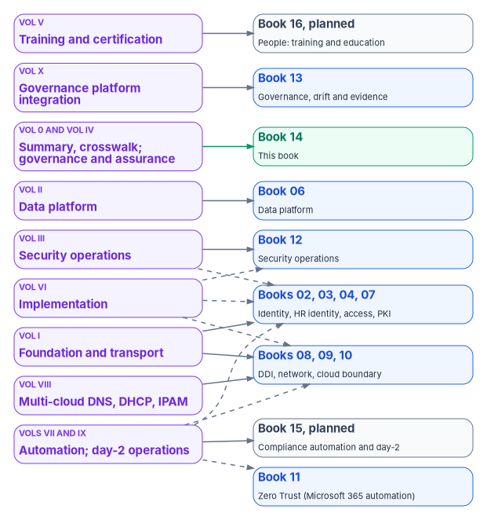
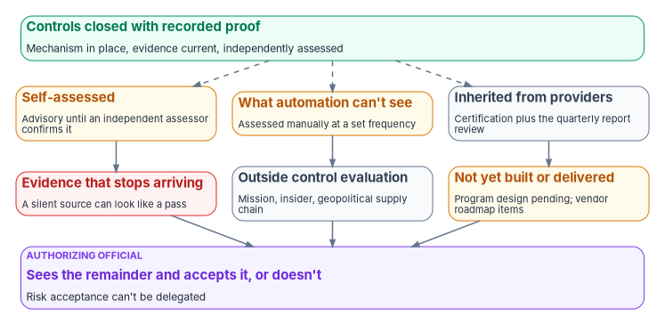

# Chapter 12 — The Series as a Map: Which Volume and Book Closes Each Control

*The compliance series and the workbook books are two views of one program; the map tells a reader where each control is closed, where its proof is built, and what will still be open when everything on the map is done.*

::: {.callout-note}
## In this chapter
How the Federal Compliance series is organized, and why its volumes and the workbook's books don't line up one to one. A volume-by-volume map: what each volume covers, which book carries it now, which control families it claims closure for, and where the full volume still lives. What an agency's first assessment can be expected to find before the program. And the residual compliance risk that remains even when every volume on the map is built, which only the authorizing official can accept.
:::

The Federal Compliance series grew as eleven volumes written for one purpose: to show, control by control, how a moderate-impact agency estate closes the NIST SP 800-53 controls in its baseline and proves it. The workbook books reorganize the same material by topic. A reader who starts from a control, a volume or a book needs to know where the other two are. This chapter is that map.

The two organizations differ for a reason. The series is arranged by layer: the naming and identity floor, then the data tier, then security operations, then the governance artifacts, then the volumes that teach, deploy, automate and operate it. The books are arranged by the question a reader brings: why does identity matter, why does DNS matter, why does compliance decay. Most volumes therefore feed more than one book, and most books draw on more than one volume. Where a book has absorbed a volume's argument, the book is the place to read it. Where a volume's depth (its runbooks, scripts and long control tables) didn't fit a book, the volume stays in the repository, and this chapter links it there.

## How to read the map

{#fig-ch12-series-map fig-alt="Nine violet volume cards on the left, each with arrows to the book cards on the right that carry it; solid arrows mark the main home and dashed arrows a partial one. Volume I, foundation and transport, points to Books 02, 03, 04 and 07 and to Books 08, 09 and 10. Volume VIII, multi-cloud DNS, DHCP and IPAM, points to Books 08, 09 and 10. Volume II, data platform, points to Book 06. Volume III, security operations, points to Book 12 and, dashed, to the identity and access books. Volumes 0 and IV, the summary and crosswalk and governance and assurance, point to Book 14, this book, shown in green. Volume X, governance platform integration, points to Book 13. Volume VI, implementation, points dashed to the identity and access books, the network and boundary books and Book 12. Volumes VII and IX, automation and day-2 operations, point to Book 15, planned, and dashed to Book 11, the identity and access books and the network and boundary books. Volume V, training and certification, points to Book 16, planned. Published books are blue and planned books slate."}

Three conventions apply to everything below.

- **"Closes" means the series' claim, under this book's rule.** A volume claims a control closed when it specifies the mechanism that closes it and the evidence that proves it. Under [Chapter 04](04-closure-with-proof.md)'s rule, a control closes only when the mechanism exists in the estate and its proof is recorded. The map shows where each claim is made, not that the agency has met it.
- **Families, not counts.** The volumes carried their own control counts, which were internal and dated. The map lists the control families each volume works in, with representative controls. The per-control index is [Appendix A](appendix-a-control-crosswalk.md).
- **Two volumes are this book.** The executive summary, questionnaire and crosswalk volume, and the governance and assurance volume, are this book's sources. Their content is in Chapters 01 to 11 and the appendices; they aren't linked separately.

## The map, volume by volume

| Volume | What it covers | Carried now by | Control families it claims closure for |
|---|---|---|---|
| Executive summary, questionnaire and crosswalk | The program's thesis, the federal clock, the closure rule, the product inventory questionnaire and the control crosswalk | This book: Chapters [01](01-proof-not-a-promise.md)–[04](04-closure-with-proof.md), [Appendix A](appendix-a-control-crosswalk.md), [Appendix B](appendix-b-product-inventory-questionnaire.md) | None directly; it indexes the rest |
| I. Foundation and transport | Naming and addressing, device and cryptographic identity, the HR source of truth, cloud identity and Zero Trust network access, telecommunications and edge enforcement | Books [02](../b02-identity/index.md), [03](../b03-hr-identity/index.md), [04](../b04-access/index.md), [07](../b07-pki/index.md), [08](../b08-ddi/index.md), [09](../b09-network/index.md), [10](../b10-cloud-boundary/index.md) | SC (SC-7, SC-8, SC-12, SC-17, SC-20 to SC-22), IA (IA-2 to IA-5, IA-9), AC (AC-2 to AC-4, AC-17, AC-19), CM (CM-2, CM-6, CM-8), AU (AU-2, AU-12), PS (PS-4, PS-5), SI (SI-3, SI-4, SI-12), with SA-9, PL-8 and CA-7 |
| II. Data platform | Database authentication without stored credentials, the implementation runbooks, and consolidation limits set by network physics | Book [06](../b06-data-platform/index.md) | IA and AC extended to the database tier; SC-5, SC-8, SC-28; AU-9; CP-9, CP-10; CA-3; SA-8 |
| III. Security operations | Privileged access, vulnerability and patch management, cloud-native posture, data protection, detection, and the multi-cloud evidence fabric | Book [12](../b12-security-operations/index.md); privileged access in Book [04](../b04-access/index.md) | AC-5, AC-6 and enhancements, AC-11, AC-12, IA-11; RA-5, SI-2, SI-5, CM-7; MP-2 to MP-5, SC-12, SC-13, SC-28, AU-10; AU-6 to AU-8, AU-11, SI-4, IR-4, IR-6, IR-8 |
| IV. Governance and assurance | Contingency, supply chain, program management, privacy, training, and the authorization package | This book: Chapters [05](05-program-management-controls.md)–[11](11-the-authorization-package.md) | CP, SR, PM, PT, AT; CA-2, CA-5, CA-6, CA-7; RA-3 |
| V. Training and certification | The academy: a compliance track and an implementation track over the same material, rubrics, certification and labs | Planned Book 16, People: Training & Education ([book list](../index.md)); the training controls are [Chapter 09](09-training-and-awareness-controls.md) | No new closures; it produces the training evidence AT-2 and AT-3 rely on |
| VI. Implementation | The architecture as code: landing zone and network, identity and access, detection, response, data protection, baselines, the evidence pipeline and test harnesses | Book [10](../b10-cloud-boundary/index.md) (landing zone as code), Book [04](../b04-access/index.md) (access as code), Book [12](../b12-security-operations/index.md) (detection, response, data protection, baselines, evidence pipeline) | No new closures; it deploys the mechanisms the architecture volumes claim (CM-2, CM-3, CM-6, CM-7, AC, IA, AU-6, SI-4, IR-4, CA-5, CA-7) |
| VII. Automation | The coordination layer: drift routed to an owner, change gated by approval, evidence rolled into the package, across Microsoft 365, Azure, AWS and VMware | [Book 15, Compliance Automation & Day-2 Operations](../b15-day2-operations/index.md); Microsoft 365 automation in Book [11](../b11-zero-trust/index.md); attestation and native access governance in Book [04](../b04-access/index.md) | No new closures; it operates CM-3, CM-6, CM-8, AC-2, AC-6, RA-5, SI-2, CA-2, CA-5, CA-7 |
| VIII. Multi-cloud DNS, DHCP and IPAM | The naming plane built cloud by cloud, with a governed front door for change | Book [08](../b08-ddi/index.md) | SC-20, SC-22, CM-8, CM-3, AU-2, and CM-5 for separation of duties over naming changes |
| IX. Day-2 operations | The governed catalog: help desk requests, the landing zone front door, application registration, telephony, SaaS integration and identity governance | [Book 15](../b15-day2-operations/index.md); front door in Book [10](../b10-cloud-boundary/index.md); application registration and identity governance in Book [04](../b04-access/index.md) | No new closures; it re-expresses AC-2, AC-5, AC-6, IA-4, IA-5, CM-2, CM-3, CM-8, SA-9, CA-3, AU-2 as governed requests |
| X. Governance platform integration | How the series' evidence lands on a governance platform, and why that binding is optional | Book [13](../b13-governance/index.md) | No new closures; it routes and explains |

Book 17, AI Identity Governance, is planned ([book list](../index.md)) and has no volume behind it; its material is new.

### Where the full volumes still are

The volumes outside this book stay in the repository. Each of the following is a complete document with its own control tables, runbooks and scripts, written before the books were built; where a book and a volume disagree, the book is the later, footnoted text.

| Volume | Files |
|---|---|
| I. Foundation and transport | [Overview](https://github.com/WhalerMike/modernization-workbook/blob/main/docs/compliance/Vol_I_Book_00_Foundation_Transport_Overview.md) · [Landing zone, IPAM and FedRAMP](https://github.com/WhalerMike/modernization-workbook/blob/main/docs/compliance/Vol_I_Book_01_Cloud_Landing_Zone_IPAM_FedRAMP.md) · [Network access control (802.1X)](https://github.com/WhalerMike/modernization-workbook/blob/main/docs/compliance/Vol_I_Book_02_Network_Access_Control_802_1X.md) · [Certificates, tokens and cryptographic identity](https://github.com/WhalerMike/modernization-workbook/blob/main/docs/compliance/Vol_I_Book_03_Certificates_Tokens_Cryptographic_Identity.md) · [HR identity and organizational source of truth](https://github.com/WhalerMike/modernization-workbook/blob/main/docs/compliance/Vol_I_Book_04_HRIT_Identity_Org_SSOT.md) · [Network modernization](https://github.com/WhalerMike/modernization-workbook/blob/main/docs/compliance/Vol_I_Book_05_Network_Modernization.md) · [Telecommunications modernization](https://github.com/WhalerMike/modernization-workbook/blob/main/docs/compliance/Vol_I_Book_06_Federal_Telecommunications_Modernization.md) · [Network enforcement](https://github.com/WhalerMike/modernization-workbook/blob/main/docs/compliance/Vol_I_Book_07_Network_Enforcement_Substrate.md) |
| II. Data platform | [Overview](https://github.com/WhalerMike/modernization-workbook/blob/main/docs/compliance/Vol_II_Book_00_Data_Platform_Overview.md) · [SQL Server authentication modernization](https://github.com/WhalerMike/modernization-workbook/blob/main/docs/compliance/Vol_II_Book_01_SQL_Server_Authentication_Modernization.md) · [SQL Server implementation guide](https://github.com/WhalerMike/modernization-workbook/blob/main/docs/compliance/Vol_II_Book_02_SQL_Server_Implementation_Guide.md) · [Database consolidation and network physics](https://github.com/WhalerMike/modernization-workbook/blob/main/docs/compliance/Vol_II_Book_03_Database_Consolidation_Network_Physics.md) |
| III. Security operations | [Overview](https://github.com/WhalerMike/modernization-workbook/blob/main/docs/compliance/Vol_III_Book_00_Security_Operations_Overview.md) · [Privileged access](https://github.com/WhalerMike/modernization-workbook/blob/main/docs/compliance/Vol_III_Book_01_Privileged_Access_Management.md) · [Vulnerability management](https://github.com/WhalerMike/modernization-workbook/blob/main/docs/compliance/Vol_III_Book_02_Vulnerability_Management.md) · [Patch and systems management](https://github.com/WhalerMike/modernization-workbook/blob/main/docs/compliance/Vol_III_Book_03_Patch_Systems_Management.md) · [Cloud-native posture](https://github.com/WhalerMike/modernization-workbook/blob/main/docs/compliance/Vol_III_Book_04_Cloud_Native_Posture.md) · [Data protection](https://github.com/WhalerMike/modernization-workbook/blob/main/docs/compliance/Vol_III_Book_05_Data_Protection_Purview.md) · [SIEM and XDR detection](https://github.com/WhalerMike/modernization-workbook/blob/main/docs/compliance/Vol_III_Book_06_SIEM_XDR_Detection.md) · [Multi-cloud evidence fabric](https://github.com/WhalerMike/modernization-workbook/blob/main/docs/compliance/Vol_III_Book_07_Multi_Cloud_Evidence_Fabric.md) |
| V. Training and certification | [Overview](https://github.com/WhalerMike/modernization-workbook/blob/main/docs/compliance/Vol_V_Book_00_Training_Certification_Overview.md) · [Compliance track](https://github.com/WhalerMike/modernization-workbook/blob/main/docs/compliance/Vol_V_Book_01_Compliance_Track.md) · [Implementation track](https://github.com/WhalerMike/modernization-workbook/blob/main/docs/compliance/Vol_V_Book_02_Implementation_Track.md) · [Assessment and certification](https://github.com/WhalerMike/modernization-workbook/blob/main/docs/compliance/Vol_V_Book_03_Assessment_Certification.md) · [Vendor training and labs](https://github.com/WhalerMike/modernization-workbook/blob/main/docs/compliance/Vol_V_Book_04_Vendor_Training_Lab_Environments.md) |
| VI. Implementation | [Overview](../b15-day2-operations/02-day-two-is-where-compliance-lives.md) · [Landing zone and network as code](https://github.com/WhalerMike/modernization-workbook/blob/main/docs/compliance/Vol_VI_Book_01_Landing_Zone_Network_as_Code.md) · [Identity and access as code](https://github.com/WhalerMike/modernization-workbook/blob/main/docs/compliance/Vol_VI_Book_02_Identity_Access_as_Code.md) · [Detection engineering](https://github.com/WhalerMike/modernization-workbook/blob/main/docs/compliance/Vol_VI_Book_03_Detection_Engineering.md) · [Response automation](https://github.com/WhalerMike/modernization-workbook/blob/main/docs/compliance/Vol_VI_Book_04_Response_Automation_SOAR.md) · [Data protection deployment](https://github.com/WhalerMike/modernization-workbook/blob/main/docs/compliance/Vol_VI_Book_05_Data_Protection_Deployment.md) · [Configuration baselines](https://github.com/WhalerMike/modernization-workbook/blob/main/docs/compliance/Vol_VI_Book_06_Configuration_Baselines_Hardening.md) · [Evidence and continuous monitoring pipeline](../b15-day2-operations/11-attestation-and-the-compliance-app.md) · [Validation and test harnesses](../b15-day2-operations/12-the-day-two-runbook.md) |
| VII. Automation | [Overview](../b15-day2-operations/02-day-two-is-where-compliance-lives.md) · [CMDB reconciliation](../b15-day2-operations/07-the-cmdb-and-asset-identity.md) · [Microsoft 365 automation](../b15-day2-operations/08-control-automation-m365-and-azure.md) · [Azure automation](../b15-day2-operations/08-control-automation-m365-and-azure.md) · [Control attestation and evidence](../b15-day2-operations/11-attestation-and-the-compliance-app.md) · [The compliance app](../b15-day2-operations/11-attestation-and-the-compliance-app.md) · [AWS automation](../b15-day2-operations/09-control-automation-aws-and-vmware.md) · [VMware automation](../b15-day2-operations/09-control-automation-aws-and-vmware.md) · [Native access governance](https://github.com/WhalerMike/modernization-workbook/blob/main/docs/compliance/Vol_VII_Book_08_Native_IAM_RBAC_Access_Governance.md) |
| VIII. Multi-cloud DNS, DHCP and IPAM | [Overview and kit](https://github.com/WhalerMike/modernization-workbook/blob/main/docs/compliance/Vol_VIII_Book_00_DDI_Automation_Overview.md) |
| IX. Day-2 operations | [Overview](../b15-day2-operations/01-the-help-desk-decides.md) · [Help desk catalog](../b15-day2-operations/05-the-service-catalogs.md) · [Landing zone front door](https://github.com/WhalerMike/modernization-workbook/blob/main/docs/compliance/Vol_IX_Book_02_Landing_Zone_Front_Door.md) · [Application registration](https://github.com/WhalerMike/modernization-workbook/blob/main/docs/compliance/Vol_IX_Book_03_App_Registration_Governance.md) · [Telephony catalog](../b15-day2-operations/05-the-service-catalogs.md) · [SaaS integration](../b15-day2-operations/06-saas-integration-governance.md) · [Identity and access governance](https://github.com/WhalerMike/modernization-workbook/blob/main/docs/compliance/Vol_IX_Book_06_Identity_Access_Governance.md) |
| X. Governance platform integration | [Overview](https://github.com/WhalerMike/modernization-workbook/blob/main/docs/compliance/Vol_X_Book_00_Governance_Substrate_Integration_Overview.md) |

The repository volumes predate the re-verification the books went through, and some of their dates and directive descriptions are stale. Two examples matter for compliance. They describe the agency's evidence as feeding "the FedRAMP 20x KSI pipeline," but FedRAMP's 2026 Key Security Indicators bind cloud providers, not agencies ([Book 13, Chapter 11](../b13-governance/11-reciprocity-and-one-authorization.md#the-2026-key-security-indicators)). And some describe BOD 26-04 as an SBOM directive, which it isn't ([Chapter 11](11-the-authorization-package.md#a-correction-the-source-got-wrong)). Read a volume for its depth; check its federal facts against the book that carries it.

## What the volumes depend on

The order a reader meets the volumes isn't the order the estate needs them. The series makes two dependency claims, both the program's design, that explain most of the map.

**The naming and identity floor comes first.** The foundation volume's argument is that "you cannot inventory what you cannot name, authorize what you cannot identify," and that without that floor the controls claimed in later volumes don't degrade, they become impossible to evaluate. Authoritative asset identity from the naming plane is the join key the evidence contract runs on ([Book 12, Chapter 02](../b12-security-operations/02-the-evidence-contract.md)); the HR source of truth is what every account decision asserts ([Book 03](../b03-hr-identity/index.md)). The multi-cloud naming volume is read last only because it is the deepest implementation detail; in dependency order it sits near the root ([Book 08](../b08-ddi/index.md)).

**Assurance comes last, and depends on everything.** The governance and assurance volume, this book, turns technical evidence into an authorization. Its recurring point is that a well-configured control that can't produce a signed, tested, machine-readable artifact is, from the assessor's chair, an open finding. The package in [Chapter 11](11-the-authorization-package.md) can only report what the earlier volumes made observable.

The build-and-run volumes sit across the others. Implementation deploys what the architecture volumes specify, automation operates it, day-2 operations governs the routine changes that otherwise erode it, and training makes people able to do all three. The series is explicit that these four volumes mostly re-express controls the architecture already closes rather than closing new ones; their necessity is that a closure nobody deploys, operates or evidences isn't assessable.

## What the first assessment will find

Before the program, the series expected an assessor to document a recognizable set of findings at a moderate-impact agency still running a perimeter-era estate. These are the program's expectations from its own analysis, not a published audit list, and an agency's own assessment will differ. They are worth knowing because each points at the book that closes it.

| Expected finding | The condition behind it | Closed in |
|---|---|---|
| CM-8: component inventory incomplete | Inventory assembled per environment, by hand or by periodic scan; new workloads missed until the next scan | Book [08](../b08-ddi/index.md); Book [12, Chapter 02](../b12-security-operations/02-the-evidence-contract.md) |
| SC-20, SC-21: secure name resolution incomplete | Internal zones unsigned; no consistent validation across environments | Book [08](../b08-ddi/index.md) |
| SC-7: no DNS-layer boundary control | Command-and-control and exfiltration domains resolvable through the standard resolver | Book [08](../b08-ddi/index.md) |
| AU-2, AU-12: naming and addressing events not in the SIEM | DNS and DHCP logs per environment, in different formats, or not collected | Books [08](../b08-ddi/index.md) and [12](../b12-security-operations/index.md) |
| IA-9, SC-8: certificate-to-host binding undocumented | Workload certificates issued by hand and not tied to the inventory | Book [07](../b07-pki/index.md) |
| SC-8: no network-layer encryption on direct internet circuits | Confidentiality depends on each application negotiating TLS | Book [09](../b09-network/index.md) |
| AC-4, SC-7, SI-3: no application-layer inspection on direct internet paths | Traffic controlled by address and port only | Book [09](../b09-network/index.md) |
| AU-12: session records incomplete | Flow logs without user, device, application or action | Book [09](../b09-network/index.md) |
| IA-2: legacy authentication events hard to attribute | NTLM fallback that doesn't produce attributable, queryable sign-in records | Books [02](../b02-identity/index.md) and [06](../b06-data-platform/index.md) |
| IA-5, CM-8: database credentials and estate undocumented | Stored SQL logins, no central rotation, instances not fully enumerated | Book [06](../b06-data-platform/index.md) |

The source added that under FedRAMP's 2026 rules an open finding would no longer carry a remediation deadline but a continuous-evidence requirement. That is wrong for an agency. FedRAMP's rules bind providers; the agency's plan of action and milestones is governed by CA-5, with milestones and scheduled completion dates, and its remediation clocks for known exploited vulnerabilities come from BOD 26-04 ([Chapter 11](11-the-authorization-package.md#the-plan-of-action-and-milestones); [Book 12, Chapter 06](../b12-security-operations/06-vulnerability-management.md)). What is true is that continuous evidence is how the agency shows a finding stayed closed.

## The residual risk after the whole program

Build every volume on the map and the agency still carries risk. The series is candid about this, and so is this book. The authorizing official needs to see the remainder, because they are the only person who can accept it: SP 800-37 says the explicit acceptance of risk "cannot be delegated."[^c12-sp80037]

{#fig-ch12-residual-risk fig-alt="At the top, a green card: controls closed with recorded proof, mechanism in place and evidence current. Below it, six cards in two rows of three describe what remains. Amber: self-assessed until independently assessed. Amber: what automation can't see, assessed manually at a set frequency. Slate: inherited from providers, through their certification and quarterly reports. Red: evidence that stops arriving, a silent source looks like a pass. Slate: risks outside control evaluation, such as mission, insider and geopolitical supply chain risk. Amber: design not yet built and vendor features not yet delivered. All six lead to a violet card at the bottom: the authorizing official sees the remainder and accepts it, or doesn't; acceptance can't be delegated."}

The remainder falls into six kinds.

1. **Self-assessment until it is independently assessed.** The program's automated verdicts are the system's own team grading its own work. CA-2(1) and CA-7(1), both in the NIST Moderate baseline, ask for independent assessors.[^c12-sp80053] Until an independent assessment confirms them, every verdict is advisory, however reproducible ([Chapter 11](11-the-authorization-package.md#the-assessment-plan-and-the-test-plans)).
2. **What automation can't see.** SP 800-37 notes that automated tools may "not generate information for every control or every part of a control," and that manual assessments then fill the gaps at frequencies the organization sets.[^c12-sp80037] Policies, plans, training effectiveness and physical protections are in this category. The program's coverage report separates proven claims from asserted ones so the gap is visible ([Book 13, Chapter 12](../b13-governance/12-governance-at-scale.md#the-honest-limits-of-coverage)).
3. **Risk inherited from providers.** Where the system runs on a certified cloud service, controls such as physical and environmental protection are the provider's, and the agency's assurance is the provider's certification plus the agency's review of each quarterly report. FedRAMP requires agencies to review each Ongoing Certification Report and to notify FedRAMP when one raises a concern serious enough that the authorizing official would likely rescind the authorization.[^c12-fr-ccm][^c12-fr-agu] Where a cloud capability the design assumed isn't in the authorized boundary, the gap is the agency's ([Book 10](../b10-cloud-boundary/index.md)). On premises, the agency owns the physical controls itself.
4. **Evidence that stops arriving.** A mechanism that emits nothing is invisible, and the package reflects only the evidence present ([Book 12, Chapter 12](../b12-security-operations/12-evidence-metrics-and-continuous-monitoring.md#the-continuous-monitoring-pipeline)). The program treats a silent required source as a monitoring failure, not a pass, but a source nobody knew to require is still a blind spot.
5. **Risks outside control evaluation.** The source volume named four: mission risk from a system's failure; insider threat, which needs HR and behavioral programs as well as technical controls; physical security; and supply chain risk beyond what a software inventory can show, such as a supplier's ownership or location. A satisfied control set doesn't measure any of them. The agency's risk management strategy and its supply chain program ([Chapter 07](07-supply-chain-risk-management.md)) do.
6. **Design not yet built, and vendor features not yet delivered.** Parts of the program are designed but not built: governance across agencies' own estates, and generating complete OSCAL security plans for every consuming agency of a shared service ([Book 13, Chapter 11](../b13-governance/11-reciprocity-and-one-authorization.md#what-is-design-and-what-is-requirement)). And a vendor roadmap is not a commitment: a control that depends on a feature the vendor has announced but not shipped in the authorized boundary is open until the feature is there ([Chapter 04](04-closure-with-proof.md)).

Two more belong to the people rather than the technology. The program's own rule set covers only part of FedRAMP's indicator surface, so a clean run against it is a statement about the rule set, not about full coverage. And every mechanism on the map depends on people who can build, run and evidence it; that is the subject of the planned Book 16 ([book list](../index.md)), and of [Chapter 09](09-training-and-awareness-controls.md) for the controls.

None of this argues against the program. It argues for writing the remainder down. A package that lists what is proven, what is asserted, what is inherited and what is accepted gives the authorizing official a risk they can see. A package that reports a single green score hides the same risk and makes it theirs anyway.

## What changes, in one table

| Old habit | What replaces it |
|---|---|
| Eleven volumes read front to back | A map from each control and volume to the book that carries it now |
| A volume's control count stands for coverage | Families per volume, with the per-control index in Appendix A and closure judged by Chapter 04's rule |
| The volumes are the current word on federal facts | The books are; the volumes keep their depth but some of their dates and directive descriptions are stale |
| Volumes read in reading order | The naming and identity floor first; assurance last; build-and-run across all of them |
| A clean self-assessment means the risk is gone | Six kinds of residual risk remain, written down for the authorizing official to accept or not |

::: {.callout-tip}
## Continue the book
[← Previous: Chapter 11 — The Authorization Package and Continuous Monitoring](11-the-authorization-package.md) · [Book index](index.md) · [Next: Appendix A — Control Crosswalk →](appendix-a-control-crosswalk.md)
:::

[^c12-sp80037]: National Institute of Standards and Technology, SP 800-37 Rev. 2, *Risk Management Framework for Information Systems and Organizations: A System Life Cycle Approach for Security and Privacy*, December 2018, Task R-4 (risk acceptance can't be delegated) and Appendix F (ongoing authorization, limits of automated tools), <https://nvlpubs.nist.gov/nistpubs/SpecialPublications/NIST.SP.800-37r2.pdf> (accessed Oct 21, 2026).
[^c12-sp80053]: National Institute of Standards and Technology, SP 800-53 Rev. 5, controls CA-2(1) and CA-7(1), read from the release 5.2.0 OSCAL catalog, <https://github.com/usnistgov/oscal-content/blob/main/nist.gov/SP800-53/rev5/json/NIST_SP-800-53_rev5_catalog.json>; baseline membership from the release 5.2.0 SP 800-53B Moderate baseline profile, <https://github.com/usnistgov/oscal-content/blob/main/nist.gov/SP800-53/rev5/json/NIST_SP-800-53_rev5_MODERATE-baseline_profile.json> (both accessed Oct 21, 2026).
[^c12-fr-ccm]: FedRAMP, "Collaborative Continuous Monitoring," *FedRAMP Consolidated Rules for 2026*, rules CCM-AGM-ROR and CCM-OCR-AVL, <https://www.fedramp.gov/2026/reference/collaborative-continuous-monitoring/> (accessed Oct 21, 2026).
[^c12-fr-agu]: FedRAMP, "Agency Use" rules, *FedRAMP Consolidated Rules for 2026*, rule AGU-USE-NFC (Notify FedRAMP of Monitoring Concerns), <https://www.fedramp.gov/2026/agencies/rules/agency-use/> (accessed Oct 21, 2026).
