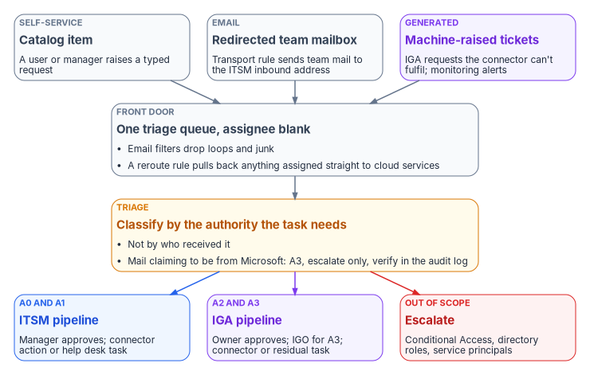
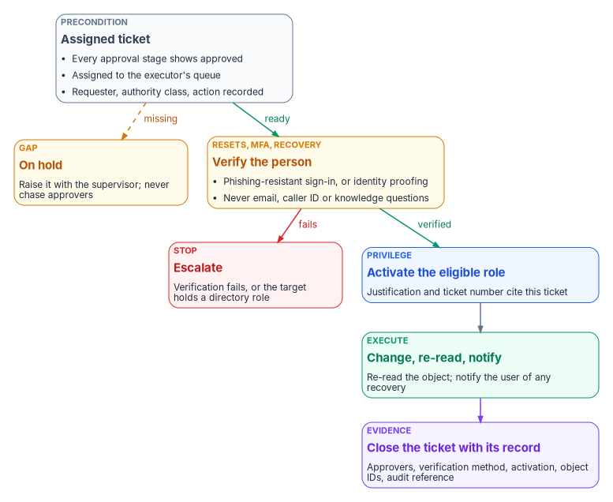

# Chapter 03 — Intake, Triage and Routing

*A help desk that decides what to do from whoever happened to email it has no authority model at all; one that triages every request by the authority it needs can show, for any change, who asked, who approved, who acted and what proves it.*

::: {.callout-note}
## In this chapter
How requests come in and how every source is funneled into one triage queue. How triage classifies a request by the authority the task needs, and how that class routes it to the ITSM pipeline, the identity-governance pipeline or escalation. Who executes and who approves, what the executor checks before acting, and how the person is verified before a password reset, an MFA reset or an account recovery. Then the evidence each ticket must leave, and how a new request type is described and wired in.
:::

[Book 04, Chapter 06](../b04-access/06-who-decides-access.md#the-help-desk-and-cloud-services-authority-split) settled who decides access and set out the authority split: A0 to A3, plus out of scope. That chapter is the governance half. This one is the operations half, the day-two mechanics that make the split real. It covers how a request actually arrives, who looks at it first, how it reaches the right approver, what the help desk technician checks before touching the tenant, and what is left behind when the ticket closes.

These mechanics are where modernization is tested ([Chapter 01](01-the-help-desk-decides.md)). An estate with a clean role model and a well-built governance platform still reverts if the cloud services team keeps answering email, if a manager's "please just do it" counts as approval, or if a caller who sounds right gets an MFA reset. The rules below are the program's design unless a footnote says otherwise. The platforms named are the ones the program's sources describe: ServiceNow as the ITSM platform, an identity governance and administration (IGA) platform for access decisions, and Microsoft Entra ID as the place the change lands. None is endorsed, and Microsoft Entra ID Governance can fill the IGA role ([Book 04, Chapter 09](../b04-access/09-access-governance.md)).

{#fig-ch03-one-front-door fig-alt="A top-to-bottom flow. Three source cards sit in a row at the top: a slate card for self-service catalog items, a slate card for the redirected team mailbox, where a transport rule sends team mail to the ITSM inbound address, and a violet card for machine-raised tickets, meaning IGA requests the connector can't fulfil and monitoring alerts. All three lead into a wide slate front-door card: one triage queue with the assignee blank, where email filters drop loops and junk and a reroute rule pulls back anything assigned straight to cloud services. That leads to a wide amber triage card: classify by the authority the task needs, not by who received it; mail claiming to be from Microsoft is A3, escalate only, verified in the audit log. Triage branches three ways: a blue card for A0 and A1, the ITSM pipeline, where a manager approves and a connector action or help desk task executes; a violet card for A2 and A3, the IGA pipeline, where the owner approves, the IGO approves A3, and a connector or residual task executes; and a red card for out of scope, escalate, covering Conditional Access, directory roles and service principals."}

## One front door

The program's operating rule is that nothing is handled as ad hoc email to the cloud services team. Every request is triaged inside the ITSM platform first and then routed by the authority the task requires. Cloud services is the escalation tier above the help desk, for work the help desk and automation can't do. It isn't a second intake queue.

Work arrives from four kinds of source, and the design gives each one the same destination.

| Source | Example | How it reaches the queue |
|---|---|---|
| Self-service | A user reports a OneDrive sync failure; a manager requests a license | Catalog item in the ITSM portal, auto-assigned to triage |
| Email | A user writes to the cloud services mailbox | Mail-flow rule to the ITSM inbound address; inbound email processing creates the record |
| The IGA platform | Approved access the IGA connector can't provision; a certification revocation; a provisioning or license failure | The IGA platform's ITSM integration raises a request item and task |
| Monitoring | Repeated sign-in failures to one application from one user or group | An alert rule fires a webhook that opens an incident |

A fifth source, notifications that appear to come from Microsoft, arrives by email but is treated differently at triage, as the next section explains.

### Redirecting the mailbox

The first mechanism moves the team mailbox's traffic into the ITSM platform. In Exchange Online this is a mail-flow (transport) rule whose condition is the recipient and whose action sends the message to the address tied to the ServiceNow email account. The choice of action matters. `BlindCopyTo` adds a recipient in the Bcc field, so the original mailbox still receives the message and people can keep working from it; `RedirectMessageTo` redirects the message to the specified recipients instead.[^c03-exo-rule] A single front door needs the redirect. A copy leaves two queues.

A transport rule also has a mode. In `Audit` mode, the actions the rule would have taken are written to the message tracking log and nothing that affects delivery happens; `Enforce`, the default, takes every action.[^c03-exo-rule] That gives a safe pilot: run the rule in audit mode, compare what it would have redirected with what the team actually received, and only then enforce it.

::: {.callout-warning}
## Illustrative, not tested against a production tenant
The commands below are examples for review and adaptation. They haven't been validated against a live tenant. Run the read-only command first, create the rule in audit mode, and pilot it with the mailbox owner before enforcing it. A transport rule changes mail flow for everyone who writes to the address.
:::

```powershell
# Read-only: list existing mail-flow rules that already mention the mailbox.
Get-TransportRule | Where-Object { $_.SentTo -match 'cloud-services' } |
    Format-List Name, State, Mode, SentTo, BlindCopyTo, RedirectMessageTo

# Illustrative: redirect intake to the ServiceNow inbound address, audit mode first.
# CONFIGURE both addresses before use.
New-TransportRule -Name 'Route cloud services intake to ITSM' `
    -SentTo 'cloud-services@agency.gov' `
    -RedirectMessageTo 'itsm-inbound@agency.gov' `
    -Mode Audit
```

On the ServiceNow side, each incoming email is classified as a forward, a reply or new, and inbound email actions use conditions and scripts to create or update records much as business rules do. By default an email without a recognizable watermark creates an incident, and one carrying an existing record's watermark updates that record. Inbound email flows built with Flow Designer triggers take priority over inbound email actions, so an instance that has both must decide which one owns the triage mailbox.[^c03-sn-inbound] The program's configuration sends new mail to a triage record with the assignee left blank, so nobody owns it until triage assigns it.

Email filters run before any of this. A filter either marks a message ignored, in which case it is saved but not processed, or moves it to a mailbox such as Junk; the defaults skip calendar responses and move mail whose sender equals the instance's own address to Junk, which is what stops mail loops.[^c03-sn-filters]

The last piece is a reroute rule, a ServiceNow business rule that catches any ticket assigned directly to cloud services without passing triage and sends it back. Without it, the old habit of addressing work to the team that will "just do it" survives the redirect.

| Artifact | Where it lives | Purpose |
|---|---|---|
| Mail-flow rule | Exchange Online | Redirect the team mailbox to the ITSM inbound address |
| Email account | ITSM platform | Connect the inbound mailbox |
| Email filters | ITSM platform | Drop loops and junk before processing |
| Inbound email action or flow | ITSM platform | Create the triage record, assignee blank |
| Reroute business rule | ITSM platform | Pull tickets assigned straight to cloud services back to triage |
| Triage classifier | ITSM flow or a script | Set the authority class |
| Approval subflows | ITSM flows | Manager, owner or IGO approval, with a due date |
| Connector actions | ITSM integration platform | Execute covered tasks without a person at a console |

## Triage by required authority

Triage asks one question: what authority does this task need? Who received the request, how urgent the requester says it is, and how senior they are don't change the answer. The classes are the ones [Book 04, Chapter 06](../b04-access/06-who-decides-access.md#the-help-desk-and-cloud-services-authority-split) defines, summarized here with the triage test that puts a request in each.

| Class | The triage test | Pipeline |
|---|---|---|
| A0 | No access change: a cloud-only password reset after verification, a sign-in or audit log lookup, a client-side fix | ITSM |
| A1 | Changes to the requester's own account or entitlements: an MFA method reset, a license, a profile attribute | ITSM; the service desk supervisor or the requester's manager approves |
| A2 | Access governed by an owner: application access, group creation and ownership, a certification revocation, a joiner or leaver | IGA; the application owner approves |
| A3 | Governance actions: admin consent, an ImmutableID hard-match repair, anything arriving as a Microsoft notification | IGA; the application owner and the IGO approve; never automated |
| Out of scope | Conditional Access, directory roles, service principals and app registrations | Escalated to security or identity engineering |

The program's triage checks run in a fixed order, because the first match wins and the early checks catch the dangerous cases.

1. **Does the message claim to come from Microsoft?** Force it to A3, escalate only.
2. **Does the target hold a directory role, or is the task on the out-of-scope list?** Escalate. A help desk role that can reset a non-administrator can't safely reset an administrator, and [Chapter 04](04-help-desk-authority-in-entra.md) shows which Entra roles can act on whom.
3. **Is it a governance action?** A3.
4. **Does it change who can reach what?** A2.
5. **Does it change only the requester's own account?** A1.
6. **Otherwise** A0.

### Notifications that claim to come from Microsoft

Microsoft sends real administrative email: consent requests, risk alerts, Privileged Identity Management (PIM) notices, service health. The trouble is that attackers send look-alikes, and a technician with an elevated role who follows a "Review permissions" link can execute a consent grant. The program's rule is that nothing is approved, denied or changed on the strength of an email.

The source guidance told technicians to confirm the sender is exactly `MSSecurity-noreply@microsoft.com`. That is the documented sender for PIM notifications,[^c03-pim-email] but it isn't the only one. Microsoft's operations guide names `azure-noreply@microsoft.com` for access reviews, Connect Health, ID Protection and application certificate and provisioning notices,[^c03-ops-notify] and self-service password reset notices come from yet other addresses, with separate ones for Azure for US Government.[^c03-sspr-notify] A sender check is a quick way to spot an obvious fake, not proof that a message is genuine. The check that counts is the tenant itself: open the Entra audit log, find the event the email describes, and match it to an approved ticket.

| Notification | Help desk action | Escalation |
|---|---|---|
| Admin consent request | Triage and record. Never approve from the email | Application owner, then the IGO ([Book 04, Chapter 06](../b04-access/06-who-decides-access.md#who-approves-admin-consent)) |
| Sign-in risk alert | Check the sign-in log; if compromise is likely, place the account on hold | Security operations and the help desk supervisor |
| Identity Protection detection | Record it. Don't change risk policies | Security operations or identity engineering |
| Service health | Correlate with open tickets and add a known-issue note | Help desk supervisor |
| An audit-log entry showing a consent, role assignment or access grant with no approved ticket behind it | Record and escalate immediately. Don't remediate without direction | The IGO and the security operations center |

[Book 04, Chapter 06](../b04-access/06-who-decides-access.md#the-help-desk-and-cloud-services-authority-split) sets the clocks for this lane: verify within four business hours and escalate within an hour if the event can't be matched to an approved ticket.

## Routing: two pipelines and an escalation lane

The class decides the pipeline, and the pipeline decides who sees the approval.

**The ITSM pipeline (A0 and A1).** A ServiceNow flow asks the requester's manager for approval, then executes. The flow action that does this, Ask for Approval, sends a sign-off request for a record and tracks the result, and a due date on the approval stops the flow waiting forever by approving, rejecting or canceling automatically when nobody responds.[^c03-sn-approval] The program sets the due-date outcome to reject or cancel, never approve, so silence can't grant access. A0 tasks that need no approval, such as reading a sign-in log, run straight to execution.

**The IGA pipeline (A2 and A3).** The IGA platform owns the access decision and the certification. The requester submits in the IGA portal; a business approver confirms the need, the application owner confirms the role, and the IGO approves high-risk access, ImmutableID changes and all admin consent matters. On approval the IGA platform provisions through its Entra connector where the connector has write access to the target. Where it doesn't, most often for enterprise application role assignments and for ImmutableID operations, the IGA platform's ITSM integration raises a request item and a task for the residual manual step. The help desk sees nothing of this pipeline until that task arrives, and it never processes IGA portal submissions or approvals itself.

**The escalation lane (out of scope).** These tickets go to security, identity engineering or the change advisory board. The help desk records what it found and doesn't execute.

### Prefer the connector, and check what it actually covers

Execution prefers automation. Where a connector action exists, the ticket authorizes the machine and the person's role stops at approval, the shape [Book 13, Chapter 10](../b13-governance/10-ticket-to-machine.md#ticket-to-machine-not-ticket-to-human) sets as the default. For Entra ID tasks, ServiceNow ships the Microsoft Entra ID spoke, formerly the Microsoft Azure Active Directory spoke. It covers ten action categories: audit logs, group, license, application, device, organization, user authentication, service principal, password and user management. It requires an Integration Hub subscription, and it authenticates through a custom app registered in the agency's tenant that obtains OAuth 2.0 tokens for Microsoft Graph, using delegated permissions with the authorization code grant or application permissions with client credentials.[^c03-sn-spoke]

The source crosswalk mapped more tasks to the spoke than its documentation supports. Checked against ServiceNow's current spoke page, the picture is this:

| Task | Class | What the spoke documents | Execution in the program |
|---|---|---|---|
| Password reset, cloud-only user | A0 | Reset Password, for users created in Entra ID only; it doesn't reset federated users | Connector action after verification |
| Password reset, synced user | A0 | Not covered | Help desk, from the Entra admin center with password writeback, or in on-premises AD |
| Sign-in or audit log lookup | A0 | Audit log actions | Connector action, read-only |
| MFA or authentication-method reset | A1 | No action. The user authentication category lists only Revoke User SignIn Sessions | Help desk task, after verification |
| License assign or remove | A1 | Assign User License, Remove User License | Connector action |
| User enable, disable, update | A1 or A2 | Enable User, Disable User, Update User | Connector action; joiners and leavers through the lifecycle workflow ([Book 03, Chapter 08](../b03-hr-identity/08-joiner-mover-leaver.md)) |
| Group membership, group creation, owners | A1 or A2 | Add or remove user, create security group, add or remove owner | Connector action |
| Enterprise application access | A2 | Create and Delete Application Assignment; the page doesn't say whether these handle group-to-app-role assignment | Connector for group membership; help desk task for the app-role binding until a pilot proves the action |
| Device actions | A2 or out of scope | Group membership for devices only; no enable, disable or delete | Device team |
| ImmutableID hard-match repair | A3 | Not covered | Identity engineering, not the help desk: usually fixed in AD (`mS-DS-ConsistencyGuid`), after two approvals ([Chapter 04](04-help-desk-authority-in-entra.md#why-immutableid-repair-left-the-help-desk)) |
| Admin consent | A3 | Not covered | The IGO, never automated |
| Conditional Access, directory roles, service principals | Out of scope | Service principal actions exist; the program keeps them manual | Security or identity engineering |

Two corrections to the source matter for configuration. First, the source said reset, change-password and session-revocation actions can't run with application permissions. Today's documentation says Reset Password accepts the application permission `User-PasswordProfile.ReadWrite.All`, while Change Password and the user-management Revoke User SignIn Sessions action support only delegated work or school permissions.[^c03-sn-spoke] The connection type therefore decides which of those actions work. Second, an MFA reset has no spoke action, so it stays a person's task, and that makes the verification step later in this chapter the control that matters. Coverage changes between releases, so validate the crosswalk against the installed spoke.

For synced users the reset path also needs care. Microsoft documents that an administrator can reset an on-premises-mastered user's password only with password writeback turned on and the user's domain managed; federated domains aren't supported, and the reset has to happen in on-premises AD.[^c03-reset-pw] A reset made in the Entra admin center writes back for federated or password-hash-synchronized users, but one made in the Microsoft 365 admin center doesn't, which leaves the cloud and on-premises passwords out of step.[^c03-writeback] The runbook names the admin center to use.

## Who executes and who approves

The rule underneath every pipeline is that the team executes and a manager or owner approves. The help desk and cloud services have no approval authority of their own. The requester never approves, and the approver isn't the executor. SP 800-53's AC-5 asks organizations to identify the duties that must be separated and to define access authorizations that support the separation;[^c03-sp80053] the ticket flow is where the program enforces it. Entra ID enforces part of it natively, since PIM approvers can't approve their own activation requests.[^c03-pim-approve]

Approval also follows the resolution, not the symptom. A OneDrive sync ticket shows the pattern: the same ticket can need no approval or two, depending on what the fix turns out to be.

| Resolution | Approval | Approver | Executor proceeds after |
|---|---|---|---|
| Client-side fix: sign out and in, reset or reinstall the client | None | — | Ticket assigned |
| License assignment or change | Yes | Departmental owner or manager | Approval recorded; scoped role activated |
| Storage provisioning trigger | Yes | Departmental owner or manager | Approval recorded |
| MFA reset to break an authentication loop | Yes | The service desk supervisor or the requester's manager, after identity verification | Approval and verification recorded; authentication role activated |
| ImmutableID repair | Yes, two-stage | Identity engineering lead and the IGO | Both approvals recorded; the fix made in AD, or in the cloud by a role that can write `onPremisesImmutableId` (not Hybrid Identity Administrator) |
| Conditional Access exception or change | Escalate | Security administrator and the IGO, through the change advisory board | The help desk records and escalates; it doesn't execute |

When a fix turns out to need approval, the technician raises an approval task to the right approver and sets the ticket to pending approval. The ticket returns to the queue when the approver acts.

### Before acting

The executor checks three things and puts the ticket on hold if any is missing:

1. **Every approval stage shows approved.** If a stage is pending, returned or incomplete, the executor waits. The help desk doesn't contact approvers to hurry them.
2. **The task is in the executor's queue, assigned.** New, pending-approval and on-hold tickets aren't ready.
3. **The ticket carries what the action needs:** the approval chain with names and timestamps, the requester and their user principal name, the target application or object, the authority class and risk tier, and the specific action required.

A gap goes to the help desk supervisor or the IGA team, not around them. Urgency doesn't change the rule. An ad hoc fix made outside the workflow, whoever asked for it, is a policy violation the next audit will find. If a request is genuinely urgent, the supervisor invokes the emergency change process inside the ITSM platform, so even the emergency leaves a ticket.

## Verify the person before a sensitive action

Approval answers "should this be done?" It doesn't answer "is this caller the person the account belongs to?" A manager's approval of an MFA reset is worthless if the person on the phone is an attacker who has also emailed the manager. Password resets, MFA resets, Temporary Access Passes and account recovery all need the second answer, and the help desk is where attackers go to get it.

The threat is documented. CISA's advisory on the Scattered Spider group, revised in July 2025, describes actors who posed as employees to convince IT and help desk staff to reset passwords and move MFA to devices the actors controlled, and who earlier posed as IT staff to get employees to read out one-time codes. Its mitigation is phishing-resistant MFA, such as FIDO/WebAuthn or PKI-based authenticators, for all services to the extent possible.[^c03-cisa]

NIST SP 800-63B-4, final in July 2025, is the federal reference for what a sound process looks like.[^c03-sp80063b]

- **It names the risk.** Where authenticator recovery is human-assisted, social engineering attacks also pose risks. Its threat tables give the examples of an attacker masquerading as a system administrator by phone and an insider such as a customer support representative colluding with an attacker. One of the listed mitigations is to avoid authenticators that present a social engineering risk to third parties such as customer service agents.
- **It separates replacement from recovery.** Replacing a forgotten password for a user who can still authenticate with another authenticator is binding a new authenticator, not recovery, and the binding has to be done at the maximum assurance level available in the account (Sec. 4.1.2.1 and 4.2).
- **It sets what recovery may rely on** (Sec. 4.2). The methods are saved recovery codes, issued recovery codes, recovery contacts and repeated identity proofing. At AAL2 recovery requires two recovery codes obtained by different methods, or one recovery code plus a single-factor authenticator already bound to the account, or repeated identity proofing. Recovery at AAL3 for an account proofed at IAL3 adds a biometric comparison against the sample collected at enrollment.
- **It requires a notice.** In all cases, account recovery must cause a notification to the subscriber or their designee (Sec. 4.2.3), with clear instructions and contact information in case the person repudiates the event (Sec. 4.6).
- **It defines phishing resistance.** Phishing, which earlier editions called verifier impersonation, is defeated only when the authentication protocol itself keeps secrets from an impostor verifier without relying on the claimant's vigilance. That requires cryptographic authentication, and authenticators that make the user type an output, such as one-time passwords and out-of-band codes, don't qualify (Sec. 3.2.5). Federal agencies must require their staff, contractors and partners to use phishing-resistant authentication to access federal information systems, and verifiers at AAL2 must offer at least one phishing-resistant option (Sec. 2.2.2).

SP 800-53 makes the same point as a control. IA-5 asks the organization to verify the identity of the individual receiving an authenticator as part of initial distribution, and to establish and carry out procedures for lost, compromised or damaged authenticators.[^c03-sp80053] A help desk reset is that procedure.

Microsoft's guidance runs the same way. Its verified help desk pattern says personal information and knowledge-based questions are no match for attackers who use phishing, social engineering and AI voice cloning, and it describes two patterns: have users authenticate with their existing phishing-resistant credentials before the help desk acts, and, for total loss, verify the person with Microsoft Entra Verified ID and Face Check before the service desk issues a Temporary Access Pass or resets anything.[^c03-vid-helpdesk] Entra ID account recovery turns the second pattern into a product feature. A user who has lost every method is verified by a third-party identity verification provider using a government-issued document and a liveness check, presents the resulting Verified ID, is matched against their Entra profile, by first and last name unless a custom extension checks more, and receives a Temporary Access Pass to register new methods.[^c03-account-recovery] Microsoft announced it generally available in May 2026.[^c03-vid-whatsnew] It needs Entra ID P1 and a Face Check license,[^c03-ar-faq] and Verified ID has been supported in GCC, not GCC High, since September 2025.[^c03-vid-whatsnew] Confirm availability in the agency's cloud and review the identity verification provider's privacy terms with the privacy office before relying on it.

The Temporary Access Pass deserves its own care, because it is the credential a recovery hands over. Authentication Administrators can create one for members but not for administrators; Privileged Authentication Administrators can create one for administrators too. The policy sets lifetimes between 10 minutes and 30 days and can force every pass to be one-time use, and the pass's value is shown once, when it's created.[^c03-tap]

The program turns all this into a verification ladder. The ladder is a CISO decision, not a help desk one ([Book 01, Chapter 09](../b01-transformation-arc/09-who-leads-the-transformation.md#the-help-desk)), and the values below are program defaults.

| Situation | Verification the program accepts | Then |
|---|---|---|
| The user can still sign in with a phishing-resistant method (a passkey or PIV) | The user raises or confirms the ticket from an authenticated session | Reset or bind the new method; no help desk judgment about identity needed |
| The user can sign in with a weaker method only | An authenticated session plus a second check the CISO approves, such as a video call matched against the badge photo | Bind a phishing-resistant method as part of the fix |
| The user has lost every method | Identity proofing: Entra account recovery where available, or in-person verification against a PIV card or government ID | One-time Temporary Access Pass with a short lifetime, handed over in the session |
| The target holds a directory role | None at the help desk | Escalate to the role holders who can act on administrators |
| Anything else | Not accepted | Email alone, caller ID, a callback to a number the caller supplies, knowledge questions and a manager's say-so don't verify anyone |

Every reset and recovery then triggers a notice to the user through a channel other than the one just recovered, so a victim learns of a reset they didn't ask for. The ticket records which rung of the ladder was used. It never records the evidence itself: no document numbers, no photos, no dates of birth. Keeping personal data out of operational records is the minimization that [Book 14, Chapter 08](../b14-compliance/08-privacy-pii-processing.md) expects of every system.

{#fig-ch03-verify-before-acting fig-alt="A top-to-bottom flow. A slate precondition card, assigned ticket, lists three checks: every approval stage shows approved, the ticket is assigned to the executor's queue, and the requester, authority class and action are recorded. A dashed amber arrow labeled missing leads to an amber card, on hold: raise it with the supervisor and never chase approvers. A green arrow labeled ready leads to an amber card, verify the person, for resets, MFA and recovery: a phishing-resistant sign-in or identity proofing, never email, caller ID or knowledge questions. A red arrow labeled fails leads to a red card, escalate, when verification fails or the target holds a directory role. A green arrow labeled verified leads to a blue card, activate the eligible role, with a justification and ticket number that cite this ticket. That leads to a green card, change, re-read and notify, meaning re-read the object and notify the user of any recovery. A violet arrow leads to a violet card, close the ticket with its record: approvers, verification method, activation, object IDs and the audit reference."}

## The evidence each ticket leaves

A ticket that closes with "done" is an assertion. [Book 13, Chapter 10](../b13-governance/10-ticket-to-machine.md#how-the-service-desk-fits) makes the ticket's status a view of the record, not a substitute for it, and [Book 12, Chapter 02](../b12-security-operations/02-the-evidence-contract.md) requires every piece of evidence to carry the asset's identity and a time. For the help desk that means three records that have to agree: the closed ticket records the decision, the PIM activation records the privilege, and the Entra audit log records the change. CM-3 asks for this shape, with documented change decisions and retained records of configuration-controlled changes.[^c03-sp80053]

Before a ticket can close it carries:

| Field | Why |
|---|---|
| Requester, user principal name and the request as submitted | Who asked, and for what |
| Authority class and the triage outcome | Why it took this pipeline |
| Approval chain with names and timestamps | Who decided, and that they weren't the requester or executor |
| Verification rung used, for resets and recovery | That the person was proven, without storing personal data |
| PIM activation, with its justification and ticket number | Which privilege was used, when, and for how long |
| The action taken, object IDs, group, application and app role | What changed, by identifier rather than by display name |
| Entra audit-log reference and the re-read result | That the change happened and the object now matches the request |
| User notification sent, for resets and recovery | That the account owner was told |
| Resolution summary and time closed | How it ended |

The program's rule is that the ticket closes within an hour of the change ([Book 04, Chapter 06](../b04-access/06-who-decides-access.md#the-help-desk-and-cloud-services-authority-split)), and a supervisor returns any ticket closed without these fields. When a resolution changed a license or a provisioning state, the executor updates the IGA platform too, so the two systems don't disagree about who has what, and then ends the PIM session rather than letting it run out.

### What Entra ID enforces, and what the program has to build

PIM can require a justification, a ticket number and approval on activation. The ticket number is an information-only field, though: Microsoft says correlation with information in any ticketing system isn't enforced.[^c03-pim-settings] The source guidance said activations whose justification lacked a valid ticket number were automatically flagged within 24 hours. That only happens if the program builds it. The design is a detection rule in the SIEM that compares each activation's ticket number with the ITSM platform's assigned tickets and opens a finding when there is no match, owned by identity engineering and reported to the IGO.

Retention needs the same attention. Entra ID keeps audit and sign-in logs for 30 days on P1 or P2 and seven days on the free tier,[^c03-retention] far shorter than any audit cycle, so the logs are forwarded to the agency's SIEM and kept to the logging policy in [Book 12, Chapter 03](../b12-security-operations/03-identity-telemetry.md). Help desk access to those logs is read-only and limited to triage inside an open ticket. The help desk doesn't export, copy, delete or change audit data.

The help desk supervisor reports these conditions to the IGO within one business day of finding them:

- a PIM activation with no valid, assigned ticket behind it;
- an Entra change found afterward with no approved ticket;
- an attempt to perform an action outside the help desk's authority;
- an admin consent grant executed by a help desk account;
- audit data shared, copied or exported outside approved systems.

### Service levels

The program sets acknowledgement and resolution targets by priority. They are program defaults, and an external clock such as an incident notification deadline overrides them when it is shorter.

| Priority | Examples | Acknowledge | Resolve | Supervisor alerted |
|---|---|---|---|---|
| 1, critical | Security-related or IGO-directed | 15 minutes | 4 hours | At half the resolution window |
| 2, high | Certification revocation, ImmutableID repair | 1 hour | 8 business hours | At 6 hours |
| 3, normal | Enterprise application assignment, MFA reset | 4 hours | 3 business days | On day 2 |
| 4, low | OneDrive sync, provisioning trigger | 8 hours | 5 business days | On day 4 |

[Chapter 12](12-the-day-two-runbook.md) turns these into the operator's daily checks, and [Chapter 10](10-who-runs-day-two.md) assigns who watches the backlog.

## Describing, changing and adding a request type

A request type is fully described by one row of a flow definition table. Building it means wiring that row into the mechanisms above.

| Field | Meaning | Example |
|---|---|---|
| Task type | Short name | `enterprise-app-access` |
| Intake match | Catalog item, or the email filter or inbound condition | Catalog item "Application access", or subject matching "access to" |
| Authority | A0 to A3, or out of scope | A2 |
| Approver | Who owns the decision | Business approver and application owner |
| Verification | The ladder rung required, if any | None; the requester is authenticated in the portal |
| Pipeline | ITSM or IGA | IGA |
| Execution | Connector action, residual task or escalation | IGA connector; help desk task for the app-role binding |
| Evidence | Fields beyond the standard set | App role, group object ID |
| Service level | Priority and escalation | Priority 3 |

To add a request type: define the row; add the catalog item or the intake condition; set the authority class in the triage classifier; clone the approval subflow and set the approver and a due date that rejects; wire the execution to a connector action, a task or the IGA platform; then test it end to end with a sample request and confirm that the ticket, the PIM activation and the audit log agree. To change one, change the row, then the one mechanism the change touches, and run the same test.

### A worked example

A user emails the cloud services mailbox: "I need access to the payroll application." The transport rule redirects the message, and inbound processing creates a triage record with no assignee. Triage classifies it A2, because it changes who can reach an owner-governed application, and replies with a link to the IGA request so the user submits it from an authenticated session. Payroll is a high-risk application, so the application owner approves with the IGO notified and the program's hold window observed. The IGA connector adds the user to the application's access group. The group is already bound to the right app role, so nothing is left for a person, and the request closes in the IGA platform with the audit-log reference attached. Had the group not yet been bound, the IGA platform would have raised a task. The help desk would then have checked the three preconditions, activated its scoped assignment role in PIM citing the ticket, bound the group, re-read the assignment and closed the ticket with the object IDs.

Nobody in that chain decided anything outside their authority, and every step left a record someone else can check. That is what [Chapter 04](04-help-desk-authority-in-entra.md) builds into the Entra role model.

## Key takeaways

- One front door: redirect the team mailbox, use filters to stop loops, and reroute anything that bypasses triage.
- Triage by the authority the task needs, in a fixed order that catches Microsoft look-alikes and privileged targets first.
- The class picks the pipeline: ITSM for A0 and A1, IGA for A2 and A3, escalation for the rest. Prefer connector actions, but check what the connector documents, because MFA resets and synced-user resets aren't on it.
- The team executes and a manager or owner approves. Approval isn't identity verification, and the help desk verifies the person by a phishing-resistant sign-in or identity proofing, never by what a caller knows or says.
- A ticket closes with its evidence, and the PIM-to-ticket correlation Entra ID doesn't enforce is one the program has to build.

::: {.callout-tip}
## Continue the book
[← Previous: Chapter 02 — Day Two Is Where Compliance Lives or Dies](02-day-two-is-where-compliance-lives.md) · [Book index](index.md) · [Next: Chapter 04 — Help Desk Authority in Entra ID →](04-help-desk-authority-in-entra.md)
:::

[^c03-exo-rule]: Microsoft Learn, "New-TransportRule," parameters `-BlindCopyTo`, `-RedirectMessageTo`, `-SentTo` and `-Mode`, <https://learn.microsoft.com/powershell/module/exchangepowershell/new-transportrule> (accessed Oct 21, 2026).
[^c03-sn-inbound]: ServiceNow, "Inbound email actions," ServiceNow AI Platform Administration (Australia release), <https://www.servicenow.com/docs/r/UrSRFFKWBbfQBgoRlt~ltw/jgDDyP_KVTlRQFYHIoH46g> (accessed Oct 21, 2026).
[^c03-sn-filters]: ServiceNow, "Email filters," ServiceNow AI Platform Administration (Brazil release), <https://www.servicenow.com/docs/r/platform-administration/c_EmailFilters.html> (accessed Oct 21, 2026).
[^c03-pim-email]: Microsoft Learn, "Email notifications in PIM," section "Sender email address and subject line," <https://learn.microsoft.com/entra/id-governance/privileged-identity-management/pim-email-notifications> (accessed Oct 21, 2026).
[^c03-ops-notify]: Microsoft Learn, "Microsoft Entra general operations guide reference," section "Notifications," <https://learn.microsoft.com/entra/architecture/ops-guide-ops> (accessed Oct 21, 2026).
[^c03-sspr-notify]: Microsoft Learn, "How it works: Microsoft Entra self-service password reset," section "Notifications," <https://learn.microsoft.com/entra/identity/authentication/concept-sspr-howitworks> (accessed Oct 21, 2026).
[^c03-sn-approval]: ServiceNow, "Ask for Approval action," Build Workflows (Yokohama release), <https://www.servicenow.com/docs/r/QG7EzyJSIJf6bo5K1OVTbw/eNjrggHQNOdpv8E3iNKJ4w> (accessed Oct 21, 2026).
[^c03-sn-spoke]: ServiceNow, "Microsoft Entra ID spoke," Integration Hub (Zurich release), including the action lists and the permission tables for Reset Password, Change Password and Revoke User SignIn Sessions, <https://www.servicenow.com/docs/bundle/zurich-integrate-applications/page/administer/integrationhub/concept/microsoft-azure-ad-spoke.html> (accessed Oct 21, 2026).
[^c03-reset-pw]: Microsoft Learn, "Reset a user's password," section "Overview," <https://learn.microsoft.com/entra/fundamentals/users-reset-password-azure-portal> (accessed Oct 21, 2026).
[^c03-writeback]: Microsoft Learn, "How does self-service password reset writeback work in Microsoft Entra ID?," <https://learn.microsoft.com/entra/identity/authentication/concept-sspr-writeback>; and "Troubleshoot admin password resets in Microsoft 365 admin center," <https://learn.microsoft.com/troubleshoot/entra/entra-id/user-prov-sync/password-writeback-microsoft-365-admin-center> (both accessed Oct 21, 2026).
[^c03-sp80053]: National Institute of Standards and Technology, SP 800-53 Rev. 5, *Security and Privacy Controls for Information Systems and Organizations*, controls AC-5, CM-3 and IA-5, <https://csrc.nist.gov/pubs/sp/800/53/r5/upd1/final>; control text checked against the release 5.2.0 OSCAL catalog, <https://github.com/usnistgov/oscal-content/blob/main/nist.gov/SP800-53/rev5/json/NIST_SP-800-53_rev5_catalog.json> (both accessed Oct 21, 2026).
[^c03-pim-approve]: Microsoft Learn, "Approve or deny requests for Microsoft Entra roles in Privileged Identity Management," section "Approve requests," <https://learn.microsoft.com/entra/id-governance/privileged-identity-management/pim-approval-workflow> (accessed Oct 21, 2026).
[^c03-cisa]: Cybersecurity and Infrastructure Security Agency, Cybersecurity Advisory AA23-320A, *Scattered Spider*, November 16, 2023, revised July 29, 2025, <https://www.cisa.gov/news-events/cybersecurity-advisories/aa23-320a> (accessed Oct 21, 2026).
[^c03-sp80063b]: National Institute of Standards and Technology, SP 800-63B-4, *Digital Identity Guidelines: Authentication and Authenticator Management*, July 2025 (final July 31, 2025), sections 2.2.2, 3.2.5, 4.1.2.1, 4.2 and 4.6 and the threats and security considerations, <https://pages.nist.gov/800-63-4/sp800-63b.html> and <https://pages.nist.gov/800-63-4/sp800-63b/events/>; publication record <https://csrc.nist.gov/pubs/sp/800/63/b/4/final> (all accessed Oct 21, 2026).
[^c03-vid-helpdesk]: Microsoft Learn, "Verified helpdesk with Microsoft Entra Verified ID," <https://learn.microsoft.com/entra/verified-id/helpdesk-with-verified-id> (accessed Oct 21, 2026).
[^c03-account-recovery]: Microsoft Learn, "Account recovery overview," <https://learn.microsoft.com/entra/identity/authentication/concept-account-recovery-overview> (accessed Oct 21, 2026).
[^c03-vid-whatsnew]: Microsoft Learn, "What's new in Microsoft Entra Verified ID," entries for May 2026 and September 2025, <https://learn.microsoft.com/entra/verified-id/whats-new> (accessed Oct 21, 2026).
[^c03-ar-faq]: Microsoft Learn, "Frequently asked questions about account recovery in Microsoft Entra ID," <https://learn.microsoft.com/entra/identity/authentication/self-service-account-recovery> (accessed Oct 21, 2026).
[^c03-tap]: Microsoft Learn, "Configure Temporary Access Pass to register passwordless authentication methods," sections "Enable the Temporary Access Pass policy" and "Create a Temporary Access Pass," <https://learn.microsoft.com/entra/identity/authentication/howto-authentication-temporary-access-pass> (accessed Oct 21, 2026).
[^c03-pim-settings]: Microsoft Learn, "Configure Microsoft Entra role settings in Privileged Identity Management," section "Require ticket information on activation," <https://learn.microsoft.com/entra/id-governance/privileged-identity-management/pim-how-to-change-default-settings> (accessed Oct 21, 2026).
[^c03-retention]: Microsoft Learn, "Microsoft Entra data retention," <https://learn.microsoft.com/entra/identity/monitoring-health/reference-reports-data-retention> (accessed Oct 21, 2026).
