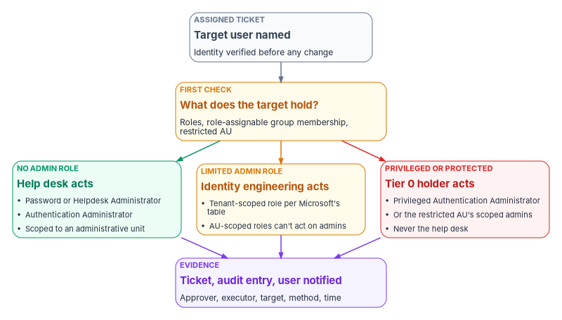
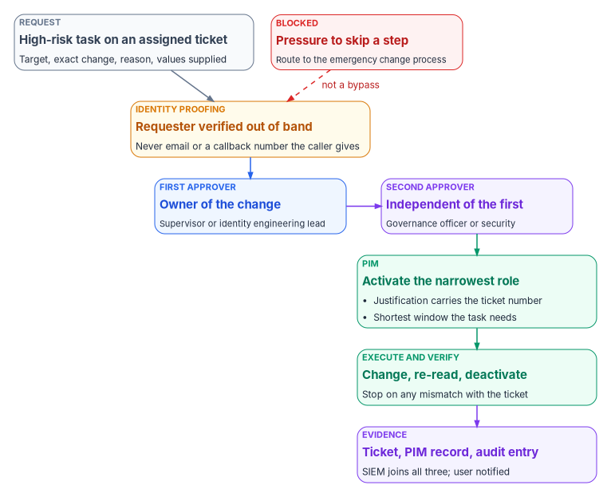

# Chapter 04 — Help Desk Authority in Entra ID

*A help desk is safe in Entra ID when the role it holds, not the caller on the line, decides whose account it can change, and when the changes that could hand an account to a stranger need two people besides the one making them.*

::: {.callout-note}
## In this chapter
The five built-in roles that cover most help desk identity work, what each can do, and whose credentials each can act on, with the corrections that Microsoft's documentation forces on the older help desk design. How administrative units and restricted management units narrow those roles, and how the roles reach technicians through role-assignable groups and Privileged Identity Management (PIM). How to recover a user who has lost a sign-in method, with Temporary Access Pass and MFA re-registration, measured against NIST's account recovery rules. Last, the high-risk tasks, why each needs a second approver, and the evidence every action leaves behind.
:::

In Active Directory, help desk authority was a property of the tree. The help desk group got password-reset rights on an organizational unit, and every account placed in that OU was in scope. Nobody had to think about whose password could be reset, because the OU answered the question.

Microsoft Entra ID answers it differently, and the answer has three parts. The **role** decides what a technician can do. The **target** decides whether the role applies: most help desk roles can act only on users who hold no administrative role, or a short list of limited ones. The **scope** narrows the population further, to an administrative unit. A help desk design that gets any of the three wrong either can't do its job or can do far more than it should.

[Chapter 03](03-intake-triage-and-routing.md) routed each request by the authority it needs. This chapter defines that authority inside Entra ID. [Book 04](../b04-access/index.md) owns the privileged-access model the help desk sits inside, and [Book 02, Chapter 05](../b02-identity/05-delegation-without-ous.md) owns the administrative-unit design; this chapter applies both to the help desk and doesn't restate them. [Appendix A](appendix-a-help-desk-task-reference.md) gives the task-by-task reference.

{#fig-ch04-who-can-act-on-whom fig-alt="A top-to-bottom flow. A slate card, assigned ticket, target user named, identity verified before any change, leads to an amber decision card asking what the target holds: roles, role-assignable group membership, or restricted administrative unit membership. The decision branches three ways. A green card, no admin role, help desk acts, using Password or Helpdesk Administrator or Authentication Administrator scoped to an administrative unit. An amber card, limited admin role, identity engineering acts, using a tenant-scoped role per Microsoft's table, because administrative-unit-scoped roles can't act on admins. A red card, privileged or protected, Tier 0 holder acts, meaning Privileged Authentication Administrator or the restricted unit's scoped admins, never the help desk. All three lead to a violet evidence card: ticket, audit entry and user notified, recording approver, executor, target, method and time."}

## The built-in roles that fit help desk work

Microsoft Entra ID has no single "help desk" role that covers everything a help desk does, and the older design this chapter replaces was right about that. It was wrong about the details, and the details are where the risk sits. Five built-in roles carry most of the identity work. All five carry Microsoft's privileged label.[^c04-roles-ref]

| Role | What it adds | Whose credentials it can act on (tenant scope) | Book 04 tier |
|---|---|---|---|
| Password Administrator | Reset passwords; nothing else of note[^c04-roles-ref] | Users with no admin role, Directory Readers, Guest Inviter, Password Administrator[^c04-privileged] | Tier 2 |
| Helpdesk Administrator | Reset passwords, invalidate refresh tokens, manage service requests, monitor service health[^c04-privileged] | The Password Administrator set plus Helpdesk Administrator, Message Center Reader, Reports Reader and a few reader roles[^c04-privileged] | Tier 2 |
| Authentication Administrator | Set, reset and delete authentication methods (including passwords); require re-registration of MFA; create Temporary Access Pass for members; perform sensitive actions for some users[^c04-roles-ref][^c04-tap] | Users with no admin role and some limited roles, including other Authentication Administrators and Password Administrators[^c04-privileged] | Tier 2 |
| User Administrator | Create users; update most properties; create and manage groups; assign licenses; reset passwords; delete and restore some users; can't manage MFA[^c04-roles-ref] | Non-admins and limited admins, including Helpdesk, Groups and User Administrators[^c04-privileged] | Tier 2 |
| Privileged Authentication Administrator | Everything Authentication Administrator does, for every user including Global Administrators; delete or restore any user; update sensitive properties for all users[^c04-roles-ref] | Everyone, including members and owners of role-assignable groups[^c04-privileged] | Tier 0 |

The tiers are [Book 04, Chapter 04](../b04-access/04-privileged-roles-and-tiers.md#the-programs-privilege-tiers)'s. Privileged Authentication Administrator is the only one of the five that can reset a privileged administrator, which is exactly why it sits in Tier 0 and outside the help desk.

### Whose account the role can touch

The "whose credentials" column is the part help desk designs most often get wrong. Microsoft publishes two matrices. "Who can reset passwords" lists, for each role that can reset passwords and invalidate refresh tokens, the roles of the users it can act on. "Who can perform sensitive actions" does the same for a list of sensitive properties: enabling or disabling the account, business and mobile phone, other emails, the password profile, the user principal name, the on-premises immutable ID, and deleting or restoring the user.[^c04-privileged] Two rows matter more than the rest:

- **Members and owners of role-assignable groups** can be reset only by Privileged Authentication Administrators and Global Administrators, even when they hold no role themselves.[^c04-privileged] This is a deliberate protection: whoever could take over a member's account would inherit the group's role.
- **Users with a role scoped to a restricted management administrative unit** are in the same protected class.[^c04-privileged]

Both tables describe tenant-scoped assignments. When the role is assigned at administrative-unit scope, Microsoft restricts it further: reading and modifying authentication methods, resetting passwords, modifying sensitive properties, and deleting or restoring accounts apply only to members of the unit who hold no administrator role.[^c04-au-roles] An AU-scoped help desk can't reset a limited administrator inside its own unit; that request goes to identity engineering.

### Capability is not authority

Several of these roles can do more than a help desk should, and the older design treated its prohibitions as if the platform enforced them. It doesn't:

- **Authentication Administrator can delete, disable and enable users**, and update their user principal name, for the users in its table.[^c04-privileged] "The help desk doesn't delete accounts" is a procedural rule for any technician holding it.
- **User Administrator can delete users, create guests and change licenses**[^c04-roles-ref][^c04-by-task] and can reset passwords for limited administrators.[^c04-privileged] The older design listed it as the broadest optional role for good reason.
- **Application Administrator can grant consent** to delegated permissions and to application permissions outside Microsoft Graph, and can create enterprise applications.[^c04-by-task] A help desk that activates it can technically do the one thing the help desk must never do. [Book 04, Chapter 06](../b04-access/06-who-decides-access.md#what-each-entra-role-can-actually-do) works through this case and replaces Application Administrator in the help desk with a custom role holding only `microsoft.directory/servicePrincipals/appRoleAssignedTo/update`, which manages user and group assignments to enterprise apps, scoped to one app or the whole tenant, and needs Entra ID P1 for each assignee.[^c04-custom-apps]

Where the platform can't enforce a boundary, the program enforces it twice: in the ticket, which must carry the approval, and in monitoring, which flags any audit event a help desk account produced outside an approved ticket ([Evidence every action leaves](#evidence-every-action-leaves)).

### Corrections to the older help desk design

The help desk guidance this chapter replaces made five claims that Microsoft's documentation doesn't support. Each one changes the design.

| The older design said | What Microsoft documents | What changes |
|---|---|---|
| Helpdesk Administrator covers "only password resets and basic Microsoft 365 tasks" and isn't used | It resets passwords and invalidates refresh tokens for non-admins and several limited roles, and manages service requests and service health[^c04-privileged] | Helpdesk Administrator (or the narrower Password Administrator) is the right role for routine resets; the program uses it |
| Password reset rights map to Authentication Administrator | The least-privileged role for resetting a non-admin's password is Password Administrator[^c04-by-task] | Password resets use Password or Helpdesk Administrator; Authentication Administrator is for methods |
| Hybrid Identity Administrator resets the ImmutableID | Hybrid Identity Administrator manages Entra Connect, cloud provisioning, pass-through authentication, password hash sync, seamless SSO and federation;[^c04-roles-ref] it isn't among the roles that can update `onPremisesImmutableId` (Authentication, User and Privileged Authentication Administrator, and Global Administrator, each for the users in Microsoft's table)[^c04-graph-users] | ImmutableID repair moves to identity engineering under a two-approver gate ([below](#the-high-risk-tasks-and-why-they-need-a-second-approver)) |
| Role-assignable groups need Entra ID P2 | Role-assignable groups need Entra ID P1; just-in-time activation through PIM needs P2[^c04-rag] | Licensing is P1 for the groups, P2 or Entra ID Governance for PIM |
| Authentication Administrator can "temporarily disable MFA" for a user | The role manages a user's methods, can require re-registration and can revoke remembered MFA; it can't manage per-user MFA or tenant MFA settings, which belong to Authentication Policy Administrator[^c04-privileged][^c04-roles-ref] | No "disable MFA" step; a user who has lost every method gets a Temporary Access Pass instead |

The older design also scripted its ImmutableID procedure against the MSOnline module. MSOnline and the Azure AD PowerShell modules are deprecated; Microsoft Graph PowerShell replaces them.[^c04-msonline] Every script in this book uses Graph PowerShell.

## Scope: administrative units

Every help desk role in the table above except Privileged Authentication Administrator is normally assigned at administrative-unit scope in the program, following [Book 02, Chapter 05](../b02-identity/05-delegation-without-ous.md). Authentication, Helpdesk, Password, User, Groups and License Administrator can all be assigned to an administrative unit; Application Administrator, Cloud Application Administrator and Hybrid Identity Administrator can't.[^c04-au-roles] Each administrator assigned a role over a unit needs Entra ID P1; members need only Entra ID Free, unless the unit's membership is dynamic, in which case each member needs P1.[^c04-au-roles][^c04-au-overview]

The old AD habit translates directly. Where the help desk had reset rights on `OU=Field-Offices`, it now holds Password Administrator over a dynamic administrative unit whose rule selects the field-office population from an HR-sourced attribute. Two things don't translate. An administrative unit limits what a technician can change, not what they can see,[^c04-au-overview] and an administrative unit can't be nested, so "region inside department" is a naming convention.

### Restricted management units for the accounts the help desk must not reset

Some accounts should be out of the help desk's reach even when they hold no role: executives, their assistants, and other high-value targets. Microsoft's own example is the chief executive's account, which a tenant-wide Helpdesk Administrator could otherwise reset.[^c04-rmau] A restricted management administrative unit solves this. Only administrators with a role assigned at the scope of that unit can change its members' Entra properties; tenant-scoped Global Administrators and Privileged Role Administrators can't edit the objects, though they can manage the unit itself, including assigning themselves a role over it, and those actions are audited.[^c04-rmau]

The program's pattern for executive support:

1. Put the executive accounts and their devices in a restricted management unit, decided at creation because the setting can't be changed later.[^c04-rmau]
2. Assign Authentication Administrator and Password Administrator over that unit to a small executive-support group, eligible through PIM, with approval required.
3. Leave the general help desk without any assignment over it. A reset request for an executive reaches the help desk, fails the target check at the top of this chapter, and routes to executive support.

Don't put the help desk technicians themselves in a restricted management unit. Users and groups in one can't be managed by Entra ID Governance features, including PIM, entitlement management, lifecycle workflows and access reviews.[^c04-rmau] The technicians are protected a different way, below.

## How the roles reach a technician

The older design called its mechanism a "Privileged Access Group." That was Microsoft's name, until January 2023, for what is now PIM for Groups.[^c04-pim-groups] The program uses [Book 04, Chapter 04](../b04-access/04-privileged-roles-and-tiers.md#how-a-role-reaches-a-person)'s pattern instead of one group holding every role:

- **One role-assignable group per role and scope**, named `PRV-T2-<role>-<AU>` (for example `PRV-T2-PasswordAdmin-AU-FieldOps`). The group holds an **eligible** assignment of the role at the unit's scope. Technicians are members of the group and activate the role in PIM.
- **Membership through an access package** with approval, expiry and review ([Book 04, Chapter 09](../b04-access/09-access-governance.md)), so onboarding a technician is itself an approved, recorded request.
- **A custom role for application assignments**, held the same way, in place of Application Administrator.

The role-assignable group does two jobs. It carries the role, and it protects its members. A role-assignable group can't have dynamic membership or nested groups, its `isAssignableToRole` property is set only at creation, and a tenant can have at most 500 of them.[^c04-rag] Because only Privileged Authentication Administrators and Global Administrators can reset the credentials of a role-assignable group's members,[^c04-privileged] one technician can't reset another technician's password and inherit their access. That matters, because Helpdesk Administrators can otherwise reset other Helpdesk Administrators, and Authentication Administrators other Authentication Administrators.[^c04-privileged]

### PIM settings for help desk roles

PIM settings are defined per role, and every assignment of a role follows that role's settings.[^c04-pim-settings] The help desk therefore inherits Book 04's Tier 2 values ([Book 04, Appendix B](../b04-access/appendix-b-pim-role-settings.md#tier-2-scoped-operations)): eligible only, an 8-hour activation ceiling, justification and ticket number required, eligibility expiring after 180 days, and PIM approval not required under a documented risk acceptance. Four points apply to the help desk in particular.

- **The approval lives in the ticket.** Book 04's risk acceptance for Tier 2 rests on scoping and on role-assignable groups protecting their members. The approval a help desk action needs, such as the supervisor's approval of an MFA reset, is recorded in the ticket, not in PIM. High-risk tasks add a second approver and are done by roles that do require PIM approval ([below](#the-high-risk-tasks-and-why-they-need-a-second-approver)).
- **The ticket number is information only.** PIM can require a ticket number on activation, but it doesn't check the number against any ticketing system.[^c04-pim-settings] The older design promised that activations without a valid request number would be flagged automatically. That only happens if the agency builds the correlation, which the program does in its SIEM: every activation's ticket field is joined to the ITSM record and an unmatched number raises an alert.
- **Shorter is possible but tenant-wide.** A help desk working ticket by ticket rarely needs eight hours, and the activation maximum can be anything from one to 24 hours.[^c04-pim-settings] Because the setting is per role, shortening Password Administrator to two hours shortens it for every holder in the tenant. Agree any change with the owners of Book 04's role settings.
- **Approvers can't approve themselves.** Where a role does require approval, the platform blocks self-approval, approvers have 24 hours to act, and an unanswered request expires.[^c04-pim-approval]

Hybrid Identity Administrator and Application Administrator stay in Book 04's Tier 1, with identity engineering, behind approval by the Tier 1 approver group. The help desk doesn't hold them.

### Onboarding and offboarding technicians

Onboarding is an access-package request for the technician's role groups, approved by the help desk supervisor and the identity governance officer, followed by PIM training before the first activation. The program reviews help desk role membership quarterly, as Book 04 sets for Tier 2, with the supervisor certifying each technician's continued need and removal on non-response.

Offboarding is faster and needs no governance approval, because removing access never increases risk: the supervisor's request removes the technician from the role groups. If the technician has an active activation at the time, identity engineering removes the active assignment as well, then revokes the technician's sessions.

## Identity proofing before any credential action

The most common attack on a help desk is a phone call. CISA's advisory on the Scattered Spider group describes actors calling IT help desk staff, posing as employees, to get passwords reset or MFA moved to a device they control, and it recommends phishing-resistant MFA and continued training against voice phishing.[^c04-cisa-spider] Every role in this chapter is only as safe as the check the technician performs before using it.

NIST SP 800-63B-4 (July 2025) treats a lost authenticator as **account recovery**. It recognizes four recovery methods: saved recovery codes, issued recovery codes, recovery contacts, and repeated identity proofing. To recover an account that authenticates at AAL2, it calls for two recovery codes delivered by different methods, one recovery code plus a bound single-factor authenticator, or repeated identity proofing if the account was identity-proofed. In every case, recovery must send a notification to the subscriber.[^c04-nist-63b]

For a workforce that was proofed at hiring, the program's recovery rule follows the last option:

1. **Re-proof, don't interview.** The technician confirms identity against the record the agency already holds: in person with the PIV card, or by a supervised video session against the HR-sourced identity. Knowledge questions, the caller's own callback number, and email are never enough on their own.
2. **Check the target before the method.** If the user holds any role, is a member or owner of a role-assignable group, or sits in a restricted management unit, the help desk stops and routes the request, as the first figure in this chapter shows.
3. **Notify the user** through a channel other than the one the request came on, every time a credential or method changes.

## Temporary Access Pass and MFA re-registration

When a user has lost their only strong method, the help desk has two tools, and the older design had neither.

**Require re-register MFA** deactivates the user's hardware OATH tokens and deletes their phone numbers, Microsoft Authenticator registrations and software OATH tokens; the user is asked to set up a new method at the next sign-in.[^c04-mfa-methods] **Revoke sessions** invalidates the user's refresh tokens and forces reauthentication everywhere.[^c04-mfa-methods] Re-registration alone leaves a gap: the next sign-in, whoever makes it, gets to register the new method.

A **Temporary Access Pass** closes that gap. It is a time-limited passcode, for single or multiple use, that lets a user sign in and register a new method, including a passkey, without the method they lost.[^c04-tap] Its controls shape the procedure:

- **Who can issue it.** Authentication Administrators can create, delete and view a pass for members, not for themselves; Privileged Authentication Administrators can do so for admins too. The pass method must be enabled in the authentication methods policy, which takes Authentication Policy Administrator, and only users the policy includes can sign in with one.[^c04-tap]
- **Lifetime.** The tenant sets a minimum, maximum and default between 10 minutes and 30 days; the defaults are one hour minimum and default and eight hours maximum. One-time use can be enforced tenant-wide, and each user can have only one pass at a time.[^c04-tap]
- **Ten minutes to register.** With a one-time pass, the user must finish registering a passwordless method within 10 minutes of signing in.[^c04-tap]
- **Expiry doesn't end the session.** Tokens issued during a pass sign-in are capped at the pass's expiry when issued, but expiry doesn't invalidate sessions already established; sign-in frequency in Conditional Access governs how long access lasts.[^c04-tap]
- **Limits.** A pass can't be used with the NPS extension or the AD FS adapter, and can't be issued to external guests.[^c04-tap]

The program's recovery sequence, executed by an Authentication Administrator scoped to the user's unit against a supervisor-approved ticket:

1. Re-proof the user and run the target check above.
2. Revoke the user's sessions.
3. Delete the lost method, or require re-registration if the user has lost several.
4. Issue a **one-time** pass with the **shortest** lifetime the handover allows, delivered to the verified person, never to an email address or a number supplied on the call.
5. Stay with the user while they register a phishing-resistant method, then confirm the old method is gone. Microsoft notes that users replacing lost credentials should remove the old ones.[^c04-tap]
6. Notify the user, and close the ticket with the evidence in [Evidence every action leaves](#evidence-every-action-leaves).

The pass policy settings (one-time use, the lifetime ceiling, which groups may use a pass) are policy, not help desk work. They belong to the authentication policy owners in [Book 04](../b04-access/index.md).

## The high-risk tasks and why they need a second approver

A task is high-risk in the program's design when one person could use it to take over an identity, break the link between an identity and its source of truth, or open an application to the wrong people, and when the platform can't stop the misuse by itself. For those tasks a single approval isn't enough. NIST SP 800-53 asks organizations to identify the duties that must be separated and to define access authorizations that support the separation (AC-5), and to log the use of privileged functions (AC-6(9)).[^c04-fedramp-ac] The program's answer is two approvers besides the executor, both recorded in the ticket before any role is activated.

{#fig-ch04-high-risk-two-approvers fig-alt="A top-to-bottom flow. A slate request card, high-risk task on an assigned ticket, naming the target, the exact change, the reason and the values supplied, leads to an amber identity proofing card: requester verified out of band, never by email or a callback number the caller gives. That leads to a blue first approver card, the owner of the change, a supervisor or identity engineering lead, and then to a violet second approver card, independent of the first, the governance officer or security. A red blocked card, pressure to skip a step, route to the emergency change process, has a dashed red arrow labeled not a bypass pointing back to identity proofing. After the second approver, a green PIM card: activate the narrowest role, justification carries the ticket number, shortest window the task needs. Then a green execute and verify card: change, re-read, deactivate, stop on any mismatch with the ticket. Last, a violet evidence card: ticket, PIM record and audit entry, which the SIEM joins, and the user is notified."}

| Task | Why it's high-risk | Who executes | First approver | Second approver |
|---|---|---|---|---|
| Credential or method reset, or a pass, for an account the help desk can't touch (a privileged role, a role-assignable group member, a restricted unit member) | Hands over an account that controls others | Privileged Authentication Administrator (Tier 0), or the restricted unit's scoped admins | Account owner's manager | Security office |
| ImmutableID or hard-match repair | A wrong mapping links a cloud account to the wrong on-premises object, which then becomes its source of authority[^c04-hardmatch] | Identity engineering | Identity engineering lead | Identity governance officer |
| Delete, disable or restore an account outside the HR-driven lifecycle | Destroys or revives access without the authoritative record | User Administrator, in identity engineering | Account owner's manager | Identity governance officer |
| Enterprise-app assignment to a Tier 1 application | Opens high-risk data to a group | Help desk, custom assignment role | Application owner | Identity governance officer, per [Book 04, Chapter 06](../b04-access/06-who-decides-access.md#risk-tiers-set-the-approval-chain) |
| Bulk change (many users, one request) | One mistake repeated at scale | Automation, under [Book 13, Chapter 10](../b13-governance/10-ticket-to-machine.md)'s change classes | Change owner | Change advisory board |

Admin consent isn't on the list because the help desk never performs it at all; it triages and escalates ([Book 04, Chapter 06](../b04-access/06-who-decides-access.md#who-approves-admin-consent)).

### Why ImmutableID repair left the help desk

The older design let help desk technicians reset a user's ImmutableID through PowerShell once two people had approved. The approvals were right; the executor and the method weren't. Microsoft's documentation explains why the task is dangerous and where it should be fixed:

- **Matching happens on new objects only.** Entra Connect evaluates hard match (on the source anchor, which becomes `onPremisesImmutableId`) and soft match (on UPN or primary SMTP address) only when a new object arrives from AD; changing an existing object so it matches produces an error instead.[^c04-hardmatch]
- **Fix it at the source.** For the common duplicate-object conflict, Microsoft's fix is to set the on-premises user's `mS-DS-ConsistencyGuid` to the existing cloud user's ImmutableID, so the next sync makes the correct hard match.[^c04-hardmatch] That is an AD change, made by the AD and identity engineering teams.
- **Synced objects resist cloud edits.** For synced users, whether a property can be updated in Microsoft Graph also depends on the source of authority and whether sync is enabled.[^c04-user-update] Writing `onPremisesImmutableId` from the cloud is mainly a way to prepare a cloud-only account to be taken over.
- **The platform now blocks risky matches.** From July 1, 2026, Entra ID blocks a hard match when the target cloud account already has `onPremisesObjectIdentifier` set, or holds or is eligible for a privileged role, and Microsoft cautions against using hard match as a general repair tool.[^c04-hardmatch]
- **Hard match should usually be off.** Microsoft advises blocking hard matching unless it's needed to take over cloud-only accounts, and turning the block back on once the match is done.[^c04-hardmatch]

So the program treats an ImmutableID mismatch as an identity engineering change: the help desk detects it (sign-in failures, a duplicate object, a stale last-sync time) and escalates with the evidence; identity engineering decides whether the fix is in AD or in the cloud, and executes it under the two approvals. [Appendix A](appendix-a-help-desk-task-reference.md#hybrid-identity) has the detection steps and a read-only comparison script.

### What the second approver checks

A second approver who rubber-stamps adds nothing. The program asks the second approver to confirm three things the first may not:

1. **The requester was verified** by the method in [Identity proofing](#identity-proofing-before-any-credential-action), and the record of it is in the ticket.
2. **The change is exactly specified**: the target's object ID, not just a display name; the values to set, supplied by the authoritative source and not worked out by the executor; and the rollback.
3. **The urgency is real.** A caller who presses for speed, or a manager who asks the technician to skip the queue, is routed to the supervisor's emergency change process, which has its own approvals. Urgency is never a reason to skip the second approver.

## Evidence every action leaves

Each help desk action produces three records, and the evidence contract in [Book 12, Chapter 02](../b12-security-operations/02-the-evidence-contract.md) needs all three joined on the target's identity and the time:

- **The ticket**: requester, verification method, approvers with timestamps, target object ID, the exact change, the executor, and the result.
- **The PIM record**: the activation request, its justification and ticket number, any approval, and the activation and deactivation times. PIM writes these to the audit log under activities such as "Add member to role completed (PIM activation)."[^c04-audit-activities]
- **The directory audit entry** for the change itself, for example "Reset password," "Admin deleted security info," "Admin registered security info," "Update user," "Delete user" or "Add app role assignment to group."[^c04-audit-activities]

Entra ID keeps audit and sign-in logs for 30 days with P1 or P2 (seven with Free), and longer retention means routing them out through Azure Monitor or using Purview Audit.[^c04-retention] The program streams them to the SIEM ([Book 12](../b12-security-operations/index.md)), where three rules run continuously:

1. Any privileged activation whose ticket number doesn't match an assigned ticket in the ITSM tool.
2. Any directory change by a help desk account that has no matching ticket.
3. Any action the help desk may never take (a consent grant, a role assignment, a Conditional Access change) attributed to a help desk account, alerted immediately to the security operations center.

Help desk technicians read logs for triage; they don't export, copy or delete them. The least-privileged role for reading audit and sign-in logs is Reports Reader,[^c04-by-task] not Application Administrator as the older design assumed, and seeing which Conditional Access policies applied to a sign-in also needs permission to read the policies, which Security Reader provides.[^c04-ca-logs]

## The authority boundary

The help desk's boundary, both ways, is set in [Book 04, Chapter 06](../b04-access/06-who-decides-access.md#help-desk-and-cloud-services): it executes approved work and never decides. This chapter adds the identity-specific edges:

| The help desk may | The help desk may not |
|---|---|
| Reset passwords and methods, and issue a Temporary Access Pass, for users with no admin role in its units | Act on an admin, a role-assignable group member, or a restricted unit member |
| Revoke a user's sessions during recovery or a suspected compromise | Disable MFA, change authentication method policy, or edit Conditional Access |
| Detect sync and ImmutableID problems and escalate with evidence | Write `onPremisesImmutableId`, or change sync rules or Entra Connect configuration |
| Assign approved groups to enterprise apps with the custom assignment role | Hold Application Administrator, or grant any consent |
| Read sign-in and audit logs inside an assigned ticket | Export, copy or retain log data outside the SIEM |

Who staffs the help desk and cloud services tiers, and how their work is measured, is [Chapter 10](10-who-runs-day-two.md)'s subject. The catalog items that put these tasks in front of users are [Chapter 05](05-the-service-catalogs.md)'s.

::: {.callout-tip}
## Continue the book
[← Previous: Chapter 03 — Intake, Triage and Routing](03-intake-triage-and-routing.md) · [Book index](index.md) · [Next: Chapter 05 — The Service Catalogs: ITSM and Teams Telephony →](05-the-service-catalogs.md)
:::

[^c04-roles-ref]: Microsoft Learn, "Microsoft Entra built-in roles," entries for Authentication Administrator, Hybrid Identity Administrator, Password Administrator, Privileged Authentication Administrator and User Administrator, <https://learn.microsoft.com/entra/identity/role-based-access-control/permissions-reference> (accessed Oct 21, 2026).
[^c04-privileged]: Microsoft Learn, "Privileged roles and permissions in Microsoft Entra ID (preview)," sections "Compare authentication roles," "Who can reset passwords" and "Who can perform sensitive actions," <https://learn.microsoft.com/entra/identity/role-based-access-control/privileged-roles-permissions> (accessed Oct 21, 2026).
[^c04-by-task]: Microsoft Learn, "Least privileged roles by task in Microsoft Entra ID," <https://learn.microsoft.com/entra/identity/role-based-access-control/delegate-by-task> (accessed Oct 21, 2026).
[^c04-custom-apps]: Microsoft Learn, "Create custom roles to manage enterprise apps in Microsoft Entra ID," <https://learn.microsoft.com/entra/identity/role-based-access-control/custom-enterprise-apps> (accessed Oct 21, 2026).
[^c04-graph-users]: Microsoft Learn, "Working with users in Microsoft Graph," section "Sensitive actions," <https://learn.microsoft.com/graph/api/resources/users> (accessed Oct 21, 2026).
[^c04-rag]: Microsoft Learn, "Use Microsoft Entra groups to manage role assignments," <https://learn.microsoft.com/entra/identity/role-based-access-control/groups-concept> (accessed Oct 21, 2026).
[^c04-msonline]: Microsoft Learn, "Upgrade from Azure AD PowerShell to Microsoft Graph PowerShell," <https://learn.microsoft.com/powershell/microsoftgraph/migration-steps> (accessed Oct 21, 2026).
[^c04-au-roles]: Microsoft Learn, "Assign Microsoft Entra roles," section "Assign roles with administrative unit scope," <https://learn.microsoft.com/entra/identity/role-based-access-control/admin-units-assign-roles> (accessed Oct 21, 2026).
[^c04-au-overview]: Microsoft Learn, "Administrative units in Microsoft Entra ID," <https://learn.microsoft.com/entra/identity/role-based-access-control/administrative-units> (accessed Oct 21, 2026).
[^c04-rmau]: Microsoft Learn, "Restricted management administrative units in Microsoft Entra ID," <https://learn.microsoft.com/entra/identity/role-based-access-control/admin-units-restricted-management> (accessed Oct 21, 2026).
[^c04-pim-groups]: Microsoft Learn, "Privileged Identity Management (PIM) for Groups," <https://learn.microsoft.com/entra/id-governance/privileged-identity-management/concept-pim-for-groups> (accessed Oct 21, 2026).
[^c04-pim-settings]: Microsoft Learn, "Configure Microsoft Entra role settings in PIM," <https://learn.microsoft.com/entra/id-governance/privileged-identity-management/pim-how-to-change-default-settings> (accessed Oct 21, 2026).
[^c04-pim-approval]: Microsoft Learn, "Approve or deny requests for Microsoft Entra roles in Privileged Identity Management," <https://learn.microsoft.com/entra/id-governance/privileged-identity-management/pim-approval-workflow> (accessed Oct 21, 2026).
[^c04-cisa-spider]: Cybersecurity and Infrastructure Security Agency, AA23-320A, *Scattered Spider*, November 16, 2023 (updated July 29, 2025), <https://www.cisa.gov/news-events/cybersecurity-advisories/aa23-320a> (accessed Oct 21, 2026).
[^c04-nist-63b]: National Institute of Standards and Technology, SP 800-63B-4, *Digital Identity Guidelines: Authentication and Authenticator Management*, July 2025, section 4.2, "Account Recovery," <https://pages.nist.gov/800-63-4/sp800-63b.html> (accessed Oct 21, 2026); publication record <https://csrc.nist.gov/pubs/sp/800/63/b/4/final>.
[^c04-mfa-methods]: Microsoft Learn, "Manage user authentication methods for Microsoft Entra multifactor authentication," section "Manage user authentication options," <https://learn.microsoft.com/entra/identity/authentication/howto-mfa-userdevicesettings> (accessed Oct 21, 2026).
[^c04-tap]: Microsoft Learn, "Configure Temporary Access Pass to register passwordless authentication methods," <https://learn.microsoft.com/entra/identity/authentication/howto-authentication-temporary-access-pass> (accessed Oct 21, 2026).
[^c04-fedramp-ac]: FedRAMP, "Access Control" (NIST SP 800-53 Rev. 5 controls, catalog release 5.2.0), AC-5 and AC-6(9), <https://fedramp.gov/2026/reference/controls/access-control/> (accessed Oct 21, 2026).
[^c04-hardmatch]: Microsoft Learn, "Configure Microsoft Entra Connect for an existing tenant," sections "Hard match vs soft match," "Block hard match in Microsoft Entra ID" and "Hard match security protections," <https://learn.microsoft.com/entra/identity/hybrid/connect/how-to-connect-install-existing-tenant> (accessed Oct 21, 2026).
[^c04-user-update]: Microsoft Learn, "Update user" (Microsoft Graph v1.0), <https://learn.microsoft.com/graph/api/user-update> (accessed Oct 21, 2026).
[^c04-audit-activities]: Microsoft Learn, "Microsoft Entra audit log activity reference," <https://learn.microsoft.com/entra/identity/monitoring-health/reference-audit-activities> (accessed Oct 21, 2026).
[^c04-retention]: Microsoft Learn, "Microsoft Entra data retention," <https://learn.microsoft.com/entra/identity/monitoring-health/reference-reports-data-retention> (accessed Oct 21, 2026).
[^c04-ca-logs]: Microsoft Learn, "View applied Conditional Access details in the Microsoft Entra activity logs," section "Prerequisites," <https://learn.microsoft.com/entra/identity/monitoring-health/how-to-view-applied-conditional-access-policies> (accessed Oct 21, 2026).
