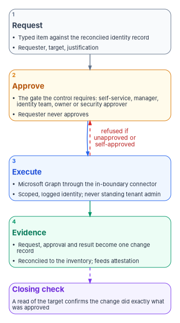
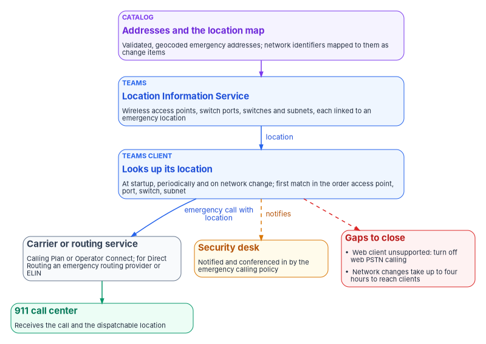

# Chapter 05 — The Service Catalogs: ITSM and Teams Telephony

*The busiest surfaces in a modernized estate stay governed only if every routine change arrives as a typed request with an approval and leaves as evidence, and telephony is no exception, because a wrong emergency address sends responders to the wrong place.*

::: {.callout-note}
## In this chapter
The help-desk catalog: ten request types for joiners, movers, leavers, credentials, groups, licenses, Conditional Access exceptions and guests, each bound to the control it exercises and the approval it needs. The loop every item runs, the five verbs that every identity change reduces to, and why the reset and the leaver deserve the most care. Then the Teams Phone catalog: phone numbers, calling policy, voice routing, emergency addresses and call records, what federal rules ask of the agency as the operator of a multi-line telephone system, how Teams meets them in the commercial cloud, GCC and GCC High, and how Teams configuration drift joins the Microsoft 365 compliance loop.
:::

A service desk makes hundreds of identity changes a week. Each one, whether a new account, a password reset or a group added, changes something that a control governs: account management (AC-2), authenticator management (IA-5) or least privilege (AC-6). Done as a portal click by a technician holding a standing administrator role, the change has no recorded reason, no recorded approval and no proof that it did only what was asked. Multiplied across a week, that is the largest steady source of control erosion in the estate, and none of it shows up until an assessor samples the accounts.

The program's answer is a catalog. Every routine change is a **request** against a named target, not a click. The request carries the approval its control needs, a machine or a scoped technician carries it out, and the result is written back as a record. The catalog doesn't add a control. It stops the most frequent operations from quietly undoing the controls the agency already claims. [Chapter 03](03-intake-triage-and-routing.md) explained how requests reach the desk and how they're routed by the authority they need, and [Chapter 04](04-help-desk-authority-in-entra.md) defined that authority in Entra ID. This chapter defines what the requests are.

{#fig-ch05-request-loop fig-alt="Four numbered cards in a single column, read top to bottom. A slate card, Request: a typed catalog item against the reconciled identity record, carrying the requester, the target and the justification. An amber card, Approve: the gate the control requires, which may be self-service, manager, identity team, owner or security approver, and the requester never approves. A blue card, Execute: Microsoft Graph called through the in-boundary connector, under a scoped and logged identity, never a standing tenant administrator. A green card, Evidence: the request, approval and Graph result become a change record reconciled to the configuration database, feeding attestation. A dashed red arrow from the execute card back up to the approve card is labeled refused if unapproved or self-approved. A dashed violet arrow from the evidence card leads to a violet card at the bottom, Closing check: a read of the target confirms the change did exactly what was approved."}

## The loop every item runs

Every catalog item, identity or telephony, runs the same four steps. They are the program's design, the day-two form of the ticket-to-machine tempo in [Book 13, Chapter 10](../b13-governance/10-ticket-to-machine.md).

1. **Request.** A typed item names the target (the identity record reconciled to the configuration database, [Chapter 07](07-the-cmdb-and-asset-identity.md)), the requester and the justification. Free text is for context, never for the target.
2. **Approve.** The item carries the gate its control requires: self-service where policy allows it, the manager, the identity team, the resource owner or a security approver. The requester never approves their own request.
3. **Execute.** Microsoft Graph is called through the connector inside the boundary, under a service identity whose write permissions are scoped, logged and approved per change. No step runs under a standing tenant administrator. Where no connector action exists, the technician executes under the role [Chapter 04](04-help-desk-authority-in-entra.md) assigns and records what was done.
4. **Evidence.** The request, the approval and the Graph result become one change record, reconciled to the inventory and passed to attestation ([Chapter 11](11-attestation-and-the-compliance-app.md)). The record closes only when a read of the target confirms the change, the rule [Book 14, Chapter 04](../b14-compliance/04-closure-with-proof.md) sets for every closure.

[Chapter 02](02-day-two-is-where-compliance-lives.md#the-coordination-contract) explains why ServiceNow is the reference platform in the sources, what its in-boundary connector does, and how an agency on a different service-management platform satisfies the same contract. [Chapter 03](03-intake-triage-and-routing.md#prefer-the-connector-and-check-what-it-actually-covers) maps each help-desk task to the actions ServiceNow's Microsoft Entra ID spoke actually documents. Substituting the platform changes the catalog and connector syntax; it doesn't change the loop.

## The identity catalog

The catalog has ten items in three families: lifecycle (joiner, mover, leaver, license, guest), credentials (password, MFA method, unlock) and access (groups and Conditional Access exceptions). Each binds to the control it exercises in NIST SP 800-53 Rev. 5 and to the approval that control calls for. The control column records the control each item exercises; the approval column is the program's design.

| Catalog item | Control | Approval gate | What the item enforces |
|---|---|---|---|
| New account (joiner) | AC-2 | Manager and identity team | Provisioned from the HR-sourced record ([Book 03, Chapter 08](../b03-hr-identity/08-joiner-mover-leaver.md)) with a least-privilege baseline |
| Role or scope change (mover) | AC-6 | Manager and identity team | Entitlements re-derived from the new assignment; stale ones removed; an access review of what remains |
| Deprovision (leaver) | AC-2 | Manager and identity team | Disable, revoke sessions and tokens, reassign owned objects, all evidenced |
| Password reset | IA-5 | Self-service, or the service desk after verification | Self-service password reset where policy allows; otherwise the verified path in [Chapter 04](04-help-desk-authority-in-entra.md#identity-proofing-before-any-credential-action) |
| MFA method reset | IA-5 | Service desk, after re-proofing | Re-proofing required; the change is logged and alerts, because it is a social-engineering target |
| Account unlock | IA-5 | Self-service, or the service desk | Repeated unlocks for one account are a detection signal, not just a ticket count |
| Group membership | AC-6 | Group owner and an approver | Time-bound where the group grants elevation; linked to the access review |
| License assignment | AC-2 | Manager | Group-based licensing preferred over per-user assignment |
| Conditional Access exception | AC-3 | Security approver | Mandatory expiry and review, using the one exception path [Book 04, Chapter 06](../b04-access/06-who-decides-access.md#exceptions) defines |
| Guest invitation | AC-2 | Sponsor and security | A named sponsor and an expiry on every guest |

: The help-desk catalog. Controls from SP 800-53 Rev. 5;[^c05-sp80053] approval gates and enforcement are program design. {.striped .hover}

Two of these items reuse patterns that already exist elsewhere, and the catalog deliberately invokes them rather than building second copies. The Conditional Access exception is the exception process [Book 04](../b04-access/06-who-decides-access.md#exceptions) owns, with its emergency-access exclusions, expiry and review; the catalog item is a front door to it, not a parallel path that could drift. Guest invitations follow the same sponsor-and-expiry pattern as any other external identity. Where an item's work also has a home in Microsoft Entra ID Governance, such as access packages and access reviews ([Book 04, Chapter 09](../b04-access/09-access-governance.md)), the catalog raises the request and the governance tooling carries the decision; the program doesn't rebuild what the platform already does.

## Five verbs

Every identity operation the catalog fulfills is one of five verbs: **add, move, change, delete or reset**. Each travels the same authorized path: it starts from the authoritative record, is approved by the person with authority over it, runs under a just-in-time scoped role, closes with a check that proves the result, and emits its evidence automatically. The verbs differ in what starts them, what the closing check has to prove, and which controls they exercise.

| Verb | What it means for an identity | What starts it | The closing check proves | Controls exercised |
|---|---|---|---|---|
| Add | Joiner: account created, groups and licenses derived, MFA registered, accounts created in every connected application | HR joiner event | The account exists with exactly the derived entitlements; an MFA method is registered; every connected application has the account | AC-2, IA-4, IA-5 |
| Move | Mover: role or unit change; attributes updated, group and license membership re-derived, application access re-evaluated | HR mover event | The new derivation matches the authoritative record, and entitlements from the old role are gone | AC-2, AC-6 |
| Change | An entitlement or attribute change outside a move: an access request, a group addition, a delegation | A request checked against the authoritative record | The scope granted equals the scope approved, and nothing broader | AC-2, AC-6 |
| Delete | Leaver: disable, revoke sessions and tokens, deprovision every connected application, reassign owned objects, including the person's service accounts and app registrations | HR separation event | The account is unusable everywhere, no sessions remain, connected applications have disabled the account, and nothing owned is left without an owner | AC-2, AC-2(3), IA-4 |
| Reset | A credential event: password reset, MFA method reset, session revocation | A request checked against the authoritative identity | The person was re-proofed before issuance, the new credential meets policy, and the old one no longer works | IA-4, IA-5, AC-2 |

: The five verbs at the help desk. Control numbers from SP 800-53 Rev. 5;[^c05-sp80053] the rest is program design. {.striped .hover}

The same five verbs govern every other kind of object the program manages, from devices to DNS records. At the help desk only the object changes (people, and on the delete row the non-human identities they own) and so do the checks.

### Reset is the verb attackers order

A password or MFA reset reissues the keys to an identity on the strength of a conversation. That makes it the classic social-engineering entry point, and it is why [Chapter 04](04-help-desk-authority-in-entra.md#identity-proofing-before-any-credential-action) treats a lost authenticator as account recovery and requires re-proofing against the record the agency already holds, never against facts the caller supplies. The catalog's reset items enforce that order mechanically. The verification result is a required field on the item, the reset runs under a scoped just-in-time role, and the item closes only when a check confirms the old credential no longer works and the new one meets policy. A reset closed by hand, with no verification result attached, is exactly the kind of closure [Book 14, Chapter 04](../b14-compliance/04-closure-with-proof.md) declines to count.

### The leaver is the one that fails audits

Deprovisioning is an obligation with evidence, not a courtesy. SP 800-53 asks the agency to disable accounts within a defined time once they are no longer associated with a user (AC-2(3)).[^c05-sp80053] The leaver item therefore does four things and records each one: disable the account, revoke active sessions and refresh tokens, deprovision the person from every connected application, and reassign everything they owned, including groups, application ownership and mailboxes. ServiceNow's Entra ID spoke documents the first two as actions (Disable User, and Revoke User SignIn Sessions), and its sample offboarding flow disables the user and removes group memberships when the ServiceNow user record is deactivated.[^c05-sn-spoke] The other two depend on how the person's applications are connected, which is [Chapter 06](06-saas-integration-governance.md)'s subject: an application provisioned by SCIM receives the disable automatically, and one that isn't becomes a manual task with no automatic check.

Ownership transfer covers non-human identities too. A leaver who owned service accounts or app registrations leaves them orphaned unless the item hands each one to a named successor; the program treats an ownerless non-human identity as a finding, as [Book 04, Chapter 06](../b04-access/06-who-decides-access.md#ownership-changes-and-orphaned-apps) does for applications.

### What the catalog doesn't fix

- Self-service password reset and unlock are only as strong as the tenant's authentication-methods policy. A weak policy is a configuration problem for [Chapter 08](08-control-automation-m365-and-azure.md), not something the catalog can repair.
- The catalog governs the request. A standing Global Administrator can still act outside it; detections and access reviews catch that, and [Book 04](../b04-access/index.md) removes the standing role.
- Catalog coverage is only as good as the connector actions behind it. Where an action is missing, as it is for MFA method resets in the current Entra ID spoke ([Chapter 03](03-intake-triage-and-routing.md#prefer-the-connector-and-check-what-it-actually-covers)), the item routes to a person and the verification step carries the weight.

## The telephony catalog

Teams Phone is the voice workload in Microsoft 365, and it carries day-two work that is usually run by ad hoc administrator action. Microsoft offers four ways to connect Teams Phone to the public telephone network: Microsoft Calling Plans, where Microsoft is the carrier; Operator Connect, where a participating carrier manages the connection; Teams Phone Mobile, through a participating mobile operator; and Direct Routing, where the agency connects its own session border controllers.[^c05-pstn] Microsoft lists PSTN calling through Teams Phone as available in GCC. In GCC High and DoD, Direct Routing must be configured for Teams voice and audio conferencing to work.[^c05-teams-sd][^c05-gcch]

The architecture choice belongs to the network and telecommunications design; [Book 09, Chapter 12](../b09-network/12-microsoft-365-traffic.md) covers how Teams media crosses the network. This chapter governs the standing operator tasks on whatever architecture the agency chose, and every one of them is a change to a configured surface (CM-3) or a source of audit records (AU-2).

| Catalog item | Control | What the item enforces |
|---|---|---|
| Phone number assignment or release | CM-3 | Reconciled to the number inventory; a release returns the number to the pool and records it |
| Calling policy and dial plan assignment | CM-3 | Least-privilege calling scope (for example, domestic only by default); PSTN calling from the Teams web client turned off where dynamic emergency calling is in use |
| Emergency address validation | CM-3 | A validated emergency address is a gate on number assignment, not an optional field |
| Network-to-location mapping | CM-3 | Subnets, wireless access points and switches mapped to emergency locations whenever the network changes |
| Voice routing or session border controller change | CM-3 | Change-controlled; a session border controller is a boundary-affecting component |
| Call records and telephony administration telemetry | AU-2 | Call detail records and telephony administrator actions routed into the evidence store at onboarding |

: The Teams Phone catalog. Controls from SP 800-53 Rev. 5;[^c05-sp80053] the items are program design. {.striped .hover}

### Emergency calling is the agency's obligation

The emergency-address item is the one telephony step where a silent error has physical consequences: a phone whose registered location is wrong sends responders to the wrong building. It is also where federal rules bind the agency directly, because they bind whoever operates the phone system.

Two statutes apply. **Kari's Law** requires a multi-line telephone system to let a user dial 911 directly, without a prefix such as 9 for an outside line, and to notify someone (for example a front desk or security office) when a 911 call is made. It applies to systems manufactured, imported, first sold or leased, or installed after February 16, 2020.[^c05-fcc1976] **Section 506 of RAY BAUM'S Act** directed the FCC to consider rules so that a caller's dispatchable location is conveyed with every 911 call, whatever the technology; the FCC adopted those rules in its August 2019 order implementing both statutes.[^c05-fcc1976]

The rules sit in 47 CFR part 9, and three points in them matter to an agency.

- **They cover the agency's system.** The FCC defines a multi-line telephone system to include network-based and premises-based systems, including VoIP, and states that it includes systems owned or leased by governmental agencies.[^c05-cfr93]
- **They bind the operator, not only the manufacturer.** A person engaged in installing, managing or operating such a system must configure it so a user can dial 911 directly, must configure notification to a central location or another person if the system can do it without new hardware or software, and must configure it so the caller's dispatchable location reaches the 911 call center. Notification has to start at the same time as the call where technically feasible, mustn't delay the call, and must go somewhere someone is likely to see or hear it.[^c05-cfr916]
- **They define "dispatchable location" and set dates.** A dispatchable location is the validated street address of the caller plus information such as a suite or floor needed to locate them.[^c05-cfr93] On-premises fixed phones had to provide it automatically by January 6, 2021. Non-fixed on-premises devices and off-premises devices had to provide it by January 6, 2022: automatically where technically feasible, and otherwise from a location the user updates manually or, for off-premises devices, the best available location obtainable at reasonable cost, which may be coordinate-based.[^c05-cfr916]

A notification under the rules has to say, at a minimum, that a 911 call was made, give a valid callback number, and pass on the location information the system sent with the call.[^c05-cfr93] This chapter is guidance, not legal advice; the agency's counsel and telecommunications office own the compliance determination. What the catalog contributes is the evidence that the configuration meeting those rules was put in place and kept current.

{#fig-ch05-emergency-location fig-alt="A top-to-bottom flow. A violet card at the top, the catalog: validated emergency addresses with geocodes, and network identifiers mapped to them, maintained as change items. It feeds a blue card, the Location Information Service, holding wireless access points, switch ports, switches and subnets each linked to an emergency location. A blue card, the Teams client, sends its network connectivity to the Location Information Service at startup, periodically and when its network changes, and gets back a location, matched in the order wireless access point, switch port, switch, subnet. An arrow labeled emergency call with location leads to a slate card, the carrier or emergency routing service: Calling Plan, Operator Connect, or for Direct Routing an emergency routing service provider or an ELIN gateway. That leads to a green card, the 911 call center, which receives the call and the dispatchable location. A separate amber card, the security desk, is reached by a dashed arrow from the Teams client labeled emergency calling policy notifies and conferences in. A red card on the side notes the gaps to close: the Teams web client isn't supported for dynamic emergency calling, so web PSTN calling is turned off, and a network change takes up to four hours to reach clients."}

### How Teams meets the rules

Teams provides the mechanisms; the agency has to configure them, and the catalog keeps them configured.

- **Validated addresses.** An emergency address must be marked validated before it can be assigned to a user or a network identifier. Addresses created with the map search in the Teams admin center are validated and geocoded automatically, and Microsoft recommends creating them that way. Places (floor, wing or office) can be added under an address to give the in-building detail.[^c05-emerg] For Calling Plan users in the United States, an emergency location is required at the moment a number is assigned to the user.[^c05-cp-e911] The catalog makes that requirement the gate for every connectivity option, not only Calling Plans.
- **Dynamic locations.** Dynamic emergency calling works with Calling Plans, Operator Connect, Teams Phone Mobile and Direct Routing. The Teams client sends its network connectivity to the Location Information Service at startup, periodically and when its connection changes, and the service returns the location linked to the first matching network element, in the order wireless access point, switch port, switch, subnet. Network identifiers used for dynamic locations need addresses with geocodes, and some network-settings changes take up to four hours to reach clients.[^c05-dynamic] That is why network-to-location mapping is its own catalog item, raised whenever the address-management system records a new subnet or access point ([Book 08](../b08-ddi/index.md)).
- **Notification.** The Teams emergency calling policy sets who is notified when someone places an emergency call and how, including conferencing the security desk into the call, and it can treat a test call to 933 differently. It applies to all four connectivity options and can be assigned to users, network sites or both; a site assignment overrides a user assignment.[^c05-dynamic]
- **Routing.** Calling Plan, Operator Connect and Teams Phone Mobile users are enabled for emergency calling automatically. Direct Routing needs an emergency call routing policy, a session border controller set to pass location in PIDF-LO, and either an emergency routing service provider (in the United States and Canada) or an ELIN configuration on the session border controller.[^c05-dynamic]
- **Unsupported clients.** Dynamic emergency calling, including security desk notification, isn't supported on the Teams web client. Microsoft's guidance is a calling policy that turns off web PSTN calling for those users.[^c05-dynamic] The calling-policy item applies it by default.
- **Testing.** Calling Plan, Operator Connect and Teams Phone Mobile users in the United States and Canada can dial 933 to hear back their number, their location and whether a real call would route automatically; Direct Routing customers arrange testing with their emergency routing provider.[^c05-dynamic] A successful test call is the closing check on the address and mapping items.

Government clouds differ in client coverage, so the catalog has to know which cloud it is in. Microsoft lists dynamic emergency calling as available on all Teams clients in GCC; in GCC High it is available on Teams desktop and mobile clients and on Teams phones from a stated app version, and in DoD on desktop, mobile and Teams phone applications released through the Teams admin center.[^c05-dynamic]

### Call records are evidence, and they expire

Call detail records and telephony administrator actions are the AU-2 half of the catalog. Microsoft Graph keeps a call record for 30 days after the call ends, and organizations can subscribe to call records as they are created to build their own reporting or alert on scenarios such as emergency calls.[^c05-callrecords] The PSTN usage report in the Teams admin center keeps detailed PSTN records for a period set by country; for most countries it is 365 days for Calling Plans and 150 days for Direct Routing.[^c05-pstn-report] Both windows are shorter than most audit periods. The program's design routes call records and telephony administrator actions into the evidence store when the service is onboarded, under the evidence contract in [Book 12, Chapter 02](../b12-security-operations/02-the-evidence-contract.md), rather than relying on the portal's retention when an investigation needs them.

### Teams configuration drift joins the Microsoft 365 loop

Teams also carries the second kind of day-two work: drift from its secure configuration. CISA's SCuBA project publishes a Teams baseline alongside the other Microsoft 365 baselines, and BOD 25-01 requires federal civilian agencies to implement the mandatory policies for in-scope tenants; the deadline for the policies in force at issuance was June 20, 2025.[^c05-bod2501] The required Teams policies are that anonymous users can't start meetings (MS.TEAMS.1.2v2), external access is enabled only per domain (MS.TEAMS.2.1v2), unmanaged users can't initiate contact with internal users (MS.TEAMS.2.2v2), and Teams email integration is disabled (MS.TEAMS.4.1v1).[^c05-bod-configs]

The program doesn't build a separate loop for Teams. It extends the Microsoft 365 loop in [Chapter 08](08-control-automation-m365-and-azure.md) to the Teams surface: the assessment runs, a new failure becomes a typed change or incident against the Teams service record, an owner fixes it in the native console, and a re-test closes it with evidence (CM-6). One loop, one more surface.

## Who does what

The catalog only works if the roles behind it stay separate. The program's design, consistent with [Chapter 03](03-intake-triage-and-routing.md#who-executes-and-who-approves) and [Chapter 10](10-who-runs-day-two.md):

| Role | Owns |
|---|---|
| Service desk | Verification, execution of items with no connector action, and the record of what was done; never approval |
| Identity team | Approval of lifecycle and credential items; the joiner, mover and leaver derivations |
| Resource and group owners | Approval of access items for what they own |
| Security approver | Conditional Access exceptions, guest invitations, MFA resets for sensitive accounts |
| Telephony administrators | Numbers, policies, routing and the network-to-location map, through catalog items |
| Facilities and the security desk | The accuracy of building and floor addresses, and receiving emergency notifications |
| Counsel and the telecommunications office | The determination that the configuration meets the FCC rules |

: Who does what in the catalogs. Program design. {.striped .hover}

## Honest limits

- The emergency-address check is only as good as the address data behind it. The catalog validates against the Teams address service and the agency's own building records; someone has to keep those records current when offices move.
- Media-path confidentiality and the accreditation of session border controllers belong to the network and telecommunications design. This chapter governs operational changes to that design, not its transport security.
- Teams baseline coverage depends on the assessment tool's Teams checks, which [Chapter 12](12-the-day-two-runbook.md) tests.
- The approval gates and the five-verb checks are the program's design. They are a defensible reading of SP 800-53, not the only one, and an agency's authorizing official may set different gates.

::: {.callout-tip}
## Continue the book
[← Previous: Chapter 04 — Help Desk Authority in Entra ID](04-help-desk-authority-in-entra.md) · [Book index](index.md) · [Next: Chapter 06 — SaaS Integration Governance →](06-saas-integration-governance.md)
:::

[^c05-sp80053]: National Institute of Standards and Technology, SP 800-53 Rev. 5, *Security and Privacy Controls for Information Systems and Organizations*, controls AC-2, AC-2(3), AC-3, AC-6, AU-2, CM-3, CM-6, IA-4 and IA-5, statements checked against the release 5.2.0 OSCAL catalog, <https://github.com/usnistgov/oscal-content/blob/main/nist.gov/SP800-53/rev5/json/NIST_SP-800-53_rev5_catalog.json> (accessed Oct 21, 2026).
[^c05-sn-spoke]: ServiceNow, "Microsoft Entra ID Spoke" (Washington DC release documentation), action list and sample User Offboarding flow, <https://www.servicenow.com/docs/r/washingtondc/integrate-applications/integration-hub/microsoft-azure-ad-spoke.html> (accessed Oct 21, 2026).
[^c05-pstn]: Microsoft Learn, "PSTN connectivity options," <https://learn.microsoft.com/microsoftteams/pstn-connectivity> (accessed Oct 21, 2026).
[^c05-teams-sd]: Microsoft Learn, "Microsoft Teams service description," Feature availability table and footnotes 2 and 6, <https://learn.microsoft.com/office365/servicedescriptions/teams-service-description> (accessed Oct 21, 2026).
[^c05-gcch]: Microsoft Learn, "Office 365 GCC High and DoD," Feature nuances, Microsoft Teams, <https://learn.microsoft.com/office365/servicedescriptions/office-365-platform-service-description/office-365-us-government/gcc-high-and-dod> (accessed Oct 21, 2026).
[^c05-fcc1976]: Federal Communications Commission, FCC 19-76, *Report and Order, Implementing Kari's Law and Section 506 of RAY BAUM'S Act*, PS Docket No. 18-261, adopted August 1, 2019, released August 2, 2019, paragraphs 8–12, <https://docs.fcc.gov/public/attachments/FCC-19-76A1.pdf> (accessed Oct 21, 2026).
[^c05-cfr93]: Electronic Code of Federal Regulations, 47 CFR § 9.3, definitions of "Dispatchable location," "Multi-line telephone system or MLTS" and "MLTS notification," <https://www.ecfr.gov/api/versioner/v1/full/2026-10-01/title-47.xml?part=9&section=9.3> (accessed Oct 21, 2026).
[^c05-cfr916]: Electronic Code of Federal Regulations, 47 CFR § 9.16, "General obligations—direct 911 dialing, notification, and dispatchable location," <https://www.ecfr.gov/api/versioner/v1/full/2026-10-01/title-47.xml?part=9&section=9.16> (accessed Oct 21, 2026).
[^c05-emerg]: Microsoft Learn, "Manage emergency calling," sections Emergency address, Emergency address validation and Emergency address geo codes, <https://learn.microsoft.com/microsoftteams/what-are-emergency-locations-addresses-and-call-routing> (accessed Oct 21, 2026).
[^c05-cp-e911]: Microsoft Learn, "Emergency calling considerations for Microsoft Calling Plans," <https://learn.microsoft.com/microsoftteams/considerations-calling-plan> (accessed Oct 21, 2026).
[^c05-dynamic]: Microsoft Learn, "Plan and configure dynamic emergency calling," including Configure emergency policies, Test emergency calling and Government support, <https://learn.microsoft.com/microsoftteams/configure-dynamic-emergency-calling> (accessed Oct 21, 2026).
[^c05-callrecords]: Microsoft Learn, "Call records" (Microsoft Graph), <https://learn.microsoft.com/graph/cloud-communications-callrecords> (accessed Oct 21, 2026).
[^c05-pstn-report]: Microsoft Learn, "Microsoft Teams PSTN usage report," Interpret the report, retention table, <https://learn.microsoft.com/microsoftteams/teams-analytics-and-reports/pstn-usage-report> (accessed Oct 21, 2026).
[^c05-bod2501]: Cybersecurity and Infrastructure Security Agency, BOD 25-01, *Implementing Secure Practices for Cloud Services*, December 17, 2024, <https://www.cisa.gov/news-events/directives/bod-25-01-implementing-secure-practices-cloud-services> (accessed Oct 21, 2026).
[^c05-bod-configs]: Cybersecurity and Infrastructure Security Agency, "BOD 25-01: Implementing Secure Practices for Cloud Services Required Configurations," Microsoft Teams, <https://www.cisa.gov/resources-tools/services/bod-25-01-implementing-secure-practices-cloud-services-required-configurations> (accessed Oct 21, 2026).
