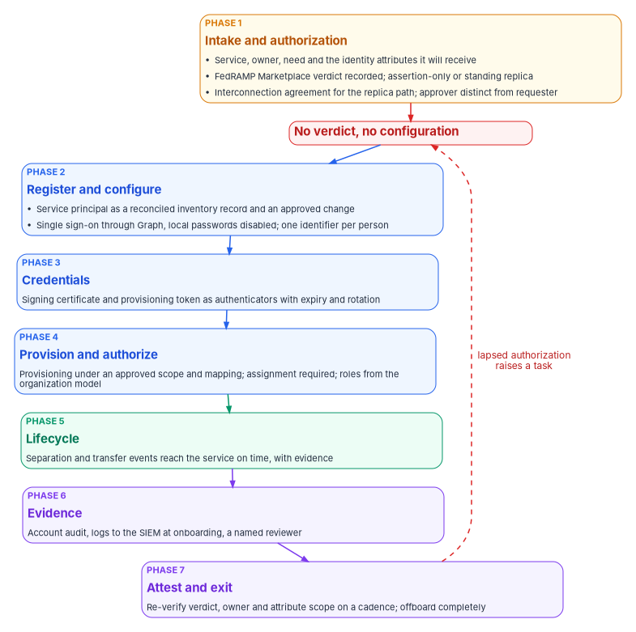
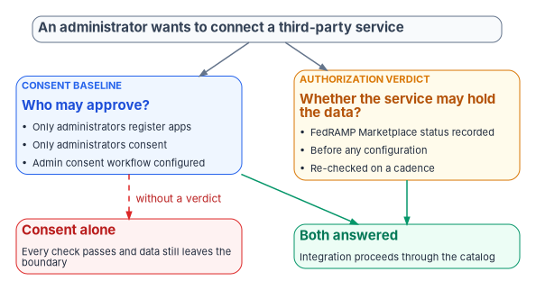

# Chapter 06 — SaaS Integration Governance

*An administrator can federate a third-party service with the agency directory in fifteen minutes, so the authorization question has to be asked and recorded before anyone configures anything, because nothing in the vendor's path will ask it.*

::: {.callout-note}
## In this chapter
What happens when an administrator connects a third-party SaaS application to Entra ID, and why that moment closes or skips a whole set of controls at once. Why the gate has to be the agency's own: in GCC the full commercial application gallery is available, and certification travels with the service, not with the federation trust. The authorization check against FedRAMP Marketplace data, and why restricting consent doesn't replace it. OAuth application risk and app governance in the government clouds. How single sign-on and SCIM provisioning close account-management controls, and what they don't close. A seven-phase catalog from request to offboarding, the least-privilege Microsoft Graph surface it needs (with corrections to the source design), the tests that would prove it wrong, and the review that keeps every integration current.
:::

An administrator opens the Microsoft Entra admin center, searches the application gallery, follows the vendor's tutorial, and configures SAML single sign-on and SCIM provisioning to a third-party service. In about fifteen minutes, a continuously synchronized copy of part of the agency directory (names, work email addresses, employee identifiers, manager chains, organizational structure) lives in that vendor's cloud.

It is tempting to read that as one missing gate: a check on the external service, SA-9, that ought to sit in front of the configuration. That reading is too small. Onboarding a SaaS application is the densest control-closing moment in the identity estate. SCIM provisioning *is* automated account management. The separation event reaching the vendor *is* account disablement. The signing certificate *is* an authenticator with a lifecycle. The service principal *is* a component to inventory. The user assignment *is* access enforcement. Each of those controls is either closed during onboarding or silently skipped there, and skipping is the default, because the vendor's path has nowhere to put them.

This chapter is the design that closes them: a catalog, a control binding for each item, a least-privilege way to execute it, and tests that would show it failing. [Book 04](../b04-access/index.md) owns the objects and the approval model for applications in general ([Chapter 05](../b04-access/05-applications-and-workload-identities.md) and [Chapter 06](../b04-access/06-who-decides-access.md) there); this chapter applies them to the specific case of a third-party service that receives agency identity data, and doesn't restate them.

{#fig-ch06-verify-then-configure fig-alt="A top-to-bottom flow of seven phases. Phase 1, an amber card, Intake and authorization: record the service, its owner, the business need and the identity attributes it will receive; record a FedRAMP Marketplace verdict; classify as assertion-only or standing replica; an interconnection agreement for the replica path; a security approver distinct from the requester. A red gate between phase 1 and the rest reads: no verdict, no configuration. Phase 2, a blue card, Register and configure: the service principal becomes a reconciled inventory record and an approved change; single sign-on configured through Graph, with local passwords disabled; one enterprise identifier per person. Phase 3, a blue card, Credentials: signing certificate and provisioning token as authenticators with expiry and rotation. Phase 4, a blue card, Provision and authorize: the provisioning job under an approved scoping filter and attribute mapping; assignment required; roles from the organization model. Phase 5, a green card, Lifecycle: separation and transfer events reach the service on time. Phase 6, a violet card, Evidence: account audit, logs to the SIEM at onboarding, a named reviewer. Phase 7, a violet card, Attest and exit: re-verify the verdict, owner and attribute scope on a cadence, and offboard completely. A dashed arrow from phase 7 returns to the gate, labeled lapsed authorization raises a task."}

## Why the gate has to be the agency's

Three facts put the whole burden on the agency.

**The full commercial gallery is available.** Microsoft states that Office 365 GCC is paired with Microsoft Entra ID in Azure, while GCC High and DoD are paired with Microsoft Entra ID in Azure Government.[^c06-feature-avail] GCC uses the public Entra ID because it was created before Azure Government had its own directory,[^c06-gov-identity] and a GCC tenant calls the worldwide Microsoft Graph endpoints.[^c06-graph-deploy] An agency on GCC therefore sees the same application gallery, single sign-on templates and provisioning connectors as any commercial tenant. Nothing is blocked and nothing is marked. ([Book 10, Chapter 04](../b10-cloud-boundary/04-gcc-and-the-feature-gap.md) covers what the GCC pairing does and doesn't change elsewhere.)

**Nothing in the integration path asks about authorization.** The vendor tutorials are accurate and written for their purpose, which is making an integration work. The gallery's own risk scores, which Microsoft Defender for Cloud Apps calculates, weigh general, security, compliance and legal factors; Microsoft names SOC 2, ISO 27001, HIPAA and PCI as examples of the compliance standards they consider, and seeing the scores in the gallery requires a Microsoft Entra Suite or Microsoft Entra Internet Access license.[^c06-gallery] A good score is useful information. It isn't an authorization verdict. Microsoft says the same thing plainly about third-party apps in Teams: enabling them extends the system boundary, and the customer must make sure they meet compliance requirements including FedRAMP.[^c06-teams-gov]

**Certification travels with the service, not with the trust.** FedRAMP's 2026 rules say each agency still authorizes its own federal information systems, and the authorizing official accepts risk for the agency's specific use of a cloud service, including "the integrations enabled."[^c06-fr-use] A federation trust from the agency's tenant to a third-party service makes that service part of what the agency's authorization has to account for. [Book 10, Chapter 02](../b10-cloud-boundary/02-the-invisible-boundary.md) explains why that boundary is invisible in the console, and [Book 10, Chapter 11](../b10-cloud-boundary/11-the-authorization-package.md) shows how it is evidenced in the package.

The conclusion is the program's design position: the control surface for third-party integrations is entirely the agency's, and there is no technical backstop to inherit. The controls the gate answers are specific. SA-9 asks the agency to require providers of external system services to comply with its security and privacy requirements, to define oversight roles, and to monitor the providers' control compliance on an ongoing basis; SA-9(2) asks providers to identify the functions, ports, protocols and services their service needs; AC-20 governs whether and how organization-controlled information may be processed, stored or transmitted on external systems; and CA-3 asks the agency to approve and manage information exchanges with other systems through a documented agreement.[^c06-sp80053]

## Consent restriction answers who, not whether

The strongest alternative a reviewer will propose is the consent baseline. CISA's BOD 25-01 required configurations include three Entra ID policies on applications: only administrators may register applications (MS.AAD.5.1v1), user consent to applications must be restricted (MS.AAD.5.2v1, which CISA lets an agency meet either by allowing no user consent or by allowing it only for apps from verified publishers and for permissions an administrator has classified as low risk), and an admin consent workflow must be configured (MS.AAD.5.3v1).[^c06-bod-configs] [Book 04, Chapter 05](../b04-access/05-applications-and-workload-identities.md#consent) describes the consent settings, permission classifications and the admin consent workflow, and [Book 04, Chapter 06](../b04-access/06-who-decides-access.md#who-approves-admin-consent) sets who approves each grant.

Those are good controls, and the program applies them. They don't close SA-9. Consent restriction governs **who** approves an integration. It says nothing about **whether** the service on the far end is authorized to hold federal data. A tenant fully compliant with administrator-only consent and a configured workflow can still have an administrator, correctly and within policy, consent to a service with no FedRAMP certification. Every check passes and data still leaves the boundary. That is a gap of scope, not of configuration, and no amount of configuration hardening reaches it. Only an authorization verdict recorded against the integration, before anything is configured, closes it.

{#fig-ch06-who-versus-whether fig-alt="A slate card at the top: an administrator wants to connect a third-party service. It branches to two cards side by side. Left, a blue card labeled consent baseline, who may approve: only administrators register apps, only administrators consent, and an admin consent workflow is configured. Right, an amber card labeled authorization verdict, whether the service may hold the data: a FedRAMP Marketplace status recorded before any configuration and re-checked on a cadence. Below them, a red card, consent alone, every check passes and data still leaves the boundary, reached from the blue card by a dashed arrow labeled without a verdict; and a green card, both answered, the integration proceeds through the catalog, reached by arrows from both the blue and the amber cards."}

### OAuth application risk

The same gap has an attacker's version. In an illicit consent grant, an attacker registers an application that requests access to data such as email, contacts or documents, then tricks a user into consenting through phishing or injected code. Once consent is granted the application has account-level access without needing an account in the organization, and Microsoft notes that resetting passwords or requiring MFA doesn't remove it, because the application is outside the organization.[^c06-illicit] The response is to disable the application rather than delete it: a disabled application can't obtain new tokens and no one can consent to it again, while a deleted one can come back the next time someone consents.[^c06-ir-consent]

Microsoft Defender for Cloud Apps includes **app governance**, which tracks non-Microsoft applications that use OAuth to authenticate to Entra ID and adds detections and policies on their behavior beyond the basic OAuth app view.[^c06-appgov-faq] Microsoft announced app governance as available in the government clouds in May 2024.[^c06-mdca-archive] Its US Government documentation lists a set of predefined app policy alerts and threat detection alerts that are still on the roadmap for GCC, GCC High and DoD, including detections for dormant applications suddenly accessing new APIs and for suspicious reply URLs; agencies should read that list before relying on a detection.[^c06-mdca-gov] For GCC, Microsoft describes Defender for Cloud Apps as a commercial offering covered by the Azure Commercial FedRAMP High authorization that may not meet other GCC compliance attributes such as CJIS background screening, IRS 1075 or access to customer content only by screened US personnel.[^c06-ems-gov] Where an agency owns it, app governance is the native monitoring layer for consented applications, and the catalog in this chapter feeds it rather than duplicating it.

## Federation closes controls, and what it doesn't close

Configured through the gate, the Entra integration surface (single sign-on and provisioning) is the technical mechanism for a specific set of controls. The mapping is the program's reading of SP 800-53; the platform behavior behind each row is Microsoft's.

| Control | How the integration closes it |
|---|---|
| AC-2, AC-2(1), AC-2(3) | The Entra provisioning service uses SCIM 2.0 to create and update accounts in the application and to disable them when a user is unassigned, goes out of scope or is disabled in the directory. It runs repeated incremental cycles and logs every read and write.[^c06-provisioning] Accounts that outlive the person are the gap auditors find first. |
| AC-3, AC-6 | With single sign-on, access to the application is a directory assignment decision governed by Conditional Access, not a separate credential in each application. |
| IA-2 | Every sign-in to the application is the agency's authentication event, so phishing-resistant MFA and session policy apply even to applications that couldn't enforce them natively. |
| SC-8 | With federation, Entra ID authenticates the user and passes identity information to the application through SAML 2.0 or OpenID Connect, so the application never handles the user's credentials.[^c06-sso] |
| AU-2, AU-12 | Federated sign-ins and provisioning actions land in the central sign-in and provisioning logs, which feed the evidence store; a directly credentialed application logs to a place the agency doesn't read. |

: What a governed integration closes. Control mapping is program design; platform behavior from Microsoft Learn. {.striped .hover}

**SCIM is how identity changes propagate.** Every add, move, change, delete and reset executed against the directory ([Chapter 05](05-the-service-catalogs.md#five-verbs)) reaches each connected application through provisioning: one authorized operation, one closing check, the connected estate converged. The converse is the finding. **An integration without provisioning is a manual-closure island.** Its joiners and leavers are hand-worked tickets whose closures carry no automatic check, the kind of closure [Book 14, Chapter 04](../b14-compliance/04-closure-with-proof.md) declines to count. The catalog treats "single sign-on without provisioning" as a degraded state that has to be either fixed or recorded as an accepted, visible exception.

Password-based single sign-on is a weaker variant. With it, Entra ID collects and stores each user's credentials for the application in encrypted form and supplies them at sign-in;[^c06-pwsso] the application still has its own passwords, and the agency is now storing them. The catalog permits it only by exception and treats it like a replica path for review purposes.

**Configuration is not compliance.** The federation mechanics close technical controls. They don't write the policies (AC-1, IA-1), sign the agreements with external systems, or run the access reviews that SP 800-53 expects alongside them. The gate in this chapter closes the external-system direction (AC-20 and SA-9, the authorization verdict before configuration); the reviews are [Book 04, Chapter 09](../b04-access/09-access-governance.md)'s subject.

## The catalog: seven phases

The order is the control. The authorization verdict is recorded before anything is configured, because a verdict collected afterward is a rationalization, not a gate. Each item below names what happens, who approves it and the control it exercises. Items, approvals and phase order are the program's design; control numbers are from SP 800-53 Rev. 5.[^c06-sp80053]

### Phase 1: intake and authorization

Nothing is configured in this phase. It answers whether the integration may happen at all, and records the answer before anyone can act on the opposite.

| Item | What happens | Approval | Control |
|---|---|---|---|
| Request | Records the service, its business owner, the business need and **the specific identity attributes it will receive**. The last field is what makes classification possible; without it, exposure is reasoned about from vendor marketing. | Owner | AC-20 |
| Authorization verdict | **The gate.** A FedRAMP Marketplace status recorded against the request. No verdict, no progress. | Security approver | SA-9 |
| Interfaces | The service's sign-in and provisioning endpoints, ports and protocols recorded; firewall allow-lists and DNS records derive from this record, so an undocumented endpoint shows up as drift. | Security approver | SA-9(2) |
| Classification | Assertion-only (sign-in only) or standing replica (provisioning)? Derived from the attributes captured at request, not judged case by case. | Automated | AC-4 |
| Interconnection agreement | Replica path only: an agreement attached and approved **before** the provisioning job is enabled. | Owner and security | CA-3 |
| Approval | The requester may never approve. A privileged scope or any replica path needs a security approver distinct from the owner. | Security approver | AC-5 |

: Phase 1. {.striped .hover}

Intake is also where the program asks for the service's accessibility evidence. Section508.gov tells agencies to require "A written ACR for each ICT item, based on the product's Voluntary Product Accessibility Template," and warns that a "Partially Supports" entry means "the product does not conform to Section 508 standards."[^c06-508acr] OMB asks agencies to validate vendor conformance documentation before purchase, and again when the product changes.[^c06-m2408] The program records the ACR, and any gaps in it, with the intake decision.

**What the verdict checks.** FedRAMP now labels certified services by certification class rather than impact level, and the Marketplace data shows both: a status such as FedRAMP Certified, a class from A to D, and the legacy impact level ([Book 10, Chapter 03](../b10-cloud-boundary/03-what-changed-at-fedramp.md)). The program's default threshold for a service that will hold agency identity data is **FedRAMP Certified at Class C or higher**, which corresponds to the former Moderate and High baselines; a lower class or a non-certified status sends the request to the authorizing official as a risk decision rather than to the catalog. In the Marketplace data on October 21, 2026, the 42 listings whose impact level is Li-SaaS all carry Class B, so a Class C threshold excludes them automatically.[^c06-fr-data] The threshold is design; an agency's authorizing official may set a different one for data that isn't identity data.

**Where the verdict comes from.** The source design took the Marketplace export by hand and said the Marketplace had no API. That is no longer true. FedRAMP publishes the Marketplace as a machine-readable dataset that carries, for each listing, its FedRAMP identifier, provider, offering name, status, certification class, impact level and a trust-center field.[^c06-fr-data] The catalog reads that file on a schedule, date-stamps every verdict with the dataset's last-change time, and stores the listing identifier with the request. Matching a vendor's name to a listing is still a heuristic. The tooling produces a review queue and **never** an "unauthorized" verdict on its own, because the absence of a name match isn't evidence that no authorization exists. [Book 14, Appendix B](../b14-compliance/appendix-b-product-inventory-questionnaire.md) shows how to record status in the product inventory.

### Phase 2: register and configure

The integration becomes a governed object, a reconciled inventory record and an approved change, before it becomes a federation trust.

| Item | What happens | Approval | Control |
|---|---|---|---|
| Inventory record | The service principal, its gallery template, single sign-on mode and provisioning-job state become a configuration item reconciled to the authoritative asset identity ([Chapter 07](07-the-cmdb-and-asset-identity.md)). A service principal in the tenant with no record is drift. | Automated | CM-8 |
| Change | Every compliance-affecting change (enabling single sign-on, enabling provisioning, widening the attribute scope, rotating a credential) carries an approved change record before execution. | Owner and security | CM-3 |
| Single sign-on | Configured through Microsoft Graph by the connector, never a portal click. The item records that the application's local passwords are disabled or exception-approved: single sign-on *available* isn't single sign-on *required*. | Owner | IA-2 |
| Identifier | One enterprise identifier per person, from the HR-derived worker record ([Book 03](../b03-hr-identity/index.md)). The vendor never creates its own identifier for an agency user. | Owner | IA-4 |

: Phase 2. {.striped .hover}

### Phase 3: credentials

The SAML signing certificate and the provisioning token are authenticators with lifecycles, not setup steps. This is the same rule [Book 04, Chapter 05](../b04-access/05-applications-and-workload-identities.md#governing-app-registrations) applies to app registrations, applied to the federation trust.

| Item | What happens | Approval | Control |
|---|---|---|---|
| Issue | Certificate-based where the service supports it; a secret with a mandatory expiry where it doesn't. No long-lived secret in configuration. | Owner | IA-5(2) |
| Rotate | Raised automatically ahead of expiry and approved by the owner, with the vendor-side update tracked as a change. The trust never depends on someone remembering a three-year certificate. | Owner | IA-5 |
| Certificate policy | Issuance, publication to the service, rollover and revocation under the agency's certificate policy. | Owner | SC-17 |

: Phase 3. {.striped .hover}

The platform facts behind this phase: when an administrator configures SAML single sign-on, Entra ID generates a self-signed signing certificate valid for three years by default. A new certificate can be created with any expiry up to three years, or uploaded, and Microsoft recommends a rollover in which the application picks up the new certificate from the federation metadata before it is made active. Entra ID emails expiry notices 60, 30 and 7 days ahead to up to five addresses.[^c06-certs] The program's design puts the agency's own certificate policy in charge of that lifecycle ([Book 07](../b07-pki/index.md)): a shorter lifetime than the default, a named distribution list in the notification slot, and rotation raised by the catalog well before the first notice.

### Phase 4: provision and authorize

Only now does directory data move, and only under an approved scoping filter and attribute mapping.

| Item | What happens | Approval | Control |
|---|---|---|---|
| Enable provisioning | Creating the provisioning job *is* automated account management. Blocked until the interconnection agreement is approved. The scoping filter and attribute mapping travel in the change record, so which attributes leave is reviewed, not discovered later. | Owner and security | AC-2(1) |
| Assignment | **Assignment required** on the enterprise application; never available to all users. The assignment is the enforcement point the agency still controls once the trust exists. | Owner | AC-3 |
| Roles | Application roles mapped from the authoritative organizational model, not a vendor default. Any role with administrative authority inside the service needs a security approver. | Security approver | AC-6 |

: Phase 4. {.striped .hover}

With **Assignment required** set to No, all users can sign in, other applications can obtain tokens, and any external user invited into the organization can sign in too; with it set to Yes, users must be assigned first. Global Administrators can sign in regardless of the setting.[^c06-props] An application that requires assignment also can't receive user consent, so its permissions always need admin consent.[^c06-restrict] Both facts support the program's rule in [Book 04, Chapter 06](../b04-access/06-who-decides-access.md#assignment), and the second is one more reason to keep standing Global Administrators close to zero.

### Phase 5: lifecycle

HR owns the fact that someone has joined, moved or left ([Book 03, Chapter 08](../b03-hr-identity/08-joiner-mover-leaver.md)). This phase is where the fact reaches the service.

| Item | What happens | Approval | Control |
|---|---|---|---|
| Leaver | The separation event drives disable or removal in the service **on the effective date**, with evidence for each step. The interval from separation to revocation inside the service becomes a continuous-monitoring measure. | Manager and identity team | AC-2(3) |
| Mover | A transfer re-derives entitlements in the service from the new assignment and raises an access review of anything left over. | Owner | PS-5 |

: Phase 5. {.striped .hover}

Provisioning doesn't act instantly. The service disables the account in the target application during its next incremental cycle after the user is disabled, unassigned or moves out of scope; it deletes the account after the user is hard-deleted, which Entra ID does 30 days after a soft delete. Cycles run at intervals set per application, and a job that fails consistently goes into quarantine, where cycles slow to once a day and the job is disabled after four weeks.[^c06-provisioning] For a separation that can't wait, the provisioning API can provision a single user on demand.[^c06-ondemand] The leaver item therefore records the cycle that carried the disable, falls back to an on-demand push when the separation is urgent, and treats a quarantined job as an open finding, not a status color.

Without this phase, the directory is clean and the vendor still holds a live account, which is exactly what an assessor probes. Separation can't be seen from the network: an absence of sign-ins looks the same as leave. Only an event-driven feed from the owner of the fact starts revocation on time.

### Phase 6: evidence

Collection isn't review. Both are catalog items, because only an owned task proves somebody looked.

| Item | What happens | Approval | Control |
|---|---|---|---|
| Account audit | Account creation, change, enable, disable and removal produce audit records automatically, correlated to the HR or catalog event that started them. | Automated | AC-2(4) |
| Logs | Provisioning and sign-in telemetry routed to the SIEM **at onboarding**, not after an incident. | Automated | AU-2 |
| Review | A named reviewer, a cadence and a closure record. Collection is AU-2; evidence that somebody looked is AU-6. | Security approver | AU-6 |

: Phase 6. {.striped .hover}

The logs item collects what the tenant can see. It can't produce what the cloud boundary withholds, and GCC's telemetry limits bound what reaches the SIEM in the first place ([Book 10, Chapter 04](../b10-cloud-boundary/04-gcc-and-the-feature-gap.md), [Book 12](../b12-security-operations/index.md)). A continuous-monitoring claim built on this item has to state that limit rather than imply completeness.

### Phase 7: attest and exit

Authorization isn't a one-time fact, and the step most often skipped is the last one.

| Item | What happens | Approval | Control |
|---|---|---|---|
| Attest | Re-verifies on a cadence the Marketplace status, the owner and the attribute scope. A lapsed authorization or an orphaned integration raises a task that feeds attestation ([Chapter 11](11-attestation-and-the-compliance-app.md)). | Owner and security | CA-7 |
| Retention | Records which attributes flow, from which authoritative source, and the vendor's retention and deletion commitments where the data originates, because lineage can't be rebuilt from the vendor's copy at audit time. | Owner | SI-12 |
| Offboard | Disables the provisioning job, removes assignments, revokes the trust and the credential, confirms vendor-side deletion against the retention record, and retires the inventory record. | Owner and security | AC-2 |

: Phase 7. {.striped .hover}

A service can lose its certification, and an integration can outlive its business need. An integration nobody uses still holds a live directory replica and a valid signing certificate. Setting an enterprise application's **Enabled for users to sign in** to No stops tokens being issued to it, for users and for service principals using application permissions alike,[^c06-props] which makes it the first step of an offboarding and the immediate response to a lapsed authorization while the rest of the exit runs.

## The actuation surface, least privilege first

The catalog executes through Microsoft Graph from the in-boundary connector ([Chapter 02](02-day-two-is-where-compliance-lives.md#the-boundary-question)). The source design proposed a set of connector methods and a permission set for them. Checked against the Graph reference, the operations are right but the permission set isn't, and the corrections matter more than the methods.

| Operation | Graph call | Least-privileged application permission | Notes |
|---|---|---|---|
| Add a gallery or non-gallery application | `POST /applicationTemplates/{id}/instantiate` | `Application.ReadWrite.OwnedBy` | Non-gallery template IDs are `8adf8e6e-67b2-4cf2-a259-e3dc5476c621` for the global service, which GCC uses, and `4602d0b4-76bb-404b-bca9-2652e1a39c6d` for US Government[^c06-instantiate] |
| Set the single sign-on mode | `PATCH /servicePrincipals/{id}` (`preferredSingleSignOnMode`) | `Application.ReadWrite.OwnedBy` | On an application the connector owns[^c06-sp-update] |
| Create a signing certificate | `POST /servicePrincipals/{id}/addTokenSigningCertificate` | `Application.ReadWrite.OwnedBy` | Generates a **self-signed** certificate, valid up to three years; available in the global service, not in GCC High or DoD[^c06-addcert] |
| Create the provisioning job | `POST /servicePrincipals/{id}/synchronization/jobs` | `Application.ReadWrite.OwnedBy` | The job is created disabled; starting it is a separate call[^c06-syncjob] |
| Store provisioning credentials | `PUT /servicePrincipals/{id}/synchronization/secrets` | `Application.ReadWrite.OwnedBy` | [^c06-syncsecrets] |
| Push one user now | `POST .../synchronization/jobs/{jobId}/provisionOnDemand` | `Application.ReadWrite.OwnedBy` | Rate-limited to five requests per ten seconds[^c06-ondemand] |
| Assign a group to the application | `POST /servicePrincipals/{id}/appRoleAssignedTo` | `AppRoleAssignment.ReadWrite.All` and `Application.Read.All` | Tenant-wide; see below[^c06-approle] |

: The Graph surface the catalog needs. Operations and permissions from the Microsoft Graph reference; the column of notes is the program's reading. {.striped .hover}

Three corrections follow.

1. **`Application.ReadWrite.OwnedBy` is enough, and `Synchronization.ReadWrite.All` isn't needed.** The source design gave the connector both and described the pair as limiting it to integrations it owns. For every provisioning call above, Microsoft lists `Application.ReadWrite.OwnedBy` as the least-privileged application permission and `Synchronization.ReadWrite.All` as a higher-privileged one.[^c06-syncjob][^c06-syncsecrets] `Application.ReadWrite.OwnedBy` allows the same operations as `Application.ReadWrite.All` but only on applications and service principals the calling app owns, although it can still list every application in the tenant.[^c06-permref] Adding the tenant-wide synchronization permission would undo the ownership boundary the design relies on.
2. **Assignment needs a permission that can grant anything.** Assigning users or groups to an application through `appRoleAssignedTo` requires `AppRoleAssignment.ReadWrite.All`,[^c06-approle] and Microsoft warns that permissions which allow granting authorization, including this one, let an application grant additional privileges to itself, other applications or any user.[^c06-permref] A connector holding it is effectively a privileged administrator. The program's design keeps it off the connector: the one-time assignment of the application's access group is executed by a person in the approved role, activated through PIM against the ticket, exactly as [Book 04, Chapter 06](../b04-access/06-who-decides-access.md#assignment) does for every enterprise application, and ongoing access changes are membership changes to that group.
3. **The certificate call doesn't apply the agency's certificate policy.** `addTokenSigningCertificate` creates a self-signed certificate.[^c06-addcert] It is fine for a short-lived certificate on a controlled rotation, but it can't put a certificate issued under the agency's policy in place; that path is the upload described in Phase 3. The source design used this call for both.

The gate in the connector refuses any execution whose change record is unapproved or whose approver equals the requester, and the tests below hold it to that.

::: {.callout-warning}
## Illustrative and read-only
The script below is illustrative and hasn't been tested against a production tenant. It changes nothing: it lists enterprise applications created from a gallery or non-gallery template, with their single sign-on mode, whether assignment is required and whether a provisioning job exists. Review it before running, run it with the read-only scopes shown (`Application.Read.All` and `Synchronization.Read.All`, the delegated read permissions for these calls),[^c06-listjobs] and use it to measure the population before sizing the catalog.
:::

```powershell
# Federal Modernization Program: read-only inventory of SaaS integrations.
# Requires the Microsoft Graph PowerShell SDK. Changes nothing.
Connect-MgGraph -Scopes 'Application.Read.All','Synchronization.Read.All' -NoWelcome

$sps = Get-MgServicePrincipal -All `
    -Property Id,DisplayName,AppId,ApplicationTemplateId,PreferredSingleSignOnMode,AppRoleAssignmentRequired,AccountEnabled |
    Where-Object { $_.ApplicationTemplateId }

$report = foreach ($sp in $sps) {
    $jobs = @(Get-MgServicePrincipalSynchronizationJob -ServicePrincipalId $sp.Id -ErrorAction SilentlyContinue)
    [pscustomobject]@{
        DisplayName        = $sp.DisplayName
        AppId              = $sp.AppId
        TemplateId         = $sp.ApplicationTemplateId
        SsoMode            = $sp.PreferredSingleSignOnMode
        AssignmentRequired = $sp.AppRoleAssignmentRequired
        Enabled            = $sp.AccountEnabled
        ProvisioningJobs   = $jobs.Count
    }
}

# Integrations with single sign-on but no provisioning are manual-closure islands.
$report | Sort-Object ProvisioningJobs, DisplayName | Format-Table -AutoSize
```

## Tests that would prove the design wrong

A catalog that only tests the happy path proves nothing. The program's design runs these negative tests on a sub-production instance before the catalog goes live and after every change to it.

| Test | Asserts |
|---|---|
| Configure without a verdict | Single sign-on and provisioning items refuse when no authorization verdict is recorded. The ordering rule, mechanically. |
| Replica without an agreement | The provisioning item refuses when the classification is replica and no approved interconnection agreement exists. |
| Sign-in only needs no agreement | The sign-in-only path completes without an agreement; over-gating the cheap path is how a control gets routed around. |
| Self-approval | The approval item refuses when the approver is the requester. |
| Over-privileged connector | Execution refuses if the connector identity holds `Application.ReadWrite.All`, `Synchronization.ReadWrite.All` or `AppRoleAssignment.ReadWrite.All`. |
| Unreconciled integration | A service principal in the tenant with no inventory record raises drift (the ungoverned portal click). |
| Lapsed authorization | The attestation item raises a task when the recorded verdict ages past its cadence or the Marketplace status changes. |
| Offboarding is complete | Offboarding leaves no enabled provisioning job, no assignment and no valid signing certificate. |

: Negative tests for the SaaS catalog. Program design. {.striped .hover}

## The Help Desk Kit audit

The inventory above counts integrations. The [Help Desk Kit](https://github.com/WhalerMike/modernization-workbook/releases/tag/helpdesk-entra-kit-v1.6.2) ([download](index.md)) carries the audit that tiers them: `Get-EnterpriseAppInventory.ps1`, run by identity operations, read-only and with read scopes only. It lists every enterprise application except Microsoft's own, with its owners, the application permissions it holds, its delegated scopes and a risk tier, and writes `app-inventory.csv`. Three findings come out of it.

| Finding | What the script checks | Tier | Who acts |
|---|---|---|---|
| Orphaned application | No owner on the service principal, nor on the application object for apps registered in the tenant | Tier 1 | The governance officer assigns an owner before any access is granted |
| Critical permission | A critical permission, such as `Mail.Send` or `RoleManagement.ReadWrite.Directory`, held as an application permission or a delegated scope | Tier 1 | The application owner justifies it or it's removed |
| Acts as every user | A delegated grant consented on behalf of all users with a critical or high-risk scope (the `TenantWideRiskyScopes` column) | Flagged for review | The application owner and the governance officer |

: The Help Desk Kit audit. Checks from the kit's script; tiers and owners are program design. {.striped .hover}

The third finding needs a word. A delegated grant has a consent type: *AllPrincipals* authorizes the application to impersonate all users, and *Principal* authorizes it for one user.[^c06-oauth2-grant] An application admin-consented for every user can act as anyone who signs in to it, within the scopes granted. That is the nearest thing Entra ID has to Active Directory's unconstrained delegation, which lets a server act as any user who connects to it against any service ([Book 02, Chapter 08](../b02-identity/08-assessing-the-forest.md)). The difference is the limit: the Entra grant stops at its scopes, so the finding is about which scopes, not whether delegation exists. The workbook's Start Kit runs the Active Directory check; this script runs the Entra one.

Every finding is a governance action (A3 in [Chapter 03](03-intake-triage-and-routing.md)), so the help desk never remediates one. A tenant-wide grant the catalog didn't produce is drift and goes to the governance officer and security operations. Externally published applications aren't detected by the script; raise them to Tier 1 by hand. The script isn't tenant-tested: review it and run it in a sub-production tenant first.

## Keeping integrations authorized

The review that keeps the estate current combines the catalog's attestation item with what the platforms already do.

- **Status.** The attestation item re-reads the Marketplace data on a schedule and compares each integration's listing with the verdict recorded at intake. A change of status or class raises a task to the owner and the security approver, and the service principal can be disabled while the decision is made.
- **Access.** Access reviews for each application run on its risk tier's cadence under Entra ID Governance ([Book 04, Chapter 09](../b04-access/09-access-governance.md)). Microsoft lists Entra ID Governance as available in GCC, GCC High and DoD.[^c06-entra-avail]
- **Consent and behavior.** App governance, where the agency has it, watches consented applications for anomalous behavior; consent grants the catalog didn't produce are drift. The Help Desk Kit audit above lists the tenant-wide ones on every run.
- **Inventory.** Every service principal with a gallery or non-gallery template is either in the inventory with an owner and a verdict, or it is a finding ([Chapter 07](07-the-cmdb-and-asset-identity.md)).

Who approves what is set by [Book 04, Chapter 06](../b04-access/06-who-decides-access.md); who runs the reviews is [Chapter 10](10-who-runs-day-two.md)'s subject.

## Honest limits

1. **The population is unmeasured.** The source design specified the gate before counting how many gallery integrations exist and how many carry provisioning. Run the read-only inventory above first; if the count is small, scale the catalog down and say so.
2. **The connector surface is specified, not built.** The Graph operations are the ones the catalog needs; the connector code that calls them, its flows and its tests are work to be built and proved on a sub-production instance.
3. **The agreement line is a judgment.** Requiring an interconnection agreement only for the replica path is asserted, not derived. Password-based single sign-on stores the users' application passwords in Entra ID and replays them, which is arguably a standing flow of secrets; revisit the line with the authorizing official.
4. **Name matching is permanent.** Joining a vendor to a Marketplace listing by name will always need a person to confirm it.
5. **Telemetry has a ceiling.** What reaches the SIEM is bounded by what the cloud boundary lets the tenant see.
6. **The vendor's path changes.** Tutorials, gallery entries and risk scores change continuously; the observation that the vendor path never asks the authorization question should be re-checked, not assumed.

::: {.callout-tip}
## Continue the book
[← Previous: Chapter 05 — The Service Catalogs: ITSM and Teams Telephony](05-the-service-catalogs.md) · [Book index](index.md) · [Next: Chapter 07 — The CMDB and Asset Identity →](07-the-cmdb-and-asset-identity.md)
:::

[^c06-feature-avail]: Microsoft Learn, "Cloud feature availability for US Government customers," Microsoft 365 integration, <https://learn.microsoft.com/azure/security/fundamentals/feature-availability> (accessed Oct 21, 2026).
[^c06-gov-identity]: Microsoft Learn, "Planning identity for Azure Government applications," Frequently asked questions, <https://learn.microsoft.com/azure/azure-government/documentation-government-plan-identity> (accessed Oct 21, 2026).
[^c06-graph-deploy]: Microsoft Learn, "Microsoft Graph national cloud deployments," Microsoft Graph and Graph Explorer service root endpoints, <https://learn.microsoft.com/graph/deployments> (accessed Oct 21, 2026).
[^c06-gallery]: Microsoft Learn, "Overview of the Microsoft Entra application gallery," Understanding application risk scores, <https://learn.microsoft.com/entra/identity/enterprise-apps/overview-application-gallery> (accessed Oct 21, 2026).
[^c06-teams-gov]: Microsoft Learn, "Plan for government clouds" (Teams platform), Compliance with third-party services, <https://learn.microsoft.com/microsoftteams/platform/concepts/cloud-overview> (accessed Oct 21, 2026).
[^c06-fr-use]: FedRAMP, "Using a FedRAMP Certified Cloud Service," *FedRAMP Consolidated Rules for 2026*, <https://www.fedramp.gov/2026/agencies/use/> (accessed Oct 21, 2026).
[^c06-sp80053]: National Institute of Standards and Technology, SP 800-53 Rev. 5, *Security and Privacy Controls for Information Systems and Organizations*, controls AC-2, AC-2(1), AC-2(3), AC-2(4), AC-3, AC-4, AC-5, AC-6, AC-20, AU-2, AU-6, AU-12, CA-3, CA-7, CM-3, CM-8, IA-2, IA-4, IA-5, IA-5(2), PS-5, SA-9, SA-9(2), SC-8, SC-17 and SI-12, statements checked against the release 5.2.0 OSCAL catalog, <https://github.com/usnistgov/oscal-content/blob/main/nist.gov/SP800-53/rev5/json/NIST_SP-800-53_rev5_catalog.json> (accessed Oct 21, 2026).
[^c06-bod-configs]: Cybersecurity and Infrastructure Security Agency, "BOD 25-01: Implementing Secure Practices for Cloud Services Required Configurations," Microsoft Entra ID, MS.AAD.5.1v1–5.3v1, <https://www.cisa.gov/resources-tools/services/bod-25-01-implementing-secure-practices-cloud-services-required-configurations> (accessed Oct 21, 2026).
[^c06-illicit]: Microsoft Learn, "Detect and remediate illicit consent grants in Microsoft 365," <https://learn.microsoft.com/defender-office-365/detect-and-remediate-illicit-consent-grants> (accessed Oct 21, 2026).
[^c06-ir-consent]: Microsoft Learn, "App consent grant investigation," How to stop and remediate an illicit consent grant attack, <https://learn.microsoft.com/security/operations/incident-response-playbook-app-consent> (accessed Oct 21, 2026).
[^c06-appgov-faq]: Microsoft Learn, "Frequently asked questions about app governance," <https://learn.microsoft.com/defender-cloud-apps/app-governance-faq> (accessed Oct 21, 2026).
[^c06-mdca-archive]: Microsoft Learn, "Archive of past updates for Microsoft Defender for Cloud Apps," May 2024, App governance available for government clouds, <https://learn.microsoft.com/defender-cloud-apps/release-note-archive> (accessed Oct 21, 2026).
[^c06-mdca-gov]: Microsoft Learn, "Microsoft Defender for Cloud Apps for US Government offerings," Feature support, <https://learn.microsoft.com/defender-cloud-apps/editions-cloud-app-security-gcc> (accessed Oct 21, 2026).
[^c06-ems-gov]: Microsoft Learn, "Enterprise Mobility + Security for US Government service description," EMS for US GCC customers, <https://learn.microsoft.com/enterprise-mobility-security/solutions/ems-govt-service-description> (accessed Oct 21, 2026).
[^c06-provisioning]: Microsoft Learn, "How Application Provisioning works in Microsoft Entra ID," sections Provisioning using SCIM 2.0, Provisioning cycles and Deprovisioning, <https://learn.microsoft.com/entra/identity/app-provisioning/how-provisioning-works> (accessed Oct 21, 2026).
[^c06-sso]: Microsoft Learn, "What is single sign-on in Microsoft Entra ID?," Single sign-on options, <https://learn.microsoft.com/entra/identity/enterprise-apps/what-is-single-sign-on> (accessed Oct 21, 2026).
[^c06-pwsso]: Microsoft Learn, "Add password-based single sign-on to an application," <https://learn.microsoft.com/entra/identity/enterprise-apps/configure-password-single-sign-on-non-gallery-applications> (accessed Oct 21, 2026).
[^c06-fr-data]: FedRAMP Marketplace product data, <https://www.fedramp.gov/marketplace/products.json>, dataset `last_change` 2026-10-21T16:12:00Z, 781 listings; fields `fedramp_id`, `cloud_service_provider`, `cloud_service_offering`, `status`, `cert_class`, `impact_level` and `trust_center`; counts computed from the file (accessed Oct 21, 2026).
[^c06-certs]: Microsoft Learn, "Tutorial: Manage certificates for federated single sign-on," <https://learn.microsoft.com/entra/identity/enterprise-apps/tutorial-manage-certificates-for-federated-single-sign-on> (accessed Oct 21, 2026).
[^c06-props]: Microsoft Learn, "Properties of an enterprise application," sections Enabled for users to sign in and Assignment required, <https://learn.microsoft.com/entra/identity/enterprise-apps/application-properties> (accessed Oct 21, 2026).
[^c06-restrict]: Microsoft Learn, "Restrict a Microsoft Entra app to a set of users," Update the app to require user assignment, <https://learn.microsoft.com/entra/identity-platform/howto-restrict-your-app-to-a-set-of-users> (accessed Oct 21, 2026).
[^c06-ondemand]: Microsoft Learn, "synchronizationJob: provisionOnDemand" (Microsoft Graph v1.0), <https://learn.microsoft.com/graph/api/synchronization-synchronizationjob-provisionondemand?view=graph-rest-1.0> (accessed Oct 21, 2026).
[^c06-instantiate]: Microsoft Learn, "applicationTemplate: instantiate" (Microsoft Graph v1.0), <https://learn.microsoft.com/graph/api/applicationtemplate-instantiate?view=graph-rest-1.0> (accessed Oct 21, 2026).
[^c06-addcert]: Microsoft Learn, "servicePrincipal: addTokenSigningCertificate" (Microsoft Graph v1.0), <https://learn.microsoft.com/graph/api/serviceprincipal-addtokensigningcertificate?view=graph-rest-1.0> (accessed Oct 21, 2026).
[^c06-syncjob]: Microsoft Learn, "Create synchronizationJob" (Microsoft Graph v1.0), <https://learn.microsoft.com/graph/api/synchronization-synchronization-post-jobs?view=graph-rest-1.0> (accessed Oct 21, 2026).
[^c06-syncsecrets]: Microsoft Learn, "Add synchronization secrets" (Microsoft Graph v1.0), <https://learn.microsoft.com/graph/api/synchronization-serviceprincipal-put-synchronization?view=graph-rest-1.0> (accessed Oct 21, 2026).
[^c06-sp-update]: Microsoft Learn, "Update servicePrincipal" (Microsoft Graph v1.0), Permissions, <https://learn.microsoft.com/graph/api/serviceprincipal-update?view=graph-rest-1.0> (accessed Oct 21, 2026).
[^c06-listjobs]: Microsoft Learn, "List synchronization jobs" (Microsoft Graph v1.0), Permissions and PowerShell example, <https://learn.microsoft.com/graph/api/synchronization-synchronization-list-jobs?view=graph-rest-1.0> (accessed Oct 21, 2026).
[^c06-approle]: Microsoft Learn, "Grant an appRoleAssignment for a service principal" (Microsoft Graph v1.0), Permissions, <https://learn.microsoft.com/graph/api/serviceprincipal-post-approleassignedto?view=graph-rest-1.0> (accessed Oct 21, 2026).
[^c06-permref]: Microsoft Learn, "Microsoft Graph permissions reference," entries for `Application.ReadWrite.OwnedBy` and `AppRoleAssignment.ReadWrite.All`, <https://learn.microsoft.com/graph/permissions-reference> (accessed Oct 21, 2026).
[^c06-oauth2-grant]: Microsoft Learn, "oAuth2PermissionGrant resource type," property `consentType` (*AllPrincipals* "indicates authorization to impersonate all users"; *Principal*, a specific user), <https://learn.microsoft.com/graph/api/resources/oauth2permissiongrant> (accessed Oct 27, 2026).
[^c06-entra-avail]: Microsoft Learn, "Microsoft Entra feature availability," Other Microsoft Entra products, <https://learn.microsoft.com/entra/identity/authentication/feature-availability> (accessed Oct 21, 2026).
[^c06-508acr]: Section508.gov, "Request Accessibility Information from Vendors and Contractors" (updated August 2026), <https://www.section508.gov/buy/request-accessibility-information/>, and "Understanding Accessibility Conformance Claims," <https://www.section508.gov/buy/understand-claims/> (both accessed Oct 23, 2026).
[^c06-m2408]: Office of Management and Budget, M-24-08, *Strengthening Digital Accessibility and the Management of Section 508 of the Rehabilitation Act*, December 21, 2023, §III.B, <https://www.whitehouse.gov/wp-content/uploads/2023/12/M-24-08-Strengthening-Digital-Accessibility-and-the-Management-of-Section-508-of-the-Rehabilitation-Act.pdf> (accessed Oct 23, 2026).
