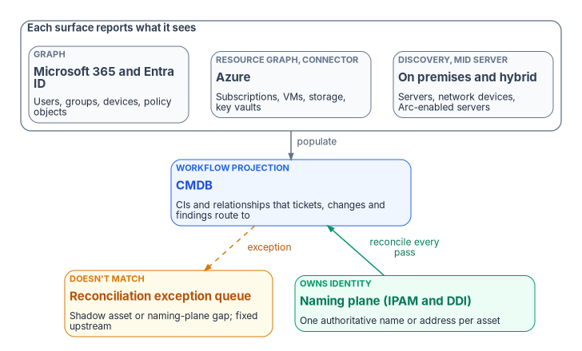
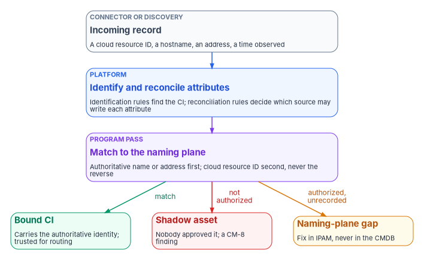

# Chapter 07 — The CMDB and Asset Identity

*Every ticket names an asset, so the help desk can only be as right as the inventory it routes to; the CMDB earns that trust by agreeing with one authoritative identity, not by being one.*

::: {.callout-note}
## In this chapter
What the CMDB is for in day-two operations, and why the program treats it as a workflow projection of the authoritative asset identity rather than a second source of truth. What CM-8 and its enhancements ask of an inventory, and which baselines select them. Where configuration items come from (discovery, service graph connectors and the cloud platforms' own inventories), how ServiceNow's identification and reconciliation engine decides what to create and who may write, and the program's reconcile pass on top of it. The join key of asset identity plus time, duplicate and stale configuration items, and why patching and evidence depend on all of it.
:::

A compliance task is only as good as the asset it names. "Remediate the storage account that allows public access" is work someone can do. "Remediate something in one of three subscriptions" is not. The same is true of every request the help desk handles: a laptop reimage, a server patch, a certificate renewal, a firewall exception. Each ticket points at a thing, and the thing has to exist, exactly once, with a name an assessor can follow from the ticket to the change to the evidence.

That pointer is the CMDB's job. In most agencies the IT service management platform already holds the configuration management database, and every incident, request, change and finding is attached to a configuration item (CI) in it ([Book 13, Chapter 10](../b13-governance/10-ticket-to-machine.md#how-the-service-desk-fits)). When the CMDB is right, work routes to the right owner, a change's blast radius can be computed, and a closed ticket proves something about a real asset. When it is wrong, the same virtual machine appears as three CIs, a remediation task closes against the wrong one, and the evidence trail forks without anyone noticing.

This chapter covers how the CMDB is populated from the cloud and on-premises surfaces, and the part that matters most: how it is **reconciled** to the authoritative asset identity so it never becomes a second, competing source of truth.

{#fig-ch07-cmdb-is-a-projection fig-alt="Three slate cards in a group labeled each surface reports what it sees: Microsoft 365 and Entra ID through Graph, with users, groups, devices and policy objects; Azure through Resource Graph and a connector, with subscriptions, VMs, storage and key vaults; and on premises and hybrid through Discovery and a MID Server, with servers, network devices and Arc-enabled servers. An arrow labeled populate runs from the group down to a blue card, the CMDB, a workflow projection holding the CIs and relationships that tickets, changes and findings route to. Two cards sit side by side below the CMDB. On the right, a green card, the naming plane (IPAM and DDI), which owns identity, one authoritative name or address per asset, sends a green arrow labeled reconcile every pass up to the CMDB. On the left, a dashed amber arrow labeled exception runs from the CMDB down to an amber card, the reconciliation exception queue: a shadow asset or a naming-plane gap, fixed upstream."}

## The CMDB is a projection, not the authority

The program's position is short. Discovery and connectors **populate** the CMDB; the authoritative naming and addressing record **governs** identity. Where the two disagree, the CMDB is wrong by definition, and the disagreement is itself a finding. That is a design choice, and it is the same one the published books already make. [Book 12, Chapter 02](../b12-security-operations/02-the-evidence-contract.md#the-join-key-authoritative-asset-identity-plus-time) keys every evidence record to the naming plane's authoritative name or address and gives the service management CMDB the role of workflow and correlation hub that reconciles *to* it. [Book 13, Chapter 03](../b13-governance/03-one-authoritative-record.md#who-is-authoritative-for-what) gives each class of fact one authoritative source and makes every other copy a pointer that knows where it came from. The CMDB is the most important of those pointers, because the most work flows through it.

| Layer | Owns | Realized by | Reconciles to |
|---|---|---|---|
| Naming and addressing plane | Authoritative asset identity: name, address, DNS and IPAM record | IPAM and DDI ([Book 08](../b08-ddi/index.md), [Book 10, Chapter 06](../b10-cloud-boundary/06-ipam-and-network-as-code.md)) | Nothing; it is the authority |
| Cloud-native inventories | Each surface's own view of its resources | Microsoft Graph, Azure Resource Graph, the Defender device inventory, Intune | The naming plane, at ingest |
| CMDB | Workflow-addressable CIs and their relationships | Discovery and service graph connectors | The naming plane, on every reconcile pass |

: Who owns what about an asset {.striped .hover}

Why not make the CMDB the authority? Because it is built from what connectors and scanners report, and a scanner reports what it found, not what the agency decided should exist. NIST's security-focused configuration management guide says the component inventory "is populated through a process of discovery," and that even with automated tools some elements, among them organizational unique identifiers, system association and the component's owner, still have to be entered by people.[^c07-sp800128] Those human-decided facts are the identity. The program keeps them in the record that decides addressing, and lets the CMDB inherit them.

## What CM-8 asks of an inventory

CM-8 is the control an assessor reads the CMDB against. It asks for an inventory of system components that accurately reflects the system, includes all components within it, "does not include duplicate accounting of components or components assigned to any other system," sits at the granularity needed for tracking and reporting, includes the information the agency defines for accountability, and is reviewed and updated at a frequency the agency sets. Its discussion is direct about the mechanism: preventing duplicate accounting "necessitates use of a unique identifier for each component," and it notes that scanning networks over both IPv4 and IPv6 can produce duplicate components in different address spaces.[^c07-sp80053]

The enhancements describe what a mature inventory does. Several map directly to day-two work.

| Enhancement | What it asks | NIST baselines | Where it lands in day-two work |
|---|---|---|---|
| CM-8 | The inventory itself: accurate, complete, no duplicates, reviewed on a set frequency | Low, Moderate, High | The reconcile pass and the exception queue |
| CM-8(1) | Update the inventory as part of installations, removals and system updates | Moderate, High | Every change record and decommission updates the CI ([stale CIs](#stale-cis)) |
| CM-8(2) | Keep the inventory current, complete, accurate and available with automated mechanisms | High | Connectors and discovery, never hand entry |
| CM-8(3) | Detect unauthorized hardware, software and firmware automatically, and act (disable, isolate or notify) | Moderate, High | Shadow-asset exceptions |
| CM-8(4) | Identify, by name, position or role, the individuals responsible for administering each component | High | An owner and a managing group on every CI ([Chapter 10](10-who-runs-day-two.md)) |
| CM-8(5) | Withdrawn; incorporated into CM-8 | — | — |
| CM-8(6) | Include assessed configurations and approved deviations | Not selected | Configuration objects as CIs; exceptions linked to them |
| CM-8(7) | Provide a centralized repository | Not selected | The CMDB, as the program's design |
| CM-8(8) | Track components by geographic location with automated mechanisms | Not selected | Location attributes, coordinated with privacy where it matters |
| CM-8(9) | Assign components to a system and get an acknowledgement from defined personnel | Not selected | System association on every CI, acknowledged by the system owner |

: CM-8 and its enhancements, with NIST SP 800-53B baselines {.striped .hover}

The baseline column is read from NIST's SP 800-53B profiles: Moderate selects CM-8, CM-8(1) and CM-8(3); High adds CM-8(2) and CM-8(4).[^c07-sp80053b] Agencies may select the others, and the program uses CM-8(4), (6), (7) and (9) as design at every level because they are what make a CMDB usable for routing. CM-8(4) in particular is the reason a CI without an owner is a defect, not a missing nicety: its discussion says naming the responsible individuals lets the organization contact them "if some action is required," such as when the component is the source of a breach.[^c07-sp80053]

Two federal requirements push in the same direction. CISA's BOD 23-01 requires agencies to perform automated asset discovery every 7 days, to start vulnerability enumeration across all discovered assets every 14 days, and to feed results into the CDM Agency Dashboard within 72 hours of discovery completing.[^c07-bod2301] Discovery on that cadence produces exactly the stream of records a CMDB has to reconcile. And FedRAMP's 2026 Key Security Indicators ask cloud providers that "authoritative sources are used to automatically generate real-time inventories of all information resources when needed" (KSI-PIY-GIV), mapped to CM-8, CM-8(1), CM-8(2) and CM-8(4) among others.[^c07-ksi] The indicators bind providers, not agencies, but they describe the same discipline: the inventory is generated from an authority, not typed.

## Where configuration items come from

The program's rule is that the CMDB is populated by connectors and discovery, never by hand entry, so it is reproducible and can be compared run to run. That follows CM-8(2) where it is selected and is good practice where it isn't.

| Source surface | Mechanism | Representative CI classes |
|---|---|---|
| On premises and hybrid | ServiceNow Discovery through a MID Server inside the agency network | Servers, network devices, Arc-enabled servers, the applications running on them |
| Azure | The Service Graph Connector for Microsoft Azure; Azure Resource Graph for change-driven updates | Subscriptions, virtual machines, storage accounts, key vaults |
| Microsoft 365 and Entra ID | An integration over Microsoft Graph that the agency builds or acquires | Users, groups, devices, and policy objects as configuration CIs |
| Security posture | Defender and Defender for Cloud findings, written as attributes and relationships on existing CIs | No new CI tree; findings attach to the asset they describe |

ServiceNow describes Discovery as finding "computers, servers, printers, a variety of IP-enabled devices, and the applications that run on them," and updating the CMDB with what it finds. The MID Server runs the probes and patterns inside the network, starts every connection from inside the firewall, and doesn't retain discovery data.[^c07-sn-discovery] The Service Graph Connector for Microsoft Azure pulls Azure data into the CMDB; ServiceNow documents that the data is mapped to CMDB classes by its Robust Transform Engine and inserted through the Identification and Reconciliation Engine, and that events pulled from Azure can create and update the connector's CIs.[^c07-sn-sgc-azure] The program's design places the MID Server and the connector's credentials inside the authorization boundary, so the CMDB's reach into the estate is itself an assessed, least-privilege path.

Azure Resource Graph is the other half of the Azure picture. Microsoft describes it as querying "at scale across a given set of subscriptions," with the last 14 days of resource configuration changes available, and lists keeping an up-to-date CMDB as a use for its change data: "instead of refreshing all resources and their full property sets on a scheduled frequency, you only receive their changes."[^c07-arg] A connector's full load and a change feed are complementary. The full load catches what the feed missed; the feed keeps the CMDB close to current between loads.

**Configuration objects are CIs too.** A Conditional Access policy, an Azure Policy assignment and a secure-baseline setting are configuration state the compliance workflow reasons about. The program models them as configuration CIs so a drift task can reference the exact object that drifted, not a free-text description of it. CM-8(6), which asks the inventory to carry assessed configurations and approved deviations, is the control that design answers.[^c07-sp80053] No ServiceNow connector the program relies on is claimed to import these objects; the integration is the agency's to build, and [Chapter 08](08-control-automation-m365-and-azure.md) describes the drift work that consumes them.

## How the platform reconciles, and what the program adds

ServiceNow already does much of the reconciliation work natively, and the program's design builds on it rather than replacing it. Its Identification and Reconciliation Engine (IRE) "prevents duplicate CIs by uniquely identifying CIs" and "reconciles CI attributes by allowing only authoritative data sources to write to CMDB." It uses three kinds of rule:[^c07-sn-ire][^c07-sn-recon]

- **Identification rules** decide whether an incoming record is an existing CI or a new one. Where a source supplies its own name and native key, IRE can identify the CI from those without running the matching rules.
- **Reconciliation rules** decide which discovery sources may update which attributes of a class, so that "discovery sources can't overwrite each other's updates." A rule on a parent class applies to its children unless a child rule overrides it. Data refresh rules decide when a CI is stale for a given source, so that a lower-priority authorized source can update it.
- **IRE data source rules** stop named sources from creating CIs of a given class at all.

On every payload IRE also updates the CI's `last_discovered` and `discovery_source`, and `first_discovered` records when the CI was first created.[^c07-sn-ire]

That machinery answers "is this the same CI the CMDB already has?" It doesn't answer "is this asset the one the agency's naming plane says exists?" The program adds a reconcile pass for that second question, run before a CI is trusted for routing.

{#fig-ch07-reconcile-pass fig-alt="A vertical flow. A slate card, the incoming record from a connector or discovery, carrying a cloud resource ID, a hostname, an address and a time observed, leads to a blue card for the platform step: identify and reconcile attributes, where identification rules find the CI and reconciliation rules decide which source may write each attribute. That leads to a violet card for the program's pass: match to the naming plane, by the authoritative name or address first and the cloud resource ID second, never the reverse. Three arrows leave it. A green arrow labeled match leads to a green card, bound CI, which carries the authoritative identity and is trusted for routing. A red arrow labeled not authorized leads to a red card, shadow asset: nobody approved it, a CM-8 finding. An amber arrow labeled authorized, unrecorded leads to an amber card, naming-plane gap: fix in IPAM, never in the CMDB."}

1. **Match.** The incoming asset is matched to an authoritative IPAM and DDI record by name or address. The authoritative key is tried first and the cloud resource ID second, never the reverse; otherwise the CMDB would make the cloud's identifier the truth.
2. **Bind.** The matched CI carries the authoritative identity as its correlation key, so every task, change and evidence record attached to it inherits one traceable identity across surfaces. In the program's design that key is the `asset_id` of [Book 12's evidence contract](../b12-security-operations/02-the-evidence-contract.md#the-contract-one-record-every-source).
3. **Flag.** An asset present on a surface but absent from the naming plane is a **reconciliation exception**. Either it is a shadow asset nobody authorized, which is a real finding under CM-8(3), or it is an authorized asset the naming plane never recorded, which is a defect in the naming plane. Either way it is raised, not absorbed.

The exception queue is a compliance artifact in its own right: its size and age are the running measure of how completely the estate is enumerated. SP 800-128 makes the same point about monitoring in general: confirm "that all items in the component inventory can be identified and are associated with the appropriate system," and look for unapproved components, which "rarely have updated patches, are not configured using the approved baseline configurations, and are not assessed or included in the authorization to operate."[^c07-sp800128]

The direction of repair matters as much as the detection. A naming-plane gap is fixed in IPAM and DDI and then flows back to the CMDB on the next pass. Patching it in the CMDB would invert the relationship the whole design depends on, which is the upstream-correction rule [Book 13, Chapter 03](../b13-governance/03-one-authoritative-record.md#who-is-authoritative-for-what) sets for every derived copy.

Where ServiceNow's CMDB 360 is enabled, dynamic reconciliation rules can choose an attribute's value from the values several sources report rather than from source priority.[^c07-sn-recon] That is a useful tool for attributes nobody owns authoritatively, such as an operating system build. It isn't a substitute for the naming plane on identity, which isn't decided by majority.

## The join key: identity plus time

An inventory row says *what* exists. Evidence also needs *when*. [Book 12, Chapter 02](../b12-security-operations/02-the-evidence-contract.md#the-join-key-authoritative-asset-identity-plus-time) makes the join key authoritative asset identity plus synchronized time, so records from different stacks can be joined into one story about one asset at one moment. The CMDB has to carry both halves.

The identity half is the bound key from the reconcile pass. The time half is easier to get wrong, because each source means something different by "last seen":

- **The CMDB's own time.** `last_discovered` is updated on every payload IRE processes, even when nothing else changes, and `discovery_source` records which source sent it.[^c07-sn-ire] It says when a source last vouched for the CI, not when the asset was last used.
- **Entra ID's device activity timestamp.** Microsoft calls it `ApproximateLastSignInDateTime` and says it "isn't an audit." It is replaced only when the new value is more than 14 days (plus or minus 5) newer than the old one, so Microsoft advises against treating any timestamp younger than 21 days as a sign of staleness, and notes that some active devices have a blank timestamp.[^c07-entra-stale]
- **Defender's device inventory.** The `DeviceInfo` table's `Timestamp` is the "last date and time recorded for the device."[^c07-mde-deviceinfo]
- **Azure Resource Graph.** It is a cache over Resource Manager with 14 days of change history.[^c07-arg]

The program's rule is that every CI attribute that feeds evidence carries the time it was observed and the source that observed it, and that a join between a CMDB row and an evidence record uses the evidence record's `observed_at`, not the CMDB's refresh time. A row that says a server is patched, with no date, is a claim, not evidence.

## Duplicate CIs

Duplicates are CM-8's first named failure ("duplicate accounting of components") and the most common one in practice.[^c07-sp80053] They come from the sources themselves, not from careless administrators.

- Microsoft's guidance on stale devices lists "duplicate device objects after an OS reinstall, reimage, or recovery" among the common signs, and notes that duplicates "can make it difficult for your helpdesk staff to identify which device is currently active."[^c07-entra-stale]
- Defender's device inventory keeps a history of identifiers for one device: `MergedDeviceIds` holds "previous device IDs that have been assigned to the same device" and `MergedToDeviceId` "the most recent device ID." Microsoft's own sample queries filter out records where `MergedToDeviceId` is set to remove "invalidated/merged devices."[^c07-mde-deviceinfo]
- CM-8's discussion warns that scanning both IPv4 and IPv6 can surface one component twice.[^c07-sp80053]

ServiceNow's CMDB Health dashboard counts duplicates as part of its correctness score. Duplicates are found with identification rules, only independent CIs are evaluated, and in a set of duplicates the count is the number of CIs in the set minus one.[^c07-sn-health]

The program resolves a duplicate by binding, not by deleting. The duplicates are matched to one naming-plane identity, the CI that will survive is the one that carries that identity, and the tickets, changes and findings attached to the others are moved to it before anything is retired. Deleting the wrong duplicate first is how an open vulnerability finding loses its asset and quietly stops counting. Where duplicates keep reappearing from one source, the fix is in that source's identification rule or the connector's mapping, which is a change to the platform and goes through change control like any other.

## Stale CIs

A stale CI describes something that may no longer exist. It is the opposite failure from a missing one, and it is just as costly: patch compliance computed over CIs that no longer exist looks worse than it is, and a finding routed to a stale CI goes to an owner who may have moved on.

ServiceNow's CMDB Health correctness score includes staleness: "A CI is stale if it was not updated within the Effective Duration time period," which the base system's default rule sets to 60 days.[^c07-sn-health] Its CMDB Data Manager turns that into lifecycle work through policies for retiring, archiving and deleting CIs, and an attestation policy that sends tasks asking owners to "verify the existence of actual IT infrastructure and applications that you own." A separate task is created for each Managed By Group value among the target CIs, and when a policy requires approval, members of that group approve before it runs.[^c07-sn-datamgr]

Microsoft's guidance for stale Entra ID devices shows why the sequence matters. It recommends defining a timeframe, disabling first and deleting only after a grace period, because "there is no way to recover deleted devices" and deleting a device also deletes the BitLocker recovery keys stored on it. Devices under Intune or another device manager are retired there first, and system-managed devices such as Autopilot objects aren't deleted at all.[^c07-entra-stale]

The program's lifecycle for a stale CI follows the same shape, as design:

1. **Detect** on the platform's staleness rule, using a window longer than the slowest source's refresh interval.
2. **Attest** through the CI's managing group: the owner confirms the asset is gone, or that it still exists and a source has stopped reporting it. The second answer is a coverage problem, not a stale CI, and goes to the source's owner.
3. **Retire** the CI, which keeps it visible with its history, and update the naming plane in the same change. CM-8(1) asks for the inventory to be updated as part of removals.[^c07-sp80053]
4. **Archive or delete** only after open findings, changes and evidence attached to it are closed or moved, and only within the records schedule ([Chapter 10](10-who-runs-day-two.md) gives the records officer that decision).

## Why patching and evidence depend on it

[Book 12, Chapter 07](../b12-security-operations/07-patch-configuration-and-baselines.md#cm-8-is-the-precondition-for-si-2-at-scale) states the dependency plainly: CM-8 is the precondition for SI-2 at scale. A patch stack reports by its own machine ID, a vulnerability scanner by its own device ID, a cloud console by its resource ID. The question "is this vulnerability fixed across the estate?" can be answered only if every one of those records maps to one asset, and a remediation record that can't be mapped proves nothing about any real asset.

The CMDB is where that mapping becomes operational. The daily remediation queue in [Book 12, Chapter 06](../b12-security-operations/06-vulnerability-management.md#building-the-daily-queue) reads an asset register exported from the authoritative inventory, with each asset's identity, exposure and owner. Each queue row becomes a task on a CI. The CI decides who receives it, the change that fixes it is raised against it, and closure requires a later assessment of the same asset that no longer sees the finding. Break the CMDB at any point and each step fails differently:

| CMDB defect | What it does to patching | What it does to evidence |
|---|---|---|
| Missing CI (shadow asset) | Never scanned or patched; not in any window | Coverage looks complete because the denominator is wrong |
| Duplicate CI | The fix lands on one copy; the finding stays open on the other, or closes against the wrong one | Two partial histories; neither proves the asset was fixed |
| Stale CI | Work is routed to an asset that no longer exists | Compliance percentages computed over phantoms |
| CI without an owner | Task sits unassigned until its window lapses | No one to attest; CM-8(4) gap |
| CI bound to a cloud ID only | Breaks when the resource is redeployed with a new ID | History splits at every redeployment |

The same is true of control evidence generally. [Chapter 11](11-attestation-and-the-compliance-app.md) assembles attestation from records that name assets, and an assessor will sample them. A sample that leads from a closed task to a CI to a naming-plane record to a scanner result for the same asset at a later time is evidence. A sample that leads to a CI nobody can find in the network is a finding about the inventory, whatever the ticket says.

## Measuring the inventory

The program measures the CMDB with a small set of indicators, reviewed weekly by the CMDB owner and monthly by the CISO alongside the drift metrics of [Book 13, Chapter 09](../b13-governance/09-who-governs.md#cadence). The measures and targets are program design.

| Measure | What it shows | Direction |
|---|---|---|
| Open reconciliation exceptions, by kind and age | How completely the estate is enumerated | Down, and none older than one discovery cycle without an owner |
| Share of CIs bound to a naming-plane identity | Whether routing can be trusted | Up, toward all CIs in scope |
| Duplicate count (CMDB Health correctness) | Identification rules and connector mappings working | Down |
| Stale CIs past the attestation window | Lifecycle working | Down |
| CIs without an owner or managing group | CM-8(4) readiness | Zero for in-scope classes |
| CIs not assigned to a system | CM-8(9) readiness; boundary accuracy | Zero for in-scope classes |
| Discovery and connector runs that failed or returned fewer records than the last run | Coverage decay before it becomes a finding | Investigated within one business day |

The last row matters most. A connector that silently returns half its usual records produces no error and a CMDB that is half right.

## Honest limits

- **Coverage decays.** A new resource type, a connector version that changes its mappings, or a credential that expires leaves assets unmodeled. The exception queue surfaces the gap only if someone works it; an unworked queue is a silent CM-8 regression.
- **The CMDB can't repair the naming plane.** An IPAM gap is fixed in IPAM, not patched in the CMDB, or the fix inverts the authority relationship.
- **The platform is replaceable; the discipline isn't.** Moving to a different service management platform changes the connectors, the identification rules and the health scoring. Reconciling to one authoritative identity, binding it, and flagging what doesn't match stay the same.
- **Native features overlap the design.** IRE, CMDB Health and Data Manager already cover identification, attribute authority, duplicate and staleness scoring, and attestation. The program's additions are the external identity authority and the exception queue. An agency whose naming plane isn't ready can still get most of the hygiene benefit from the native features first.

::: {.callout-tip}
## Continue the book
[← Previous: Chapter 06 — SaaS Integration Governance](06-saas-integration-governance.md) · [Book index](index.md) · [Next: Chapter 08 — Control Compliance Automation: Microsoft 365 and Azure →](08-control-automation-m365-and-azure.md)
:::

[^c07-sp800128]: National Institute of Standards and Technology, SP 800-128, *Guide for Security-Focused Configuration Management of Information Systems*, August 2011 (includes updates as of October 10, 2019), §2.3.4 (Component Inventory), §3.1.2 (Planning at the System Level, "Create or Update System Component Inventory") and §3.4 (SecCM Monitoring), <https://nvlpubs.nist.gov/nistpubs/SpecialPublications/NIST.SP.800-128.pdf> (accessed Oct 21, 2026).
[^c07-sp80053]: National Institute of Standards and Technology, SP 800-53 Rev. 5, *Security and Privacy Controls for Information Systems and Organizations*, release 5.2.0, controls CM-8 (with discussion) and CM-8(1) through CM-8(9), <https://csrc.nist.gov/pubs/sp/800/53/r5/upd1/final>; control text checked against the release 5.2.0 OSCAL catalog, <https://github.com/usnistgov/oscal-content/tree/main/nist.gov/SP800-53/rev5/json> (both accessed Oct 21, 2026).
[^c07-sp80053b]: National Institute of Standards and Technology, SP 800-53B, *Control Baselines for Information Systems and Organizations*, Low, Moderate and High baseline profiles, release 5.2.0 (OSCAL), <https://github.com/usnistgov/oscal-content/tree/main/nist.gov/SP800-53/rev5/json> (accessed Oct 21, 2026).
[^c07-bod2301]: Cybersecurity and Infrastructure Security Agency, Binding Operational Directive 23-01, *Improving Asset Visibility and Vulnerability Detection on Federal Networks*, October 3, 2022, Required Actions, <https://www.cisa.gov/news-events/directives/bod-23-01-improving-asset-visibility-and-vulnerability-detection-federal-networks> (accessed Oct 21, 2026).
[^c07-ksi]: FedRAMP, "Key Security Indicators," *FedRAMP Consolidated Rules for 2026*, 20x Class C, KSI-PIY-GIV (Generating Inventories) and its control mappings (changelog entries through October 13, 2026), <https://www.fedramp.gov/2026/reference/20x/c/key-security-indicators/> (accessed Oct 21, 2026).
[^c07-sn-discovery]: ServiceNow, "Exploring Discovery," IT Operations Management documentation, Brazil release, <https://www.servicenow.com/docs/r/it-operations-management/discovery/c_GetStartedWithDiscovery.html> (accessed Oct 21, 2026).
[^c07-sn-sgc-azure]: ServiceNow, "Service Graph Connector for Microsoft Azure," Zurich release documentation, <https://www.servicenow.com/docs/r/zS6yb8e~gR8BPjeviYdV9g/ZhQhBkUG5nbYi9PwAtM5GQ> (accessed Oct 21, 2026).
[^c07-arg]: Microsoft Learn, "What is Azure Resource Graph?," <https://learn.microsoft.com/azure/governance/resource-graph/overview>, and "Get resource changes: Run a query," <https://learn.microsoft.com/azure/governance/resource-graph/changes/get-resource-changes> (both accessed Oct 21, 2026).
[^c07-sn-ire]: ServiceNow, "Identification and Reconciliation Engine (IRE)," Australia release documentation, <https://www.servicenow.com/docs/bundle/australia-servicenow-platform/page/product/configuration-management/concept/ire.html> (accessed Oct 21, 2026).
[^c07-sn-recon]: ServiceNow, "Reconciliation rules," Australia release documentation, <https://www.servicenow.com/docs/bundle/australia-servicenow-platform/page/product/configuration-management/reference/r_ReconciliationRulesPrinciples.html> (accessed Oct 21, 2026).
[^c07-entra-stale]: Microsoft Learn, "How To: Manage stale devices in Microsoft Entra ID," sections "What is a stale device?," "How is the value of the activity timestamp managed?," "Plan the cleanup of your stale devices" and "What you should know," <https://learn.microsoft.com/entra/identity/devices/manage-stale-devices> (accessed Oct 21, 2026).
[^c07-mde-deviceinfo]: Microsoft Learn, "DeviceInfo" (advanced hunting schema), <https://learn.microsoft.com/defender-xdr/advanced-hunting-deviceinfo-table>, and "Review and assess devices in Microsoft Defender for Endpoint: Query details for discovered devices," <https://learn.microsoft.com/defender-endpoint/assess-devices> (both accessed Oct 21, 2026).
[^c07-sn-health]: ServiceNow, "CMDB Health KPIs and metrics," Australia release documentation, <https://www.servicenow.com/docs/bundle/australia-servicenow-platform/page/product/configuration-management/reference/r_CMDBHealthMetrics.html> (accessed Oct 21, 2026).
[^c07-sn-datamgr]: ServiceNow, "Working with CMDB Data Manager," Australia release documentation, <https://www.servicenow.com/docs/bundle/australia-servicenow-platform/page/product/configuration-management/concept/cmdb-data-management.html> (accessed Oct 21, 2026).
