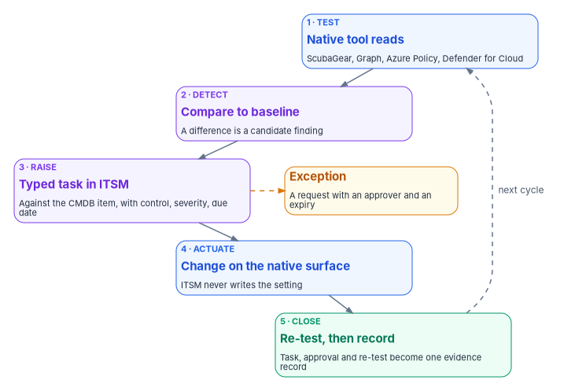
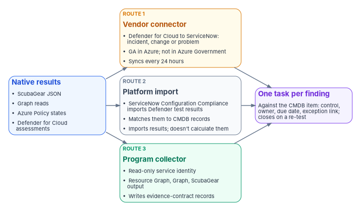

# Chapter 08 — Control Compliance Automation: Microsoft 365 and Azure

*Microsoft's own tools already test most of the settings an assessor asks about, every day. Day two is about turning each failed test into owned work with a clock, and each closed task into a record an assessor can trace.*

::: {.callout-note}
## In this chapter
The five-step loop the program runs on every control surface, and why the coordination platform reads control state but never writes it. What produces control evidence in Microsoft 365 (ScubaGear, Microsoft Graph, Purview audit, Purview Compliance Manager) and in Azure (Azure Policy regulatory compliance initiatives, Defender for Cloud regulatory compliance, Azure Resource Graph), each checked for availability in GCC, GCC High and Azure Government. Three ways results reach the IT service management (ITSM) platform, where ServiceNow's own compliance applications overlap the design, and a read-only collector to start from.
:::

[Chapter 07](07-the-cmdb-and-asset-identity.md) gave every asset one identity in the configuration management database (CMDB). This chapter and [Chapter 09](09-control-automation-aws-and-vmware.md) put control results against those identities. Microsoft 365 and Azure come first because most agencies run both, and because the two surfaces show the two shapes the problem takes. Microsoft 365 is software as a service: the agency configures it but doesn't host it, so its control obligations are mostly about identity, configuration baselines and data protection. Azure is infrastructure the agency fills with its own workloads, so it adds resource configuration, vulnerabilities and patching.

On both, Microsoft already ships tools that test the settings continuously. That isn't the gap. The gap is what [Book 13, Chapter 10](../b13-governance/10-ticket-to-machine.md#native-tools-change-state-they-dont-close-findings) describes: a native console shows current state, but an assessor needs to know, for each finding, who owns it, what clock they work against, who approved the change or exception, and what re-test showed it closed. Day two is where that record either gets built as a by-product of the work or gets assembled by hand the month before an audit.

{#fig-ch08-one-loop fig-alt="Five cards in a column joined by arrows, top to bottom. A blue card, test: the native tool reads control state, for example ScubaGear, Graph, Azure Policy or Defender for Cloud. A violet card, detect drift: the result is compared with the intended baseline. A violet card, raise: a typed task is opened in the ITSM platform against the configuration item from the CMDB, with the control, severity and due date. A blue card, actuate: the owning team makes the change on the native surface; the ITSM platform never writes the setting. A green card, close with evidence: the next native test confirms the fix, and the task, approval and re-test become one evidence record keyed to the asset identity. A dashed amber arrow runs from the raise card to an amber card beside it: exception, a request with an approver and an expiry. A dashed arrow runs from the green card back to the test card, labeled next cycle."}

## One loop on every surface

The program runs the same five steps on every control surface. The surface changes; the loop doesn't. This is program design, and it is the same loop [Book 13, Chapter 10](../b13-governance/10-ticket-to-machine.md) describes for every change.

| Step | What happens | Where it happens |
|---|---|---|
| 1. Test | The native tool reads control state: a ScubaGear result, a Conditional Access policy, an Azure Policy compliance state, a Defender for Cloud assessment | On the native surface, read-only |
| 2. Detect drift | The result is compared with the intended baseline; a difference is a candidate finding | In the collector or the ITSM platform |
| 3. Raise | A typed task (incident, change or request) is opened against the configuration item from [Chapter 07](07-the-cmdb-and-asset-identity.md), carrying the control, the severity and the due date | In the ITSM platform |
| 4. Actuate | The owning team, or a machine under an approved plan, makes the change on the native surface | On the native surface |
| 5. Close with evidence | The next native test confirms the fix; the task, approval trail and re-test result become the evidence record | ITSM platform to the evidence store |

: The five-step loop (program design) {.striped .hover}

Two rules hold the loop together.

**The coordination platform reads; it doesn't write.** A workflow platform holding standing write access to Conditional Access or tenant configuration would itself be a privilege problem, the kind AC-6 least privilege exists to prevent.[^c08-sp80053] The ITSM platform needs read access to control state and the right to create tasks in its own tables. Where an automated fix is safe and reversible, it runs as a scoped, logged action under its own approval, through the execution layer [Book 13, Chapter 10](../b13-governance/10-ticket-to-machine.md#approval-gates-keep-humans-on-the-decisions-that-matter) describes, never through standing access granted to the workflow tool.

**A task closes on a re-test, not on a click.** The record closes when the next native test of the same asset shows the fixed state. That is the `disposition` rule of the evidence contract in [Book 12, Chapter 02](../b12-security-operations/02-the-evidence-contract.md), and it is why the test in step 1 has to run on a schedule, not on demand.

## Microsoft 365: what produces the evidence

### ScubaGear and the secure configuration baselines

CISA's ScubaGear checks a Microsoft 365 tenant against the SCuBA secure configuration baselines. It queries the Microsoft 365 APIs with PowerShell, evaluates the settings with Open Policy Agent against policies written from the baselines, and reports the results as HTML, JSON and CSV.[^c08-scubagear] Its `-M365Environment` parameter takes `commercial`, `gcc`, `gcchigh` or `dod`, and it is required for GCC High and DoD tenants.[^c08-scuba-params] [Book 11, Chapter 05](../b11-zero-trust/05-two-assessment-tools.md) covers running it, the roles it needs and the version to pin; [Book 11, Chapter 04](../b11-zero-trust/04-scuba-and-bod-25-01.md) covers what BOD 25-01 requires. The directive required agencies to deploy all SCuBA assessment tools for in-scope cloud tenants by April 25, 2025, and to report continuously, either by feeding the results to CISA's continuous monitoring solution or by submitting the latest results each quarter in a machine-readable format.[^c08-bod2501]

For day two, the JSON output is what matters. Each policy result carries a stable policy identifier, such as `MS.AAD.1.1v1` ("Legacy authentication SHALL be blocked"),[^c08-scuba-aad] so the program holds the mapping from policy to task as data: the same failing policy always raises the same type of task with the same control (CM-6 for a configuration setting) against the same tenant configuration item. A new failure is a **change** if fixing it is a planned configuration change, or an **incident** if the setting regressed unexpectedly. A policy the agency has decided not to meet appears in the output as omitted, with its rationale, and [Book 11, Chapter 04](../b11-zero-trust/04-scuba-and-bod-25-01.md#how-agencies-report) notes that CISA expects omissions to be approved through the agency's risk process. In the program's design an omission is an exception record with an approver and an expiry, not a line in a configuration file.

### Microsoft Graph for identity state

Some identity controls are easier to test directly than through a baseline tool. Microsoft Graph's list operation for Conditional Access policies needs only the `Policy.Read.All` permission, works with roles as limited as Global Reader or Security Reader, and is available in the global service and in both US Government national clouds.[^c08-graph-ca] The endpoint depends on the tenant: a Microsoft 365 GCC tenant keeps using the worldwide `https://graph.microsoft.com`, while GCC High uses `https://graph.microsoft.us` and DoD uses `https://dod-graph.microsoft.us`, each with an app registration made in the matching cloud.[^c08-graph-clouds]

Reading Conditional Access this way supports the identity workflows that generate the most standing human work: joiner, mover and leaver changes, privileged-role requests and Conditional Access exceptions such as an emergency-access account or a temporary exclusion for a service. The program's design treats every exception as a **request** with a justification, a security approver (an exception weakens a blocking control) and an expiry, reviewed on the cadence [Book 04](../b04-access/index.md) sets. The Graph read is the test that catches the exclusion still present after its request expired, which the program treats as a high-severity finding, not a quiet default. Who may approve what is in [Book 02, Chapter 05](../b02-identity/05-delegation-without-ous.md) and [Book 04](../b04-access/index.md).

### Purview audit and data protection

Microsoft Purview is both the actuator and the evidence engine for data protection, and [Book 12, Chapter 09](../b12-security-operations/09-data-protection-and-classification.md) covers the policies. Two pieces reach day two. The unified audit log is retrievable through the Office 365 Management Activity API, which has its own endpoint per cloud: `manage-gcc.office.com` for GCC, `manage.office365.us` for GCC High and `manage.protection.apps.mil` for DoD.[^c08-mgmt-api] Audit (Standard) keeps records for 180 days; Audit (Premium) keeps Entra ID, Exchange, OneDrive and SharePoint records for one year by default, with retention policies up to ten years for users with the add-on license, and the Management Activity API is how Microsoft expects records to be kept longer than that.[^c08-audit] Microsoft's GCC planning guide lists Audit (Standard), one-year and ten-year retention, and the higher Management Activity API bandwidth as available in GCC.[^c08-purview-gcc]

The other piece is change control. In the program's design a change to the sensitivity label taxonomy or to a DLP rule is a compliance-affecting change that carries a **change** record, so the data-protection posture has an approval trail rather than a silent edit; and a user override of a DLP block or a mass label removal opens an **incident** with a review task, because that is the human judgment the detection can't make.

### Purview Compliance Manager

Compliance Manager is the Microsoft product closest to what this chapter describes, so it is worth being precise about what it does. It assesses a tenant against regulatory templates. FedRAMP Moderate and a FedRAMP SSP High Baseline template are among the premium regulations; the Data Protection Baseline is included for everyone, and GCC Moderate, GCC High and DoD customers also get CMMC included.[^c08-cm-regs] Universal templates, the general versions that can apply to any service, can't currently be used by GCC Moderate, GCC High or DoD customers.[^c08-cm-universal]

Many improvement actions are tested automatically, from three sources: built-in signals from other Purview solutions, Microsoft Secure Score, and Microsoft Defender for Cloud, which extends testing to Azure, AWS and Google Cloud resources.[^c08-cm-actions] Statuses refresh every 24 hours. Results can be exported to Excel: an assessment export is a snapshot as of the export time, and each improvement action has an exportable testing history.[^c08-cm-actions][^c08-cm-assess] In GCC, Microsoft lists Compliance Manager itself as available, but continuous compliance assessments as still rolling out and alerts and notifications as in development.[^c08-purview-gcc]

The program uses Compliance Manager as a readiness signal, not as the evidence of record. [Book 14, Chapter 11](../b14-compliance/11-the-authorization-package.md#vendor-scores-are-not-assessment-evidence) explains why: Microsoft itself says a high compliance score doesn't express an absolute measure of compliance with a standard. Its exports are snapshots, it has no documented feed into another system, and its control mapping is Microsoft's. It is a useful place for an operator to see which improvement actions are open; the evidence record is still the task-plus-re-test the loop produces.

## Azure: what produces the evidence

### Azure Policy and the FedRAMP regulatory compliance initiatives

Azure Policy evaluates resources against assigned definitions. Microsoft publishes regulatory compliance built-in initiatives that group those definitions by control, including a FedRAMP Moderate initiative for Azure and a separate FedRAMP Moderate (Azure Government) initiative with its own definitions.[^c08-policy-fedramp][^c08-policy-fedramp-gov] [Book 10, Chapter 05](../b10-cloud-boundary/05-the-landing-zone.md) assigns the initiative at the top of the landing zone in audit mode; day two is about what happens to its results.

Microsoft's own caveat on every one of these initiatives is the most important sentence to carry into an assessment: "Compliant" in Azure Policy "refers only to the policy definitions themselves; this doesn't ensure you're fully compliant with all requirements of a control," and "compliance in Azure Policy is only a partial view of your overall compliance status."[^c08-policy-fedramp] Many FedRAMP controls in the initiative map only to manual policies, which Azure can't test. The initiative is a source of findings for the technical settings it covers, not a verdict on a control.

Timing matters for the evidence record. Azure Policy re-evaluates assignments in a standard cycle once every 24 hours; a newly created or updated resource's result appears about 15 minutes after the change; and an on-demand scan can be started for a subscription or resource group.[^c08-policy-eval] A task the loop closes on "the next evaluation" therefore closes up to a day after the fix, and the record should carry the evaluation time, not the time someone looked.

Exceptions have a native form. A policy exemption has a category, **Waiver** (the non-compliance is temporarily accepted) or **Mitigated** (the intent is met another way), and an optional `expiresOn` date. When the date passes the exemption is no longer honored, but the object isn't deleted, which keeps the record.[^c08-exemption] In the program's design every exemption is created only from an approved request in the ITSM platform, with the expiry set, so the Azure object and the exception register agree. An exemption created any other way is itself a finding.

### Defender for Cloud regulatory compliance

Defender for Cloud presents regulatory standards in its regulatory compliance dashboard; the standards are Azure Policy initiatives underneath. It assesses the controls that can be checked automatically and greys out those that can't, and a standard assigned to a scope with no relevant resources doesn't appear at all.[^c08-mdc-standards] Assigning a standard needs any Defender for Cloud plan except Defender for Servers Plan 1 or Defender for APIs Plan 1.[^c08-mdc-assign] Microsoft's list of available standards shows FedRAMP High and Moderate for Azure and NIST SP 800-53 R5.1.1 across Azure, AWS and Google Cloud.[^c08-mdc-standards]

For day two the useful features are continuous export, which streams regulatory compliance data (or weekly snapshots of it) to a Log Analytics workspace or an event hub, and workflow automation, which can start a Logic App when a regulatory compliance assessment changes state.[^c08-mdc-dashboard] Microsoft's support matrix lists regulatory compliance, continuous export and workflow automation as generally available in both Azure and Azure Government.[^c08-mdc-matrix] Continuous export's limit from [Book 12, Chapter 02](../b12-security-operations/02-the-evidence-contract.md#one-queue-for-every-finding) applies here too: it sends a record when state changes, so silence isn't proof that nothing is open.

Vulnerability findings and patch results from Defender for Cloud, Defender Vulnerability Management and Azure Update Manager feed the same loop for RA-5 and SI-2. [Book 12, Chapter 06](../b12-security-operations/06-vulnerability-management.md) and [Chapter 07](../b12-security-operations/07-patch-configuration-and-baselines.md) build those queues; this chapter doesn't repeat them.

### Azure Resource Graph as the read path

Azure Resource Graph is the simplest read-only way to pull both kinds of result at scale. Policy compliance states are in the `PolicyResources` table (`microsoft.policyinsights/policystates`), and Defender for Cloud's per-standard regulatory compliance state, with passed, failed, skipped and unsupported control counts, is in the `SecurityResources` table (`microsoft.security/regulatorycompliancestandards`).[^c08-arg-policy][^c08-arg-mdc] Exempt resources and the compliance state they would have without the exemption can be queried the same way.[^c08-exemption] Resource Graph is generally available in Azure Government.[^c08-azgov-roadmap] It returns at most 1,000 records per request, so a collector has to page with a skip token.[^c08-arg-paging]

## Getting results into the ITSM platform

There are three ways a result reaches the ITSM platform. The program's design uses whichever one the agency can run in its own cloud, but always lands the same evidence record.

{#fig-ch08-three-routes fig-alt="On the left, a blue card for native results: ScubaGear JSON, Graph reads, Azure Policy states and Defender for Cloud assessments. Three arrows lead to three cards stacked in the middle. An amber card, vendor connector: Defender for Cloud's ServiceNow integration opens incidents, changes or problems from recommendations; generally available in Azure, not available in Azure Government; synchronizes every 24 hours. A slate card, platform import: ServiceNow Configuration Compliance imports Defender for Cloud test results and matches them to CMDB records; it imports results, it doesn't calculate them. A green card, program collector: a read-only service identity reads Resource Graph, Graph and ScubaGear output and writes evidence-contract records. All three lead to a violet card on the right: one typed task per finding against the CMDB configuration item, with control, owner, due date and exception link, closing on a re-test."}

| Route | What it does | Government-cloud note | Program treatment |
|---|---|---|---|
| Vendor connector | Defender for Cloud's ServiceNow integration creates and links ServiceNow incidents, changes or problems from recommendations, manually or through governance rules that set an owner and a remediation timeframe; synchronization runs every 24 hours[^c08-mdc-snow] | Requires the Defender CSPM plan; listed as generally available in Azure and not available in Azure Government[^c08-mdc-snow][^c08-mdc-matrix] | Usable for Azure commercial subscriptions; a convenience for routing, not the evidence record |
| Platform import | ServiceNow Configuration Compliance imports Defender for Cloud test results on scheduled jobs and matches them to CMDB records through CI lookup rules; it "does not calculate the test results, but imports them"[^c08-snow-cc] | Depends on what the agency's Azure scope and ServiceNow instance can reach | A strong option where licensed; remediation tasks live in ServiceNow |
| Program collector | A read-only service identity reads Resource Graph, Graph and ScubaGear output and writes evidence-contract records that open or update tasks | Works in every cloud, with the endpoints set per cloud | The default where neither of the others is available, and the only route that also covers ScubaGear |

: Three routes to the ITSM platform {.striped .hover}

The routes can be combined, but each source should feed through exactly one of them. Two routes for the same finding produce two tasks with two clocks, and the record of which one closed it becomes ambiguous. The GCC case is common and easy to get wrong: Microsoft 365 GCC tenants pair with Entra ID in commercial Azure, so a GCC agency's Defender for Cloud subscriptions are usually in commercial Azure, where the vendor connector works; an agency on Azure Government can't use it.[^c08-cmmc-clouds][^c08-mdc-matrix]

### The clock on each task

Every task carries a due date, and the source of that date matters. For vulnerabilities and patches the agency's clock is BOD 26-04, *Prioritizing Security Updates Based on Risk* (June 10, 2026), which sets deadlines by whether an asset is publicly exposed and whether the vulnerability is in CISA's Known Exploited Vulnerabilities catalog, and is mandatory for federal civilian executive branch agencies.[^c08-bod2604] [Book 12, Chapter 06](../b12-security-operations/06-vulnerability-management.md#the-programs-remediation-clock) builds that clock. The source volume encoded FedRAMP's Potential Agency Impact (PAIN) timeframe table as the agency's service level instead. That table belongs to FedRAMP's Vulnerability Detection and Response rules, which "apply to all providers with FedRAMP Certifications," state their timeframes as "SHOULD" expectations, and vary them by certification class as well as by PAIN rating and exposure.[^c08-fedramp-vdr] An agency reads a provider's results against those rules; it doesn't run its own queue on them. For configuration findings with no external deadline, the due date is the program's own service level, set per severity.

## Where ServiceNow's own products overlap

Most agencies that run this loop run it on ServiceNow, and ServiceNow sells applications that cover part of it. They are an option to weigh, not a competitor to the design.

- **Continuous Authorization and Monitoring (CAM)** automates the seven-step NIST Risk Management Framework, evaluates controls with SP 800-53A assessment objectives mapped to Rev. 5, supports continuous monitoring from a workspace, and generates plans of action and milestones. It is a separate subscription that requires activation.[^c08-snow-cam] Recent releases added import and export of system security plans and catalogs in OSCAL.[^c08-snow-cam-rn]
- **Configuration Compliance** imports third-party test results, including Defender for Cloud's, maps them to CMDB records and remediates them with remediation tasks, as the table above shows.[^c08-snow-cc] Defender for Cloud's own integration documentation names Configuration Compliance as the ServiceNow module for its posture findings.[^c08-mdc-snow]

An agency that licenses CAM can land the roll-up of this chapter's results there, and [Chapter 11](11-attestation-and-the-compliance-app.md) covers how the program's attestation design and a ServiceNow compliance application fit together. What none of these products supplies is the part this book argues for: the agency's own decision about which native result raises which typed task against which configuration item, with which exception rule, and a closure that requires a re-test. That mapping is the agency's to write and keep, whichever application holds the tasks.

## Illustrative: a read-only collector

::: {.callout-warning}
## Illustrative, not tested against a production tenant or subscription
This script is an example of the collector route. It hasn't been run against a production tenant or subscription. It reads data only and changes nothing, but read it, run it against a test scope first and review its output before relying on it. Connect with the environment that matches your cloud (`AzureUSGovernment` and `USGov` for Azure Government and GCC High; the defaults for commercial Azure and GCC).
:::

```powershell
# Read-only collector: Azure Policy FedRAMP Moderate states and Conditional Access
# policy inventory, written as evidence-contract records (Book 12, Chapter 02).
# Requires Az.Accounts, Az.ResourceGraph, Microsoft.Graph.Authentication and
# Microsoft.Graph.Identity.SignIns. Roles: Reader on the scope; Graph Policy.Read.All.
# Asset identity is resolved later against the CMDB (Chapter 07); this script
# carries the platform's own identifiers in source_ref.

param(
    [string] $AzEnvironment    = 'AzureCloud',   # or 'AzureUSGovernment'
    [string] $GraphEnvironment = 'Global',       # or 'USGov' (GCC High)
    [string] $OutFile          = '.\fmp-evidence-m365-azure.json'
)

Connect-AzAccount -Environment $AzEnvironment | Out-Null
Connect-MgGraph -Environment $GraphEnvironment -Scopes 'Policy.Read.All' -NoWelcome

$observedAt = (Get-Date).ToUniversalTime().ToString('o')
$records    = [System.Collections.Generic.List[object]]::new()

# 1. Non-compliant and exempt Azure Policy states. Add a filter on setName for the
#    FedRAMP initiative assigned in your cloud (its ID differs in Azure Government).
$query = @"
PolicyResources
| where type == 'microsoft.policyinsights/policystates'
| extend setName = tostring(properties.policySetDefinitionName),
         state   = tostring(properties.complianceState),
         resId   = tostring(properties.resourceId),
         defRef  = tostring(properties.policyDefinitionReferenceId),
         evalAt  = tostring(properties.timestamp)
| where state in ('NonCompliant', 'Exempt')
| project id, setName, state, resId, defRef, evalAt
"@

$skipToken = $null
do {
    $page = if ($skipToken) { Search-AzGraph -Query $query -First 1000 -SkipToken $skipToken }
            else            { Search-AzGraph -Query $query -First 1000 }
    foreach ($row in $page) {
        $records.Add([pscustomobject]@{
            source      = 'azure-policy'
            surface     = 'cloud service provider'
            control     = 'CM-6'
            state       = $row.defRef
            verdict     = if ($row.state -eq 'Exempt') { 'exception' } else { 'drift' }
            observed_at = $row.evalAt
            disposition = if ($row.state -eq 'Exempt') { 'exception (check register)' } else { 'open' }
            source_ref  = $row.resId
        })
    }
    $skipToken = $page.SkipToken
} while ($skipToken)

# 2. Conditional Access inventory: one record per policy, for exception review.
foreach ($p in Get-MgIdentityConditionalAccessPolicy -All) {
    $records.Add([pscustomobject]@{
        source      = 'graph-conditional-access'
        surface     = 'identity'
        control     = 'AC-2'
        state       = "$($p.DisplayName) [$($p.State)] excluded users: $(@($p.Conditions.Users.ExcludeUsers).Count)"
        verdict     = 'exception'   # until compared with the approved exception register; drift if not on it
        observed_at = $observedAt
        disposition = 'open'
        source_ref  = $p.Id
    })
}

$records | ConvertTo-Json -Depth 4 | Set-Content -Path $OutFile -Encoding utf8
"Wrote $($records.Count) records to $OutFile"
```

The script deliberately stops at the record. Matching `source_ref` to the CMDB identity, comparing exclusions with the approved exception register, and opening or updating tasks belong to the platform side of the loop, under the identity and permissions [Chapter 07](07-the-cmdb-and-asset-identity.md) and [Chapter 11](11-attestation-and-the-compliance-app.md) describe. The filter to the FedRAMP initiative is left to the reader because the built-in initiative's definition differs between Azure and Azure Government.

## Honest limits

- **The loop is only as good as the test.** A setting no native test covers is invisible to the loop. ScubaGear covers what the baselines cover; the FedRAMP initiative covers the technical settings it maps and leaves manual controls to people. Coverage is a validation question for [Chapter 12](12-the-day-two-runbook.md).
- **"Closed" lags the fix.** Azure Policy's daily cycle and Compliance Manager's 24-hour refresh mean a record closes up to a day after the change. Evidence timestamps record the evaluation, not the instant of the fix.
- **Government clouds differ.** Defender for Cloud's ServiceNow integration isn't available in Azure Government; Compliance Manager's continuous assessments are still rolling out in GCC; universal templates aren't available in GCC, GCC High or DoD. Check each feature against Microsoft's current matrix before building on it, and record the result in the feature register [Book 10, Chapter 09](../b10-cloud-boundary/09-equivalents-and-exceptions.md) describes.
- **Automated remediation still needs a change record.** An Azure Policy `deployIfNotExists` or `modify` remediation changes state; in the program's design it still carries a change record, with the policy engine as the actuator instead of a person.

## The control map for this chapter

The mapping is the program's, not a published crosswalk.

| Control | What the loop contributes |
|---|---|
| AC-2, AC-6 | Conditional Access and role exceptions raised as requests with an approver and expiry, reviewed, and re-tested through Graph; the coordination platform holds read access only |
| CM-3 | Label, DLP and baseline changes carried as change records, including those an automated remediation makes |
| CM-6 | ScubaGear and Azure Policy failures raised as tasks against the configuration item and closed on a re-test |
| RA-5, SI-2 | Defender for Cloud and Update Manager results routed into the queues of [Book 12](../b12-security-operations/index.md), clocked by BOD 26-04 |
| CA-7 | Every result emitted into one monitoring record keyed to asset identity, so monitoring is acted on, not only displayed |

: Controls the loop helps an agency show {.striped .hover}

## What to take from this chapter

- Microsoft already tests most of the settings; the agency's job is to own the result, not to re-test it.
- Run one loop everywhere: test, detect, raise against the configuration item, actuate natively, close on a re-test.
- Keep the ITSM platform read-only on the estate it governs.
- Use Compliance Manager and Defender for Cloud scores as signals, not as the evidence of record.
- Check every feature in your own cloud: GCC, GCC High and Azure Government don't all have the same features.
- Choose one route per source into the ITSM platform, and make every exception a request with an expiry.

::: {.callout-tip}
## Continue the book
[← Previous: Chapter 07 — The CMDB and Asset Identity](07-the-cmdb-and-asset-identity.md) · [Book index](index.md) · [Next: Chapter 09 — Control Compliance Automation: AWS and VMware →](09-control-automation-aws-and-vmware.md)
:::

[^c08-sp80053]: National Institute of Standards and Technology, SP 800-53 Rev. 5, *Security and Privacy Controls for Information Systems and Organizations*, September 2020 (updated December 10, 2020; release 5.2.0 noted August 27, 2025), controls AC-2, AC-6, CA-7, CM-3, CM-6, RA-5 and SI-2, <https://csrc.nist.gov/pubs/sp/800/53/r5/upd1/final> (accessed Oct 21, 2026).
[^c08-scubagear]: Cybersecurity and Infrastructure Security Agency, ScubaGear README, release v1.8.0 (how it works; HTML, JSON and CSV output; supported products), <https://github.com/cisagov/ScubaGear/blob/v1.8.0/README.md> (accessed Oct 21, 2026).
[^c08-scuba-params]: Cybersecurity and Infrastructure Security Agency, ScubaGear v1.8.0 documentation, "Parameters" (`M365Environment`, `OutPath`, `OutJsonFileName`), <https://github.com/cisagov/ScubaGear/blob/v1.8.0/docs/configuration/parameters.md> (accessed Oct 21, 2026).
[^c08-bod2501]: Cybersecurity and Infrastructure Security Agency, Binding Operational Directive 25-01, *Implementing Secure Practices for Cloud Services*, December 17, 2024, <https://www.cisa.gov/news-events/directives/bod-25-01-implementing-secure-practices-cloud-services> (accessed Oct 21, 2026).
[^c08-scuba-aad]: Cybersecurity and Infrastructure Security Agency, ScubaGear, *Microsoft Entra ID secure configuration baseline* (`aad.md`), release v1.8.0, <https://github.com/cisagov/ScubaGear/blob/v1.8.0/PowerShell/ScubaGear/baselines/aad.md> (accessed Oct 21, 2026).
[^c08-graph-ca]: Microsoft Learn, "List policies" (conditionalAccessPolicy; national cloud availability; `Policy.Read.All`; supported roles), Microsoft Graph v1.0, <https://learn.microsoft.com/graph/api/conditionalaccessroot-list-policies?view=graph-rest-1.0> (accessed Oct 21, 2026).
[^c08-graph-clouds]: Microsoft Learn, "Microsoft Graph national cloud deployments," service root endpoints and US Government guidance, <https://learn.microsoft.com/graph/deployments> (accessed Oct 21, 2026).
[^c08-mgmt-api]: Microsoft Learn, "Office 365 Management Activity API reference," endpoints by subscription plan, <https://learn.microsoft.com/office/office-365-management-api/office-365-management-activity-api-reference> (accessed Oct 21, 2026).
[^c08-audit]: Microsoft Learn, "Learn about auditing solutions in Microsoft Purview," Audit (Standard) and Audit (Premium), <https://learn.microsoft.com/purview/audit-solutions-overview> (accessed Oct 21, 2026).
[^c08-purview-gcc]: Microsoft Learn, "Plan for Microsoft Purview compliance and risk management solutions – GCC deployments," step 4 (Audit and Compliance Manager capability status in GCC), <https://learn.microsoft.com/office365/servicedescriptions/microsoft-365-service-descriptions/microsoft-365-tenantlevel-services-licensing-guidance/plan-for-microsoft-purview-gcc-deployments> (accessed Oct 21, 2026).
[^c08-cm-regs]: Microsoft Learn, "Compliance Manager regulations list," included and premium regulations, <https://learn.microsoft.com/purview/compliance-manager-regulations-list> (accessed Oct 21, 2026).
[^c08-cm-universal]: Microsoft Learn, "Learn about regulations in Compliance Manager," regulations overview, <https://learn.microsoft.com/purview/compliance-manager-regulations> (accessed Oct 21, 2026).
[^c08-cm-actions]: Microsoft Learn, "Working with improvement actions in Compliance Manager," automated testing and monitoring, implementation and testing, exporting testing history, <https://learn.microsoft.com/purview/compliance-manager-improvement-actions> (accessed Oct 21, 2026).
[^c08-cm-assess]: Microsoft Learn, "Build and manage assessments in Compliance Manager," export an assessment report, <https://learn.microsoft.com/purview/compliance-manager-assessments> (accessed Oct 21, 2026).
[^c08-policy-fedramp]: Microsoft Learn, "Details of the FedRAMP Moderate Regulatory Compliance built-in initiative," Azure Policy samples, <https://learn.microsoft.com/azure/governance/policy/samples/fedramp-moderate> (accessed Oct 21, 2026).
[^c08-policy-fedramp-gov]: Microsoft Learn, "Details of the FedRAMP Moderate (Azure Government) Regulatory Compliance built-in initiative," <https://learn.microsoft.com/azure/governance/policy/samples/gov-fedramp-moderate> (accessed Oct 21, 2026).
[^c08-policy-eval]: Microsoft Learn, "Get compliance data of Azure resources," evaluation triggers and on-demand evaluation scan, <https://learn.microsoft.com/azure/governance/policy/how-to/get-compliance-data> (accessed Oct 21, 2026).
[^c08-exemption]: Microsoft Learn, "Azure Policy exemption structure," exemption category, expiration and compliance substate, <https://learn.microsoft.com/azure/governance/policy/concepts/exemption-structure> (accessed Oct 21, 2026).
[^c08-mdc-standards]: Microsoft Learn, "Regulatory compliance standards in Microsoft Defender for Cloud," compliance controls and available compliance standards, <https://learn.microsoft.com/azure/defender-for-cloud/concept-regulatory-compliance-standards> (accessed Oct 21, 2026).
[^c08-mdc-assign]: Microsoft Learn, "Assign regulatory compliance standards in Microsoft Defender for Cloud," prerequisites, <https://learn.microsoft.com/azure/defender-for-cloud/assign-regulatory-compliance-standards> (accessed Oct 21, 2026).
[^c08-mdc-dashboard]: Microsoft Learn, "Improve regulatory compliance," continuously export compliance status and trigger a workflow when assessments change, <https://learn.microsoft.com/azure/defender-for-cloud/regulatory-compliance-dashboard> (accessed Oct 21, 2026).
[^c08-mdc-matrix]: Microsoft Learn, "Support matrices for Defender for Cloud," cloud support (Azure and Azure Government columns), <https://learn.microsoft.com/azure/defender-for-cloud/support-matrix-defender-for-cloud> (accessed Oct 21, 2026).
[^c08-arg-policy]: Microsoft Learn, "Azure Resource Graph sample queries for Azure Policy," <https://learn.microsoft.com/azure/governance/policy/samples/resource-graph-samples> (accessed Oct 21, 2026).
[^c08-arg-mdc]: Microsoft Learn, "Azure Resource Graph sample queries for Microsoft Defender for Cloud," regulatory compliance state per compliance standard, <https://learn.microsoft.com/azure/defender-for-cloud/resource-graph-samples> (accessed Oct 21, 2026).
[^c08-azgov-roadmap]: Microsoft Learn, "Microsoft Azure Government Product General Availability (GA) Roadmap," Azure Policy and Azure Resource Graph rows, <https://learn.microsoft.com/azure/azure-government/documentation-government-product-roadmap> (accessed Oct 21, 2026).
[^c08-arg-paging]: Microsoft Learn, "Guidance for pagination," Azure Resource Graph, and "Search-AzGraph" (Az.ResourceGraph), <https://learn.microsoft.com/azure/governance/resource-graph/concepts/paging-results>, <https://learn.microsoft.com/powershell/module/az.resourcegraph/search-azgraph> (accessed Oct 21, 2026).
[^c08-mdc-snow]: Microsoft Learn, "Overview of the ServiceNow integration," "Connect ServiceNow ITSM to Defender for Cloud" and "Create automatic tickets with governance rules," <https://learn.microsoft.com/azure/defender-for-cloud/integration-servicenow>, <https://learn.microsoft.com/azure/defender-for-cloud/connect-servicenow>, <https://learn.microsoft.com/azure/defender-for-cloud/create-governance-rule-servicenow> (accessed Oct 21, 2026).
[^c08-snow-cc]: ServiceNow, "Configuration Compliance imported data for Microsoft Defender for Cloud Integration," Yokohama release documentation, <https://www.servicenow.com/docs/r/9rlb2awQeTeY3Z9jGMo5DQ/kPebuoD7tqLFhVVXwqBhbA> (accessed Oct 21, 2026).
[^c08-cmmc-clouds]: Microsoft Learn, "Microsoft and the Cybersecurity Maturity Model Certification (CMMC)," Microsoft services: "In Commercial, both Office 365 Commercial and Office 365 GCC pair with Microsoft Entra ID," <https://learn.microsoft.com/compliance/us-government/gov-cmmc> (accessed Oct 21, 2026).
[^c08-bod2604]: Cybersecurity and Infrastructure Security Agency, Binding Operational Directive 26-04, *Prioritizing Security Updates Based on Risk*, June 10, 2026, <https://www.cisa.gov/news-events/directives/bod-26-04-prioritizing-security-updates-based-risk> (accessed Oct 21, 2026).
[^c08-fedramp-vdr]: FedRAMP, "Vulnerability Detection and Response," *FedRAMP Consolidated Rules for 2026*, applicability and rules VDR-TFR-PVR and VDR-TFR-KEV, <https://www.fedramp.gov/2026/reference/vulnerability-detection-and-response/> (accessed Oct 21, 2026).
[^c08-snow-cam]: ServiceNow, "Continuous Authorization and Monitoring," Yokohama release documentation (RMF automation, POA&M, plugin `com.sn_irm_cont_auth_monitor` as a separate subscription), <https://www.servicenow.com/docs/r/UUPLjuAXTo4SlQO8Ml6ZjQ/s5uGqPgL9j543l_fdj99WQ> (accessed Oct 21, 2026).
[^c08-snow-cam-rn]: ServiceNow, "Continuous Authorization and Monitoring release notes," Yokohama (OSCAL import landing page; SSP and catalog import and export in OSCAL), <https://www.servicenow.com/docs/r/yokohama/release-notes/grc-cam-rn.html> (accessed Oct 21, 2026).
