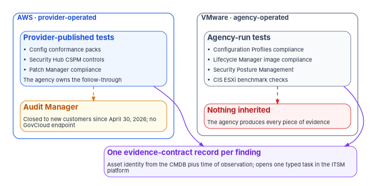
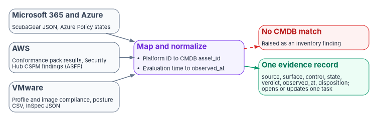

# Chapter 09 — Control Compliance Automation: AWS and VMware

*In AWS the provider ships the tests and the agency owns the follow-through. In the agency's own VMware estate nobody else ships anything the agency can inherit, so the agency owns the tests too.*

::: {.callout-note}
## In this chapter
The same five-step loop as [Chapter 08](08-control-automation-m365-and-azure.md), run on two very different estates. What produces control evidence in AWS, checked for AWS GovCloud (US) and the commercial Regions: AWS Config conformance packs, Security Hub CSPM and the new Security Hub, and Patch Manager, plus the corrections that come from checking them, chiefly that AWS Audit Manager closed to new customers in April 2026 and has no GovCloud endpoint. What produces it in an on-premises VMware Cloud Foundation estate, where the product names and compliance features changed between versions 9.0 and 9.1. How every source lands in the evidence contract, where ServiceNow's own products overlap, and where the on-premises gap stays open.
:::

[Chapter 08](08-control-automation-m365-and-azure.md) ran the loop on Microsoft 365 and Azure: test on the native surface, detect drift, raise a typed task against the configuration item, actuate natively, close on a re-test. This chapter runs it on the two other platforms most federal estates carry. The loop is deliberately the same, so that an assessor sees one story whatever the platform. What differs is how much of the evidence the agency can get from someone else.

AWS is like Azure. The provider operates the infrastructure, publishes control-mapped tests for it, and runs posture services the agency turns on. The agency's day-two job is to take ownership of the results. A VMware estate in the agency's own data center is different in kind. The hypervisor, the virtual network and the management plane are the agency's to operate and patch; there is no provider authorization to inherit for them, and [Book 12, Chapter 08](../b12-security-operations/08-cloud-native-posture.md#per-platform-mechanisms) notes that customer-operated software has no FedRAMP certification of its own. Every piece of evidence about that layer is the agency's to produce.

Both AWS locations are valid for a Moderate system. AWS lists its US East/West Regions as FedRAMP Certified Class C (formerly Moderate) and AWS GovCloud (US) as Class D (formerly High), and it lists FedRAMP scope per service and per Region; Amazon Connect Customer, for example, is listed in both.[^c09-aws-fedramp] NIST's baselines are cumulative, so a High offering includes the Moderate controls and a Moderate system can run in GovCloud (US) *(inference)*. An agency may run most of its AWS workloads in GovCloud (US) at Moderate and a contact center in a commercial Region. The loop below is the same in both; the chapter flags where a feature differs between them *(design guidance)*.

{#fig-ch09-two-estates fig-alt="Two columns feed one card at the bottom. The left column, labeled AWS, provider-operated, has a blue card listing AWS Config conformance packs, Security Hub CSPM controls and Patch Manager compliance, with a note that the provider publishes the tests and the agency owns the follow-through; beneath it an amber note says Audit Manager is closed to new customers and has no GovCloud endpoint. The right column, labeled VMware, agency-operated, has a slate card listing vSphere Configuration Profiles compliance, vSphere Lifecycle Manager image compliance, VCF Operations Security Posture Management and CIS ESXi benchmark checks, with a red note that nothing is inherited, so the agency produces every piece of evidence. Both columns lead to a violet card: one evidence-contract record per finding, keyed to the asset identity from the CMDB and the time of the observation, opening one typed task in the ITSM platform."}

## AWS: what produces the evidence

### AWS Config and conformance packs

AWS Config records resource configurations and evaluates them with rules. A conformance pack is "a collection of AWS Config rules and remediation actions that can be easily deployed as a single entity in an account and a Region or across an organization," written as a YAML template.[^c09-cpack] AWS publishes sample templates for many frameworks, among them Operational Best Practices for FedRAMP (Low), FedRAMP (Moderate), FedRAMP (High, in two parts) and NIST 800-53 rev 5.[^c09-cpack-samples] Conformance packs, including deployment across an organization, are supported in both AWS GovCloud (US-East) and AWS GovCloud (US-West).[^c09-cpack]

AWS is as plain about the limits of its templates as Microsoft is about its initiatives. The sample templates "are not designed to ensure your compliance with a specific governance standard" and "can neither replace your internal efforts nor guarantee that you will pass a compliance assessment"; AWS also advises checking which managed rules are available in the deployment Region and amending the template before deploying.[^c09-cpack-samples] The FedRAMP (Moderate) page describes its pack as letting a customer "align to a subset of the FedRAMP controls" and doesn't say which revision of the baseline it maps to.[^c09-cpack-fedramp] For a Rev. 5 system, the program's design uses the NIST 800-53 rev 5 pack as the primary mapping and treats the FedRAMP pack as a cross-check until AWS states its revision.

Config also gives the evidence trail. AWS recommends advanced queries to export current configuration items as CSV or JSON, and the `get-resource-config-history` API for the configuration and compliance state of a resource over a period.[^c09-am-change] For day two the conformance pack's per-resource results are the test in step 1 of the loop: `get-conformance-pack-compliance-details` returns each non-compliant result with the rule, the resource, when the rule ran and when Config recorded the result.[^c09-cli-cpack]

**Remediation in GovCloud needs testing first.** Config remediates through Systems Manager Automation documents, manually or automatically, and the Config developer guide lists both GovCloud Regions as supporting remediation actions.[^c09-remediation] The AWS GovCloud (US) user guide, however, says that "SSM documents for AWS Config remediation actions are not available" in GovCloud.[^c09-govcloud-config] The two pages may mean different things (the AWS-managed remediation documents, for example, rather than remediation as a feature), but they don't say so. Until a test account in GovCloud shows which remediation actions work, the program plans GovCloud remediation through the agency's own Automation documents or infrastructure as code, and records the result in the feature register [Book 10, Chapter 09](../b10-cloud-boundary/09-equivalents-and-exceptions.md) describes.

### Security Hub CSPM, and the new Security Hub

What used to be called Security Hub is now **AWS Security Hub CSPM** (cloud security posture management). It runs control checks against standards, including the AWS Foundational Security Best Practices standard and a NIST SP 800-53 Revision 5 standard, and receives findings from GuardDuty, Inspector, Macie and supported third-party products in one format, the AWS Security Finding Format (ASFF).[^c09-shcspm] Its NIST standard "support[s] a subset" of Rev. 5 requirements and doesn't cover requirements that need manual checks; most of its controls run as service-linked AWS Config rules, so resource recording in Config has to be enabled and configured for the resource types the controls check.[^c09-sh-nist] Security Hub CSPM is available in both GovCloud Regions, and its standards are available wherever it is.[^c09-sh-endpoints][^c09-sh-regions]

Security Hub CSPM also runs the **CIS AWS Foundations Benchmark**, in versions 5.0.0, 3.0.0, 1.4.0 and 1.2.0, and AWS recommends 5.0.0.[^c09-sh-cis] Like the other standards apart from Control Tower and Resource Tagging, it is available in every Region where Security Hub CSPM is, GovCloud (US) included.[^c09-sh-regions] For a civilian agency this is the published hardening benchmark for the AWS account layer: the agency can name it as the common secure configuration behind its CM-6 settings for AWS, next to the NIST standard's control mapping *(design guidance)*. CIS's own current release of the benchmark is 7.1.0,[^c09-cis] so the Security Hub standard can trail CIS; the agency's baseline file records which version it measures against.

Three properties shape how it feeds the loop:

- **No backfill.** Security Hub CSPM "only detects and consolidates findings that are generated after you enable" it, and only in the Region where it is enabled.[^c09-shcspm] The first cycle in a new account or Region is a baseline, not a backlog.
- **Ninety-day retention.** A finding is kept for 90 days after its most recent update, or after creation if it is never updated.[^c09-sh-endpoints] Security Hub is not an evidence archive; a finding that matters to the authorization record has to be copied into the evidence store before it ages out.
- **Automatic resolution.** For control findings, when the compliance status changes to passed Security Hub CSPM sets the workflow status to resolved, and a later failure resets it to new.[^c09-asff-filters] That is the re-test the loop wants, but it also means a ticket synchronized from Security Hub can close itself; the program's record still needs the closure tied to the task that owned it.

In GovCloud, Security Hub CSPM aggregates findings across Regions only between GovCloud (US-East) and GovCloud (US-West), and supports a shorter list of integrations. The AWS services list is AWS Config, Detective, Firewall Manager, GuardDuty, Health, IAM Access Analyzer, Inspector and IoT Device Defender; ServiceNow ITSM is on the third-party list.[^c09-sh-regions] Systems Manager Patch Manager isn't on the GovCloud list, so the source's plan to see patch compliance in Security Hub alongside posture findings doesn't hold there. In GovCloud, patch compliance comes from Systems Manager directly.

A newer, separate service now carries the Security Hub name. **AWS Security Hub** correlates signals from Security Hub CSPM, Inspector, Macie and GuardDuty, and became available in both GovCloud Regions on March 30, 2026.[^c09-sh-govcloud-news] Its GovCloud page lists what is missing there: third-party integrations, automation rules for integrations, the cost estimator, the usage page, the Extended plan and network scanning.[^c09-sh-govcloud] Its ServiceNow ITSM integration, which creates incidents or problems from findings, is therefore a commercial-Region option only.[^c09-sh-snow]

### Systems Manager Patch Manager

Patch Manager scans managed nodes against the agency's own patch baseline and installs patches in approved windows. [Book 12, Chapter 07](../b12-security-operations/07-patch-configuration-and-baselines.md#actuation-is-platform-native) covers it as the SI-2 actuator for AWS and quotes the two cautions that matter for evidence: its compliance data is a point-in-time snapshot from the latest successful patching operation, and compliance with a baseline doesn't mean a node is secure. Its results join the remediation record that chapter defines, clocked by BOD 26-04 as [Chapter 08](08-control-automation-m365-and-azure.md#the-clock-on-each-task) explains, not by FedRAMP's provider timeframes.

### AWS Audit Manager is not a foundation any more

Earlier program drafts expected AWS Audit Manager to be part of the AWS evidence path. It shouldn't be. Audit Manager is in maintenance mode: from April 30, 2026, it can't be set up in new accounts, existing customers can't extend it to new Regions or organizations, and AWS will not add new frameworks or new versions of existing ones.[^c09-am-change] AWS's Region table for it lists commercial Regions only, with no GovCloud endpoint.[^c09-am-endpoints] Its FedRAMP framework is built on the FedRAMP Security Baseline Controls r4 (Rev. 4), with 36 automated and 289 manual controls for Moderate, and AWS says the framework isn't intended to verify FedRAMP compliance.[^c09-am-fedramp] AWS's own migration advice is conformance packs, with partner products for the parts Config can't hold, such as procedural controls and audit packaging.[^c09-am-change]

The program's treatment follows. An agency that already uses Audit Manager in a commercial Region can keep its evidence; AWS retains evidence for two years after collection and recommends turning on evidence finder before disabling the service.[^c09-am-change] Nobody should start a new federal evidence program on it.

### Getting AWS results into the ITSM platform

The vendor connector most agencies used is going away. The AWS Service Management Connector for ServiceNow, which synchronized Security Hub findings with ServiceNow incidents and problems and fed AWS Config data to the CMDB, stopped taking new customers on March 31, 2026, and AWS will end support on March 31, 2027.[^c09-smc-eos] AWS points to partner solutions, to direct integration through the Config, Security Hub CSPM and Systems Manager APIs, and to Security Hub's native ServiceNow integration.[^c09-smc-eos]

| Route | Status | Program treatment |
|---|---|---|
| AWS Service Management Connector | No new customers since March 31, 2026; support ends March 31, 2027[^c09-smc-eos] | Plan the migration now; don't build on it |
| New Security Hub ServiceNow ITSM integration | Creates incidents or problems from findings; third-party integrations aren't available in GovCloud[^c09-sh-snow][^c09-sh-govcloud] | Commercial Regions only; a routing convenience |
| Security Hub CSPM ServiceNow ITSM integration | Listed among the third-party integrations supported in GovCloud[^c09-sh-regions] | Usable in GovCloud; confirm its support path, since many deployments ran through the connector above |
| Program collector | Reads conformance pack results and Security Hub CSPM findings through the APIs; EventBridge can push finding changes as they happen[^c09-shcspm] | The default; it also writes the evidence record before Security Hub's 90-day retention expires |

: Routes from AWS to the ITSM platform {.striped .hover}

As in [Chapter 08](08-control-automation-m365-and-azure.md#getting-results-into-the-itsm-platform), each source should feed through one route, so each finding has one task and one clock.

## VMware: the on-premises evidence gap

On a hyperscaler the agency inherits the provider's controls for the layers the provider runs. In its own data center it inherits nothing. Three facts make the VMware layer the hardest part of the estate to evidence:

1. **Nothing below the guest is visible to the guest.** [Book 12, Chapter 07](../b12-security-operations/07-patch-configuration-and-baselines.md#actuation-is-platform-native) shows that the hypervisor and firmware column has no cross-platform tool: an agent in a virtual machine can't patch or assess the ESX host it runs on.
2. **No provider publishes the control mapping.** Microsoft and AWS ship initiatives and conformance packs mapped to FedRAMP and SP 800-53. For the agency's own VMware estate, the mapping from Broadcom's hardening content to the agency's baseline is the agency's work.
3. **The tooling changed under the agency's feet.** Between VCF 9.0 and 9.1 the compliance feature in VCF Operations was replaced, and the agency's baseline has to follow it. Both are covered below.

### Configuration: vSphere Configuration Profiles

vSphere Configuration Profiles sets one desired configuration for all hosts in a cluster, stored as a human-readable JSON document backed by a schema. It checks each host's compliance against that configuration, shows drift, and remediates non-compliant hosts after a pre-check.[^c09-vcp] It is the configuration test in step 1 of the loop for the ESX layer, with two conditions: the cluster must be managed with a vSphere Lifecycle Manager image, with all hosts at ESX 8.0 Update 1 or later and vCenter at 9.0 or later. Clusters still managed with baselines use the older Host Profiles, and switching a cluster to Configuration Profiles "is permanent."[^c09-vcp]

### Patching: vSphere Lifecycle Manager images

vSphere Lifecycle Manager assesses and remediates hosts against a desired image. In vSphere 9.0, using baselines to upgrade clusters and standalone hosts is deprecated; baselines remain only for patching 8.x hosts and updating third-party software, and images must be used to update and upgrade hosts at 8.0 and later.[^c09-vlcm] [Book 12, Chapter 07](../b12-security-operations/07-patch-configuration-and-baselines.md#actuation-is-platform-native) covers how an image also carries firmware through the hardware vendor's support manager. For day two, the consequence is that the same image move unlocks both the patch test and the configuration test above. In the program's design, a cluster still on baselines is tracked as its own finding with a migration date, not treated as a permanent second path.

### Compliance posture: VCF Operations, and the 9.0 to 9.1 change

In VCF 9.0, VCF Operations (formerly Aria Operations)[^c09-vcfops-name] measures compliance with scorecards built on alert definitions. Its VMware SDDC benchmarks measure hosts, virtual machines and network objects against the vSphere, vSAN and NSX security configuration guides, and its regulatory benchmarks include DISA, FISMA, NIST SP 800-171 and NIST SP 800-53 R5. The same page says these benchmarks are slated for deprecation.[^c09-vcfops-90]

In VCF 9.1 that happened: "Compliance Benchmarks are deprecated in VCF 9.1. Compliance is now managed by Security Posture Management."[^c09-vcfops-91-dep] Security Posture Management, part of VCF Operations, ships three benchmarks: the VMware Cloud Foundation Security Configuration and Hardening Guide, PCI DSS v4.0.1 for VCF, and VCF 9 General Controls. It can remediate non-compliant objects for a supported list of rules, and it exports assessment results as CSV and produces control-level compliance reports.[^c09-vcfops-91-spm] Its documentation doesn't list a NIST SP 800-53 or DISA benchmark. An agency moving from 9.0 to 9.1 can lose the 800-53 view it had and has to map the hardening guide to its own baseline, which is exactly the work point 2 above describes.

Broadcom also sells **VMware Advanced Cyber Compliance**, announced November 3, 2025 as an advanced service for VCF customers. It uses VMware Salt for desired-state configuration management and event-driven automation, and adds automated remediation of critical security threats.[^c09-vacc] It is a separate purchase, and the program doesn't assume it.

### VMware hardening content: the vendor guide and CIS ESXi {#vmware-hardening-content}

For a Moderate civilian system, the agency's CM-6 settings for the VMware layer come from the vendor's own hardening guide and a civilian benchmark *(design guidance)*. Broadcom's *VMware Cloud Foundation Security Configuration and Hardening Guide* is the vendor guide, and it is the first of the benchmarks Security Posture Management ships in 9.1, so the same guide is both the baseline's source and its automated test.[^c09-vcfops-91-spm] CIS publishes VMware ESXi 8.0 (1.4.0) and 9.0 (1.0.0) benchmarks, a vendor-neutral cross-check for the host layer.[^c09-cis] NIST SP 800-53 CM-6 leaves the choice of common secure configuration to the agency and says such configurations can come from product developers, vendors, federal agencies, consortia and others,[^c09-sp80053-cm6] so the agency's baseline file names the guide and version behind each setting *(design guidance)*.

*High only* marks material that applies to FedRAMP High or Defense environments, such as DISA STIGs and DoD Impact Levels, not to the Moderate civilian baseline this workbook targets. It's kept as an optional reference.

Broadcom also publishes DISA STIG content and automation for VCF (High only). For VCF 9.x it is "currently in STIG Readiness Guide status," and an official DISA-reviewed STIG for VCF 9.1 is in progress. Audit runs with MITRE's InSpec (or the open-source Cinc Auditor), remediation with Ansible playbooks for appliances and VCF.PowerCLI scripts for settings exposed through the vSphere and VCF APIs, and MITRE's SAF CLI converts InSpec's JSON output into STIG checklist files.[^c09-vcf-stig] A civilian ATO doesn't require it. An agency that borrows its checks or automation as a reference, where the vendor guide is silent, gets a useful evidence artifact in the InSpec JSON: it is machine-readable, it carries a result per control, and it can be re-run to show a fix. If the agency does that, it records which readiness-guide version each scan used, because the control identifiers will change when DISA publishes the final STIG.

Running hardening content with Ansible under an orchestrator, with one owning tool per setting and the controller's own credentials governed as a non-person identity, is covered in the companion guide [Ansible for Configuration Automation](../guides/ansible-configuration-automation.md#vmware).

### Getting VMware results into the ITSM platform

There is no VMware counterpart to Defender for Cloud's ServiceNow integration or Security Hub's ServiceNow ITSM integration in the current documentation this chapter could verify. The source volume cited a VCF Operations management pack for ServiceNow and a VCF Automation plugin for ServiceNow; the official page found for the management pack is for an older Aria Operations release and describes pulling ServiceNow CMDB items into Aria Operations, not sending compliance results to ServiceNow,[^c09-mp-snow] so neither is relied on here. The program's collector route is therefore the default for VMware: it reads the Security Posture Management CSV export, the Configuration Profiles and image compliance results, and any InSpec JSON the agency produces, and writes evidence-contract records against the configuration items that ServiceNow discovery or the reconciliation in [Chapter 07](07-the-cmdb-and-asset-identity.md) maintains.

### When no machine reaches the surface

The source volume spent many pages on one failure mode: an approver emails a script to an operator, who runs it by hand in a live vCenter session. [Book 13, Chapter 10](../b13-governance/10-ticket-to-machine.md#when-no-machine-can-reach-the-surface) states the program's rule for that case, and this chapter doesn't restate it: where no machine can reach the surface, the fallback is a declared exception through an approved, time-boxed, proxied and recorded privileged session, with the recording attached to the task and an end date for the exception. The vendor tooling above narrows how often that fallback is needed. Configuration Profiles remediates host configuration, Security Posture Management remediates a supported list of rules, and Broadcom's Ansible and PowerCLI content can be run by an orchestrator under a service identity. Each of those is a machine actuator for the settings it covers. The declared exception is for what remains, and a manual session closes a task as a documented process, never as a pipeline-validated change.

The source also framed the vCenter pattern as satisfying FedRAMP's change-management Key Security Indicators. KSIs bind providers, not agencies; an agency can model its evidence on them, as [Book 12, Chapter 07](../b12-security-operations/07-patch-configuration-and-baselines.md) does, but doesn't "meet" them.

## One contract, four platforms

Every source in this chapter and [Chapter 08](08-control-automation-m365-and-azure.md) lands in the same record, the evidence contract of [Book 12, Chapter 02](../b12-security-operations/02-the-evidence-contract.md). The contract is what lets an assessor follow one finding from detection to closure whatever the platform. What changes per platform is where the fields come from.

{#fig-ch09-one-contract fig-alt="A table-like diagram with four slate cards on the left, one per platform, each naming its native artifact: Microsoft 365 and Azure, ScubaGear JSON and Azure Policy states; AWS, conformance pack results and Security Hub CSPM findings in ASFF; VMware, Configuration Profiles and image compliance, Security Posture Management CSV and InSpec JSON. Each card points to a violet card in the middle, map and normalize: the platform's own identifier becomes the asset_id from the CMDB, and the platform's evaluation time becomes observed_at. That leads to a green card on the right, one evidence record with source, surface, control, state, verdict, observed_at and disposition, which opens or updates one task. A red card beside the green card, joined to the violet card by a dashed red arrow, reads: no CMDB match, raised as an inventory finding."}

| Platform | Native artifact | `source` and its own identifier | `observed_at` comes from | Keep in mind |
|---|---|---|---|---|
| AWS Config | Conformance pack evaluation results | `aws-config`; resource ID and type | `ConfigRuleInvokedTime` or `ResultRecordedTime`[^c09-cli-cpack] | Sample packs don't guarantee compliance; GovCloud remediation unconfirmed |
| Security Hub CSPM | ASFF finding | `aws-securityhub`; finding ID and resource ID | The finding's update time | 90-day retention; no backfill |
| Patch Manager | Patch compliance report | `ssm`; managed node ID | The patching operation's capture time | Point-in-time snapshot |
| vSphere Configuration Profiles | Host compliance against the cluster's desired configuration | `vcp`; host and cluster | The compliance check's time | Image-managed clusters only |
| vSphere Lifecycle Manager | Host compliance against the cluster image | `vlcm`; host and cluster | The compliance check's time | Baselines deprecated for upgrades |
| VCF Operations Security Posture Management | Assessment results export (CSV) | `vcf-spm`; object | The assessment's time | No 800-53 or DISA benchmark listed in 9.1 |
| Optional STIG readiness scan (High only) | InSpec JSON | `inspec`; target | The scan's time | A reference some agencies borrow; readiness guide, not final STIG |

: Where each contract field comes from (program mapping) {.striped .hover}

The `asset_id` column is missing on purpose. On every row it comes from the CMDB reconciliation in [Chapter 07](07-the-cmdb-and-asset-identity.md), never from the platform's own identifier; a record whose identifier has no CMDB match is raised as an inventory finding, the way [Book 12, Chapter 02](../b12-security-operations/02-the-evidence-contract.md#the-join-key-authoritative-asset-identity-plus-time) requires.

## Where ServiceNow's own products overlap

[Chapter 08](08-control-automation-m365-and-azure.md#where-servicenows-own-products-overlap) describes ServiceNow's Continuous Authorization and Monitoring and Configuration Compliance applications, and they apply here in the same way. Configuration Compliance's import-and-remediate model is the platform-side version of the collector, where an integration for the source exists. Continuous Authorization and Monitoring can hold the authorization-level roll-up across all four platforms. Neither removes the AWS connector migration or the VMware integration gap above, and neither supplies the agency's mapping from Broadcom's hardening guide to its own baseline. [Chapter 11](11-attestation-and-the-compliance-app.md) covers how the program's attestation design and a ServiceNow compliance application fit together.

## Illustrative: reading AWS results for the collector

::: {.callout-warning}
## Illustrative, not tested against a production account
These commands are examples of the collector's AWS reads. They haven't been run against a production account. They read data only and change nothing, but run them against a test account first and review the output before relying on it. Set the Region to the workload's Region, a GovCloud (US) Region or a commercial one, with the matching credentials.
:::

```bash
#!/usr/bin/env bash
# Read-only: non-compliant conformance pack results and active failed
# Security Hub CSPM control findings, saved for the evidence store before
# Security Hub's 90-day retention expires. Requires AWS CLI v2 and read
# permissions for AWS Config and Security Hub CSPM in the target account.
set -euo pipefail

REGION="${REGION:-us-gov-west-1}"
PACK="${PACK:?set PACK to the conformance pack name}"
STAMP="$(date -u +%Y%m%dT%H%M%SZ)"

# 1. Conformance pack: each non-compliant evaluation with rule, resource and times.
aws configservice get-conformance-pack-compliance-details \
  --region "$REGION" \
  --conformance-pack-name "$PACK" \
  --filters ComplianceType=NON_COMPLIANT \
  --query 'ConformancePackRuleEvaluationResults[].{
      rule: EvaluationResultIdentifier.EvaluationResultQualifier.ConfigRuleName,
      resource_type: EvaluationResultIdentifier.EvaluationResultQualifier.ResourceType,
      resource_id: EvaluationResultIdentifier.EvaluationResultQualifier.ResourceId,
      invoked: ConfigRuleInvokedTime,
      recorded: ResultRecordedTime}' \
  --output json > "fmp-aws-config-${PACK}-${STAMP}.json"

# 2. Security Hub CSPM: active control findings that currently fail.
aws securityhub get-findings \
  --region "$REGION" \
  --filters '{"ComplianceStatus":[{"Value":"FAILED","Comparison":"EQUALS"}],
              "RecordState":[{"Value":"ACTIVE","Comparison":"EQUALS"}]}' \
  --query 'Findings[].{id: Id, control: Compliance.SecurityControlId,
      resource: Resources[0].Id, severity: Severity.Label,
      workflow: Workflow.Status, updated: UpdatedAt}' \
  --output json > "fmp-aws-securityhub-${STAMP}.json"

echo "Saved results for ${REGION} at ${STAMP}"
```

The AWS CLI pages through results by default. The two files are the raw artifacts; the collector then maps each `resource_id` to the CMDB identity and writes the contract record, as in [Chapter 08](08-control-automation-m365-and-azure.md#illustrative-a-read-only-collector).

## Honest limits

- **"Closed" lags the fix.** Config evaluations, Security Hub checks, Patch Manager scans and VMware compliance checks all run on cycles. Evidence timestamps record the evaluation, not the instant of the fix.
- **GovCloud is a different feature set.** Config remediation documents, Security Hub integrations and the new Security Hub's third-party integrations differ from the commercial Regions, and AWS's own pages disagree on one of them. Test each one in an account in the Region the workload uses before relying on it.
- **The VMware mapping is the agency's.** No provider publishes a FedRAMP or 800-53 mapping for an agency-operated VCF estate, and VCF 9.1's Security Posture Management doesn't list one. The agency maps Broadcom's hardening guide, and CIS ESXi where it uses it, to its own CM-6 settings, and revisits the mapping when either publisher revises its content.
- **Connectors are moving.** The AWS Service Management Connector ends on March 31, 2027, and a current VMware-to-ServiceNow compliance integration wasn't found. The collector route is the one the agency controls.
- **Each guard rail covers its own layer.** Hybrid-activated nodes under Systems Manager, like Arc-enabled servers under Azure, are governed at the guest operating system only. The hypervisor, firmware and managed services reconcile from their own stacks.

## The control map for this chapter

The mapping is the program's, not a published crosswalk.

| Control | AWS contribution | VMware contribution |
|---|---|---|
| CM-2, CM-6 | Conformance pack and Security Hub CSPM control results raised as tasks and closed on re-evaluation | Configuration Profiles, Security Posture Management (hardening guide) and CIS ESXi results raised as tasks and closed on re-check |
| CM-3 | Config and Automation remediations carried as change records | Configuration Profiles, image and posture remediations carried as change records; manual sessions only as declared exceptions |
| CM-8 | Every record joined to the CMDB identity; unmatched resources raised as inventory findings | The same, for hosts, clusters and management appliances the agency discovers itself |
| RA-5, SI-2 | Inspector findings through Security Hub CSPM and Patch Manager results into the [Book 12](../b12-security-operations/index.md) queues, clocked by BOD 26-04 | Image compliance into the same queue for the hypervisor |
| CA-7 | One monitoring record per finding, copied out of Security Hub before it ages out | One monitoring record per finding from exports and scans the agency runs |

: Controls the loop helps an agency show {.striped .hover}

## What to take from this chapter

- Run the same loop on AWS and VMware as on Microsoft 365 and Azure, and land every result in the same evidence contract.
- Build AWS evidence on Config conformance packs and Security Hub CSPM, not on Audit Manager.
- Check every AWS feature in the Region the workload uses, GovCloud (US) or commercial; several differ in GovCloud, and AWS's documentation disagrees on Config remediation.
- Plan the move off the AWS Service Management Connector before March 31, 2027.
- Treat the VMware layer as evidence the agency produces end to end: move clusters to images, use Configuration Profiles and Security Posture Management, take the baseline from Broadcom's hardening guide with CIS ESXi as a cross-check, and write the mapping to the agency's CM-6 settings.
- Use machine actuators wherever the vendor provides them, and keep the recorded privileged session for what remains.

::: {.callout-tip}
## Continue the book
[← Previous: Chapter 08 — Control Compliance Automation: Microsoft 365 and Azure](08-control-automation-m365-and-azure.md) · [Book index](index.md) · [Next: Chapter 10 — Who Runs Day Two →](10-who-runs-day-two.md)
:::

[^c09-cpack]: AWS documentation, "Conformance Packs for AWS Config," definition and Region support, *AWS Config Developer Guide*, <https://docs.aws.amazon.com/config/latest/developerguide/conformance-packs.html> (accessed Oct 21, 2026).
[^c09-cpack-samples]: AWS documentation, "Conformance Pack Sample Templates for AWS Config," *AWS Config Developer Guide*, <https://docs.aws.amazon.com/config/latest/developerguide/conformancepack-sample-templates.html> (accessed Oct 21, 2026).
[^c09-cpack-fedramp]: AWS documentation, "Operational Best Practices for FedRAMP(Moderate)," *AWS Config Developer Guide*, <https://docs.aws.amazon.com/config/latest/developerguide/operational-best-practices-for-fedramp-moderate.html> (accessed Oct 21, 2026; introduction and disclaimer read, control table not read in full).
[^c09-cli-cpack]: AWS CLI Command Reference, "get-conformance-pack-compliance-details," <https://docs.aws.amazon.com/cli/latest/reference/configservice/get-conformance-pack-compliance-details.html> (accessed Oct 21, 2026).
[^c09-remediation]: AWS documentation, "Remediating Noncompliant Resources with AWS Config," Region support, *AWS Config Developer Guide*, <https://docs.aws.amazon.com/config/latest/developerguide/remediation.html> (accessed Oct 21, 2026).
[^c09-govcloud-config]: AWS documentation, "AWS Config in AWS GovCloud (US)," *AWS GovCloud (US) User Guide*, <https://docs.aws.amazon.com/govcloud-us/latest/UserGuide/govcloud-config.html> (accessed Oct 21, 2026).
[^c09-shcspm]: AWS documentation, "Introduction to AWS Security Hub CSPM," *AWS Security Hub User Guide*, <https://docs.aws.amazon.com/securityhub/latest/userguide/what-is-securityhub.html> (accessed Oct 21, 2026).
[^c09-sh-nist]: AWS documentation, "NIST SP 800-53 Revision 5 in Security Hub CSPM," *AWS Security Hub User Guide*, <https://docs.aws.amazon.com/securityhub/latest/userguide/standards-reference-nist-800-53.html> (accessed Oct 21, 2026).
[^c09-sh-endpoints]: AWS General Reference, "AWS Security Hub CSPM endpoints and quotas," service endpoints (including both AWS GovCloud (US) Regions) and the finding retention quota, <https://docs.aws.amazon.com/general/latest/gr/sechub.html> (accessed Oct 21, 2026).
[^c09-sh-regions]: AWS documentation, "Regional limits for Security Hub CSPM," cross-Region aggregation, integrations supported in AWS GovCloud (US), and availability of standards, *AWS Security Hub User Guide*, <https://docs.aws.amazon.com/securityhub/latest/userguide/securityhub-regions.html> (accessed Oct 21, 2026).
[^c09-asff-filters]: AWS Security Hub API Reference, "AwsSecurityFindingFilters," `ComplianceStatus`, `RecordState` and `WorkflowStatus`, <https://docs.aws.amazon.com/securityhub/1.0/APIReference/API_AwsSecurityFindingFilters.html> (accessed Oct 21, 2026).
[^c09-sh-govcloud-news]: Amazon Web Services, "AWS Security Hub is now available in AWS GovCloud (US) Regions," What's New, March 30, 2026, <https://aws.amazon.com/about-aws/whats-new/2026/03/aws-security-hub-govcloud-us-regions> (accessed Oct 21, 2026).
[^c09-sh-govcloud]: AWS documentation, "AWS Security Hub in AWS GovCloud (US)," *AWS GovCloud (US) User Guide*, <https://docs.aws.amazon.com/govcloud-us/latest/UserGuide/govcloud-ashv2.html> (accessed Oct 21, 2026).
[^c09-sh-snow]: AWS documentation, "Integrations for ServiceNow," *AWS Security Hub User Guide*, <https://docs.aws.amazon.com/securityhub/latest/userguide/servicenow.html> (accessed Oct 21, 2026).
[^c09-am-change]: AWS documentation, "AWS Audit Manager availability change," *AWS Audit Manager User Guide*, <https://docs.aws.amazon.com/audit-manager/latest/userguide/audit-manager-availability-change.html> (accessed Oct 21, 2026).
[^c09-am-endpoints]: AWS General Reference, "AWS Audit Manager endpoints and quotas," service endpoints, <https://docs.aws.amazon.com/general/latest/gr/audit-manager.html> (accessed Oct 21, 2026).
[^c09-am-fedramp]: AWS documentation, "FedRAMP Security Baseline Controls r4," *AWS Audit Manager User Guide*, <https://docs.aws.amazon.com/audit-manager/latest/userguide/fedramp-moderate.html> (accessed Oct 21, 2026).
[^c09-smc-eos]: AWS documentation, "AWS Service Management Connector end of support," *AWS Service Management Connector Administrator Guide*, <https://docs.aws.amazon.com/smc/latest/ag/smc-end-of-support.html>; and "Configuring AWS Security Hub CSPM in ServiceNow," <https://docs.aws.amazon.com/smc/latest/ag/sn-security-hub-integ.html> (both accessed Oct 21, 2026).
[^c09-mp-snow]: Broadcom TechDocs, "Management Pack for ServiceNow," VMware Aria Operations for Integrations 8.4, <https://techdocs.broadcom.com/us/en/vmware-cis/aria/aria-operations-for-integrations/8-4/management-pack-for-servicenow-8-4/management-pack-for-servicenow.html> (accessed Oct 21, 2026).
[^c09-vcfops-name]: Broadcom Knowledge Base, "Backups on VCF Operations/Aria Operations," article 441149 ("VCF Operations (formerly Aria Operations) appliances"), <https://knowledge.broadcom.com/external/article/441149/backups-on-vcf-operationsaria-operations.html> (accessed Oct 21, 2026).
[^c09-vcp]: Broadcom TechDocs, "Using vSphere Configuration Profiles to Manage Host Configuration at a Cluster Level," vSphere 9.0, <https://techdocs.broadcom.com/us/en/vmware-cis/vsphere/vsphere/9-0/managing-host-and-cluster-lifecycle/using-vsphere-config-profiles-to-manage-host-configuration-at-a-cluster-level.html> (accessed Oct 21, 2026).
[^c09-vlcm]: Broadcom TechDocs, "vSphere Lifecycle Manager Baselines and Images," vSphere 9.0, <https://techdocs.broadcom.com/us/en/vmware-cis/vsphere/vsphere/9-0/managing-host-and-cluster-lifecycle/about-vsphere-lifecycle-manager-new/vlcm-baselines-and-images.html> (accessed Oct 21, 2026).
[^c09-vcfops-90]: Broadcom TechDocs, "Measuring Compliance of Objects," VMware Cloud Foundation 9.0, Security and Compliance, <https://techdocs.broadcom.com/us/en/vmware-cis/vcf/vcf-9-0-and-later/9-0/security-and-compliance/viewing-and-configuring-compliance/measuring-compliance-of-objects.html> (accessed Oct 21, 2026).
[^c09-vcfops-91-dep]: Broadcom TechDocs, "Activate a Regulatory Benchmark," VMware Cloud Foundation 9.1, deprecation notice, <https://techdocs.broadcom.com/us/en/vmware-cis/vcf/vcf-9-0-and-later/9-1/security-and-compliance/viewing-and-configuring-compliance/how-to-configure-compliance-benchmarks/install-a-regulatory-benchmark.html> (accessed Oct 21, 2026).
[^c09-vcfops-91-spm]: Broadcom TechDocs, "Compliance Assessment and Reporting using Security Posture Management," VMware Cloud Foundation 9.1, <https://techdocs.broadcom.com/us/en/vmware-cis/vcf/vcf-9-0-and-later/9-1/security-and-compliance/security-posture-management/compliance-assessment-and-reporting-using-security-posture-management.html> (accessed Oct 21, 2026).
[^c09-vacc]: VMware Cloud Foundation Blog (Broadcom), "VMware Advanced Cyber Compliance is now available to VCF customers," November 3, 2025, <https://blogs.vmware.com/cloud-foundation/2025/11/03/vmware-advanced-cyber-compliance-is-now-available-to-vcf-customers/> (accessed Oct 21, 2026).
[^c09-aws-fedramp]: Amazon Web Services, "FedRAMP" (US East/West FedRAMP Certified Class C, formerly Moderate; GovCloud (US) Class D, formerly High), <https://aws.amazon.com/compliance/fedramp/>; and "FedRAMP — Services in Scope" (per-service, per-Region columns; Amazon Connect Customer listed in both), <https://aws.amazon.com/compliance/services-in-scope/FedRAMP/> (accessed Oct 29, 2026).
[^c09-sh-cis]: AWS documentation, "CIS AWS Foundations Benchmark in Security Hub CSPM" (supported versions 5.0.0, 3.0.0, 1.4.0 and 1.2.0; 5.0.0 recommended), *AWS Security Hub User Guide*, <https://docs.aws.amazon.com/securityhub/latest/userguide/cis-aws-foundations-benchmark.html> (accessed Oct 29, 2026).
[^c09-cis]: Center for Internet Security, "CIS Benchmarks" (benchmark list, including Amazon Web Services Foundations 7.1.0, VMware ESXi 8.0 1.4.0 and VMware ESXi 9.0 1.0.0), <https://www.cisecurity.org/cis-benchmarks> (accessed Oct 29, 2026).
[^c09-sp80053-cm6]: National Institute of Standards and Technology, SP 800-53 Rev. 5, *Security and Privacy Controls for Information Systems and Organizations*, controls CM-2 and CM-6 (statement and discussion), <https://csrc.nist.gov/pubs/sp/800/53/r5/upd1/final>; read from NIST's OSCAL Rev. 5 catalog, <https://github.com/usnistgov/oscal-content/tree/main/nist.gov/SP800-53/rev5> (accessed Oct 29, 2026).
[^c09-vcf-stig]: VMware Cloud Foundation Blog (Broadcom), "Securing the Foundation: VMware Cloud Foundation 9.1 STIG Compliance," July 14, 2026, <https://blogs.vmware.com/cloud-foundation/2026/07/14/securing-the-foundation-vmware-cloud-foundation-9-1-stig-compliance/> (accessed Oct 21, 2026).
