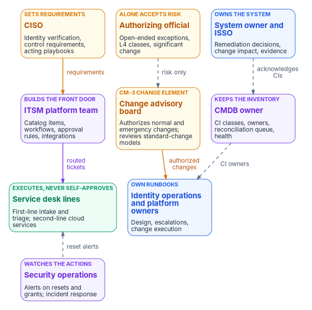
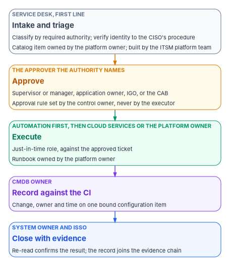

# Chapter 10 — Who Runs Day Two

*Day two is run by the people who touch the estate most often and decide the least, so the design has to put every decision with someone who isn't holding the keyboard.*

::: {.callout-note}
## In this chapter
Where the day-two roles come from: NIST's Risk Management Framework, its configuration management guide and the CM-3, CM-5, CM-8 and CM-9 controls. Then each role: the service desk lines, identity operations, platform owners, the ITSM platform team, the CMDB owner, the change advisory board, security operations, the system owner and ISSO, and the authorizing official. Who owns each catalog item and runbook, how the change advisory board fits beside the program's governance board, a responsibility matrix consistent with Book 00 Chapter 07, Book 01 Chapter 09, Book 12 Chapter 10, Book 13 Chapter 09 and Book 14 Chapter 10, and the separations that keep day-two work honest.
:::

Every other Who chapter in this workbook is about decisions that happen a few times a year: an authorization, a gate, a rule change, a risk acceptance. Day two is about decisions that happen hundreds of times a week. A reset, a group change, a license, a firewall rule, a patch window, a retired server. The people closest to that work are the service desk and the platform teams, and the temptation is to let them decide as well as do, because they are there and the queue is long.

That is how modernization reverts. A service desk that can approve its own resets has rebuilt the standing administrator the program removed. A platform team that changes production without a change record has rebuilt the undocumented estate. A service management team that edits an approval rule to clear a backlog has quietly changed who may approve. None of them is acting in bad faith. Each is closing a ticket. The failure is that nobody else was in the loop.

This chapter applies the program-wide model in [Book 01, Chapter 09](../b01-transformation-arc/09-who-leads-the-transformation.md) and the running mechanics in [Book 00, Chapter 07](../b00-orientation/07-who-runs-the-program.md) to day-two operations. It agrees with the Who chapters that cover neighboring ground: [Book 04, Chapter 06](../b04-access/06-who-decides-access.md) for access decisions and the help desk authority split, [Book 12, Chapter 10](../b12-security-operations/10-who-runs-security-operations.md) for security operations, [Book 13, Chapter 09](../b13-governance/09-who-governs.md) for the authoritative record and exceptions, and [Book 14, Chapter 10](../b14-compliance/10-who-owns-compliance.md) for the authorization roles. Where those chapters go deeper for their domain, they govern. The model below is the program's recommended design. Adapt it to the agency's structure, but keep one decider per row.

{#fig-ch10-who-runs-day-two fig-alt="Four rows of cards. Top row, the roles that set requirements and accept risk: the CISO in amber, who sets requirements for identity verification, control requirements and acting playbooks; the authorizing official in amber, who alone accepts risk for open-ended exceptions, L4 classes and significant changes; and the system owner and ISSO in blue, who own the system's remediation decisions, change impact and evidence. Second row, the roles that govern the flow of work, each beneath the role that feeds it: the ITSM platform team in violet, which builds the front door's catalog items, workflows, approval rules and integrations; the change advisory board in amber, the CM-3 change control element, which authorizes normal and emergency changes and reviews standard-change models; and the CMDB owner in violet, who keeps CI classes, owners, the reconciliation queue and health. Third row, the roles that execute: the service desk lines in green, beneath the ITSM platform team, which execute and never approve their own work, first-line intake and triage and second-line cloud services; and identity operations and platform owners in blue, beneath the change advisory board, who own runbooks, design, escalations and change execution. Bottom row, beneath the service desk: security operations in violet, which watches the actions, alerting on resets and grants and responding to incidents. Arrows: the CISO sends requirements to the ITSM platform team; the authorizing official has a dashed arrow labeled risk only to the change advisory board; the system owner has a dashed arrow labeled acknowledges CIs to the CMDB owner; the change advisory board sends authorized changes to identity operations and platform owners; the ITSM platform team sends routed tickets to the service desk; the CMDB owner has a dashed arrow labeled CI owners to identity operations and platform owners; and security operations has a dashed arrow labeled reset alerts up to the service desk."}

## Where the roles come from

No federal document defines a service desk tier or a CMDB owner. The roles come from four places that describe the work those teams do.

**The Risk Management Framework** gives the system-level roles. SP 800-37 Rev. 2 describes the system security or privacy officer as responsible for keeping a system's security and privacy posture, often assigned day-to-day security operations, and, in close coordination with the system owner, playing an active role in "managing and controlling changes to the system, and assessing the security or privacy impact of those changes." The authorizing official is "the only organizational official who can accept the security and privacy risk," approves plans of action and milestones, and decides whether significant changes require reauthorization. The role is an inherent U.S. Government function, assigned to government personnel only.[^c10-sp80037] Monitoring the system and its environment for changes that affect its posture is RMF task M-1.[^c10-sp80037]

**SP 800-53's configuration management family** turns change and inventory into controls with roles inside them. CM-3 asks the organization to decide which changes are configuration-controlled, review and approve or disapprove them "with explicit consideration for security and privacy impact analyses," document the decisions, implement only approved changes, retain the records, and coordinate oversight "through" a configuration change control element it defines; the discussion names Configuration Control Boards and Change Advisory Boards as such elements. CM-3(4) asks for security and privacy representatives to be members of that element. CM-5 asks for access restrictions on who may make changes, and lists workflow automation and change windows among them. CM-8(4) asks the inventory to identify, by name, position or role, the individuals responsible for administering each component, and CM-8(9) asks for each component to be assigned to a system with an acknowledgement from defined personnel. CM-9 asks for a configuration management plan that "addresses roles, responsibilities, and configuration management processes and procedures," and CM-9(1) asks that the people who develop the configuration management process not be directly involved in system development.[^c10-sp80053] CM-3, CM-3(4), CM-5, CM-8 and CM-9 are in NIST's Moderate baseline; CM-8(4) is in the High baseline.[^c10-sp80053b]

**SP 800-128**, NIST's guide to security-focused configuration management, assigns those duties to people. The CIO designates a configuration management program manager and approves the organization's plan and policies; the senior agency information security officer may serve as that manager and may provide security staff to the configuration control board. The authorizing official "manages or participates in" the board for the systems it authorizes and makes the final determination whether a change or set of changes is still an acceptable security risk. The system security officer helps the system owner implement configuration management, monitors configuration, and may sit on the board; system administrators implement agreed baselines and assist with impact analysis. The guide defines the board as "two or more individuals that have the collective responsibility and authority to review and approve changes," and its change process starts with a request that may come from "the end user of the system, a help desk, or from management."[^c10-sp800128]

**AC-5** asks the organization to identify the duties that must be separated and to define access authorizations that support the separation, including "dividing mission or business functions and support functions among different individuals or roles."[^c10-sp80053] Day two is where that control is won or lost, because the support functions are the ones that touch the estate.

## Deciding, doing and owning

The program separates three kinds of involvement, as Book 01 does, and adds a fourth that day two needs.

- **Deciding** means being accountable for the outcome and able to say no.
- **Doing** means building, configuring, executing or remediating.
- **Being consulted** means the decision can't be made well without that role's input.
- **Owning an artifact** means keeping a catalog item, a runbook, a workflow or a CI class correct over time, including when nobody is asking.

The fourth matters because day-two work runs on artifacts, and artifacts decay. A catalog item written for last year's license model, a runbook that still says to use a retired console, or a CI class that nobody maps from the new connector is a decision nobody made, enforced every time someone follows it. The program gives every artifact one owner, recorded on the artifact, with a review date.

## The roles

### The service desk lines

The service desk executes; it doesn't decide what it executes. That is [Book 04, Chapter 06](../b04-access/06-who-decides-access.md#help-desk-and-cloud-services)'s rule, and this book extends it from access to every day-two request. The program's model has three lines of support. They are support lines, not the privilege tiers of [Book 04](../b04-access/index.md), which [Chapter 04](04-help-desk-authority-in-entra.md) uses for the help desk's roles.

- **The first line, the service desk,** is the front door. It takes every request, from people and from machines, classifies it by the authority it needs, verifies the requester's identity to the procedure the CISO sets, and executes the work its scoped roles allow against an approved, assigned ticket. [Chapter 03](03-intake-triage-and-routing.md) covers intake and triage and [Chapter 04](04-help-desk-authority-in-entra.md) the roles in Entra ID.
- **The second line, cloud services,** is the escalation tier, not a second intake queue. It handles what the first line and automation can't, under the same rule: it executes approved work and doesn't approve its own. A request that lands directly on cloud services goes back to triage ([Book 04, Chapter 06](../b04-access/06-who-decides-access.md#the-help-desk-and-cloud-services-authority-split)).
- **The third line** is the owning engineering team: identity engineering for identity, and the platform owners for everything else. It takes escalations that need design judgment, and it owns the runbooks the first two lines follow.

Classification isn't approval. When the first line sorts a request into one of Book 04's authority levels, from low-impact support (A0) through governance actions that are never automated (A3), it is choosing the pipeline and the approver, not granting anything. Technicians have no approval authority at any level, hold no standing privileged role, and activate their eligible roles through Privileged Identity Management with a justification for the ticket in hand.

The **service desk supervisor** is the one approver inside the desk, and the role is narrow. In this book's task reference the supervisor, or the requester's manager, approves routine credential work for ordinary users, such as a password reset, an authenticator method removal or a Temporary Access Pass, after the technician has verified the person ([Appendix A](appendix-a-help-desk-task-reference.md)). The supervisor never approves a ticket they execute, never approves access to an application or a group (those belong to the owners Book 04 names), and never acts as the second approver on a high-risk task ([Chapter 04](04-help-desk-authority-in-entra.md#the-high-risk-tasks-and-why-they-need-a-second-approver)). The supervisor also runs the desk: certifies each technician's continued need for their role groups in the quarterly review, watches the backlog against the service levels in [Chapter 03](03-intake-triage-and-routing.md#service-levels), returns tickets closed without their evidence, invokes the emergency change process when a request is genuinely urgent, and reports the conditions Chapter 03 lists to the identity governance officer within one business day.

The CIO, or the service desk's management under the CIO, decides how the desk is staffed and sourced, which is a scope and funding decision under [Book 01, Chapter 09](../b01-transformation-arc/09-who-leads-the-transformation.md#decision-rights-across-the-program). A contracted service desk works under this model without change, because none of its rows carries a decision a contractor may not make.

### Staffing, measuring and watching the queue

How well the desk is staffed shows up in its numbers before it shows up in an audit. The program's measures are design, reviewed weekly by the supervisor and monthly by the service desk manager with the identity governance officer and the CISO's representative.

| Measure | What it shows |
|---|---|
| Tickets past their service level, by priority | Capacity, and whether escalations are stuck |
| Share of tickets escalated to cloud services or engineering | Whether runbooks and roles cover the work; a rising share is a runbook or catalog gap |
| Tickets returned for missing evidence fields | Whether closure discipline is holding ([Chapter 03](03-intake-triage-and-routing.md#the-evidence-each-ticket-leaves)) |
| Identity verifications that failed or were abandoned | Social engineering pressure, or a verification step that doesn't work for real users |
| Privileged activations with no matching ticket | A broken link between the queue and the roles; each one is a supervisor report |
| Requests handled outside the front door | Email or chat work that never became a ticket |

The service desk manager owns the staffing response: more people for a capacity problem, a runbook or catalog change through its owner for a coverage problem, training for a discipline problem. The ITSM platform team produces the measures from the platform, so nobody on the desk reports on their own work by hand.

### Identity operations

Identity operations is two roles from [Book 04](../b04-access/06-who-decides-access.md#the-roles). The **identity governance officer** decides the risk tier of applications, the approval chain for access, admin consent outside the lowest tier, and the membership and scope of the service desk's privileged access group, which it reviews quarterly. **Identity engineering** designs and builds: app registrations, provisioning, group design, the custom roles and administrative-unit scopes the service desk uses, and the workload identities that let automation act. It handles the escalations the desk can't, eligible rather than standing. In the target model, joiner, mover and leaver events run from the HR system of record through lifecycle workflows ([Book 03](../b03-hr-identity/index.md)), so most identity changes reach day two as automation to watch, not tickets to work.

### Platform owners

The platform owners are the teams that own each technology: the cloud platform, collaboration, endpoint, server infrastructure, network, the DNS and DDI team, PKI and data, as [Book 12, Chapter 10](../b12-security-operations/10-who-runs-security-operations.md#the-roles) lists them. On day two each one owns three things for its platform: the **runbooks** for the work done on it, the **content of the catalog items** that request that work, and the **execution** of approved changes that automation can't make. Each platform owner also remediates the findings raised on its platform, on the schedule the system owner decides ([Book 13, Chapter 09](../b13-governance/09-who-governs.md#who-reviews-drift)).

The DNS and DDI team has a further role that day two depends on. It owns the naming plane, the authoritative identity every CI is reconciled to ([Chapter 07](07-the-cmdb-and-asset-identity.md)). When the reconcile pass finds an authorized asset the naming plane never recorded, the DDI team fixes the record; nobody fixes it in the CMDB.

### The ITSM platform team

The ITSM platform team runs the service management platform itself: the instance, its catalog items, workflows and approval rules, its integrations and connectors, the MID Servers that reach into the estate, and the service identities that automation runs under. It builds what the platform owners and the control owners specify. It doesn't decide what a catalog item does or which approval a control requires.

That line is easy to cross by accident. An approval rule is configuration in the platform, and the team that maintains the platform can usually edit it. CM-5 names workflow automation as one of the access restrictions on change,[^c10-sp80053] and the program reads that literally: a change to an approval rule, a routing rule or an integration's permissions is a change to a control, raised as a change record, reviewed by someone outside the ITSM platform team and authorized like any other normal change.

The platform is also a system in its own right. ServiceNow's Government Community Cloud is listed on the FedRAMP Marketplace as FedRAMP Certified at Class D (High).[^c10-fedramp-sn] A provider's certification doesn't authorize the agency's use of it; the agency still needs its own decision, as [Book 13, Chapter 11](../b13-governance/11-reciprocity-and-one-authorization.md) explains, and the instance needs a system owner, an ISSO and an authorizing official of its own. Where the agency uses a different platform, the same roles apply.

ServiceNow also sells native products that cover parts of this book's design, among them its compliance and continuous-monitoring applications ([Chapter 11](11-attestation-and-the-compliance-app.md)). Whichever the agency uses, the ITSM platform team builds and runs it, and the roles that decide what it enforces stay where this chapter puts them.

### The CMDB owner

The CMDB owner keeps the inventory that every ticket points at. In the program's model the role is a named person, usually in the ITSM platform team or the configuration management program SP 800-128 describes, who owns:

- the **CI class model** and which classes are in scope for each system;
- the **identification and reconciliation rules** that decide what is a new CI and which source may write each attribute;
- the **reconciliation exception queue**, worked to closure with the owners of each exception;
- **CMDB health**: duplicates, stale CIs, missing owners and connector coverage, reported weekly; and
- the **lifecycle policies** that retire, archive and delete CIs.

The CMDB owner doesn't own the facts about an asset. The naming plane owns its identity; the system owner owns its assignment to a system; the platform owner owns its configuration. CM-8(4) asks the inventory to name the people responsible for each component, and CM-8(9) asks for a system assignment acknowledged by defined personnel;[^c10-sp80053] the CMDB owner makes sure those fields are filled and acknowledged, and the people named in them are the ones accountable. ServiceNow's data model carries the same idea in its Managed by Group attribute, which "identifies the group that manages a CI class" and "might or might not be the same group as repairs an individual CI."[^c10-sn-csdm] Its CMDB Data Manager assigns a lifecycle task to each Managed by Group and, when a policy requires approval, has that group's members approve.[^c10-sn-datamgr]

### The change advisory board

The change advisory board is the agency's configuration change control element for production changes, the body CM-3(g) asks for.[^c10-sp80053] In ServiceNow's change model it has a defined place. A **standard change** is pre-authorized, low risk and relatively common, and doesn't need peer, group or CAB approval. A **normal change** needs "assessment, peer or technical approval, and CAB authorization before implementation." An **emergency change**, implemented immediately to resolve a major incident or apply a security patch, goes "directly to the Authorization state for CAB approval."[^c10-sn-change] The platform gives the CAB manager a workbench to set agendas, run meetings and record notes.[^c10-sn-cab] SP 800-128 describes the same structure in federal terms: some changes are "exempt from configuration change control or pre-approved," and approval of the rest "is usually performed by the CCB."[^c10-sp800128]

The program maps that structure onto its own tempo ([Book 13, Chapter 10](../b13-governance/10-ticket-to-machine.md#approval-gates-keep-humans-on-the-decisions-that-matter)) as design.

| Kind of change | Who authorizes it | How it maps to the program |
|---|---|---|
| Standard change | The CAB, once, when it approves the standard-change model; then no per-instance CAB approval | Catalog items and L3 classes whose steps, scope and rollback are fixed. Each instance still has its own approver where the class needs one |
| Normal change | The CAB, after peer or technical approval and a security impact analysis | Everything else, including changes to the ITSM platform's own approval rules and integrations |
| Emergency change | The CAB, or the emergency subset of it the charter names, at authorization | A major incident or an urgent security fix; reviewed at the next full CAB meeting |
| An operation class allowed to run without a person (L4) | The authorizing official, in writing | Not a CAB decision; the CAB is consulted ([Book 13, Chapter 09](../b13-governance/09-who-governs.md#who-approves-rule-changes)) |
| A change that may require reauthorization | The authorizing official | The CAB flags it; the system owner prepares it ([Book 14, Chapter 10](../b14-compliance/10-who-owns-compliance.md#the-responsibility-matrix)) |

Membership follows the controls. CM-3(4) requires security and privacy representatives on the board, and its discussion lists system security officers, senior agency information security officers, senior agency officials for privacy and system privacy officers as examples.[^c10-sp80053] The program's CAB therefore has the CISO's representative and a privacy representative as standing members, the ISSOs of the systems on the agenda, the platform owners making the changes, the service desk lead, and security operations. The service desk lead is there because SP 800-128's change process ends with stakeholders, the help desk among them, being told about a change, "especially if the change implementation requires a service interruption or alters the functionality of the system," and notes that user and help desk training may be needed;[^c10-sp800128] the desk learns about a change at the CAB or from the first caller. The authorizing official's designated representative may attend, as SP 800-128 allows the authorizing official to,[^c10-sp800128] but the CAB doesn't accept risk. A change whose residual risk needs accepting goes to the authorizing official.

The CAB isn't the program's governance board. The governance board of [Book 13, Chapter 09](../b13-governance/09-who-governs.md#the-governance-board) reviews changes to the authoritative record and its rules; the CAB reviews changes to running systems. In a small agency the same people may sit on both, and a rule change that will cause many production changes reaches both. Keep the two agendas and the two decision records separate, because an assessor will ask for each.

### Security operations

Security operations watches what day two does. [Book 12, Chapter 10](../b12-security-operations/10-who-runs-security-operations.md) assigns it in full; three points matter here. Every reset, authenticator change, privileged activation and consent grant raises an event the SOC monitors, and [Book 04](../b04-access/06-who-decides-access.md#the-responsibility-matrix) gives security operations the decision on audit log review and alert triage, with the help desk doing the work. Security operations decides incident-driven revocation, because speed matters more than the approval chain, and the identity governance officer is consulted after the fact. And a playbook that acts on production, such as disabling an account the service desk just reset, needs the CISO's approval of the action and its conditions.

### The system owner and the ISSO

The system owner owns each system's day-two posture: how a finding on it is remediated and on what schedule within its window ([Book 12, Chapter 10](../b12-security-operations/10-who-runs-security-operations.md#the-responsibility-matrix)), which components belong to it, and what its plan of action and milestones commits to ([Book 14, Chapter 10](../b14-compliance/10-who-owns-compliance.md#the-system-owner)). The ISSO is the system's representative in day-two work: the person who assesses the security impact of a normal change before the CAB sees it, sits on the CAB when the system is on the agenda, confirms that day-two records for the system meet the evidence standard, and carries them into the authorization package ([Chapter 11](11-attestation-and-the-compliance-app.md)). That is what SP 800-37 describes when it gives the role managing and controlling changes and assessing their impact.[^c10-sp80037]

### The authorizing official

The authorizing official is outside day-two operations and above it. Four day-two decisions reach the role, and only these: an exception with no end date or no compensating control; an operation class allowed to run at L4; a change that may require reauthorization; and the ongoing authorization decision informed by day-two evidence. The designated representative can do the day-to-day work, but the acceptance of risk can't be delegated, and the role is government-only.[^c10-sp80037] [Book 13, Chapter 09](../b13-governance/09-who-governs.md#the-authorizing-officials-role) sets out the rest.

## Who owns each catalog item and runbook

Day-two artifacts are owned the way facts in the authoritative record are: the person who decides what an artifact says is not the person who builds it. The table is program design.

| Artifact | Owner (decides what it says) | Builds and maintains it | Consulted | Reviewed |
|---|---|---|---|---|
| A catalog item's purpose, fields and fulfillment steps | The platform owner of the surface it changes | ITSM platform team | Service desk lead, ISSO, CMDB owner | Yearly, and on any change to the surface |
| The approval gate a catalog item enforces | The control owner: the CISO, or the identity governance officer for access items under Book 04's risk tiers | ITSM platform team | ISSO, platform owner | With the item, and whenever the control requirement changes |
| The identity-verification step for resets and recovery | The CISO ([Book 01, Chapter 09](../b01-transformation-arc/09-who-leads-the-transformation.md#the-help-desk)) | ITSM platform team and identity engineering | Service desk lead, security operations | Yearly, and after any incident involving social engineering |
| A runbook for the first or second line | The platform owner | The platform owner, with the service desk lead | ISSO | Yearly, and after any escalation it didn't cover |
| A standard-change model | The platform owner proposes; the CAB authorizes | Platform owner and ITSM platform team | ISSO, CISO's representative | Yearly, or when its failure rate rises |
| The automation's service identity and its permissions | The CISO for privileged scopes; identity engineering designs | Identity engineering and ITSM platform team | Security operations | Quarterly, with the privileged access reviews |
| A CI class, its identification and reconciliation rules | The CMDB owner | ITSM platform team | Platform owners for their classes | On every connector upgrade |
| Routing and assignment rules | The service desk manager, inside the authority classification the identity governance officer sets | ITSM platform team | Platform owners | Quarterly, against escalation data |

Every artifact carries its owner and review date where people will see them: in the catalog item's record, at the top of the runbook, in the CI class definition. An artifact past its review date is a finding for the owner, raised by the ITSM platform team, not something the platform team fixes on its own.

{#fig-ch10-one-request-five-owners fig-alt="Five cards in a vertical chain. First, a slate card for the service desk first line: intake and triage, classifying by required authority and verifying identity to the CISO's procedure, with the catalog item owned by the platform owner and built by the ITSM platform team. An amber arrow leads to an amber card for the approver the authority names: approve, by the supervisor or manager, the application owner, the identity governance officer, or the CAB for a normal change, with the approval rule set by the control owner and never by the executor. A green arrow leads to a green card for automation first, then cloud services or the platform owner: execute, under a just-in-time role against the approved ticket, with the runbook owned by the platform owner. A violet arrow leads to a violet card for the CMDB owner: record against the CI, with the change, owner and time on one bound configuration item. A blue arrow leads to the last card, blue, for the system owner and ISSO: close with evidence, where a re-read confirms the result and the record joins the evidence chain."}

## The responsibility matrix

D = decides (accountable) · R = does the work · C = consulted · blank = informed at most. "Service desk" is the first and second lines, with the supervisor's and manager's rows marked. "Identity ops" is the identity governance officer (IGO) and identity engineering, each for their own rows. "Platform owners" includes the DNS and DDI team as owner of the naming plane. Approvers named by a request's authority level (the requester's manager, an application owner, a business approver) are outside the matrix; [Book 04, Chapter 06](../b04-access/06-who-decides-access.md#the-responsibility-matrix) assigns them.

| Decision or work item | CISO | AO | System owner / ISSO | Service desk | Identity ops | Platform owners | ITSM platform team | CMDB owner | CAB | Security ops | Records / privacy |
|---|---|---|---|---|---|---|---|---|---|---|---|
| Identity-verification procedure for resets and recovery | D | | C | R | C | | R | | | C | C (privacy) |
| Authority classification (A0 to A3) and routing to approvers | C | | | R | D (IGO) | C | R | | | | |
| Execute an approved request against its runbook | | | | R | R | D, R | R | | | | |
| Escalation from the first line to cloud services and engineering | | | | R | R | D, R | C | | | | |
| Approve routine credential tasks for ordinary users | C | | | D (supervisor) | C | | | | | C | |
| Backlog, service levels and supervisor reports to the IGO | | | | D, R (supervisor) | C | C | R | | | | |
| Service desk staffing, sourcing and the response to its measures | C | | | D (manager) | C | C | R | | | | |
| A catalog item's purpose, fields and steps | C | | C | C | C | D | R | C | | | |
| The approval gate a catalog item enforces | D | | C | | D (IGO, access items) | C | R | | | | |
| Runbook content and review | | | C | C | R | D, R | C | | | | |
| Service desk privileged access group: membership, scope, quarterly review | C | | C | | D (IGO), R | | | | | C | |
| Automation service identity and its permissions | D | | C | | R | C | R | | C | C | |
| Change to the ITSM platform's approval rules, routing or integrations | C | | C (platform's ISSO) | C | C | | R | C | D | C | |
| Standard-change model | C | | C | C | | R | R | | D | | |
| Normal change: impact analysis and authorization | C | | R | C | C | R | | C | D | C | C (privacy) |
| Emergency change | C | | R | C | C | R | | | D | R | |
| Does a change require reauthorization? | C | D | R | | | C | | | C | | |
| Raise an operation class to L4 | R | D | C | | C | C | C | | C | | |
| Naming-plane identity of an asset | | | C | | C | D, R (DDI) | | C | | | |
| CI class model, identification and reconciliation rules | | | C | | | C | R | D, R | C | | |
| CI owner and system assignment (CM-8(4), CM-8(9)) | | | D | | | R | | R | | | |
| Shadow-asset exception: authorize or remove | C | | D | | | R | | R | | C | |
| Retire a stale CI | | | C | | | D, R | | R | | | |
| Archive or delete CI and ticket history | C | | C | | | | R | R | | | D (records) |
| Remediation of a finding within its window | C | | D | R | R | R | | C | | | |
| Alert triage on resets, activations and grants | C | | | R | C | | | | | D, R | |
| Incident-driven revocation | C | | C | C | R | R | | | | D | |
| SaaS integration attestation and access reviews ([Chapter 06](06-saas-integration-governance.md#keeping-integrations-authorized)) | C | | C | | D (IGO), R | | R | R | | C | |
| Bounded exception with an end date and compensating control | D | C | R | | C | R | | | | C | |
| Exception with no end date or no compensating control | R | D | R | | C | C | | | | C | |
| Evidence standard for a closed ticket | D | | C | | | | R | C | | C | C (records) |
| Day-two evidence in the authorization package | C | C | D, R | | | R | R | R | | | |

Rows for building the day-two automation in-house (who writes, reviews and approves the code, and who approves the AI assistants used to draft it) are in [Chapter 13](13-building-day-two-automation-in-house.md#who-writes-reviews-approves-and-operates).

Nine rows need comment.

The **routine credential** row gives the service desk supervisor a decision, the only one inside the desk. It matches [Appendix A](appendix-a-help-desk-task-reference.md), where the supervisor or the requester's manager approves routine resets for ordinary users, and [Book 04, Chapter 06](../b04-access/06-who-decides-access.md#the-help-desk-and-cloud-services-authority-split), where an authentication method reset is an A1 item. Accounts the desk can't touch, and every access item, go to the approvers Chapter 04 and Book 04 name.

The **identity-verification** row matches [Book 01, Chapter 09](../b01-transformation-arc/09-who-leads-the-transformation.md#decision-rights-across-the-program): the CISO decides the procedure and the service desk follows it. The privacy office is consulted because verification questions draw on personal data, and the procedure should collect no more than it needs.

The **approval-gate** row has two deciders on purpose, divided by scope. For access items the identity governance officer decides the chain under Book 04's risk tiers; for every other item the CISO decides which gate the control requires. No item has both. The ITSM platform team builds the gate in either case and decides neither.

The **execution** and **escalation** rows give the platform owner the decision, because the platform owner owns the runbook that says how the work is done. The approver of the request decided *whether*; the runbook decides *how*. Neither is the service desk's.

The **ITSM platform change** row is where the program's separation is most often lost. The ITSM platform team does the work and the CAB decides, with the platform's own ISSO consulted, because the change alters the controls every other system relies on.

The **standard-change** row gives the CAB one decision that replaces many. Approving a standard-change model is approving every future instance that stays inside it, so the CAB reviews the model's scope, steps and rollback as carefully as a normal change, and withdraws it when its failure rate rises.

The **L4** and **reauthorization** rows match [Book 13, Chapter 09](../b13-governance/09-who-governs.md#the-responsibility-matrix) and [Book 14, Chapter 10](../b14-compliance/10-who-owns-compliance.md#the-responsibility-matrix). The CAB is consulted on both because it sees the change volume and the failure history, but neither is a change-control decision. Both are risk decisions, and risk is the authorizing official's.

The **CMDB** rows split the inventory three ways, as [Chapter 07](07-the-cmdb-and-asset-identity.md) does: the DDI team decides identity, the system owner decides assignment and ownership, and the CMDB owner decides how the CMDB models and reconciles them. A shadow asset is a system owner's decision because it is either a component the owner will accept into the boundary or one the owner will have removed.

The **remediation**, **exception** and **revocation** rows are copied from [Book 12, Chapter 10](../b12-security-operations/10-who-runs-security-operations.md#the-responsibility-matrix), [Book 13, Chapter 09](../b13-governance/09-who-governs.md#who-accepts-exceptions) and [Book 04, Chapter 06](../b04-access/06-who-decides-access.md#the-responsibility-matrix) so the books agree. The time split is the same throughout: a bounded exception is the CISO's, an open-ended one is the authorizing official's.

Two decisions sit above the matrix. How the service desk is staffed and funded belongs to the CIO and executive sponsor, as every scope and funding decision does in [Book 00, Chapter 07](../b00-orientation/07-who-runs-the-program.md#who-decides-what). And how long ticket, change and approval records are kept is the records officer's, under the schedules [Book 13, Chapter 09](../b13-governance/09-who-governs.md#who-keeps-the-record-as-a-record) describes; the ITSM platform team implements it.

## Keeping the roles apart

Day two is where separation of duties is tested hundreds of times a week, so the separations have to be enforced by the platform, not remembered by people.

1. **Executors don't approve.** The service desk, cloud services, the platform owners acting as executors and the automation all act only against an approved, assigned ticket. The service desk supervisor approves routine credential work but never a ticket the supervisor executes. In the program's design the platform records approver and executor as different identities and refuses a ticket where they match ([Book 04, Chapter 06](../b04-access/06-who-decides-access.md#deciding-isnt-doing)).
2. **Nobody changes the gate they pass through.** The ITSM platform team can't approve changes to approval rules, routing or integrations; the CAB does. The service desk can't edit the routing that sends work to it.
3. **The CMDB owner doesn't edit identity.** A naming-plane gap is fixed by the DDI team at the source; a CI's owner is set by the system owner. The CMDB owner keeps the model and the queue and has no write path around them.
4. **The CAB doesn't accept risk.** It authorizes changes. A change that leaves a control unmet goes to the CISO or the authorizing official under the exception rows, with the CAB's record attached.
5. **The configuration management process isn't written by the people it governs.** CM-9(1) asks that responsibility for developing the configuration management process sit with people not directly involved in system development.[^c10-sp80053] In the program that means the CAB's charter, the standard-change rules and the CMDB model are owned outside the platform teams whose changes they control.
6. **The authorizing official stays outside day-two operations.** The role is government-only and can't be delegated.[^c10-sp80037] A contracted service desk, ITSM platform team or CAB secretariat can prepare every decision in this chapter except the ones in the authorizing official's column.

## Where each Who chapter fits

| Chapter | What it settles |
|---|---|
| [Book 00, Chapter 07 — Who Runs the Program](../b00-orientation/07-who-runs-the-program.md) | Program roles, the decision table, gates, rhythm and repository conventions |
| [Book 01, Chapter 09 — Who Leads the Transformation](../b01-transformation-arc/09-who-leads-the-transformation.md) | Program-wide decision rights, including the help desk and its identity-verification procedure |
| [Book 04, Chapter 06 — Who Decides Access](../b04-access/06-who-decides-access.md) | Access decisions, the authority levels A0 to A3, the help desk and cloud services split |
| [Book 12, Chapter 10 — Who Runs Security Operations](../b12-security-operations/10-who-runs-security-operations.md) | Logging, detection, incident response, platform owners' emission duties |
| [Book 13, Chapter 09 — Who Governs](../b13-governance/09-who-governs.md) | The authoritative record, rule changes, drift review, exceptions, records management |
| [Book 14, Chapter 10 — Who Owns Compliance](../b14-compliance/10-who-owns-compliance.md) | The RMF roles, the authorization path, the plan of action and milestones |
| This chapter | Day-two execution: the service desk lines and supervisor, catalog and runbook ownership, the CMDB owner, the change advisory board |

## What changes, in one table

| Old habit | What replaces it |
|---|---|
| The help desk approves what it can do | The help desk executes against an approved ticket; approval belongs to the role the authority level names |
| The service management team owns the catalog | Platform owners own what each item does, control owners own its gate, and the service management team builds both |
| Approval rules are platform configuration | Approval rules are controls; changing one is a normal change the CAB authorizes |
| Runbooks belong to whoever wrote them last | Every runbook has one platform owner and a review date |
| The CMDB is whatever discovery found | The CMDB is reconciled to the naming plane; the CMDB owner keeps the model, owners keep the facts |
| The CAB approves everything, including risk | The CAB authorizes changes; risk goes to the CISO or the authorizing official |
| Standard changes are a way around the CAB | A standard-change model is a CAB decision, reviewed yearly and withdrawn when it fails |
| A contractor-run desk "owns" day two | Contractors execute and prepare; government officials make the decisions only they may make |

::: {.callout-tip}
## Continue the book
[← Previous: Chapter 09 — Control Compliance Automation: AWS and VMware](09-control-automation-aws-and-vmware.md) · [Book index](index.md) · [Next: Chapter 11 — Attestation, Evidence and the Compliance Application →](11-attestation-and-the-compliance-app.md)
:::

[^c10-sp80037]: National Institute of Standards and Technology, SP 800-37 Rev. 2, *Risk Management Framework for Information Systems and Organizations: A System Life Cycle Approach for Security and Privacy*, December 2018, Chapter 3, task M-1, and Appendix D (Authorizing Official; System Security or Privacy Officer), <https://nvlpubs.nist.gov/nistpubs/SpecialPublications/NIST.SP.800-37r2.pdf> (accessed Oct 21, 2026).
[^c10-sp80053]: National Institute of Standards and Technology, SP 800-53 Rev. 5, *Security and Privacy Controls for Information Systems and Organizations*, release 5.2.0, controls AC-5 (with discussion), CM-3 (with discussion), CM-3(4) (with discussion), CM-5 (with discussion), CM-8(4), CM-8(9), CM-9 and CM-9(1), <https://csrc.nist.gov/pubs/sp/800/53/r5/upd1/final>; control text checked against the release 5.2.0 OSCAL catalog, <https://github.com/usnistgov/oscal-content/tree/main/nist.gov/SP800-53/rev5/json> (both accessed Oct 21, 2026).
[^c10-sp80053b]: National Institute of Standards and Technology, SP 800-53B, *Control Baselines for Information Systems and Organizations*, Moderate and High baseline profiles, release 5.2.0 (OSCAL), <https://github.com/usnistgov/oscal-content/tree/main/nist.gov/SP800-53/rev5/json> (accessed Oct 21, 2026).
[^c10-sp800128]: National Institute of Standards and Technology, SP 800-128, *Guide for Security-Focused Configuration Management of Information Systems*, August 2011 (includes updates as of October 10, 2019), §2.3.3 (Configuration Control Board), §2.4 (SecCM Roles and Responsibilities) and §3.3.2 (Implement the Configuration Change Control Process), <https://nvlpubs.nist.gov/nistpubs/SpecialPublications/NIST.SP.800-128.pdf> (accessed Oct 21, 2026).
[^c10-fedramp-sn]: FedRAMP Marketplace product data, `products.json` (meta `last_change` 2026-10-21), entry F1305072116, ServiceNow, "Government Community Cloud": status FedRAMP Certified, class D, impact level High, <https://www.fedramp.gov/marketplace/products.json> (accessed Oct 21, 2026).
[^c10-sn-csdm]: ServiceNow, "CSDM implementation stage: Foundation," Zurich release documentation, <https://www.servicenow.com/docs/r/zS6yb8e~gR8BPjeviYdV9g/~4pPmXOR~9zhWxgCX4oJeg> (accessed Oct 21, 2026).
[^c10-sn-datamgr]: ServiceNow, "Working with CMDB Data Manager," Australia release documentation, <https://www.servicenow.com/docs/bundle/australia-servicenow-platform/page/product/configuration-management/concept/cmdb-data-management.html> (accessed Oct 21, 2026).
[^c10-sn-change]: ServiceNow, "Change types," Zurich IT Service Management documentation, <https://www.servicenow.com/docs/r/MlbQAgTiiiMOLOw9T36wJg/0mfA2AyAdGPOssbbVgOLLQ> (accessed Oct 21, 2026).
[^c10-sn-cab]: ServiceNow, "CAB meeting management using the CAB workbench," IT Service Management documentation, Brazil release, <https://www.servicenow.com/docs/r/it-service-management/change-management/manage-cab-meeting-using-cab-workbench.html> (accessed Oct 21, 2026).
