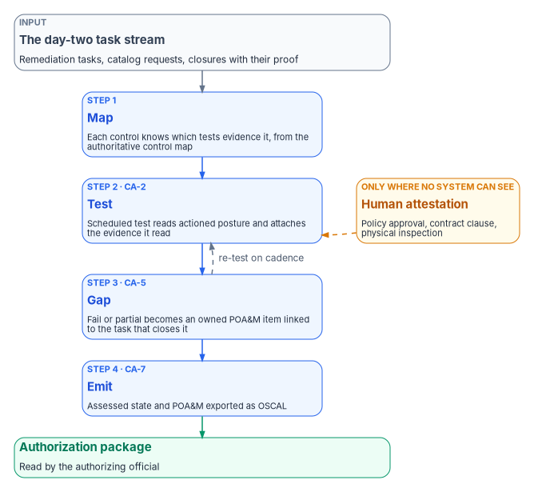
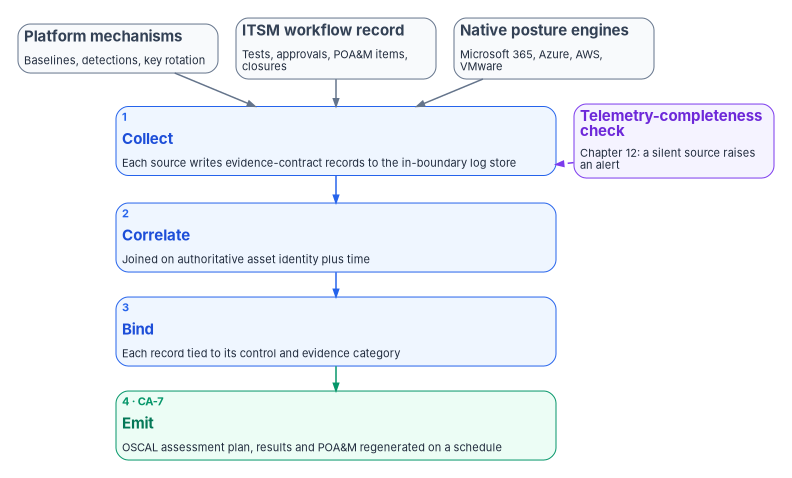

# Chapter 11 — Attestation, Evidence and the Compliance Application

*A closed ticket proves that someone did some work; an assessed control proves that the work held, and only the second one belongs in front of an authorizing official.*

::: {.callout-note}
## In this chapter
The rule that decides when a control is proven by system evidence and when a person has to attest to it. The four-step loop (map, test, gap, emit) that turns the day-two task stream into assessed control state, a plan of action and milestones, and continuous-monitoring output. What ServiceNow's own Policy and Compliance Management, Continuous Authorization and Monitoring and Configuration Compliance applications already do, and where the program's own compliance application fits beside them. The evidence and continuous-monitoring pipeline that carries every record into the authorization package, and the limits of all of it.
:::

The chapters before this one put day-two work on rails. Requests arrive through the catalog ([Chapter 05](05-the-service-catalogs.md)), the help desk acts under scoped, time-boxed roles ([Chapter 04](04-help-desk-authority-in-entra.md)), the CMDB knows which asset each finding belongs to ([Chapter 07](07-the-cmdb-and-asset-identity.md)), and drift in Microsoft 365, Azure, AWS and VMware becomes owned, tracked work ([Chapter 08](08-control-automation-m365-and-azure.md), [Chapter 09](09-control-automation-aws-and-vmware.md)). All of that is operational hygiene. None of it is yet something an authorizing official can sign.

The gap between the two is attestation in the broad sense: the periodic control test, the evidence that the test passed, the plan of action and milestones (POA&M) for what didn't, and a machine-readable roll-up that lets continuous monitoring run as a standing activity rather than a scramble before each assessment. This chapter is about that join. It doesn't repeat what the rest of the workbook already settles. Why a system-produced record outranks a signed statement is [Book 13, Chapter 07](../b13-governance/07-evidence-over-attestation.md). What the authorization package contains, the OSCAL model for each part, the POA&M lifecycle and the continuous-monitoring cadence are [Book 14, Chapter 11](../b14-compliance/11-the-authorization-package.md). The evidence contract that every source emits, keyed on asset identity plus time, is [Book 12, Chapter 02](../b12-security-operations/02-the-evidence-contract.md). This chapter shows how the IT service management (ITSM) platform that runs day two feeds all three.

{#fig-ch11-attestation-loop fig-alt="At the top, a slate card: the day-two task stream, remediation tasks, catalog requests and closures with their proof. It leads to four numbered blue cards in sequence. Step 1, map: each control knows which tests and tasks evidence it, a projection of the authoritative control map. Step 2, test: a scheduled control test reads actioned posture and attaches the evidence it read, CA-2. Step 3, gap: every fail or partial becomes an owned POA&M item linked to the work that will close it, CA-5. Step 4, emit: assessed state and POA&M are exported as OSCAL into the authorization package and the continuous-monitoring stream, CA-7. Beside step 2, an amber card labeled human attestation, only where no system can observe the control, such as a policy approval or a physical inspection, feeds the test step with a dashed arrow. Step 4 leads to a green card: the authorization package, read by the authorizing official. A dashed arrow labeled re-test on cadence runs from the gap step back to the test step."}

## System evidence first, attestation where no system can see

The program's rule is simple to state. **A control is proven by evidence a system produced whenever a system can observe it. A person attests only to what no system can observe, and the package says which is which.** That is a design position, and federal guidance supports both halves of it.

NIST's Risk Management Framework expects automation and expects it to fall short. In its appendix on ongoing authorization, SP 800-37 says organizations "may begin by generating security and privacy information from automated tools and fill in gaps by generating additional information from manual assessments," adjusting as more monitoring is automated.[^c11-sp80037] SP 800-137 makes the same point more bluntly: organization-wide monitoring "cannot be efficiently achieved through manual processes alone or through automated processes alone," and every implemented control, including management and operational controls, "must be regularly assessed for effectiveness, even if the monitoring of such controls cannot be automated or is not easily automated."[^c11-sp800137] Automation isn't optional, and neither is the human part.

The practical question on day two is where the line falls. The program draws it by what the control is about, not by how convenient a signature would be.

| What the control is about | Example | How it is proven | Who signs |
|---|---|---|---|
| A configuration a platform exposes through an interface | Conditional Access policy state, baseline settings, patch level | A system reads the setting on a schedule and records when and how it read it | Nobody per cycle; people sign for the rule and for exceptions |
| An event a platform logs | A privileged role activation, a password reset, a consent grant | The platform's own audit record, joined to the ticket that authorized it | Nobody per event; the approver's decision is itself in the record |
| A process outcome that leaves a system trace | An access review completed, a POA&M item closed on re-test | The workflow record, with the evidence attached at closure | The reviewer or owner, inside the workflow |
| A decision or condition no system can observe | A policy approved, a contract clause in force, a physical inspection, a tabletop exercise held | A human attestation, dated, with the artifact it rests on | The accountable official, on a stated cadence |

Attestation in the bottom row isn't second-class evidence; it is the only evidence there is. What the program won't do is let a signature stand in for a reading a system could have taken. An attested control in the top three rows is a finding: the package is claiming less than it could prove. [Book 13, Chapter 07](../b13-governance/07-evidence-over-attestation.md) gives the long form of this argument and the integrity mechanisms (hashes, chains, signatures) that make system evidence checkable by an assessor.

## The attestation loop

The program's design lifts control state from the task stream to evidence in four steps. Each step has an output an assessor can examine.

| Step | Input | What happens | Output |
|---|---|---|---|
| 1. Map | The control map: for each control, the tests and task types that evidence it | The platform's control records are loaded from the authoritative control map, not typed in by hand | Each control knows which tests attest it |
| 2. Test | The current posture roll-up from the remediation streams, plus spot evidence | A scheduled control test reads the posture and attaches the evidence it read | Pass, fail or partial per control, with evidence |
| 3. Gap | Any fail or partial | An issue is raised and becomes a POA&M item with one owner, a milestone and a required closure evidence type | An owned item linked to the work that will close it |
| 4. Emit | Assessed control state and the POA&M | Both are exported in OSCAL and published to the continuous-monitoring stream | Machine-readable records the authorization package consumes |

: The attestation loop (program design) {.striped .hover}

The control map deserves a sentence of its own. Which controls the platform attests, and which test or evidence category stands behind each, is defined once, in the program's authoritative control map, the same record that [Book 14, Chapter 11](../b14-compliance/11-the-authorization-package.md#the-evidence-contracts-five-rules) calls the first rule of the evidence contract. The ITSM platform's control records are a projection of that map. If the two disagree, the map wins and the platform is out of date; the same discipline the CMDB follows toward the authoritative network and asset records in [Chapter 07](07-the-cmdb-and-asset-identity.md).

### Assessed control state (CA-2)

CA-2 asks the organization to assess its controls at a defined frequency "to determine the extent to which the controls are implemented correctly, operating as intended, and producing the desired outcome," to produce a report, and to provide the results to defined people.[^c11-sp80053] The control test in step 2 is the program's unit of that assessment. It reads the rolled-up posture the remediation streams produce (secure-baseline pass rates, Conditional Access exception review currency, Azure Policy compliance, the age of open vulnerability findings, patch timeliness) and renders a verdict with the evidence attached.

What makes the verdict worth something is what it reads. A test that reads *actioned* posture (drift that became a task, which closed with proof) is backed by an owned trail. A test that reads a dashboard tile is a screenshot with a schedule. The difference is the difference between CA-2 as an annual event and CA-2 as a standing indicator. It doesn't remove the independent assessor: at the Moderate baseline CA-2(1) still requires independent assessors, and the automated results are evidence for them, not a substitute ([Book 14, Chapter 11](../b14-compliance/11-the-authorization-package.md)).[^c11-baselines]

### The plan of action and milestones (CA-5)

CA-5 asks for a POA&M that documents planned remediation of weaknesses found in assessment, updated at a defined frequency "based on the findings from control assessments, independent audits or reviews, and continuous monitoring activities."[^c11-sp80053] In the program's design every fail or partial from step 2 becomes a POA&M item with a single owner, a milestone date and a required closure evidence type. Because items are issues in the same platform as the remediation work, they inherit the same service levels, approvals and audit trail, and each one links back to the remediation task that will close it. Three rules follow, all program design:

- **A POA&M item closes on re-test, not on ticket closure.** When the linked task closes and the next control test passes, the item closes with that test's evidence. A closed task with a failing re-test reopens the item.
- **A slipped milestone escalates.** It doesn't quietly move.
- **The POA&M is never a parallel spreadsheet.** If it lives apart from the work, it drifts from the work.

The disposition vocabulary (actionable drift, governed exception, lapsed acceptance), the OSCAL risk-status mapping and the generator that writes the POA&M are in [Book 14, Chapter 11](../b14-compliance/11-the-authorization-package.md#the-plan-of-action-and-milestones). This chapter only adds where the items come from on day two.

### The emit (CA-7)

CA-7 asks for ongoing control assessments, ongoing monitoring of defined metrics, correlation and analysis of what both produce, response actions, and reporting of the system's security and privacy status at a defined frequency.[^c11-sp80053] Step 4 is the reporting half. Assessed control state and the POA&M are exported as OSCAL assessment results and POA&M documents and handed to whatever assembles the authorization package. OSCAL's current release is 1.2.3, published August 7, 2026.[^c11-oscal-release] Because the package is generated, it can be diffed from one release to the next, and a reviewer can see what changed rather than reread everything.

### A correction about FedRAMP's indicators

The source design emitted each attested control "as FedRAMP 20x KSI evidence" into the agency's package. That overstates what the indicators are. FedRAMP's 2026 Key Security Indicators, 46 of them in 10 themes, are part of the rules for cloud service offerings seeking FedRAMP certification.[^c11-fr-ksi] The rules that require them are addressed to providers: for 20x certifications, "Providers MUST also include" a summary of the measures that demonstrate each applicable indicator in their Security Decision Record.[^c11-fr-sdr] An agency's own system isn't certified by FedRAMP; it is authorized by the agency under the Risk Management Framework ([Book 14, Chapter 11](../b14-compliance/11-the-authorization-package.md#what-fedramps-2026-rules-expect)).

So the program keeps the indicators in their place. A control record may carry an indicator tag as vocabulary, which helps when the agency reads a provider's quarterly report alongside its own results, and the tag must name a real theme (the source used `KSI-CM`, which isn't one; change management is `KSI-CMT`).[^c11-fr-ksi] The agency's own package is an RMF package, judged against the agency's baseline by its own authorizing official.

## The platform is the workflow record, not the evidence store

ServiceNow, or whichever ITSM platform the agency runs, contributes one kind of record: the workflow and attestation record. That is the owned test, the approval trail, the POA&M item and the closure with its proof. It is not where the telemetry lives, and it shouldn't become the place where the authorization narrative is written. Telemetry belongs in the log and evidence stores [Book 12](../b12-security-operations/index.md) describes; the package is assembled from the evidence contract, and the platform is one more source that writes to that contract. Keeping the roles separate matters for two reasons. It lets the agency change its ITSM platform without losing its evidence, and it stops the platform's own dashboards from becoming a second, unofficial version of the package.

## What ServiceNow already provides

Before anyone builds a compliance application, the agency should know what its platform already does. ServiceNow ships several applications that cover much of the attestation loop. The facts below are from ServiceNow's documentation and its partners' documentation as of October 2026; each release changes them, so recheck before relying on any of them.

- **Policy and Compliance Management.** ServiceNow's governance, risk and compliance suite models controls as implementations of control objectives and tests them two ways. An indicator "allows you to do a test on the controls, and tests can be scheduled daily, weekly, monthly, or quarterly"; an attestation "assesses the control to continuously monitor its compliance"; and "if a gap is identified while testing a control, then that gap is termed as an issue."[^c11-snow-pcm] That is steps 2 and 3 of the loop, natively.
- **Continuous Authorization and Monitoring.** This application "provides a standardized approach to defining an authorization package" by "walking through the seven stages of the NIST Risk Management Framework," and lets the team view all POA&Ms in a single pane, with POA&Ms that "include all authorization package issues."[^c11-snow-cam-x] Its later releases added OSCAL: exporting the system security plan in OSCAL; generating and downloading OSCAL system security plan and POA&M files from within an authorization package, and importing individual POA&M files (Zurich release); and importing and exporting OSCAL assessment plans and assessment results (Australia release).[^c11-snow-cam] That is much of step 4.
- **Configuration Compliance.** Microsoft documents an integration that brings Defender for Cloud's posture-management findings into ServiceNow's Configuration Compliance module, alongside an ITSM integration that creates incidents, problems and changes from Defender for Cloud recommendations.[^c11-mdc-snow] Microsoft's support matrix lists that ServiceNow integration as generally available in commercial Azure and not available in Azure Government, which matters for an agency whose subscriptions live there.[^c11-mdc-matrix]
- **Partner applications for FedRAMP's indicators.** In July 2026 a ServiceNow partner announced an application, planned for the ServiceNow Store, that runs inside Continuous Authorization and Monitoring, mirrors FedRAMP's 46 indicators and opens remediation issues in ServiceNow's risk management application when evidence falls short.[^c11-partner] That is a vendor announcement, not a verified capability; treat it as a sign that the gap is being filled commercially, and evaluate it like any other product.

The platform itself is authorized for federal use. FedRAMP's marketplace data lists ServiceNow's Government Community Cloud as FedRAMP Certified at Class D (High impact), first certified in 2019, with 101 agency authorizations as of October 21, 2026.[^c11-fr-market] (The source volumes told writers never to cite High for the platform. The marketplace says High; the agency's own system categorization is a separate question.)

### Build, buy or both

The program's recommendation is **buy the native applications first, and build only what they don't do**. The native applications already provide the control records, scheduled tests, issues, the POA&M view and OSCAL import and export. What they don't provide out of the box, as far as the program has been able to verify, is the part that is specific to this workbook's design:

| Need | Native coverage | What the agency adds |
|---|---|---|
| Control records, scheduled tests, issues | Policy and Compliance Management | Load the controls from the authoritative control map; don't type them in |
| RMF workflow, authorization package, POA&M view | Continuous Authorization and Monitoring | Link each POA&M item to the remediation task that closes it |
| OSCAL export of the security plan, POA&M, assessment plan and results | Continuous Authorization and Monitoring (recent releases) | Validate the export against the OSCAL release the package uses |
| Posture findings into tracked work | Configuration Compliance with the Defender for Cloud integration (commercial Azure) | An equivalent path for Azure Government, AWS and VMware ([Chapter 09](09-control-automation-aws-and-vmware.md)) |
| Join every finding to the authoritative asset identity before a task is raised | Partial, through CMDB reconciliation | The reconciliation rule from [Chapter 07](07-the-cmdb-and-asset-identity.md) |
| Close only with proof; flag human-only closures | Workflow configuration | The closure gate below |
| Keep the platform's control set in step with the control map | None | A check in continuous integration (below) |

: Native ServiceNow coverage and the program's additions (as of October 2026) {.striped .hover}

The bottom three rows are the reason a compliance application exists in the program's design at all. If the agency's platform team can deliver them as configuration of the native applications, it should, and skip the custom build. If the native applications can't be funded at all, [Chapter 13](13-building-day-two-automation-in-house.md) covers building the application in-house.

## The compliance application, if you build one

Where the native applications leave gaps, the program's design is a scoped application in the agency's ServiceNow instance. A scoped application keeps the program's records, scripts and flows in their own namespace, packaged so they can be moved between instances as a unit. The design is a starter, not a finished product: an agency completes the connector settings and control map for its own tenant, pins API versions, and tests in a sub-production instance before anything reaches production. Where there is no funding for the native applications or an integrator, [Chapter 13](13-building-day-two-automation-in-house.md) shows how the agency's own staff can build it on the instance it already owns, with AI-assisted drafting, a named reviewer for every line and a sandbox-to-production path under change control.

### What it contains

| Component | Kind of record | Role |
|---|---|---|
| Ingest | Server-side script | Reads Microsoft 365 and Azure control state (Graph, secure-baseline results, Purview, Resource Graph, Defender, Update Manager) through outbound REST calls and normalizes each result into a finding |
| Reconcile | Server-side script | Matches each finding's asset to the authoritative CMDB item before a task is raised; sends unmatched assets to the reconciliation exception queue ([Chapter 07](07-the-cmdb-and-asset-identity.md)) |
| Gate | Server-side script | After a change, re-reads the source, confirms the condition is gone, and stamps the re-test evidence on the task |
| Outbound REST messages | REST message records | Calls to Microsoft Graph and Azure Resource Manager, with endpoints and credentials taken from connection aliases and routed through the MID Server; exported per tenant, never committed |
| Control map | Application data (JSON) | The finding-to-control binding: control, task type, approval, actuation path, evidence category; a projection of the authoritative map |
| Flows | Flow Designer | Detect and route control drift; review exceptions; run the scheduled emit |
| Validation script | MID Server script | Runs the per-surface read and validate scripts on the MID Server and returns one verdict |
| Automated tests | Automated Test Framework suites | The happy path (drift to task to closure to evidence) and the negative paths (unreconciled asset, self-approval blocked, missed service level escalates) |
| Update set | Update set | The whole application assembled for import into another instance; assembled in sub-production, never committed |

### Boundary and least privilege

The design keeps the same boundary discipline as every other automated path in the workbook.

- **The MID Server sits inside the authorization boundary.** ServiceNow describes the MID Server as "a Java application that runs as a Windows service" on a server in the customer's network, mediating between that network and the instance.[^c11-snow-mid] Placing it in-boundary keeps credentials and execution where the agency's controls apply.
- **Connector identities read; they don't administer.** The Microsoft Graph and Azure identities hold read access to the state they evaluate, plus narrowly scoped write for specific, approved, logged remediations. They never hold standing tenant administration. Each newly automated remediation is a review of that scope, because scope creep is the sharpest risk in the whole design.
- **The instance is FedRAMP-authorized**, and reaching any SaaS surface outside the boundary requires an explicit acknowledgement setting.
- **The catalog approval, the change record, the gate verdict and the CMDB reconciliation are the audit evidence.** Nothing in the application closes work without them.

### Standing it up

The sequence below is the program's design, written for a sub-production instance.

1. Create the scoped application, or import the update set, in sub-production.
2. Add the three server-side scripts and the two outbound REST messages.
3. Create connection and credential aliases for Graph and Azure Resource Manager, each bound to the in-boundary MID Server and pointing at the endpoints that serve the agency's cloud. (Microsoft's guidance is that a Microsoft 365 GCC environment keeps using the worldwide endpoints, `https://graph.microsoft.com` and `https://portal.azure.com`, while GCC High and DoD use their own Graph endpoints and the Azure US Government portal; those are a separate exercise.)[^c11-graph-clouds]
4. Set the application properties: which MID Server, which boundary, where the MID scripts live, and the SaaS-acknowledgement flag.
5. Load the control map and run the continuous-integration check against the authoritative map.
6. Copy the validation script and per-surface read scripts to the MID Server.
7. Build the flows, publish the catalog items (control exception request, POA&M item, remediation change), and run the automated test suites before turning on any live connector.

Step 7 has a platform rule behind it. ServiceNow's Automated Test Framework exists "to confirm that your instance works after making a change," and the property that runs tests is disabled by default "to prevent you from accidentally running them on a production system." ServiceNow's guidance is to "run tests only on development, test, and other non-production instances to avoid data corruption and outage."[^c11-snow-atf] The program follows it. A further limit: the test suites exercise the workflow with simulated inputs. They prove the flow routes, approves, escalates and closes as designed; they don't prove the native surfaces behave as the flow expects. Live-connector validation is a separate, gated step, and [Chapter 12](12-the-day-two-runbook.md#validation-and-test-harnesses) covers how the program keeps checking the automation once it runs.

### The control map is data, and it is checked

The binding from finding to task lives in a data file, not in code, so it can be reviewed and checked. An illustrative excerpt:

::: {.callout-warning}
## Illustrative, not production configuration
The control map, records and scripts in this chapter are illustrative. They haven't been tested against a production ServiceNow instance or tenant. Review every entry, connector scope and API version against your own environment, and test in a sub-production instance before use.
:::

```json
{
  "boundary": "m365-gcc",
  "catalog": {
    "m365.baseline.drift": {
      "title": "Microsoft 365 secure-baseline drift",
      "control": "CM-6",
      "task_type": "change",
      "approval": "owner",
      "actuation": "platform-native",
      "evidence_category": "security",
      "ksi_tag": ["KSI-CMT"]
    },
    "azure.patch.remediation": {
      "title": "Azure patch / flaw remediation",
      "control": "SI-2",
      "task_type": "change",
      "approval": "owner",
      "actuation": "platform-native",
      "evidence_category": "endpoint",
      "ksi_tag": ["KSI-SVC"]
    },
    "azure.vuln.finding": {
      "title": "Defender vulnerability finding",
      "control": "RA-5",
      "task_type": "change",
      "approval": "owner",
      "actuation": "platform-native",
      "evidence_category": "security",
      "ksi_tag": ["KSI-MLA"]
    }
  }
}
```

The full map also carries account exceptions (AC-2) and the three attestation entries for the control test, the POA&M item and the continuous-monitoring roll-up (CA-2, CA-5 and CA-7). The `ksi_tag` field is vocabulary only, for the reason given above.

A check in continuous integration regenerates the expected control set from the authoritative map and fails the build when the application's set differs, or when an evidence category or indicator tag isn't valid vocabulary. That keeps the application and the map from drifting apart on *which* controls are covered. It doesn't check every attribute of every entry: whether a given finding should map to a given task type or evidence category remains a review item for people.

## The evidence and continuous-monitoring pipeline

Every automated mechanism in the estate produces operating evidence: a drift record, a detection firing, a revocation, a key rotation, a closed POA&M item. Scattered, that telemetry proves nothing. The pipeline is what turns it into continuously refreshed, control-bound evidence in the form an assessor reads.

{#fig-ch11-evidence-pipeline fig-alt="Three slate cards across the top name the sources: platform mechanisms such as baselines, detections and key rotation; the ITSM platform's workflow record of tests, approvals, POA&M items and closures; and the native posture engines for Microsoft 365, Azure, AWS and VMware. All three feed a blue card, step 1, collect: each source writes evidence-contract records to the in-boundary log store. That leads to step 2, correlate: records joined on authoritative asset identity plus time, AU-12(1). Then step 3, bind: each record tied to its control and evidence category, with an optional indicator tag. Then step 4, emit, a green card: OSCAL assessment plan, assessment results and POA&M regenerated on a schedule, CA-7. A violet card at the side labeled telemetry-completeness check, Chapter 12, points with a dashed arrow at the collect step, marking that a silent source is detected."}

### One record, every source

The record shape is the evidence contract specified in [Book 12, Chapter 02](../b12-security-operations/02-the-evidence-contract.md#the-contract-one-record-every-source); the version below shows the fields that matter for attestation. It is an illustrative shape to adapt, and it is what keeps the pipeline independent of any one engine: anything that can read the contract can produce the package.

```json
{
  "source": "machine-config",
  "assetId": "ipam:10.4.2.17",
  "timestamp": "2026-07-09T15:13:00Z",
  "control": ["CM-6"],
  "ksiTag": ["KSI-CMT"],
  "verdict": "compliant",
  "detail": { "rule": "2.3.1.1", "desired": "Disabled", "observed": "Disabled" },
  "evidenceRef": "loganalytics://.../row/abc123"
}
```

Two fields carry the weight. `assetId` is the authoritative identity from the network and asset records, so records from different surfaces about the same machine correlate; without it the trail fragments. `control` is what binds raw telemetry to the package; without it, the record is just a log line. `verdict` takes one of four values (compliant, drift, remediated, exception), and the ITSM platform writes the same shape when a control test runs or a POA&M item closes.

### Four stages

1. **Collect.** Each mechanism writes contract records to the log store inside the boundary, through diagnostic settings and data collection rules on Azure or the native export on other platforms.
2. **Correlate.** Records are joined on asset identity and time, producing a system-wide, time-correlated trail.
3. **Bind.** Each control-tagged record is tied to its evidence category, and optionally to an indicator tag.
4. **Emit.** On a schedule, the pipeline regenerates the OSCAL assessment plan, assessment results and POA&M, so the package is current rather than assembled at audit time. [Book 14, Chapter 11](../b14-compliance/11-the-authorization-package.md#the-cadence) sets the monthly regeneration and the review cadence around it.

### Controls the pipeline supports

| Control | What the pipeline does for it | Baseline note |
|---|---|---|
| CA-7 Continuous Monitoring | Telemetry to evidence to package, on a cadence | Low, Moderate and High |
| CA-5 Plan of Action and Milestones | POA&M items generated from unremediated drift and failed tests | Low, Moderate and High |
| AU-6(1) Automated Process Integration | Review, analysis and reporting integrated across surfaces | Moderate and High |
| AU-12(1) System-wide and Time-correlated Audit Trail | Asset-identity and time correlation across the log store | High only; at Moderate the program adopts it as design |

: Controls the evidence pipeline supports {.striped .hover}

The baseline column corrects the source, which listed AU-12(1) as if it were required at Moderate. In the NIST SP 800-53B baselines it appears only in High.[^c11-baselines] The program does it anyway, because the correlation is what makes the pipeline work; that is a design reason, not a compliance requirement, and the package should present it that way.

### One pipeline, every estate

The pipeline is the same whatever the platform. Remediation records from the AWS estate enter the same flaw-remediation task stream, AWS assessment findings rank in the same vulnerability queue, and AWS security telemetry lands in the same log store the emit reads ([Chapter 09](09-control-automation-aws-and-vmware.md)). A control is assessed over the whole estate, keyed to the one asset identity. There is no separate AWS attestation narrative, no second scorecard and no per-cloud OSCAL package. If there were, the authorizing official would be reconciling them by hand, which is exactly the work this chapter exists to remove.

## What else the platform can carry

The source material sketched a portfolio of further ServiceNow applications beyond the compliance application, the network-change application and the day-two catalog. The program's position on them is a sequence, not a schedule:

- **Identity and access governance** is the next candidate: joiner, mover and leaver automation driven by HR events, access certification campaigns, and identity evidence fed into the same attestation loop. It extends the day-two catalog's joiner, mover and leaver requests rather than duplicating them ([Chapter 05](05-the-service-catalogs.md)), and it depends on a reliable HR identity source ([Book 03](../b03-hr-identity/index.md)) and on the Entra ID work in [Book 02](../b02-identity/index.md). Microsoft's own access reviews and lifecycle workflows cover part of this ([Book 04, Chapter 09](../b04-access/09-access-governance.md)); the same buy-before-build test applies.
- **Further candidates** are just-in-time privileged access, device compliance, extending the queues to the AWS estate, and analytics over the access evidence, which must stay advisory and never act on its own.

Two gates apply to every one of them. Each needs its own requirements document, reviewed by the platform team, the security office and the people who will run it, before anything is built. And none starts until the applications already in place are running in sub-production with passing automated tests. The source dated these phases and tracked them by internal numbers; the workbook doesn't repeat either, because neither is a commitment an agency can rely on.

## Honest limits

- **An attestation is only as strong as the test behind it.** A control test that reads a shallow signal attests shallowly. Test depth is the subject of the validation harnesses in [Chapter 12](12-the-day-two-runbook.md#validation-and-test-harnesses); the attestation inherits their coverage, good or bad.
- **The pipeline sees only what emits.** A mechanism that deploys but writes no contract record is invisible, and the package can't attest a control whose mechanism is silent. The telemetry-completeness check is the guard.
- **Continuous is a discipline, not a feature.** The emit is only continuous if the tests run on cadence and someone works the POA&M. An idle compliance module produces a stale attestation that reads worse than an honest annual one.
- **The platform's record isn't the package.** The ITSM platform contributes the workflow record; the security plan and the authorization decision live elsewhere, and the platform must not grow a second authorization narrative.
- **Vendor capabilities move fast.** Everything under "What ServiceNow already provides" is dated October 2026. Recheck it before a build decision.

## What changes, in one table

| Old habit | What replaces it |
|---|---|
| A control owner signs that each control was in place this cycle | Systems prove what they can observe; people attest only to what no system can see, and the package says which is which |
| Controls are typed into the compliance tool by hand | The tool's control records are loaded from the authoritative control map and checked against it |
| A POA&M lives in a spreadsheet beside the work | POA&M items are issues linked to the remediation tasks that close them, closing only on re-test |
| The authorization package is assembled before each assessment | The package is regenerated from the evidence pipeline on a cadence and diffed release to release |
| FedRAMP's indicators are treated as the agency's deliverable | Indicators bind providers; the agency may tag its records with them as vocabulary |
| A custom compliance application is built first | The platform's native applications come first; the program builds only reconciliation, the closure gate and the map check |
| Automated tests run wherever is convenient | Tests run in non-production only, and they prove the workflow, not the native surfaces |

::: {.callout-tip}
## Continue the book
[← Previous: Chapter 10 — Who Runs Day Two](10-who-runs-day-two.md) · [Book index](index.md) · [Next: Chapter 12 — The Day-Two Operator Runbook and Validation →](12-the-day-two-runbook.md)
:::

[^c11-sp80037]: National Institute of Standards and Technology, SP 800-37 Rev. 2, *Risk Management Framework for Information Systems and Organizations: A System Life Cycle Approach for Security and Privacy*, December 2018, Appendix F (ongoing authorization), <https://nvlpubs.nist.gov/nistpubs/SpecialPublications/NIST.SP.800-37r2.pdf> (accessed Oct 21, 2026).
[^c11-sp800137]: National Institute of Standards and Technology, SP 800-137, *Information Security Continuous Monitoring (ISCM) for Federal Information Systems and Organizations*, September 2011, Executive Summary and Chapter 2, <https://nvlpubs.nist.gov/nistpubs/Legacy/SP/nistspecialpublication800-137.pdf> (accessed Oct 21, 2026).
[^c11-sp80053]: National Institute of Standards and Technology, SP 800-53 Rev. 5, *Security and Privacy Controls for Information Systems and Organizations*, controls CA-2, CA-5 and CA-7; text read from the release 5.2.0 OSCAL catalog, <https://github.com/usnistgov/oscal-content/blob/main/nist.gov/SP800-53/rev5/json/NIST_SP-800-53_rev5_catalog.json> (accessed Oct 21, 2026).
[^c11-baselines]: National Institute of Standards and Technology, SP 800-53B control baselines, release 5.2.0 OSCAL profiles for the Low, Moderate and High baselines (CA-2(1) and AU-6(1) in Moderate and High; AU-12(1) in High only), <https://github.com/usnistgov/oscal-content/tree/main/nist.gov/SP800-53/rev5/json> (accessed Oct 21, 2026).
[^c11-oscal-release]: National Institute of Standards and Technology, OSCAL release v1.2.3, published August 7, 2026, <https://github.com/usnistgov/OSCAL/releases/tag/v1.2.3> (accessed Oct 21, 2026).
[^c11-fr-ksi]: FedRAMP, "Key Security Indicators," *FedRAMP Consolidated Rules for 2026* (46 indicators across the CED, CMT, CNA, IAM, INR, MLA, PIY, RPL, SCR and SVC themes), <https://fedramp.gov/2026/reference/key-security-indicators/> (accessed Oct 21, 2026).
[^c11-fr-sdr]: FedRAMP, "Security Decision Record," *FedRAMP Consolidated Rules for 2026*, rule SDR-CSX-KSI (audience: providers; 20x certifications), <https://fedramp.gov/2026/providers/20x/rules/security-decision-record/> (accessed Oct 21, 2026).
[^c11-snow-pcm]: ServiceNow, "Structural overview of Policy and Compliance Management," Zurich release documentation, <https://www.servicenow.com/docs/r/DDKNGuzcS_gt6P_P4KM3Dg/vlVidjfvSt~IUXRenqy1vg> (accessed Oct 21, 2026).
[^c11-snow-cam-x]: ServiceNow, "Continuous Authorization and Monitoring release notes," Xanadu release, <https://www.servicenow.com/docs/r/xanadu/release-notes/grc-cam-rn.html> (accessed Oct 21, 2026).
[^c11-snow-cam]: ServiceNow, "Combined Continuous Authorization and Monitoring release notes for upgrades from Xanadu to Australia," <https://www.servicenow.com/docs/r/Cz0Un5C85RB3j2nhhAK1aQ/0n7UxVNR4OMwTipZdiXtEg> (accessed Oct 21, 2026).
[^c11-mdc-snow]: Microsoft Learn, "Overview of the ServiceNow integration" (Defender for Cloud), sections "IT Service Management (ITSM)" and "Configuration Compliance module," <https://learn.microsoft.com/azure/defender-for-cloud/integration-servicenow> (accessed Oct 21, 2026).
[^c11-mdc-matrix]: Microsoft Learn, "Support matrices for Defender for Cloud," section "Cloud support" (ServiceNow Integration: GA in Azure, NA in Azure Government), <https://learn.microsoft.com/azure/defender-for-cloud/support-matrix-defender-for-cloud> (accessed Oct 21, 2026).
[^c11-partner]: CIO Influence, "C1Secure Launches SmartRAMP 20x, a ServiceNow-Native Platform Built for the FedRAMP 20x Model," July 15, 2026 (vendor press release), <https://cioinfluence.com/cloud/c1secure-launches-smartramp-20x-a-servicenow-native-platform-built-for-the-fedramp-20x-model/> (accessed Oct 21, 2026).
[^c11-fr-market]: FedRAMP Marketplace data, `products.json` (General Services Administration; last change October 21, 2026), entry F1305072116, ServiceNow Government Community Cloud: status FedRAMP Certified, Class D, impact level High, certified August 12, 2019, 101 authorizations, <https://www.fedramp.gov/marketplace/products.json> (accessed Oct 21, 2026).
[^c11-snow-mid]: ServiceNow, "MID Server," Xanadu release documentation, <https://www.servicenow.com/docs/r/GCPjp~ldPTNRN99oH1DYFg/2apL8Os6qilIEyYhtvCy0Q> (accessed Oct 21, 2026).
[^c11-graph-clouds]: Microsoft Learn, "Microsoft Graph national cloud deployments," section "Microsoft Graph and Graph Explorer service root endpoints," <https://learn.microsoft.com/graph/deployments> (accessed Oct 21, 2026).
[^c11-snow-atf]: ServiceNow, "Test your apps with the ATF," Xanadu release documentation, <https://www.servicenow.com/docs/r/a3E8xg0zsiQLBPKbKO15Mg/cP2Njdzlu6Zs5j5aasYMIg> (accessed Oct 21, 2026).
