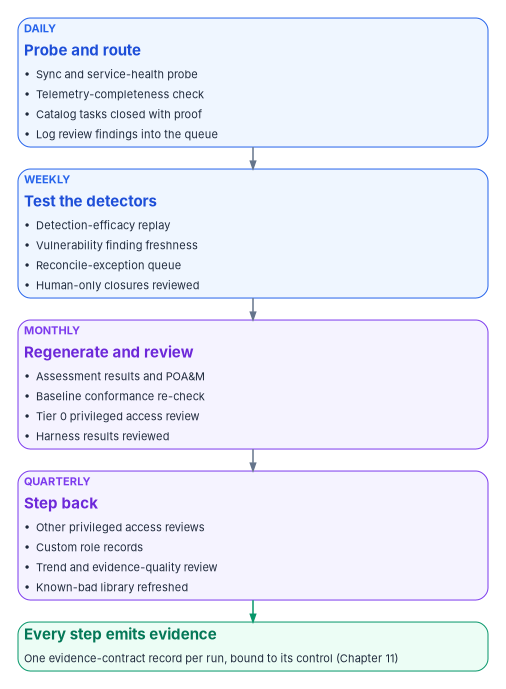
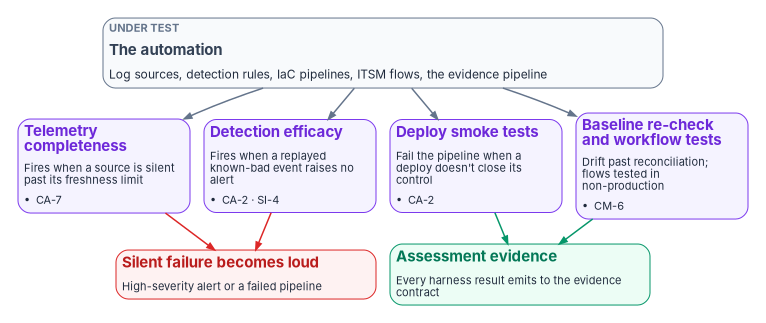

# Chapter 12 — The Day-Two Operator Runbook and Validation

*A runbook earns its place when every step leaves proof behind, and when something checks, on a schedule, that the steps the machines took on the operator's behalf actually happened.*

::: {.callout-note}
## In this chapter
The operator's runbook by cadence: what happens daily, weekly, monthly and quarterly, what each step proves and which control it supports. The governed procedure for the eight everyday tasks that most often arrive in an ungoverned shape, from password resets to the morning synchronization check, with an illustrative read-only probe. The validation and test harnesses that check the automation itself (telemetry completeness, detection efficacy, deployment smoke tests and baseline re-checks), the controls they support, what the platforms already provide, and what the harnesses can't prove.
:::

Every chapter in this book has added a piece of machinery: one front door for requests ([Chapter 03](03-intake-triage-and-routing.md)), scoped help-desk authority ([Chapter 04](04-help-desk-authority-in-entra.md)), typed catalog items ([Chapter 05](05-the-service-catalogs.md)), an authorization verdict before any SaaS consent ([Chapter 06](06-saas-integration-governance.md)), a CMDB that reconciles to the authoritative inventory ([Chapter 07](07-the-cmdb-and-asset-identity.md)), native control state turned into tracked work ([Chapter 08](08-control-automation-m365-and-azure.md), [Chapter 09](09-control-automation-aws-and-vmware.md)), and the attestation loop that turns the result into evidence ([Chapter 11](11-attestation-and-the-compliance-app.md)). This chapter is what the operators do with it, day after day.

Two things make a runbook more than a checklist. Each step has to say what it proves, so an operator who skips one knows what evidence stops arriving. And the runbook has to include steps that check the automation, not just the estate, because the most dangerous failure in an automated operation is a silent one: a log source that stops sending, a detection that stopped matching after a schema change, a pipeline that deployed without closing the control it was written for. A control that fails silently is worse than one known to be absent. It carries false confidence into an authorization.

The five operating rules every step obeys are in [Chapter 02](02-day-two-is-where-compliance-lives.md#the-day-two-operating-rules): originate with the source of truth, carry the authorization the control requires, act under least privilege elevated just in time, close with proof, and emit the evidence automatically. This chapter doesn't restate them; it applies them.

{#fig-ch12-runbook-cadence fig-alt="Four cards stacked top to bottom, connected by arrows. A blue card, daily, probe and route: synchronization and service-health probe, telemetry-completeness check, catalog tasks closed with proof, log review findings into the queue. A blue card, weekly, test the detectors: detection-efficacy replay, vulnerability finding freshness, reconcile-exception queue, human-only closures reviewed. A violet card, monthly, regenerate and review: assessment results and POA&M, baseline conformance re-check, Tier 0 privileged access review, harness results reviewed. A violet card, quarterly, step back: other privileged access reviews, custom role records, trend and evidence-quality review, known-bad library refreshed. The last card leads to a green card: every step emits evidence, one evidence-contract record per run, bound to its control, Chapter 11."}

## The runbook at a glance

The table is the program's design. NIST leaves almost every frequency here to the organization: CA-7 asks the organization to establish its own frequencies for monitoring and for assessing control effectiveness, and AC-6(7) asks for privilege reviews at an organization-defined frequency.[^c12-sp80053] Where another book in the workbook has already set a frequency, this table uses it.

| Cadence | Step | What it proves | Controls it supports | Owner |
|---|---|---|---|---|
| Daily | Synchronization and service-health probe | Directory synchronization ran, its errors are known, and each one is tracked work | CA-7, SI-4, CP-9 (backup result) | Identity operations |
| Daily | Telemetry-completeness check | Every expected log source is still sending | CA-7, SI-4 | Security operations |
| Daily | Catalog and remediation tasks | Each change was requested, approved, executed under a scoped role and closed with a check | AC-2, IA-5, CM-3, and the task's own control | Service desk; platform teams |
| Daily | Log review findings | Review happened, and what it found entered the same queue as everything else | AU-6 | Security operations |
| Weekly | Detection-efficacy replay | Detection rules still fire on the patterns they were written for | CA-2, SI-4 | Detection engineering |
| Weekly | Vulnerability finding freshness | Open findings are current and inside their remediation deadlines | RA-5, SI-2 | Vulnerability management |
| Weekly | Reconciliation exceptions | Findings for assets the CMDB couldn't match are being resolved, not ignored | CM-8 | Configuration management |
| Weekly | Human-only closures | Every task closed without automated proof is reviewed and either evidenced or reopened | CA-2, CA-7 | Service desk lead |
| Monthly | Regenerate assessment results and the POA&M | The package reflects current evidence | CA-2, CA-5, CA-7 | ISSO |
| Monthly | Baseline conformance re-check | Configuration matches the intended baseline after reconciliation | CM-6 | Platform teams |
| Monthly | Tier 0 privileged access review | Every Tier 0 assignment is still needed | AC-6(7), AC-2 | Governance office |
| Monthly | Harness results review | The checks on the automation passed, or their failures are tracked | CA-2, CA-7 | ISSO |
| Quarterly | Other privileged access reviews | Every non-Tier-0 privileged assignment is still needed | AC-6(7), AC-2 | Role owners |
| Quarterly | Custom role records | Each custom role's permissions, backing group and purpose are still right | AC-6, AC-2 | Identity architecture |
| Quarterly | Trend and evidence-quality review | Which controls drift repeatedly; which verdicts rest on manual evidence | CA-7 (CA-7(3) as design) | ISSM |
| Quarterly | Known-bad event library refresh | The efficacy tests still reflect current attacker behavior and current schemas | CA-2, SI-4 | Detection engineering |

: The operator runbook by cadence (program design) {.striped .hover}

The monthly regeneration and review match the cadence in [Book 14, Chapter 11](../b14-compliance/11-the-authorization-package.md#the-cadence). The Tier 0 monthly and other-privileged quarterly reviews are the program's choice in [Book 04, Chapter 09](../b04-access/09-access-governance.md) and [Book 04, Chapter 08](../b04-access/08-pim-self-request-with-approval.md), and they are never self-reviews. CA-7(3), Trend Analyses, isn't in any NIST baseline;[^c12-baselines] the quarterly trend review adopts it as a design choice, because a control that passed every month and then failed is a different finding from one that has always failed.

## Daily: the eight everyday tasks, governed

The source runbook took eight tasks as they actually arrive at many service desks, by email, under standing administrator rights, closed with a reply, and rewrote each as a governed procedure. [Chapter 02](02-day-two-is-where-compliance-lives.md#what-changes-for-everyday-tasks) has the one-line summary of each. Here is the procedure an operator follows. The first five are request-driven; the last three are standing operations. The illustrative catalog item names are the program's design ([Chapter 05](05-the-service-catalogs.md)).

### 1. Password reset

**Catalog item:** `entra.credential.password_reset` · **Supports:** IA-5

The ungoverned shape: an email arrives, an operator with standing portal rights resets the password and emails a temporary password back to the mailbox that asked. If that mailbox is compromised, the reset hands the account to whoever holds it.

1. **Originate.** The email opens a catalog request against the reconciled identity record. If the account is disabled, the request stops and routes to the security office rather than proceeding.
2. **Authorize.** Self-service where policy allows. Otherwise the service desk verifies the person against the record the agency already holds, never against facts the caller supplies ([Chapter 04](04-help-desk-authority-in-entra.md#identity-proofing-before-any-credential-action)).
3. **Elevate and act.** The catalog actuator resets the credential through Graph under a just-in-time scoped role. The operator holds no standing administrator role.
4. **Deliver on a separate channel.** A Temporary Access Pass, Microsoft's "time-limited passcode that can be configured for single use or multiple sign-ins,"[^c12-tap] or another channel distinct from the one the request came in on. Two messages to the same inbox are still one channel.
5. **Close with proof.** The closing check confirms the new credential is active and the old one no longer works. The change record holds who asked, who approved, what verification happened and the check result.

### 2. Authenticator (MFA) reset

**Catalog item:** `entra.credential.mfa_reset` · **Supports:** IA-5, with IA-2 and IA-12

::: {.callout-important}
## The highest-risk task on the desk
After an authenticator reset, the next person to register a method controls the account. A reset performed on an emailed request with no verification is the classic help-desk social-engineering entry. It is never a look-up-and-click.
:::

1. **Originate.** The request opens the reset item against the identity record.
2. **Authorize: the gate is the point.** The operator verifies identity to policy before anything happens, at the assurance level the account's risk tier requires, and a privileged or sensitive account needs a second approver ([Chapter 04](04-help-desk-authority-in-entra.md#the-high-risk-tasks-and-why-they-need-a-second-approver)).
3. **Elevate and act.** Require re-registration through Graph under a just-in-time role ([Chapter 04](04-help-desk-authority-in-entra.md#temporary-access-pass-and-mfa-re-registration)).
4. **Alert.** Every reset raises an audit event and a security alert (SI-4). Repeated resets on one identity are a detection signal, not routine.
5. **Close with proof.** The record carries the verification evidence and confirms the old method is gone and a new registration is pending under the user's control.

### 3. Admin consent for a third-party application

**Catalog item:** the SaaS integration request ([Chapter 06](06-saas-integration-governance.md)) · **Supports:** AC-20, SA-9, AC-6

Consent restriction governs *who* may approve an integration. It doesn't decide *whether the service at the other end is authorized to hold federal data*. An administrator who correctly consents to an unauthorized cloud service passes every consent gate and still breaks the boundary.

1. **Originate.** The request records the application, its business owner and the directory attributes it will receive (what identity data leaves the boundary, and to which external system).
2. **Authorize: verdict before configuration.** Record the service's authorization status at or above the required baseline before consent is granted. A missing or lapsed authorization stops the request. An approved-software list is necessary but not sufficient.
3. **Least privilege on the grant.** Consent is scoped to the minimum the application needs; the approver is not the requester; the grant is executed through the connector, not a portal click by a standing administrator.
4. **Declare the endpoints.** The application's sign-on and provisioning endpoints, ports and protocols are recorded, so network allow-lists derive from the declaration and an undeclared endpoint shows up as drift.
5. **Close and re-check.** Closure records the verdict, the scoped consent and the endpoint declaration; the authorization is re-checked on a cadence and a lapse raises a task (CA-7).

### 4. Creating an account

**Catalog item:** `entra.jml.joiner` · **Supports:** AC-2, with AC-6 and IA-5

1. **Originate from the joiner event.** The account is provisioned from the HR joiner event, not an ad hoc request ([Book 03](../b03-hr-identity/index.md)). Provisioning before the HR record exists is the exception path, flagged and time-boxed.
2. **Authorize.** The manager of record, taken from the authoritative record, plus the identity team.
3. **Least privilege by derivation.** Group, license and role membership are derived from the identity's attributes (department, role, location), not picked by hand. Usage location and synchronization attributes are set from the record so the account is well formed at creation.
4. **Elevate and act.** Create through Graph under a just-in-time scoped role, never standing global administrator.
5. **Deliver credentials on a separate channel.** A Temporary Access Pass or other out-of-band channel; never a username and password in clear-text email.
6. **Close with proof.** The check confirms the account exists with exactly the derived entitlements and an anchored owner.

### 5. Running a script for a requester

**Catalog item:** a typed extension of the catalog, never a free-form script · **Supports:** AC-2, AC-6, CM-3

::: {.callout-warning}
## Never run a command pasted from a request
If the requester writes the command and the operator runs it under administrator rights, the requester is the author and the operator is the execution engine. A spoofed or compromised mailbox then gets arbitrary execution in the tenant.
:::

1. **Parameters travel; commands don't.** The request supplies validated inputs to a pre-approved, version-controlled script held in the platform. The form can submit only the parameters the script declares, and the script is the only thing that runs. A secret is resolved on the connector host, never typed into a form.
2. **Originate and authorize.** The request resolves against the authoritative record for the objects it changes, and the change type's approval gate holds it.
3. **Elevate and act.** The script acts through Graph under a just-in-time scoped role.
4. **Close with proof.** The closing record captures the exact parameters, the before-and-after state of each changed object, and a check confirming the intended change and nothing broader. A genuinely one-off bulk change outside the catalog is a change-managed, peer-reviewed, logged operation ([Book 13, Chapter 10](../b13-governance/10-ticket-to-machine.md)); never an emailed command.

### 6. The morning synchronization check

**Runs:** daily, scheduled · **Supports:** CA-7, SI-4, AU-6, CP-9

The ungoverned shape is one of the purest examples of manual compilation: an operator logs on interactively every morning to the directory synchronization servers, which are Tier 0 assets, reads the latest import, synchronization and export results, and pastes them into an email in which "changes from yesterday must be bolded." Errors found don't become tracked work, and the daily privileged logon is itself a risk.

1. **Probe, don't log on.** A scheduled read-only probe collects synchronization status and errors through APIs, under a read-only identity. Microsoft Entra Connect Health for sync already gathers server health, alerts, synchronization errors and data freshness in one view, and its alert catalog includes failed imports and exports, a stopped synchronization service and a skipped password-hash-synchronization heartbeat.[^c12-connect-health] Microsoft Graph reports the tenant's last synchronization time and the synchronization conflicts recorded on each user.[^c12-graph-org][^c12-graph-user] Daily interactive logon to the synchronization hosts ends (AC-6, and the privileged-access model in [Book 04](../b04-access/index.md)).
2. **Generate the report; don't compile it.** The morning report is produced from the probe's output, so it can be re-run and diffed, and "what changed since yesterday" is a computed difference rather than bold text.
3. **Errors become tracked work.** Each synchronization error or unhealthy connector opens a task with an owner and a service level. A failed backup of the synchronization server is a CP-9 finding, not a note.
4. **Emit.** The probe result and the report go to the evidence pipeline ([Chapter 11](11-attestation-and-the-compliance-app.md#the-evidence-and-continuous-monitoring-pipeline)).

What the probe should treat as late is grounded in the product's own schedule: by default Microsoft Entra Connect runs a synchronization cycle every 30 minutes, and a modified schedule must still run a cycle at least once every seven days.[^c12-scheduler]

::: {.callout-warning}
## Illustrative, not tested against a production tenant
The scripts and queries in this chapter are illustrative. They read state and change nothing, but they haven't been tested against a production tenant or workspace. Review them, run them first against a test tenant under a read-only identity, and adapt the thresholds to your own schedule before relying on them.
:::

```powershell
# Morning synchronization probe: read-only.
# Requires the Microsoft Graph PowerShell SDK and an identity holding only
# Organization.Read.All and User.Read.All. It changes nothing in the tenant.

Connect-MgGraph -Scopes 'Organization.Read.All', 'User.Read.All' -NoWelcome

# 1. When did the tenant last synchronize with the on-premises directory?
$org = Get-MgOrganization -Property 'id', 'onPremisesSyncEnabled', 'onPremisesLastSyncDateTime'

$lastSync   = $org.OnPremisesLastSyncDateTime
$ageMinutes = $null
if ($lastSync) {
    $ageMinutes = [int]((Get-Date).ToUniversalTime() - $lastSync.ToUniversalTime()).TotalMinutes
}

# Default cycle is 30 minutes; flag anything past two missed cycles.
$syncLate = ($null -eq $ageMinutes) -or ($ageMinutes -gt 90)

# 2. Which users carry a synchronization conflict?
# Advanced query: needs ConsistencyLevel eventual and a count.
$conflicts = Get-MgUser -All `
    -Filter "onPremisesProvisioningErrors/any(o:o/category eq 'PropertyConflict')" `
    -ConsistencyLevel eventual -CountVariable conflictCount `
    -Property 'id', 'onPremisesProvisioningErrors'

# 3. One record per run, shaped for the evidence pipeline.
[pscustomobject]@{
    source        = 'sync-probe'
    timestamp     = (Get-Date).ToUniversalTime().ToString('o')
    control       = @('CA-7', 'SI-4')
    syncEnabled   = $org.OnPremisesSyncEnabled
    lastSyncUtc   = $lastSync
    ageMinutes    = $ageMinutes
    syncLate      = $syncLate
    conflictCount = $conflictCount
    verdict       = $(if ($syncLate -or $conflictCount -gt 0) { 'drift' } else { 'compliant' })
} | ConvertTo-Json -Depth 4
```

The filter uses Graph's advanced query support, in which `onPremisesProvisioningErrors/any(o:o/category)` is a supported filter on users and `PropertyConflict` is currently the only error category.[^c12-graph-adv][^c12-graph-perr] The probe records object identifiers, not names; the task it opens carries what the operator needs. Connect Health's own synchronization error report and export cover the detail the probe leaves out.[^c12-connect-health]

### 7. Event-log handling

**Runs:** continuously, reviewed daily · **Supports:** AU-2, AU-6, AU-9, AU-11

The ungoverned shape: a scheduled script writes event-log output to an administrative file share that anyone with server administrator rights can change. The audit record can be altered by the very people it is meant to hold accountable, which is what AU-9 exists to prevent: it asks the organization to "protect audit information and audit logging tools from unauthorized access, modification, and deletion."[^c12-sp80053] The source document ended with "Review Monday to see if this is enough."

1. **Forward to the central log platform, not a share.** Event logs go to the log platform described in [Book 12](../b12-security-operations/index.md), in a store the monitored administrators can't alter. An administrative share is never an evidence destination. In an Azure Monitor Logs workspace, deleting data is a separate, permissioned operation, and each deletion appears in the workspace's Activity Log with the caller, the target table and the status.[^c12-la-delete] The program grants that permission to nobody who administers the systems whose logs it holds.
2. **Retain to policy.** Retention follows the audit-record policy (AU-11) and the federal logging requirements in [Book 12, Chapter 12](../b12-security-operations/12-evidence-metrics-and-continuous-monitoring.md), not the free space on a server.
3. **Review is a procedure.** Log review (AU-6) is scheduled and owned, and its findings enter the same remediation queue as everything else.
4. **Emit.** Collection status and review completion go to the evidence pipeline.

### 8. Custom administrative roles

**Runs:** the standing posture under every task above; reviewed quarterly · **Supports:** AC-6, AC-6(7), AC-2

The ungoverned shape is common: one well-scoped custom role exists (for example, a help-desk role limited to one device action) while everything else runs on standing global and portal administrator rights, and even the good role has no recorded permission set, activation policy or review.

1. **Least privilege by default.** Every task in this chapter runs under a scoped role activated just in time; standing global and portal administrator rights leave day-to-day operations. The one good scoped role becomes the pattern ([Chapter 04](04-help-desk-authority-in-entra.md)).
2. **Enumerate and bind.** Each custom role is a governed record: its exact permissions, its backing group and the tasks it exists for.
3. **Activation through Privileged Identity Management.** Elevation is time-boxed, approved where configured and logged; the activation record is part of each task's evidence, binding who could act to what was done ([Book 04, Chapter 08](../b04-access/08-pim-self-request-with-approval.md)).
4. **Review on a calendar.** Privileged role membership is reviewed (AC-6(7) asks the organization to review privileges "to validate the need for such privileges"[^c12-sp80053]), and revocations become tracked work.

A note on the control the source cited here. It named AC-2(7), Privileged User Accounts, for the review. AC-2(7) is about administering privileged accounts under a role-based scheme and isn't in any NIST baseline; the review of privileges is AC-6(7), which is in the Moderate and High baselines, together with AC-2's own account review.[^c12-baselines] The runbook cites AC-6(7).

## Weekly, monthly and quarterly

The daily work produces most of the evidence. The longer cycles check that the evidence still means what it says.

**Weekly.** The detection-efficacy replay runs (below). Vulnerability findings are checked for freshness against their remediation deadlines ([Book 12, Chapter 06](../b12-security-operations/06-vulnerability-management.md)); stale findings are themselves findings. The reconciliation exception queue from [Chapter 07](07-the-cmdb-and-asset-identity.md) is worked down, because a finding that can't be tied to an asset can't be attested. And every task closed without automated proof (a human-only closure) is reviewed: either the evidence is attached, or the task reopens. The program counts human-only closures separately so the number is visible; an attestation over unverified closures would attest something nobody checked.

**Monthly.** Assessment results and the POA&M are regenerated from current evidence ([Chapter 11](11-attestation-and-the-compliance-app.md), [Book 14, Chapter 11](../b14-compliance/11-the-authorization-package.md)). The baseline conformance re-check compares current configuration with the intended baseline and raises drift that survived reconciliation as a CM-6 finding ([Book 13, Chapter 06](../b13-governance/06-the-drift-engine.md)). Tier 0 privileged access is reviewed. And the ISSO reviews the harness results: which checks failed, whether each failure became work, and whether any check stopped running.

**Quarterly.** Non-Tier-0 privileged access is reviewed, custom role records are revisited, and the ISSM runs the trend and evidence-quality review: which controls drift repeatedly, which verdicts rest on manual or derived evidence, and which evidence categories are close to their freshness limits. The known-bad event library behind the efficacy tests is refreshed, because an efficacy test that hasn't changed in a year has quietly become a rubber stamp.

## Validation and test harnesses

Everything above depends on automation: log sources, detection rules, deployment pipelines, ITSM flows and the evidence pipeline. The harnesses are the part of the runbook that checks the automation itself. Their purpose is to make silent failure loud.

{#fig-ch12-harnesses fig-alt="A wide slate card at the top, under test, the automation: log sources, detection rules, infrastructure-as-code pipelines, ITSM flows and the evidence pipeline. It points to four violet cards in a row. Telemetry completeness, which fires when a source is silent past its freshness limit, CA-7. Detection efficacy, which fires when a replayed known-bad event raises no alert, CA-2 and SI-4. Deploy smoke tests, which fail the pipeline when a deployment doesn't close its control, CA-2. Baseline re-check and workflow tests, drift past reconciliation and flows tested in non-production, CM-6. The first two point to a red card: silent failure becomes loud, a high-severity alert or a failed pipeline. The last two point to a green card: assessment evidence, every harness result emits to the evidence contract."}

| Harness | Question it answers | Fires when | Supports |
|---|---|---|---|
| Telemetry completeness | Is every expected source still sending? | A source's newest record is older than its freshness limit | CA-7; SI-4 |
| Detection efficacy | Do the detection rules still catch what they should? | A replayed known-bad event doesn't raise its rule | CA-2; SI-4 |
| Deployment smoke tests | Did the infrastructure-as-code change actually close the control? | A post-deployment assertion fails | CA-2 |
| Baseline conformance re-check | Does configuration still match the intended baseline after reconciliation? | Drift survives a reconciliation cycle | CM-6 |
| Workflow tests | Do the ITSM flows still route, approve, escalate and close as designed? | A test in the non-production instance fails | CA-2; CM-3 |

: The validation harnesses (program design) {.striped .hover}

Every harness result is written to the evidence contract as assessment evidence ([Chapter 11](11-attestation-and-the-compliance-app.md#one-record-every-source)), so the checks on the automation are themselves part of the package.

### Which controls this supports, precisely

- **CA-2, Control Assessments**, asks for assessments that determine whether controls are "implemented correctly, operating as intended, and producing the desired outcome."[^c12-sp80053] Efficacy and smoke tests are assessments of exactly that kind.
- **CA-7, Continuous Monitoring**, asks for ongoing monitoring of defined metrics and response actions to what the monitoring finds.[^c12-sp80053] A silent source is a monitoring outage, and the completeness check is how the program notices one.
- **CA-7(3), Trend Analyses**, isn't in any NIST baseline; the program adopts it as design for the quarterly review.[^c12-baselines] The source mapped the completeness check itself to CA-7(3). The check is monitoring, not trend analysis, so the runbook maps it to CA-7 and SI-4 and keeps CA-7(3) for the quarterly comparison of results over time.
- **SI-6, Security and Privacy Function Verification**, asks the organization to verify "the correct operation" of defined security and privacy functions, at defined times, and to alert defined people "to failed security and privacy verification tests."[^c12-sp80053] That describes the harnesses closely, but SI-6 is in the High baseline only.[^c12-baselines] At Moderate, the program presents the harnesses as CA-2 and CA-7 evidence and treats SI-6 as a design aspiration, not a claimed control.
- **SI-4, System Monitoring**, is where source liveness belongs as a first-class signal, and **CM-6** is the baseline re-check.

There is a parallel worth noticing on the provider side. FedRAMP's 2026 rules ask providers seeking 20x certification to include, for each applicable Key Security Indicator, "verification that the automation in place is accurate and sufficient" and "validation that the measures are accurately produced and are in place and working as intended."[^c12-fr-sdr] Those rules bind providers, not agencies, but they make the same point this section does: automation is evidence only if something checks the automation.

### The telemetry-completeness check

This is the most valuable harness, because every other control depends on its sources still sending. It asserts that each expected table has produced data within its freshness limit. A table that goes quiet is the leading indicator of a detection that has gone blind.

```kql
// Telemetry completeness: list every expected source that is past its freshness limit.
// Read-only. Limits are illustrative; set each one from the source's own expected cadence.
let expected = datatable(TableName: string, SlaMinutes: long) [
    "SigninLogs", 60,
    "AADNonInteractiveUserSignInLogs", 60,
    "OfficeActivity", 120,
    "DeviceEvents", 120
];
let lastSeen =
    union isfuzzy=true withsource=TableName
        SigninLogs, AADNonInteractiveUserSignInLogs, OfficeActivity, DeviceEvents
    | where TimeGenerated > ago(2d)
    | summarize LastSeen = max(TimeGenerated) by TableName;
expected
| join kind=leftouter lastSeen on TableName
| extend AgeMin = datetime_diff('minute', now(), LastSeen)
| where isnull(LastSeen) or AgeMin > SlaMinutes   // any row is a source that went dark
| project TableName, LastSeen, AgeMin, SlaMinutes
```

Two corrections to the source's version. It called `now` without parentheses, which isn't valid in KQL; the function is `now()`. And without `isfuzzy=true`, a `union` that names a table that doesn't exist in the workspace fails outright. With it, the union proceeds over the tables that resolve and returns a warning for the rest,[^c12-kql-union] so a missing table shows up as a null `LastSeen` and is reported, which is what a completeness check should do. The two-day look-back keeps the query cheap; anything silent for longer is reported as null and is just as stale.

Schedule the query at the tightest source limit and route any result to a high-severity alert. A dark source is a control outage, not a hygiene item.

### Detection efficacy, smoke tests and the baseline re-check

The **detection-efficacy** harness is the active counterpart. It replays a library of known-bad but harmless events into a test scope (a benign impossible-travel pair, a scripted password-spray burst) and asserts that the matching rule raises. Run it on every rule change, as a regression gate, and on the weekly schedule. A rule that silently stopped matching after a schema change is then caught by a test rather than by a missed incident. [Book 12, Chapter 11](../b12-security-operations/11-detection-engineering-and-response.md) covers detection engineering itself; this harness is how the runbook keeps checking it.

**Deployment smoke tests** attach to each infrastructure-as-code pipeline, so a deployment that doesn't close the control it was written for fails the pipeline, not the audit. The **baseline conformance re-check** runs monthly against the intended baseline and surfaces drift that survived reconciliation.

**Workflow tests** check the ITSM side. ServiceNow's Automated Test Framework is the platform's own mechanism, and ServiceNow's guidance is to "run tests only on development, test, and other non-production instances to avoid data corruption and outage."[^c12-snow-atf] The program follows it: workflow tests run in the non-production instance on every change to a flow or catalog item, and they prove the workflow, not the behavior of the native platforms behind it ([Chapter 11](11-attestation-and-the-compliance-app.md#standing-it-up)).

### What the platforms already provide

As with the compliance application, the agency should use what its platforms ship before building. Microsoft Sentinel provides a data collection health monitoring workbook that "detects anomalies, and gives insight regarding the workspace's data ingestion status," and a `SentinelHealth` table that records connector health events, which Microsoft recommends pairing with Azure Monitor alert rules. The table currently covers only selected connectors (among them Amazon Web Services, Office 365 and Microsoft Defender for Endpoint), and the health feature must be turned on first.[^c12-sentinel-health] For synchronization, Connect Health supplies the alerts listed above.[^c12-connect-health] The custom completeness query still earns its place because it covers every table the agency depends on, regardless of connector, and because its output goes into the evidence pipeline in the program's record shape.

### What the harnesses can't prove

- **Efficacy tests bound regression; they don't prove coverage.** A test proves a rule *can* fire on a known pattern. It says nothing about attacker variants nobody has written down.
- **The known-bad library ages.** If it isn't refreshed as attacker behavior and log schemas change, the efficacy test silently becomes a rubber stamp. That is why its refresh is on the quarterly runbook.
- **Smoke tests assert what they were written to assert.** A dimension of a control that no test covers is still unverified, however green the pipeline.
- **The harnesses are automation too.** A harness that stops running looks exactly like a harness that passes. The monthly harness review checks that each one ran, not just what it found.

## Honest limits

- **The runbook is design, not mandate.** Every frequency in it is the program's choice, within ranges NIST leaves to the organization; an agency should set its own and record why.
- **Some steps still need people.** Identity verification for a reset, the second approval on a high-risk task, the access review decision and the quarterly trend review are human judgments. The runbook makes them recorded and scheduled; it doesn't automate them away.
- **The probe sees what the APIs expose.** Graph reports the last synchronization time and recorded conflicts, not every class of synchronization error; Connect Health reports more but needs its agent and, for full alert coverage, the default synchronization configuration.[^c12-connect-health]
- **Evidence is only as good as the step that produced it.** A task closed by hand with a "done" note is still visible as a human-only closure. The runbook makes those visible; it can't make them good.

## What changes, in one table

| Old habit | What replaces it |
|---|---|
| A runbook lists steps | Each step states what it proves and which control it supports |
| The morning check is a privileged logon and a hand-edited email | A scheduled read-only probe generates the report and opens a task per error |
| Logs land on an administrative share | Logs go to a store the administrators can't alter, retained and reviewed on a schedule |
| Requests carry commands for the operator to run | Requests carry parameters for a pre-approved script, and the closing record shows before and after |
| Automation is trusted once deployed | Harnesses check it on a schedule, and a silent source or a blind rule raises an alert |
| Workflow tests run wherever convenient | Workflow tests run in non-production only, on every change |
| Human-only closures disappear into the totals | They are counted, reviewed weekly and either evidenced or reopened |
| SI-6 is claimed because the harnesses look like it | At Moderate the harnesses are presented as CA-2 and CA-7 evidence; SI-6 is High-only |

::: {.callout-tip}
## Continue the book
[← Previous: Chapter 11 — Attestation, Evidence and the Compliance Application](11-attestation-and-the-compliance-app.md) · [Book index](index.md) · [Next: Appendix A — Help Desk Task Reference →](appendix-a-help-desk-task-reference.md)
:::

[^c12-sp80053]: National Institute of Standards and Technology, SP 800-53 Rev. 5, *Security and Privacy Controls for Information Systems and Organizations*, controls AU-9, AC-6(7), CA-2, CA-7 and SI-6; text read from the release 5.2.0 OSCAL catalog, <https://github.com/usnistgov/oscal-content/blob/main/nist.gov/SP800-53/rev5/json/NIST_SP-800-53_rev5_catalog.json> (accessed Oct 21, 2026).
[^c12-baselines]: National Institute of Standards and Technology, SP 800-53B control baselines, release 5.2.0 OSCAL profiles for the Low, Moderate and High baselines (AC-6(7) in Moderate and High; SI-6 in High only; CA-7(3) and AC-2(7) in none), <https://github.com/usnistgov/oscal-content/tree/main/nist.gov/SP800-53/rev5/json> (accessed Oct 21, 2026).
[^c12-tap]: Microsoft Learn, "Configure Temporary Access Pass to register passwordless authentication methods," <https://learn.microsoft.com/entra/identity/authentication/howto-authentication-temporary-access-pass> (accessed Oct 21, 2026).
[^c12-connect-health]: Microsoft Learn, "Monitor Microsoft Entra Connect Sync with Microsoft Entra Connect Health" (service overview, alerts, limited evaluation of alerts, object-level synchronization error report), <https://learn.microsoft.com/entra/identity/hybrid/connect/how-to-connect-health-sync>; and "Microsoft Entra Connect Health Alert Catalog," section "Alerts for Microsoft Entra Connect (Sync)," <https://learn.microsoft.com/entra/identity/hybrid/connect/how-to-connect-health-alert-catalog> (both accessed Oct 21, 2026).
[^c12-graph-org]: Microsoft Learn, "organization resource type" (`onPremisesLastSyncDateTime`, `onPremisesSyncEnabled`), <https://learn.microsoft.com/graph/api/resources/organization?view=graph-rest-1.0>; and "Get organization," permissions (Organization.Read.All needed to read all properties), <https://learn.microsoft.com/graph/api/organization-get?view=graph-rest-1.0> (both accessed Oct 21, 2026).
[^c12-graph-user]: Microsoft Learn, "user resource type," property `onPremisesProvisioningErrors` ("Errors when using Microsoft synchronization product during provisioning"), <https://learn.microsoft.com/graph/api/resources/user?view=graph-rest-1.0> (accessed Oct 21, 2026).
[^c12-scheduler]: Microsoft Learn, "Microsoft Entra Connect Sync: Scheduler," <https://learn.microsoft.com/entra/identity/hybrid/connect/how-to-connect-sync-feature-scheduler> (accessed Oct 21, 2026).
[^c12-graph-adv]: Microsoft Learn, "Advanced query capabilities on Microsoft Entra ID objects" (user properties supporting `onPremisesProvisioningErrors/any(o:o/category)`), <https://learn.microsoft.com/graph/aad-advanced-queries>; and "Get-MgUser" (`-Filter`, `-ConsistencyLevel`, `-CountVariable`, `-Property`, `-All`), <https://learn.microsoft.com/powershell/module/microsoft.graph.users/get-mguser?view=graph-powershell-1.0> (both accessed Oct 21, 2026).
[^c12-graph-perr]: Microsoft Learn, "onPremisesProvisioningError resource type" (category: "Currently, there is only one possible value," `PropertyConflict`), <https://learn.microsoft.com/graph/api/resources/onpremisesprovisioningerror?view=graph-rest-1.0> (accessed Oct 21, 2026).
[^c12-la-delete]: Microsoft Learn, "Delete data from a Log Analytics workspace by using the Delete Data API," section "Check delete data operations and status," <https://learn.microsoft.com/azure/azure-monitor/logs/delete-log-data> (accessed Oct 21, 2026).
[^c12-fr-sdr]: FedRAMP, "Security Decision Record," *FedRAMP Consolidated Rules for 2026*, rule SDR-CSX-KSI (audience: providers; 20x certifications), <https://fedramp.gov/2026/providers/20x/rules/security-decision-record/> (accessed Oct 21, 2026).
[^c12-kql-union]: Microsoft Learn, "union operator," parameters `isfuzzy` and `withsource`, <https://learn.microsoft.com/kusto/query/union-operator?view=microsoft-fabric> (accessed Oct 21, 2026).
[^c12-snow-atf]: ServiceNow, "Test your apps with the ATF," Xanadu release documentation, <https://www.servicenow.com/docs/r/a3E8xg0zsiQLBPKbKO15Mg/cP2Njdzlu6Zs5j5aasYMIg> (accessed Oct 21, 2026).
[^c12-sentinel-health]: Microsoft Learn, "Monitor the health of your data connectors" (data collection health monitoring workbook; `SentinelHealth` table and its supported connectors; Azure Monitor alert rules), <https://learn.microsoft.com/azure/sentinel/monitor-data-connector-health> (accessed Oct 21, 2026).
