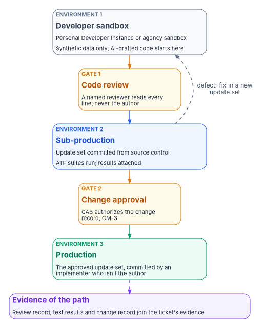

# Chapter 13 — Building Day-Two Automation In-House

*No budget for a new product isn't the end of the design; it moves the work to the agency's own staff, and the controls that make a vendor's code trustworthy have to be applied to the agency's own.*

::: {.callout-note}
## In this chapter
What federal staff can build on the ServiceNow instance the agency already owns when there is no funding for add-on modules or a commercial identity-governance product, and what that build doesn't replace. How AI coding assistants can draft the scripts under the agency's AI-use policy, with a named person reviewing every line and no production data in any prompt. The path from a developer sandbox through sub-production to production under change control, mapped to NIST's Secure Software Development Framework and its generative-AI profile. Who writes, reviews, approves and operates, how existing staff are trained to do it, and why the development path itself is audit evidence.
:::

[Chapter 11](11-attestation-and-the-compliance-app.md) recommends buying the ITSM platform's native compliance applications first and building only what they don't do. That advice assumes there is money to buy them. Often there isn't. An agency can own a ServiceNow instance for its service desk and still have no budget for the platform's compliance modules, no identity-governance product, and no integrator to build the joins this book describes. When leadership's answer to a funding request is no, the design in Chapters 03 through 12 doesn't stop being right. The question becomes who builds it, and how the agency trusts what they build.

This chapter answers with a path the program considers workable: the agency's own staff build the compliance application from [Chapter 11](11-attestation-and-the-compliance-app.md#the-compliance-application-if-you-build-one) as a scoped application on the instance the agency already licenses, use approved AI coding assistants to draft the code, and put every line through the same review, testing and change control the agency would demand of a vendor. Nothing here is new technology. What makes it safe is discipline: a named reviewer, a sandbox that holds no real data, tests that run before anything moves, and a change record that someone other than the author approves.

The chapter is program design except where a footnote says otherwise. It names ServiceNow and SailPoint because they are the platforms the workbook's examples use ([Chapter 11](11-attestation-and-the-compliance-app.md), [`examples/servicenow-sailpoint`](https://github.com/WhalerMike/modernization-workbook/tree/main/examples/servicenow-sailpoint)); it doesn't endorse either, and the same reasoning applies to any ITSM platform the agency already owns.

{#fig-ch13-sandbox-to-production fig-alt="A vertical chain of cards. At the top, a slate card labeled environment 1, developer sandbox: a Personal Developer Instance or agency sandbox, synthetic data only, where AI-drafted code starts. An amber arrow leads to an amber card labeled gate 1, code review: a named reviewer reads every line, never the author. A blue arrow leads to a blue card labeled environment 2, sub-production: the update set is committed from source control and the Automated Test Framework suites run, with results attached. An amber arrow leads to an amber card labeled gate 2, change approval: the change advisory board authorizes the change record, CM-3. A green arrow leads to a green card labeled environment 3, production: the approved update set, committed by an implementer who isn't the author. A dashed violet arrow leads to a violet card at the bottom, evidence of the path: the review record, test results and change record join the ticket's evidence. A dashed arrow labeled defect, fix in a new update set, runs from sub-production back to the developer sandbox."}

## The no-funding path

### What the native route costs, and why it may be closed

The native applications Chapter 11 recommends aren't part of a basic ITSM subscription. ServiceNow's documentation says the Policy and Compliance Management plugin "is available as a separate subscription and requires activation," and says the same of the Continuous Authorization and Monitoring plugin.[^c13-snow-pcm][^c13-snow-cam] A commercial identity-governance product is a further purchase on top of that, and Microsoft's own access reviews and lifecycle workflows need Entra ID Governance licensing ([Book 04, Chapter 09](../b04-access/09-access-governance.md#licensing-what-needs-entra-id-governance)). An agency that can't fund any of these has two choices: leave the day-two design on paper, or build the parts it needs on what it already pays for.

### What staff can build on the instance the agency already owns

The build is the scoped application [Chapter 11](11-attestation-and-the-compliance-app.md#the-compliance-application-if-you-build-one) describes, nothing larger. It uses platform features that come with the instance (tables, server-side scripts, outbound REST messages, Flow Designer, the MID Server, the Automated Test Framework and update sets) rather than the separately licensed modules. In practice that means:

- **Its own records for findings, control tests and plan of action and milestones (POA&M) items.** A custom table that extends the platform's task table inherits numbering, state, assignment, approvals and the audit trail, as the [SailPoint and ServiceNow example](https://github.com/WhalerMike/modernization-workbook/blob/main/examples/servicenow-sailpoint/README.md) does with its identity-finding table.
- **The ingest, reconcile and gate scripts** that read control state, match each finding to the authoritative CMDB item ([Chapter 07](07-the-cmdb-and-asset-identity.md)), and close work only when a re-read confirms the fix.
- **The control map as data**, loaded from the authoritative map and checked against it in continuous integration ([Chapter 11](11-attestation-and-the-compliance-app.md#the-control-map-is-data-and-it-is-checked)).
- **Scheduled control tests and an export** of assessed state and the POA&M in the shape the evidence pipeline expects ([Chapter 11](11-attestation-and-the-compliance-app.md#the-evidence-and-continuous-monitoring-pipeline)).
- **Identity-lifecycle checks without an identity-governance product**: the read-only drift reconciliation that joins the HR extract to Microsoft Graph, and the re-read-before-close rule, both of which the example implements without needing anything written into Entra ID ([Book 03](../b03-hr-identity/index.md) describes the drift classes).

### What it doesn't replace

The build replaces the joins this workbook needs. It doesn't replace a commercial product's breadth, and the agency should say so in writing before it starts, so nobody later treats the custom application as if it were one.

| Capability | A commercial identity-governance product | The in-house build |
|---|---|---|
| Access certification campaigns | Built in: designated people, such as managers or system owners, review users' access and decide whether it is appropriate or should be revoked[^c13-sp-certs] | Possible as a catalog-driven review for a few high-value groups; not a general campaign engine |
| Connectors that provision to many sources | A library of connectors maintained by the vendor | Only the reads the agency writes and maintains itself; the build reads and records, it doesn't provision |
| Role discovery | Machine-learning analysis that proposes roles from access patterns (SailPoint describes a "patented network graph analysis")[^c13-sp-roles] | None; roles are designed by people |
| Separation-of-duties policy engine | Policy definitions evaluated at request time and in reviews | Approver-is-not-executor checks inside the platform's own workflows ([Chapter 10](10-who-runs-day-two.md#keeping-the-roles-apart)) |
| Vendor support, roadmap and authorization | A provider's support, upgrades and, where it applies, its own FedRAMP authorization | The agency's staff, its own testing, and its own authorization of the instance it already has |
| The workbook's joins: asset reconciliation, closure gate, control-map check | Usually still custom configuration | Built, because they are the point |

: What the in-house build does and doesn't replace (program assessment) {.striped .hover}

Three limits follow. The build covers the agency's own day-two loop; it isn't an enterprise identity-governance program. It depends on the people who wrote it, so it needs documentation and a second trained maintainer from the start. And it must be retested on every platform upgrade, because nothing the agency writes is covered by the vendor's upgrade testing.

### A sister team as the model

The program's preferred staffing model doesn't start from nothing. Many agencies already have an infrastructure, cloud or platform team that writes its own scripts for the ITSM platform: discovery patterns, MID Server scripts, catalog fulfillment, integrations with the hypervisor or the cloud console. That team already knows the platform's scripting model, the instance's change process and the boundary. The workable model is to treat it as a sister team: the day-two developers borrow its conventions, its sub-production instance and its reviewers, and in return contribute their own reviewers to its queue. Neither team approves its own changes. The arrangement costs no new money, and it puts two teams' worth of eyes on code that runs with access to the estate.

Where no such team exists, the ITSM platform team from [Chapter 10](10-who-runs-day-two.md#the-itsm-platform-team) is the starting point, with the same rule: authors and reviewers are different people, recorded as such.

## AI-assisted development with guardrails

An AI coding assistant is useful here for the same reason it is risky: it produces plausible platform scripts quickly. A draft business rule, a Flow Designer action, an Automated Test Framework (ATF) step or a REST payload parser can appear in seconds. Whether any of it is correct is a separate question, and the answer comes only from a person who reads it and a test that runs it.

### The policy the agency's tools sit under

The governing federal policy for agency use of AI is OMB Memorandum M-25-21, *Accelerating Federal Use of AI through Innovation, Governance, and Public Trust*, dated April 3, 2025, which rescinds and replaces M-24-10.[^c13-m2521] Three parts of it shape this chapter:

- **Each agency sets its own terms for generative AI.** Section 3(b)(iv) says that within 270 days agencies "should develop a policy that sets the terms for acceptable use of generative AI for their missions and establishes adequate safeguards and oversight mechanisms."[^c13-m2521] The coding assistants used to build the compliance application are used under that policy, not beside it. If the agency's policy doesn't yet address code generation, the team asks the agency's AI governance function before it starts, not after.
- **Each agency has a Chief AI Officer and keeps an inventory.** M-25-21 requires each agency to designate a Chief AI Officer and to inventory its AI use cases at least annually (Sections 3(a)(i) and 3(b)(v)).[^c13-m2521] Whether an internal coding assistant is a use case the agency records is that office's decision; the development team supplies what it needs to make it.
- **High-impact AI has extra minimum practices.** The memo treats AI as high-impact "when its output serves as a principal basis for decisions or actions that have a legal, material, binding, or significant effect on rights or safety" (Section 4(a)).[^c13-m2521] In the program's reading, a coding assistant whose every line is reviewed by a person before it can run isn't the principal basis for any such decision; the reviewer and the change approver are. That reading is the program's, and the agency's Chief AI Officer makes the actual determination.

Two other OMB documents are worth knowing about. M-25-22 covers acquiring AI, which matters if the agency later buys an assistant rather than using one it already has.[^c13-m2522] And M-26-05, January 23, 2026, rescinded the earlier secure-software attestation memoranda (M-22-18 and M-23-16) and told agencies to "develop software and hardware assurance policies and processes that match their risk determinations and mission needs," naming NIST SP 800-218 among the references.[^c13-m2605] So the Secure Software Development Framework used below is a reference the agency adopts by its own policy, not an attestation OMB now requires.

### The rules

These are program design. Each one closes a specific way AI-assisted code goes wrong.

1. **Only approved assistants.** The team uses AI tools the agency has approved under its AI-use policy and, where the tool is a cloud service, authorized like any other cloud service ([Book 13, Chapter 11](../b13-governance/11-reciprocity-and-one-authorization.md)). A personal account on a public chatbot is not an approved tool, however convenient.
2. **A named person reviews every line before it is accepted.** The assistant drafts; a developer accepts the draft into the code only after reading it, and a second, named reviewer reads it again before it leaves the sandbox. "The AI wrote it" is never a reason a line was accepted. NIST's generative-AI profile takes the same position: its practices "do not distinguish between human-written and AI-generated source code, because it is assumed that all source code should be evaluated for vulnerabilities and other issues before use."[^c13-sp800218a]
3. **No production data, credentials or secrets in any prompt.** Prompts use synthetic records, placeholder instance names, and field names without values. No real names, identifiers, ticket contents, tenant IDs, tokens, passwords, connection strings or log extracts. If the assistant needs a realistic shape, the team writes a fixture, as the example kit's `tests/fixtures/` folder does.
4. **No secrets in the code, either.** Credentials come from the platform's credential and connection aliases, bound to the in-boundary MID Server ([Chapter 11](11-attestation-and-the-compliance-app.md#boundary-and-least-privilege)). A reviewer rejects any change that carries a literal secret, whoever or whatever wrote it.
5. **Check every platform API against the vendor's documentation.** Assistants invent plausible methods, parameters and table names. The reviewer confirms each platform call against the vendor's current documentation for the instance's release, and a call nobody can find there is removed.
6. **Treat suggested dependencies as acquisitions.** If the assistant proposes a library, a Store application or a snippet from elsewhere, it is a third-party component, and the SSDF asks the organization to verify that such components "comply with the requirements, as defined by the organization, throughout their life cycles" (task PW.4.4).[^c13-sp800218]
7. **Record that AI was used.** The review record notes which approved tool drafted the change. That isn't a confession; it lets the agency answer its Chief AI Officer's questions and see later whether AI-drafted changes fail review or test more often.

## Sandbox to production under a standard SDLC

The development path is the agency's ordinary system development life cycle, applied to code that happens to be drafted with AI help. NIST's SA-3 asks the organization to "acquire, develop, and manage the system using" a defined life cycle that incorporates security and privacy, and to define and assign the security roles within it.[^c13-sp80053] The path below is the program's version for an ITSM platform.

### Three environments

| Environment | What it is | What may be in it | What happens there |
|---|---|---|---|
| Developer sandbox | A ServiceNow Personal Developer Instance (PDI) for learning and early drafts, or an agency-owned development instance | Synthetic data only. A PDI belongs to ServiceNow, outside the agency's boundary | Drafting, including AI-assisted drafting; unit-level checks; the first ATF tests |
| Sub-production | The agency's own test instance, inside its authorization boundary | Test data; never a production copy that hasn't been scrubbed under the agency's privacy rules | Update set committed from source control; full ATF suites; connector tests against non-production tenants |
| Production | The agency's production instance | Real data | Only the approved update set, committed by an implementer who isn't the author |

: The three environments (program design) {.striped .hover}

A PDI is a useful place to learn and to draft. ServiceNow describes the developer program as free, and says PDIs "cannot be clone targets or clone sources for customer or partner instances" because they belong to ServiceNow.[^c13-snow-pdi] That ownership is the reason the program allows only synthetic data in one: it is not the agency's system. PDIs are also temporary. ServiceNow's developer blog announced in July 2026 that a PDI 90 days or older with no explicit login in the past 10 days is eligible for reclamation, and advised developers to export update sets and connect scoped apps to source control so nothing is lost.[^c13-snow-pdi-2026] The program's rule is that nothing exists only in a PDI: the code lives in the agency's repository from the first day.

### Source control, update sets and tests

- **Source control is the record of the code.** ServiceNow's source control integration lets developers "save and manage multiple versions of a global or scoped application from a non-production instance," and the documentation states that it "does not support managing applications on a production instance."[^c13-snow-scm] The repository is agency-owned, access to it is least privilege, and it holds every version. That is SSDF task PS.1.1: store all forms of code, including configuration-as-code, so that only authorized people, tools and services have access.[^c13-sp800218]
- **Update sets are the unit that moves.** ServiceNow's guidance is to "move update sets from dev to test and then from test to production," to "never migrate the same update set from multiple sources," and to set a completed update set on the production instance to Ignore.[^c13-snow-us] A defect found in sub-production is fixed in the sandbox in a new update set, never patched in place.
- **ATF suites run before anything moves, and never in production.** The Automated Test Framework exists to confirm that the instance works after a change; its test-execution property is disabled by default "to prevent you from accidentally running them on a production system," and ServiceNow advises running tests "only on development, test, and other non-production instances."[^c13-snow-atf] The suites cover the happy path and the negative paths Chapter 11 lists: an unreconciled asset, a blocked self-approval, a missed service level that escalates.

### The gates

Two gates stand between the sandbox and production, and neither is held by the author.

1. **Code and design review (gate 1).** A named reviewer reads the whole change, checks it against the agency's secure coding standard and the rules in the previous section, and records the decision and any findings in the team's issue tracker. A design review comes earlier for anything that adds a new integration, a new identity's permissions or a new table. SSDF tasks PW.7.1 and PW.7.2 ask the organization to decide where code review or code analysis applies and to "record and triage all discovered issues."[^c13-sp800218]
2. **Change approval (gate 2).** Moving the update set to production is a normal change under [Chapter 10](10-who-runs-day-two.md#the-change-advisory-board)'s model, with a security impact analysis, the ATF results attached and the change advisory board's authorization. A change that alters an approval rule, a routing rule or an integration's permissions is a change to a control, as [Chapter 10](10-who-runs-day-two.md#the-itsm-platform-team) explains, and never qualifies as a standard change.

### The controls behind the path

| Control | What it asks (SP 800-53 Rev. 5) | How the path meets it | Baseline |
|---|---|---|---|
| CM-3 Configuration Change Control | Review proposed changes and approve or disapprove them "with explicit consideration for security and privacy impact analyses"; document decisions; implement only approved changes; retain the records | Gate 2: the change record, its impact analysis and the CAB's decision | Moderate and High |
| CM-3(2) Testing, Validation, and Documentation of Changes | "Test, validate, and document changes to the system before finalizing the implementation" | ATF suites in sub-production, results attached to the change | Moderate and High |
| CM-4 Impact Analyses | Analyze changes for security and privacy impact before implementation | The impact analysis on the change record | Low, Moderate and High |
| CM-4(1) Separate Test Environments | Analyze changes in a separate test environment before the operational one | Sub-production | High only; the program adopts it as design |
| CM-5 Access Restrictions for Change | Define, document, approve and enforce access restrictions on change | Authors have no rights to commit to production | Low, Moderate and High |
| AC-5 Separation of Duties | Identify duties to separate and define access to support it | Author, reviewer and change approver are different, recorded identities | Moderate and High |
| SA-10 Developer Configuration Management | Control the integrity of changes; implement only approved ones; track flaws | Source control, update sets, the issue tracker | Moderate and High |
| SA-11 Developer Testing and Evaluation | Test at all post-design stages and "produce evidence of the execution of the assessment plan and the results" | ATF results and review records, kept | Moderate and High |
| SA-15 Development Process, Standards, and Tools | Follow a documented process that names its tools and tool configurations | The team's written process, which names the approved AI assistants | Moderate and High |

: The development path against NIST controls {.striped .hover}

The control text is from the SP 800-53 Rev. 5 release 5.2.0 catalog, and the baseline column from the SP 800-53B profiles.[^c13-sp80053][^c13-baselines] SA-10, SA-11 and SA-15 are written for "the developer"; when the agency's own staff build the application, the program reads the agency as the developer and applies them to itself.

### The SSDF and its generative-AI profile

NIST SP 800-218, the Secure Software Development Framework (SSDF) Version 1.1, published February 2022, is the current final version. A draft Version 1.2, SP 800-218 Rev. 1, was released for comment on December 17, 2025, and NIST's publications page still listed it as a draft in October 2026.[^c13-ssdf-pubs] The mapping below uses Version 1.1.

| SSDF practice or task | What it asks | What it looks like here |
|---|---|---|
| PO.1.1, PO.1.2 | Identify and document security requirements for the development infrastructure and for organization-developed software | The rules in this chapter, written into the team's process |
| PO.2.1, PO.2.2 | Define SDLC roles and responsibilities; "provide role-based training for all personnel with responsibilities that contribute to secure development" | The roles table below; the training plan |
| PO.3.2 | Follow recommended security practices to deploy, operate and maintain tools and toolchains | Approved AI assistants only, configured under the agency's AI-use policy |
| PO.5.1 | "Separate and protect each environment involved in software development" | Sandbox, sub-production and production, with synthetic data in the sandbox |
| PS.1.1 | Store all forms of code under least privilege | The agency-owned repository |
| PW.4.4 | Verify acquired third-party components | Suggested libraries and Store apps treated as acquisitions |
| PW.7.1, PW.7.2 | Decide on code review and analysis; perform it and record issues | Gate 1, every line, every change |
| PW.8.1, PW.8.2 | Decide on executable-code testing; scope, perform and document it | ATF suites in sub-production |
| RV.1.1 | Gather and investigate reports of vulnerabilities | Defects found after release go back through the same path |

: The development path against SSDF Version 1.1 {.striped .hover}

The practice and task wording is from SP 800-218.[^c13-sp800218]

SP 800-218A, *Secure Software Development Practices for Generative AI and Dual-Use Foundation Models: An SSDF Community Profile*, published July 2024, adds AI-specific practices to SSDF 1.1.[^c13-sp800218a] Its scope needs stating precisely. The profile is about AI model development, and it names three audiences: AI model producers, AI system producers, and "AI system acquirers," organizations acquiring a product or service that uses AI. An agency using an approved coding assistant is in the third group. Most of the profile's added practices are about model weights and training data, which the agency doesn't touch. What carries over directly is the principle quoted above, that AI-generated and human-written code are evaluated alike, and two of its considerations, one under the practice on criteria for security checks (PO.4) and one under secure design (PW.1): requiring "review and approval from a human-in-the-loop for software security checks beyond risk-based thresholds," and making sure an AI model isn't in a critical path to make significant security decisions without a human in the loop.[^c13-sp800218a] The program applies both without thresholds: a person approves every line.

## Staffing and skills

### Who writes, reviews, approves and operates

The rows below extend [Chapter 10's responsibility matrix](10-who-runs-day-two.md#the-responsibility-matrix) to building the automation. They use its codes: D = decides (accountable), R = does the work, C = consulted, blank = informed at most. "Developers" are the agency staff who write the application; "reviewers" are qualified developers from the same team or the sister team, never the author of the change they review.

| Decision or work item | CISO | AO | System owner / ISSO | ITSM platform team | Developers | Reviewers | CAB | Security ops | Chief AI Officer |
|---|---|---|---|---|---|---|---|---|---|
| Which AI coding assistants are approved, and on what terms | C | | C | C | | | | C | D |
| Secure coding standard and the AI rules in this chapter | D | | C | R | C | C | | C | C |
| Design of a new integration, identity or table | C | | D | R | R | R | | C | |
| Write and unit-test a change in the sandbox | | | | C | R | | | | |
| Code review of every line (gate 1) | | | | C | | D, R | | | |
| ATF suites in sub-production, results recorded | | | C | R | R | R | | | |
| Change authorization to production (gate 2) | C | | C | R | C | C | D | C | |
| Commit the approved update set to production | | | C | R (implementer, not the author) | | | | | |
| Permissions of the application's connector identities | D | | C | R | C | C | C | C | |
| Operate the application: schedules, queues, failures | | | D | R | C | | | C | |
| Does the build change the instance's authorization? | C | D | R | C | | | C | | |

: Building the automation in-house, added to Chapter 10's matrix (program design) {.striped .hover}

Four rows need comment. The Chief AI Officer decides which assistants are approved because M-25-21 makes that office responsible for promoting AI adoption "through a governance and oversight process" and for maintaining the agency's AI use case inventory;[^c13-m2521] the CISO decides the coding standard because it is a security requirement. The code-review row gives the reviewer the decision, not the developer's supervisor: a supervisor under schedule pressure is the person most likely to wave a change through. The commit row repeats [Chapter 10](10-who-runs-day-two.md#keeping-the-roles-apart)'s rule that executors don't approve, turned the other way: the author doesn't execute. And the authorization row is there because a custom application with new connector identities may be a significant change to the instance; the authorizing official decides that, not the team that built it.

### Training existing staff rather than hiring

The program's model trains people the agency already has. M-25-21 points the same way: it tells agencies to leverage AI training programs and resources "to strengthen the technical skills of staff in AI and AI-enabling roles" and to develop additional hands-on training as needed (Section 2(e)(i)).[^c13-m2521] The SSDF asks for role-based training for everyone who contributes to secure development and periodic review of their proficiency (PO.2.2).[^c13-sp800218]

A practical sequence, all program design:

1. **Platform fundamentals in a PDI.** Each new developer gets a PDI and works through the platform's scripting, table and flow basics with synthetic data. The developer program is free.[^c13-snow-pdi]
2. **The agency's process before its code.** The secure coding standard, the AI rules, the repository, update sets and the change process, taught before the developer's first real change.
3. **Paired work with the sister team.** The first few changes are written alongside an experienced platform developer and reviewed by one.
4. **Reviewer qualification.** A developer becomes a reviewer after a set number of changes reviewed under supervision. Reviewers are listed, and only listed reviewers can approve gate 1.
5. **AI-assistant training.** What the agency's AI-use policy allows, what never goes in a prompt, and how to check an assistant's output against the vendor's documentation.

The curriculum fits [Book 16](../b16-people/index.md)'s implementation track, and the reviewers' qualification belongs in its assessment records ([Book 16, Chapter 05](../b16-people/05-assessment-and-certification.md)). The minimum the program asks for is two trained maintainers for every component, so the application never depends on one person.

## Evidence: the development path is itself audit evidence

A vendor's product arrives with the vendor's assurances. An in-house build has to make its own, and the development path makes them as a by-product. Every gate leaves a record:

| Record | Produced by | What it proves |
|---|---|---|
| The review record: change, reviewer, decision, findings, AI tool used | Gate 1, in the issue tracker or the repository | A named person other than the author read every line (AC-5, SSDF PW.7) |
| ATF results for the update set | Sub-production | The change was tested before it was finalized (CM-3(2), SA-11) |
| The update set and its source-control commit | The repository and sub-production | What exactly moved, and that it matches what was reviewed (SA-10) |
| The change record, its impact analysis and the CAB's decision | Gate 2 | The change was authorized with security impact considered (CM-3, CM-4) |
| The production commit by an implementer | Production | The author didn't move their own code (CM-5) |

These records fit the model [Book 13, Chapter 10](../b13-governance/10-ticket-to-machine.md) sets for every routine change: an owner, a clock, an approval and a result that someone other than the actor can check. A change to the compliance application is a ticket like any other, and its closure carries the review, the test results and the change record as its proof, the same way a remediation task carries its re-read ([Book 13, Appendix B](../b13-governance/appendix-b-ticket-to-machine-reference.md)). CM-3 asks for the change records to be retained, and SA-11 asks the developer to "produce evidence of the execution of the assessment plan and the results of the testing and evaluation";[^c13-sp80053] the path produces both without anyone assembling them. When an assessor asks how the agency knows the custom application does what it claims, the answer is a query, not a narrative.

The application's own output then joins the same pipeline as everything else: its control tests, POA&M items and closures are written in the evidence contract's record shape ([Chapter 11](11-attestation-and-the-compliance-app.md#one-record-every-source)), so the authorization package can't tell, and doesn't need to know, whether the code that produced them was bought or built.

## Honest limits

- **This isn't free; it moves the cost to people.** Developer and reviewer time, sub-production capacity, and retesting on every platform upgrade are real costs, paid from existing staff time instead of a license line. Leadership should see that trade stated plainly.
- **It doesn't replace an identity-governance product.** No certification engine at scale, no connector library, no role discovery, no provisioning. If the agency's needs grow into those, the build buys time; it doesn't remove the need.
- **Review is only as good as the reviewer.** A tired reviewer approving a long AI-drafted change is the weakest point in the path. Small changes, listed reviewers and a reviewer's right to send a change back are the guards; none is a guarantee.
- **AI assistance can speed up mistakes as well as code.** Invented APIs, insecure defaults and confident but wrong logic are the usual failures. The path catches them only if the review and the tests are real.
- **The federal AI policy and the SSDF are both moving.** M-25-21 is the current memo as of October 2026, and SSDF Version 1.2 is still a draft. Recheck both before relying on this chapter's mapping.
- **Platform facts change with each release.** The PDI rules, source control behavior and ATF guidance cited here are dated. Check them against the instance's release.
- **The PDI is outside the boundary.** It is for learning and synthetic drafts only. Anything that touches agency data or a real tenant belongs in the agency's own instances.

## What changes, in one table

| Old habit | What replaces it |
|---|---|
| No funding means the design waits | Staff build the joins on the instance the agency already owns, and state what that doesn't replace |
| Custom platform scripts are written and pushed by whoever knows the platform | Every change has an author, a different reviewer, tests and an approved change record |
| AI coding tools are used informally, or banned informally | Approved assistants are used under the agency's AI-use policy, with rules for prompts and a named reviewer for every line |
| Code lives in the instance | Code lives in an agency-owned repository from the first day; update sets carry it between instances |
| Tests run when someone remembers, sometimes in production | ATF suites run in sub-production before every move, never in production |
| Expertise sits with one person | Existing staff are trained, paired with a sister team, and every component has two maintainers |
| Assurance for custom code is a narrative written for the assessor | The review records, test results and change records are the evidence, produced by the path |

## Key takeaways

1. When the native compliance modules and an identity-governance product can't be funded, the agency's own staff can build the joins this book needs as a scoped application on the instance it already owns.
2. Say in writing what the build doesn't replace: certification campaigns at scale, connectors, role discovery and vendor support.
3. AI coding assistants are used only under the agency's generative-AI policy (OMB M-25-21, Section 3(b)(iv)); no production data, credentials or secrets go into a prompt; and a named person reviews every line, because NIST's generative-AI profile evaluates AI-drafted code exactly like any other.
4. Code moves from a sandbox with synthetic data, through sub-production with ATF tests, to production through an approved change, with author, reviewer and approver as different people (CM-3, CM-3(2), CM-5, AC-5; SSDF PO.5, PS.1, PW.7, PW.8).
5. Train existing staff, borrow a sister team's conventions and reviewers, and keep two maintainers for every component.
6. The path produces its own audit evidence, which joins the ticket-to-machine record like any other change.

::: {.callout-tip}
## Continue the book
[← Previous: Chapter 12 — The Day-Two Operator Runbook and Validation](12-the-day-two-runbook.md) · [Book index](index.md) · [Next: Appendix A — Help Desk Task Reference →](appendix-a-help-desk-task-reference.md)
:::

[^c13-snow-pcm]: ServiceNow, "Policy and Compliance Management," Zurich release documentation (the `com.sn_compliance` plugin "is available as a separate subscription and requires activation"), <https://www.servicenow.com/docs/r/DDKNGuzcS_gt6P_P4KM3Dg/eeRL8FMUVmmUbfaUseTLyA> (accessed Oct 28, 2026).
[^c13-snow-cam]: ServiceNow, "Continuous Authorization and Monitoring," Zurich release documentation (the `com.sn_irm_cont_auth_monitor` plugin "is available as a separate subscription"), <https://www.servicenow.com/docs/r/DDKNGuzcS_gt6P_P4KM3Dg/KvuARTgnwDh27DBm1_IHoQ> (accessed Oct 28, 2026).
[^c13-sp-certs]: SailPoint, "Certifications Overview," Identity Security Cloud documentation, <https://documentation.sailpoint.com/saas/help/certs/index.html> (accessed Oct 28, 2026).
[^c13-sp-roles]: SailPoint, "Discovering Roles," Identity Security Cloud documentation, <https://documentation.sailpoint.com/saas/help/ai/access_modeling/discover_roles.html> (accessed Oct 28, 2026).
[^c13-m2521]: Office of Management and Budget, M-25-21, *Accelerating Federal Use of AI through Innovation, Governance, and Public Trust*, April 3, 2025, Sections 2(e)(i), 3(a)(i), 3(b)(iv), 3(b)(v) and 4(a), <https://www.whitehouse.gov/wp-content/uploads/2025/02/M-25-21-Accelerating-Federal-Use-of-AI-through-Innovation-Governance-and-Public-Trust.pdf> (accessed Oct 28, 2026).
[^c13-m2522]: Office of Management and Budget, M-25-22, *Driving Efficient Acquisition of Artificial Intelligence in Government*, April 3, 2025, <https://www.whitehouse.gov/wp-content/uploads/2025/02/M-25-22-Driving-Efficient-Acquisition-of-Artificial-Intelligence-in-Government.pdf> (accessed Oct 28, 2026).
[^c13-m2605]: Office of Management and Budget, M-26-05, *Adopting a Risk-based Approach to Software and Hardware Security*, January 23, 2026, <https://www.whitehouse.gov/wp-content/uploads/2026/01/M-26-05-Adopting-a-Risk-based-Approach-to-Software-and-Hardware-Security.pdf> (accessed Oct 28, 2026).
[^c13-sp800218a]: National Institute of Standards and Technology, SP 800-218A, *Secure Software Development Practices for Generative AI and Dual-Use Foundation Models: An SSDF Community Profile*, July 2024, sections "Audience" and "Scope" and the profile table (considerations under PO.4 and PW.1), <https://nvlpubs.nist.gov/nistpubs/SpecialPublications/NIST.SP.800-218A.pdf> (accessed Oct 28, 2026).
[^c13-sp800218]: National Institute of Standards and Technology, SP 800-218, *Secure Software Development Framework (SSDF) Version 1.1: Recommendations for Mitigating the Risk of Software Vulnerabilities*, February 2022, practices PO.1, PO.2, PO.3, PO.5, PS.1, PW.4, PW.7, PW.8 and RV.1, <https://nvlpubs.nist.gov/nistpubs/SpecialPublications/NIST.SP.800-218.pdf> (accessed Oct 28, 2026).
[^c13-ssdf-pubs]: National Institute of Standards and Technology, Computer Security Resource Center, "SSDF Publications" (SP 800-218 Rev. 1, SSDF Version 1.2, draft, released December 17, 2025; SP 800-218A, final, July 26, 2024; SP 800-218, final, February 3, 2022), <https://csrc.nist.gov/projects/ssdf/publications> (accessed Oct 28, 2026).
[^c13-sp80053]: National Institute of Standards and Technology, SP 800-53 Rev. 5, *Security and Privacy Controls for Information Systems and Organizations*, controls AC-5, CM-3, CM-3(2), CM-4, CM-4(1), CM-5, SA-3, SA-10, SA-11 and SA-15; text read from the release 5.2.0 OSCAL catalog, <https://github.com/usnistgov/oscal-content/blob/main/nist.gov/SP800-53/rev5/json/NIST_SP-800-53_rev5_catalog.json> (accessed Oct 28, 2026).
[^c13-baselines]: National Institute of Standards and Technology, SP 800-53B control baselines, release 5.2.0 OSCAL profiles for the Low, Moderate and High baselines (CM-4 and CM-5 in all three; AC-5, CM-3, CM-3(2), SA-10, SA-11 and SA-15 in Moderate and High; CM-4(1) in High only), <https://github.com/usnistgov/oscal-content/tree/main/nist.gov/SP800-53/rev5/json> (accessed Oct 28, 2026).
[^c13-snow-pdi]: ServiceNow, "Understanding PDIs," Yokohama release documentation, <https://www.servicenow.com/docs/r/SmYvGPN0OygSQs53fsexIQ/yG_RdLKb649OcfnDiGEkwQ> (accessed Oct 28, 2026).
[^c13-snow-pdi-2026]: ServiceNow Developer Blog, "Keeping PDIs Available for Active Builders: Upcoming PDI Reclamation Changes," July 10, 2026, <https://www.servicenow.com/community/developer-blog/personal-developer-instance-pdi-lifecycle-changes-what-you-need/ba-p/3572058> (accessed Oct 28, 2026).
[^c13-snow-scm]: ServiceNow, "Source control integration in ServiceNow Studio," Zurich release documentation, <https://www.servicenow.com/docs/r/guL1zqmJkV9eywMq_6qu~w/nc7n32VUnLB7lPZtcIibvA> (accessed Oct 28, 2026).
[^c13-snow-us]: ServiceNow, "Get started with update sets," Zurich release documentation, <https://www.servicenow.com/docs/r/guL1zqmJkV9eywMq_6qu~w/Dzl1AsfhhtvmdXMY_EBTVA> (accessed Oct 28, 2026).
[^c13-snow-atf]: ServiceNow, "Test your apps with the ATF," Xanadu release documentation, <https://www.servicenow.com/docs/r/a3E8xg0zsiQLBPKbKO15Mg/cP2Njdzlu6Zs5j5aasYMIg> (accessed Oct 28, 2026).
