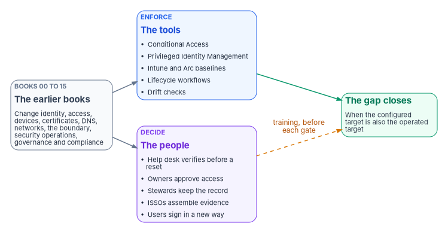
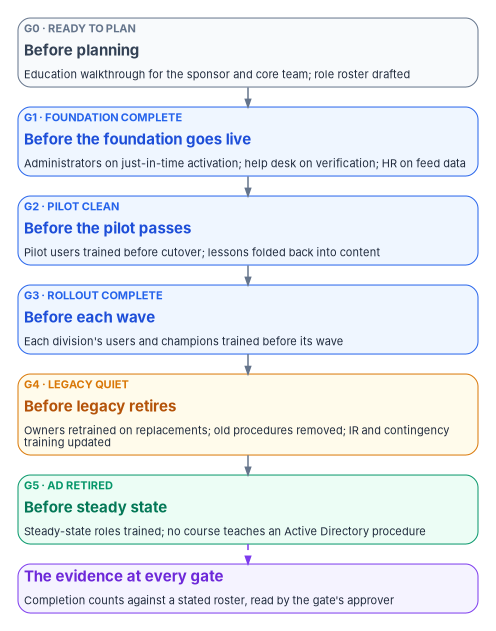

# Chapter 01 — People, Not Tools, Close the Gap

*Every control the earlier books configure is enforced by a tool but kept by a person, so the modernization is finished only when the people who run the estate do their jobs the new way.*

::: {.callout-note}
## In this chapter
The argument for the whole book. It lists what each earlier book changes in someone's daily work, from the help desk to the authorizing official, and separates what tools enforce from what only people can decide. It then sets out the program's design for teaching it: education that builds the mental model first, then training by role. It explains why training scheduled after cutover is paid for twice. And it makes training part of the readiness check at every gate from G0 to G5.
:::

A Conditional Access policy can require phishing-resistant sign-in for every user. It can't decide what happens when a caller tells the help desk that their security key is lost, they're traveling, and they need to sign in now. An entitlement review can list every person with access to a system. It can't make the application owner read the list before approving it. A drift check can find that a server has left its baseline. It can't tell the change board whether the exception that caused it was ever approved. In each case the tool enforces a rule. A person then decides whether the rule still means anything.

That is the gap this book is about. The books before it describe a modernized estate: identity mastered from HR, access granted by policy and approved by owners, devices managed from the cloud, certificates issued by a governed authority, DNS run as a control plane, telemetry joined on one key, and every control backed by proof. Each of those designs works only if the people around it change what they do. Tools close the technical gap between the old estate and the target. People close the operational gap between the target as configured and the target as it's run every day after cutover.

{#fig-ch01-people-close-the-gap fig-alt="Three columns joined by arrows. On the left, a slate card: the earlier books, Books 00 to 15, which change identity, access, devices, certificates, DNS, networks, the cloud boundary, security operations, governance and compliance. An arrow leads to a blue card in the middle: the tools enforce, listing Conditional Access, Privileged Identity Management, Intune and Arc baselines, lifecycle workflows and drift checks. A second arrow leads from the left card to a violet card: people decide, listing the help desk verifying identity before a reset, owners approving access, stewards keeping the record, ISSOs assembling evidence, and users signing in a new way. On the right, a green card: the gap closes, when the configured target is also the operated target. A solid arrow leads to it from the blue card, and a dashed amber arrow from the violet card, labeled training, before each gate."}

## What each book changes in people's work

The workbook's books are organized around technology, but each one moves a decision from one person to another, or from a habit to a rule. The table lists the main change in each book. It is the starting point for the curriculum in this book: every row is someone who needs to learn something before their part of the estate moves. [Appendix A](appendix-a-curriculum-map.md) maps each row to a training track.

| Book | Whose work changes | What they do differently |
|---|---|---|
| [Book 00, Orientation & Program](../b00-orientation/index.md) | Executive sponsor, steward, program team | Run the program through named decision rights, phases and gates instead of a project plan owned by one team |
| [Book 01, The Transformation Arc](../b01-transformation-arc/index.md) | Program leadership, workstream leads | Sequence five workstreams through six gates and treat each gate as a readiness decision, not a date |
| [Book 02, Identity & Directory](../b02-identity/index.md) | Domain administrators, identity engineers | Delegate through administrative units and scoped roles instead of organizational units and domain-wide rights |
| [Book 03, HR-Driven Identity](../b03-hr-identity/index.md) | HR staff, contractor sponsors, identity engineers | HR keeps personnel data correct at the source, because accounts are now created, changed and disabled from it |
| [Book 04, Access & Privilege](../b04-access/index.md) | Administrators, application owners, the help desk | Administrators activate roles just in time; owners approve access; the help desk executes approved tickets and never decides |
| [Book 05, Devices & Endpoints](../b05-devices/index.md) | Endpoint engineers, server teams, the help desk, end users | Manage workstations in Intune and servers through Azure Arc; users enroll and reset devices instead of waiting for a domain join |
| [Book 06, Data Platform](../b06-data-platform/index.md) | Database administrators, application developers | Grant database access to Entra ID principals and groups, and remove Windows-authentication and NTLM dependencies application by application |
| [Book 07, PKI & Certificates](../b07-pki/index.md) | PKI operators, endpoint and identity teams | Issue certificates from governed profiles, track renewal ownership per certificate class, and separate who decides what a CA issues from who operates it |
| [Book 08, DNS, DHCP & IPAM](../b08-ddi/index.md) | DNS, network and directory teams | Change DNS records through an approval path on one policy plane instead of editing zones on domain controllers |
| [Book 09, Network & Transport](../b09-network/index.md) | Network engineers, field-office staff, the boundary owner | Name an owner for each transport step and file boundary changes before a cutover, not after |
| [Book 10, Cloud Boundary & Landing Zone](../b10-cloud-boundary/index.md) | Platform team, authorizing official, cloud owners | Check a feature against the authorization boundary before adopting it, and document every equivalent and exception |
| [Book 11, Zero Trust & Assessment](../b11-zero-trust/index.md) | Pillar owners, the Zero Trust posture owner | Close known gaps before running an assessment, and read its output as evidence to act on, not a score |
| [Book 12, Security Operations & Telemetry](../b12-security-operations/index.md) | SOC analysts, detection engineers, log owners | Own each detection and playbook by name, and decide collection and retention as risk decisions |
| [Book 13, Governance, Drift & Evidence](../b13-governance/index.md) | Stewards, drift reviewers, exception owners, the governance board | Keep one authoritative record, review drift on a cadence, and accept exceptions only by a named, dated decision |
| [Book 14, Federal Compliance & Authorization](../b14-compliance/index.md) | ISSOs, system owners, control assessors, the authorizing official | Assemble evidence from the systems that produce it, so an assessor can re-derive it, instead of collecting screenshots before each assessment |
| [Book 15, Compliance Automation & Day-2 Operations](../b15-day2-operations/index.md) | The help desk, cloud services, approvers | Verify identity before every reset or recovery, work inside a written authority model, and route each request to the person who may approve it |

Two patterns run through the table. First, almost every row splits a job that one person used to do into deciding and doing. The domain administrator who could change anything becomes an identity engineer who executes approved changes. The help desk technician who reset whatever was asked becomes an operator who verifies, executes and escalates. Splitting the job is the control. It also means two people now need to know the procedure where one used to. Second, many rows move a decision to people who aren't in IT at all: HR staff, application owners, contracting officer's representatives, records officers. They didn't sign up for an identity program, and they won't read its runbooks. They need short, specific training on the one decision that is now theirs.

## Tools enforce; people decide

Every "who" chapter in the earlier books makes the same distinction: decision rights and work are different things. [Book 04, Chapter 06](../b04-access/06-who-decides-access.md) builds the help desk's authority boundary on it. [Book 13, Chapter 09](../b13-governance/09-who-governs.md) builds governance on it: a governance platform can detect every drift and still decay, because the platform can't decide anything. [Book 14, Chapter 10](../b14-compliance/10-who-owns-compliance.md) shows the Risk Management Framework doing the same, with a named role for every task.

The program's position, as design, is that the technology in this workbook moves the risk from configuration to judgment. In the old estate much of the risk sat in settings: a permissive Group Policy Object, a domain admin group with forty members, a service account that never expired. The target estate removes most of those settings, and what is left is a smaller number of human decisions that carry more weight:

- whether a caller is who they say they are;
- whether an access request is justified;
- whether a drift finding is fixed, accepted or escalated;
- whether an exception is still needed when it comes up for renewal;
- whether the evidence for a control is complete before it goes to the authorizing official.

Each of those decisions is made by a person, usually under time pressure, and usually by someone who learned the job in the old estate. A person who doesn't know the new rule will fall back on the old habit, and the old habit is what the modernization was meant to remove. In [Book 13](../b13-governance/index.md)'s terms, an untrained person is a source of drift that no drift check can see until after the fact.

## Education before training

The program separates two kinds of learning, as design ([Book 00, Chapter 04, Principle 13](../b00-orientation/04-the-principles.md#principle-13)).

**Education builds the mental model.** It is for everyone who will work in or around the program, before they learn any tool. It teaches six ideas in order, because each one depends on the one before:

1. Governance is a system that runs continuously, not a report or a checklist.
2. Identity is the starting point. Every device, application, permission and record attaches to an identity.
3. One map of the environment replaces many inventories. The discovery tools produce one picture, not a pile of spreadsheets.
4. Every derived record names its source and version, so anyone can trace it back.
5. Modernization is a lifecycle that runs under change control, not a project that ends.
6. Drift is the feedback signal. The system reports when reality has moved away from the authoritative record, ranked by what matters most.

Someone who holds those six ideas understands why the help desk now asks for verification, why a role must be activated instead of held, and why a screenshot isn't evidence. Someone who doesn't will experience each new rule as friction. [Chapter 09](09-building-and-running-the-curriculum.md) covers the formats: a facilitated walkthrough for program kickoff, a self-paced written path for people who can't attend, and a short briefing for auditors on traceability and drift.

**Training teaches the job.** It is by role, and it comes after education. The program's design has two broad audiences. One is the people who change the authoritative record: engineers, stewards and the people who maintain the program's own documents and checks. They need to land a reviewed change with valid metadata and passing checks. The other is the people who run and read the tools: operators, the help desk, ISSOs and assessors. They need to run discovery and drift checks against their own environment, interpret the results, and trace every output to its source. Within those audiences the book builds four tracks: a compliance track for people who evidence controls ([Chapter 03](03-the-compliance-track.md)), an implementation track for people who build the systems ([Chapter 04](04-the-implementation-track.md)), vendor training and labs for the product skills underneath ([Chapter 06](06-vendor-training-and-labs.md)), and end-user training for everyone who signs in ([Chapter 07](07-end-user-training.md)). [Chapter 05](05-assessment-and-certification.md) covers how the program checks that the training worked.

## Why training last costs twice

Many modernization programs schedule training at the end: build the target, migrate the users, then train. The program's observation is that this is paid for twice.

The first payment comes at cutover. Users who haven't been taught the new sign-in call the help desk. A help desk that hasn't been taught the new verification procedure either refuses legitimate callers or resets accounts without the checks that were supposed to stop impersonation. Administrators who haven't practiced just-in-time activation ask for standing roles "until things settle." Each of those workarounds is a small exception, and exceptions granted under pressure during a wave tend to stay. [Book 00, Chapter 09](../b00-orientation/09-design-pilot-and-rollout.md) lists user resistance and help desk spikes among the rollout risks, with training as the mitigation and pausing the wave as the response.

The second payment comes afterward. The workarounds have to be found and removed, the people who made them have to be retrained, and the habits they formed in the first weeks have to be unlearned. Unlearning is slower than learning. Meanwhile, the evidence for the training controls has a gap that someone has to explain. Federal requirements already put training before the change, not after it:

- OPM's rule requires agencies to give new employees security awareness material before they get access, and to provide training "whenever there is a significant change in the agency information system environment or procedures" or when an employee moves into a position that needs role-specific training.[^c01-cfr930] A modernization that changes how everyone signs in, how devices are managed and how access is approved is that kind of change.
- NIST SP 800-53 asks for literacy training "when required by system changes," and for role-based training before people get access or perform their duties, and again when system changes require it.[^c01-sp80053] IR-2 and CP-3 carry the same system-change trigger for incident response and contingency roles.[^c01-sp80053]
- OMB Circular A-130 requires role-based security and privacy training for people with assigned security and privacy roles "before authorizing access" to federal information or systems or before they perform their assigned duties.[^c01-a130]

So training last isn't only more expensive. For the roles the earlier books create or change, it also puts the agency behind requirements it already has. [Book 14, Chapter 09](../b14-compliance/09-training-and-awareness-controls.md) carries those controls and their evidence in full.

## Training is part of each gate's readiness

The program's roadmap moves through six gates, G0 to G5, each with exit criteria an approver checks before the next phase starts ([Book 01, Chapter 12](../b01-transformation-arc/12-migration-roadmap.md)). The criteria in that chapter are technical: groups drift-clean, Conditional Access enforced, PCs cloud-joined, domain controllers decommissioned. The program's design adds a training criterion to each gate, so that a gate can't pass while the people who will run the next phase are still untrained. The table gives the criterion and the evidence for each one. The roles and contents are the program's design; [Chapter 10](10-measuring-readiness.md) explains how to measure them.

| Gate | Technical exit (Book 01) | Training readiness (design) | Evidence |
|---|---|---|---|
| G0 — Ready to Plan | Platform host operational; assessment committed | Sponsor, steward and core team have had the education walkthrough; the role roster of every person whose work changes is drafted; the training plan names an owner per track | Attendance record; roster with its source; training plan |
| G1 — Foundation Complete | Groups and administrative units drift-clean; baseline Conditional Access enforced; HR provisioning live for the foundation scope | Administrators with eligible roles trained on just-in-time activation; help desk trained on the new verification and recovery procedures; HR staff trained on the data fields the provisioning feed uses; emergency access procedure rehearsed | Completion counts per population against the roster; drill record |
| G2 — Pilot Clean | Zero drift for a hold period; retrospective committed | Pilot division's users trained before their cutover; help desk staffed and trained for the wave; pilot lessons folded back into the course content | Completion before each user's cutover date; content change log |
| G3 — Rollout Complete | Every division through its exit gate | Each division's users and local champions trained before their wave; division completion is part of the division's own exit criteria | Completion per division, measured before each wave |
| G4 — Legacy Quiet | Legacy GPOs, groups, DNS zones and certificate dependencies retired | Owners of the retired systems trained on their replacements; retired procedures removed from runbooks and courses; incident response and contingency training updated for the changed estate | Updated runbooks and course versions; IR-2 and CP-3 completion for named plan roles |
| G5 — AD Retired | Domain controllers decommissioned or islanded; evidence packet filed | Steady-state roles (stewards, drift reviewers, ISSOs, the help desk) trained on the operating cadence; no course still teaches an Active Directory procedure | Completion for steady-state roles; course inventory review |

{#fig-ch01-training-at-each-gate fig-alt="Six gate cards stacked from top to bottom, joined by arrows, each with a short training check. G0 Ready to Plan, slate: education walkthrough for the sponsor and core team, role roster drafted. G1 Foundation Complete, blue: administrators trained on just-in-time activation, help desk on verification, HR on feed data. G2 Pilot Clean, blue: pilot users trained before cutover, lessons folded back into content. G3 Rollout Complete, blue: each division trained before its wave. G4 Legacy Quiet, amber: owners of retired systems retrained, old procedures removed, incident response and contingency training updated. G5 AD Retired, green: steady-state roles trained, no course teaches an Active Directory procedure. Below the stack, a violet card joined by a dashed arrow: the evidence at every gate, completion counts against a stated roster, read by the gate's approver."}

Two rules make the training check work. First, the evidence is measured against a roster, not a headcount. The roster comes from the same sources the earlier books build: the HR-driven identity record, the eligible-role assignments, the system inventory and the incident response and contingency plans ([Book 14, Chapter 09](../b14-compliance/09-training-and-awareness-controls.md)). A gate that reports "92 percent trained" without saying 92 percent of which list hasn't been checked. Second, the training check is a readiness decision like the technical ones. The gate's approver can pass a gate with a gap only by recording it as a named, dated exception, the same way [Book 13](../b13-governance/index.md) handles every other gap. A wave doesn't start for users who haven't been trained, any more than it starts for devices that haven't been enrolled.

## Training is also a control, with evidence

Training belongs in the readiness check for a second reason: it is a security control with evidence of its own. The awareness and training family, AT-1 to AT-4, together with IR-2 and CP-3, asks whether the right people have been trained for the roles they hold, and the only thing that proves it is a record. [Book 14, Chapter 09](../b14-compliance/09-training-and-awareness-controls.md) covers those controls one by one and shows how training records become evidence an assessor can re-derive. This book doesn't repeat that chapter. It takes the people's view: what to teach, to whom, in what order, and how to tell whether it worked.

One correction to the source material belongs here. It treated FedRAMP's training indicator, KSI-CED-RAT, as the agency's own obligation and as the last box in its checklist. The indicator binds cloud service providers, not agencies, as [Book 14, Chapter 09](../b14-compliance/09-training-and-awareness-controls.md) explains. The agency's own training obligations come from federal law and policy, which [Chapter 02](02-what-the-workforce-rules-require.md) sets out. Training by role also does more than satisfy a control. A-130 requires agencies to "track performance of workforce development training," and to make sure the workforce that supports their information resources has the knowledge and skills those resources need.[^c01-a130] Readiness at each gate is how the program tracks that performance during the modernization itself.

## How this book is organized

The book follows the same Why / What / Who / How shape as the others.

- **Why.** This chapter, and [Chapter 02](02-what-the-workforce-rules-require.md) on what federal workforce law and policy require: FISMA, OPM's training rule, the NICE Workforce Framework, cybersecurity position coding and OMB A-130.
- **What.** The four tracks: compliance ([Chapter 03](03-the-compliance-track.md)), implementation ([Chapter 04](04-the-implementation-track.md)), vendor training and labs ([Chapter 06](06-vendor-training-and-labs.md)), and end-user training for the modernized estate ([Chapter 07](07-end-user-training.md)), with assessment and certification across all of them ([Chapter 05](05-assessment-and-certification.md)).
- **Who.** [Chapter 08](08-who-owns-workforce-readiness.md) names who owns workforce readiness: who decides what each role must learn, who delivers it, and who signs for it at each gate.
- **How.** [Chapter 09](09-building-and-running-the-curriculum.md) covers building and running the curriculum, and [Chapter 10](10-measuring-readiness.md) covers measuring readiness and evidencing it.
- **Appendix.** [Appendix A](appendix-a-curriculum-map.md) maps each role to the books it needs and the track that teaches them.

The book after this one, [Book 17, AI Identity Governance](../b17-ai-identity/index.md), extends the same question to a new kind of worker: AI agents that act in the estate need identities, owners and rules, and the people who own them need to know what those rules are.

## What changes, in one table

| Old habit | What replaces it |
|---|---|
| Train after the system is live | Train each role before its phase starts, as part of the gate |
| One annual awareness course as the whole program | Education first, then role-based tracks, with end-user training timed to each wave |
| Technical exit criteria only | Every gate also checks training readiness against a roster |
| "Most people have done the training" | Completion counts against a stated roster, read before each wave |
| The tool is the control | The tool enforces the rule; a trained person makes the decision the rule depends on |
| Training owned by the training office alone | Each track has an owner, and each gate's approver signs for training readiness ([Chapter 08](08-who-owns-workforce-readiness.md)) |

::: {.callout-tip}
## Continue the book
[← Previous: Book index](index.md) · [Next: Chapter 02 — What Federal Workforce Rules Require →](02-what-the-workforce-rules-require.md)
:::

[^c01-cfr930]: 5 CFR § 930.301, "Information systems security awareness training program," paragraphs (b) and (d); text checked in the eCFR as of October 1, 2026, <https://www.ecfr.gov/api/versioner/v1/full/2026-10-01/title-5.xml?part=930&subpart=C>; also at <https://www.law.cornell.edu/cfr/text/5/930.301> (both accessed Oct 22, 2026).
[^c01-sp80053]: National Institute of Standards and Technology, SP 800-53 Rev. 5, *Security and Privacy Controls for Information Systems and Organizations*, controls AT-2 (item a.2), AT-3 (items a.1 and a.2), IR-2 and CP-3, <https://csrc.nist.gov/pubs/sp/800/53/r5/upd1/final>; control text checked against the release 5.2.0 OSCAL catalog, <https://github.com/usnistgov/oscal-content/blob/main/nist.gov/SP800-53/rev5/json/NIST_SP-800-53_rev5_catalog.json> (both accessed Oct 22, 2026).
[^c01-a130]: Office of Management and Budget, Circular A-130, *Managing Information as a Strategic Resource*, July 2016, Main Body §5.c (Leadership and Workforce), items 2 and 3, and Appendix I, §4.h (Awareness and Training), item 5, <https://www.whitehouse.gov/wp-content/uploads/legacy_drupal_files/omb/circulars/A130/a130revised.pdf> (accessed Oct 22, 2026).
