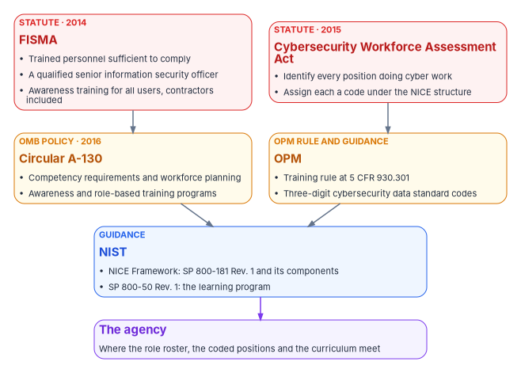
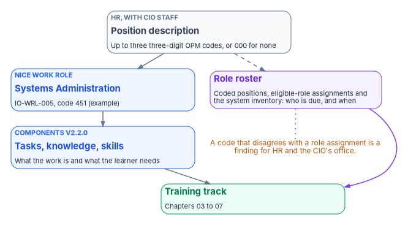

# Chapter 02 — What Federal Workforce Rules Require

*Federal law asks an agency to know which of its positions do cyber work, to say what that work is in a shared vocabulary, and to train the people in those positions for it; a training program that can't name the positions it serves can't show it meets any of those duties.*

::: {.callout-note}
## In this chapter
The workforce side of the federal training requirements. It covers what FISMA asks of the agency head and the CIO, what OPM's rule at 5 CFR 930.301 requires for each audience, and what OMB Circular A-130 adds on competency requirements and workforce planning. It describes the NICE Workforce Framework for Cybersecurity in NIST SP 800-181 Rev. 1 and its current components, and the position coding the Federal Cybersecurity Workforce Assessment Act of 2015 requires, with the record of how well agencies have done it. The Department of Defense's 8140 program appears at the end as a contrast, with its scope stated. The training controls themselves, AT-1 to AT-4, IR-2 and CP-3, are in [Book 14, Chapter 09](../b14-compliance/09-training-and-awareness-controls.md) and aren't repeated here.
:::

[Book 14, Chapter 09](../b14-compliance/09-training-and-awareness-controls.md) asks whether the right people were trained and whether the record proves it. This chapter asks the questions that come before that one. Which people does the agency have to identify? How must it describe their work? Who in the agency, and who in government, owns each part? The answers come from four kinds of source: two statutes, an OMB circular, an OPM regulation and its coding guidance, and NIST's workforce framework. They were written over twenty years by different authors, and they fit together better than their ages suggest.

{#fig-ch02-workforce-rule-layers fig-alt="Four rows of cards from top to bottom, joined by arrows. Top row, two red-outlined statute cards: FISMA 2014, which requires trained personnel sufficient to comply, a qualified senior information security officer and awareness training for everyone including contractors; and the Federal Cybersecurity Workforce Assessment Act of 2015, which requires every agency to identify positions doing cyber work and assign each a code. Second row, two amber cards: OMB Circular A-130, with competency requirements, workforce planning and training programs; and OPM, with the training rule at 5 CFR 930.301 and the cybersecurity data standard codes. Third row, one blue card: NIST, with the NICE Workforce Framework, SP 800-181 Rev. 1 and its components, and SP 800-50 Rev. 1 for the learning program. Bottom row, one violet card: the agency, where the role roster, the coded positions and the curriculum meet."}

## The sources at a glance

| Source | Date | Binds | What it adds for the workforce |
|---|---|---|---|
| FISMA, 44 U.S.C. § 3554 | 2014 | The agency head, through the CIO | Trained personnel sufficient to comply; a qualified senior agency information security officer; training for people with significant security responsibilities; awareness training for all users, contractors included |
| Federal Cybersecurity Workforce Assessment Act | December 18, 2015 | Agency heads, OPM, DoD | Identify every position that does cyber work and assign it a code under the NICE coding structure |
| OMB Circular A-130 | July 2016 | Agencies; OPM | Competency requirements and workforce planning for information resources staff; awareness and role-based training programs |
| 5 CFR 930.301 | June 14, 2004 | Executive agencies | A training plan; role-specific training by audience; awareness before access and at least annually; training on significant change |
| OPM coding guidance | January 2017, April 2022 | Agencies (as OPM's procedures under the Act) | Three-digit cybersecurity data standard codes on position descriptions, reported to OPM |
| NIST SP 800-181 Rev. 1 and the NICE Framework Components | November 2020; components v2.2.0, April 2026 | Guidance | The shared vocabulary: tasks, knowledge, skills, competency areas and work roles |
| NIST SP 800-50 Rev. 1 | September 2024 | Guidance | The learning program's life cycle, with role definitions sent to the NICE Framework ([Book 14, Chapter 09](../b14-compliance/09-training-and-awareness-controls.md)) |

## FISMA: trained people, not only trained courses

FISMA's training duties are usually read as a course requirement. Read as a whole, they're a staffing requirement. The agency head must "ensure that the agency has trained personnel sufficient to assist the agency in complying" with the law's requirements, which is a statement about capacity: enough trained people, in the right places, to run the program.[^c02-fisma] The head delegates to the CIO the authority to ensure compliance, including "training and overseeing personnel with significant responsibilities for information security."[^c02-fisma] The senior agency information security officer the CIO designates must "possess professional qualifications, including training and experience, required to administer the functions" of the role.[^c02-fisma] And the agency's security program must include awareness training that informs personnel, "including contractors and other users," of the risks of their activities and their responsibilities under agency policy.[^c02-fisma]

Two of those duties matter for a modernization. "Sufficient" is measured against the work, and the work changes. The earlier books move privileged access to just-in-time activation, account lifecycle to HR-driven provisioning, device management to Intune and Arc, and evidence to systems that produce it. An agency that had enough trained people for the old estate may not have enough for the new one, especially during the long interim when both run side by side. And "significant responsibilities for information security" isn't a fixed list. When the help desk takes on identity verification before account recovery ([Book 15](../b15-day2-operations/index.md)), or HR staff start mastering the attributes that create accounts ([Book 03](../b03-hr-identity/index.md)), those people have taken on security responsibilities they didn't have before. The program's design treats both as findings for the training plan, not as side effects.

## OPM's rule: an audience for every course

OPM's rule at 5 CFR 930.301 is the oldest of the sources and the most specific about who needs what. Each executive agency must develop a plan for information systems security awareness and training, identify employees with significant information security responsibilities, and give them role-specific training under NIST standards and guidance.[^c02-cfr930] The rule then sets out five audiences:

| Audience in 5 CFR 930.301(a) | Training the rule requires | Roles in this workbook (program's mapping) |
|---|---|---|
| (1) All users: "employees, contractors, students, guest researchers, visitors," and others who need access | Exposure to security awareness materials at least annually | Every person who signs in ([Chapter 07](07-end-user-training.md)) |
| (2) Executives | Information security basics, and policy-level training in security planning and management | Executive sponsor, authorizing official, CIO, chief human capital officer |
| (3) Program and functional managers | Basics; management and implementation training in security planning and system and application security management; and in life cycle management, risk management and contingency planning | System owners, application owners, workstream leads, supervisors of affected teams |
| (4) CIOs, IT security program managers, auditors and other security-oriented personnel, "e.g., system and network administrators, and system/application security officers" | Basics, and broad training in security planning, system and application security management, life cycle management, risk management and contingency planning | CISO, ISSOs and ISSMs, control assessors, privileged administrators in identity, endpoint, network, DNS and PKI |
| (5) IT function management and operations personnel | Basics; management and implementation training in security planning and system and application security management; and in life cycle management, risk management and contingency planning | Engineers and operators in every workstream, the help desk and cloud services, SOC analysts |

The rule adds three timing requirements. New employees get awareness material before they get access. Refresher training happens as often as the agency decides, based on the sensitivity of the information people use. And agencies must provide training "whenever there is a significant change in the agency information system environment or procedures or when an employee enters a new position that requires additional role-specific training."[^c02-cfr930] [Chapter 01](01-people-close-the-gap.md) uses that last clause to put training into each gate's readiness check.

The right-hand column is the program's mapping, not OPM's. The rule's categories predate cloud identity, and some people the earlier books depend on, such as HR staff who master attributes, records officers and contracting officer's representatives, don't fit any of rows (2) to (5) neatly. They still fall under row (1), and A-130's role-based training requirement covers anyone with an assigned security or privacy role.[^c02-a130] The program's design gives them short, role-specific modules on the decision that is theirs ([Chapter 07](07-end-user-training.md) and [Appendix A](appendix-a-curriculum-map.md)).

The section dates from June 14, 2004, cites the 2002 FISMA as authority, and points to a NIST web address that predates the current site, as [Book 14, Chapter 09](../b14-compliance/09-training-and-awareness-controls.md) records.[^c02-cfr930] The NIST guidance it sends readers to is now SP 800-50 Rev. 1, and the role definitions are in the NICE Framework.

## OMB Circular A-130: competencies and workforce planning

A-130's awareness and training appendix, Appendix I, §4.h, is the part training programs usually cite: mandatory agency-wide awareness and training for all employees and contractors, foundational and advanced training with measures "to test the knowledge level" of users, and role-based training before access or duties.[^c02-a130] [Book 14, Chapter 09](../b14-compliance/09-training-and-awareness-controls.md) carries those seven items. Two other parts of the circular matter more for the workforce view, and they are cited less often.

The main body's section on leadership and workforce, §5.c, requires agencies to have the chief human capital officer, the CIO, the chief acquisition officer and the senior agency official for privacy develop "a set of competency requirements for information resources staff, including program managers, information security, privacy, and IT leadership positions," and to maintain a current workforce planning process so the agency can anticipate changing mission requirements, keep skills current "in a rapidly developing IT environment," and recruit and retain the talent it needs.[^c02-a130] Agencies must make sure the workforce that supports their information resources has "the appropriate knowledge and skills," evaluate the IT knowledge and skills of the executive-level workforce, and "track performance of workforce development training, including cross-functional training, rotational development and assignments."[^c02-a130] The privacy official must be involved in the agency's privacy hiring, training and professional development needs.[^c02-a130]

That makes competency requirements a joint job of HR and the CIO, not a training-office product. It also means a modernization program that changes what information resources staff do should feed its new competencies into the agency's workforce plan. [Chapter 08](08-who-owns-workforce-readiness.md) assigns that to named owners.

The circular's government-wide section gives OPM the matching duties: to analyze the federal workforce's IT and information resources management needs on an ongoing basis, identify its training needs, oversee the development of curricula, training methods and priorities, and assess the training of employees in IT disciplines.[^c02-a130]

## The NICE Framework: a shared vocabulary for cyber work

The NICE Workforce Framework for Cybersecurity is NIST's vocabulary for describing cybersecurity work and the people who do it. Its home in law is the national cybersecurity awareness and education program NIST coordinates, which includes supporting efforts to identify workforce skill gaps, facilitating federal programs for "cybersecurity education, training, and workforce development," and promoting efforts to forecast the federal government's future cybersecurity workforce needs.[^c02-usc7443] The Federal Cybersecurity Workforce Assessment Act ties its coding requirement to that initiative by name.[^c02-fcwaa]

### The framework and its components

NIST SP 800-181 Rev. 1, published November 2020, is the current framework document. It superseded the 2017 edition and remains final.[^c02-sp800181] Revision 1 simplified the 2017 model. It dropped the old categories and specialty areas as organizing constructs, folded ability statements into skill statements, and moved the lists of tasks, knowledge, skills and work roles out of the publication into separately maintained, versioned artifacts.[^c02-sp800181] Its building blocks describe two things. Task statements describe the work, and knowledge and skill statements describe the learner.[^c02-sp800181] Competencies group those statements into broader areas an organization can assess through tests, lab demonstrations or interviews.[^c02-sp800181] Work roles are groupings of work someone is responsible or accountable for, made of tasks, and the publication is explicit that "Work Role names are not synonymous with job titles," nor with occupations: one work role can cover many job titles, and one job can combine several work roles.[^c02-sp800181]

The data elements, the NICE Framework Components, are published separately in the NICE Framework Resource Center.[^c02-sp800181][^c02-nice-current] The current release is version 2.2.0, published April 28, 2026.[^c02-nice-220][^c02-nice-changelog] Its machine-readable file, counted for this chapter, contains five work role categories, 42 work roles, 11 competency areas, and 962 task, 693 knowledge and 556 skill statements.[^c02-nice-json] The five categories are Oversight and Governance, Design and Development, Implementation and Operation, Protection and Defense, and Investigation.[^c02-nice-json]

Three recent versions explain the current shape.

- **Version 2.0.0, March 5, 2025**, was a major update that removed two categories, Cyberspace Effects and Cyberspace Intelligence, and their work roles. NIST explained that those roles fall under titles 10 and 50 of the U.S. Code, military and intelligence operations, and that they continue to be maintained in the Department of Defense's Cyber Workforce Framework. NIST describes the NICE Framework, by contrast, as intended for broad use across government, the private sector and academia.[^c02-nice-200][^c02-nice-changelog]
- **Version 2.1.0, December 3, 2025**, revised the Cybercrime Investigation work role and the AI Security competency area.[^c02-nice-changelog]
- **Version 2.2.0, April 28, 2026**, added a Cybersecurity Supply Chain Risk Management work role (OG-WRL-017) and published knowledge and skill statements for the Cryptography and DevSecOps competency areas. NIST calls it a minor update with minimal effect on backward compatibility.[^c02-nice-220]

NIST's current-versions page still lists some companion resources, such as its Cybersecurity Framework crosswalk, against earlier component versions.[^c02-nice-current] An agency that maps its curriculum to work roles should record which components version it used, because role identifiers and contents change between versions.

### The work roles the modernized estate needs

The table lists the NICE work roles that the earlier books' roles most often correspond to, with the OPM code the v2.2.0 components file assigns to each. The work roles and codes come from NIST's file.[^c02-nice-json] The mapping to workbook roles is the program's design. It is a starting point for the agency's own mapping, which belongs to HR classification staff and the CIO's office together, as the next section explains.

| Workbook role | NICE work role (identifier) | OPM code | Where in the workbook |
|---|---|---|---|
| Identity, endpoint and server administrators | Systems Administration (IO-WRL-005) | 451 | [Books 02](../b02-identity/index.md), [05](../b05-devices/index.md) |
| Network and DNS engineers | Network Operations (IO-WRL-004) | 441 | [Books 08](../b08-ddi/index.md), [09](../b09-network/index.md) |
| Database administrators | Database Administration (IO-WRL-002) | 421 | [Book 06](../b06-data-platform/index.md) |
| Help desk and cloud services | Technical Support (IO-WRL-007) | 411 | [Book 15](../b15-day2-operations/index.md) |
| Architects for the target estate | Cybersecurity Architecture (DD-WRL-001); Enterprise Architecture (DD-WRL-002) | 652; 651 | [Books 01](../b01-transformation-arc/index.md), [11](../b11-zero-trust/index.md) |
| Developers and pipeline owners | Secure Software Development (DD-WRL-003) | 621 | [Book 14, Chapter 07](../b14-compliance/07-supply-chain-risk-management.md) |
| SOC analysts and detection engineers | Defensive Cybersecurity (PD-WRL-001); Incident Response (PD-WRL-003) | 511; 531 | [Book 12](../b12-security-operations/index.md) |
| Vulnerability management staff | Vulnerability Analysis (PD-WRL-007) | 541 | [Book 12](../b12-security-operations/index.md) |
| ISSOs and ISSMs | Systems Security Management (OG-WRL-014) | 722 | [Book 14](../b14-compliance/index.md) |
| Authorizing officials and their representatives | Systems Authorization (OG-WRL-013) | 611 | [Book 14](../b14-compliance/index.md) |
| Control assessors | Security Control Assessment (OG-WRL-012) | 612 | [Book 14](../b14-compliance/index.md) |
| Privacy staff | Privacy Compliance (OG-WRL-008) | 732 | [Book 14, Chapter 08](../b14-compliance/08-privacy-pii-processing.md) |
| Supply chain risk staff | Cybersecurity Supply Chain Risk Management (OG-WRL-017) | none listed | [Book 14, Chapter 07](../b14-compliance/07-supply-chain-risk-management.md) |
| Program and project managers | Program Management (OG-WRL-010); Secure Project Management (OG-WRL-011) | 801; 802 | [Books 00](../b00-orientation/index.md), [01](../b01-transformation-arc/index.md) |
| The people who run this book's curriculum | Cybersecurity Workforce Management (OG-WRL-003); Curriculum Development (OG-WRL-004); Instruction (OG-WRL-005) | 751; 711; 712 | [Chapters 08](08-who-owns-workforce-readiness.md) to [10](10-measuring-readiness.md) |

Two things the table shows are worth stating. First, the three newest work roles in the file, Cybersecurity Supply Chain Risk Management, Operational Technology Cybersecurity Engineering (DD-WRL-009) and Insider Threat Analysis (PD-WRL-005), carry no OPM code in v2.2.0.[^c02-nice-json] An agency that codes positions doing that work has to choose an existing code and record why until a code is published. Second, many people the earlier books rely on, such as HR staff, application owners and records officers, don't hold cyber positions at all. NICE doesn't describe their work, and it shouldn't. They still need training for the security decisions they now make, under the awareness and role-based requirements above.

SP 800-50 Rev. 1 makes the same connection from the training side. It says that for people whose IT, cybersecurity or cybersecurity-related responsibilities need more or specific training, the NICE Framework identifies the knowledge and skills needed for the tasks of those work roles, and it recommends the framework as a complementary tool for identifying who needs additional training.[^c02-sp80050] It also notes that the role-based content of the withdrawn SP 800-16 was carried into either SP 800-50 Rev. 1 or SP 800-181 Rev. 1.[^c02-sp80050]

## Coding the positions: the Federal Cybersecurity Workforce Assessment Act

The Federal Cybersecurity Workforce Assessment Act of 2015 is Title III of Division N of the Consolidated Appropriations Act, 2016, signed December 18, 2015, and carried as a note to 5 U.S.C. 301.[^c02-fcwaa][^c02-usc301] It turns the NICE vocabulary into a reporting obligation.

- **Identify and code.** The head of each agency must identify all positions "that require the performance of cybersecurity or other cyber-related functions" and assign each the corresponding employment code under the NICE initiative.[^c02-fcwaa]
- **OPM builds the structure.** OPM, coordinating with NIST, had 180 days to develop a coding structure, and nine months to establish procedures for identifying all federal civilian positions that require IT, cybersecurity or other cyber-related functions. DoD had 18 months to do the same for noncivilian positions.[^c02-fcwaa]
- **A baseline report.** Within three months of the procedures, each agency had to report the percentage of its IT, cybersecurity and cyber-related personnel who held the appropriate industry-recognized certifications identified under the NICE initiative, the readiness of the others to take certification exams, and a strategy for closing those gaps through training and certification.[^c02-fcwaa]
- **Agency procedures and assignment.** Agencies had three months to set procedures for coding all encumbered and vacant positions, and one year after that to finish assigning codes.[^c02-fcwaa]
- **Critical needs.** Beginning a year after codes were assigned, and annually "through 2022," each agency had to identify its IT, cybersecurity and cyber-related work roles of critical need and report them to OPM, with OPM issuing guidance on roles with acute and emerging skill shortages.[^c02-fcwaa][^c02-usc301]
- **Oversight.** GAO was to monitor the implementation of the coding and critical-need sections and report to Congress.[^c02-fcwaa]

The annual critical-need reporting ran through 2022 under the Act's own text.[^c02-usc301] The coding requirement has no end date.

### How OPM implemented it

OPM's procedures came in a January 4, 2017 memorandum to agency heads.[^c02-opm2017] Its instructions are the working rules for coding today:

- Agencies find codes in the Federal Cybersecurity Coding Structure, and the codes are also described in OPM's Guide to Data Standards.
- CIO staff, managers, and HR and classification staff partner to identify positions and assign codes. CIO staff know where cyber work happens and how to read the work roles; managers know what their positions actually do; HR and classification staff run the process.
- Agencies review encumbered and authorized, funded vacant positions, and annotate the position descriptions with the codes. The codes are three digits, replacing the earlier two-digit codes, and positions with this work "will extend beyond the GS-2210 Information Technology occupational series."
- Code "000" marks a position with no IT, cybersecurity or cyber-related functions. Codes from 100 to 999 mark positions with substantial functions of that kind. A position can carry up to three codes, most critical first.
- Coded data for encumbered positions goes to OPM's Enterprise Human Resources Integration data warehouse.

OPM's April 11, 2022 update added three points.[^c02-opm2022] The codes align to each NICE work role. Work roles may change in later framework versions, but agencies "may use, or code their positions to, current or previous Work Roles in perpetuity." And in its audit, GAO directed agencies to give every GS-2210 position a code other than "000," which OPM notes is not an OPM rule but which GAO considers consistent with the Act's intent. OPM's Interpretive Guidance for Cybersecurity Positions, dated October 2018, is still the edition OPM lists for classifying and titling positions with cybersecurity work.[^c02-opm-ig]

### How well it has worked

GAO's March 2019 review found the codes unreliable. Twenty-two of the 24 agencies it reviewed had given a non-IT work role code to 15,779 positions in the GS-2210 IT management series, about 19 percent of them. At six agencies it examined more closely, the codes didn't match the duties in the position descriptions for 63 of 120 sampled positions. Agency officials attributed the errors to miscoding and incomplete validation, and GAO concluded that the inaccuracy weakens the data agencies need for workforce planning.[^c02-gao19144]

### What the program does with the codes

The code on a position description is the HR system's statement of what cyber work a position does. The program's design uses it in three ways.

1. **As a roster input.** The role roster behind the training evidence in [Book 14, Chapter 09](../b14-compliance/09-training-and-awareness-controls.md) needs to know who holds a role with significant security responsibilities. Coded positions are one authoritative input, alongside the identity platform's role assignments and the system inventory. Where the two disagree, for example a person who holds an eligible administrative role in a position coded "000," the disagreement is a finding for HR and the CIO's office to resolve together, not something for the training office to settle.
2. **As the link to a track.** Each track in [Chapters 03](03-the-compliance-track.md) to [06](06-vendor-training-and-labs.md) names the NICE work roles it serves, so a person who moves into a coded position is due for the matching training on the day they move, as 930.301(d) and AT-3 expect.[^c02-cfr930]
3. **As a review trigger.** The earlier books change what positions do. Domain administrators become identity engineers who execute approved changes. The help desk takes on identity verification. Developers take on dependency and pipeline decisions. The program's design asks HR classification staff and the CIO's office to review the affected position descriptions and their codes when a workstream reaches its gate, the partnership OPM's memorandum describes.[^c02-opm2017] Nothing in the sources requires a review at that moment. It is the program's way of keeping the codes as accurate as the work they describe.

{#fig-ch02-from-position-to-curriculum fig-alt="A top-to-bottom chain of four cards, with two items beside it. First, a slate card: the position description, classified by HR with the CIO's staff, carrying up to three three-digit OPM codes, or 000 for none. Second, a blue card: the NICE work role the code aligns to, for example Systems Administration, IO-WRL-005, code 451. Third, a blue card: the work role's tasks, knowledge and skill statements from the NICE Framework Components, version 2.2.0. Fourth, a green card: the training track that teaches them, Chapters 03 to 07. Beside the chain, a violet card, the role roster, built from coded positions, eligible-role assignments and the system inventory, saying who is due and when; a dashed arrow reaches it from the position description and a violet arrow leads from it to the training track. An amber note under the roster says that a code that disagrees with a role assignment is a finding for HR and the CIO's office."}

## What the rules don't require

Three common claims go further than the sources do.

- **Certification.** None of the civilian sources in this chapter requires a civilian employee to hold a particular industry certification. The Act asked agencies to report the percentage of their cyber workforce who held the certifications identified under the NICE initiative, and their plan for gaps.[^c02-fcwaa] That is a measurement duty. Certifications are a useful form of evidence of competence, and [Chapter 05](05-assessment-and-certification.md) treats them that way.
- **An annual number for everyone.** The only "annual" in these sources is 930.301's floor for awareness material.[^c02-cfr930] Role-based refresher frequency is the agency's to set, based on the sensitivity of the information people use.
- **NICE as a mandate.** SP 800-181 Rev. 1 is guidance, and its own examples of competencies are meant to be used "in part, all together, or not at all," depending on the organization.[^c02-sp800181] What is required is coding positions under the NICE initiative's structure, which the Act and OPM's procedures make mandatory.[^c02-fcwaa][^c02-opm2017] How the agency uses the framework to design its curriculum is its own choice.

## DoD 8140, as a contrast

Agencies and contractors often hear about DoD's 8140 program, and training vendors often advertise courses against it. It is useful to understand, and it doesn't apply to civilian agencies.

DoD Directive 8140.01, effective October 5, 2020, implements sections 303 and 304 of the Federal Cybersecurity Workforce Assessment Act for DoD. It establishes the DoD Cyber Workforce Framework as the department's authoritative reference for identifying, tracking and reporting cyberspace positions and as the foundation for baseline qualifications.[^c02-dodd814001] DoD Manual 8140.03, effective February 15, 2023, sets those qualifications. It applies to DoD components and to all DoD personnel in positions coded to cyberspace work roles, including service members, civilian employees and "personnel who provide contracted services," and it requires contractors to be fully qualified. It replaced the older DoD 8570.01-M program.[^c02-dodm814003]

The manual's model is a qualification standard per work role and proficiency level. Qualification has a foundational part, met by any one of education, training or a personnel certification, or by documented experience within limits, and a residential part demonstrated on the job. After qualification, people must complete at least 20 hours a year of continuous professional development. Proficiency levels run from basic through intermediate to advanced, and the manual says they need have no connection to rank or grade.[^c02-dodm814003]

The contrast with the civilian rules is the point. Civilian agencies must identify and code positions, train people by role, and plan their workforce, but the sources in this chapter set no qualification standard per role. DoD does, for its own workforce and its contractors. A civilian agency can borrow the idea, as program design, by defining what "qualified" means for its highest-risk roles, and [Chapter 05](05-assessment-and-certification.md) does that for the program's own tracks. It shouldn't cite DoD 8140 as its requirement. And when NICE moved the cyberspace effects and intelligence roles into DoD's framework in 2025, the two frameworks were separated further: civilian agencies code to NICE, and DoD qualifies against its own framework.[^c02-nice-200]

## Who owns which part

[Chapter 08](08-who-owns-workforce-readiness.md) assigns workforce readiness in full. The sources assign these parts by name.

| Owner | Part the sources assign | Source |
|---|---|---|
| Agency head | Trained personnel sufficient to comply; identifying and coding cyber positions | FISMA;[^c02-fisma] the Act[^c02-fcwaa] |
| CIO | Training and overseeing personnel with significant security responsibilities; competency requirements, with the CHCO, chief acquisition officer and privacy official | FISMA;[^c02-fisma] A-130 §5.c[^c02-a130] |
| Chief human capital officer | Competency requirements and workforce planning for information resources staff, with the CIO | A-130 §5.c[^c02-a130] |
| Senior agency information security officer (often the CISO) | Holds qualifications, including training and experience, for the role | FISMA[^c02-fisma] |
| Senior agency official for privacy | Involved in privacy hiring, training and professional development needs | A-130 §5.c[^c02-a130] |
| HR and classification staff, CIO staff and managers | Partner to identify positions and assign codes | OPM 2017 memorandum[^c02-opm2017] |
| OPM | The coding structure and procedures; analyzing federal IT workforce and training needs | The Act;[^c02-fcwaa] A-130 §6.g[^c02-a130] |
| NIST | The NICE Framework and the national cybersecurity education program | 15 U.S.C. 7443;[^c02-usc7443] SP 800-181 Rev. 1[^c02-sp800181] |

## What changes, in one table

| Old habit | What replaces it |
|---|---|
| Training described as a course catalog | Training described against coded positions and NICE work roles, with the components version recorded |
| "Significant security responsibilities" as a fixed list | The list reviewed whenever a workstream changes what a position does |
| Position codes treated as an HR data field | Codes used as a roster input, with disagreements against role assignments resolved by HR and the CIO's office |
| Competencies written by the training office | Competency requirements set jointly by the CHCO and CIO, as A-130 asks, and fed into the workforce plan |
| "The rules require certification" | Certification as evidence of competence; DoD's qualification model borrowed as design where it helps, never cited as a civilian requirement |
| OPM's 2004 audience categories read literally | The categories mapped to today's roles, with non-cyber roles covered by awareness and role-based modules |

::: {.callout-tip}
## Continue the book
[← Previous: Chapter 01 — People, Not Tools, Close the Gap](01-people-close-the-gap.md) · [Book index](index.md) · [Next: Chapter 03 — The Compliance Track →](03-the-compliance-track.md)
:::

[^c02-fisma]: Federal Information Security Modernization Act of 2014, 44 U.S.C. § 3554, subsections (a)(3)(A)(ii), (a)(3)(D), (a)(4) and (b)(4), <https://www.law.cornell.edu/uscode/text/44/3554> (accessed Oct 22, 2026).
[^c02-cfr930]: 5 CFR § 930.301, "Information systems security awareness training program," paragraphs (a)(1)–(5) and (b)–(d), with subpart C authority (5 U.S.C. 4118; Pub. L. 107-347) and source note (69 FR 32836, June 14, 2004), eCFR text as of October 1, 2026, <https://www.ecfr.gov/api/versioner/v1/full/2026-10-01/title-5.xml?part=930&subpart=C>; also at <https://www.law.cornell.edu/cfr/text/5/930.301> (both accessed Oct 22, 2026).
[^c02-a130]: Office of Management and Budget, Circular A-130, *Managing Information as a Strategic Resource*, July 2016, Main Body §5.c (Leadership and Workforce), items 1–3 and 6; §6.g (Office of Personnel Management), items 1–4; and Appendix I, §4.h (Awareness and Training), items 1–7, <https://www.whitehouse.gov/wp-content/uploads/legacy_drupal_files/omb/circulars/A130/a130revised.pdf> (accessed Oct 22, 2026).
[^c02-usc7443]: 15 U.S.C. § 7443, "National cybersecurity awareness and education program," subsection (a), items (6), (7) and (10), <https://www.law.cornell.edu/uscode/text/15/7443> (accessed Oct 22, 2026).
[^c02-fcwaa]: Federal Cybersecurity Workforce Assessment Act of 2015, Consolidated Appropriations Act, 2016, Pub. L. 114-113, Division N, Title III, §§ 301–305, December 18, 2015, 129 Stat. 2975–2977, <https://www.govinfo.gov/content/pkg/PLAW-114publ113/html/PLAW-114publ113.htm> (accessed Oct 22, 2026).
[^c02-usc301]: 5 U.S.C. § 301, statutory note "Federal Cybersecurity Workforce Assessment," showing Pub. L. 114-113, div. N, title III, as amended by Pub. L. 116-283, § 9401(g)(4)(A), January 1, 2021, including § 304(a) ("annually thereafter through 2022"), <https://www.law.cornell.edu/uscode/text/5/301> (accessed Oct 22, 2026).
[^c02-sp800181]: National Institute of Standards and Technology, SP 800-181 Rev. 1, *Workforce Framework for Cybersecurity (NICE Framework)*, November 2020, §1 (Introduction, summary of changes), §2.1 (Task Statements), §3.3 (Competencies) and §3.4 (Work Roles), <https://nvlpubs.nist.gov/nistpubs/SpecialPublications/NIST.SP.800-181r1.pdf>; publication page (final; supersedes SP 800-181, August 2017; note on components maintained in the NICE Framework Resource Center), <https://csrc.nist.gov/pubs/sp/800/181/r1/final> (both accessed Oct 22, 2026).
[^c02-nice-current]: National Institute of Standards and Technology, "NICE Framework: Current Versions," NICE Framework Resource Center, <https://www.nist.gov/itl/applied-cybersecurity/nice/nice-framework-resource-center/nice-framework-current-versions> (accessed Oct 22, 2026).
[^c02-nice-220]: National Institute of Standards and Technology, "NICE Releases NICE Framework Components v2.2.0," April 28, 2026, <https://www.nist.gov/news-events/news/2026/04/nice-releases-nice-framework-components-v220>; and *NICE Framework Components v2.2.0: Summary of Changes*, April 2026, <https://www.nist.gov/document/nice-framework-v220-summary-changes-april-2026pdf> (both accessed Oct 22, 2026).
[^c02-nice-changelog]: National Institute of Standards and Technology, "NICE Framework Change Logs," entries for v1.0.0 (March 5, 2024), v2.0.0 (March 5, 2025), v2.1.0 (December 3, 2025) and v2.2.0 (April 28, 2026), <https://www.nist.gov/itl/applied-cybersecurity/nice/nice-framework-resource-center/current-version/change-logs> (accessed Oct 22, 2026).
[^c02-nice-json]: National Institute of Standards and Technology, NICE Framework Components v2.2.0, JSON data file (`SP_800_181_2_2_0`), elements of type category, work_role, competency_area, task, knowledge, skill and opm_code, and the work-role-to-OPM-code relationships; counts made for this chapter, <https://csrc.nist.gov/csrc/media/Projects/cprt/documents/nice/v2-2-0_nf_components.json> (accessed Oct 22, 2026).
[^c02-nice-200]: National Institute of Standards and Technology, *NICE Framework Components v2.0.0: Summary of Changes*, March 2025, "V 2.0.0 Update Details: Work Role Categories," <https://www.nist.gov/document/nice-framework-v2-summary-changes-march-2025508compliantpdf> (accessed Oct 22, 2026).
[^c02-sp80050]: National Institute of Standards and Technology, SP 800-50 Rev. 1, *Building a Cybersecurity and Privacy Learning Program*, September 2024, Introduction and §1.6 (Roles and Responsibilities), <https://nvlpubs.nist.gov/nistpubs/SpecialPublications/NIST.SP.800-50r1.pdf> (accessed Oct 22, 2026).
[^c02-opm2017]: Office of Personnel Management, memorandum for heads of executive departments and agencies, *Guidance for Assigning New Cybersecurity Codes to Positions with Information Technology, Cybersecurity, and Cyber-Related Functions*, January 4, 2017, <https://www.opm.gov/chcoc/transmittals/2017/guidance-assigning-new-cybersecurity-codes-positions-IT-cybersecurity-cyber-functions_508.pdf> (accessed Oct 22, 2026).
[^c02-opm2022]: Office of Personnel Management, memorandum for human resources directors, *Cybersecurity Workforce Management Updates and Resources*, April 11, 2022, Attachment 1, items 2 and 3, <https://sfs.opm.gov/docs/Cybersecurity%20Workforce%20Management%20Resources.pdf> (accessed Oct 22, 2026).
[^c02-opm-ig]: Office of Personnel Management, *Interpretive Guidance for Cybersecurity Positions*, October 2018, <https://www.opm.gov/policy-data-oversight/classification-qualifications/reference-materials/interpretive-guidance-for-cybersecurity-positions.pdf>; listed as the current edition on "Classification & Qualifications: Reference Materials," <https://www.opm.gov/policy-data-oversight/classification-qualifications/reference-materials/> (both accessed Oct 22, 2026).
[^c02-gao19144]: Government Accountability Office, GAO-19-144, *Cybersecurity Workforce: Agencies Need to Accurately Categorize Positions to Effectively Identify Critical Staffing Needs*, March 12, 2019, <https://www.gao.gov/products/gao-19-144> (accessed Oct 22, 2026).
[^c02-dodd814001]: Department of Defense, DoD Directive 8140.01, *Cyberspace Workforce Management*, effective October 5, 2020, purpose statement, <https://www.esd.whs.mil/Portals/54/Documents/DD/issuances/dodd/814001p.pdf> (accessed Oct 22, 2026, through the Internet Archive's copy of that address because the DoD site didn't resolve from the research environment).
[^c02-dodm814003]: Department of Defense, DoD Manual 8140.03, *Cyberspace Workforce Qualification and Management Program*, effective February 15, 2023, §1.1 (Applicability), §1.2 (Policy), §3.2 (qualification program, foundational and residential qualification, continuous professional development) and §3.3 (Proficiency Levels), <https://www.esd.whs.mil/Portals/54/Documents/DD/issuances/dodm/814003p.PDF> (accessed Oct 22, 2026, through the Internet Archive's copy of that address because the DoD site didn't resolve from the research environment).
