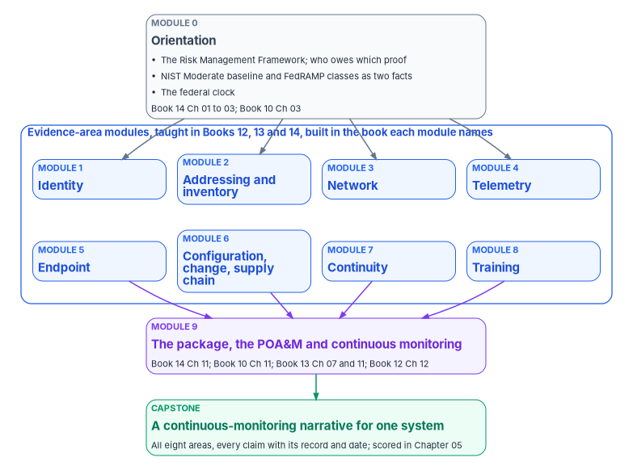
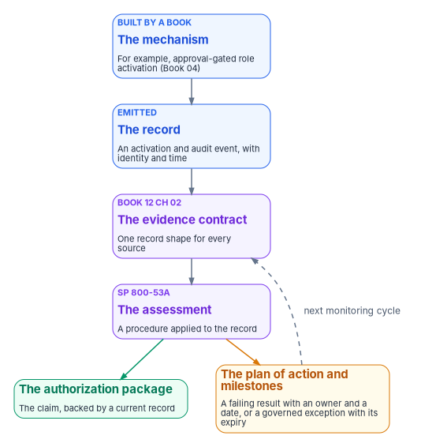

# Chapter 03 — The Compliance Track

*A compliance professional who can recite that a control is satisfied hasn't learned the job; one who can trace it from the mechanism that closes it to the record that proves it has.*

::: {.callout-note}
## In this chapter
The curriculum for the people who read evidence rather than build it: information system security officers and managers, compliance staff, control assessors, and authorizing officials and their designated representatives. It sets out who the track is for, how each module is built, an orientation module on the Risk Management Framework and who owes which proof, eight modules that follow the program's evidence areas from identity to training, a module on the authorization package, the plan of action and milestones and continuous monitoring, and a capstone. Every module points to the workbook book that teaches its content, mostly Books 10, 12, 13 and 14.
:::

Every book before this one changes what someone does. The compliance track is about the people whose job is to check that the change is real. An information system security officer (ISSO) assembles evidence, an assessor tests it, and an authorizing official decides whether the risk that remains is acceptable. None of them builds the identity platform, the network or the detection rules. All of them have to be able to read what those builds produce, and say whether it proves what the system security plan claims.

The track teaches one skill above the others: tracing. Given a control, the learner should be able to name the mechanism that closes it, the book that built that mechanism, the record the mechanism emits, and where that record sits in the authorization package. Given a record, the learner should be able to work backwards to the control it supports and say whether it is current. A compliance team that can do this in both directions doesn't need the engineers in the room to defend an assessment, and doesn't accept a screenshot where a log should be.

This is a curriculum, not a second controls chapter. The awareness and training controls themselves, the federal training requirements and the training record as evidence are in [Book 14, Chapter 09](../b14-compliance/09-training-and-awareness-controls.md). The roles the track trains are defined in [Book 14, Chapter 10](../b14-compliance/10-who-owns-compliance.md). The engineers' counterpart, which builds what this track reads, is [Chapter 04](04-the-implementation-track.md).

{#fig-ch03-compliance-track-modules fig-alt="A top-to-bottom flow. At the top, a slate card: Module 0, orientation, the Risk Management Framework, who owes which proof, the Moderate baseline and FedRAMP classes, the federal clock, taught by Book 14 Chapters 01 to 03 and Book 10 Chapter 03. It leads to a blue group of eight cards labeled evidence-area modules, in two rows: Module 1 identity, Module 2 addressing and inventory, Module 3 network, Module 4 telemetry, Module 5 endpoint, Module 6 configuration, change and supply chain, Module 7 continuity, Module 8 training. A note says each one is taught by Books 12, 13 and 14 and built by the book named in the module. The group leads to a violet card: Module 9, the package, the POA&M and continuous monitoring, taught by Book 14 Chapter 11, Book 10 Chapter 11, Book 13 Chapters 07 and 11 and Book 12 Chapter 12. That leads to a green card: the capstone, a continuous-monitoring narrative for one system, scored in Chapter 05."}

## Who the track is for

The track has one body of content and several ways through it. The roles are the federal ones [Book 14, Chapter 10](../b14-compliance/10-who-owns-compliance.md) defines; the depth each needs is the program's design.

| Role | What the track gives them | Path |
|---|---|---|
| ISSO and ISSM | The whole tracing skill, for every evidence area their system has | All modules and the capstone |
| Compliance staff and continuous-monitoring operators | Reading records against their freshness rules and keeping the package current | Modules 0, 1 to 8 for their areas, 9, and the capstone |
| Control assessor | Testing a closure claim without relying on the operator's word | All modules; the capstone is assessed, not written |
| Authorizing official and designated representative | Knowing what a sufficient package looks like and which questions to ask of it | Modules 0 and 9, and a reviewed capstone from their own system |
| System owner | What their system must show and who produces it | Modules 0 and 9, and the modules for the areas they own |
| Privacy and supply chain leads | The areas their programs depend on | Modules 0, 6 and 9, with [Book 14, Chapters 07 and 08](../b14-compliance/07-supply-chain-risk-management.md) |

The NICE Framework gives these roles a common vocabulary. Its current components, version 2.2.0, list Security Control Assessment, Systems Authorization, Systems Security Management, Privacy Compliance, Cybersecurity Policy and Planning and Technology Program Auditing among the work roles in its Oversight and Governance category.[^c03-nice] The program maps the ISSO and ISSM to Systems Security Management, the assessor to Security Control Assessment and the authorizing official's staff to Systems Authorization. That mapping is the program's design; an agency should set its own from its position descriptions and the coding rules in [Chapter 02](02-what-the-workforce-rules-require.md).

## How each module is built

Every module has the same parts, in the same order:

- **Prerequisites:** the modules, or the knowledge, it assumes.
- **Read:** the workbook chapters that teach the content, and the book that builds the mechanism.
- **Controls:** the NIST SP 800-53 Rev. 5 anchor controls for the area. These are the controls the program treats as the area's spine, not a statement of what any baseline selects; baseline membership is in [Book 14, Appendix A](../b14-compliance/appendix-a-control-crosswalk.md).
- **Practice:** what the learner does with real or lab records.
- **Checkpoint:** a short artifact that shows the learner can trace from control to evidence and back.
- **Outcome:** what the learner can do afterwards.

::: {.callout-important}
## Closure claims in training are practice, not findings
Every closure the track asks a learner to trace is a self-assessment until an independent assessment tests it and the authorizing official accepts the result. The track teaches how to trace and evidence a closure claim, never how to assert one as settled. A checkpoint that says "satisfied" without the record and its date fails.
:::

## Module 0 — Orientation: the framework and who owes which proof {#module-0}

**Prerequisites:** none. Every other module, in this track and in [Chapter 04](04-the-implementation-track.md), assumes this one.

**Read:** [Book 14, Chapters 01 to 03](../b14-compliance/01-proof-not-a-promise.md), [Book 10, Chapter 03](../b10-cloud-boundary/03-what-changed-at-fedramp.md), and [Book 13, Chapter 07](../b13-governance/07-evidence-over-attestation.md).

**Learn.** Four ideas carry the rest of the track.

1. **The framework.** NIST's Risk Management Framework has seven steps: Prepare, Categorize, Select, Implement, Assess, Authorize and Monitor.[^c03-rmf] SP 800-37 Rev. 2 describes it as a preparatory step and six main steps, and says all seven are essential.[^c03-sp80037] The learner should be able to place any artifact on that sequence: a categorization belongs to Categorize, a test plan to Assess, a risk acceptance to Authorize, a quarterly review to Monitor.
2. **Who owes which proof.** A cloud provider proves its service; the agency proves its own system and the controls it keeps; the authorizing official alone accepts the residual risk. FedRAMP's rules for agencies say so directly: agencies "MUST complete the Authorization to Operate process for federal information systems" that use certified cloud services, and their governance, risk, compliance and inventory tools must be able to produce and ingest machine-readable artifacts.[^c03-agu] A provider's certification is evidence the agency reuses, not the agency's decision ([Book 14, Chapter 01](../b14-compliance/01-proof-not-a-promise.md#who-owes-which-proof)).
3. **Two facts, not one.** "Moderate" for an agency system means NIST's process: FIPS 199 categorization, the FIPS 200 high-water mark, and the SP 800-53B Moderate baseline, tailored. FedRAMP's 2026 rules certify cloud services in classes instead; FedRAMP's notice on the designations says "Class C will include the current Moderate baseline," with Class B for the former Low and LI-SaaS baselines and Class D for High.[^c03-ntc0004] The two sets overlap but aren't the same, and [Book 14, Chapter 03](../b14-compliance/03-the-baseline-and-the-crosswalk.md#two-facts-not-one) lists where they diverge. A learner who writes "required at Moderate" without saying which fact they mean hasn't passed this module.
4. **The indicators bind providers.** FedRAMP publishes 46 Key Security Indicators in ten themes, from Cybersecurity Education to Service Configuration.[^c03-ksi] They are outcomes a provider demonstrates. They aren't the agency's obligations, which run through its own authorization and control CA-7 ([Book 13, Chapter 11](../b13-governance/11-reciprocity-and-one-authorization.md)). The agency uses them to read its providers' evidence and, as a design choice, to structure its own evidence the same way.

The module also walks the federal clock in [Book 14, Chapter 02](../b14-compliance/02-the-federal-clock.md), with one discipline attached: every date the learner cites carries its source and the day it was checked.

**Checkpoint:** a one-page brief for one real or lab system: its categorization and the baseline it selects; the certified services it relies on and their classes; which controls are inherited, shared and the agency's own; and the three federal dates that affect it next, each with its source.

**Outcome:** the learner can say, for any artifact or date, which step of the framework it belongs to and which party owes it.

## Modules 1 to 8 — the evidence areas

The program organizes a system's evidence into eight areas, each fed by particular books and anchored on a few controls. The areas are the program's design, chosen because each has one kind of mechanism and one kind of record. They let a team divide the work and an assessor know where to look. They aren't a federal structure, and they don't replace the control-by-control view an assessment uses.

| Module | Evidence area | Built in | Anchor controls | Taught in |
|---|---|---|---|---|
| 1 | Identity | Books [02](../b02-identity/index.md), [03](../b03-hr-identity/index.md), [04](../b04-access/index.md), [06](../b06-data-platform/index.md), [07](../b07-pki/index.md) | IA-2, IA-5, AC-2, AC-6 | [Book 12, Ch 03](../b12-security-operations/03-identity-telemetry.md); [Book 14, Ch 04](../b14-compliance/04-closure-with-proof.md) |
| 2 | Addressing and inventory | [Book 08](../b08-ddi/index.md); [Book 10, Ch 06](../b10-cloud-boundary/06-ipam-and-network-as-code.md) | CM-8 | [Book 12, Ch 02](../b12-security-operations/02-the-evidence-contract.md) |
| 3 | Network | [Book 09](../b09-network/index.md); [Book 10, Ch 07](../b10-cloud-boundary/07-the-front-door.md) | SC-7, SC-8, AC-4 | [Book 09, Ch 13](../b09-network/13-sequencing-cost-and-evidence.md); [Book 12, Ch 12](../b12-security-operations/12-evidence-metrics-and-continuous-monitoring.md) |
| 4 | Telemetry | [Book 12](../b12-security-operations/index.md) | CA-7, SI-4, AU-6, RA-5 | [Book 12, Ch 02, 05, 06, 12](../b12-security-operations/12-evidence-metrics-and-continuous-monitoring.md) |
| 5 | Endpoint | [Book 05](../b05-devices/index.md); [Book 09, Ch 07](../b09-network/07-network-access-control.md) | CM-8, IA-3, SI-2 | [Book 05, Ch 10](../b05-devices/10-operating-and-evidencing-the-fleet.md); [Book 12, Ch 07](../b12-security-operations/07-patch-configuration-and-baselines.md) |
| 6 | Configuration, change and supply chain | [Book 13](../b13-governance/index.md); [Book 15](../b15-day2-operations/index.md) | CM-2, CM-3, SR family, PM family | [Book 13, Ch 04, 06](../b13-governance/04-change-control-and-provenance.md); [Book 14, Ch 05, 07](../b14-compliance/07-supply-chain-risk-management.md) |
| 7 | Continuity | Agency continuity program | CP-2, CP-3, CP-4 | [Book 14, Ch 06](../b14-compliance/06-contingency-and-continuity.md) |
| 8 | Training | This book | AT-2, AT-3, AT-4, IR-2, CP-3 | [Book 14, Ch 09](../b14-compliance/09-training-and-awareness-controls.md); [Chapter 10](10-measuring-readiness.md) |

: The eight evidence-area modules: where each area is built, its anchor controls, and where the track's content is taught {.striped .hover}

Each module follows the same pattern: read the book that built the mechanism closely enough to know what it emits, then read the teaching chapter that says what an assessor does with the record. The prerequisite for all eight is Module 0. Modules 1 and 2 come first in practice, because every other area joins its records to an identity or an asset ([Book 12, Chapter 02](../b12-security-operations/02-the-evidence-contract.md#the-join-key-authoritative-asset-identity-plus-time)).

### Module 1 — Identity

**Practice.** For one privileged role, trace the whole chain: the approval-gated activation design in [Book 04, Chapter 08](../b04-access/08-pim-self-request-with-approval.md), the AC-6 enhancement it supports, and the activation and audit records that show it working. Then do the same for one joiner, mover or leaver event from [Book 03, Chapter 08](../b03-hr-identity/08-joiner-mover-leaver.md), from the HR record to the account change.

**The discipline.** IA-2 asks the system to uniquely identify and authenticate its users. A configuration export can show that a multifactor policy exists; it can't show that a particular sign-in was phishing-resistant and evaluated for risk. Only the identity provider that performed the authentication records that, so the evidence for the area is the sign-in and audit record, not the policy definition. A learner who offers a screenshot of the policy page as proof of IA-2 hasn't passed.

**Checkpoint:** the privileged-role trace, with the record identifiers and dates.

**Outcome:** the learner can tell configuration evidence from event evidence and knows which one a control needs.

### Module 2 — Addressing and inventory

**Practice.** Compare the authoritative address inventory from the DDI platform ([Book 08](../b08-ddi/index.md)) with the device, server and cloud inventories, and explain each difference.

**The discipline.** The naming and addressing plane is the one every component has to touch to work at all, so the program treats it as the anchor for CM-8 and as the join key the other areas' records are correlated on. An inventory is authoritative only when it counts managed and unmanaged assets alike. The learner should be able to say what share of observed addresses map to a known, owned asset, and what happens to the rest.

**Checkpoint:** an inventory evidence statement: what the platform attests, which CM-8 requirements that supports, and the unexplained differences with an owner for each.

**Outcome:** the learner can judge whether an inventory is complete enough to anchor everything else.

### Module 3 — Network

**Practice.** Take one application-aware path policy and one access policy from [Book 09, Chapter 05](../b09-network/05-sd-wan-sase-and-governed-transport.md), and map them to SC-7 and SC-8 with the monitoring signal that shows they stay enforced.

**The discipline.** A circuit carries traffic; it closes no control. The controls near the network, SC-7, SC-8, AC-4 and SI-4 among them, are closed by the policy and enforcement layer that governs the path, and the customer-owned edge is the agency's part of SC-7 that no provider's certification covers ([Book 09, Chapter 02](../b09-network/02-transport-is-physics-control-is-compliance.md)). The learner should reject any closure claim that names a circuit or a bandwidth figure as the mechanism.

**Checkpoint:** the policy-to-control map, with the continuous-monitoring signal for each control.

**Outcome:** the learner can separate transport from control in a network narrative.

### Module 4 — Telemetry

**Practice.** Follow one known exploited vulnerability through the estate: the scanner finding ([Book 12, Chapter 06](../b12-security-operations/06-vulnerability-management.md)), the detection and incident, the remediation, and the re-test that closes it, then check the record against the retention period the agency set for AU-11.

**The discipline.** The telemetry area is evaluable only if every source emits into one evidence contract with the same identity and time keys ([Book 12, Chapter 02](../b12-security-operations/02-the-evidence-contract.md)). The assessor's skill is following one finding across the seams, from the tool that found it to the tool that fixed it, without losing the thread.

**Checkpoint:** the end-to-end trace, with timestamps that show each step inside its required window ([Book 14, Chapter 02](../b14-compliance/02-the-federal-clock.md#bod-26-04-risk-based-remediation)).

**Outcome:** the learner can test a remediation claim against the clock that governs it.

### Module 5 — Endpoint

**Practice.** Write the endpoint inventory evidence statement for one population of devices or servers: device identity at the port (IA-3), inventory completeness (CM-8) and remediation (SI-2), with the records from [Book 05, Chapter 10](../b05-devices/10-operating-and-evidencing-the-fleet.md).

**The discipline.** Endpoint evidence is the close-it side of the telemetry area's find-it: one book assesses and prioritizes, another actually remediates, and the evidence for SI-2 is the remediation record, not the scan. The learner should check the inventory against the addressing anchor from Module 2.

**Checkpoint:** the evidence statement, with the reconciliation against the address inventory.

**Outcome:** the learner can tell a scan result from proof of remediation.

### Module 6 — Configuration, change and supply chain

**Practice.** Pick one change to a governed system and trace it: the ticket, the approval, the change record, the configuration before and after, and the drift check that confirms the result ([Book 13, Chapter 04](../b13-governance/04-change-control-and-provenance.md), [Chapter 06](../b13-governance/06-the-drift-engine.md)). Then read one supplier's disclosure package against [Book 14, Chapter 07](../b14-compliance/07-supply-chain-risk-management.md).

**The discipline.** Configuration evidence is a comparison between an intended state and an observed one, at a known time. The program-management controls are the agency-level charter that makes the whole program auditable, and they sit outside every system baseline ([Book 14, Chapter 05](../b14-compliance/05-program-management-controls.md)). The supply chain part of the module follows Book 14, Chapter 07 on what federal policy now asks of software suppliers and what the agency chooses to put in its contracts.

**Checkpoint:** the change trace, plus a one-paragraph judgment on the supplier package.

**Outcome:** the learner can show that a change was authorized and that the system still matches what was authorized.

### Module 7 — Continuity

**Practice.** Read one contingency test's after-action report and map it to CP-4 ([Book 14, Chapter 06](../b14-compliance/06-contingency-and-continuity.md#testing-and-training-cp-4-cp-3)).

**The discipline.** Continuity evidence is the test result, not the plan. A CP-2 plan asserts a capability; a CP-4 exercise shows whether it exists. An after-action report with findings and named owners is evidence. A report with no findings is usually evidence that the test wasn't hard enough, and the learner should say so.

**Checkpoint:** the CP-4 map, with each finding carried to an owner and, where needed, a plan of action and milestones item.

**Outcome:** the learner can judge whether a continuity test was real.

### Module 8 — Training

**Practice.** Take one role population and trace it from the role-based training requirement to the training record ([Book 14, Chapter 09](../b14-compliance/09-training-and-awareness-controls.md#training-records-as-evidence-at-4)).

**The discipline.** The training record is per person, dated and reproducible. A completion percentage on a dashboard doesn't evidence AT-4 by itself, because the people the percentage hides are the ones the control exists for. The program's suggested threshold is 95 percent completion per population, with every overdue person in a privileged tier treated as a finding; that number is the program's design, and the agency sets its own. This module is the one the track both teaches and produces: completing the compliance track creates role-based training records for the people who took it ([Chapter 10](10-measuring-readiness.md)).

**Checkpoint:** the trace for one population, with the list of overdue people in privileged roles and what happens to each.

**Outcome:** the learner can read a training record the way an assessor will.

## Module 9 — The package, the plan of action and milestones, and continuous monitoring

**Prerequisites:** Module 0 and at least two evidence-area modules.

**Read:** [Book 14, Chapter 11](../b14-compliance/11-the-authorization-package.md), [Book 10, Chapter 11](../b10-cloud-boundary/11-the-authorization-package.md), [Book 13, Chapters 07 and 11](../b13-governance/07-evidence-over-attestation.md), and [Book 12, Chapter 12](../b12-security-operations/12-evidence-metrics-and-continuous-monitoring.md).

**Learn.** The evidence areas feed one package, and this module teaches how it is assembled and kept current.

- **The package and the decision.** SP 800-37 Task R-1 assembles the authorization package and submits it to the authorizing official, and Task R-4 is the decision on whether the risk is acceptable.[^c03-sp80037] The authorizing official's questions are the module's syllabus: is every control the baseline selects accounted for, is every claim backed by a record, and is every record current?
- **The plan of action and milestones.** Task A-6 prepares it from the findings and recommendations in the assessment reports.[^c03-sp80037] SP 800-37 also says entries "are not necessary when deficiencies are accepted by the authorizing official as residual risk."[^c03-sp80037] The program keeps an accepted deficiency in the record anyway, as a governed exception with the acceptance it rests on and the date it expires; that is its design ([Book 14, Chapter 11](../b14-compliance/11-the-authorization-package.md#the-plan-of-action-and-milestones)). Learners should also unlearn one habit: an empty plan on a moderate system isn't a target. It more often means the assessment didn't look where the findings are.
- **Assessment.** SP 800-53A Rev. 5 supplies the methodology and procedures for assessing controls; its current release is 5.2.0.[^c03-sp80053a] The learner should be able to read an assessment procedure and say what record would satisfy it.
- **Continuous monitoring.** SP 800-137 is NIST's guide to an information security continuous monitoring strategy and program.[^c03-sp800137] The Monitor step's tasks give the cadence its purpose: system and environment changes (M-1), ongoing assessments (M-2), ongoing risk response (M-3), authorization package updates (M-4), security and privacy reporting (M-5), ongoing authorization (M-6) and system disposal (M-7).[^c03-sp80037]
- **The provider's half.** Certified providers send an Ongoing Certification Report every three months, and agencies "MUST review each Ongoing Certification Report" for changes that affect the risk tolerance in their authorization.[^c03-ccm] FedRAMP's agency-use rules say SHOULD for the same review; the workbook follows the stricter rule.[^c03-agu]
- **Machine-readable artifacts.** OSCAL, NIST's open format for control information, puts the assessment plan, assessment results and plan of action and milestones in its assessment layer, beside the catalog, profile, system security plan and component definition models.[^c03-oscal] The learner doesn't need to write OSCAL by hand; they need to know which model holds which artifact and how one cites another ([Book 14, Chapter 11](../b14-compliance/11-the-authorization-package.md#one-oscal-model-per-artifact)).

{#fig-ch03-trace-one-control fig-alt="A top-to-bottom chain of four cards. First, blue: the mechanism, built by a book, for example approval-gated role activation from Book 04. Second, blue: the record it emits, an activation and audit event with identity and time. Third, violet: the evidence contract, one record shape for every source, from Book 12 Chapter 02. Fourth, violet: the assessment, a procedure from SP 800-53A applied to the record. The chain then splits into two cards: a green card, the authorization package, the claim backed by a current record; and an amber card, the plan of action and milestones, a failing result with an owner and a date, or a governed exception with its expiry. A dashed arrow from both back to the evidence contract is labeled next monitoring cycle."}

**Checkpoint:** for one system, a short note that says which artifacts make up its package, where each lives, how fresh each is, and which plan of action and milestones items are open, accepted or overdue.

**Outcome:** the learner can open a package and say whether the authorizing official is looking at the present or the past.

## The capstone — a continuous-monitoring narrative for one system

The capstone puts the modules together. For one real or lab system, the learner writes a single document, or annotates a generated assessment-results export, that covers all eight evidence areas. For each area it:

1. names the books whose mechanisms feed it;
2. lists the anchor controls and their current status, with the record behind each;
3. states each record's date against the freshness rule the agency set for it; and
4. names every gap, stale record or failing result, with its plan of action and milestones item or governed exception.

The document is deliberately the skeleton of a continuous-monitoring narrative that an authorizing official could read. [Chapter 05](05-assessment-and-certification.md) sets the rubric and the pass mark. Assessors don't write a capstone; they are certified by assessing one, against the same rubric, and their assessment is compared with a second assessor's.

## Order and pairing

Module 0 comes first, and Module 9 after at least two evidence-area modules. Modules 1 and 2 are best taken early because the others join to them; the rest can be taken in any order, and an ISSO need only take the areas their system has. The program's suggestion is to pair each evidence-area module with the implementation module that builds the same area ([Chapter 04](04-the-implementation-track.md#order-and-pairing)), so that ISSOs and engineers work from the same records. The track is part of each program gate's readiness: before a gate in [Book 01, Chapter 12](../b01-transformation-arc/12-migration-roadmap.md) passes, the ISSOs for the affected systems should have completed the modules for the areas that gate changes.

## Outside learning, as examples

The track is built on the workbook, and none of it depends on an outside course. Some public material fits alongside it. These are examples, not endorsements, and [Chapter 06](06-vendor-training-and-labs.md) covers vendor training in general.

| Example | What it is | Fits with |
|---|---|---|
| NIST RMF introductory courses | Four free, self-guided online courses on SP 800-37, SP 800-53, SP 800-53A and SP 800-53B, with no registration[^c03-nist-courses] | Modules 0 and 9 |
| NIST OSCAL tutorials | Tutorials on catalogs, profiles, component definitions and representing proof of compliance[^c03-oscal-learn] | Module 9 |
| ISC2 Governance, Risk and Compliance (CGRC) certification | A certification whose domains run from program and system scope through control selection, implementation and assessment to compliance maintenance; it lists two years of required work experience[^c03-cgrc] | The whole track, for ISSOs and compliance staff |
| ISACA Certified Information Systems Auditor (CISA) | A certification for auditing, monitoring and assessing information systems[^c03-isaca] | Assessors |

An outside certification can show general competence. It doesn't show that someone can trace this agency's controls through this agency's records, which is what the capstone tests.

## What changed from the earlier curriculum

The program's earlier curriculum for this track was written against an internal rule set and needed several corrections:

- **It treated FedRAMP's indicators as the agency's scorecard.** The indicators bind providers. The track now teaches them as the vocabulary for reading provider evidence, and the agency's own obligations as its authorization and CA-7.
- **It used indicator labels FedRAMP doesn't publish.** There is no numbered training indicator; the training indicator is KSI-CED-RAT, "Reviewing All Training," one of 46.[^c03-ksi] The track no longer assigns an indicator theme to each evidence area, because several of the earlier assignments didn't match FedRAMP's own control mappings ([Book 14, Chapter 03](../b14-compliance/03-the-baseline-and-the-crosswalk.md#the-fedramp-2026-indicator-view)).
- **It attached the wrong instrument to a date.** It described December 7, 2026 as a BOD 26-04 deadline for vulnerability disclosure and software bills of materials. That date is both BOD 26-04's Phase III deadline for agency remediation and the date FedRAMP's provider vulnerability rules become mandatory; the two are different instruments that bind different parties, and the directive doesn't mention software bills of materials.[^c03-bod2604][^c03-ntc0014] [Book 14, Chapter 02](../b14-compliance/02-the-federal-clock.md) sets out both.
- **It presented a completion threshold as a requirement.** The 95 percent figure is the program's suggested threshold, not a federal one.
- **It set an empty plan of action and milestones as the goal.** The track now teaches the opposite question: what did the assessment miss?

::: {.callout-tip}
## Continue the book
[← Previous: Chapter 02 — What Federal Workforce Rules Require](02-what-the-workforce-rules-require.md) · [Book index](index.md) · [Next: Chapter 04 — The Implementation Track →](04-the-implementation-track.md)
:::

[^c03-nice]: Cybersecurity and Infrastructure Security Agency, National Initiative for Cybersecurity Careers and Studies, "NICE Framework" work role listing (data from NICE Framework Components version 2.2.0; Oversight and Governance category), <https://niccs.cisa.gov/tools/nice-framework> (accessed Oct 22, 2026).
[^c03-rmf]: National Institute of Standards and Technology, Risk Management Framework project, "About the RMF" (the seven steps), <https://csrc.nist.gov/projects/risk-management/about-rmf> (accessed Oct 22, 2026).
[^c03-sp80037]: National Institute of Standards and Technology, SP 800-37 Rev. 2, *Risk Management Framework for Information Systems and Organizations: A System Life Cycle Approach for Security and Privacy*, December 2018, §2 (seven steps), Tasks A-6, R-1, R-4 and M-1 to M-7, <https://nvlpubs.nist.gov/nistpubs/SpecialPublications/NIST.SP.800-37r2.pdf>; publication page <https://csrc.nist.gov/pubs/sp/800/37/r2/final> (accessed Oct 22, 2026).
[^c03-agu]: FedRAMP, "Agency Use of FedRAMP Certified Cloud Services," *FedRAMP Consolidated Rules for 2026*, rules AGU-USE-ABU, AGU-AGC-GRC and AGU-USE-ROR, <https://fedramp.gov/2026/reference/agency-use/> (accessed Oct 22, 2026).
[^c03-ntc0004]: FedRAMP, Notice NTC-0004, *Initial Outcome from RFC-0020 FedRAMP Authorization Designations*, February 25, 2026, <https://www.fedramp.gov/notices/0004/> (accessed Oct 22, 2026).
[^c03-ksi]: FedRAMP, "Key Security Indicators," *FedRAMP Consolidated Rules for 2026*, Ruleset Reference (46 indicators in ten themes; KSI-CED-RAT, Reviewing All Training, and its related controls), <https://www.fedramp.gov/2026/reference/key-security-indicators/> (accessed Oct 22, 2026).
[^c03-sp80053a]: National Institute of Standards and Technology, SP 800-53A Rev. 5, *Assessing Security and Privacy Controls in Information Systems and Organizations*, January 2022, publication page with the planning note of August 27, 2025 on release 5.2.0, <https://csrc.nist.gov/pubs/sp/800/53/a/r5/final> (accessed Oct 22, 2026).
[^c03-sp800137]: National Institute of Standards and Technology, SP 800-137, *Information Security Continuous Monitoring (ISCM) for Federal Information Systems and Organizations*, September 2011, publication page, <https://csrc.nist.gov/pubs/sp/800/137/final> (accessed Oct 22, 2026).
[^c03-ccm]: FedRAMP, "Collaborative Continuous Monitoring," *FedRAMP Consolidated Rules for 2026*, rules CCM-OCR-AVL and CCM-AGM-ROR, <https://www.fedramp.gov/2026/reference/collaborative-continuous-monitoring/> (accessed Oct 22, 2026).
[^c03-oscal]: National Institute of Standards and Technology, OSCAL, "Layers and Models" (control, implementation and assessment layers), <https://pages.nist.gov/OSCAL/learn/concepts/layer/> (accessed Oct 22, 2026).
[^c03-nist-courses]: National Institute of Standards and Technology, Risk Management Framework project, "RMF Online Introductory Courses," <https://csrc.nist.gov/projects/risk-management/rmf-courses> (accessed Oct 22, 2026).
[^c03-oscal-learn]: National Institute of Standards and Technology, OSCAL, "Learn" (tutorials), <https://pages.nist.gov/OSCAL/learn/> (accessed Oct 22, 2026).
[^c03-cgrc]: ISC2, "CGRC — Governance, Risk and Compliance Certification" (exam domains and required work experience), <https://www.isc2.org/certifications/cgrc> (accessed Oct 22, 2026).
[^c03-isaca]: ISACA, "CISA — Certified Information Systems Auditor" (description and job practice domains), <https://www.isaca.org/credentialing/cisa> (accessed Oct 22, 2026).
[^c03-bod2604]: Cybersecurity and Infrastructure Security Agency, Binding Operational Directive 26-04, *Prioritizing Security Updates Based on Risk*, June 10, 2026, Required Actions, Phase III (within 180 days of issuance), <https://www.cisa.gov/news-events/directives/bod-26-04-prioritizing-security-updates-based-risk> (accessed Oct 22, 2026).
[^c03-ntc0014]: FedRAMP, Notice NTC-0014, *FedRAMP Response to CISA BOD 26-04 (Prioritizing Security Updates Based on Risk)*, June 16, 2026 (VDR and VER rules mandatory December 7, 2026), <https://www.fedramp.gov/notices/0014/> (accessed Oct 22, 2026).
