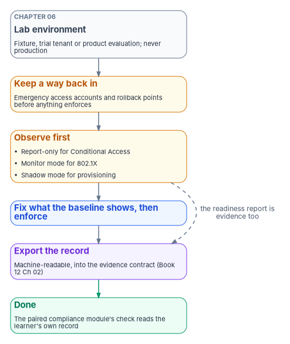
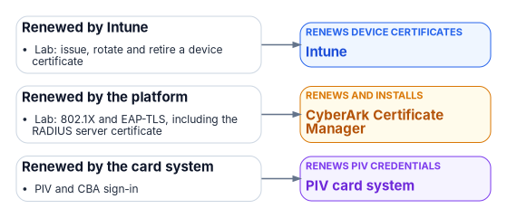

# Chapter 04 — The Implementation Track

*A build is finished when it works and its evidence lands where an assessor can read it; the second half is the one most builds skip.*

::: {.callout-note}
## In this chapter
The curriculum for the engineers and administrators who build and run the estate. It sets out who the track is for and the one rule every module follows, an orientation module, ten build modules from DDI to day-two operations, each mapped to the book that teaches it and ending in a lab and an evidence artifact, the order the modules run in and how they pair with the compliance track, a capstone, and example certifications, checked against Microsoft Learn on October 22, 2026.
:::

[Chapter 03](03-the-compliance-track.md) teaches the estate from the assessor's chair. This chapter teaches it from the engineer's. Its learners are the people who stand up the DNS and IPAM platform, rebuild identity in Microsoft Entra ID, move devices to Intune, replace the certificate authority, re-route the network, take SQL Server off Windows authentication, write the detection rules and run the estate on day two. Books 01 to 09, 12 and 15 describe what they build. The track turns those books into modules a person can be trained and checked on.

The track is a sequence of builds, but its purpose is not to repeat the books. A learner who has read [Book 04](../b04-access/index.md) knows what an approval-gated role activation is. A learner who has finished the access module has configured one in a lab, watched it work, exported the audit trail it produces and handed that trail to an ISSO who could trace it to AC-6. The difference is the evidence, and it is why the track exists.

{#fig-ch04-build-sequence fig-alt="A top-to-bottom flow. At the top, a slate card: Module 0, orientation, the program, its gates and the compliance track's Module 0, Books 00 and 01. It leads to a blue card, Module 1, DDI, Book 08, which leads to a blue card, Module 2, identity, Books 02 and 03. Identity leads to two blue cards side by side: Module 3, certificates, Book 07, and Module 4, access and privileged access, Book 04. Certificates lead, with the label certificates before enforcement, to Module 6, network and network access control, Book 09, which leads to Module 7, data platform, Book 06. Access leads to a violet group labeled in parallel once identity exists, holding three cards: Module 5, devices and servers, Book 05; Module 8, cloud platform, Book 10 and Book 01 Chapter 03; and Module 9, security operations, Book 12. The data platform and the three parallel modules lead to a green card at the bottom: Module 10, day-two operations, Book 15, which runs what the other modules built."}

## Who the track is for

The track serves every technical role that changes the estate. The roles below are illustrative; the program's design is that every engineer takes Module 0, the modules for the areas they build or run, and Module 10.

| Role | Core modules | NICE Framework work role (example mapping) |
|---|---|---|
| Identity engineer | 2, 3, 4 | Systems Administration |
| Endpoint and server administrator | 5, 8 | Systems Administration |
| Network and DDI engineer | 1, 6 | Network Operations; Infrastructure Support |
| Database administrator | 7 | Database Administration |
| Cloud platform engineer | 8, with 1 and 4 | Systems Administration; Systems Security Analysis |
| Security operations analyst and detection engineer | 9 | Defensive Cybersecurity; Incident Response; Vulnerability Analysis |
| Help desk and day-two operator | 10, with 2 and 4 | Technical Support |

: Implementation track roles, their core modules, and an example NICE Framework mapping {.striped .hover}

The work role names are from NICE Framework Components version 2.2.0, which lists them in its Implementation and Operation and its Protection and Defense categories.[^c04-nice] The mapping of a workbook role to a work role is the program's example; [Chapter 02](02-what-the-workforce-rules-require.md) covers how an agency codes its own positions.

## The rule of the track

Every module ends the same way, and the rule is the program's design:

::: {.callout-important}
## Done means it works and the evidence has landed
A module is complete when the thing works **and** the record it produces sits where the agency's evidence pipeline can read it, and a re-run of the relevant check shows the result coming from that record. Building the control is half the work. Producing the evidence an assessor reads is the other half.
:::

Three habits follow from the rule, and every lab teaches them.

1. **Observe before you enforce.** Where the platform has an observe mode, the lab uses it first. Microsoft's guidance is to deploy Conditional Access policies in report-only mode and check their effect before turning them on, and policies created from its templates start in report-only.[^c04-ca-plan] Port-based access control starts in monitor mode, logging what would have failed without blocking it ([Book 09, Chapter 07](../b09-network/07-network-access-control.md)). Identity provisioning starts in shadow mode, comparing what it would do with what the directory holds ([Book 03, Chapter 12](../b03-hr-identity/12-execution-plan.md)). The would-have-failed record is itself evidence: an assessor reading the enforcement evidence should also see the readiness report that preceded it.
2. **Keep a way back in.** Before a lab removes standing access or enforces a sign-in policy, it creates the emergency access accounts first. Microsoft recommends at least two, cloud-only, excluded from Conditional Access policies that block or restrict sign-in, with every use alerted on and the accounts validated at least every 90 days.[^c04-emergency]
3. **Export the record, not a screenshot.** Every lab ends with a machine-readable export, placed where the evidence contract in [Book 12, Chapter 02](../b12-security-operations/02-the-evidence-contract.md) expects it, and handed to the paired compliance module in [Chapter 03](03-the-compliance-track.md).

{#fig-ch04-lab-pattern fig-alt="A top-to-bottom chain of six cards. First, slate, tagged Chapter 06: lab environment, a fixture, trial tenant or product evaluation, never production. Second, amber: keep a way back in, emergency access accounts and rollback points before anything enforces. Third, amber: observe first, with report-only for Conditional Access, monitor mode for 802.1X and shadow mode for provisioning. Fourth, blue: fix what the baseline shows, then enforce. Fifth, violet: export the record, machine-readable, into the evidence contract from Book 12 Chapter 02. Sixth, green: done, when the paired compliance module's check reads the learner's own record. A dashed arrow from observe first to export the record is labeled the readiness report is evidence too."}

The lab environments the modules use, from recorded fixtures through trial tenants to product evaluation environments, are set up in [Chapter 06](06-vendor-training-and-labs.md). Every lab in this chapter runs in one of those environments, never against production.

## Module 0 — Orientation

**Prerequisites:** none.

**Read:** [Book 00, Chapter 04](../b00-orientation/04-the-principles.md), [Book 01, Chapter 12](../b01-transformation-arc/12-migration-roadmap.md), and the compliance track's [Module 0](03-the-compliance-track.md#module-0).

**Learn:** the program's phases and gates, what a gate checks and who can stop one; why every build ends by landing evidence; and the difference between what a cloud provider proves and what the agency proves. An engineer needs the compliance track's orientation module because every module here ends by producing a record for someone in that track.

**Outcome:** the learner can say which gate their work feeds, and what record that gate will ask for.

## The build modules

Each module below lists what it builds, the book that teaches it, its prerequisites, the lab, the evidence the lab has to land, and the compliance module that reads that evidence. The certifications named are examples, with their status checked at the end of the chapter.

| Module | Builds | Taught in | Prerequisites | Evidence it lands | Read by compliance module |
|---|---|---|---|---|---|
| 1 | DNS, DHCP and IPAM | [Book 08](../b08-ddi/index.md) | 0 | Authoritative address inventory export | 2 |
| 2 | Identity and the HR-driven lifecycle | [Books 02](../b02-identity/index.md), [03](../b03-hr-identity/index.md) | 1 | Provisioning and deprovisioning records | 1 |
| 3 | Certificates | [Book 07](../b07-pki/index.md) | 2 | Issuance and rotation records | 1 |
| 4 | Access and privileged access | [Book 04](../b04-access/index.md) | 2 | Report-only results; role activation audit trail | 1 |
| 5 | Devices and servers | [Book 05](../b05-devices/index.md) | 2 | Device inventory reconciliation; update compliance | 5 |
| 6 | Network and network access control | [Book 09](../b09-network/index.md) | 2, 3 | Monitor-mode baseline; path and access policy state | 3, 5 |
| 7 | The data platform | [Book 06](../b06-data-platform/index.md) | 2, 6 | Authentication audit and authentication-mode records | 1 |
| 8 | The cloud platform | [Book 10, Ch 05 and 06](../b10-cloud-boundary/05-the-landing-zone.md); [Book 01, Ch 03](../b01-transformation-arc/03-platform-foundation.md) | 1, 4 | Policy compliance state for the landing zone | 2, 6 |
| 9 | Security operations | [Book 12](../b12-security-operations/index.md) | 2 | One finding traced from detection to re-test | 4, 5 |
| 10 | Day-two operations | [Book 15](../b15-day2-operations/index.md) | 0, 2, 4 | Governed task records; automation validation results | 6, 8 |

: The build modules: what each builds, where it is taught, what it needs first, and the evidence it hands to the compliance track {.striped .hover}

### Module 1 — DNS, DHCP and IPAM

**Build:** the authoritative naming and addressing plane: IPAM, DNS and DHCP moved off Active Directory-integrated services into one policy plane, following the sequence in [Book 08, Chapter 10](../b08-ddi/10-migration-sequence.md) and the reference architecture in [Chapter 08](../b08-ddi/08-reference-architecture.md).

**Lab:** in a lab or fixture environment, stand up an IPAM inventory, move one zone with its rollback point, and export the address inventory.

**Evidence:** the inventory export, reconciled against at least one other inventory, with the unexplained differences listed.

**Why first:** the address inventory is the anchor the other areas' records are joined on ([Book 12, Chapter 02](../b12-security-operations/02-the-evidence-contract.md#the-join-key-authoritative-asset-identity-plus-time)). Without it, nothing downstream correlates, so the module isn't done until the export is in the pipeline and the inventory check reads it.

**Example training:** Microsoft's Azure networking certification (AZ-700) covers Azure name resolution and private DNS zones;[^c04-az700] vendor DDI training is in [Chapter 06](06-vendor-training-and-labs.md).

### Module 2 — Identity and the HR-driven lifecycle

**Build:** the Entra ID target, from the object model and sync decisions to groups and service accounts ([Book 02, Chapter 09](../b02-identity/09-building-the-entra-target.md)), and the HR-driven provisioning pipeline with its joiner, mover and leaver events ([Book 03, Chapters 05 and 08](../b03-hr-identity/08-joiner-mover-leaver.md)).

**Lab:** run the provisioning pipeline in shadow mode for a test population, explain every difference between what it would do and what the directory holds, then run one leaver end to end and capture the deprovisioning record.

**Evidence:** the shadow-mode comparison and the leaver record, both with the HR event they started from.

**Example training:** the Microsoft Identity and Access Administrator Associate certification (SC-300), which covers designing, implementing and operating identity and access management with Microsoft Entra.[^c04-sc300]

### Module 3 — Certificates

**Build:** the target certificate architecture: what stays on AD CS and is hardened, what moves to the cloud issuer, and how device and user certificates are issued and renewed ([Book 07, Chapters 03, 04 and 06](../b07-pki/04-the-target-pki.md)).

**Lab:** issue a device certificate through the target path, rotate it before it expires, and confirm the old one is revoked or retired.

**Evidence:** the issuance and rotation records, and the certificate inventory entry they update ([Book 07, Chapter 08](../b07-pki/08-lifecycle-monitoring-and-decommissioning.md)).

**Why here:** network access control in Module 6 authenticates devices by certificate, so certificates have to issue before ports can enforce.

### Module 4 — Access and privileged access

**Build:** the Conditional Access policy set and its persona model ([Book 04, Chapters 03 and 07](../b04-access/07-the-conditional-access-policy-library.md)), the privileged role tiers and emergency access accounts ([Chapter 04](../b04-access/04-privileged-roles-and-tiers.md)), and approval-gated activation of administrative roles ([Chapter 08](../b04-access/08-pim-self-request-with-approval.md)).

**Lab:** create the emergency access accounts first. Then deploy one Conditional Access policy in report-only mode and review its results; the program's design is at least 14 days in report-only before enforcement. Configure one eligible administrative role with approval and an access review, and activate it.

**Evidence:** the report-only results, and the role's activation and audit trail. The trail of activations is the evidence for least privilege, not the policy definition.

**Example training:** SC-300; and Microsoft's Cloud and AI Security Engineer Associate certification (SC-500), which includes implementing Privileged Identity Management and Conditional Access policies among its identity skills.[^c04-sc500] SC-500 replaced the Azure Security Engineer Associate certification (AZ-500), which retired on August 31, 2026.[^c04-retired]

### Module 5 — Devices and servers

**Build:** Intune-first onboarding of new devices with Windows Autopilot, compliance and configuration baselines ([Book 05, Chapter 04](../b05-devices/04-intune-first-onboarding.md)), the move of Group Policy settings to Intune ([Chapter 08](../b05-devices/08-gpo-to-intune-policy-migration.md)), servers under Azure Arc ([Chapter 09](../b05-devices/09-servers-under-azure-arc.md)), and the fleet's run state ([Chapter 10](../b05-devices/10-operating-and-evidencing-the-fleet.md)).

**Lab:** enroll a test device from zero, apply the compliance and configuration baseline, migrate one Group Policy setting and show the device reports it, and onboard one server to Arc.

**Evidence:** the device inventory reconciled against the address inventory from Module 1, and the update compliance record for the test devices.

**Example training:** Microsoft's Endpoint Administrator Associate certification (exam MD-102), which covers deploying and managing endpoints with Intune, Windows Autopilot, Defender for Endpoint and Entra ID;[^c04-md102] and, for server administrators, exam AZ-802, Administering Windows Server, whose skills include Azure Arc-enabled Windows Server.[^c04-az802] Microsoft retired exams AZ-800 and AZ-801 on September 30, 2026, and names the AZ-802 course as the replacement for both of their courses.[^c04-retired][^c04-courses]

### Module 6 — Network and network access control

**Build:** port-based access control with 802.1X and EAP-TLS ([Book 09, Chapter 07](../b09-network/07-network-access-control.md)), and application-aware transport with SD-WAN and SASE under TIC 3.0 ([Chapter 05](../b09-network/05-sd-wan-sase-and-governed-transport.md), [Chapter 03](../b09-network/03-what-tic-3-requires.md)).

**Lab:** run 802.1X in monitor mode on a lab switch or wireless network, read the would-have-failed log, fix certificate and supplicant coverage, then enforce on one port group. Separately, write one application-aware path policy and one access policy, and export their state.

**Evidence:** the monitor-mode baseline, the enforcement configuration, and the exported policy state with the monitoring signal that shows it stays enforced ([Book 09, Chapter 13](../b09-network/13-sequencing-cost-and-evidence.md)).

**The lesson the lab teaches:** enforcing 802.1X on day one is the classic way to lock a building out of its own network. Monitor first, fix what the baseline shows, then enforce.

**Example training:** AZ-700 for the Azure side;[^c04-az700] network vendor training is in [Chapter 06](06-vendor-training-and-labs.md).

### Module 7 — The data platform

**Build:** SQL Server moved from Windows authentication to Entra ID authentication: the estate inventory and authentication audit ([Book 06, Chapters 04 and 07](../b06-data-platform/07-the-authentication-audit.md)), Arc for SQL Server ([Chapter 10](../b06-data-platform/10-arc-deployment-sequencing.md)), the engine authentication decision ([Chapter 12](../b06-data-platform/12-the-engine-authentication-decision.md)) and the three phases of NTLM elimination ([Chapter 15](../b06-data-platform/15-the-three-phases-of-ntlm-elimination.md)). The runbooks R01 to R10 in Book 06 are the lab steps.

**Lab:** run the authentication audit against a lab instance, migrate one login and one application connection string, and run the parallel-run check ([Book 06, runbook R05](../b06-data-platform/r05-login-migration-and-parallel-run.md)).

**Evidence:** the authentication audit before and after, and the instance's authentication-mode record.

**Example training:** Microsoft's exam DP-300, Administering Microsoft Azure SQL Solutions, which covers Azure SQL services and SQL Server on-premises, including implementing a secure environment.[^c04-dp300]

### Module 8 — The cloud platform

**Build:** the landing zone that turns the authorization boundary into structure, with management groups, subscriptions and Azure Policy ([Book 10, Chapter 05](../b10-cloud-boundary/05-the-landing-zone.md)), IPAM and network as code ([Chapter 06](../b10-cloud-boundary/06-ipam-and-network-as-code.md)), and the governed host that runs the program's analysis and evidence steps ([Book 01, Chapter 03](../b01-transformation-arc/03-platform-foundation.md)).

**Lab:** deploy a landing zone into a trial subscription from code, assign one policy initiative, and export the compliance state.

**Evidence:** the policy compliance state, and the code commit that produced the landing zone.

**Example training:** Microsoft's Azure Administrator exam (AZ-104), whose skills include Azure Policy, management groups and role assignments.[^c04-az104] AWS and VMware equivalents are in [Book 15, Chapter 09](../b15-day2-operations/09-control-automation-aws-and-vmware.md) and their vendors' training in [Chapter 06](06-vendor-training-and-labs.md).

### Module 9 — Security operations

**Build:** the telemetry and response spine: identity and platform telemetry into one evidence contract, the move from a log warehouse to detection, vulnerability management, patch and configuration baselines, cloud posture, data protection, and detection engineering and response ([Book 12, Chapters 02 to 11](../b12-security-operations/11-detection-engineering-and-response.md)).

**Lab:** one end-to-end detection. Seed a vulnerable or exposed condition in the lab, watch it surface in the vulnerability tool, raise an alert and an incident, remediate it through the patch path, and close it only on re-test.

**Evidence:** the finding, the incident, the remediation record and the re-test, joined on the asset identity from Module 1, each with its timestamp.

**Example training:** Microsoft's Security Operations Analyst Associate certification (SC-200), covering triage, incident response, threat hunting and detection engineering with Defender XDR and Microsoft Sentinel;[^c04-sc200] and exam SC-401, Administering Information Security in Microsoft 365, for the data protection chapter.[^c04-sc401]

### Module 10 — Day-two operations

**Prerequisites:** Modules 0, 2 and 4, and the module for each area the learner will operate.

**Build:** the operating model that keeps the estate governed after cutover: intake, triage and routing ([Book 15, Chapter 03](../b15-day2-operations/03-intake-triage-and-routing.md)), help-desk authority in Entra ID ([Chapter 04](../b15-day2-operations/04-help-desk-authority-in-entra.md)), the service catalogs and asset identity ([Chapters 05 and 07](../b15-day2-operations/07-the-cmdb-and-asset-identity.md)), control compliance automation ([Chapters 08 and 09](../b15-day2-operations/08-control-automation-m365-and-azure.md)) and the operator runbook ([Chapter 12](../b15-day2-operations/12-the-day-two-runbook.md)).

**Lab:** take one everyday task that most often arrives ungoverned, such as an authentication method reset or a group change, and run it through the governed procedure from ticket to execution, with identity verification. Then run the runbook's validation harness and break one automated check on purpose to confirm the failure is loud.

**Evidence:** the task record with its ticket reference, approval and execution log, and the validation results.

**Why last:** this module runs what every other module built. It also has the most people in it: help-desk staff and operators who never took Modules 1 to 9 in full take this one, with the identity and access modules as prerequisites.

## Order and pairing

Modules 1, 2, 6 and 7 are a real dependency chain: address before you identify, identify before you shape transport, and shape transport before you place data. Certificates (Module 3) come before network access control enforces. Access, devices, the cloud platform and security operations run in parallel once identity exists. Day-two operations comes last.

The program's design is to pair each build module with the compliance module that reads its evidence, and to run the pair together where staffing allows, so an engineer and an ISSO work from the same records:

| Build module | Compliance module |
|---|---|
| 1 DNS, DHCP and IPAM | 2 Addressing and inventory |
| 2 Identity; 3 Certificates; 4 Access; 7 Data platform | 1 Identity |
| 5 Devices and servers | 5 Endpoint |
| 6 Network | 3 Network; 5 Endpoint, for port-level device identity |
| 8 Cloud platform | 2 Addressing and inventory; 6 Configuration and change |
| 9 Security operations | 4 Telemetry; 5 Endpoint |
| 10 Day-two operations | 6 Configuration and change; 8 Training |

: Pairing the implementation and compliance tracks {.striped .hover}

The track also feeds the program's gates. Before a gate in [Book 01, Chapter 12](../b01-transformation-arc/12-migration-roadmap.md) passes, the engineers who will carry out the next phase should have finished the modules for it, and the help desk should have finished Module 10 for any change that alters what users or operators do.

## The capstone — one module, evidence-complete

The learner picks one build module and carries it out end to end in a lab, or against a recorded fixture where a lab isn't available. They land the evidence where the pipeline reads it and re-run the check. Completion means the result the paired compliance module reads comes from the learner's own artifact, and an ISSO who has taken that compliance module can trace it without help. [Chapter 05](05-assessment-and-certification.md) sets the rubric and the pass mark.

## Example certifications

None of the track depends on an outside certification, and none is endorsed. Certifications are useful as a general signal and as a structured way to learn a product; they don't show that someone can build this estate to this program's evidence standard, which the capstone does. The Microsoft certifications named above, as Microsoft Learn shows them on October 22, 2026:

| Certification | Exam | Modules | Status |
|---|---|---|---|
| Identity and Access Administrator Associate | SC-300 | 2, 4 | Current; English exam update on October 28, 2026[^c04-sc300] |
| Cloud and AI Security Engineer Associate | SC-500 | 4, 8 | Current; replaced AZ-500[^c04-sc500][^c04-retired] |
| Endpoint Administrator Associate | MD-102 | 5 | Current; English exam update on October 27, 2026[^c04-md102] |
| Windows Server Hybrid Administrator Associate | AZ-802 | 5 | Current exam; AZ-800 and AZ-801 retired September 30, 2026[^c04-az802][^c04-retired] |
| Azure Network Engineer Associate | AZ-700 | 1, 6 | Current[^c04-az700] |
| Azure Database Administrator Associate | DP-300 | 7 | Current[^c04-dp300] |
| Azure Administrator Associate | AZ-104 | 8 | Current[^c04-az104] |
| Security Operations Analyst Associate | SC-200 | 9 | Current[^c04-sc200] |
| Information Security Administrator Associate | SC-401 | 9 | Current[^c04-sc401] |
| Microsoft 365 Administrator Expert | MS-102 | 10 | Retiring November 30, 2026; plan around it[^c04-retired] |

: Example Microsoft certifications for the implementation track, with their status on October 22, 2026 {.striped .hover}

Microsoft's associate, expert and specialty certifications expire every year and are renewed by passing a free online assessment on Microsoft Learn.[^c04-renew] Certification names and exams change often, as the four retirements in this table show; the program re-checks the table at each gate, the same way it re-checks federal dates. Network, DDI, identity governance and cloud vendors other than Microsoft have their own programs, which [Chapter 06](06-vendor-training-and-labs.md) covers.

## What changed from the earlier curriculum

- **The modules now cover the whole estate.** The earlier curriculum had no module for devices, the cloud platform or day-two operations, and grouped its last two modules around continuity, supply chain, program governance and the authorization package. Those are compliance subjects; they are taught in the compliance track's Modules 6, 7 and 9, with the controls in [Book 14](../b14-compliance/index.md). The engineering parts of them, such as generating a software bill of materials or running a contingency test, are labs inside the modules that own the systems concerned.
- **Address evidence goes to the addressing area.** The earlier implementation curriculum filed the IPAM inventory under network evidence while its compliance counterpart filed it under addressing. Both tracks now use the addressing and inventory area.
- **One certification was retired and another replaced.** The earlier curriculum recommended the Azure Security Engineer Associate (AZ-500), which retired on August 31, 2026; the current certification is SC-500.[^c04-retired] Windows Server administrators now take AZ-802.
- **Internal labels are gone.** The earlier labs ended by binding an artifact to a numbered slot and an internal indicator rule. Each lab now ends by landing a named record that a named compliance module reads.

## Certificates in this book and the CLM platform {#certificates-and-the-clm-platform}

[Book 07](../b07-pki/index.md) gives each class of certificate one issuer and one renewal engine, and makes CyberArk Certificate Manager, Self-Hosted the system of record for every certificate that Intune and the PIV system don't manage ([Chapter 04](../b07-pki/04-the-target-pki.md), [Chapter 05](../b07-pki/05-who-owns-the-certificate-estate.md)). The certificates this book's systems depend on map to it as follows; [Book 07, Appendix C](../b07-pki/appendix-c-anatomy-of-the-clm-platform.md) describes the platform itself.

| Certificate | Book 07 class | Issued by | Renewed by | What the CLM platform does |
|---|---|---|---|---|
| Lab: issue, rotate and retire a device certificate | Device and user auth (Intune) | Cloud PKI or a lab CA | Intune | Nothing |
| Lab: 802.1X and EAP-TLS, including the RADIUS server certificate | RADIUS and 802.1X servers | Lab CA | CyberArk Certificate Manager | A lab exercise can renew it through the platform (inference) |
| PIV and CBA sign-in | PIV | Federal PKI | PIV card system | Nothing |

{fig-alt="Lab: issue, rotate and retire a device certificate go to Intune (renews device certificates); Lab: 802.1X and EAP-TLS, including the RADIUS server certificate go to CyberArk Certificate Manager (renews and installs); PIV and CBA sign-in go to PIV card system (renews piv credentials)."}

The CLM platform owner is a role Book 07 assigns ([Chapter 05](../b07-pki/05-who-owns-the-certificate-estate.md)); the implementation track can add a server-certificate lab that renews a certificate through the platform and installs it with a driver ([Book 07, Appendix C](../b07-pki/appendix-c-anatomy-of-the-clm-platform.md)).

::: {.callout-tip}
## Continue the book
[← Previous: Chapter 03 — The Compliance Track](03-the-compliance-track.md) · [Book index](index.md) · [Next: Chapter 05 — Assessment and Certification →](05-assessment-and-certification.md)
:::

[^c04-nice]: Cybersecurity and Infrastructure Security Agency, National Initiative for Cybersecurity Careers and Studies, "NICE Framework" work role listing (data from NICE Framework Components version 2.2.0; Implementation and Operation, and Protection and Defense categories), <https://niccs.cisa.gov/tools/nice-framework> (accessed Oct 22, 2026).
[^c04-ca-plan]: Microsoft Learn, "Plan a Conditional Access deployment" (deploy policies in phases; policies created from templates are in report-only mode; test and monitor before turning on), <https://learn.microsoft.com/entra/identity/conditional-access/plan-conditional-access>, and "Conditional Access report-only mode," <https://learn.microsoft.com/entra/identity/conditional-access/concept-conditional-access-report-only> (accessed Oct 22, 2026).
[^c04-emergency]: Microsoft Learn, "Manage emergency access accounts in Microsoft Entra ID" (security guardrails summary), <https://learn.microsoft.com/entra/identity/role-based-access-control/security-emergency-access> (accessed Oct 22, 2026).
[^c04-az700]: Microsoft Learn, "Study guide for Exam AZ-700: Designing and Implementing Microsoft Azure Networking Solutions" (skills measured as of July 27, 2026), <https://learn.microsoft.com/credentials/certifications/resources/study-guides/az-700>, and "Microsoft Certified: Azure Network Engineer Associate," <https://learn.microsoft.com/credentials/certifications/azure-network-engineer-associate/> (accessed Oct 22, 2026).
[^c04-sc300]: Microsoft Learn, "Microsoft Certified: Identity and Access Administrator Associate" (last updated April 27, 2026; English version updated October 28, 2026), <https://learn.microsoft.com/en-us/credentials/certifications/identity-and-access-administrator/> (accessed Oct 22, 2026).
[^c04-sc500]: Microsoft Learn, "Microsoft Certified: Cloud and AI Security Engineer Associate," <https://learn.microsoft.com/en-us/credentials/certifications/cloud-and-ai-security-engineer-associate/>, and "Study guide for Exam SC-500: Implementing End-to-End Security Controls for Cloud and AI Workloads" (skills measured), <https://learn.microsoft.com/credentials/certifications/resources/study-guides/sc-500> (accessed Oct 22, 2026).
[^c04-retired]: Microsoft Learn, "Exam and assessment lab retirement" (recently retired exams, including AZ-500 on August 31, 2026 and AZ-800 and AZ-801 on September 30, 2026; exams scheduled to retire, MS-102 on November 30, 2026), <https://learn.microsoft.com/en-us/credentials/support/retired-certification-exams>; and Microsoft Partner Center, "May 2026 announcements" (AZ-500 transitions to SC-500), <https://learn.microsoft.com/partner-center/announcements/2026-may> (accessed Oct 22, 2026).
[^c04-md102]: Microsoft Learn, "Microsoft 365 Certified: Endpoint Administrator Associate" (last updated July 24, 2026; English version updated October 27, 2026), <https://learn.microsoft.com/en-us/credentials/certifications/modern-desktop/>, and "Study guide for Exam MD-102: Managing and Securing Microsoft 365 Endpoints by using Intune," <https://learn.microsoft.com/credentials/certifications/resources/study-guides/md-102> (accessed Oct 22, 2026).
[^c04-az802]: Microsoft Learn, "Study guide for Exam AZ-802: Administering Windows Server" (audience profile and skills measured, including Azure Arc-enabled Windows Server instances; practice assessment listed for the Windows Server Hybrid Administrator Associate certification), <https://learn.microsoft.com/credentials/certifications/resources/study-guides/az-802>, and "Practice Assessments for Microsoft Certifications" (AZ-802: Windows Server Hybrid Administrator Associate), <https://learn.microsoft.com/credentials/certifications/practice-assessments-for-microsoft-certifications> (accessed Oct 22, 2026).
[^c04-courses]: Microsoft Learn, "Course retirement" (AZ-800T00 and AZ-801T00 retired September 30, 2026, replacement course AZ-802T00: Administer Windows Server; AZ-500T00 retired August 31, 2026, replacement course SC-500T00), <https://learn.microsoft.com/en-us/credentials/certifications/retired-courses> (accessed Oct 22, 2026).
[^c04-dp300]: Microsoft Learn, "Study guide for Exam DP-300: Administering Microsoft Azure SQL Solutions" (skills measured as of October 27, 2026), <https://learn.microsoft.com/credentials/certifications/resources/study-guides/dp-300>, and "Microsoft Certified: Azure Database Administrator Associate," <https://learn.microsoft.com/credentials/certifications/azure-database-administrator-associate/> (accessed Oct 22, 2026).
[^c04-az104]: Microsoft Learn, "Study guide for Exam AZ-104: Microsoft Azure Administrator" (skills measured as of April 17, 2026), <https://learn.microsoft.com/credentials/certifications/resources/study-guides/az-104>, and "Microsoft Certified: Azure Administrator Associate," <https://learn.microsoft.com/credentials/certifications/azure-administrator/> (accessed Oct 22, 2026).
[^c04-sc200]: Microsoft Learn, "Microsoft Certified: Security Operations Analyst Associate" (last updated October 21, 2026), <https://learn.microsoft.com/en-us/credentials/certifications/security-operations-analyst/> (accessed Oct 22, 2026).
[^c04-sc401]: Microsoft Learn, "Study guide for Exam SC-401: Administering Information Security in Microsoft 365," <https://learn.microsoft.com/credentials/certifications/resources/study-guides/sc-401>, and "Microsoft Certified: Information Security Administrator Associate," <https://learn.microsoft.com/credentials/certifications/information-security-administrator/> (accessed Oct 22, 2026).
[^c04-renew]: Microsoft Learn, study guides for Exams AZ-700 and SC-401, "Useful links" (certification renewal: associate, expert and specialty certifications expire annually and are renewed by passing a free online assessment), <https://learn.microsoft.com/credentials/certifications/resources/study-guides/az-700> (accessed Oct 22, 2026).
