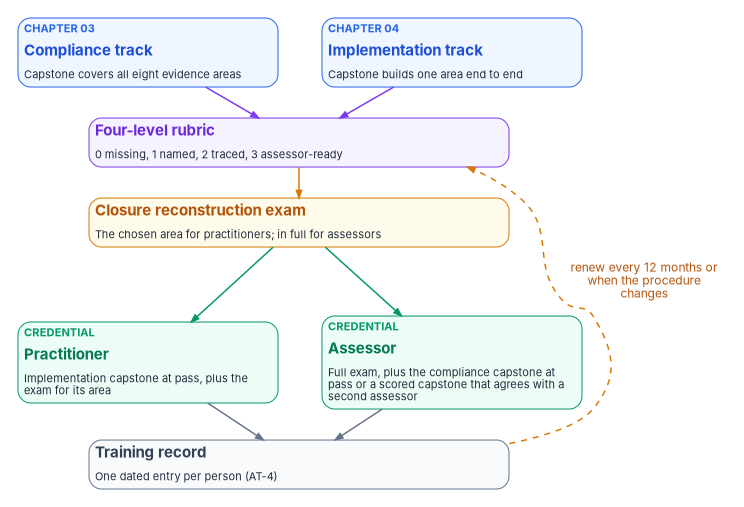
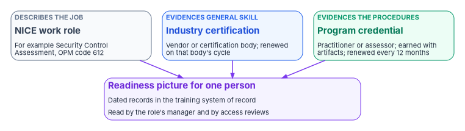

# Chapter 05 — Assessment and Certification

*An attendance certificate proves someone sat through a course; the program certifies only what a person can show, with an artifact someone else could check.*

::: {.callout-note}
## In this chapter
How the program grades the two capstones that end the [compliance track](03-the-compliance-track.md) and the [implementation track](04-the-implementation-track.md): a four-level scale, a set of checks that apply to every submission, and a rubric for each of eight evidence areas. Then the closure reconstruction exam, the two credentials the program confers, and how they are renewed. The last part places the program's credentials beside the industry certifications people already hold and the NICE Framework's work roles. The scales, credentials and renewal rules are the program's design; the federal requirements and the external certifications are cited.
:::

Federal training rules ask for more than completion. OMB Circular A-130 tells agencies to give users foundational and more advanced training and to "ensure that measures are in place to test the knowledge level" of those users, and to give role-based training to people with security and privacy roles before they get access or perform their duties.[^c05-a130] NIST SP 800-50 Rev. 1 is specific about what a good test looks like. It uses the four Kirkpatrick levels (reaction, learning, behavior and results) to evaluate training. For the second level, learning, it recommends "practical assessments that allow for the demonstration of knowledge and skill development and that mimic what will be experienced in the work role," using case studies, virtual labs, demonstrations and scenario-based exercises.[^c05-sp80050]

The program takes that literally. Every book before this one ends in a procedure: verify before resetting, approve before activating, record before closing. A person who can do the work can run the procedure and leave behind the evidence the procedure produces. So the assessment asks for that evidence, scored the way an independent assessor would score it. The NICE Framework describes the assessor's job as conducting "independent comprehensive assessments" of the controls a system uses or inherits "to determine their overall effectiveness."[^c05-nice-json] That is the skill being certified: not "can you say the control is met," but "can you trace the closure to its evidence and say why nothing else would close it." It is also the AT-3 role-based training the agency's own authorization depends on, which is why the program's training records become part of its evidence ([Book 14, Chapter 09](../b14-compliance/09-training-and-awareness-controls.md)).

{#fig-ch05-certification-path fig-alt="A flow from top to bottom. Two blue cards at the top: the compliance track, ending in a capstone that covers all eight evidence areas, and the implementation track, ending in a capstone that builds one area end to end. Both feed a violet card, the four-level rubric, scored from 0 missing to 3 assessor-ready. Below it an amber card, the closure reconstruction exam, which is taken in full for the assessor credential and for the chosen area only for the practitioner credential. Two green cards follow: the practitioner credential, which needs the implementation capstone at pass plus the exam for its area, and the assessor credential, which needs the full exam plus either the compliance capstone at pass or, for control assessors, a scored capstone that agrees with a second assessor's. Both lead to a slate card, the training record, one dated entry per person for AT-4. A dashed amber arrow loops from the record back to the rubric, labeled renew every 12 months or when the procedure changes."}

## The scale

Every rubric in this chapter uses one four-level scale. It is the program's design, written in the language an assessor uses.

| Level | Name | What it means |
|---|---|---|
| 0 | Missing | The area isn't addressed, or it is addressed without reference to the books or to the agency's evidence mapping |
| 1 | Named | The right books and the right evidence area are named, but the controls are wrong or missing, or the evidence flow is absent |
| 2 | Traced | The chain from book to NIST SP 800-53 control to evidence source is complete and correct against the agency's control crosswalk |
| 3 | Assessor-ready | Level 2, plus a real result from the agency's evidence tooling, dated against the freshness rule the agency set for that record, an honest statement of anything not yet evaluated, and the external date that gap answers to |

The pass bar for the compliance-track capstone is every area at level 2 or higher and at least three areas at level 3. All eight at level 3 is a distinguished result: in substance, a continuous-monitoring narrative an assessor could read.

The distinction between levels 2 and 3 is the one [Book 13, Chapter 07](../b13-governance/07-evidence-over-attestation.md) draws between attestation and evidence. A level 2 answer says where the proof would come from. A level 3 answer shows it, in the form [Book 12, Chapter 02](../b12-security-operations/02-the-evidence-contract.md) calls an evidence contract, and is honest about what it doesn't yet cover. [Book 11, Chapter 10](../b11-zero-trust/10-evidence-not-verdicts.md) explains why a verdict without its evidence scores no higher than a claim.

## Checks that apply to the whole submission

Four checks are scored once per capstone, yes or no.

| Check | Passes when |
|---|---|
| The evidence output is attached | The assessment result file is linked or attached, not described |
| No invented controls | Every control cited appears in the agency's crosswalk or in the book that carries it ([Book 14, Appendix A](../b14-compliance/appendix-a-control-crosswalk.md)) |
| Gaps stay gaps | Anything not yet evaluated is stated as a gap, never presented as satisfied |
| Each gap has a date | Each gap names the external date it answers to, from the clocks in [Book 14, Chapter 02](../b14-compliance/02-the-federal-clock.md) |

The last check exists because the source material for this chapter got one of those dates wrong: it tied a supply-chain artifact deadline to a CISA directive that sets agency remediation timelines instead. Book 14, Chapter 02 has the corrected picture. A candidate who cites the right date for the right reason passes the check. A candidate who repeats a date without knowing who it binds does not.

## The eight evidence areas

The compliance track organizes the books into eight evidence areas, and the implementation track builds one of them end to end. The areas and their anchor controls are the ones in [Chapter 03](03-the-compliance-track.md); the rubric adds the further controls a candidate is expected to place. Each row below names the books an answer draws on, the controls the candidate has to place, what earns level 2, and what level 3 adds. The control assignments are the program's design; the control names and baselines come from the SP 800-53 Release 5.2.0 catalog and the SP 800-53B baselines. Every control listed is in the Moderate baseline except two: the PM family, which isn't in any of the SP 800-53B system baselines, and AT-3(5), which is in the privacy baseline only.[^c05-sp80053]

| Area | Books | Controls to place | Level 2 evidence | Level 3 adds |
|---|---|---|---|---|
| 1. Identity | [02](../b02-identity/index.md), [03](../b03-hr-identity/index.md), [04](../b04-access/index.md), [06](../b06-data-platform/index.md), [07](../b07-pki/index.md) | IA-2 with (1) and (2), IA-5, IA-11, AC-2 with (1), AC-3, AC-5, AC-6, AC-17, CA-7 | Sign-in and risk logs named as the source | A privileged-role trace: the activation design in [Book 04, Chapter 08](../b04-access/08-pim-self-request-with-approval.md), the control, the check that reads it, and the audit-log entry; and a before-and-after for one AC-6 enhancement |
| 2. Addressing and inventory | [08](../b08-ddi/index.md); [10, Ch06](../b10-cloud-boundary/06-ipam-and-network-as-code.md) | CM-8 | The IPAM inventory named as the attestation | An actual inventory export or lab fixture, placed where the evidence mapping reads it |
| 3. Network | [09](../b09-network/index.md); [10, Ch07](../b10-cloud-boundary/07-the-front-door.md) | SC-7, SC-8, AC-4, CA-7 | One application-aware path policy mapped to SC-8 | The continuous signal that shows the policy stays enforced, and the agency-owned SC-7 edge called out |
| 4. Telemetry | [12](../b12-security-operations/index.md) | SI-4, CA-7, RA-5, SI-2, AU-6, AU-11, IR-4, IR-6, IR-8 | A known-exploited vulnerability traced from scanner finding to SIEM incident to closure | A rule that fired, plus the AU-11 retention argument |
| 5. Endpoint | [05](../b05-devices/index.md); [09, Ch07](../b09-network/07-network-access-control.md) | CM-8, IA-3, SI-2 | An endpoint inventory statement covering device identity, completeness and remediation | The endpoints that handle PII called out with their privacy treatment ([Book 14, Chapter 08](../b14-compliance/08-privacy-pii-processing.md)) |
| 6. Configuration, change and supply chain | [13](../b13-governance/index.md), [15](../b15-day2-operations/index.md); taught in [14, Ch05](../b14-compliance/05-program-management-controls.md) and [Ch07](../b14-compliance/07-supply-chain-risk-management.md) | CM-2, CM-3, the SR family, the PM family | What the agency receives from providers and asks for in contracts, per Book 14, Chapter 07 | An actual software bill of materials or vendor disclosure, with the agency's review cadence stated |
| 7. Continuity | [14, Ch06](../b14-compliance/06-contingency-and-continuity.md) | CP-2, CP-3, CP-4, CP-6, CP-7, CP-8, CP-9, CP-10 | One contingency test mapped to CP-4 | A tabletop after-action report with findings and owners; a report with no findings scores 0 |
| 8. Training | [14, Ch09](../b14-compliance/09-training-and-awareness-controls.md) and this book | AT-2, AT-2(2), AT-2(3), AT-3, AT-4, CP-3, IR-2; AT-3(5) where the privacy baseline applies | The training evidence record named as the evidence for the AT controls | An actual record (a lab-generated one is fine) with the per-person completions behind its summary; an aggregate percentage alone scores 0 |

Three corrections were made to the source rubric while building this table. It listed IA-2(11) in the identity area; NIST withdrew that enhancement and incorporated it into IA-2(6).[^c05-sp80053] It listed AT-2(1) and AT-3(3), the practical-exercise enhancements, as training-area requirements; neither is in any SP 800-53B baseline, as [Book 14, Chapter 09](../b14-compliance/09-training-and-awareness-controls.md) also found. And it omitted AT-2(3), social engineering and mining, which the Moderate baseline does select.[^c05-sp80053] The continuity row keeps the source's one detail that a candidate often misses: CP-5 is withdrawn and incorporated into CP-2, so a candidate who assigns it a book has invented a control.[^c05-sp80053]

The rule that a no-findings after-action report scores 0 is the program's design. An exercise that found nothing either tested nothing or recorded nothing, and either way it isn't evidence of readiness. The same reasoning drives the training row: Book 14, Chapter 09 builds the training record from one completion per person and course, and an answer that can show only a percentage hasn't shown the record.

## Scoring the compliance-track capstone

The compliance-track capstone is one document covering all eight areas, backed by a real run of the agency's evidence tooling against a lab or test environment. The assessor scores each area on the scale, applies the four checks once, and applies the pass bar: every area at 2 or higher, at least three at 3, and all four checks passed. The score sheet is at the end of this chapter.

## Scoring the implementation-track capstone

The implementation-track capstone is one area built, or simulated in a lab, from end to end, with its artifact placed where the evidence mapping reads it. Because it is depth-first, it is scored on a narrower bar.

| Criterion | Passes when |
|---|---|
| The build works | The mechanism demonstrably functions: configuration, run output or fixture |
| The evidence is placed | The artifact sits where the evidence mapping references it, not described but placed |
| The result moves | The evidence tooling's result for that area changes because of the candidate's artifact |
| The trace is stated | The candidate can name the control the build closes and the check that reads the evidence |

[Chapter 06](06-vendor-training-and-labs.md) describes the lab environments these builds run in. The third criterion is the one that separates a working build from a demonstration: if the result doesn't move, either the artifact is in the wrong place or it doesn't prove what the candidate thinks it does.

## The closure reconstruction exam

The certification exam is a reconstruction. The candidate gets a blank list of control families, or of the FedRAMP Key Security Indicator themes, and rebuilds the agency's closure picture from the books: place each item in its evidence area, name the mechanism that closes it as a function rather than a product, say whether a configuration-assessment tool can attest it alone or whether it depends on architecture the tool can't see, and explain why no alternate mechanism closes it.

FedRAMP's 2026 rules publish 46 Key Security Indicators in ten themes, from Cybersecurity Education to Service Configuration, and the indicators are written about the provider: for example, the education indicator says the effectiveness of cybersecurity education and training "is persistently reviewed."[^c05-fedramp-ksi] [Book 14, Chapter 03](../b14-compliance/03-the-baseline-and-the-crosswalk.md) explains why those indicators bind cloud service providers rather than agencies, and how the agency's crosswalk relates to them. The exam uses the indicators as a structure the candidate will meet in provider reports, not as agency requirements.

What the exam tests is the split the program turns on. Some closures can be read straight from configuration: a baseline scanner can show that a tenant setting is right. Others can't, because they depend on an authoritative inventory, a tested contingency architecture, or a per-person training record that no configuration scan sees. A candidate who can draw that line correctly, with the reason for each item, has the coverage-gap fluency an assessor needs. The program's reference answer is the agency's own crosswalk, maintained as [Book 14, Appendix A](../b14-compliance/appendix-a-control-crosswalk.md) describes, so the exam changes when the crosswalk does.

## Two credentials

The program confers two credentials. Both are competency credentials, not attendance certificates, and both are earned with artifacts. Their names and requirements are the program's design.

- **The practitioner credential** (implementation). It requires the implementation-track capstone at pass, plus the reconstruction exam done correctly for the area or areas the chosen build feeds. A practitioner has shown they can build a control and land the evidence that proves it.
- **The assessor credential** (compliance). It requires the full reconstruction exam done correctly, with the tool-attestable and architecture-dependent split and the reasoning for each item, plus one of two routes through the capstone described in [Chapter 03](03-the-compliance-track.md). An ISSO or member of the compliance staff writes the compliance-track capstone and passes it. A control assessor doesn't write one; they score a submitted capstone against this rubric, and their scores are compared with a second assessor's. The program's design is that the two must agree within one level on every area and agree on the result. An assessor credential holder has shown they can trace and adjudicate the whole evidence model.

A credential is a record before it is anything else. Each award is entered as one dated, per-person training record under AT-4, the same record [Book 14, Chapter 09](../b14-compliance/09-training-and-awareness-controls.md) uses as evidence for AT-2 and AT-3. SP 800-50 Rev. 1 warns that learning data can carry heightened sensitivity, because training records are often part of employment or contract records and can be tied to performance evaluations, and it tells program managers to manage the risks of processing that data, including in the learning management system.[^c05-sp80050] The program's design follows Book 14: per-person records stay in the system of record, and the summaries that leave it carry counts, not names.

## Recertification

The source material defined the credentials but not how long they last. The program's design is that both expire after 12 months, and earlier when the procedure they certify changes materially, for example when a book's procedure is revised or a vendor retires the feature it depends on. Renewal is a short practical reassessment on what changed, scored on the same scale, not a repeat of the whole capstone.

That design follows the requirements and the market. AT-3 asks for role-based training before access, at an organization-defined frequency afterward, and when system changes require it; NIST sets no fixed interval.[^c05-sp80053] SP 800-50 Rev. 1 notes that people in role-based work may need "annual certifications or courses" to maintain their status.[^c05-sp80050] Microsoft's role-based and specialty certifications expire after one year and are renewed by passing a free online assessment on Microsoft Learn, available in the six months before expiry; a certification that lapses must be earned again by exam.[^c05-ms-renew] The program's annual cycle matches the cadence most of its candidates already keep.

What a lapsed credential means operationally is the agency's decision. One design the program offers: make a current practitioner or assessor credential one condition of eligibility for the privileged roles a person activates through the workflow in [Book 04, Chapter 08](../b04-access/08-pim-self-request-with-approval.md), so that the access review in [Book 04, Chapter 09](../b04-access/09-access-governance.md) can see it. That turns the credential into a control input, which is the point of having one. It also makes the credential's accuracy matter, so the agency should adopt it only once the training record is reliable.

{#fig-ch05-three-signals fig-alt="Three cards side by side feeding one card below. On the left, a slate card tagged describes the job: the NICE Framework work role, for example Security Control Assessment, OPM code 612, with tasks, knowledge and skills. In the center, a blue card tagged evidences general skill: an industry certification, from a vendor or a certification body, renewed on that body's cycle. On the right, a green card tagged evidences the agency's procedures: the program credential, practitioner or assessor, earned with artifacts and renewed every 12 months. All three feed a violet card at the bottom: the readiness picture for one person, held as dated records in the training system of record, used by the role's manager and by access reviews."}

## Industry certifications and the NICE Framework

People arrive with credentials already. The program's credentials are meant to sit beside them, not replace them, and the NICE Framework gives the common vocabulary for how they relate.

### The NICE Framework's work roles

NIST SP 800-181 Rev. 1, published in November 2020, defines the NICE Framework as "a common, consistent lexicon that categorizes and describes cybersecurity work," built from task, knowledge and skill statements.[^c05-sp800181] The components themselves are versioned separately from that publication. The current release, version 2.2.0 of April 28, 2026, added a Cybersecurity Supply Chain Risk Management work role.[^c05-nice-news] Its data file lists five work role categories (Oversight and Governance, Design and Development, Implementation and Operation, Protection and Defense, and Investigation), 42 work roles and 11 competency areas, and links most work roles to a three-digit OPM cybersecurity code.[^c05-nice-json] Version 2.0.0, released March 5, 2025, had removed the Cyberspace Effects and Cyberspace Intelligence categories, cutting the count from seven categories to five.[^c05-nice-v2] Older role lists that show seven categories or 52 roles are out of date.

The program maps its own roles to NICE work roles so that a credential, a position description and a training plan can all point at the same definition. The mapping is the program's design; the role names and codes are NIST's.[^c05-nice-json]

| Program role (where the books define it) | NICE work role | OPM code |
|---|---|---|
| Help desk analyst ([Book 15](../b15-day2-operations/index.md)) | Technical Support (IO-WRL-007) | 411 |
| Identity, endpoint and server administrators ([Books 02](../b02-identity/index.md), [05](../b05-devices/index.md)) | Systems Administration (IO-WRL-005) | 451 |
| Network and DNS engineers ([Books 08](../b08-ddi/index.md), [09](../b09-network/index.md)) | Network Operations (IO-WRL-004) | 441 |
| Database administrators ([Book 06](../b06-data-platform/index.md)) | Database Administration (IO-WRL-002) | 421 |
| Security engineers who build the controls | Systems Security Analysis (IO-WRL-006) | 461 |
| Security operations analysts ([Book 12](../b12-security-operations/index.md)) | Defensive Cybersecurity (PD-WRL-001); Incident Response (PD-WRL-003); Vulnerability Analysis (PD-WRL-007) | 511; 531; 541 |
| Architects | Cybersecurity Architecture (DD-WRL-001) | 652 |
| ISSO and ISSM ([Book 14, Chapter 10](../b14-compliance/10-who-owns-compliance.md)) | Systems Security Management (OG-WRL-014) | 722 |
| Control assessors | Security Control Assessment (OG-WRL-012) | 612 |
| Authorizing official | Systems Authorization (OG-WRL-013) | 611 |
| Privacy officer | Privacy Compliance (OG-WRL-008) | 732 |
| Curriculum owners and instructors ([Chapter 08](08-who-owns-workforce-readiness.md)) | Cybersecurity Curriculum Development (OG-WRL-004); Cybersecurity Instruction (OG-WRL-005); Cybersecurity Workforce Management (OG-WRL-003) | 711; 712; 751 |

The practitioner credential corresponds most closely to the Implementation and Operation roles and to Systems Security Analysis; the assessor credential to Security Control Assessment and Systems Security Management. [Chapter 02](02-what-the-workforce-rules-require.md) covers the federal workforce coding that uses these codes.

### Industry certifications

SP 800-50 Rev. 1 tells managers to "encourage them to acquire industry-recognized certifications" when they promote the development of staff with security and privacy responsibilities, and it counts certification attempts and passes among the quantitative measures a learning program can track.[^c05-sp80050] The program treats an industry certification as evidence of general competence in a product or a discipline, and its own credential as evidence that the person can run the agency's procedures. The two answer different questions, so neither substitutes for the other. The bodies below are examples only, checked on their own sites; the program endorses none of them.

| Body and example | What it evidences | How it is maintained |
|---|---|---|
| Microsoft role-based certifications (examples by module in [Chapter 04](04-the-implementation-track.md)) | Product skill in the platform most of the books configure | Expires after one year; renewed by a free online assessment[^c05-ms-renew] |
| Microsoft Applied Skills | Scenario-based skill, earned by passing an interactive, lab-based assessment on Microsoft Learn[^c05-ms-applied] | Per credential |
| CompTIA Security+ | Vendor-neutral baseline for core security functions | Valid three years; renewed through continuing education, among other methods[^c05-comptia] |
| ISC2 CISSP | Security program leadership; five years of required work experience | 120 continuing professional education credits over each three-year cycle[^c05-isc2] |
| ISC2 CGRC | Governance, risk and compliance practice; two years of required work experience | 60 credits over each three-year cycle[^c05-isc2] |
| ISACA CISA, CISM, CRISC | Audit and assessment; security management; IT risk and control[^c05-isaca] | Per ISACA's continuing education policy |

Two uses follow, both the program's design. First, an industry certification can be a prerequisite for a track or can waive a module that teaches the same product skill. It can't waive a capstone, because no industry exam tests the agency's procedures or produces its evidence. Second, renewal cycles differ: one year for Microsoft, three for CompTIA and ISC2. The training record should hold each credential's own expiry date rather than assume the program's 12-month cycle, so that the readiness picture in [Chapter 10](10-measuring-readiness.md) is accurate.

## Score sheet

| Area | Level (0–3) | Notes |
|---|---|---|
| 1. Identity | | |
| 2. Addressing and inventory | | |
| 3. Network | | |
| 4. Telemetry | | |
| 5. Endpoint | | |
| 6. Configuration, change and supply chain | | |
| 7. Continuity | | |
| 8. Training | | |
| Checks passed | /4 | |
| **Result** | Pass / Not yet | Pass: every area at 2 or higher, at least three at 3, and 4 of 4 checks |

"Not yet" is deliberate. A capstone that doesn't pass goes back with the scored sheet and is resubmitted; the record shows both attempts, so the agency can see where its curriculum, not just its candidates, needs work. [Chapter 09](09-building-and-running-the-curriculum.md) uses those results to revise the curriculum.

::: {.callout-tip}
## Continue the book
[← Previous: Chapter 04 — The Implementation Track](04-the-implementation-track.md) · [Book index](index.md) · [Next: Chapter 06 — Vendor Training and Lab Environments →](06-vendor-training-and-labs.md)
:::

[^c05-a130]: Office of Management and Budget, Circular A-130, *Managing Information as a Strategic Resource*, July 2016, Appendix I, §4.h (Awareness and Training), items 4 and 5, <https://www.whitehouse.gov/wp-content/uploads/legacy_drupal_files/omb/circulars/A130/a130revised.pdf> (accessed Oct 21, 2026).
[^c05-sp80050]: National Institute of Standards and Technology, SP 800-50 Rev. 1, *Building a Cybersecurity and Privacy Learning Program*, September 2024, §1.6.4 (Managers), §2.4.1 (measurements and the sensitivity of learning data), §2.4.1.1 (Quantitative Measurements), §2.5.3 (role-based training and "annual certifications or courses"), and §5.2.3.3 with Table 3 (Kirkpatrick levels and Level 2 best practices), <https://nvlpubs.nist.gov/nistpubs/SpecialPublications/NIST.SP.800-50r1.pdf> (accessed Oct 21, 2026).
[^c05-nice-json]: National Institute of Standards and Technology, NICE Framework Components v2.2.0, JSON data file (work role categories, work roles with definitions, competency areas, and OPM code relationships), <https://csrc.nist.gov/csrc/media/Projects/cprt/documents/nice/v2-2-0_nf_components.json>; linked from "NICE Framework Current Version," <https://www.nist.gov/itl/applied-cybersecurity/nice/nice-framework-resource-center/current-version> (both accessed Oct 21, 2026). The current-version page prints the release date as April 28, 2025; NIST's release announcement gives April 28, 2026.
[^c05-sp80053]: National Institute of Standards and Technology, SP 800-53 Rev. 5 Release 5.2.0 OSCAL catalog (control statements; withdrawn status of IA-2(11), incorporated into IA-2(6), and of CP-5, incorporated into CP-2; AT-3 statement) and SP 800-53B Low, Moderate and High baseline profiles, <https://raw.githubusercontent.com/usnistgov/oscal-content/main/nist.gov/SP800-53/rev5/json/NIST_SP-800-53_rev5_catalog.json> and the baseline profiles in the same folder (accessed Oct 21, 2026).
[^c05-fedramp-ksi]: FedRAMP, "Key Security Indicators," *FedRAMP Consolidated Rules for 2026*, theme list and KSI-CED-RAT, <https://www.fedramp.gov/2026/reference/key-security-indicators/> (accessed Oct 21, 2026).
[^c05-ms-renew]: Microsoft Learn, "Frequently asked questions (FAQs) about renewal," <https://learn.microsoft.com/credentials/certifications/renew-your-microsoft-certification-faq>; and "Certification process overview," Renewing your certification, <https://learn.microsoft.com/credentials/certifications/certification-process-overview#renewing-your-certification> (both accessed Oct 21, 2026).
[^c05-sp800181]: National Institute of Standards and Technology, SP 800-181 Rev. 1, *Workforce Framework for Cybersecurity (NICE Framework)*, November 2020, publication page and abstract, <https://csrc.nist.gov/pubs/sp/800/181/r1/final> (accessed Oct 21, 2026).
[^c05-nice-news]: National Institute of Standards and Technology, "NICE Releases NICE Framework Components v2.2.0," April 28, 2026, <https://www.nist.gov/news-events/news/2026/04/nice-releases-nice-framework-components-v220> (accessed Oct 21, 2026).
[^c05-nice-v2]: National Institute of Standards and Technology, *NICE Framework Components v2.0.0: Summary of Changes*, March 2025, Summary of Changes and Table 1, <https://www.nist.gov/document/nice-framework-v2-summary-changes-march-2025508compliantpdf> (accessed Oct 21, 2026).
[^c05-ms-applied]: Microsoft Learn, "Applied Skills," Microsoft Learn for Educators, <https://learn.microsoft.com/training/educator-center/programs/msle/appliedskills> (accessed Oct 21, 2026).
[^c05-comptia]: CompTIA, "Security+," <https://www.comptia.org/en-us/certifications/security/>; and "Certification Renewal Policy," <https://www.comptia.org/en-us/resources/test-policies/continuing-education-policies/certification-renewal-policy/> (both accessed Oct 21, 2026).
[^c05-isc2]: ISC2, "CISSP," <https://www.isc2.org/certifications/cissp>; "CGRC," <https://www.isc2.org/certifications/cgrc>; and "Member Policies," CPE requirements by credential, <https://www.isc2.org/policies-procedures/member-policies> (all accessed Oct 21, 2026).
[^c05-isaca]: ISACA, "Certifications," <https://www.isaca.org/credentialing/certifications> (accessed Oct 21, 2026).
