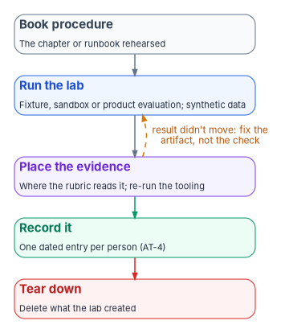

# Chapter 06 — Vendor Training and Lab Environments

*The books teach what to do and why, vendors teach their products, and labs are where people practice both without touching anything real.*

::: {.callout-note}
## In this chapter
How the program chooses vendor training, and the training offered by the vendors whose products the books configure, checked on each vendor's own site. The federal training sources. Where lab environments come from, who is eligible for them, and what changes in the government clouds. The safety and data-handling rules every lab follows. Then the labs themselves, each mapped to the book procedure it rehearses and to the [implementation track](04-the-implementation-track.md) module that uses it.
:::

The rest of this book is written by function, not by product. This chapter can't be. A learner who has read [Book 08](../b08-ddi/index.md) knows why DNS has to leave the domain controllers; to move a zone, they need to know the IPAM product in front of them. A curriculum that names no products leaves that gap to chance. So this chapter names vendors, as examples. Every product it mentions was checked on the vendor's own site in October 2026. Naming a vendor doesn't endorse it, recommend a purchase, or say the product is in an agency's authorization boundary; an agency should confirm any product's FedRAMP status on the FedRAMP Marketplace at the time it buys.

NIST's guidance supports using outside material. SP 800-50 Rev. 1 tells learning program managers to evaluate materials from "federal programs and repositories, industry vendors, and academic institutions," notes that some are low cost or free, and allows an agency to license a vendor's course library and curate it for particular audiences or work roles.[^c06-sp80050] Before choosing a vendor, it says, agencies should understand their own needs, judge whether the vendor's material meets them, and consider who owns the material for future updates, with the contracting officer involved.[^c06-sp80050]

{#fig-ch06-where-labs-run fig-alt="A decision flow from top to bottom. A slate card at the top: a lab rehearses one book procedure. First amber question: does it need a live service? If no, a green card: fixture tier, recorded data and the evidence tooling, no cloud footprint. If yes, a second amber question: does it need a vendor's product, such as DDI, network access control or SD-WAN? If yes, a blue card: product evaluation tier, a vendor evaluation, lab instance or containers. If no, a third amber question: does the behavior differ in the government cloud? If no, a blue card: sandbox tier, a commercial developer or trial tenant. If yes, a violet card: the agency's own non-production government tenant or subscription. A red card at the side, reached by a dashed line from every outcome: never a production tenant, never production data."}

## Choosing vendor training

The program's design is that a vendor course earns a place in the curriculum only when it meets four tests.

1. **It maps to a book procedure.** The course teaches a product skill that a specific chapter or runbook needs. The mapping table later in this chapter is the list.
2. **It is current.** Vendors retire courses and certifications often, and an outdated one teaches a product that no longer exists. Microsoft retired the Azure Security Engineer Associate certification (AZ-500) and its renewal assessment on August 31, 2026, and introduced the Cloud and AI Security Engineer Associate (SC-500) as the transition path.[^c06-ms-az500] [Chapter 04](04-the-implementation-track.md) re-checks its Microsoft certifications at each program gate; the same check applies to every row here.
3. **Its records can be kept.** A completion the agency can't record isn't evidence. The training record under AT-4 belongs in the agency's system of record ([Book 14, Chapter 09](../b14-compliance/09-training-and-awareness-controls.md)), so the agency needs a completion export or a certificate it can enter. Vendor certifications belong to the person, not the employer: Microsoft recommends registering for its exams with a personal Microsoft account, because exam records tied to a work or school account are lost when the person leaves the organization.[^c06-ms-sc401] The agency should keep its own record of the credential and its expiry date.
4. **Its handling of learner data is known.** SP 800-50 Rev. 1 notes that training records can carry heightened sensitivity and tells program managers to manage the risks of processing learning data, including in learning management systems.[^c06-sp80050] If a vendor platform will hold agency learner records, the agency should know where they live and who can see them before it enrolls a cohort.

Free material passes these tests as often as paid material does. The cost question is whether the agency can record and govern the result.

## Vendor training by book

Microsoft's role-based certifications, mapped to the implementation track's modules, are in [Chapter 04](04-the-implementation-track.md). Microsoft Learn's self-paced training is free, and many modules include interactive exercises.[^c06-ms-learn-types] One change matters for lab planning: the free Microsoft Learn sandboxes that once came with many modules are no longer available, and Microsoft now says completing those exercises needs an Azure subscription, such as a free 30-day trial.[^c06-ms-learn-faq] Microsoft Applied Skills are scenario-based credentials earned by passing an interactive, lab-based assessment on Microsoft Learn, a close match to the practical assessments in [Chapter 05](05-assessment-and-certification.md).[^c06-ms-applied]

The table lists other vendors whose products the books configure. Each entry was checked on the vendor's site. An agency should use the ones that match its own estate and drop the rest.

| Book and subject | Vendor and offering | What the vendor's site describes |
|---|---|---|
| [Book 08](../b08-ddi/index.md), DNS, DHCP and IPAM | Infoblox, Launchpad | Its official learning platform, with product training, hands-on labs and certifications; free access included with all Infoblox products, and free industry-focused learning for non-customers[^c06-infoblox]; a role-by-role learning path is under review in [Research](../../research/infoblox-training.md) |
| [Book 08](../b08-ddi/index.md), DNS, DHCP and IPAM | BlueCat, BlueCat Learning | Self-paced online learning and hands-on lab training in a personal environment; Associate, Professional and Advanced certifications; a product-agnostic DDI stream on DNS, DHCP and IP address management basics[^c06-bluecat] |
| [Book 09](../b09-network/index.md), network and network access control | Cisco, Cisco U. and Networking Academy | Cisco U. offers certification preparation, tutorials, hands-on labs, learning paths and continuing education credits; Networking Academy is aimed at beginners[^c06-cisco] |
| [Book 09](../b09-network/index.md), SD-WAN and SASE | Fortinet, Training Institute | Self-paced and instructor-led courses; the NSE certification program, with updates announced for July 15, 2026[^c06-fortinet] |
| [Book 09](../b09-network/index.md), SD-WAN and SASE | Palo Alto Networks, education services | A library of free digital learning modules, instructor-led training with labs, role-based certifications, and a paid learning subscription[^c06-paloalto] |
| [Book 09](../b09-network/index.md), SASE | Zscaler, Cyber Academy | Role-based learning paths and certifications earned by proctored exam, with a separate academy sign-in for government customers[^c06-zscaler] |
| [Book 03](../b03-hr-identity/index.md) and [Book 04](../b04-access/index.md), identity governance | SailPoint, Identity University | On-demand and instructor-led courses, role-based and product-based paths, knowledge credentials, and professional certifications that require experience and a proctored exam[^c06-sailpoint] |
| [Book 15, Chapter 09](../b15-day2-operations/09-control-automation-aws-and-vmware.md), AWS | AWS, Skill Builder | More than 1,000 free learning resources; paid individual and team subscriptions add exam preparation and the full set of immersive and hands-on experiences[^c06-aws-sb] |
| [Book 15, Chapter 09](../b15-day2-operations/09-control-automation-aws-and-vmware.md), VMware | Broadcom, VMware Cloud Foundation learning | Free digital and instructor-led learning entitlements for VMware Cloud Foundation Platform and Strategic customers;[^c06-vcf-ebook] VCP certifications for VCF and VVF administrators, architects and support staff, whose holders can request a personal-use license for a home lab[^c06-vcp-lab] |
| [Book 15](../b15-day2-operations/index.md), service management | ServiceNow, ServiceNow University | ServiceNow's training portal, at learning.servicenow.com[^c06-servicenow] |

The ServiceNow row is thin on purpose. ServiceNow's training pages wouldn't load for verification, so this chapter states only the portal's name and address; an agency should read the current offerings on the portal itself. Two rows carry cautions. A personal-use VMware license is for an individual's home lab, not for an agency lab; the agency's lab needs its own licensing. And a vendor academy with a separate government sign-in, as Zscaler's has, should be the one the agency's staff use when the agency runs that vendor's government offering, so that the training matches the service.

## Federal sources

Three federal sources are free and should come first.

- **CISA Learning.** CISA's no-cost online cybersecurity training platform replaced the Federal Virtual Training Environment (FedVTE) and several other learning systems. It is open to federal, state, local, tribal and territorial staff and contractors, veterans, military personnel and U.S. residents, who sign in through Login.gov.[^c06-cisa]
- **The NICE Framework.** NIST's work roles and their task, knowledge and skill statements are the common vocabulary for describing what each program role needs to learn; [Chapter 05](05-assessment-and-certification.md#the-nice-frameworks-work-roles) maps the program's roles to them.
- **FedRAMP's published rules.** The 2026 Key Security Indicators and their related controls are what providers report against, and the compliance track teaches staff to read them ([Chapter 03](03-the-compliance-track.md)).[^c06-fedramp-ksi]

## Where lab environments come from

A lab needs a tenant or subscription the learner can break. There are four common sources, and their eligibility rules differ more than most programs expect.

| Source | What it gives | Eligibility and limits |
|---|---|---|
| Microsoft 365 Developer Program sandbox | A Microsoft 365 E5 developer subscription with 25 user licenses, which includes Intune;[^c06-ms-devprog] Microsoft 365 E5 includes Entra ID P2, the license Privileged Identity Management needs[^c06-entra-lic] | Eligible Visual Studio Professional or Enterprise subscribers, ISV Success and eligible partner program members, and Premier or Unified Support customers; lasts up to 90 days and renews with development activity; for development purposes only; not offered in Microsoft's government clouds[^c06-ms-devprog] |
| Azure free trial | An Azure subscription for 30 days, enough for the Learn exercises and short platform labs[^c06-ms-learn-faq] | Commercial Azure only |
| Microsoft 365 Government trial | A free one-month trial of Office 365 GCC | GCC only; trials are available only to U.S. government entities; no trials of GCC High or DoD[^c06-ms-gcc-trial][^c06-ms-gcc] |
| Azure Government trial | An Azure Government subscription | Customers are subject to validation of eligibility before a trial is provisioned[^c06-azgov] |

Two consequences follow. First, many people won't qualify for a developer sandbox on their own; the agency's program office should arrange lab tenants rather than leave each learner to find one. Second, no free sandbox exists in GCC High or DoD, and the developer program doesn't run in any government cloud. Labs that need government-cloud behavior have to run in a non-production tenant or subscription the agency owns.

AWS has the same split. AWS GovCloud (US) is a pair of isolated U.S. regions for verified U.S. government agencies and entities, and root account holders are screened to confirm U.S. person status. GovCloud accounts also use their own identity and access management system and credentials.[^c06-govcloud] A lab in a standard AWS account teaches the service, but not the GovCloud account model.

## What changes in the government clouds

A commercial sandbox teaches the procedure, but it doesn't prove how the procedure behaves where the agency runs. Features arrive in the government clouds later or not at all, as [Book 10, Chapter 04](../b10-cloud-boundary/04-gcc-and-the-feature-gap.md) shows for GCC. Endpoints differ too: Azure Government has its own portal at portal.azure.us and its own sign-in environment, so a script that works in a commercial lab must be pointed at it explicitly, for example with `Connect-AzAccount -Environment AzureUSGovernment` in Azure PowerShell.[^c06-azgov-ps]

The program's design is a two-step lab path. Learners practice in a commercial sandbox, where tenants are easy to get and safe to destroy. Before a gate in [Book 01, Chapter 12](../b01-transformation-arc/12-migration-roadmap.md) passes, the team rehearses the same procedure once in the agency's own non-production government tenant or subscription, and records any step that behaved differently. That rehearsal is where a feature gap from Book 10 turns up as a finding, not as a production surprise.

## Lab tiers

The labs fall into three tiers. The tiers and their names are the program's design.

| Tier | What it needs | Use it when |
|---|---|---|
| Fixture | Recorded data and the agency's evidence tooling, with no cloud footprint | The skill is reading, binding or scoring evidence, as in most compliance-track work |
| Sandbox | A disposable tenant or subscription from the sources above | The procedure needs real tenant behavior: Conditional Access, privileged roles, Intune, Sentinel, Purview |
| Product evaluation | A vendor evaluation, a vendor's lab instance, or containers | The procedure needs a product the tenant doesn't provide: DDI, network access control, SD-WAN, SQL Server |

## Rules for every lab

These rules apply to every lab in this book. Rules 2 and 3 are habits [Chapter 04](04-the-implementation-track.md) teaches, and its third habit, exporting the record, applies to every lab here too; this chapter adds the environment, teardown and data rules.

1. **Never a production tenant.** Every lab assumes a tenant or subscription the agency can delete. Privileged role changes, Conditional Access and data loss prevention policies are exactly the changes that lock an organization out.
2. **Observe before enforcing.** Conditional Access policies start in report-only mode, which evaluates the policy at sign-in without enforcing it and records the result in the sign-in logs.[^c06-ca-report] The same habit applies to data loss prevention simulation, 802.1X monitor mode and provisioning shadow mode.
3. **Emergency access first.** Before a lab removes standing access or enforces a sign-in policy, it creates the emergency access accounts and excludes them from every Conditional Access policy that blocks or restricts sign-in, as Microsoft recommends; report-only policies need no exclusion.[^c06-ca-plan]
4. **Teardown is part of the lab.** Every lab ends by deleting what it created. A lab that leaves resources running becomes an unmanaged system with an unknown owner.
5. **Keep the lab separate.** A lab tenant is not joined to production. It has no directory synchronization from the production forest, no federation trust with the production tenant, and no credentials that also work in production. SP 800-53 has a control for this, CM-4(1), which analyzes changes in a separate test environment before they reach production; NIST selects it only in the High baseline, so for a Moderate system it is the agency's choice.[^c06-sp80053] The program makes that choice for every lab.
6. **No production data.** Labs use synthetic identities and synthetic records: invented names, no real Social Security numbers, no copies of production mailboxes or files. SP 800-53's SA-3(2) shows the price of doing otherwise: an organization that uses live data in a preproduction environment has to approve, document and control that use, and protect the environment at the same impact level as the live data.[^c06-sp80053] A lab that holds production data has become a production system, with everything that implies. The program's design is that labs don't.
7. **Lab artifacts stay in the lab.** Tenant names, object identifiers and exported logs from a lab don't go into the workbook or the curriculum materials, for the same reason [Book 04, Chapter 08](../b04-access/08-pim-self-request-with-approval.md) keeps tenant artifacts out of its pages. The evidence a lab produces goes where the rubric reads it, and the learner's completion goes into the training record.

Costs stay small if labs are short. Microsoft Sentinel, for example, offers a free trial in which the first 10 GB a day ingested on the analytics tier is free for 31 days, though automation and some other charges still apply during the trial.[^c06-sentinel] A lab that seeds a handful of events into one workspace and tears it down fits easily inside that.

{#fig-ch06-lab-close-out fig-alt="A top-to-bottom chain of five cards. First, slate: the book procedure, the chapter or runbook the lab rehearses. Second, blue: the lab, run in the fixture, sandbox or product evaluation tier with synthetic data. Third, violet: place the evidence where the rubric reads it and re-run the evidence tooling. Fourth, green: record the completion, one dated entry per person in the training record. Fifth, red: tear down, delete the tenant objects, subscriptions and accounts the lab created. A dashed amber arrow runs from the third card back to the second, labeled result didn't move: fix the artifact, not the check."}

## Labs mapped to the books' procedures

Each lab rehearses a procedure a book already documents. The modules are the [implementation track's](04-the-implementation-track.md); the tiers are from the table above.

| Module | Lab | Procedure it rehearses | Tier |
|---|---|---|---|
| 1, DDI | Stand up an IPAM inventory, move one zone with its rollback point, export the inventory | [Book 08, Chapter 10](../b08-ddi/10-migration-sequence.md), phases 1 to 3 and the cutover loop | Product evaluation or fixture |
| 2, Identity | Run provisioning in shadow mode against a synthetic HR feed, then one leaver end to end | [Book 03, Chapter 08](../b03-hr-identity/08-joiner-mover-leaver.md) and [Chapter 12](../b03-hr-identity/12-execution-plan.md) | Sandbox |
| 3, Certificates | Issue, rotate and retire a device certificate from a lab certificate authority | [Book 07, Chapter 06](../b07-pki/06-device-and-user-certificates.md) | Product evaluation |
| 4, Access | Emergency access first, one policy from report-only to enforcement, one approval-gated role | [Book 04, Chapter 07](../b04-access/07-the-conditional-access-policy-library.md) and the validation test plan in [Chapter 08](../b04-access/08-pim-self-request-with-approval.md) | Sandbox |
| 5, Devices and servers | Enroll a device from zero, migrate one Group Policy setting, onboard one server to Arc | [Book 05, Chapters 04](../b05-devices/04-intune-first-onboarding.md), [08](../b05-devices/08-gpo-to-intune-policy-migration.md) and [09](../b05-devices/09-servers-under-azure-arc.md) | Sandbox, plus an Azure trial for Arc |
| 6, Network | 802.1X in monitor mode on a lab switch, then enforcement on one port group | [Book 09, Chapter 07](../b09-network/07-network-access-control.md) | Product evaluation |
| 7, Data platform | Run the authentication audit, migrate one login and one connection string | [Book 06, runbooks R03](../b06-data-platform/r03-the-authentication-audit.md) and [R05](../b06-data-platform/r05-login-migration-and-parallel-run.md) | Product evaluation (a SQL Server container) or an Azure SQL trial |
| 8, Cloud platform | Deploy a landing zone from code into a trial subscription and export its compliance state | [Book 10, Chapter 05](../b10-cloud-boundary/05-the-landing-zone.md) | Sandbox |
| 9, Security operations | One detection end to end, from seeded condition to closure on re-test; one sensitivity label and DLP policy in simulation | [Book 12, Chapters 11](../b12-security-operations/11-detection-engineering-and-response.md) and [09](../b12-security-operations/09-data-protection-and-classification.md) | Sandbox |
| 10, Day-two operations | One governed task from ticket to execution, with identity verification; a help desk verification drill | [Book 15, Chapter 12](../b15-day2-operations/12-the-day-two-runbook.md) and [Chapter 04](../b15-day2-operations/04-help-desk-authority-in-entra.md) | Sandbox, plus a role-play drill |
| Compliance track | Bind fixture evidence, generate a result, and score it; run a contingency tabletop; build a training record | [Book 14, Chapters 06](../b14-compliance/06-contingency-and-continuity.md) and [09](../b14-compliance/09-training-and-awareness-controls.md); [Book 11, Chapter 09](../b11-zero-trust/09-running-the-assessment.md) for an assessment run against a sandbox tenant | Fixture, plus sandbox for the assessment run |

The help desk verification drill in module 10 rehearses the social-engineering pressure that [Book 15](../b15-day2-operations/index.md) trains the help desk to resist. It is a role-play between trainees, scripted by the program, and it follows the guidance SP 800-50 Rev. 1 gives for phishing exercises: legal review in the design, no legitimate brands or federal organizations used as the bait, staff told that exercises happen, and no one punished or called out for their response.[^c06-sp80050] [Chapter 07](07-end-user-training.md) covers the end-user side of the same exercises.

Two areas have no tenant lab. SD-WAN and SASE need vendor equipment or evaluation licenses, so they are product-evaluation labs arranged with the vendors listed above. Continuity and the authorization package are document-shaped work that runs in the fixture tier anywhere.

## Every lab ends the same way

Whatever the tier, every lab closes in four steps. The learner places the artifact the lab produced where the evidence mapping reads it and re-runs the evidence tooling, so the result for that area changes because of the learner's work, which is the third criterion of the implementation capstone in [Chapter 05](05-assessment-and-certification.md). The completion goes into the training record as one dated entry for that person. Then the lab is torn down. If the result didn't move, the fix is to the artifact or where it was placed, never to the check.

## What changed from the earlier catalog

- **The Microsoft certification table moved and was corrected.** It is now in [Chapter 04](04-the-implementation-track.md), checked against Microsoft Learn. The earlier catalog listed AZ-500, which Microsoft retired on August 31, 2026.[^c06-ms-az500]
- **Microsoft Learn's sandboxes are gone.** The earlier catalog assumed free module sandboxes; exercises now need an Azure subscription.[^c06-ms-learn-faq]
- **The developer sandbox has eligibility rules and no government version.** The earlier catalog assumed any learner could get a Microsoft 365 developer or trial tenant. Eligibility is limited, and the program isn't offered in the government clouds.[^c06-ms-devprog]
- **Vendors not verified were removed.** The earlier catalog also listed training from Juniper, Netskope, Splunk, Elastic, SANS, ISC2, Tenable, Qualys, OpenSSF, the Linux Foundation, ISACA and IAPP. Certification bodies are covered in [Chapter 05](05-assessment-and-certification.md#industry-certifications). The others weren't checked for this chapter and were left out; an agency that runs those products can add them after checking each on the vendor's own site.
- **No lab command depends on a program-specific tool.** The earlier catalog ended every lab with a command for one specific evidence tool. This chapter describes the step by what it does, so it holds whatever tooling the agency uses.

::: {.callout-tip}
## Continue the book
[← Previous: Chapter 05 — Assessment and Certification](05-assessment-and-certification.md) · [Book index](index.md) · [Next: Chapter 07 — End-User Training for the Modernized Estate →](07-end-user-training.md)
:::

[^c06-sp80050]: National Institute of Standards and Technology, SP 800-50 Rev. 1, *Building a Cybersecurity and Privacy Learning Program*, September 2024, §2.4.1 (sensitivity of learning data), §2.7.2 (Experiential Learning, on phishing exercises), §3.2.1.2.1 (External Sources of CPLP Materials), and §4.1.5 (Acquiring Learning Materials From External Sources), <https://nvlpubs.nist.gov/nistpubs/SpecialPublications/NIST.SP.800-50r1.pdf> (accessed Oct 21, 2026).
[^c06-ms-az500]: Microsoft Learn, "Microsoft Certified: Azure Security Engineer Associate" (retirement notice, August 31, 2026), <https://learn.microsoft.com/en-us/credentials/certifications/azure-security-engineer/>; and Partner Center, "May 2026 announcements," Keep skilling on track as AZ-500 transitions to SC-500, <https://learn.microsoft.com/partner-center/announcements/2026-may> (both accessed Oct 21, 2026).
[^c06-ms-sc401]: Microsoft Learn, "Exam SC-401: Administering Information Security in Microsoft 365," Schedule exam (registration with a personal Microsoft account), <https://learn.microsoft.com/credentials/certifications/exams/sc-401/> (accessed Oct 21, 2026).
[^c06-ms-learn-types]: Microsoft Learn, "Microsoft Learn content and resource types," Training, <https://learn.microsoft.com/training/support/learn-content-types#training> (accessed Oct 21, 2026).
[^c06-ms-learn-faq]: Microsoft Learn, "Frequently asked questions," What are the Microsoft Learn sandboxes? and Are sandboxes still available?, <https://learn.microsoft.com/training/support/faq> (accessed Oct 21, 2026).
[^c06-ms-applied]: Microsoft Learn, "Applied Skills," Microsoft Learn for Educators, <https://learn.microsoft.com/training/educator-center/programs/msle/appliedskills> (accessed Oct 21, 2026).
[^c06-infoblox]: Infoblox, "Infoblox Education," <https://www.infoblox.com/infoblox-education/> (accessed Oct 21, 2026).
[^c06-bluecat]: BlueCat Networks, "Training," <https://bluecatnetworks.com/services/training/> (accessed Oct 21, 2026).
[^c06-cisco]: Cisco, "Training and Certifications," <https://www.cisco.com/site/us/en/learn/training-certifications/index.html> (accessed Oct 21, 2026).
[^c06-fortinet]: Fortinet, "Fortinet Training Institute," <https://training.fortinet.com/> (accessed Oct 21, 2026).
[^c06-paloalto]: Palo Alto Networks, "Education Services," <https://www.paloaltonetworks.com/services/education> (accessed Oct 21, 2026).
[^c06-zscaler]: Zscaler, "Zscaler Cyber Academy," <https://www.zscaler.com/zscaler-cyber-academy> (accessed Oct 21, 2026).
[^c06-sailpoint]: SailPoint, "Identity University," <https://www.sailpoint.com/university> (accessed Oct 21, 2026).
[^c06-aws-sb]: Amazon Web Services, "Learn AWS online with AWS Skill Builder," <https://aws.amazon.com/training/digital/>; and "Immersive learning," <https://aws.amazon.com/training/digital/immersive-learning/> (both accessed Oct 21, 2026).
[^c06-vcf-ebook]: Broadcom, *Getting Started with your VCF Learning Entitlements*, VCF Learning Entitlement and Paid Offerings summary, <https://www.vmware.com/docs/vmw-getting-started-with-your-vcf-learning-entitlements-ebook> (accessed Oct 21, 2026).
[^c06-vcp-lab]: VMware Cloud Foundation Blog, "Free Home-Lab Licenses for VMware Certified Professionals," April 14, 2025, <https://blogs.vmware.com/cloud-foundation/2025/04/14/free-home-lab-licenses-for-vmware-certified-professionals/> (accessed Oct 21, 2026).
[^c06-servicenow]: ServiceNow University, "PDI (personal developer instance) information" (portal page title), <https://learning.servicenow.com/lxp/en/on-demand-training-and-content/pdi-personal-developer-instance-information?id=kb_article_view&sysparm_article=KB0010586> (accessed Oct 21, 2026). The page content requires a script-capable browser and could not be read.
[^c06-cisa]: Cybersecurity and Infrastructure Security Agency, National Initiative for Cybersecurity Careers and Studies, "CISA Learning," <https://niccs.cisa.gov/training/cisa-learning> (accessed Oct 21, 2026).
[^c06-fedramp-ksi]: FedRAMP, "Key Security Indicators," *FedRAMP Consolidated Rules for 2026*, <https://www.fedramp.gov/2026/reference/key-security-indicators/> (accessed Oct 21, 2026).
[^c06-ms-devprog]: Microsoft Learn, "Welcome to the Microsoft 365 Developer Program," eligibility overview (including government clouds), <https://learn.microsoft.com/office/developer-program/microsoft-365-developer-program>; and "Set up a Microsoft 365 developer sandbox subscription," <https://learn.microsoft.com/office/developer-program/microsoft-365-developer-program-get-started> (both accessed Oct 21, 2026).
[^c06-entra-lic]: Microsoft Learn, "Microsoft Entra licensing," Microsoft Entra licensing options, <https://learn.microsoft.com/entra/fundamentals/licensing>; and "Start using Privileged Identity Management," Prerequisites, <https://learn.microsoft.com/entra/id-governance/privileged-identity-management/pim-getting-started> (both accessed Oct 21, 2026).
[^c06-ms-gcc-trial]: Microsoft Learn, "Microsoft 365 Government - how to buy," What trials are available?, <https://learn.microsoft.com/office365/servicedescriptions/office-365-platform-service-description/office-365-us-government/microsoft-365-government-how-to-buy> (accessed Oct 21, 2026).
[^c06-ms-gcc]: Microsoft Learn, "Office 365 GCC," <https://learn.microsoft.com/office365/servicedescriptions/office-365-platform-service-description/office-365-us-government/gcc> (accessed Oct 21, 2026).
[^c06-azgov]: Microsoft Learn, "What is Azure Government?," <https://learn.microsoft.com/azure/azure-government/documentation-government-welcome> (accessed Oct 21, 2026).
[^c06-govcloud]: Amazon Web Services, "AWS GovCloud (US)," <https://aws.amazon.com/govcloud-us/> (accessed Oct 21, 2026).
[^c06-azgov-ps]: Microsoft Learn, "Quickstart: Connect to Azure Government using portal," <https://learn.microsoft.com/azure/azure-government/documentation-government-get-started-connect-with-portal>; and "Quickstart: Connect to Azure Government with PowerShell," <https://learn.microsoft.com/azure/azure-government/documentation-government-get-started-connect-with-ps> (both accessed Oct 21, 2026).
[^c06-ca-report]: Microsoft Learn, "Analyze Conditional Access Policy Impact," Overview, <https://learn.microsoft.com/entra/identity/conditional-access/concept-conditional-access-report-only> (accessed Oct 21, 2026).
[^c06-ca-plan]: Microsoft Learn, "Manage emergency access accounts in Microsoft Entra ID," Conditional Access considerations, <https://learn.microsoft.com/entra/identity/role-based-access-control/security-emergency-access> (accessed Oct 22, 2026); Microsoft Learn, "Plan a Conditional Access deployment," User exclusions, <https://learn.microsoft.com/entra/identity/conditional-access/plan-conditional-access>; and Microsoft cloud security benchmark v2, "Privileged Access," PA-5: Set up emergency access, <https://learn.microsoft.com/security/benchmark/azure/mcsb-v2-privileged-access> (both accessed Oct 21, 2026).
[^c06-sp80053]: National Institute of Standards and Technology, SP 800-53 Rev. 5 Release 5.2.0 OSCAL catalog (CM-4(1) Separate Test Environments; SA-3(2) Use of Live or Operational Data) and SP 800-53B baseline profiles, <https://raw.githubusercontent.com/usnistgov/oscal-content/main/nist.gov/SP800-53/rev5/json/NIST_SP-800-53_rev5_catalog.json> and the baseline profiles in the same folder (accessed Oct 21, 2026).
[^c06-sentinel]: Microsoft Learn, "Plan costs and understand Microsoft Sentinel pricing and billing," Free trial, <https://learn.microsoft.com/azure/sentinel/billing#free-trial> (accessed Oct 21, 2026).
