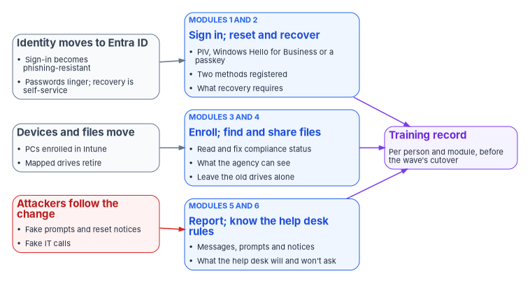
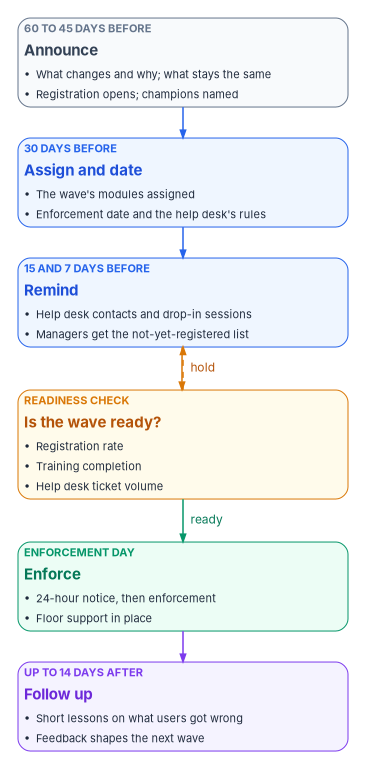

# Chapter 07 — End-User Training for the Modernized Estate

*Every user in the agency will sign in differently by the end of the program; the only question is whether they learn how from the agency before the change or from an attacker after it.*

::: {.callout-note}
## In this chapter
The six things every user has to learn when the estate moves from Active Directory to Microsoft Entra ID: phishing-resistant sign-in, self-service password reset and account recovery, device enrollment and compliance, the new places files live, how to report a suspicious message or prompt, and what the help desk will and won't ask. Then the timing of what users are told around each migration wave, how help desk volume paces the waves, and how to build the training so that every user can take it, as Section 508 requires. [Book 14, Chapter 09](../b14-compliance/09-training-and-awareness-controls.md) covers the awareness controls and their evidence; this chapter covers the content and the delivery.
:::

Most of this workbook is about systems. This chapter is about the largest population in the estate: the people who use it. Every book before this one changes something they see. [Book 02](../b02-identity/index.md) moves their identity to Microsoft Entra ID. [Book 04](../b04-access/index.md) puts Conditional Access between them and every application. [Book 05](../b05-devices/index.md) re-enrolls their computers. [Book 07](../b07-pki/index.md) changes how their PIV card signs them in. [Book 15](../b15-day2-operations/index.md) changes what the help desk will do when they call. None of those changes works if the user doesn't know what to expect, and several of them fail in a specific, dangerous way: a user who has never seen the new sign-in prompt can't tell a real one from a fake one.

Federal rules already treat this as training, not as a courtesy. OPM's rule at 5 CFR 930.301 requires agencies to train users when the information system environment or procedures change significantly, in addition to the annual awareness floor and the awareness material new employees receive before they get access.[^c07-cfr930] A migration from Active Directory to Entra ID is a significant change to both. SP 800-53's AT-2 says the same thing in control language: literacy training is given at initial training, at the agency's frequency, and when system changes require it ([Book 14, Chapter 09](../b14-compliance/09-training-and-awareness-controls.md#literacy-training-and-awareness-at-2)).

The source material for this chapter was a cheerful end-user guide. It was good at telling people what to click. It was less careful about which methods federal policy now requires, about what the agency can see on an enrolled device, and about the timing of the messages. The chapter keeps its procedures where they are still correct, corrects them where they aren't, and adds the parts a federal program needs: the help desk's rules, the reporting habits, the wave timing and accessibility.

{#fig-ch07-what-users-learn fig-alt="Three columns of cards joined by arrows. On the left, three cards name a change in the estate: a slate card, identity moves to Entra ID, sign-in becomes phishing-resistant and passwords linger while recovery becomes self-service; a slate card, devices and files move, PCs enrolled in Intune and mapped drives retired; and a red card, attackers follow the change with fake prompts, fake reset notices and fake IT calls. Each points to a blue card in the middle holding two of the six learning modules: modules 1 and 2, sign in with PIV, Windows Hello for Business or a passkey, register two methods and know what recovery requires; modules 3 and 4, read and fix compliance status, know what the agency can see and leave the old drives alone; modules 5 and 6, report messages, prompts and notices and know what the help desk will and won't ask. All three module cards point to a violet card on the right, a training record per person and module before the wave's cutover."}

## What changes for a user, and what doesn't

The guide's opening reassurance was right in substance. Users keep their mail, their files and most of their applications. What changes is how they prove who they are, where their files are kept, and who they call when something breaks. Training should say both halves plainly, because people who are told only what changes assume everything does.

| Today, in an Active Directory estate | After the user's wave |
|---|---|
| A domain password typed at the Windows sign-in screen and again at many applications | A PIV card, Windows Hello for Business or a passkey; one sign-in that applications trust |
| A text message or a phone approval as the second factor | A phishing-resistant method; codes and push approvals become a fallback the agency is retiring |
| Password reset by phoning the help desk | Self-service password reset, and a help desk that verifies identity before it touches a credential |
| A domain-joined PC configured by Group Policy | A PC enrolled in Intune, checked for compliance before it reaches agency data |
| H: and S: drives on file servers | OneDrive for personal work files; SharePoint and Teams for shared files |
| Suspicious mail forwarded to a security mailbox, sometimes | The Report button in Outlook, every time |

The table is the program's summary. Each row is a module below, and each module ends in something the user does, not something the user reads.

## Module 1: Phishing-resistant sign-in

### What federal policy requires

Two federal requirements set the target. OMB M-22-09 requires agencies to have their staff, contractors and partners use phishing-resistant methods to access agency-hosted accounts, and for routine self-service access to stop supporting methods that fail to resist phishing, naming phone numbers registered for SMS or voice calls, one-time codes and push notifications. It treats PIV, including derived PIV, as the simplest route for most systems and allows other phishing-resistant authenticators such as FIDO2 and WebAuthn where PIV isn't practical.[^c07-m2209] NIST SP 800-63B-4, final in July 2025, puts the same rule in its authentication requirements: federal agencies "SHALL require their staff, contractors, and partners to use phishing-resistant authentication to access federal information systems." It is also explicit about what doesn't qualify: passwords, look-up secrets, out-of-band approvals and one-time passwords are each described as not phishing-resistant.[^c07-sp80063b]

That correction matters for the training. The source guide taught the Microsoft Authenticator app's push approval and phone sign-in as the everyday target. Microsoft itself describes phone sign-in as convenient "but not considered phishing-resistant."[^c07-w365-methods] The program teaches push approval only as a transitional method and teaches users to move to a phishing-resistant method before their wave enforces one.

### The methods users will meet

Microsoft lists the phishing-resistant methods Entra ID supports as Windows Hello for Business, Platform Credential for macOS, synced passkeys, FIDO2 security keys, passkeys in Microsoft Authenticator and certificate-based authentication.[^c07-entra-methods] Most federal users will meet three of them.

| Method | What the user does | Where it fits |
|---|---|---|
| PIV or CAC card, through Entra certificate-based authentication | Inserts the card, chooses the smart card or certificate option, enters the card's PIN | The primary federal credential; Entra ID validates the certificate directly, without a federation server ([Book 07](../b07-pki/index.md)) |
| Windows Hello for Business | Unlocks the PC with a PIN, face or fingerprint after a one-time setup | Each user's own Windows PC; not for kiosks or shared accounts |
| Passkey in Microsoft Authenticator, or a FIDO2 security key | Approves the sign-in with the phone's or key's own unlock gesture or PIN | A portable credential for a second device, for users without a PIV reader, and for shared workstations |

Microsoft's deployment guidance adds two rules the training should carry. Each user's first phishing-resistant credential should be a portable one, which can then be used to set up local credentials on each device; and every user should have at least two methods registered, so that losing one doesn't lock them out.[^c07-pr-deploy] SP 800-63B-4 makes the same point from the other side: credential providers should encourage subscribers to keep at least two separate means of authentication.[^c07-sp80063b]

Synced passkeys need a federal caution. SP 800-63B-4 allows them for federal enterprise use only if the keys are stored in a sync fabric with FISMA Moderate protections or equivalent, the devices that hold them are protected by device management that stops keys syncing to unauthorized devices, and access to the sync fabric is controlled by agency-managed accounts.[^c07-sp80063b] A passkey saved to a personal consumer account generally won't meet those conditions. Which passkey types the agency allows is a CISO decision; the training teaches whichever ones the agency enables and tells users plainly not to save a work passkey to a personal account.

### What users learn to do

**Sign in with a PIV card.** On a Windows PC, the user selects the smart card option at the sign-in screen and enters the card PIN; Entra ID issues the sign-in token without any special client configuration.[^c07-cba] In a browser, the user enters their user name and chooses **Use a certificate or smart card**, then picks the certificate. Microsoft notes that after a successful certificate sign-in, that method becomes the user's default the next time.[^c07-cba] If a certificate prompt shows more than one certificate, the user picks the one issued by the agency's PIV issuer to their own name, and calls the help desk if none of them is. The source guide said certificates are pushed to devices and renewed automatically by Intune. That is true of device and some user certificates the agency deploys; it isn't true of a PIV card, whose certificates come from the card's issuer.

**Set up Windows Hello for Business.** On a managed PC the agency's policy prompts the user to set it up; the user creates a PIN and may add a face or fingerprint. Training should explain why the PIN isn't a weaker password, using Microsoft's own three reasons: the PIN is tied to one device and useless without it, it never leaves the device or reaches a server, and it unlocks a key held in the device's Trusted Platform Module, which locks out after too many wrong guesses.[^c07-whfb-faq] Users also need to know the PIN is per device: a second PC needs its own setup.[^c07-whfb-faq]

**Register a passkey.** The user opens Security info at `https://mysignins.microsoft.com/security-info`, signs in with multifactor authentication, chooses **Add sign-in method**, then **Passkey**, and follows the prompts for the phone, the security key or the device.[^c07-passkey-register] Passkeys in Microsoft Authenticator need iOS 17 or Android 14 or later; Microsoft lists those versions, with Windows 10 22H2 and macOS 13, as the minimums for phishing-resistant credentials.[^c07-pr-deploy] Users with older phones get a security key instead, which is a decision for the program's device-readiness work, not for the user.

**Treat any prompt you didn't start as an attack.** While push approvals remain in use, Authenticator shows a number on the sign-in screen that the user must type into the app; Microsoft has enabled number matching for all Authenticator push notifications.[^c07-number-match] A prompt with no matching screen in front of the user is someone else's sign-in attempt. The right response is to deny it and report it. Where the agency has turned on Microsoft's **Report suspicious activity** setting, the report marks the user as high risk in Entra ID Protection, which risk-based policies can act on.[^c07-report-suspicious]

### Corrections to the source procedures

- **FIDO2 security keys aren't only for kiosks.** The guide presented security keys as a shared-workstation niche. Microsoft recommends FIDO2 security keys as the first portable credential for administrators and highly regulated users.[^c07-pr-deploy] [Book 04](../b04-access/04-privileged-roles-and-tiers.md) uses them for privileged and emergency access.
- **"Enable phone sign-in" isn't the destination.** The guide ended its Authenticator setup by turning on phone sign-in. The program ends it by registering a passkey in Authenticator.
- **"Sometimes I still get a password prompt."** The guide's answer, that older applications haven't been modernized, is right, and the training should keep it. It should add that a password prompt on a page the user didn't expect, or reached from a link in a message, is the single most common phishing pattern.

## Module 2: Self-service password reset and account recovery

Passwords stay in the estate longer than anyone wants: for applications that haven't moved, for some hybrid sign-ins and as a fallback. While they remain, users should be able to fix a forgotten or expired one without calling anyone.

### Registering and resetting

Microsoft Entra self-service password reset (SSPR) lets a user reset a password or unlock an account with no administrator involvement, after first registering the methods the agency allows. The available methods are Authenticator notifications, hardware and software OATH tokens, text message, voice call and email one-time passcodes, and the agency sets whether one or two are required.[^c07-sspr] Users register in the combined Security info page, the same page as their sign-in methods.[^c07-combined-reg] Two details should be in the training: Authenticator and OATH tokens count as one method between them, so a user who must provide two can't satisfy both with the same phone app; and if the agency later changes which methods it accepts, users who registered only the removed methods lose the ability to reset.[^c07-sspr]

A user resets at `https://aka.ms/sspr` or, where the agency has enabled it on Entra-joined and hybrid-joined Windows PCs, from the **Reset password** link on the Windows sign-in screen.[^c07-sspr-windows] If the reset needs to reach a password still held in Active Directory, the agency must have password writeback enabled; otherwise the user is told to contact an administrator.[^c07-sspr]

### Lockout

The guide's lockout advice was close. Entra smart lockout locks an account after 10 failed attempts in the commercial cloud and three in Azure US Government tenants, for one minute at first and longer after repeated failures, and the agency can change both values with Entra ID P1.[^c07-lockout] The training should teach the faster exit: choosing **I forgot my password** in SSPR resets the lockout immediately, while **I know my password** doesn't.[^c07-lockout] The guide's note that frequent lockouts the user didn't cause may mean someone is trying their password is good advice and stays.

### Corrections to the source password rules

The guide told users their new password must have "14+ characters, with a mix of uppercase letters, lowercase letters, numbers, and special characters." Federal guidance has moved away from that rule. SP 800-63B-4 says verifiers shall not impose composition rules such as mixtures of character types, shall not require periodic password changes, shall require at least 15 characters for a password used as a single factor, and shall not prompt users to set up security questions.[^c07-sp80063b] M-22-09 requires that agency password policies "must not require use of special characters or regular rotation."[^c07-m2209] The agency's own password policy governs what users are told, and in a hybrid estate the Active Directory policy may still apply to synced passwords. But the training should teach length and passphrases, not character classes, and the program should raise the mismatch with the CISO if the agency's policy still requires complexity.

The guide also listed security questions and a personal email address as recovery options. The program doesn't teach security questions, for the reason above. A personal email address works, but it puts a personal address in the agency's directory and sends recovery codes outside the agency; whether to allow it is a privacy office and CISO decision, and the training should present it only if the agency has chosen to.

### When everything is lost

A user who has lost every method can't self-serve, and the training should say what happens next, because it is exactly what an attacker will imitate. The help desk follows the verification ladder in [Book 15, Chapter 03](../b15-day2-operations/03-intake-triage-and-routing.md#verify-the-person-before-a-sensitive-action): the user proves who they are by signing in with another phishing-resistant method, by in-person or supervised video verification against the PIV card or the HR record, or, where the agency has enabled it, through Entra account recovery with an identity verification provider. Then the help desk issues a short-lived Temporary Access Pass and stays with the user while they register a new phishing-resistant method ([Book 15, Chapter 04](../b15-day2-operations/04-help-desk-authority-in-entra.md#temporary-access-pass-and-mfa-re-registration)).

Users need to know two things about that process. It takes longer than a phone call used to, by design. And every account recovery sends a notice to the user; SP 800-63B-4 requires one in all cases, with instructions for what to do if the user didn't ask for it.[^c07-sp80063b] A recovery notice the user didn't expect is a report, not something to delete.

## Module 3: Device enrollment and compliance

### Enrollment and the Company Portal

New PCs in the target state arrive through Windows Autopilot or a governed enrollment path ([Book 05, Chapter 04](../b05-devices/04-intune-first-onboarding.md)); existing PCs are reset and re-enrolled or moved on a dated plan. The user's part is small: sign in with the work account when the PC asks, and wait while the policies, certificates and required applications arrive. The Company Portal app is where the user installs optional applications and checks whether the device is compliant. The guide's procedures for both are sound; the training should show them on the agency's own devices rather than on generic screenshots.

### What "not compliant" means

When a device fails a compliance policy, Conditional Access can block it from agency data. The guide promised users a grace period of "24–72 hours." That isn't a product default. In Intune the built-in action marks a device noncompliant immediately, after zero days, unless the agency changes its schedule to give users time; the agency can also send email or push notifications on a schedule it chooses.[^c07-noncompliance] Whatever window the agency sets is what users should be told, and the training should show the one fix that resolves most cases: open Company Portal, read the stated reason, install the pending update or turn on the missing setting, restart, and check again.

### What the agency can and can't see

People ask this before they enroll anything, and the guide answered it too broadly. It said the agency cannot see "personal files, photos, browsing history, text messages, and personal apps." Microsoft's own list is narrower and depends on who owns the device. Microsoft says an organization using Intune can never see calling and web browsing history, email and text messages, contacts, calendar, passwords, pictures or the content of user-created documents, and can always see the device owner, name, serial number, model, manufacturer, operating system and IMEI. It can see a corporate-owned device's full phone number and installed applications, and on corporate-owned Windows devices it can query file paths and names, registry and event log entries and running processes.[^c07-intune-visibility]

There is a second layer on government equipment. The system use notice users accept at sign-in, which SP 800-53's AC-8 requires, states that they are accessing a U.S. Government system and that use may be monitored, recorded and audited.[^c07-sp80053] So the honest answer has three parts: Intune itself doesn't read personal content; a personal device enrolled for work shows the agency only what Microsoft's list says; and a government device is a government system, monitored by other tools the security office runs. The privacy office should approve the exact wording, and the agency can publish its own privacy message in Company Portal.[^c07-intune-visibility]

### When access is blocked

Users will meet Conditional Access as a block page, and the guide's advice for that moment was good: check whether you are on a managed device, install pending updates, and if still blocked, contact the help desk with the application, the error and the troubleshooting details from the page. Those details include a correlation ID, which is how an administrator finds the exact sign-in in the Entra sign-in logs.[^c07-signin-troubleshoot] The program's training adds one sentence: a block is a control working, not a fault, and the fix is never to try the same thing from a personal device or an unapproved application.

## Module 4: New collaboration tools

### Files in OneDrive, SharePoint and Teams

The guide's file module is mostly right and worth keeping. OneDrive's Known Folder Move redirects the Desktop, Documents and Pictures folders into OneDrive, so they appear in the same places on the PC but are backed up to the cloud. Users should learn the file status icons, how to keep a file available offline, how to restore an earlier version, and where to find a deleted file. For work or school accounts, deleted OneDrive files are kept in the recycle bin and purged after 93 days unless the agency has configured otherwise, and OneDrive's Files Restore can roll a whole OneDrive back to any point in the past 30 days.[^c07-onedrive]

Shared drives move to SharePoint team sites and Teams. The training should teach where a team's files now live, how to sync a library to File Explorer, and how sharing works under the agency's rules. Sharing is where data handling training ([Book 14, Chapter 09](../b14-compliance/09-training-and-awareness-controls.md#literacy-training-and-awareness-at-2)) meets the new tools: a link that grants access to "anyone" is a different act from attaching a copy, and sensitivity labels travel with the file.

The guide's warning about old drives stays, word for word in substance: don't delete files from the old mapped drives yourself. The program retires each file share on a schedule after the records officer has been consulted ([Book 01, Chapter 09](../b01-transformation-arc/09-who-leads-the-transformation.md#records-management-and-privacy)), and both locations stay available side by side until then.

### Groups and access requests

Users can see their group memberships in My Account and request to join groups that allow it, and they can request access to sites and applications where the owner has set up a request. Approvals come from the owner or the approver the access model names, not from the help desk ([Book 04, Chapter 06](../b04-access/06-who-decides-access.md)). The training should teach users that "who can approve this?" has an answer they can look up, and that an urgent request goes to that approver, not to anyone with administrative rights.

## Module 5: Reporting suspicious messages, prompts and notices

Reporting is the one module that makes users part of the defense rather than its target. SP 800-37 lists reporting anomalous or suspicious system behavior among every system user's responsibilities.[^c07-sp80037] Users need one action for each kind of signal.

| Signal | What the user does |
|---|---|
| A suspicious email | Select it, choose **Report**, then **Report phishing**; don't forward it, don't click its links |
| An Authenticator prompt they didn't start | Deny it and use **Report suspicious activity** if the agency has enabled it; tell the help desk |
| A password reset, recovery or new-method notice they didn't expect | Report it to the help desk or the security office at once, through a channel the agency publishes |
| A call, text or chat claiming to be IT and asking for a code, an approval or a password | End it; call the help desk back on the number the agency publishes |
| A lost or stolen phone, security key, PIV card or laptop | Report it the same day, so the method can be removed |

The built-in **Report** button is available in current versions of Outlook for Windows, Mac, the web, iOS and Android, when the agency has turned on user reporting and chosen it in the Defender user reported settings. A message reported as phishing is deleted from the user's mailbox and sent where the agency's settings direct.[^c07-report-button] In Microsoft 365 GCC, GCC High and DoD, the only available destination is the agency's own reporting mailbox; sending reports directly to Microsoft isn't offered.[^c07-reported-settings] The agency can also have the security team mark each report and send the user the result, which the training should mention: people report more when they hear back.[^c07-reported-settings] Microsoft notes that the older Report Message and Report Phishing add-ins are in maintenance mode, so training material built on them should be updated.[^c07-report-button]

Simulated phishing belongs to the awareness program, and [Book 14, Chapter 09](../b14-compliance/09-training-and-awareness-controls.md#phishing-exercises-at-21) sets its rules: legal review, no lures that impersonate real federal senders or brands, and results used for learning, never to single people out. This chapter adds only that a simulation should use the same Report button users are taught here, so that reporting a test and reporting a real attack are the same habit.

## Module 6: What the help desk will and won't ask

The help desk becomes a target the moment users learn to trust it. CISA's advisory on the Scattered Spider group, last revised July 29, 2025, describes actors who posed as company IT or help desk staff by phone or text to get credentials from employees, convinced employees to share one-time passwords, and also posed as employees to the help desk. Its mitigations include phishing-resistant MFA for all services to the extent possible and continued "diligent employee training against vishing and spearphishing."[^c07-cisa-spider] Users can't verify a caller's identity, but they can know the rules the real help desk follows, and refuse anything outside them.

The rules below are the program's design, consistent with the verification ladder in [Book 15, Chapter 03](../b15-day2-operations/03-intake-triage-and-routing.md#verify-the-person-before-a-sensitive-action). The agency should publish its own version, with its own contact channels, and repeat it in every wave's messages.

| The help desk will | The help desk will never |
|---|---|
| Ask you to confirm a ticket from your signed-in session, or to sign in with your PIV card or passkey while you're on the call | Ask for your password, your PIN, or a code from your phone, text messages or email |
| Ask you to verify in person or on a video call against your badge or HR record if you've lost every method | Ask you to approve an Authenticator prompt for them |
| Issue a one-time Temporary Access Pass to you directly, during that verification, and stay while you set up a new method | Send a pass, a reset link or a code to an email address or phone number you give them on the call |
| Send you a notice whenever a credential or method on your account changes | Accept your manager's say-so, caller ID or answers to personal questions as proof of who you are |
| Use a remote-assistance session that you start from the agency's support portal | Ask you to install remote-access software from a link in a message |
| Call you back on the number in the agency directory | Pressure you to act before you can check |

The last row is the one attackers rely on. Every legitimate request in the left column survives a five-minute delay while the user hangs up and calls the published number.

## Timing: what users are told around each wave

### The cadence

[Book 01, Chapter 12](../b01-transformation-arc/12-migration-roadmap.md) moves users in groups: Tier 0 administrators register phishing-resistant methods in Phase 1, a pilot division (usually IT) proves the pattern in Phase 2, and the remaining divisions move in waves in Phase 3. Training follows the same groups, because a message that arrives months before a user's change is forgotten and one that arrives the day of it is too late.

Microsoft's phishing-resistant deployment guidance gives a concrete cadence for the messages: tell users about the change and encourage early registration 60 days before enforcement, repeat at 45 days, announce the enforcement date at 30 days, repeat with help desk contact details at 15 and 7 days, and give a final 24-hour notice. It recommends using channels beyond email, such as Teams messages, posters and champion programs, and it offers customizable message templates, including one written for the help desk.[^c07-pr-deploy] SP 800-50 Rev. 1 asks for the same things in program terms: a communications plan for each phase of a learning program that sets when managers and staff are told and how often they are reminded, a schedule that gives users "sufficient time" before a required activity, and messages that state why the training is required and the consequences of not completing it.[^c07-sp80050]

{#fig-ch07-wave-communications fig-alt="A top-to-bottom sequence of six cards for one wave. First, a slate card at 60 to 45 days before enforcement: announce the change, explain why, open registration and name champions. Second, a blue card at 30 days: assign the wave's training modules, announce the enforcement date and the help desk's rules. Third, a blue card at 15 to 7 days: reminders with help desk contacts, drop-in sessions and a list of users not yet registered sent to managers. Fourth, an amber card, the wave's readiness check: registration rate, training completion and help desk ticket volume against the wave's thresholds, with an amber arrow labeled hold back to the reminders if the check fails. Fifth, a green card on enforcement day: the 24-hour notice and the enforcement itself, with floor support. Sixth, a violet card for the two weeks after: short follow-up lessons on what users got wrong, feedback collected, and the next wave's messages adjusted."}

The program's wave calendar applies that cadence to each group. The days are relative to the wave's enforcement date and are program defaults.

| When | Users are told or asked to | Managers are told | Help desk and champions |
|---|---|---|---|
| 60 and 45 days before | What is changing, why, and what stays the same; how to register a phishing-resistant method now | The wave's dates and their staff's part | Champions are named and briefed; the help desk sees the wave's script |
| 30 days before | The enforcement date; complete the assigned modules; the help desk rules (Module 6) | Their staff's completion and registration so far | The help desk is trained on the wave's changes and its assistive-technology questions |
| 15 and 7 days before | Reminders, with drop-in sessions and help desk contacts | Names of staff not yet registered or trained | Extra staffing for the wave's first week is confirmed |
| Readiness check | — | — | The wave owner checks registration, completion and ticket volume against the wave's thresholds at the go/no-go ([Chapter 08](08-who-owns-workforce-readiness.md)) |
| 1 day before | Enforcement happens tomorrow; how to get help | — | Floor support in place |
| Up to 14 days after | Short follow-up lessons on the problems the help desk saw; a feedback survey | Their staff's remaining gaps | Ticket themes feed the next wave's materials |

### Help desk volume paces the waves

Microsoft recommends tracking help desk ticket volume throughout a phishing-resistant rollout, slowing deployments, communications and enforcement when it rises and resuming when it falls, and using date ranges rather than fixed dates, with an Entra group per wave added to policies one at a time.[^c07-pr-deploy] [Book 02, Chapter 06](../b02-identity/06-who-owns-the-migration.md) and [Book 05, Chapter 06](../b05-devices/06-who-owns-the-endpoint.md) already make registration rates and ticket volume go/no-go inputs for each wave. This chapter adds training completion to the same check. A wave whose users haven't been trained isn't ready, however clean its technical criteria are. [Chapter 10](10-measuring-readiness.md) sets out how those three numbers are measured and evidenced, and [Chapter 08](08-who-owns-workforce-readiness.md) who decides when they are good enough.

### What to send, and what never to send

Wave messages are the template attackers copy, so the program writes them to be hard to imitate. Every message comes from one published sender the users have been told to expect. None contains a sign-in link; each tells users to open Security info or Company Portal themselves. None asks for a reply with personal information. And each repeats one line from Module 6, so that the message that warns users about fake help desk calls is also the message they have seen most often.

## Accessible training

Section 508 of the Rehabilitation Act requires each federal agency, when it develops, procures, maintains or uses information and communication technology, to make sure that federal employees with disabilities have access to and use of information and data comparable to that of employees without disabilities, unless an undue burden would be imposed.[^c07-508-law] The Revised 508 Standards apply that to content. Public-facing content must conform, and so must non-public content that is official agency communication in listed categories, which include "educational or training materials." The conformance level is WCAG 2.0 Level A and AA.[^c07-508-standards] Training for the modernized estate is internal, but it is squarely inside that rule.

Accessibility also applies to the sign-in methods the training teaches. SP 800-63B-4 says identity service providers are expected to comply with Section 508, that agencies should design identity systems with the experiences of people with disabilities in mind, and that "a single authenticator type does not usually suffice for the entire user population."[^c07-sp80063b] A user who can't use a fingerprint reader, read a number on a phone or manage a small card reader needs a different phishing-resistant method, and the training should say how to get one without making the user explain why. Windows Hello's PIN, a FIDO2 security key and the PIV card give most users a workable choice; the reasonable accommodation process covers the rest.

OMB M-24-08, issued December 21, 2023, turns this into named responsibilities. It requires each agency to run an agency-wide Section 508 program with a program manager, has the CIO lead it, and has the Chief Human Capital Officer develop training plans for digital accessibility in consultation with the Section 508 program manager. It also recommends regularly scheduled training for IT help desk staff on assisting employees who use assistive technologies and on troubleshooting reported accessibility issues.[^c07-m2408] SP 800-50 Rev. 1 asks learning programs to plan for a workforce with accessibility requirements and to make program elements meet accessibility standards.[^c07-sp80050]

The program's checklist for every end-user module, as design:

- Video has accurate captions and a transcript; demonstrations describe on-screen actions in words, not "click here."
- Every step can be done with a keyboard and a screen reader, tested with the assistive technologies the agency supports, not only checked by an automated tool.
- Screenshots have text alternatives, and no instruction depends on color alone, including the OneDrive status icons, which training should name as well as show.
- Written guides are tagged documents or accessible web pages, in plain language, with headings a screen reader can navigate.
- Live sessions offer sign language interpretation or captioning on request, and the request route is in the invitation.
- Each module states how to get a different sign-in method, and the help desk script covers assistive-technology questions.
- The Section 508 program manager reviews the modules before the first wave, and again when they change.

## Keeping the material current and agency-neutral

The training changes as fast as the products do. Microsoft renamed Azure AD, put its report add-ins into maintenance mode, changed Authenticator's push behavior and added passkey options within a few years, and every one of those changes broke a screenshot somewhere. The program's design keeps end-user material in short modules, each with an owner and a review date, built from templates in which the agency's names, addresses and contacts are placeholders filled in once. Product facts carry the date they were checked. A module whose review date has passed is withdrawn from the next wave until it is checked, because outdated instructions teach users to distrust all instructions.

## What changes, in one table

| Old habit | What replaces it |
|---|---|
| A user guide sent once, before the migration | Short modules assigned to each wave, timed to its enforcement date, with a training record per person |
| Push approval and phone sign-in as the target | PIV, Windows Hello for Business and passkeys; push and codes taught as a fallback being retired |
| Password rules built on character classes and rotation | Length and passphrases, in line with SP 800-63B-4 and M-22-09; the agency's policy reviewed if it still requires complexity |
| Security questions as a recovery option | Registered methods, then identity verification at the help desk, with a notice on every recovery |
| "Your organization can't see anything personal" | Microsoft's published list, the difference between personal and government devices, and the system use notice |
| A grace period promised to users | The window the agency actually configures, stated in the training |
| Forward suspicious mail to security | The Report button, the Authenticator report and a published channel for unexpected notices |
| Trust the person who says they're IT | The help desk's published will-and-won't list, and a callback on the directory number |
| Waves on fixed dates | Waves on date ranges, held when registration, training completion or ticket volume misses its threshold |
| Accessibility checked after launch | Section 508 conformance designed in, reviewed by the 508 program manager, with alternative sign-in methods offered up front |

::: {.callout-tip}
## Continue the book
[← Previous: Chapter 06 — Vendor Training and Lab Environments](06-vendor-training-and-labs.md) · [Book index](index.md) · [Next: Chapter 08 — Who Owns Workforce Readiness →](08-who-owns-workforce-readiness.md)
:::

[^c07-cfr930]: 5 CFR § 930.301, "Information systems security awareness training program," paragraphs (a)(1), (b) and (d), <https://www.law.cornell.edu/cfr/text/5/930.301> (accessed Oct 21, 2026).
[^c07-sp80063b]: National Institute of Standards and Technology, SP 800-63B-4, *Digital Identity Guidelines: Authentication and Authenticator Management*, July 2025, §2.2.2 (phishing-resistant authentication required for federal staff, contractors and partners), §3.1.1 (passwords not phishing-resistant), §3.1.1.2 (password verifier requirements 1, 5, 6 and 8), §§3.1.2–3.1.5 (look-up secrets, out-of-band devices and OTPs not phishing-resistant), §4.1.2.1 (encouraging at least two separate means of authentication), §4.2.3 (account recovery notification), §8 (Customer Experience Considerations, Section 508 and "a single authenticator type does not usually suffice") and Appendix B (federal enterprise requirements for syncable authenticators), <https://nvlpubs.nist.gov/nistpubs/SpecialPublications/NIST.SP.800-63B-4.pdf> (accessed Oct 21, 2026).
[^c07-m2209]: Office of Management and Budget, M-22-09, *Moving the U.S. Government Toward Zero Trust Cybersecurity Principles*, January 26, 2022, §III.A (Identity), actions 2 and the discussion "Multi-factor authentication," <https://www.whitehouse.gov/wp-content/uploads/2022/01/M-22-09.pdf> (accessed Oct 21, 2026).
[^c07-w365-methods]: Microsoft Learn, "Choosing the Right Passwordless Credential Solution for Your Windows 365 Deployment," section "Passwordless Authentication Options," Phone Sign-In (Microsoft Authenticator), <https://learn.microsoft.com/windows-365/enterprise/choosing-authentication-method> (accessed Oct 21, 2026).
[^c07-entra-methods]: Microsoft Learn, "Microsoft Entra authentication overview," section "Phishing-resistant authentication methods," <https://learn.microsoft.com/entra/identity/authentication/overview-authentication> (accessed Oct 21, 2026).
[^c07-pr-deploy]: Microsoft Learn, "Plan a phishing-resistant passwordless authentication deployment in Microsoft Entra ID," sections "Plan device readiness," "Register users for phishing-resistant credentials" (including the note on registering at least two methods and the recommended portable credentials by persona), "Plan end user communications" and "Monitor help desk ticket volume," <https://learn.microsoft.com/entra/identity/authentication/how-to-deploy-phishing-resistant-passwordless-authentication> (accessed Oct 21, 2026).
[^c07-cba]: Microsoft Learn, "Windows smart card sign-in using Microsoft Entra certificate-based authentication," section "User experience," <https://learn.microsoft.com/entra/identity/authentication/concept-certificate-based-authentication-smartcard>; and "Microsoft Entra certificate-based authentication technical concepts," sections on the sign-in flow and "CBA in MostRecentlyUsed methods," <https://learn.microsoft.com/entra/identity/authentication/concept-certificate-based-authentication-technical-deep-dive> (both accessed Oct 21, 2026).
[^c07-whfb-faq]: Microsoft Learn, "Common questions about Windows Hello for Business," sections "Why a PIN is better than an online password" and "What if someone steals the device?," <https://learn.microsoft.com/windows/security/identity-protection/hello-for-business/faq> (accessed Oct 21, 2026).
[^c07-passkey-register]: Microsoft Learn, "Register a synced passkey (FIDO2)," section "Register a passkey," <https://learn.microsoft.com/entra/identity/authentication/how-to-register-passkey>; and "Register a passkey with a FIDO2 security key," section "First-time registration," <https://learn.microsoft.com/entra/identity/authentication/how-to-register-passkey-with-security-key> (both accessed Oct 21, 2026).
[^c07-number-match]: Microsoft Learn, "How number matching works in MFA push notifications for Authenticator - Authentication methods policy," introduction and "Number matching scenarios," <https://learn.microsoft.com/entra/identity/authentication/how-to-mfa-number-match> (accessed Oct 21, 2026).
[^c07-report-suspicious]: Microsoft Learn, "Configure Microsoft Entra multifactor authentication settings," section "Report suspicious activity," <https://learn.microsoft.com/entra/identity/authentication/howto-mfa-mfasettings#report-suspicious-activity> (accessed Oct 21, 2026).
[^c07-sspr]: Microsoft Learn, "How it works: Microsoft Entra self-service password reset," sections "How does the password reset process work?," "Authentication methods" (including "Mobile app and SSPR" and "Change authentication methods") and "On-premises integration," <https://learn.microsoft.com/entra/identity/authentication/concept-sspr-howitworks> (accessed Oct 21, 2026).
[^c07-combined-reg]: Microsoft Learn, "Combined security information registration for Microsoft Entra overview," sections "Combined registration modes" and "Methods available in combined registration," <https://learn.microsoft.com/entra/identity/authentication/concept-registration-mfa-sspr-combined> (accessed Oct 21, 2026).
[^c07-sspr-windows]: Microsoft Learn, "Enable Microsoft Entra self-service password reset on the Windows sign-in screen," sections "Windows 11 and Windows 10 prerequisites" and "What do users see?," <https://learn.microsoft.com/entra/identity/authentication/howto-sspr-windows> (accessed Oct 21, 2026).
[^c07-lockout]: Microsoft Learn, "Protect user accounts from attacks with Microsoft Entra smart lockout," sections "How smart lockout works" and "Manage Microsoft Entra smart lockout values," <https://learn.microsoft.com/entra/identity/authentication/howto-password-smart-lockout> (accessed Oct 21, 2026).
[^c07-noncompliance]: Microsoft Learn, "Configure actions for noncompliant devices in Intune," sections "Overview" and "Available actions for noncompliance," <https://learn.microsoft.com/intune/device-security/compliance/configure-noncompliance-actions> (accessed Oct 21, 2026).
[^c07-intune-visibility]: Microsoft Learn, "What information can my organization see when I enroll my device?," sections "Things your organization can never see," "Things your organization can always see" and "Things your organization might see," <https://learn.microsoft.com/intune/user-help/enrollment/data-visibility>; and "How to Configure the Intune Company Portal Apps, Company Portal Website, and Intune App," Privacy settings, <https://learn.microsoft.com/intune/app-management/configuration/configure-company-portal> (both accessed Oct 21, 2026).
[^c07-sp80053]: National Institute of Standards and Technology, SP 800-53 Rev. 5, *Security and Privacy Controls for Information Systems and Organizations*, control AC-8 (System Use Notification), item a, <https://csrc.nist.gov/pubs/sp/800/53/r5/upd1/final>; control text checked against the release 5.2.0 OSCAL catalog, <https://github.com/usnistgov/oscal-content/tree/main/nist.gov/SP800-53/rev5/json> (both accessed Oct 21, 2026).
[^c07-signin-troubleshoot]: Microsoft Learn, "How to troubleshoot Microsoft Entra sign-in errors," section "Gather sign-in details," <https://learn.microsoft.com/entra/identity/monitoring-health/howto-troubleshoot-sign-in-errors> (accessed Oct 21, 2026).
[^c07-onedrive]: Microsoft Learn, "Overview of OneDrive in Microsoft 365," sections "Files Restore," "Recycle bin" and "Known Folder Move," <https://learn.microsoft.com/sharepoint/onedrive-overview> (accessed Oct 21, 2026).
[^c07-sp80037]: National Institute of Standards and Technology, SP 800-37 Rev. 2, *Risk Management Framework for Information Systems and Organizations: A System Life Cycle Approach for Security and Privacy*, December 2018, Appendix D, "System User," <https://nvlpubs.nist.gov/nistpubs/SpecialPublications/NIST.SP.800-37r2.pdf> (accessed Oct 21, 2026).
[^c07-report-button]: Microsoft Learn, "Report phishing and suspicious emails in Outlook for admins," section "Use the built-in Report button in Outlook," <https://learn.microsoft.com/defender-office-365/submissions-outlook-report-messages>; and "Transition from the Microsoft Report Message or the Report Phishing add-ins," <https://learn.microsoft.com/defender-office-365/submissions-users-report-message-add-in-configure> (both accessed Oct 21, 2026).
[^c07-reported-settings]: Microsoft Learn, "User reported settings," section "Use the Microsoft Defender portal to configure user reported settings" (U.S. Government organizations; email notifications), <https://learn.microsoft.com/defender-office-365/submissions-user-reported-messages-custom-mailbox> (accessed Oct 21, 2026).
[^c07-cisa-spider]: Cybersecurity and Infrastructure Security Agency et al., Cybersecurity Advisory AA23-320A, *Scattered Spider*, November 16, 2023, revised July 29, 2025, technical details and mitigations, <https://www.cisa.gov/news-events/cybersecurity-advisories/aa23-320a> (accessed Oct 21, 2026).
[^c07-sp80050]: National Institute of Standards and Technology, SP 800-50 Rev. 1, *Building a Cybersecurity and Privacy Learning Program*, September 2024, §2.1 (planning for a workforce with accessibility requirements), §2.11 (communications plan, notifying users "in sufficient time"), §3.2.1.4 (program elements should meet accessibility standards) and §4.3 (Communicating the CPLP Implementation), <https://nvlpubs.nist.gov/nistpubs/SpecialPublications/NIST.SP.800-50r1.pdf> (accessed Oct 21, 2026).
[^c07-508-law]: 29 U.S.C. § 794d, "Electronic and information technology," subsection (a)(1)(A), <https://www.law.cornell.edu/uscode/text/29/794d> (accessed Oct 21, 2026).
[^c07-508-standards]: U.S. Access Board, *Information and Communication Technology: Revised 508 Standards and 255 Guidelines*, Appendix A to 36 CFR Part 1194, E205.2 (Public Facing), E205.3 (Agency Official Communication, item "Educational or training materials") and E205.4 (Accessibility Standard, WCAG 2.0 Level A and AA), <https://www.access-board.gov/ict/> (accessed Oct 21, 2026).
[^c07-m2408]: Office of Management and Budget, M-24-08, *Strengthening Digital Accessibility and the Management of Section 508 of the Rehabilitation Act*, December 21, 2023, §III.A (agency Section 508 program and program manager), §III.F (Cultivate a Positive Culture of Digital Accessibility, accessibility training plan and help desk training) and Appendix A (roles of the agency CIO and CHCO), <https://www.whitehouse.gov/wp-content/uploads/2023/12/M-24-08-Strengthening-Digital-Accessibility-and-the-Management-of-Section-508-of-the-Rehabilitation-Act.pdf> (accessed Oct 21, 2026).
