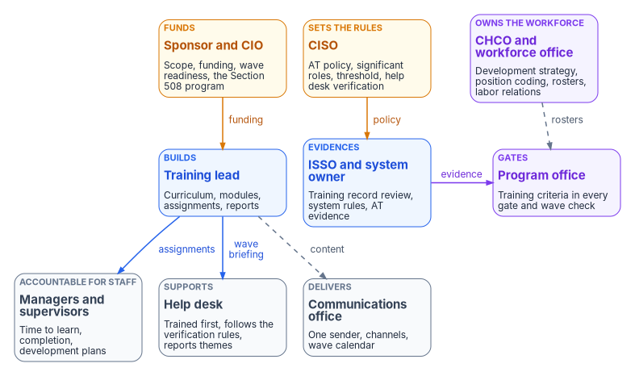
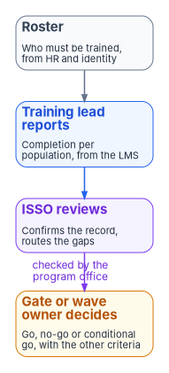

# Chapter 08 — Who Owns Workforce Readiness

*Training has more owners than any other part of the program, which is why it so often has none; readiness becomes real only when someone reports it, someone checks it, and someone else is allowed to say the wave can't go without it.*

::: {.callout-note}
## In this chapter
Where the duties come from: FISMA, the Chief Human Capital Officers Act, OPM's training rules at 5 CFR 410 and 930.301, OPM's guidance on coding cybersecurity positions, NIST SP 800-37 Rev. 2 and SP 800-50 Rev. 1, and OMB's Section 508 memorandum. Then each role in turn: the sponsor and CIO, the CISO, the CHCO and workforce office, the training lead, managers and supervisors, the ISSO and system owner, the program office, the help desk, the communications office, and the specialists around them. How training readiness enters the gates and the wave checks, a responsibility matrix consistent with Book 00 Chapter 07, Book 01 Chapter 09, Book 13 Chapter 09, Book 14 Chapter 10 and Book 15 Chapter 10, and the separations that keep the readiness numbers honest.
:::

Ask who owns training in most agencies and three offices answer at once. The security office owns the annual awareness course. Human resources owns the learning management system and the onboarding checklist. The CIO's office owns the migration and assumes someone else is telling users about it. Each answer is partly right, and between them nobody owns the thing this book cares about: whether the people who will run, support and use the modernized estate know how to do it on the day it changes. The failures are predictable. A wave goes live with a help desk that saw the new procedure once. A privileged role is granted to someone whose role-based training is a year overdue because the roster came from a spreadsheet. A phishing exercise is run without legal review and turns into a labor dispute. A training video goes out without captions.

Federal rules don't name a single owner either. They spread the duty across the agency head, the CIO, the human capital officer, the security officials, managers and every user, and they say what each must do. This chapter maps those duties onto the program. It applies the program-wide model in [Book 01, Chapter 09](../b01-transformation-arc/09-who-leads-the-transformation.md) and the running mechanics in [Book 00, Chapter 07](../b00-orientation/07-who-runs-the-program.md) to the workforce, and it agrees with the Who chapters that already cover part of the ground: [Book 13, Chapter 09](../b13-governance/09-who-governs.md) for governance, [Book 14, Chapter 10](../b14-compliance/10-who-owns-compliance.md) for the compliance roles and the AT controls, and [Book 15, Chapter 10](../b15-day2-operations/10-who-runs-day-two.md) for the help desk. Where those chapters go deeper for their domain, they govern. The model below is the program's recommended design. Adapt it to the agency's structure, but keep one decider per row.

{#fig-ch08-who-owns-readiness fig-alt="Three rows of cards. Top row: the sponsor and CIO in amber, who fund the program and own scope, wave readiness and the Section 508 program; the CISO in amber, who sets the awareness and training policy, the significant roles, the completion threshold and the help desk verification procedure; and the CHCO and workforce office in violet, who own the workforce development strategy, position coding, rosters and labor relations. Middle row: the training lead in blue, who builds the curriculum, modules, assignments and reports; the ISSO and system owner in blue, who review the training record, set system rules and own the AT evidence; and the program office in violet, which puts training criteria into every gate and wave check. Bottom row, in slate: managers and supervisors, accountable for their staff's time to learn, completion and development plans; the help desk, trained first, following the verification rules and reporting ticket themes; and the communications office, which owns the single sender, the channels and the wave calendar. Arrows: funding from the sponsor and CIO to the training lead; policy from the CISO to the ISSO; a dashed arrow labeled rosters from the CHCO to the program office; assignments from the training lead to managers; evidence from the ISSO to the program office; a wave briefing from the training lead to the help desk; and a dashed arrow labeled content from the training lead to the communications office."}

## Where the roles come from

Seven sources assign the duties. None of them uses the phrase "workforce readiness," and none of them is enough alone.

**FISMA** puts the obligation at the top and gives the CIO the working duty. The agency head must ensure the agency has trained personnel sufficient to help it comply with the law and its policies; the authority delegated to the CIO includes "training and overseeing personnel with significant responsibilities for information security"; and every agency's security program must include security awareness training for personnel, "including contractors and other users."[^c08-fisma]

**The Chief Human Capital Officers Act** gives the workforce side an owner. Each agency on the CFO Act list must appoint or designate a Chief Human Capital Officer, whose functions include "setting the workforce development strategy of the agency," assessing workforce characteristics and future needs, and "developing and advocating a culture of continuous learning."[^c08-chco] Agencies outside that list usually give the same duties to their human resources director.

**OPM's training rule at 5 CFR 410.201** makes the head of the agency, or a designee, responsible for establishing, budgeting for, operating and evaluating training programs; for training policies that link training to the agency's strategic plan, assign responsibility for training goals and delegate training approval to "the lowest appropriate level"; and for plans that identify mission-critical occupations and competencies, find competency gaps and set strategies to close them, with an assessment at least annually.[^c08-cfr410] A migration that changes every user's sign-in and every administrator's tools is exactly the kind of gap the rule describes.

**OPM's security training rule at 5 CFR 930.301** names audiences rather than owners. Every user gets awareness material at least annually; executives, program and functional managers, CIOs, security program managers, auditors and other security staff, and IT management and operations staff each get training suited to their role; new employees get awareness material before they get access; and training is required when the system environment or procedures change significantly or when an employee moves into a role that needs more.[^c08-cfr930] [Book 14, Chapter 09](../b14-compliance/09-training-and-awareness-controls.md#what-federal-law-and-policy-require) covers the rule's age and its stale pointers. This chapter uses it for one purpose: its audience list is the minimum the program's role tracks have to cover.

**OPM's cybersecurity coding guidance** implements the Federal Cybersecurity Workforce Assessment Act of 2015, which requires OPM to establish procedures for identifying every federal civilian position that performs information technology, cybersecurity or other cyber-related functions. OPM's January 2017 guidance has agencies code those positions with the Cybersecurity Data Standard Codes aligned to the NICE Framework's work roles, and it assigns the work to a partnership: CIO staff know where the work is done and what the codes mean, managers know which positions perform it, and human resources and classification staff develop and run the coding process.[^c08-opm-coding] [Chapter 02](02-what-the-workforce-rules-require.md) covers the coding structure itself. Here it matters because a correctly coded position is the cleanest source for a role-based training roster.

**NIST SP 800-37 Rev. 2** gives the system-level duties. The system owner ensures that system users and support personnel receive the requisite security and privacy training; the system security officer's day-to-day duties may include security and privacy training and awareness; and every system user's responsibilities include adhering to acceptable-use policy and "reporting anomalous or suspicious system behavior."[^c08-sp80037] SP 800-53's AT-1 adds that the agency designates an official to manage its awareness and training policy and procedures ([Book 14, Chapter 09](../b14-compliance/09-training-and-awareness-controls.md#the-controls-one-by-one)).

**NIST SP 800-50 Rev. 1** is the most direct. Its roles section names the head of the organization, senior leadership, learning program managers, managers and the system user, and it asks organizations to document who holds each role and to watch for overlapping responsibilities.[^c08-sp80050-roles] Its communications guidance adds the offices a program forgets: human resources and the CHCO's office, labor relations, the chief financial officer, the chief learning officer and the communications team.[^c08-sp80050-comms]

One more source covers accessibility. OMB M-24-08 has the CIO lead the agency's Section 508 program and appoint its program manager, and has the CHCO develop the training plans that say who is trained on digital accessibility, in consultation with that program manager.[^c08-m2408] [Chapter 07](07-end-user-training.md#accessible-training) applies it to the end-user modules.

## The roles

### The executive sponsor and the CIO

The sponsor and CIO own scope, funding and sequence for the whole program ([Book 01, Chapter 09](../b01-transformation-arc/09-who-leads-the-transformation.md#decision-rights-across-the-program)), and that includes the learning program. SP 800-50 Rev. 1's example is blunt: agency leaders and managers need to know whether training costs come from the CIO's, the CISO's, the chief learning officer's or another budget, or whether their own budgets will be hit.[^c08-sp80050-comms] The CIO also carries FISMA's duty to train and oversee personnel with significant security responsibilities,[^c08-fisma] leads the Section 508 program,[^c08-m2408] and supplies the CIO staff who help code positions.[^c08-opm-coding] And the sponsor decides each wave's user readiness and communications plan, the row [Book 02, Chapter 06](../b02-identity/06-who-owns-the-migration.md#the-responsibility-matrix) already gives the sponsor and CIO.

### The CISO

The CISO owns the awareness and training policy, decides which roles have significant security responsibilities, and sets the completion threshold, as [Book 14, Chapter 10](../b14-compliance/10-who-owns-compliance.md#the-responsibility-matrix) assigns. For this book that means the CISO also decides what users are taught to do about security: which sign-in methods the training presents, what the help desk will and won't ask, and how reporting works. The help desk identity-verification procedure is a CISO decision in [Book 01, Chapter 09](../b01-transformation-arc/09-who-leads-the-transformation.md#decision-rights-across-the-program) and [Book 15, Chapter 10](../b15-day2-operations/10-who-runs-day-two.md#the-responsibility-matrix), and the end-user module that teaches it has to match it word for word. The CISO owns the phishing-exercise program too, under the conditions [Book 14, Chapter 09](../b14-compliance/09-training-and-awareness-controls.md#phishing-exercises-at-21) sets: legal review, no impersonation of real federal senders or brands, and results used for learning.

SP 800-50 Rev. 1's example policies give the CISO, the CISO's delegates or the ISSM the authority to waive the suspension of an account whose holder hasn't completed required training.[^c08-sp80050-policy] The program follows that: suspension for missed training is the CISO's policy, and waivers are the CISO's or a named delegate's, recorded with an end date.

### The CHCO and the workforce office

The CHCO's office owns the workforce side of readiness: the workforce development strategy, the training policies and plans under 5 CFR 410, the competency gaps the migration creates, and the coding of positions that perform cyber work.[^c08-chco][^c08-cfr410][^c08-opm-coding] It also owns the human resources facts that the role rosters are built from. [Book 03, Chapter 07](../b03-hr-identity/07-who-owns-workforce-identity.md) gives HR the decision on what each authoritative worker attribute means, and [Book 14, Chapter 09](../b14-compliance/09-training-and-awareness-controls.md#role-based-training-at-3) explains why rosters derived from HR and identity records, not from a coordinator's list, are what keep a role-based training record honest.

Two duties are easy to miss. SP 800-50 Rev. 1 makes human capital responsible for communications about building training requirements into onboarding, and names labor relations as the stakeholder for any change that affects union-represented staff, including negotiations over mandatory training and input on disciplinary actions.[^c08-sp80050-comms] And M-24-08 gives the CHCO the accessibility training plans.[^c08-m2408] A program that changes what every employee must do, and may suspend accounts for missed training, needs the workforce office at the table before the first wave, not after the first grievance.

### The training lead

The training lead is the person who runs the program's learning work day to day. SP 800-50 Rev. 1 calls the role a learning program manager and gives it tactical duties: working with policy experts, curriculum developers, the security operations team, ISSOs and ISSMs, the CISO, human resources, procurement and the risk executive; producing timely material for each audience; designing how it is delivered; giving learners and managers a way to give feedback; reviewing and updating the material; helping identify who has significant responsibilities; setting up tracking and reporting; and reporting to senior leadership on the program's goals and metrics.[^c08-sp80050-roles]

In the program's model the training lead owns the curriculum and every module in it, the assignment of modules to each wave and role, the wave briefing for the help desk, and the completion reports. The training lead may sit in the CISO's office, in the chief learning officer's training office or in the program office; the program doesn't mind which, provided there is one named person. What the training lead doesn't do is decide whether a wave is ready. The training lead reports the numbers. Others review and decide, for the reasons in [Keeping the roles apart](#keeping-the-roles-apart).

Where the agency has a chief learning officer, that office usually runs the learning management system and its export, the role SP 800-50 Rev. 1 gives it as the provider of learning infrastructure.[^c08-sp80050-comms] [Book 14, Chapter 09](../b14-compliance/09-training-and-awareness-controls.md#where-the-record-lives) keeps that system as the system of record for completions.

### Managers and supervisors

SP 800-50 Rev. 1 says managers and supervisors should create individual development plans for people with significant cybersecurity and privacy roles, encourage their professional development and certifications, make sure their staff understand the rules of each system they use, make sure all their staff take part in the learning program, and work to reduce the errors that come from a lack of training.[^c08-sp80050-roles] OPM's coding guidance relies on them to know which positions perform cyber work.[^c08-opm-coding] And 5 CFR 410.201 pushes training approval down to the lowest appropriate level, which in most agencies is the supervisor.[^c08-cfr410]

In the program's model a supervisor is accountable for each of their staff completing assigned training on time, as [Book 14, Chapter 09](../b14-compliance/09-training-and-awareness-controls.md#who-owns-the-training-evidence) already says, and for giving them the time to do it. The training lead sends supervisors the names of staff not yet registered or trained before each wave ([Chapter 07](07-end-user-training.md#the-cadence)). Contracting officer's representatives carry the same accountability for contractor staff, whom FISMA's awareness requirement covers by name.[^c08-fisma]

### The ISSO and the system owner

The system owner ensures that the system's users and support staff are trained, and the ISSO runs that training day to day and reviews the evidence.[^c08-sp80037] For a modernized system, that means three things. The ISSO reviews the derived training evidence record and decides whether the overdue counts are acceptable under the CISO's threshold, the decision [Book 14, Chapter 09](../b14-compliance/09-training-and-awareness-controls.md#training-records-as-evidence-at-4) reserves to the ISSO's review rather than to the script that builds the record. The system owner and ISSO decide the system-specific rules of behavior users acknowledge. And they confirm that the system's support staff, its administrators and its contingency and incident roles have had their role training before the change that needs it, because 5 CFR 930.301 and AT-3 both tie role training to taking on the role or to a significant change.[^c08-cfr930]

The ISSM, where the agency uses the title, rolls up the ISSOs' training evidence for a portfolio of systems and can hold the CISO's delegated authority to waive training-based suspension.[^c08-sp80050-policy]

### The program office

The program office, led by the steward, owns the plan, the wave sequence and the gate checklists ([Book 00, Chapter 07](../b00-orientation/07-who-runs-the-program.md)). For readiness it owns one thing no one else does: putting training into the criteria that decide whether the program moves. Each gate and each wave check carries its training criteria next to its technical ones, and each criterion is a query against the evidence, in Book 01's sense, not a statement that training happened ([Book 01, Chapter 12](../b01-transformation-arc/12-migration-roadmap.md#gates-rollback-and-authority)). The program office checks the criteria; it doesn't decide the gate, unless Book 01 makes it the gate owner.

### The help desk

The help desk is trained first and supports everyone else. Microsoft's deployment guidance offers a message template written for the help desk and recommends tracking ticket volume as the signal that sets the pace of each wave.[^c08-pr-deploy] SP 800-50 Rev. 1 lists training IT and help desk staff to support the learning program among a program's requirements.[^c08-sp80050-design] M-24-08 recommends regular help desk training on assisting employees who use assistive technologies.[^c08-m2408] In the program's model the service desk manager decides whether the desk's staff are ready for a wave, as Book 15 gives the manager staffing and the response to the desk's measures ([Book 15, Chapter 10](../b15-day2-operations/10-who-runs-day-two.md#the-responsibility-matrix)); the training lead delivers the wave briefing; and the desk returns the ticket themes that shape the follow-up lessons. The help desk follows the CISO's verification procedure and doesn't improvise a shortcut for a user who hasn't been trained.

### The communications office

SP 800-50 Rev. 1 asks learning programs to include the organization's communications team in a communications plan for each phase.[^c08-sp80050-comms] The communications office owns the channels, the single sender users are told to expect, the templates and the wave calendar. It doesn't own the security content of a message. Every instruction about signing in, reporting or the help desk comes from the CISO's approved text, because a message that changes those instructions, however well meant, is indistinguishable to a user from a phishing lure that does the same ([Chapter 07](07-end-user-training.md#what-to-send-and-what-never-to-send)).

### The specialists around them

- The **Section 508 program manager** reviews training materials for conformance before the first wave and when they change.[^c08-m2408]
- The **privacy office** approves what users are told about what the agency can see on enrolled devices and what personal data recovery uses, and reviews any use of personal email or phone numbers for recovery.
- **Legal counsel** reviews phishing exercises, as SP 800-50 Rev. 1 recommends ([Book 14, Chapter 09](../b14-compliance/09-training-and-awareness-controls.md#phishing-exercises-at-21)).
- The **records officer** decides how long training records and their derived evidence are kept ([Book 14, Chapter 09](../b14-compliance/09-training-and-awareness-controls.md#how-long-to-keep-it)).
- **Platform teams** enforce what the policy decides: identity engineering removes access when the CISO's suspension policy says so and owns each wave's go/no-go in Book 02's model.

## Readiness is an input to every gate

[Book 01, Chapter 12](../b01-transformation-arc/12-migration-roadmap.md) gives each phase a gate and each gate an owner. Training doesn't add gates. It adds criteria to the ones that exist, each with a population, a measure and a source. The table is the program's design; [Chapter 10](10-measuring-readiness.md) sets out how each measure is computed and evidenced.

| Gate (owner, from Book 01) | Training criteria the gate checks |
|---|---|
| G0, Ready to Plan (steward) | Training lead named; learning program funded; CHCO, labor relations and the Section 508 program manager briefed; role rosters derivable from HR and identity records |
| G1, Foundation Complete (steward) | Tier 0 administrators' role-based training complete before their phishing-resistant methods and eligible roles are enforced; help desk trained on the verification procedure and Temporary Access Pass handling |
| G2, Pilot Clean (steward and sponsor) | Pilot division's end-user modules complete above threshold; follow-up lessons issued; help desk ticket themes reviewed and the modules revised |
| Each wave in Phase 3 (wave owner, Book 02 Chapter 06) | Registration rate, training completion and help desk ticket volume within the wave's thresholds before enforcement |
| G3, Rollout Complete (sponsor and steering committee) | Every division's training evidence reviewed by its ISSO; no privileged-tier person overdue |
| G4, Legacy Quiet (steward) | Users of retiring file shares and legacy applications told and trained before each retirement; administrators of the retiring platforms retrained or reassigned |
| G5, AD Retired (sponsor and CIO) | Steady-state curriculum in place: onboarding before access, annual refresh, role training on assignment, and the training record feeding continuous monitoring |

{#fig-ch08-readiness-into-gates fig-alt="Four cards in a left-to-right chain. A slate card, the roster: who must be trained, from HR and identity records. A blue arrow leads to a blue card, the training lead reports completion per population from the learning management system. A blue arrow leads to a violet card, the ISSO reviews, confirms the record and routes the gaps. A violet arrow labeled checked by the program office leads to an amber card, the gate or wave owner decides go, no-go or conditional go, together with the other criteria."}

## The responsibility matrix

D = decides (accountable) · R = does the work · C = consulted · blank = informed at most. "CHCO / HR" is the Chief Human Capital Officer and the workforce office, including classification and labor relations. "ISSO / SO" is the ISSO and the system owner, each for their own system. "Platform teams" includes identity engineering. "Help desk" is the service desk and its manager. "Specialists" is the records officer, the privacy office and the Section 508 program manager, each for their own rows.

| Decision or work item | Sponsor / CIO | CISO | CHCO / HR | Training lead | Managers | ISSO / SO | Program office | Platform teams | Help desk | Comms | Specialists |
|---|---|---|---|---|---|---|---|---|---|---|---|
| Learning program funding and staffing | D | C | C | R | | | C | | | | |
| Awareness and training policy, significant roles, completion threshold (AT-1 to AT-4) | C | D | C | R | | R | | | | | C (privacy) |
| Workforce development strategy and training plans (5 CFR 410) | C | C | D | R | C | | C | | | | |
| Coding positions with cybersecurity work-role codes | R | C | D, R | | R | | | | | | |
| Role rosters from HR and identity records | | C | D | R | | C | | R | | | C (privacy) |
| What end users are taught to do about security | | D | | R | | C | C | C | C | C | C (privacy, 508) |
| Phishing exercises: design, legal review, use of results | | D | C | R | | C | | | | C | C (privacy) |
| Wave communications plan and user readiness | D | C | | R | C | | R | C | R | R | |
| Sender, channels and message templates | | C | | R | | | C | | C | D | |
| Help desk identity-verification procedure | | D | | C | | C | C | C | R | | C (privacy) |
| Help desk trained and staffed for each wave | | C | | R | | | C | C | D (manager) | | C (508) |
| Staff complete assigned training on time | | | C | R | D | | | | | | |
| Training evidence record and its review (AT-4) | | C | | R | | D, R | C | | | | C (records) |
| Suspend access for missed training; waivers | | D | C | R | C | R | | R | | | |
| Training criteria in gate and wave checklists | | C | | R | | C | D, R | C | C | | |
| Wave go/no-go, including training readiness | C | C | | R | | C | C | D | C | | |
| Section 508 conformance of training materials | C | | C | R | | | | | | C | D (508) |
| Accessibility training plans | C | | D | R | | | | | C | | C (508) |
| What users are told the agency can see, and what recovery collects | | C | | R | | C | | C | | C | D (privacy) |
| Retention of training records and derived evidence | | C | C | R | | C | | | | | D (records) |

Seven rows need comment.

The **policy** row matches [Book 14, Chapter 10](../b14-compliance/10-who-owns-compliance.md#the-responsibility-matrix): the CISO decides, the CIO is consulted, and the system owner and ISSO do the system-level work. The **security content** row follows from it. The CISO decides what users are taught to do about sign-in, reporting and the help desk, because those instructions are the policy in the form users see.

The **roster** row gives the CHCO's office the decision because the facts are human resources facts, as [Book 01, Chapter 09](../b01-transformation-arc/09-who-leads-the-transformation.md#decision-rights-across-the-program) gives HR the meaning of authoritative worker attributes. Identity engineering does the work of joining those facts to role assignments, and the training lead consumes the result. Who counts as having significant responsibilities stays the CISO's call under the policy row.

The **two wave rows** split the plan from the go/no-go, as the earlier books do. The sponsor and CIO decide the wave's communications and user readiness plan, which is [Book 02, Chapter 06](../b02-identity/06-who-owns-the-migration.md#the-responsibility-matrix)'s row. The go/no-go for the wave is identity engineering's in the same matrix, and this chapter adds training completion to what that decision checks. Gate decisions above the wave stay with the owners in [Book 01, Chapter 12](../b01-transformation-arc/12-migration-roadmap.md#gates-rollback-and-authority); the table in the previous section lists only the criteria.

The **verification** row is copied from [Book 01, Chapter 09](../b01-transformation-arc/09-who-leads-the-transformation.md#decision-rights-across-the-program) and [Book 15, Chapter 10](../b15-day2-operations/10-who-runs-day-two.md#the-responsibility-matrix) so that the books agree: the CISO decides, the help desk follows, the privacy office is consulted. The training lead is consulted because the end-user module must teach exactly that procedure.

The **help desk readiness** row gives the service desk manager the decision, consistent with Book 15's row on the desk's staffing and the response to its measures. The training lead delivers the briefing; the manager decides whether the desk can take the wave.

The **evidence** row gives the ISSO the decision, matching [Book 14, Chapter 09](../b14-compliance/09-training-and-awareness-controls.md#training-records-as-evidence-at-4): the record states the facts, and the ISSO's review decides whether the overdue counts are acceptable under the CISO's threshold. Every overdue person in a privileged tier is a finding regardless of the percentage.

The **suspension** row follows SP 800-50 Rev. 1's example policy: the CISO sets the rule, a named delegate or the ISSM may waive it, and platform teams enforce it.[^c08-sp80050-policy] The CHCO's office is consulted because a suspension that stops someone working is a personnel matter as well as a security one.

Two decisions sit above the matrix. The organization-wide training plan required by 5 CFR 930.301 and the evaluation of training programs under 5 CFR 410.201 belong, in the end, to the head of the agency, who may designate officials to carry them out.[^c08-cfr930][^c08-cfr410] And accepting the risk of putting a system into operation with its people not yet trained is a risk acceptance like any other, which only the system's authorizing official can make ([Book 14, Chapter 10](../b14-compliance/10-who-owns-compliance.md#the-authorizing-official-and-the-designated-representative)).

## Keeping the roles apart

Readiness numbers are easy to improve without improving readiness. The separations below keep that from happening.

1. **The person who reports the numbers doesn't decide what they mean.** The training lead produces completion reports. The ISSO reviews the evidence and the gate or wave owner decides. A training lead who can also declare a wave ready is grading their own program.
2. **The record's producer doesn't review it.** The learning management system and the training lead produce the derived record; the ISSO reviews it; an assessor can re-derive it ([Book 14, Chapter 09](../b14-compliance/09-training-and-awareness-controls.md#training-records-as-evidence-at-4)). This is the same separation every evidence record in the program follows ([Book 13, Chapter 09](../b13-governance/09-who-governs.md)).
3. **Managers can't waive required training.** A supervisor can grant time and approve development, but a waiver of a required course, or of a suspension, is the CISO's or a named delegate's, recorded with an end date.
4. **Phishing-exercise results serve learning, not discipline.** SP 800-50 Rev. 1 asks that exercises not be punitive and that no one be called out ([Book 14, Chapter 09](../b14-compliance/09-training-and-awareness-controls.md#phishing-exercises-at-21)). In the program's design, managers see results for their team as a whole, follow-up training is assigned by the training lead, and any personnel action stays inside the agency's ordinary processes with the CHCO's office and labor relations involved.
5. **The communications office doesn't rewrite security instructions.** It owns the channel and the voice; the CISO owns the words that tell users how to sign in, what to report and what the help desk will ask.
6. **The help desk doesn't teach around the procedure.** A user who wasn't trained gets trained, or gets the verification ladder; never a shortcut ([Book 15, Chapter 03](../b15-day2-operations/03-intake-triage-and-routing.md#verify-the-person-before-a-sensitive-action)).

Who may hold these roles follows [Book 14, Chapter 10](../b14-compliance/10-who-owns-compliance.md#who-must-be-a-government-official). The CIO and the CISO are government officials. The training lead, the course developers, the help desk and much of the program office can be contractors, and often are. The program's position is that contractors can build, deliver and report all of the training in this book, but the decisions in the CISO's, the ISSO's, the gate owners' and the authorizing official's rows are made by government officials.

## Where each Who chapter fits

| Chapter | What it settles |
|---|---|
| [Book 00, Chapter 07 — Who Runs the Program](../b00-orientation/07-who-runs-the-program.md) | Program roles, the decision table, gate deciders, the rhythm and the repository conventions |
| [Book 01, Chapter 09 — Who Leads the Transformation](../b01-transformation-arc/09-who-leads-the-transformation.md) | Program-wide decision rights, including the help desk's verification procedure and HR's attribute decisions |
| [Book 02, Chapter 06 — Who Owns the Migration](../b02-identity/06-who-owns-the-migration.md) | User readiness and communications, and the wave go/no-go |
| [Book 13, Chapter 09 — Who Governs](../b13-governance/09-who-governs.md) | The authoritative record, exceptions and records management |
| [Book 14, Chapter 10 — Who Owns Compliance](../b14-compliance/10-who-owns-compliance.md) | The RMF roles and the awareness and training policy row |
| [Book 15, Chapter 10 — Who Runs Day Two](../b15-day2-operations/10-who-runs-day-two.md) | The service desk lines, the manager's staffing decision and the verification procedure in operation |
| This chapter | Who builds, delivers, evidences and gates the workforce's readiness for the modernized estate |

## What changes, in one table

| Old habit | What replaces it |
|---|---|
| "Security owns training" | The CISO owns the policy and the security content; the CHCO's office owns the workforce strategy and the rosters' facts; the training lead runs the work; supervisors own completion |
| A training coordinator's spreadsheet of who needs what | Rosters derived from HR records, coded positions and role assignments |
| Users told about the migration by whoever is closest | A wave communications plan the sponsor decides, sent from one sender the communications office owns, in words the CISO approves |
| The help desk learns the new procedure from the first calls | The help desk is trained and staffed before each wave, and its manager decides it's ready |
| Training reported as done | Training evidence reviewed by the ISSO and checked as a criterion at every gate and wave |
| The training lead declares readiness | The training lead reports, the ISSO reviews, the gate or wave owner decides |
| Suspension or waiver at a manager's discretion | The CISO's policy, a named delegate's waiver with an end date, and the CHCO's office consulted |
| Labor relations and the Section 508 program manager brought in after a complaint | Both briefed at G0, before the first module is built |

::: {.callout-tip}
## Continue the book
[← Previous: Chapter 07 — End-User Training for the Modernized Estate](07-end-user-training.md) · [Book index](index.md) · [Next: Chapter 09 — Building and Running the Curriculum →](09-building-and-running-the-curriculum.md)
:::

[^c08-fisma]: Federal Information Security Modernization Act of 2014, 44 U.S.C. § 3554, subsections (a)(3)(D), (a)(4) and (b)(4), <https://www.law.cornell.edu/uscode/text/44/3554> (accessed Oct 21, 2026).
[^c08-chco]: 5 U.S.C. § 1401, "Establishment of agency Chief Human Capital Officers," <https://www.law.cornell.edu/uscode/text/5/1401>; and 5 U.S.C. § 1402, "Authority and functions of agency Chief Human Capital Officers," subsection (a)(1), (2) and (4), <https://www.law.cornell.edu/uscode/text/5/1402> (both accessed Oct 21, 2026).
[^c08-cfr410]: 5 CFR § 410.201, "Responsibilities of the head of an agency," introductory text and paragraphs (a), (b) and (d), <https://www.law.cornell.edu/cfr/text/5/410.201> (accessed Oct 21, 2026).
[^c08-cfr930]: 5 CFR § 930.301, "Information systems security awareness training program," introductory text and paragraphs (a)(1)–(5), (b), (c) and (d), <https://www.law.cornell.edu/cfr/text/5/930.301> (accessed Oct 21, 2026).
[^c08-opm-coding]: U.S. Office of Personnel Management, memorandum for heads of executive departments and agencies, *Guidance for Assigning New Cybersecurity Codes to Positions with Information Technology, Cybersecurity, and Cyber-Related Functions*, January 4, 2017, "New Cybersecurity Coding Requirement" and "Instructions for Assigning Revised Codes," <https://www.opm.gov/chcoc/transmittals/2017/guidance-assigning-new-cybersecurity-codes-positions-IT-cybersecurity-cyber-functions_508.pdf> (accessed Oct 21, 2026).
[^c08-sp80037]: National Institute of Standards and Technology, SP 800-37 Rev. 2, *Risk Management Framework for Information Systems and Organizations: A System Life Cycle Approach for Security and Privacy*, December 2018, Appendix D, "System Owner," "System Security or Privacy Officer" and "System User," <https://nvlpubs.nist.gov/nistpubs/SpecialPublications/NIST.SP.800-37r2.pdf> (accessed Oct 21, 2026).
[^c08-sp80050-roles]: National Institute of Standards and Technology, SP 800-50 Rev. 1, *Building a Cybersecurity and Privacy Learning Program*, September 2024, §1.6 (Roles and Responsibilities) and §§1.6.1–1.6.5 (head of organization, senior leadership, CPLP managers, managers, system user), <https://nvlpubs.nist.gov/nistpubs/SpecialPublications/NIST.SP.800-50r1.pdf> (accessed Oct 21, 2026).
[^c08-sp80050-comms]: National Institute of Standards and Technology, SP 800-50 Rev. 1, September 2024, §2.11 (Communicating the Strategic Plan and Program Performance: funding sources; roles of HR and the Office of the CHCO, labor relations, the CFO and the CLO) and §4.3 (Communicating the CPLP Implementation: including the communications team), <https://nvlpubs.nist.gov/nistpubs/SpecialPublications/NIST.SP.800-50r1.pdf> (accessed Oct 21, 2026).
[^c08-sp80050-policy]: National Institute of Standards and Technology, SP 800-50 Rev. 1, September 2024, §2.2.1 (Examples of Learning Program Policy Statements: access suspended for missed training unless a waiver is granted by the CISO, the CISO's delegates or the ISSM), <https://nvlpubs.nist.gov/nistpubs/SpecialPublications/NIST.SP.800-50r1.pdf> (accessed Oct 21, 2026).
[^c08-sp80050-design]: National Institute of Standards and Technology, SP 800-50 Rev. 1, September 2024, §3.2.1.4 (Summarizing CPLP or Element Requirements: IT and help desk staff trained to support the program; managers able to check progress), <https://nvlpubs.nist.gov/nistpubs/SpecialPublications/NIST.SP.800-50r1.pdf> (accessed Oct 21, 2026).
[^c08-m2408]: Office of Management and Budget, M-24-08, *Strengthening Digital Accessibility and the Management of Section 508 of the Rehabilitation Act*, December 21, 2023, §III.A (agency-wide Section 508 program and program manager; coordination with the CHCO), §III.F (accessibility training plan, help desk training) and Appendix A (roles of the agency CIO, CHCO and Section 508 program manager), <https://www.whitehouse.gov/wp-content/uploads/2023/12/M-24-08-Strengthening-Digital-Accessibility-and-the-Management-of-Section-508-of-the-Rehabilitation-Act.pdf> (accessed Oct 21, 2026).
[^c08-pr-deploy]: Microsoft Learn, "Plan a phishing-resistant passwordless authentication deployment in Microsoft Entra ID," sections "Plan end user communications" and "Monitor help desk ticket volume," <https://learn.microsoft.com/entra/identity/authentication/how-to-deploy-phishing-resistant-passwordless-authentication> (accessed Oct 21, 2026).
