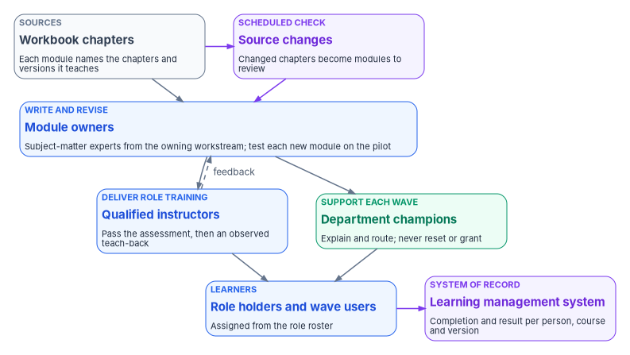

# Chapter 09 — Building and Running the Curriculum

*A curriculum that runs on the roadmap's calendar arrives when people need it; one that runs on the training office's calendar arrives after the help desk has already taken the calls.*

::: {.callout-note}
## In this chapter
How to turn the tracks, labs and assessments of Chapters 03 to 07 into a running program. The chapter ties training to the phases and gates of [Book 01, Chapter 12](../b01-transformation-arc/12-migration-roadmap.md), schedules training for each wave just before it moves, and builds the program's own instructors through train-the-trainer. It also covers keeping modules current as the books they teach change, and what the learning management system has to record so that [Chapter 10](10-measuring-readiness.md) can measure readiness and [Book 14, Chapter 09](../b14-compliance/09-training-and-awareness-controls.md) can use the records as evidence.
:::

The earlier chapters of this book describe what to teach: the compliance track, the implementation track, the assessments, the vendor courses and labs, and end-user training. None of that helps if it reaches people at the wrong time. A technician who learns the Temporary Access Pass procedure a month after the first wave has already improvised one. A user who takes the passwordless module in the annual awareness cycle, six months before their division moves, will have forgotten it by the time the prompt appears. A steering committee that first hears what a gate means at the gate review can't judge whether it is green.

So the program builds its curriculum around the roadmap. Each phase and each gate has a set of people who must be ready, a set of modules that make them ready, and a date by which the modules must be finished. The training office owns the delivery. The program office owns the schedule, because only the program office knows when the next wave moves.

{#fig-ch09-curriculum-loop fig-alt="At the top left, a slate card: the workbook chapters, the sources, with each module naming the chapters and versions it teaches. It sends a violet arrow to a violet card at the top right, a scheduled check for source changes, where changed chapters become modules to review. Both point down to a wide blue card, the module owners, subject-matter experts from the owning workstream who write and revise each module and test each new module on the pilot. The module owners point down to two cards: a blue card, qualified instructors, who deliver role training after passing the assessment and an observed teach-back; and a green card, department champions, who support each wave and explain and route but never reset or grant. A dashed arrow labeled feedback runs from the instructors back up to the module owners. Instructors and champions both point to a blue card, role holders and wave users, assigned from the role roster, which sends a violet arrow to a violet card, the learning management system, the system of record holding completion and result per person, course and version."}

## Start from the roadmap, not the catalog

Federal guidance already points the curriculum at change. OPM's rule requires training "whenever there is a significant change in the agency information system environment or procedures or when an employee enters a new position that requires additional role-specific training."[^c09-cfr930] SP 800-53 writes the same trigger into the controls: literacy training is given "when required by system changes," and role-based training "when required by system changes," in addition to initial and periodic training.[^c09-sp80053] A modernization program is a sequence of significant changes. Every wave changes how people sign in, who resets their credentials and what the help desk is allowed to do. The training requirement follows the waves.

NIST's learning-program guide gives the scheduling rule. SP 800-50 Rev. 1 describes a learning program's life cycle in four phases, plan and strategy, analysis and design, development and implementation, and assessment and improvement, which "can occur in sequence or simultaneously."[^c09-sp80050] It asks the program to keep one primary calendar, possibly automated in the learning management system, and to align it "with organizational availability, such as observed holidays, planned events, major IT releases," and anything else that would collide with training.[^c09-sp80050] In this program the major IT releases are the waves, so the calendar is built backwards from the roadmap's dates.

The program's design is a short planning rule: **no gate is scheduled without its training dates, and no wave is scheduled without its training window.** The program office puts both on the same plan, so a wave that slips moves its training with it.

## What each phase and gate needs people to know

Book 01 sets seven phases and six gates.[^c09-roadmap] [Chapter 01](01-people-close-the-gap.md) introduced the training check at each gate; this table is its schedule. It lists who must be trained before each gate and what they need. The populations come from the role models of [Book 00, Chapter 07](../b00-orientation/07-who-runs-the-program.md) and [Book 01, Chapter 09](../b01-transformation-arc/09-who-leads-the-transformation.md); the module content is in Chapters [03](03-the-compliance-track.md) to [07](07-end-user-training.md). The assignments and timing are the program's design.

| Phase and gate | Who must be ready | What they need before the gate (design) |
|---|---|---|
| Phase 0, pre-flight → G0 Ready to Plan | Executive sponsor, CIO, steering committee, steward, project manager, workstream leads, the CISO's and authorizing official's staff | The orientation briefing below; for ISSOs and the compliance staff, the start of the [compliance track](03-the-compliance-track.md) |
| Phase 1, foundation → G1 Foundation Complete | Platform teams building the target; help desk technicians and supervisors; identity governance | The [implementation track](04-the-implementation-track.md) modules for the workstream and its labs ([Chapter 06](06-vendor-training-and-labs.md)); help desk role training and the identity-verification check before any new help desk role is assigned |
| Phase 2, pilot division → G2 Pilot Clean | The pilot division's users, its managers, the help desk, department champions | The just-in-time cycle below, run for the first time; every new module tested on the pilot before the rollout uses it |
| Phase 3, general rollout → G3 Rollout Complete | Each wave's users, managers and champions; the help desk for every wave | The same cycle, wave by wave, with the modules corrected after each wave |
| Phase 4, legacy retirement → G4 Legacy Quiet | AD administrators, application owners, the records officer's staff | Role transition training for AD administrators moving to cloud roles; briefings on what each retirement removes and what replaces it |
| Phase 5, AD DS retirement → G5 AD Retired | AD administrators; the help desk | Retirement of every AD-era runbook and module, so nobody is trained on a system that no longer exists |
| Phase 6, steady state | Everyone, by role | Refresh at the agency's frequency; training for new hires and new role holders; the annual evaluation |

Two rows need comment.

Phase 1 trains the help desk before anyone else is migrated. The help desk becomes a target as soon as its new powers exist, and [Book 15, Chapter 04](../b15-day2-operations/04-help-desk-authority-in-entra.md) gives technicians roles that can reset credentials and issue Temporary Access Passes. A-130 requires role-based training for people with assigned security roles "before authorizing access" to federal information or systems or "performing assigned duties."[^c09-a130] The program applies that literally: no technician is made eligible for a help desk role until their training and verification check are on record.

Phase 5 is the step most curricula skip. When Active Directory retires, its modules and runbooks must be retired with it. A module left in the catalog keeps being assigned, and an assessment written for the old procedure keeps passing people who would now do the wrong thing.

## Orientation: education before training

The program separates education from training. Education builds the mental model; training teaches the work. [Book 00, Principle 13](../b00-orientation/04-the-principles.md#principle-13) states the model in six ideas: governance is a system, identity is the primitive, maps replace inventories, provenance is non-negotiable, modernization is a lifecycle, and drift is the feedback signal. Someone who holds those six ideas can follow why a gate is evaluated from data, why the help desk can't approve its own work, and why a training record needs a roster. Someone who doesn't will treat every later module as a list of rules.

The program offers orientation in three formats, by design:

- **A 90-minute facilitated walkthrough** for program kickoff and for each new steering committee member, about one idea every ten minutes, with questions between.
- **A self-serve written path** for anyone who can't attend live. It must be complete on its own, not a summary of the session.
- **A 45-minute briefing for auditors and assessors** on provenance, drift detection and drift remediation only, because those are what an assessor will be shown.

Orientation comes before either track, and it is the whole requirement for some roles. A sponsor needs to understand what each gate means and what the readiness report in [Chapter 10](10-measuring-readiness.md) is telling them; they don't need the implementation labs. [Appendix A](appendix-a-curriculum-map.md) lists, role by role, where orientation ends and a track begins.

## Just-in-time training before each wave

Each wave runs the same training cycle, timed against the wave's enforcement date. [Chapter 07](07-end-user-training.md) sets the user-facing messages for a wave on the 60, 45, 30, 15, 7 and 1 day cadence Microsoft recommends; the training cycle runs on the same clock, so a user hears about a module in the same message that tells them the date. The training-side milestones below are the program's design, set from the pilot and adjusted afterwards; the agency should replace them with its own once it has measured how long its people retain what they learn.

| When, before enforcement (design) | Who | What |
|---|---|---|
| 60 to 45 days | Department champions; the wave's managers | Champions take the end-user module early and the champion session; managers learn what changes for their staff, the dates and how to release staff for training |
| By 30 days | Help desk for the wave | The wave's change, what users will see, the expected calls and their runbooks, and the identity-verification procedure for the wave's sign-in method, with the verification scenario passed before the wave's roles are used |
| 30 days | Every user in the wave | The end-user modules for the change assigned ([Chapter 07](07-end-user-training.md)), due before the readiness check |
| 15 and 7 days | Users not yet complete; their managers | Reminders and drop-in sessions; managers see who hasn't completed or registered |
| Readiness check | The steward and the division lead | Completion, registration and help desk readiness against the wave's thresholds ([Chapter 10](10-measuring-readiness.md#readiness-per-gate)); a wave that isn't ready moves its date |
| Up to 14 days after | Users, champions, help desk | A short survey; reinforcement on whatever the ticket trend shows people got wrong; instructor and content feedback to the module owners |

Microsoft's own deployment guidance for phishing-resistant sign-in follows the same shape: test the strategy with a pilot group that represents the agency's user personas rather than only administrators, measure registration with the authentication methods activity report, gather feedback from the pilot users, and write end-user communications for each persona group.[^c09-ms-passwordless] It also says to watch help desk ticket volume and, as it rises, to "slow down the pace of your deployments, user communications, and enforcement actions."[^c09-ms-passwordless] [Chapter 10](10-measuring-readiness.md) turns that advice into a gate signal.

Four further rules shape the cycle.

**Communicate each module, not just the program.** SP 800-50 Rev. 1 asks for a communications plan for each element, telling learners and their managers the purpose, the audience, how completion is tracked, the consequences of not completing, the delivery method, accommodations and the due dates. It also asks that consequences be noted in the course description in the learning management system.[^c09-sp80050] For a wave, the purpose is concrete: the date the old sign-in stops working.

**Involve labor relations early.** SP 800-50 Rev. 1 notes that labor relations officers are stakeholders for union-represented staff and that human capital may need to "initiate labor relations and union negotiations" about mandatory training.[^c09-sp80050] A wave schedule that assumes mandatory training for represented staff, without that conversation, can stall on the date it was meant to start.

**Make every module accessible.** The Revised 508 Standards list "educational or training materials" and "a survey questionnaire" among the agency official communications that must conform to the accessibility requirements, even when they aren't public facing.[^c09-508] SP 800-50 Rev. 1 says the same in learning terms: content should support on-site and remote staff, contractors and guests, and people using adaptive technology such as screen readers.[^c09-sp80050] The program tests each module with assistive technology during learner testing, not after a complaint.

**Train the help desk on every change, not only on waves.** SP 800-128's change process ends by telling stakeholders, the help desk among them, about a change, "especially if the change implementation requires a service interruption or alters the functionality of the system," and notes that "user and help desk training may be required."[^c09-sp800128] [Book 15, Chapter 10](../b15-day2-operations/10-who-runs-day-two.md#the-change-advisory-board) puts the service desk lead on the change advisory board for that reason. A change approved at the board with a user-visible effect gets a help desk briefing before it is implemented, by design.

## Train-the-trainer

A program that moves division by division can't send every user to the same few experts. It needs instructors and champions of its own, and it needs them to teach the same content the same way. The program's design is a three-level cascade.

1. **Module owners** write and maintain each module. They are the subject-matter experts for the book chapters the module teaches, normally from the workstream that owns the platform. SP 800-50 Rev. 1 gives this group the job of determining "the task, knowledge, and skill requirements of the roles," identifying gaps, and guiding the development and review of materials.[^c09-sp80050]
2. **Instructors** deliver role-based and help desk training. Each instructor qualifies by passing the module's own assessment, then by teaching back a session that a module owner observes. The program's suggestion is that every module has at least two qualified instructors, which is the same cross-training rule [Book 00, Chapter 07](../b00-orientation/07-who-runs-the-program.md#the-people-the-program-needs) applies to every workstream.
3. **Department champions** support end users in their own division during its wave. They take the end-user module early, take a short champion session on the expected problems and how to route them, and are the first line of help before the service desk. Champions explain and route; they don't reset credentials or grant anything, because the authority model of [Book 15, Chapter 03](../b15-day2-operations/03-intake-triage-and-routing.md) still applies.

The cascade needs quality control, or each level drifts a little from the one above. SP 800-50 Rev. 1 recommends evaluating instructors through anonymous learner feedback and direct observation by experienced instructional designers or supervisors, telling instructors in advance when observers will attend, and summarizing feedback so that individuals aren't identified.[^c09-sp80050] It also asks instructors to report back on the material itself: its accuracy, how easily learners understood it, whether the materials were adequate, and whether they were relevant and timely.[^c09-sp80050] In this program, instructor feedback goes to the module owner after every wave, and it is the fastest way to learn that a procedure in a module no longer matches the platform.

Test every new module before a wave depends on it. SP 800-50 Rev. 1 asks for a learner-testing phase "for all new CPLP elements prior to implementation," checking that the content fits the audience segment and its skill level, with feedback built into every step of design.[^c09-sp80050] The pilot division is the natural test group. A module that the pilot found confusing is fixed before wave 1, not after wave 4.

## Keeping the curriculum current as the books change

The curriculum teaches the books, and the books change. Microsoft renames a feature, NIST revises a publication, OMB rescinds a memo, a chapter's procedure is corrected. A module written against last year's chapter keeps teaching last year's answer until someone notices.

SP 800-53 already requires the update. Literacy training content is updated at the agency's frequency "and following" events the agency defines, and role-based training content the same way.[^c09-sp80053] SP 800-50 Rev. 1 quotes the control's discussion: events that may prompt an update "include, but are not limited to, assessment or audit findings, security incidents or breaches, or changes in applicable laws, Executive Orders, directives, regulations, policies, standards, and guidelines."[^c09-sp80050] What's missing in most programs is a way to see those events.

The program's design makes the link between a module and its sources explicit and checks it on a schedule.

- **Every module records what it teaches from.** Its record lists the book chapters it is derived from, with the date or version of each, the rule [Book 00, Principle 1](../b00-orientation/04-the-principles.md#principle-1) applies to every derived artifact: it cites the document and version it came from.
- **A scheduled check watches the sources.** The workbook's own maintenance pattern is a scheduled job that re-checks the sources the books cite and the federal and vendor publication feeds, and reports which chapters a change affects. Any equivalent works: a weekly review of the books' change history, a subscription to the publishers' feeds, or a tool. The point is that a change in a source produces a list of affected chapters without anyone having to remember to look.
- **A changed chapter flags its modules.** Because each module names its chapters, the list of changed chapters becomes a list of modules to review. The module owner decides whether the change matters to learners. A renamed menu needs a screenshot; a changed procedure needs the module, the assessment and the job aid revised together; a changed requirement may need people already trained to be told.
- **Versions are recorded, not overwritten.** Each revision gets a new course version in the learning management system. Completions stay attached to the version that was taken, so the record shows who was trained on the old procedure and may need the update.
- **Incidents and audit findings feed the same queue.** AT-2 and AT-3 both ask that lessons learned from security incidents or breaches be incorporated into training.[^c09-sp80053] A finding from an exercise or an incident is a change event like any other, routed to the module that should have prevented it.

New books add modules the same way. Book 17, AI Identity Governance, is planned ([the workbook index](../index.md)); when it is published, its chapters enter the curriculum map with owners and a refresh cadence, and nothing about the process changes.

## What the learning management system records

The learning management system is the system of record for individual training. [Book 14, Chapter 09](../b14-compliance/09-training-and-awareness-controls.md#training-records-as-evidence-at-4) sets out why the evidence record is derived from it rather than kept in a dashboard, and how long the records are kept. This section covers what the system has to hold for the curriculum to run and for readiness to be measured.

OPM requires the records. Each agency "shall maintain records of training plans, expenditures, and activities" in a form that lets it submit them to OPM "through the OPM Governmentwide Electronic Data Collection System," and must establish a schedule of records for them under NARA's regulations.[^c09-cfr410] SP 800-53's AT-4 asks the agency to "document and monitor" security and privacy training and to retain individual training records for a period it defines.[^c09-sp80053] SP 800-50 Rev. 1 adds the practical requirement: an LMS "should provide the capabilities to track all necessary measures, such as training registration, attendance, and completion," and anything delivered outside it, face to face, virtual or hybrid, still needs a way to record each learner's participation and performance.[^c09-sp80050]

The program's design for a completion record:

| Field | Why it is there |
|---|---|
| Person identifier | The same identifier the role roster uses, so completions join to the roster without matching names |
| Course identifier and version | Which content was taken; the version is what the currency process above depends on |
| Population or role it satisfies | Which requirement the course meets, set in the catalog, not chosen by the learner |
| Assigned, due and completed dates | Whether training happened before access and before the wave, not only whether it happened |
| Assessment result | Pass, fail or score for modules that assess, so [Chapter 10](10-measuring-readiness.md) can separate completion from demonstrated competence |
| Delivery mode and instructor | Self-paced, instructor-led or lab; the instructor for instructor-led sessions, for the evaluation above |
| Wave or change it was assigned for | So a wave's readiness can be read directly |

Four practices keep the records usable.

1. **Give every course a unique, stable identifier and title.** SP 800-50 Rev. 1 asks that course titles and numbers be "unique, differentiated" and say how the course is accessed, when it is available and when it is due.[^c09-sp80050] Two courses called "Security Awareness" in the same catalog make every report ambiguous.
2. **Assign from the roster, not from requests.** The learning management system receives assignments from the role roster that HR and identity governance maintain ([Book 03](../b03-hr-identity/index.md), [Book 04](../b04-access/index.md)), so a person who gains a role is assigned its training the same day. This is the denominator [Book 14, Chapter 09](../b14-compliance/09-training-and-awareness-controls.md#what-the-record-has-to-answer) requires.
3. **Put contractors in the same system.** The awareness and role-based requirements cover contractors, and [Book 14, Chapter 09](../b14-compliance/09-training-and-awareness-controls.md#who-owns-the-training-evidence) makes contracting officer's representatives accountable for contractor completion. A contractor trained by their employer still needs a completion record the agency can show, either entered in the agency's system or imported from the contractor's.
4. **Treat learning data as sensitive.** SP 800-50 Rev. 1 notes that training records "are often part of employment or contract records" and can be tied to performance evaluations, and asks program managers to manage the risks of processing learning data, including in the LMS and its reporting.[^c09-sp80050] Reports leave the system as counts; per-person detail stays behind its access controls.

## The annual cycle

The roadmap ends; the curriculum doesn't. Two OPM requirements set its yearly rhythm. Agencies must assess their talent management program "periodically, but not less often than annually," to identify training needs, and must "evaluate their training programs annually to determine how well such plans and programs contribute to mission accomplishment and meet organizational performance goals."[^c09-cfr410] [Chapter 10](10-measuring-readiness.md) supplies the evidence for that evaluation.

In steady state the curriculum settles into a cycle, by design: refresh training at the agency's frequency; role training on every new role assignment; the currency review whenever a source changes; instructor and content evaluations after every instructor-led session; and once a year, the evaluation OPM requires, reviewed with senior leadership as SP 800-50 Rev. 1 describes in [Chapter 10](10-measuring-readiness.md#reporting-to-the-steering-committee).

## What changes, in one table

| Old habit | What replaces it |
|---|---|
| Training scheduled on the training office's annual calendar | Training dates set on the roadmap, with every gate and wave carrying its training window |
| The help desk trained after the first wave reveals the problems | Help desk trained, and verified, before its new roles are assigned and before each wave |
| One long course for everyone, once a year | Orientation for everyone, a track by role, and short modules timed to each change |
| A few experts teaching every class | Module owners, qualified instructors and department champions, with observed teach-backs and feedback |
| Modules updated when someone notices | Modules linked to their source chapters, a scheduled check on the sources, and versioned revisions |
| AD-era courses left in the catalog after AD retires | Retired with the system, at G5 |
| Completions kept wherever the course ran | One system of record, assigned from the roster, with course versions and assessment results |

::: {.callout-tip}
## Continue the book
[← Previous: Chapter 08 — Who Owns Workforce Readiness](08-who-owns-workforce-readiness.md) · [Book index](index.md) · [Next: Chapter 10 — Measuring Readiness and Evidencing It →](10-measuring-readiness.md)
:::

[^c09-cfr930]: 5 CFR § 930.301, "Information systems security awareness training program," paragraph (d), eCFR text as of October 1, 2026, <https://www.ecfr.gov/api/versioner/v1/full/2026-10-01/title-5.xml?part=930&section=930.301> (accessed Oct 21, 2026).
[^c09-sp80053]: National Institute of Standards and Technology, SP 800-53 Rev. 5, *Security and Privacy Controls for Information Systems and Organizations*, controls AT-2 (items a–d), AT-3 (items a–c) and AT-4, <https://csrc.nist.gov/pubs/sp/800/53/r5/upd1/final>; control text checked against the release 5.2.0 OSCAL catalog, <https://github.com/usnistgov/oscal-content/blob/main/nist.gov/SP800-53/rev5/json/NIST_SP-800-53_rev5_catalog.json> (both accessed Oct 21, 2026).
[^c09-sp80050]: National Institute of Standards and Technology, SP 800-50 Rev. 1, *Building a Cybersecurity and Privacy Learning Program*, September 2024, §1.3 (CPLP Life Cycle), §2.4.1 (Measurements), §2.5.1 (All Users), §2.11 (Communicating the Strategic Plan), §4 (Development and Implementation), §4.1.1, §4.1.6 (Conducting Learner Testing), §4.3 (Communicating the CPLP Implementation), §4.4 (Establishing Measurements, Metrics, and Reporting), §4.5 (Building a CPLP Schedule), §5.2.3.1 (Instructor Evaluation) and §5.2.3.2 (Content Evaluation), <https://nvlpubs.nist.gov/nistpubs/SpecialPublications/NIST.SP.800-50r1.pdf> (accessed Oct 21, 2026).
[^c09-roadmap]: The phases, gates and gate authorities are those of [Book 01, Chapter 12 — The Migration Roadmap](../b01-transformation-arc/12-migration-roadmap.md); the week numbers there are a sequencing model, not a commitment.
[^c09-a130]: Office of Management and Budget, Circular A-130, *Managing Information as a Strategic Resource*, July 2016, Appendix I, §4.h (Awareness and Training), items 4 and 5, <https://www.whitehouse.gov/wp-content/uploads/legacy_drupal_files/omb/circulars/A130/a130revised.pdf> (accessed Oct 21, 2026).
[^c09-ms-passwordless]: Microsoft Learn, "Plan a phishing-resistant passwordless authentication deployment in Microsoft Entra ID," sections "Test deployment strategy," "Plan rollout strategy" and "Monitor help desk ticket volume," <https://learn.microsoft.com/entra/identity/authentication/how-to-deploy-phishing-resistant-passwordless-authentication> (accessed Oct 21, 2026).
[^c09-508]: U.S. Access Board, *Information and Communication Technology: Revised 508 Standards and 255 Guidelines*, Appendix A, E205.3 (Agency Official Communication), items 6 and 8, <https://www.access-board.gov/ict/> (accessed Oct 21, 2026).
[^c09-sp800128]: National Institute of Standards and Technology, SP 800-128, *Guide for Security-Focused Configuration Management of Information Systems*, August 2011 (updated October 10, 2019), §3.3.2 (Implement the Configuration Change Control Process, step on implementing the change and notifying stakeholders), <https://doi.org/10.6028/NIST.SP.800-128> (accessed Oct 21, 2026).
[^c09-cfr410]: 5 CFR part 410, *Training*, §§ 410.201(d)(4), 410.202 and 410.601(a)–(c), eCFR text as of October 1, 2026 (source notes 74 FR 65387, December 10, 2009, and 71 FR 28547, May 17, 2006), <https://www.ecfr.gov/api/versioner/v1/full/2026-10-01/title-5.xml?part=410> (accessed Oct 21, 2026).
