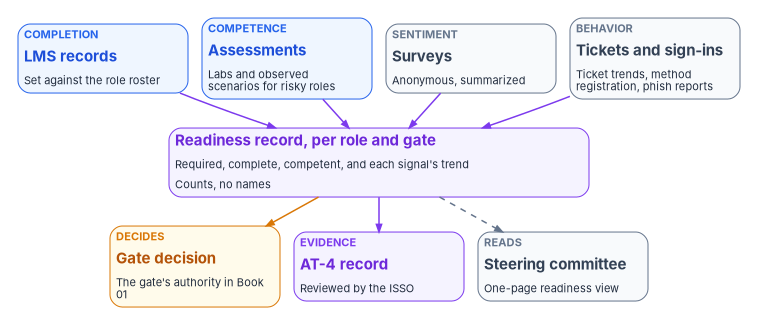

# Chapter 10 — Measuring Readiness and Evidencing It

*A completion record says someone finished a course; readiness says they can do the job on the day the change arrives, and only a measure of the job can show it.*

::: {.callout-note}
## In this chapter
What the program measures to decide whether people are ready: completion for every role, demonstrated competence where the role carries risk, and signals from outside the learning management system, surveys, help desk ticket trends and sign-in method registration, that show whether behavior changed. Then readiness criteria per role and per gate, how the training records become evidence under AT-4 (the controls themselves are in [Book 14, Chapter 09](../b14-compliance/09-training-and-awareness-controls.md)), and what the steering committee should see. Every metric and target in this chapter is the program's design unless a footnote says otherwise.
:::

[Chapter 09](09-building-and-running-the-curriculum.md) schedules training against the roadmap. This chapter asks whether it worked. Federal requirements are mostly satisfied by completion: a record that each person took the required course before access, at the required frequency. A modernization program needs more than that. At every gate someone has to decide whether the next division can move, and the question they are really asking is whether the help desk will verify before it resets, whether users will register a phishing-resistant method before the old one stops working, and whether the platform team can roll back the change if it fails. Completion can't answer those questions. The program measures them directly.

{#fig-ch10-readiness-signals fig-alt="Four cards across the top. A blue card, completion: the learning management system's completion records set against the role roster. A blue card, competence: assessment results, lab demonstrations and observed scenarios for roles that carry risk. A slate card, sentiment: post-training and follow-up surveys, anonymous and summarized. A slate card, behavior: help desk ticket trends by category, sign-in method registration and phishing report rates. All four send arrows to a violet card in the middle, the readiness record, per role and per gate: required, complete, competent, and the trend in each signal, with counts and no names. From the readiness record, an amber arrow goes to an amber card, the gate decision, made by the gate's authority in Book 01 with readiness as one criterion; a violet arrow goes to a violet card, the training evidence record that the ISSO reviews for AT-4; and a dashed arrow goes to a slate card, the steering committee readiness report."}

## Completion is not competence

Federal policy already draws the line. OMB Circular A-130 requires agencies to provide foundational and advanced training "and ensure that measures are in place to test the knowledge level of information system users."[^c10-a130] SP 800-50 Rev. 1 is blunter: laws and policies often set measurable requirements, but learning-program measurements "must go beyond simply achieving compliance," and the program's "impact on workforce capabilities, attitude, and behavioral changes must also be measured."[^c10-sp80050]

SP 800-50 Rev. 1 uses the four levels of the Kirkpatrick Model to organize those measurements.[^c10-sp80050] The program maps each level to something it can collect.

| Level | What SP 800-50 Rev. 1 asks | What the program collects (design) | Typical use |
|---|---|---|---|
| 1. Reaction | Participant feedback on usefulness, engagement and environment, during and at the end of the learning element | The short end-of-module survey; the post-wave survey | Fixing a module that confused people |
| 2. Learning | Whether the intended knowledge or skills were acquired | Assessment results, lab demonstrations and observed scenarios ([Chapter 05](05-assessment-and-certification.md)) | Deciding whether a role holder is competent |
| 3. Behavior | Whether learners applied what they learned in their work role, from learners, peers or supervisors | Help desk ticket trends, sign-in method registration, verification-step audits, phishing report rates, supervisor follow-up | Deciding whether a wave, or the help desk, is ready |
| 4. Results | Whether learning outcomes meet organizational goals, from senior leaders | The gate outcomes and the steady-state measures of [Book 00, Chapter 10](../b00-orientation/10-retirement-steady-state-and-success.md#measuring-success-the-program-scorecard) | The annual evaluation and the steering committee's view |

The NICE Framework gives the vocabulary for Level 2. SP 800-181 Rev. 1 describes competencies as "a mechanism for organizations to assess learners," defined by the employer, learner-focused and "observable and measurable," and says assessments "could take the form of tests, lab-based demonstration, or oral evaluations."[^c10-sp800181] SP 800-50 Rev. 1's best practices for Level 2 point the same way: practical assessments that "mimic what will be experienced in the work role," using case studies, virtual labs, demonstrations and scenario-based exercises.[^c10-sp80050]

The practical rule follows. **Completion is measured for everyone. Competence is measured for every role where a mistake is a security event**: help desk technicians, privileged administrators, platform engineers who change production, ISSOs who assemble evidence, and the people named in incident response and contingency plans. For those roles a completion without a passing assessment doesn't count as ready.

## Readiness per role

The table gives the program's readiness measures for the main role groups. The roles come from [Appendix A](appendix-a-curriculum-map.md); the targets are starting points for the agency to replace with its own after the pilot.

| Role group | Completion measure | Competence measure | Behavior signal | Ready when (design) |
|---|---|---|---|---|
| Every user in a wave | End-user module for the change complete before the wave date | A short check at the end of the module | Phishing-resistant method registered before enforcement; "how do I" tickets in the first two weeks | Registration and completion both above the wave's threshold, set from the pilot |
| Help desk technicians and supervisors | Help desk role training for the current procedures | Observed identity-verification scenario, including a social engineering attempt | Verification steps recorded on sensitive tickets; failed or abandoned verifications ([Book 15, Chapter 10](../b15-day2-operations/10-who-runs-day-two.md#staffing-measuring-and-watching-the-queue)) | Every technician with an eligible role has passed the scenario; none is made eligible before passing |
| Privileged administrators and platform teams | Implementation-track modules for their platform | Lab build and rollback demonstrated ([Chapter 06](06-vendor-training-and-labs.md)) | Changes landed through review without rework; privileged activations matched to tickets | Every person who will change production in the phase has passed the lab |
| ISSOs, assessors and compliance staff | Compliance-track modules | The compliance-track capstone ([Chapter 03](03-the-compliance-track.md)), scored in [Chapter 05](05-assessment-and-certification.md) | Evidence records returned for missing fields | Every ISSO for a system in the phase has passed |
| Incident response and contingency roles | Role training within the period the plan sets | Participation in the drill or tabletop for their role | After-action findings on role execution | Everyone named in the plan trained and exercised, per [Book 14, Chapter 09](../b14-compliance/09-training-and-awareness-controls.md#incident-response-and-contingency-training-ir-2-cp-3) |
| Executives, sponsor and steering committee | Orientation briefing | Can state what each gate means and how it is evaluated, without document numbers ([Book 00, Chapter 10](../b00-orientation/10-retirement-steady-state-and-success.md#delivery-measures), measure 8) | Gate decisions taken on the evidence presented | Briefed before G0 and before their first gate |
| Department champions | End-user module early; champion session | Teach-back observed by an instructor | Share of their division's questions resolved without a ticket | Every division in a wave has at least one qualified champion |

Two cautions. First, a behavior signal measures the whole system, not just training. A rise in sign-in tickets can mean users weren't trained, or that the policy was misconfigured, or that a device type wasn't supported. The program reads the ticket categories before it blames the curriculum. Second, a threshold set too high stops waves for no reason, and one set too low hides the people the threshold is for. [Book 14, Chapter 09](../b14-compliance/09-training-and-awareness-controls.md#where-the-record-lives) makes the same point about completion percentages: every overdue person in a privileged role is a finding regardless of the percentage. The same rule applies to readiness.

## Readiness per gate

Book 01 evaluates every gate from data and names who decides it.[^c10-roadmap] Workforce readiness is one of the criteria. The program's design adds these criteria to the gates; each is a query on the readiness record, not a judgment at the review.

| Gate | Readiness criteria (design) | Decided by (Book 01) |
|---|---|---|
| G0 Ready to Plan | Sponsor, steering committee, steward and workstream leads oriented; the compliance track under way for the ISSOs of in-scope systems; the role roster for training exists and joins to the learning management system | Steward, with the sponsor as backup |
| G1 Foundation Complete | Every platform team member who will change production in Phases 1–2 has passed their lab; every help desk technician with a new eligible role has passed the verification scenario; the pilot's training window is on the plan | Steward |
| G2 Pilot Clean | Pilot users' completion and method registration at or above the pilot targets; help desk ticket volume and user satisfaction within the pilot success criteria of [Book 00, Chapter 09](../b00-orientation/09-design-pilot-and-rollout.md#pilot-success-criteria) (below 5 percent of pilot users raising tickets, above 80 percent positive, both illustrative); every module corrected for what the pilot found | Steward and executive sponsor |
| G3 Rollout Complete | Every wave met its readiness thresholds before it moved; no division moved with an untrained help desk; post-wave surveys and ticket trends reviewed for each wave | Executive sponsor and steering committee |
| G4 Legacy Quiet | AD administrators moving to new roles trained and assessed in those roles; AD-era modules marked for retirement | Steward |
| G5 AD Retired | AD-era modules and runbooks retired from the catalog; no active assignments to retired courses | Executive sponsor and CIO |

Each wave inside Phase 3 has the same check before it moves. The wave owner, identity engineering, decides the wave's go/no-go ([Chapter 08](08-who-owns-workforce-readiness.md)), and the division lead and steward confirm readiness at the division-level exit Book 01 gives them. A wave that isn't ready moves its date, not its threshold. Microsoft's deployment guidance makes the same trade explicit for sign-in changes: when help desk ticket volume rises, slow the pace of deployment, communications and enforcement, and ramp them back up as it falls.[^c10-ms-passwordless]

## Signals beyond the learning management system

### Surveys

Surveys measure reaction, and with a delay, behavior. SP 800-50 Rev. 1 suggests end-of-element questions such as whether the element was relevant to the learner's work role and what the three most important things learned were, and recommends follow-up questions about applying the learning "three to six months after the learning activity."[^c10-sp80050] It also lists attitude surveys about support for the cybersecurity and privacy culture among its qualitative measures.[^c10-sp80050] The program runs three, by design: a short end-of-module survey, a post-wave survey about two weeks after a division moves, and a follow-up to role holders about three months after their role training, asking them and their supervisors whether the procedure works as taught.

Keep surveys short, anonymous where possible, and summarized before anyone outside the training team sees them. SP 800-50 Rev. 1 recommends anonymous learner feedback on instructors and summaries that don't identify individuals.[^c10-sp80050] A survey questionnaire is also agency official communication under the Revised 508 Standards and must be accessible.[^c10-508]

### Help desk ticket trends

The help desk sees readiness first. Microsoft calls the help desk "an invaluable signal" on how a passwordless deployment is progressing and recommends tracking ticket volume throughout.[^c10-ms-passwordless] [Book 00, Chapter 09](../b00-orientation/09-design-pilot-and-rollout.md#pilot-success-criteria) already sets ticket volume as a pilot success criterion. The program reads tickets three ways, by design:

- **Volume per wave**, normalized by the number of users in the wave, against the pilot's baseline.
- **Category**, so "how do I" questions, which point to training, are separated from failures, which point to configuration. The ITSM platform team adds a category for change-related tickets and tags each with the wave ([Book 15, Chapter 10](../b15-day2-operations/10-who-runs-day-two.md#the-itsm-platform-team)).
- **Decay**, the number of days after a wave before ticket volume returns to the baseline. A wave whose tickets never decay has a problem training won't fix.

### Sign-in method registration

For sign-in changes, registration is the behavior that matters. In Microsoft Entra ID, the authentication methods activity report shows how many users are capable of multifactor, passwordless and self-service password reset, and how many are registered for each method; Microsoft's deployment guidance uses it to measure the registration rollout for pilot users before enforcement.[^c10-ms-methods][^c10-ms-passwordless] The report requires Microsoft Entra ID P1 or P2.[^c10-ms-graph] Registration by wave, before the enforcement date, is the program's most direct readiness measure for end users, and it costs nothing to collect.

### Phishing exercises

Where the agency runs phishing exercises, report rates are a behavior measure. SP 800-50 Rev. 1 gives "the percentage of participants who changed a behavior," such as reporting a suspected phishing email appropriately, as an example metric.[^c10-sp80050] The rules for running the exercises, including legal review, non-punitive use of results and lures that don't impersonate real organizations, are in [Book 14, Chapter 09](../b14-compliance/09-training-and-awareness-controls.md#phishing-exercises-at-21). The readiness report uses only the aggregate rates.

## Training records as evidence

The readiness record and the training evidence record are built from the same sources. [Book 14, Chapter 09](../b14-compliance/09-training-and-awareness-controls.md#training-records-as-evidence-at-4) defines the evidence record for AT-4: counts per population against a stated roster for a stated window, built from hashed source files, with no names in the summary and an ISSO review rather than a computed pass or fail. The readiness record follows the same rules and adds three things, by design:

- **Competence alongside completion.** For roles that are assessed, the record carries how many passed, not only how many finished. That serves AT-4 directly, which asks the agency to "document and monitor" training activities,[^c10-sp80053] and it gives the ISSO the evidence that A-130's knowledge-testing requirement was met.[^c10-a130]
- **The gate and the wave.** Each count is also cut by the gate or wave it was required for, so the same record answers the assessor's question (were people trained before access?) and the steward's (is the next wave ready?).
- **Signal trends.** Survey summaries, ticket trends and registration rates sit beside the counts, as context. They aren't AT-4 evidence, and the record says so.

SP 800-53's AT-6, training feedback, asks the agency to give feedback on training results to defined personnel at a defined frequency.[^c10-sp80053] It isn't in any NIST or FedRAMP baseline ([Book 14, Chapter 09](../b14-compliance/09-training-and-awareness-controls.md#the-controls-one-by-one)), but the readiness report is that feedback in practice. An agency that selects AT-6 can name the steering committee and the ISSOs as the personnel and the report's cadence as the frequency.

## Reporting to the steering committee

SP 800-50 Rev. 1 describes an assessment report for senior leadership, created at the end of a campaign and regularly through the year, analyzing attendance, feedback, measurements and other metrics, identifying action items and next steps, and "tailored for senior leadership using appropriate language," without unexplained technical jargon.[^c10-sp80050] The review with senior leadership agrees on changes, evaluates budget needs, and addresses new risks to include in the content.[^c10-sp80050] OPM requires agencies to evaluate their training programs annually against mission and performance goals.[^c10-cfr410]

The program's design fits that report into the steering committee's rhythm from [Book 00, Chapter 07](../b00-orientation/07-who-runs-the-program.md#the-rhythm).

| Cadence (design) | What the committee sees | Decision it supports |
|---|---|---|
| Every steering committee meeting | One page: readiness for the next gate and the next two waves, by role group, against threshold; anything red, with its cause and owner | Whether the next wave keeps its date |
| Quarterly | The assessment report: completion and competence by population, survey and ticket trends, modules revised after source changes, instructor and content feedback, the quarterly training completion review [Book 14, Chapter 11](../b14-compliance/11-the-authorization-package.md) schedules | Changes to the curriculum, its staffing and its budget |
| Annually | The evaluation OPM requires: what the training cost, what it changed, and where the gaps are | Next year's priorities and funding |
| At each gate review | The gate's readiness criteria, evaluated from the record | Go, no-go or conditional go |

The one-page view should answer five questions, in this order:

1. **Is the next gate's workforce ready?** Each readiness criterion for the gate, green, amber or red.
2. **Are the next two waves ready?** Completion, registration and help desk readiness for each, against the threshold set for it.
3. **What happened in the last wave?** Ticket volume and decay against the pilot baseline; the survey's top problem; what was changed as a result.
4. **Where are the privileged gaps?** The count of people in assessed roles who haven't passed, by role group. Not a percentage: a count, because each one is a finding.
5. **What does the committee need to decide?** A wave to move, a module to fund, an instructor gap, a labor relations question.

The report carries counts, not names. The per-person detail stays in the learning management system, where supervisors, the ISSO and the assessor can see it under its access controls.

## Baselines and targets are design

Every threshold in this chapter is the program's design, offered as a starting point. SP 800-50 Rev. 1's advice for measuring results is to "establish baseline metrics" before the learning program begins, to combine quantitative and qualitative measures, and to tell senior leadership that "it takes time to see the full impact of a learning program."[^c10-sp80050] The pilot is the program's baseline. Its completion, registration, ticket and survey figures set the first wave's thresholds; each wave's results adjust the next. A target that was never measured against a baseline is a guess, and the readiness report says which of its targets are still guesses.

## What changes, in one table

| Old habit | What replaces it |
|---|---|
| A completion percentage as the readiness measure | Completion for everyone; demonstrated competence for every role where a mistake is a security event |
| Training judged by the end-of-course survey | Reaction, learning, behavior and results measured separately, with follow-up months later |
| Help desk tickets treated as an operations problem | Ticket volume, category and decay read as a readiness signal, with categories that separate training from configuration |
| Waves moving on schedule regardless of readiness | A readiness check before every wave; a wave that isn't ready moves its date, not its threshold |
| A training dashboard nobody acts on | A one-page readiness view at every steering committee, a quarterly assessment report and the annual evaluation OPM requires |
| Training evidence and readiness reporting built separately | One record from the same sources, serving AT-4 evidence and the gate decision |
| Targets copied from another program | Baselines from the pilot, adjusted wave by wave, with unmeasured targets labeled as such |

::: {.callout-tip}
## Continue the book
[← Previous: Chapter 09 — Building and Running the Curriculum](09-building-and-running-the-curriculum.md) · [Book index](index.md) · [Next: Appendix A — The Curriculum Map: Role, Book and Track →](appendix-a-curriculum-map.md)
:::

[^c10-a130]: Office of Management and Budget, Circular A-130, *Managing Information as a Strategic Resource*, July 2016, Appendix I, §4.h (Awareness and Training), item 4, <https://www.whitehouse.gov/wp-content/uploads/legacy_drupal_files/omb/circulars/A130/a130revised.pdf> (accessed Oct 21, 2026).
[^c10-sp80050]: National Institute of Standards and Technology, SP 800-50 Rev. 1, *Building a Cybersecurity and Privacy Learning Program*, September 2024, §2.4.1 (Measurements), §2.4.1.2 (Qualitative Measurements), §2.4.2 (From Measurements to Metrics), §5.2 (Creating a CPLP Assessment Report), §5.2.3.1 (Instructor Evaluation), §5.2.3.3 and Table 3 (the four levels of the Kirkpatrick Model) and §5.2.4 (Reviewing the CPLP Assessment Report with Senior Leadership), <https://nvlpubs.nist.gov/nistpubs/SpecialPublications/NIST.SP.800-50r1.pdf> (accessed Oct 21, 2026).
[^c10-sp800181]: National Institute of Standards and Technology, SP 800-181 Rev. 1, *Workforce Framework for Cybersecurity (NICE Framework)*, November 2020, §3.3 (Competencies) and Figures 2–3, <https://doi.org/10.6028/NIST.SP.800-181r1>; publication page, <https://csrc.nist.gov/pubs/sp/800/181/r1/final> (both accessed Oct 21, 2026).
[^c10-roadmap]: Gates, gate authorities and the division-level exit are those of [Book 01, Chapter 12 — The Migration Roadmap](../b01-transformation-arc/12-migration-roadmap.md#gates-rollback-and-authority).
[^c10-ms-passwordless]: Microsoft Learn, "Plan a phishing-resistant passwordless authentication deployment in Microsoft Entra ID," sections "Test deployment strategy" and "Monitor help desk ticket volume," <https://learn.microsoft.com/entra/identity/authentication/how-to-deploy-phishing-resistant-passwordless-authentication> (accessed Oct 21, 2026).
[^c10-508]: U.S. Access Board, *Information and Communication Technology: Revised 508 Standards and 255 Guidelines*, Appendix A, E205.3 (Agency Official Communication), item 6, <https://www.access-board.gov/ict/> (accessed Oct 21, 2026).
[^c10-ms-methods]: Microsoft Learn, "Authentication Methods Activity," section "Registration details," <https://learn.microsoft.com/entra/identity/authentication/howto-authentication-methods-activity> (accessed Oct 21, 2026).
[^c10-ms-graph]: Microsoft Learn, "Working with the authentication methods usage report API," section "Licenses," Microsoft Graph v1.0, <https://learn.microsoft.com/graph/api/resources/authenticationmethods-usage-insights-overview?view=graph-rest-1.0> (accessed Oct 21, 2026).
[^c10-sp80053]: National Institute of Standards and Technology, SP 800-53 Rev. 5, *Security and Privacy Controls for Information Systems and Organizations*, controls AT-4 and AT-6, <https://csrc.nist.gov/pubs/sp/800/53/r5/upd1/final>; control text checked against the release 5.2.0 OSCAL catalog, <https://github.com/usnistgov/oscal-content/blob/main/nist.gov/SP800-53/rev5/json/NIST_SP-800-53_rev5_catalog.json> (both accessed Oct 21, 2026).
[^c10-cfr410]: 5 CFR § 410.202, "Responsibilities for evaluating training," eCFR text as of October 1, 2026 (source note 74 FR 65387, December 10, 2009), <https://www.ecfr.gov/api/versioner/v1/full/2026-10-01/title-5.xml?part=410> (accessed Oct 21, 2026).
