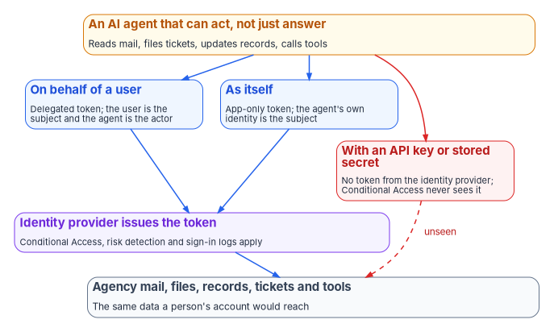
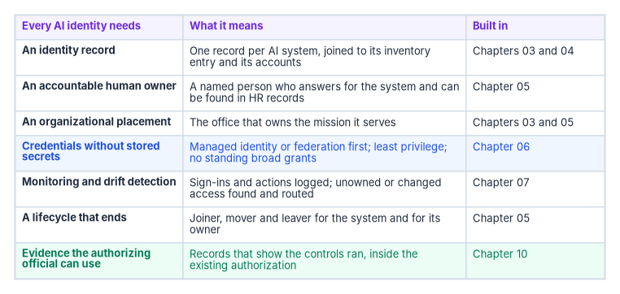

# Chapter 01 — Why AI Agents Need Identities and Owners

*An AI agent that can send an email, close a ticket or change a record is an account with permissions, and an account nobody owns is the oldest finding in identity.*

::: {.callout-note}
## In this chapter
What changes when an AI system stops answering questions and starts taking actions, and the three ways such a system reaches agency data. How most AI arrived outside the identity program, so that it has no owner of record, no organizational placement, no credential lifecycle and no leaver process. Why the risks it carries are identity risks, and why the existing control catalog already covers it. And the seven things every AI identity needs, which the rest of the book builds.
:::

A chat assistant that drafts a memo for a person to read is a tool. The person reads the draft, decides what to keep and sends it under their own name. Nothing the assistant does reaches a record until a person acts.

An AI agent is different. It reads a mailbox, decides which messages need a reply, drafts the replies and sends them. It opens a ticket, assigns it and closes it when a condition is met. It queries a case system, updates a field and calls another tool to notify someone. Each of those steps is an action against agency data, and each one is taken by something that signed in, holds permissions and leaves, or fails to leave, a record of what it did.

That makes an agent an identity. The identity program already knows how to govern identities: who owns this account, what may it reach, how is its credential protected, who reviews its access, what happens when it is no longer needed. Most AI in federal agencies was deployed without any of those questions being asked, because it arrived as a project, a pilot or a feature of software the agency already ran, not as a new kind of account. This book argues that governing AI is, in large part, identity governance applied to a new kind of principal, and shows how to do it.

{#fig-ch01-three-ways-in fig-alt="An amber card at the top: an AI agent that can act, not just answer; it reads mail, files tickets, updates records and calls tools. Three arrows lead down from it. Two blue cards: on behalf of a user, a delegated token in which the user is the subject and the agent is the actor; and as itself, an app-only token in which the agent's own identity is the subject. Both lead to a violet card: the identity provider issues the token, and Conditional Access, risk detection and sign-in logs apply. The third arrow is red and leads to a red card: with an API key or stored secret, no token from the identity provider, so Conditional Access never sees it. The violet card leads by a solid blue arrow to a slate card at the bottom, agency mail, files, records, tickets and tools, the same data a person's account would reach. The red card leads to the same slate card by a dashed red arrow labeled unseen."}

## From answering to acting

Federal policy already treats autonomy as part of what AI is. OMB Memorandum M-25-21, which governs agency use of AI, says its definition of AI "includes systems that are fully autonomous, partially autonomous, and not autonomous," with and without human oversight.[^c01-m2521] OMB's 2025 AI use case inventory asks agencies to classify each use case, and one of the classes is agentic AI: "AI systems that perform tasks or make decisions autonomously with minimal human intervention."[^c01-dict]

The inventory shows where agencies are. OMB's consolidated 2025 inventory, as of April 13, 2026, holds 3,611 individually reported use cases, 445 of them high-impact.[^c01-repo] Of the 3,611, 117 are classified as agentic, and 38 of those are in pilot or deployed; the rest are still in pre-deployment.[^c01-csv] That is a small share today. It is also the share that grows fastest once the tools are in place, and it is the share with the most direct consequence for identity, because an agent's reason to exist is to take actions that a person's account would otherwise take. [Chapter 03](03-the-inventory-as-an-identity-source.md) reads the inventory in detail.

The rest of this book uses a simple distinction. An AI system that only answers produces output that a person then acts on. An AI system that can act, not just answer, holds its own access and uses it. Both need governing. The second needs governing as an identity, because it is one.

## Three ways in

However it is built, an AI system that acts reaches agency data in one of three ways, and Microsoft's documentation for agents in Entra ID lays them out clearly.[^c01-ca-agents]

1. **On behalf of a signed-in user.** The agent exchanges the user's sign-in for a token to the resource it needs. The user is the token's subject; the agent is the actor. Policy applies to the user, and the agent can reach whatever the user can reach.
2. **As itself.** The agent requests a token with its own identity and no user present. The agent's identity is the subject, and policy targets that identity. This is how a background agent runs on a schedule or responds to events.
3. **As its own user account.** Some agents need a mailbox, a seat in a chat or membership in a group. They get a user account of their own, and policy is evaluated against that account.

There is a fourth way, and it is the one the identity program can't see. When an agent calls a service with an API key or another stored secret instead of a token from the identity provider, it "bypasses the Microsoft Entra ID authentication and token issuance pipeline entirely," and Conditional Access doesn't apply.[^c01-ca-agents] No sign-in is evaluated, no risk is scored, and the only record of the call is whatever the service itself keeps. [Chapter 04](04-kinds-of-ai-identity.md) covers the identity types in detail, and [Chapter 06](06-credentials-and-least-privilege.md) covers why the program moves AI systems off stored secrets.

The three ways that do run through the identity provider aren't safe by default either. An agent acting on behalf of a user carries the user's full reach into a process the user doesn't watch step by step. An agent acting as itself holds whatever permissions someone granted it, often broadly, to get a pilot working. An agent with its own user account is, to every system it touches, a member of staff.

## How AI arrived outside the identity program

People join an agency through a pipeline the identity program built: an HR record, an account created from it, access derived from the person's position, reviews on a schedule and a leaver process when they go. [Book 03](../b03-hr-identity/index.md) describes that pipeline. Non-person accounts for applications and services have a weaker version of it, through application registration and the workload identity patterns in [Book 04, Chapter 05](../b04-access/05-applications-and-workload-identities.md).

AI mostly came in another way. A mission office ran a pilot with a vendor. A developer wired a model into a workflow with an API key in a configuration file. A software product the agency already licensed shipped an assistant as a new feature. A business unit built an agent in a low-code tool and gave it a service account to read a shared mailbox. None of those paths runs through the identity program, so none of them produces what the identity program normally requires. In the program's experience, an AI system found this way typically has:

| What an employee's account has | What an AI system found outside the program typically lacks |
|---|---|
| An owner of record: the person, and a manager in the HR source | A named, current owner; often a project contact who has moved on |
| An organizational placement that drives access | Any placement beyond the team that set it up |
| A credential issued and protected under policy | A secret in a configuration file, a vault entry or a shared account |
| Access derived from a role and reviewed on a schedule | Permissions granted once to make a pilot work, then never reviewed |
| Monitoring tied to the person's sign-ins | Activity that looks like the application or user it runs as |
| A leaver process when the person goes | No end date; the account outlives the project and its owner |

The federal inventory doesn't close this gap, because it wasn't designed to. Its fields describe a use case: its purpose, stage, outputs, vendor, whether it involves personal information and whether it has an associated authorization to operate. The only person it names is a contact email, and the public version may replace that with an inbox for public inquiries.[^c01-guidance] It has no field for the account the AI system signs in with, the credential it holds, the permissions it has or the person accountable for that access. A use case isn't an identity, and the inventory can't tell you which identities a use case runs as. [Chapter 03](03-the-inventory-as-an-identity-source.md) shows how the program joins the two.

## Why the risk is identity-shaped

The risks people worry about most in agentic AI turn into incidents through identity. NIST's Generative AI Profile describes prompt injection: an attacker crafts input that makes a generative AI system behave in unintended ways, and in the indirect form plants that input in data the system is likely to retrieve. NIST notes that researchers have used indirect prompt injection to steal proprietary data and run malicious code.[^c01-ai6001] For a system that only answers, a successful injection produces a bad answer. For an agent with broad permissions, it produces an action: a message sent, a record changed, a file shared, all under a legitimate identity that the logs will show doing exactly what it was allowed to do.

That is why least privilege, owned credentials and monitoring matter more for an agent than for a chat tool. The blast radius of a manipulated agent is the access its identity holds. An agent that can only read one queue and write to one field can do limited harm. An agent running under a shared service account with mailbox and file permissions across an office can do a great deal, and nobody may own the account well enough to notice.

The same point appears in federal guidance. In May 2026 CISA, with the Australian Signals Directorate's Australian Cyber Security Centre and other partners, released guidance on the careful adoption of agentic AI services, which CISA summarizes as covering the security challenges of agentic AI and steps for "designing, deploying, and operating these systems safely" in line with existing cybersecurity frameworks.[^c01-cisa-agentic] Executive Order 14409 of June 2, 2026 directs the Attorney General to prioritize prosecuting anyone who uses AI to access a computer without authorization, including "employing AI agents to unlawfully access data."[^c01-eo14409] The threat model now names agents explicitly; the defense starts with knowing which identities they hold.

## The controls already apply

None of this needs a new control family. The SP 800-53 catalog already speaks to non-person accounts in the controls every authorization is built on.[^c01-sp80053]

- **AC-2, Account Management**, requires defining the account types allowed in a system, assigning account managers, specifying authorized users and privileges for each account, approving account creation, monitoring use, and notifying account managers when accounts are no longer required. Its discussion lists "system" and "service" among the account types.
- **IA-4, Identifier Management**, and **IA-5, Authenticator Management**, cover identifiers and authenticators for an "individual, group, role, service, or device," including protecting authenticator content and refreshing it on a schedule.
- **AC-6, Least Privilege**, applies to users "or processes acting on behalf of users."
- **IA-9, Service Identification and Authentication**, requires services to be uniquely identified and authenticated before they communicate with other services or applications.

NIST's AI Risk Management Framework makes the same point from the AI side. Its Govern function calls for mechanisms "to inventory AI systems," processes "for decommissioning and phasing out AI systems safely," and documented roles and responsibilities for managing AI risk.[^c01-airmf] An AI system with no owner, no recorded access and no end of life fails all three, and it fails AC-2 and IA-5 in the system it runs in.

So the gap isn't in the catalog. It is in coverage. The controls apply to every account in the authorization boundary; the AI system's account is often simply missing from the account inventory the controls are tested against. [Chapter 02](02-what-federal-ai-rules-require.md) shows that federal AI policy assumes exactly this: AI systems go through the agency's existing authorization, and there is no separate AI authorization to fall back on.

## The platforms are catching up

Identity vendors now ship identity types built for agents. Microsoft Entra Agent ID adds agent identities, created from reusable templates called agent identity blueprints, and requires at least one human sponsor for every agent identity and blueprint: "business representatives accountable for the agent's purpose and lifecycle decisions."[^c01-sponsors] Microsoft announced the Agent ID platform as generally available in April 2026.[^c01-whatsnew] Several of the controls around it are newer: Conditional Access can only block an agent identity, because there is no interactive way for an agent to satisfy a grant control, and the agent-user targets and the agent risk condition are still marked preview.[^c01-ca-target]

Two cautions keep this in proportion. First, the new identity type only governs agents that use it. An agent built on an ordinary application registration, a shared service account or an API key gets none of it, which is why Microsoft publishes guidance on migrating agents built on custom application registrations, and Copilot Studio agents, to Agent ID.[^c01-agentid-new] Second, availability differs by cloud. Microsoft's service description for Agent 365, the product that extends these controls across Microsoft 365, lists availability for GCC only, and states that as of October 1, 2026 it "meets all FedRAMP High controls" reviewed by its assessor with final authorization pending.[^c01-a365] An agency in GCC High or DoD has to confirm each capability for its own cloud before planning on it, as [Book 02, Appendix A](../b02-identity/appendix-a-federal-requirements-crosswalk.md) advises. [Chapter 04](04-kinds-of-ai-identity.md) tabulates what is generally available, what is preview and where.

The program's position follows [Book 04, Chapter 03](../b04-access/03-the-conditional-access-model.md): it builds on what is generally available in the agency's cloud and records preview capabilities as watch items. The governance model in this book doesn't depend on any one product. It depends on every AI system having the seven things below, whatever platform records them.

## What every AI identity needs

The program's model for governing AI identities has seven parts. Each is program design, built on controls the agency already has to meet; none is a new federal requirement.

{#fig-ch01-what-every-ai-identity-needs fig-alt="A three-column table with seven rows. Columns: every AI identity needs, what it means, built in. Row 1: an identity record, one record per AI system joined to its inventory entry and its accounts, Chapters 03 and 04. Row 2: an accountable human owner, a named person who answers for the system and can be found in HR records, Chapter 05. Row 3: an organizational placement, the office that owns the mission it serves, Chapters 03 and 05. Row 4, highlighted blue: credentials without stored secrets, managed identity or federation first, least privilege, no standing broad grants, Chapter 06. Row 5: monitoring and drift detection, sign-ins and actions logged, unowned or changed access found and routed, Chapter 07. Row 6: a lifecycle that ends, joiner, mover and leaver for the system and for its owner, Chapter 05. Row 7, highlighted green: evidence the authorizing official can use, records that show the controls ran inside the existing authorization, Chapter 10."}

1. **An identity record.** Every AI system that holds access has one record that ties its inventory entry to the accounts it signs in with, so the agency can answer "what is this, and what can it reach?"
2. **An accountable human owner.** A named person, resolvable in the HR source, answers for the system's access. If the owner leaves, ownership moves before the access outlives them, applying the rule in [Book 14, Chapter 04](../b14-compliance/04-closure-with-proof.md) that every non-human item anchors to a human owner.
3. **An organizational placement.** The system belongs to the office whose mission it serves, so access decisions and reviews route to the right people.
4. **Credentials without stored secrets.** Managed identities and workload identity federation come first, certificates only where neither applies, as [Book 02, Chapter 09](../b02-identity/09-building-the-entra-target.md) and [Book 04, Chapter 05](../b04-access/05-applications-and-workload-identities.md) set out; permissions are the least the task needs.
5. **Monitoring and drift detection.** The system's sign-ins and actions are logged under its own identity, and access that changes or loses its owner becomes a finding. An agentic AI system with no governed identity is a high-priority finding.
6. **A lifecycle that ends.** Provisioning, change and decommissioning are joiner, mover and leaver events for the system, with an end date set when it is created.
7. **Evidence the authorizing official can use.** Each of the above leaves records that feed the system's existing authorization and its continuous monitoring, following the evidence contract in [Book 12, Chapter 02](../b12-security-operations/02-the-evidence-contract.md).

| Chapter | The question it answers |
|---|---|
| [Chapter 02 — What Federal AI Rules Require, and What They Don't](02-what-federal-ai-rules-require.md) | What does federal policy actually ask of agencies using AI, and what doesn't it? |
| [Chapter 03 — The AI Use-Case Inventory as an Identity Source](03-the-inventory-as-an-identity-source.md) | How does the inventory become the starting list of AI identities? |
| [Chapter 04 — Kinds of AI Identity](04-kinds-of-ai-identity.md) | Which identity types do AI systems use, and what do they mean for policy and logs? |
| [Chapter 05 — Owners, Sponsors and the AI Identity Lifecycle](05-owners-sponsors-and-lifecycle.md) | Who answers for an AI identity, and how does it end? |
| [Chapter 06 — Credentials, Least Privilege and Access Policy for AI](06-credentials-and-least-privilege.md) | How does an AI system get access without a stored secret or standing broad grant? |
| [Chapter 07 — Monitoring, Drift and Shadow AI](07-monitoring-drift-and-shadow-ai.md) | How does the agency find AI it didn't know about, and notice when access changes? |
| [Chapter 08 — Who Owns AI Identity Governance](08-who-owns-ai-identity.md) | Which roles decide, operate and answer for AI identity? |
| [Chapter 09 — Running the Inventory Scan, Agency and Central](09-running-the-inventory-scan.md) | How is the inventory checked for identity gaps, by an agency and across agencies? |
| [Chapter 10 — Evidence and Authorization for AI Systems](10-evidence-and-authorization.md) | How do the records become evidence inside the existing authorization? |

## Honest limits

- **This is program design, not a federal requirement.** No federal rule today requires an AI system to have an identity record or a sponsor. The controls behind each of the seven parts are required; the model is the program's way of meeting them for a new kind of account.
- **Not every AI system holds access.** Many inventoried use cases are analytic models run by people, or features inside commercial software that act only through the user. The model applies in full to systems that sign in and act; for the rest, the identity record may simply say so.
- **The counts are small and self-reported.** The agentic share of the inventory is the agencies' own classification, and use cases aren't systems. Treat the numbers as a direction, not a measurement.
- **The products are young.** Agent identity features reached general availability in 2026 and are changing by the month, with different availability across government clouds. Every product statement in this book is a dated observation.

## What leadership should take from this

1. **Count AI identities, not AI projects.** The question for a risk discussion isn't how many use cases exist, but which accounts they run as and what those accounts can reach.
2. **Put a person's name on every one.** An AI system with access and no accountable owner is an orphaned account, and orphaned accounts are where incidents start.
3. **Govern agents first.** Systems that can act carry the largest blast radius. Start with them, then work outward to systems that only answer.

[Chapter 02](02-what-federal-ai-rules-require.md) sets out what federal AI rules ask of agencies today, and why none of them creates a separate AI authorization.

::: {.callout-tip}
## Continue the book
[← Previous: Book index](index.md) · [Next: Chapter 02 — What Federal AI Rules Require, and What They Don't →](02-what-federal-ai-rules-require.md)
:::

[^c01-m2521]: Office of Management and Budget, M-25-21, *Accelerating Federal Use of AI through Innovation, Governance, and Public Trust*, April 3, 2025, Section 5, definition of artificial intelligence, technical context item 4, <https://www.whitehouse.gov/wp-content/uploads/2025/02/M-25-21-Accelerating-Federal-Use-of-AI-through-Innovation-Governance-and-Public-Trust.pdf> (accessed Oct 21, 2026).
[^c01-dict]: Office of Management and Budget, 2025 Federal Agency AI Use Case Inventory, `Validation/data_dictionary.md`, column 12 (`classification`), <https://github.com/ombegov/2025-Federal-Agency-AI-Use-Case-Inventory/blob/main/Validation/data_dictionary.md> (accessed Oct 21, 2026).
[^c01-repo]: Office of Management and Budget, 2025 Federal Agency AI Use Case Inventory, `README.md`, Summary "As of April 13, 2026," <https://github.com/ombegov/2025-Federal-Agency-AI-Use-Case-Inventory> (accessed Oct 21, 2026).
[^c01-csv]: Office of Management and Budget, 2025 Federal Agency AI Use Case Inventory, `Data/2025_individually_reported_AI_use_cases.csv` (3,611 rows); counts of `classification` = "Agentic AI" (117) by `development_stage` (79 pre-deployment, 18 pilot, 20 deployed) computed by the program, <https://github.com/ombegov/2025-Federal-Agency-AI-Use-Case-Inventory/tree/main/Data> (accessed Oct 21, 2026).
[^c01-ca-agents]: Microsoft Learn, "Conditional Access for agents," sections "Agent access patterns" and "Boundaries and limitations," <https://learn.microsoft.com/entra/identity/conditional-access/agent-id> (accessed Oct 21, 2026).
[^c01-guidance]: Office of Management and Budget, *Guidance on 2025 Agency Artificial Intelligence Reporting*, Section 1(b)(i) and Section 5, "2025 AI Use Case Inventory Fields," <https://github.com/ombegov/2025-Federal-Agency-AI-Use-Case-Inventory/tree/main/Reporting%20Instructions> (accessed Oct 21, 2026).
[^c01-ai6001]: National Institute of Standards and Technology, NIST AI 600-1, *Artificial Intelligence Risk Management Framework: Generative Artificial Intelligence Profile*, July 26, 2024, Section 2.9, Information Security, <https://nvlpubs.nist.gov/nistpubs/ai/NIST.AI.600-1.pdf> (accessed Oct 21, 2026).
[^c01-cisa-agentic]: Cybersecurity and Infrastructure Security Agency, "Careful Adoption of Agentic AI Services," resource page, publish date May 1, 2026, <https://www.cisa.gov/resources-tools/resources/careful-adoption-agentic-ai-services> (accessed Oct 21, 2026).
[^c01-eo14409]: Executive Order 14409 of June 2, 2026, "Promoting Advanced Artificial Intelligence Innovation and Security," Section 4, 91 Fed. Reg. 34565 (June 5, 2026), <https://www.federalregister.gov/documents/2026/06/05/2026-11415/promoting-advanced-artificial-intelligence-innovation-and-security> (accessed Oct 21, 2026).
[^c01-sp80053]: National Institute of Standards and Technology, SP 800-53 Rev. 5, *Security and Privacy Controls for Information Systems and Organizations*, controls AC-2 (statement and discussion), AC-6, IA-4, IA-5 and IA-9, checked against the release 5.2.0 OSCAL catalog, <https://github.com/usnistgov/oscal-content/tree/main/nist.gov/SP800-53/rev5/json> (accessed Oct 21, 2026).
[^c01-airmf]: National Institute of Standards and Technology, NIST AI 100-1, *Artificial Intelligence Risk Management Framework (AI RMF 1.0)*, January 2023, Table 1, GOVERN 1.6, GOVERN 1.7 and GOVERN 2.1, <https://nvlpubs.nist.gov/nistpubs/ai/NIST.AI.100-1.pdf> (accessed Oct 21, 2026).
[^c01-sponsors]: Microsoft Learn, "Administrative relationships in Microsoft Entra Agent ID (Owners, sponsors, and managers)," <https://learn.microsoft.com/entra/agent-id/agent-owners-sponsors-managers> (accessed Oct 21, 2026).
[^c01-whatsnew]: Microsoft Learn, "Microsoft Entra releases and announcements," April 2026, "General Availability - Microsoft Entra Agent ID platform," <https://learn.microsoft.com/entra/fundamentals/whats-new> (accessed Oct 21, 2026).
[^c01-ca-target]: Microsoft Learn, "Target agent identities in Microsoft Entra Conditional Access policies," sections "Conditions" and "Access controls," <https://learn.microsoft.com/entra/identity/conditional-access/howto-target-agent-identities> (accessed Oct 21, 2026).
[^c01-a365]: Microsoft Learn, "Microsoft Agent 365," service description, "Feature availability," <https://learn.microsoft.com/office365/servicedescriptions/microsoft-agent-365/microsoft-agent-365> (accessed Oct 21, 2026).
[^c01-agentid-new]: Microsoft Learn, "What's new in Microsoft Entra Agent ID," section "Manage AI agents at scale" (migrate custom app registrations; migrate Copilot Studio agents), <https://learn.microsoft.com/entra/agent-id/whats-new-agent-id> (accessed Oct 21, 2026).
