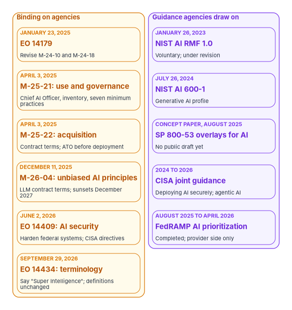
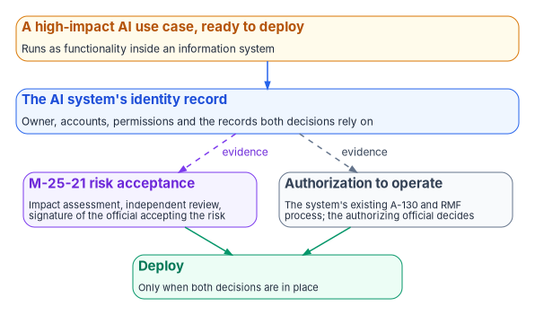

# Chapter 02 — What Federal AI Rules Require, and What They Don't

*Federal AI policy asks agencies to know their AI, name who answers for it and manage its risk inside the authorization they already run; it never asks for a second authorization, and it never says how to govern the accounts AI signs in with.*

::: {.callout-note}
## In this chapter
The federal AI rules in force as of October 2026, separated into what binds agencies and what guides them. What OMB Memorandum M-25-21 requires, when, and what it replaced; what M-25-22 adds for acquisition and M-26-04 for large language models; what the 2026 executive orders change and don't. The NIST, CISA and FedRAMP material agencies draw on. Why there is no AI-specific authorization to operate. And how the rules read as identity obligations, which is where the rest of this book starts.
:::

AI policy for federal agencies was rewritten in 2025. Executive Order 14179 of January 23, 2025 directed OMB to revise the two memoranda that had governed agency use and acquisition of AI, M-24-10 and M-24-18, within 60 days.[^c02-eo14179] OMB issued the replacements on April 3, 2025: M-25-21 for use and governance, and M-25-22 for acquisition.[^c02-m2521][^c02-m2522] Since then the rule set has grown by one OMB memorandum and several executive orders, while NIST's frameworks and CISA's guidance continued alongside.

Policy writing about AI tends to drift from what the documents say. Material written for the program earlier made exactly that mistake, reading an AI-specific authorization gate into M-25-21 that the memo doesn't contain. This chapter sticks to the text. Every requirement below is quoted or paraphrased from the primary document, and the program's own reading is labeled as such.

{#fig-ch02-rules-and-guidance fig-alt="Two columns. The amber column on the left, labeled binding on agencies, lists six cards from top to bottom: January 23, 2025, EO 14179, revise M-24-10 and M-24-18; April 3, 2025, M-25-21, use and governance, Chief AI Officer, inventory, seven minimum practices; April 3, 2025, M-25-22, acquisition, contract terms and ATO before deployment; December 11, 2025, M-26-04, unbiased AI principles, LLM contract terms, sunsets December 2027; June 2, 2026, EO 14409, AI security, harden federal systems, CISA directives; September 29, 2026, EO 14434, terminology, say Super Intelligence, definitions unchanged. The violet column on the right, labeled guidance agencies draw on, lists five cards: January 26, 2023, NIST AI RMF 1.0, voluntary, under revision; July 26, 2024, NIST AI 600-1, generative AI profile; concept paper August 2025, SP 800-53 overlays for AI, no public draft yet; 2024 to 2026, CISA joint guidance, deploying AI securely and agentic AI; August 2025 to April 2026, FedRAMP AI prioritization, completed, provider side only."}

## The rule set in force

| Instrument | Date | Binds | What it asks of agencies |
|---|---|---|---|
| Executive Order 14179, *Removing Barriers to American Leadership in Artificial Intelligence* | January 23, 2025 | Agencies, through OMB | Revise M-24-10 and M-24-18; review actions taken under the revoked Executive Order 14110[^c02-eo14179] |
| OMB M-25-21, *Accelerating Federal Use of AI through Innovation, Governance, and Public Trust* | April 3, 2025 | All agencies, with exceptions noted below | Chief AI Officer, governance, inventory, compliance plans, minimum practices for high-impact AI; rescinds M-24-10[^c02-m2521] |
| OMB M-25-22, *Driving Efficient Acquisition of Artificial Intelligence in Government* | April 3, 2025 | All agencies | Acquisition practices and contract terms for AI; rescinds M-24-18[^c02-m2522] |
| Executive Order 14319, *Preventing Woke AI in the Federal Government* | July 23, 2025 | Agencies, through OMB | Two "Unbiased AI Principles" for large language models the government procures[^c02-m2604] |
| OMB M-26-04, *Increasing Public Trust in Artificial Intelligence Through Unbiased AI Principles* | December 11, 2025 | Agencies procuring large language models | Contract requirements for the principles; sunsets after two years[^c02-m2604] |
| Executive Order 14409, *Promoting Advanced Artificial Intelligence Innovation and Security* | June 2, 2026 | Named agencies | Prioritize cyber defense of federal systems; CISA directives and guidance; a voluntary framework for frontier models[^c02-eo14409] |
| Executive Order 14434, *Inaugurating the Era of Super Intelligence* | September 29, 2026 | All agencies | Use "Super Intelligence" and "SI" in place of "Artificial Intelligence" and "AI" in non-statutory documents[^c02-eo14434] |

OMB's memoranda page lists no other AI memorandum through M-26-19 of September 2026.[^c02-memos] Several other 2025 and 2026 executive orders concern AI, including a national policy framework for state AI laws, AI infrastructure, exports and research programs, but none of them sets requirements for how an agency governs its own AI systems.[^c02-fr-eos]

## M-25-21: what it requires

M-25-21 applies to all agencies as defined in 44 U.S.C. 3502(1), with some requirements limited to the 24 CFO Act agencies, some not applying to the Intelligence Community, and no application to AI used as a component of a national security system.[^c02-m2521] It "rescinds and replaces" M-24-10. Its requirements, with the deadlines the memo sets, are:

| Requirement | Section | Deadline in the memo | Applies to |
|---|---|---|---|
| Retain or designate a Chief AI Officer | 3(a)(i) | 60 days | Each agency |
| Convene an AI governance board, chaired at Deputy Secretary level with the Chief AI Officer as vice-chair | 3(a)(ii) | 90 days | CFO Act agencies |
| Publish an AI strategy | 2(a) | 180 days | CFO Act agencies |
| Submit to OMB and publish a compliance plan, or a determination that the agency doesn't use covered AI | 3(b)(ii) | 180 days, then every two years until 2036 | Each agency |
| Update internal policies on IT infrastructure, data, cybersecurity and privacy | 3(b)(iii) | 270 days | Each agency |
| Develop a generative AI policy | 3(b)(iv) | 270 days ("should") | Each agency |
| Inventory AI use cases, submit to OMB and post a public version | 3(b)(v) | At least annually | Each agency except the Department of Defense and the Intelligence Community |
| Document implementation of the minimum practices for high-impact AI, or safely discontinue the AI | 4(a)(i) | 365 days | Each agency except the Intelligence Community |
| Track waivers centrally; report each to OMB within 30 days; publish summaries of determinations and waivers | 4(a)(ii)–(iv) | 30 days; 365 days | Each agency except the Intelligence Community |

Counted from April 3, 2025, the 365-day deadline for the minimum practices fell on April 3, 2026, the date OMB's 2025 reporting guidance also gives.[^c02-guidance] Every deadline in the table has now passed. The compliance plan recurs every two years, a cadence separate from the annual inventory.

The Chief AI Officer's listed duties include maintaining the agency's AI use case inventory, establishing the process for determining which use cases are high-impact, centrally tracking those use cases and determinations, and establishing "a process for an independent review of high-impact use cases before risk acceptance."[^c02-m2521] Agencies must let "trained and accountable agency officials at the lowest appropriate level" identify, assess, mitigate and accept risk for AI use cases.

### The seven minimum practices

AI is high-impact when "its output serves as a principal basis for decisions or actions that have a legal, material, binding, or significant effect on rights or safety," and Section 6 lists purposes presumed to be high-impact, from safety-critical infrastructure functions to benefits adjudication and the terms of federal employment.[^c02-m2521] For high-impact use cases, Section 4(b) requires seven practices:

| # | Practice (M-25-21 §4(b)) | What it requires | The identity question it raises (program reading) |
|---|---|---|---|
| i | Pre-deployment testing | Testing and risk mitigation plans reflecting expected real-world outcomes; alternative methods where the agency lacks the code, model or data | Is the system tested with the permissions it will have in production? |
| ii | AI impact assessment | Purpose and benefit, data quality, impacts, reassessment schedule, costs, results of independent review, and risk acceptance "supported by a signature from the individual accepting the risk" | Who signed, and is that person the system's accountable owner? |
| iii | Ongoing monitoring | Testing and periodic human review to detect "changes to an AI system after deployment, or changes to the context of use or associated data" | Are the system's own sign-ins and actions logged under its own identity? |
| iv | Human training and assessment | Periodic training for operators "to interpret and act on the AI's output and manage associated risks" | Which accounts operate the system, and did those people complete the training? |
| v | Human oversight, intervention and accountability | Oversight suited to the use case and, when practicable, "an appropriate fail-safe that minimizes the risk of significant harm" | Who can disable the system's identity, and has anyone tried? |
| vi | Remedies and appeals | Timely human review and a chance to appeal for people affected by AI-enabled decisions | Can the agency trace a decision to the identity that took it? |
| vii | Feedback from end users and the public | A way to submit feedback, used to inform decisions about the AI | — |

Independent review isn't an eighth practice. It is a component of the impact assessment, item F, performed by "an independent reviewer within the agency who has not been involved in the development."[^c02-m2521] Pilots are exempt from the practices if they are limited in scale and duration and the Chief AI Officer has certified them, and the Chief AI Officer may waive a practice for a specific application after a written, risk-based determination. That waiver authority can't be delegated.

### What M-25-21 doesn't do

Four limits matter for identity governance.

- **It creates no AI-specific authorization to operate.** In a footnote to its risk management section, the memo says: "For AI systems, agencies must continue to follow applicable authorization to operate requirements from OMB Circular No. A-130." Another footnote says the process for reviewing and accepting risk for AI use cases "is separate from, and does not supersede, the authorization process for information systems."[^c02-m2521] The memo does direct agencies to update their cybersecurity policies, naming "information system authorizations, continuous monitoring, continuous authorizations for AI" as examples, and suggests they update authorization and continuous monitoring processes "to better address the needs of AI applications." Those are changes to the existing process, not a new one.
- **It doesn't govern the whole system.** Its requirements "apply to system functionality that implements or is reliant on AI, rather than to the entirety of an information system that incorporates AI," and it "does not address general issues related to Federal information and information systems."
- **It sets no identity requirements.** The memo says nothing about the accounts, credentials or permissions an AI system uses. Those remain governed by the information-security controls of the system the AI runs in.
- **It doesn't require the NIST AI RMF.** M-25-21 doesn't cite NIST's AI Risk Management Framework. Agencies may use it; the memo doesn't make it a requirement.

## M-25-22: acquiring AI

M-25-22 covers how agencies buy AI. It applies to contracts awarded from solicitations issued 180 days or more after April 3, 2025, and to options exercised on existing contracts after that date, and it doesn't apply to AI acquired as a component of a national security system.[^c02-m2522] Agencies had 270 days to update their acquisition procedures.

Three provisions bear on identity and authorization:

- **Authorization before deployment.** Under contract administration: "any AI systems and services operated as an information system by or on behalf of an agency must receive an authorization to operate from an appropriate agency official prior to deployment," consistent with Circular A-130 and FISMA. This is the clearest statement in the federal rule set that AI goes through the existing authorization process.
- **Use of government data.** Contracts must "permanently prohibit the use of non-public inputted agency data and outputted results to further train publicly or commercially available AI algorithms," absent explicit agency consent.
- **Sunset and closeout.** Agencies should, where practicable, set criteria for sunsetting an AI system and, at closeout, implement contract terms on continued rights and access to data. Both are, in identity terms, the start of a leaver process for the system.

## M-26-04 and the unbiased AI principles

Executive Order 14319 of July 23, 2025 set two "Unbiased AI Principles" for large language models the government procures, truth-seeking and ideological neutrality, and directed OMB to issue guidance. M-26-04, dated December 11, 2025, is that guidance.[^c02-m2604] It requires new solicitations for large language models to include contract terms addressing the principles; asks agencies to modify existing contracts where practicable, no later than the next option exercise; required agencies to update procurement policies by March 11, 2026, including a way for users to report outputs that violate the principles; and lists the vendor documentation agencies must request, starting with an acceptable use policy, model, system or data cards, end-user resources and a feedback mechanism. It "shall cease to have any force or effect two years after the date of its issuance," which is December 11, 2027, unless OMB extends it.

M-26-04 is a procurement memo about model outputs. It has no identity or access requirements, but its documentation list is useful when an agency builds the identity record for a purchased AI service: the acceptable use policy and system card often describe how the service authenticates and what it can reach.

## The 2026 executive orders

**Executive Order 14409** of June 2, 2026 is a security order. It directs the Committee on National Security Systems and the Secretary of War to prioritize cyber defense of their systems, directs CISA to issue binding operational directives and other guidance to expedite cyber defense of civilian federal systems, sets up an AI cybersecurity clearinghouse for vulnerabilities, and asks agencies to design a voluntary framework under which developers may give the government access to "covered frontier models" up to 30 days before release. It states that nothing in it creates "a mandatory governmental licensing, preclearance, or permitting requirement" for AI models.[^c02-eo14409] CISA's Binding Operational Directive 26-04 of June 10, 2026, on prioritizing security updates based on risk, cites the order among the priorities it advances.[^c02-bod2604] The order doesn't change how agencies govern their own AI identities.

**Executive Order 14434** of September 29, 2026 is a terminology order. Agencies are to use "Super Intelligence" and "SI" in place of "Artificial Intelligence" and "AI" in official correspondence, websites, reports, policy documents and other non-statutory documents, "to the maximum extent permitted by law." It doesn't alter previously issued regulations, Presidential actions, contracts or other historical documents, and it defines the new terms as the technologies covered by the existing statutory definition of artificial intelligence.[^c02-eo14434] Agency pages have begun to change: NIST renamed its SP 800-53 overlay project for AI on October 20, 2026, and CISA's AI pages now use the new term.[^c02-cosis][^c02-cisa-ai]

For this book the order changes vocabulary, not obligations. M-25-21, M-25-22, the inventory guidance and the statutes they rest on still say "AI," and the definition hasn't moved. The workbook keeps "AI" because it is quoting and applying those documents. An agency writing its own policy documents should follow the order; readers will meet both terms in current federal material. One provision is worth watching: the order asks for proposed legislative language for a federal definition of "Super Intelligence" within 60 days, by November 28, 2026. Until Congress acts, the existing statutory definition of AI governs.[^c02-eo14434]

## The AI use case inventory

OMB's reporting guidance for the 2025 inventory required agencies to submit individually reported use cases, and a consolidated certification of common commercial AI uses, to OMB by December 22, 2025, and to post a machine-readable public inventory by January 28, 2026.[^c02-guidance] OMB's consolidated repository, as of April 13, 2026, holds 3,611 individually reported use cases, 445 of them high-impact.[^c02-repo] No guidance for a 2026 inventory had been published as of this writing.

The inventory's fields describe a use case: its agency and bureau, a contact email, its stage, whether it is high-impact, its classification, its purpose and outputs, its vendor, whether it "ha[s] an associated Authorization to Operate," whether it involves personal information, and, for deployed high-impact use cases, one status field or more for each of the seven minimum practices.[^c02-guidance] Two points matter here, and [Chapter 03](03-the-inventory-as-an-identity-source.md) develops both.

- **The inventory reports status; it doesn't evidence it.** Earlier material written for the program said human training and public feedback had no inventory field. That was true of the 2024 schema and is stale: the 2025 guidance has a field for every one of the seven practices. What each field holds is the agency's own answer. The evidence that a practice ran lives outside the inventory.
- **The inventory has no identity fields.** It has no field for the accounts a use case runs as, the credentials they hold, their permissions or the person accountable for that access. The ATO field reports the existing authorization posture; it is not a gate M-25-21 created.

## What NIST, CISA and FedRAMP add

None of the following is a requirement on agencies in its own right. Each is guidance agencies can use to meet the requirements above and the controls of the systems AI runs in.

**NIST AI Risk Management Framework.** AI RMF 1.0 (NIST AI 100-1), released January 26, 2023, is "intended for voluntary use" and organizes AI risk management into four functions: Govern, Map, Measure and Manage.[^c02-rmf-page][^c02-airmf] Its Govern function includes inventorying AI systems, decommissioning them safely and documenting roles and responsibilities, all of which map directly onto identity work. NIST states that the AI RMF "is being revised as part of the White House AI Action Plan," and released a concept note for a critical-infrastructure profile on April 7, 2026.[^c02-rmf-page] Until a revision is published, AI RMF 1.0 is current.

**NIST AI 600-1, the Generative AI Profile.** Released July 26, 2024, it identifies twelve risks "unique to or exacerbated by" generative AI.[^c02-ai6001] Two bear on identity: information security, which covers prompt injection and data poisoning against generative AI systems, and value chain and component integration, which covers untraceable third-party components and "improper supplier vetting across the AI lifecycle."

**SP 800-53 control overlays for AI systems.** NIST is developing a series of SP 800-53 overlays for AI systems, with proposed use cases for generative AI assistants, predictive AI, single-agent and multi-agent systems, and AI developers. The project published a concept paper on August 14, 2025 and an annotated outline of the predictive AI overlay on January 8, 2026, with feedback requested by February 13, 2026 "for inclusion in the initial public draft." On October 20, 2026 it renamed itself from Control Overlays for Securing AI Systems (COSAiS) to Control Overlays for Super Intelligence Systems (COSIS), following Executive Order 14434.[^c02-cosis] No public draft overlay has been published. Until one is, AI systems are assessed against the system's ordinary SP 800-53 baseline, which already covers their accounts, as [Chapter 01](01-ai-agents-need-identities.md) shows.

**CISA.** CISA publishes joint AI security guidance with partner agencies, including *Deploying AI Systems Securely* (April 15, 2024), a joint information sheet on securing the data used to train and operate AI systems, and *Careful Adoption of Agentic AI Services* (May 1, 2026), released with the Australian Signals Directorate's Australian Cyber Security Centre.[^c02-cisa-deploy][^c02-cisa-ai][^c02-cisa-agentic] The agentic guidance is the most directly relevant to this book. It is advisory.

**FedRAMP.** FedRAMP's AI Prioritization Initiative ran from August 2025 to April 2026 and is closed to new entrants. It prioritized authorization of conversational AI services for routine use by federal workers that met criteria including "single-sign on, SCIM provisioning, role-based access control," data separation, demand from at least five CFO Act agencies or a CIO Council recommendation, and availability on the GSA Multiple Award Schedule.[^c02-fedramp-ai] Those criteria are identity features, which is a useful signal: a service the agency can't connect to its identity provider can't be governed the way this book describes. As [Book 10, Chapter 03](../b10-cloud-boundary/03-what-changed-at-fedramp.md) explains, a provider's FedRAMP authorization covers the provider. The agency still authorizes its own use.

## There is no AI-specific ATO

Put together, the rules give one answer. An AI system that operates as, or inside, an information system is authorized through the agency's existing process under Circular A-130 and FISMA. M-25-22 says so for acquired AI, M-25-21 says so in its footnotes, and nothing else in the rule set creates a separate gate.[^c02-m2521][^c02-m2522] [Book 14](../b14-compliance/index.md) describes that process as it actually works: no fixed three-year cycle in law, at least annual testing under FISMA, ongoing authorization where the agency has the monitoring to support it, and residual risk accepted by the authorizing official alone.

{#fig-ch02-two-decisions fig-alt="An amber card at the top: a high-impact AI use case, ready to deploy, running as functionality inside an information system. A blue arrow leads down to a blue card: the AI system's identity record, holding the owner, accounts, permissions and the records both decisions rely on. Two dashed arrows labeled evidence lead from it to two cards side by side. The violet card: M-25-21 risk acceptance, the impact assessment, independent review and the signature of the official accepting the risk. The slate card: authorization to operate, the system's existing A-130 and RMF process, in which the authorizing official decides. Green arrows from both lead to a green card at the bottom: deploy, only when both decisions are in place."}

What M-25-21 adds for high-impact AI is a second, separate decision: the impact assessment, its independent review and the signature of the official accepting the risk of the AI use case. The memo is explicit that this decision doesn't supersede the authorization. A high-impact AI use case therefore needs both before it deploys, and they are made by people who may not be the same: the official accountable for the mission outcome, whom M-25-21 encourages agencies to choose, and the system's authorizing official.

The program's design ties the two decisions to one record. Both depend on knowing what the AI system is, who owns it, which accounts it runs as and what those accounts can reach. That record is the AI system's identity record, and the evidence it carries is the subject of [Chapter 10](10-evidence-and-authorization.md). An inventoried, deployed use case whose ATO field says "No" is a finding against the agency's own authorization policy, not against M-25-21.

## Reading the rules as identity obligations

None of the rules says "govern AI identities." Read alongside the controls of the systems AI runs in, several of them can't be met without doing so. The table is the program's reading, not a federal crosswalk; [Appendix A](appendix-a-requirements-mapping.md) maps the requirements to controls in full.

| Rule | What it asks | The identity obligation it implies (program reading) | Where this book builds it |
|---|---|---|---|
| M-25-21 §3(a)(i)(E), §3(b)(v) | Maintain an annual AI use case inventory | Join each use case to the identities it runs as | [Chapter 03](03-the-inventory-as-an-identity-source.md), [Chapter 09](09-running-the-inventory-scan.md) |
| M-25-21 §3(b)(i) | Accountable officials accept risk for AI use cases | An accountable human owner for each AI system, resolvable in HR records | [Chapter 05](05-owners-sponsors-and-lifecycle.md) |
| M-25-21 §4(b)(iii) | Monitor for changes to the AI system after deployment | Log the system's own sign-ins and actions; detect access drift | [Chapter 07](07-monitoring-drift-and-shadow-ai.md) |
| M-25-21 §4(b)(iv) | Train the operators of high-impact AI | Know which accounts operate the system, and tie training records to them | [Book 16](../b16-people/index.md), [Chapter 05](05-owners-sponsors-and-lifecycle.md) |
| M-25-21 §4(b)(v) | Human oversight and a fail-safe | A tested way to disable the system's identity | [Chapter 05](05-owners-sponsors-and-lifecycle.md), [Chapter 06](06-credentials-and-least-privilege.md) |
| M-25-21 §4(a)(i) | Safely discontinue non-compliant high-impact AI | A leaver process for the system that removes its access | [Chapter 05](05-owners-sponsors-and-lifecycle.md) |
| M-25-22 §4(e)(i) | ATO before deployment | The system's accounts in the authorization boundary's account inventory | [Chapter 10](10-evidence-and-authorization.md) |
| M-25-22 §4(e)(iv), §4(f) | Sunset criteria; closeout | An end date and a decommissioning path for the system's identities | [Chapter 05](05-owners-sponsors-and-lifecycle.md) |
| M-25-21 §2(a)(ii)(E), §3(b)(iii) | Manage AI security risk; update authorization and continuous monitoring policy | Least-privilege credentials without stored secrets; evidence for continuous monitoring | [Chapter 06](06-credentials-and-least-privilege.md), [Chapter 10](10-evidence-and-authorization.md) |

## Honest limits

- **Policy here moves quickly.** Seven federal AI instruments in under two years, one of them changing the vocabulary itself. Treat every date and requirement in this chapter as current on October 22, 2026, and check the OMB memoranda page and the Federal Register before relying on it.
- **The deadlines were dates, not states.** Every M-25-21 deadline has passed, but the obligations continue: the inventory recurs annually, the compliance plan every two years, and the minimum practices apply to every new high-impact use case.
- **Several exceptions apply.** The Department of Defense doesn't inventory individual use cases, the Intelligence Community is outside the minimum practices, and national security systems are outside both memos. An agency with those components needs its own reading.
- **The identity reading is the program's.** The rules require what they say. The obligations in the last table are the program's argument that the rules can't be met well without identity governance, not a statement that the rules require it.

## What leadership should take from this

1. **Don't create an AI authorization.** AI systems go through the existing authorization. Spend the effort making sure their accounts are in the boundary the authorizing official already reviews.
2. **Line up the two signatures.** For high-impact AI, M-25-21's risk acceptance and the system's ATO are separate decisions. Make sure both decision-makers are looking at the same record of what the system is and what it can reach.
3. **Use the inventory, and know its limits.** It is the one list of AI every agency must keep. It reports status and has no identity fields, so it is where AI identity governance starts, not where it ends.

[Chapter 03](03-the-inventory-as-an-identity-source.md) turns the inventory into the starting list of AI identities.

::: {.callout-tip}
## Continue the book
[← Previous: Chapter 01 — Why AI Agents Need Identities and Owners](01-ai-agents-need-identities.md) · [Book index](index.md) · [Next: Chapter 03 — The AI Use-Case Inventory as an Identity Source →](03-the-inventory-as-an-identity-source.md)
:::

[^c02-eo14179]: Executive Order 14179 of January 23, 2025, "Removing Barriers to American Leadership in Artificial Intelligence," Sections 4 and 5, 90 Fed. Reg. 8741 (January 31, 2025), <https://www.federalregister.gov/documents/2025/01/31/2025-02172/removing-barriers-to-american-leadership-in-artificial-intelligence> (accessed Oct 21, 2026).
[^c02-m2521]: Office of Management and Budget, M-25-21, *Accelerating Federal Use of AI through Innovation, Governance, and Public Trust*, April 3, 2025, Overview; Appendix Sections 1, 2(a), 3(a)–(b), 4(a)–(b), 5 and 6; footnotes 11, 22 and 29; Consolidated Table of Actions, <https://www.whitehouse.gov/wp-content/uploads/2025/02/M-25-21-Accelerating-Federal-Use-of-AI-through-Innovation-Governance-and-Public-Trust.pdf> (accessed Oct 21, 2026).
[^c02-m2522]: Office of Management and Budget, M-25-22, *Driving Efficient Acquisition of Artificial Intelligence in Government*, April 3, 2025, Sections 1, 2(c)–(d), 3(b), 4(e)–(f), and Appendix I, <https://www.whitehouse.gov/wp-content/uploads/2025/02/M-25-22-Driving-Efficient-Acquisition-of-Artificial-Intelligence-in-Government.pdf> (accessed Oct 21, 2026).
[^c02-m2604]: Office of Management and Budget, M-26-04, *Increasing Public Trust in Artificial Intelligence Through Unbiased AI Principles*, December 11, 2025, Overview, Agency Actions (a)–(d) and Appendix A, <https://www.whitehouse.gov/wp-content/uploads/2025/12/M-26-04-Increasing-Public-Trust-in-Artificial-Intelligence-Through-Unbiased-AI-Principles-1.pdf> (accessed Oct 21, 2026).
[^c02-eo14409]: Executive Order 14409 of June 2, 2026, "Promoting Advanced Artificial Intelligence Innovation and Security," Sections 2–4, 91 Fed. Reg. 34565 (June 5, 2026), <https://www.federalregister.gov/documents/2026/06/05/2026-11415/promoting-advanced-artificial-intelligence-innovation-and-security> (accessed Oct 21, 2026).
[^c02-eo14434]: Executive Order 14434 of September 29, 2026, "Inaugurating the Era of Super Intelligence," Sections 1–3, 91 Fed. Reg. 63129 (October 2, 2026), <https://www.federalregister.gov/documents/2026/10/02/2026-20321/inaugurating-the-era-of-super-intelligence> (accessed Oct 21, 2026).
[^c02-memos]: Office of Management and Budget, "Memoranda," list of memoranda through M-26-19, <https://www.whitehouse.gov/omb/information-resources/guidance/memoranda/> (accessed Oct 21, 2026).
[^c02-fr-eos]: Federal Register, executive orders published since January 1, 2025, queried through the Federal Register API for titles concerning artificial intelligence (including Executive Orders 14141, 14277, 14320, 14355, 14363 and 14365), <https://www.federalregister.gov/presidential-documents/executive-orders> (accessed Oct 21, 2026).
[^c02-guidance]: Office of Management and Budget, *Guidance on 2025 Agency Artificial Intelligence Reporting*, Sections 1, 2 and 4 (Consolidated Table of Actions) and Section 5 (2025 AI Use Case Inventory Fields), <https://github.com/ombegov/2025-Federal-Agency-AI-Use-Case-Inventory/tree/main/Reporting%20Instructions> (accessed Oct 21, 2026).
[^c02-repo]: Office of Management and Budget, 2025 Federal Agency AI Use Case Inventory, `README.md`, Summary "As of April 13, 2026," <https://github.com/ombegov/2025-Federal-Agency-AI-Use-Case-Inventory> (accessed Oct 21, 2026).
[^c02-bod2604]: Cybersecurity and Infrastructure Security Agency, BOD 26-04, *Prioritizing Security Updates Based on Risk*, June 10, 2026, Background, <https://www.cisa.gov/news-events/directives/bod-26-04-prioritizing-security-updates-based-risk> (accessed Oct 21, 2026).
[^c02-cosis]: National Institute of Standards and Technology, Computer Security Resource Center, "SP 800-53 Control Overlays for Super Intelligence Systems (COSIS)," project overview and Recent Updates (August 14, 2025; January 8, 2026; October 20, 2026), <https://csrc.nist.gov/projects/cosais> (accessed Oct 21, 2026).
[^c02-cisa-ai]: Cybersecurity and Infrastructure Security Agency, "Super Intelligence" topic page (formerly "Artificial Intelligence"), joint-seal publications list, <https://www.cisa.gov/ai> (accessed Oct 21, 2026).
[^c02-rmf-page]: National Institute of Standards and Technology, "AI Risk Management Framework," <https://www.nist.gov/itl/ai-risk-management-framework> (accessed Oct 21, 2026).
[^c02-airmf]: National Institute of Standards and Technology, NIST AI 100-1, *Artificial Intelligence Risk Management Framework (AI RMF 1.0)*, January 2023, Part 2 and Table 1, <https://nvlpubs.nist.gov/nistpubs/ai/NIST.AI.100-1.pdf> (accessed Oct 21, 2026).
[^c02-ai6001]: National Institute of Standards and Technology, NIST AI 600-1, *Artificial Intelligence Risk Management Framework: Generative Artificial Intelligence Profile*, July 26, 2024, Section 2 (risks 9 and 12) and Section 2.9, <https://nvlpubs.nist.gov/nistpubs/ai/NIST.AI.600-1.pdf> (accessed Oct 21, 2026).
[^c02-cisa-deploy]: Cybersecurity and Infrastructure Security Agency, "Deploying AI Systems Securely," alert, April 15, 2024, <https://www.cisa.gov/news-events/alerts/2024/04/15/joint-guidance-deploying-ai-systems-securely> (accessed Oct 21, 2026).
[^c02-cisa-agentic]: Cybersecurity and Infrastructure Security Agency, "Careful Adoption of Agentic AI Services," resource page, publish date May 1, 2026, <https://www.cisa.gov/resources-tools/resources/careful-adoption-agentic-ai-services> (accessed Oct 21, 2026).
[^c02-fedramp-ai]: FedRAMP, "FedRAMP AI," 2025 AI Prioritization Initiative and historical prioritization criteria, <https://www.fedramp.gov/ai/> (accessed Oct 21, 2026).
