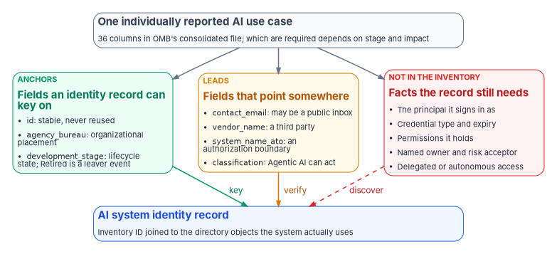
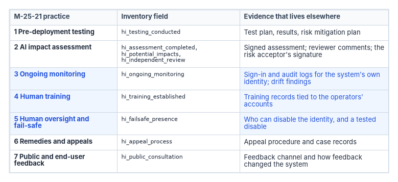

# Chapter 03 — The AI Use-Case Inventory as an Identity Source

*The inventory is the only government-wide list of federal AI, and it was built to tell the public what agencies use AI for; read as identity data, it supplies a key, a place in the organization and a lifecycle state, and leaves blank everything that decides what an AI system can touch.*

::: {.callout-note}
## In this chapter
What the Federal AI Use Case Inventory is under OMB's 2025 guidance, what it records and how many use cases it holds. Which of its fields can anchor an identity record, which only point somewhere, and which identity facts aren't in it at all. Why a use case isn't an identity, and how the program joins the two. What the inventory's high-impact fields can and can't show about M-25-21's seven minimum practices, including a correction to an earlier reading. How the program uses the inventory as the seed list for AI identity governance, and what the inventory can't see.
:::

Every AI system an agency runs has to sign in to something. It reads a mailbox, queries a case database, calls a model endpoint, or writes to a ticketing system, and each of those calls is made with a credential that belongs to some principal in some directory. [Chapter 01](01-ai-agents-need-identities.md) makes the case that this principal needs an owner, a place in the organization, a credential lifecycle and an end. Before an agency can give its AI systems any of that, it needs a list of them.

It already has one. Office of Management and Budget Memorandum M-25-21 requires each agency, except the Department of Defense and the Intelligence Community, to inventory its AI use cases at least annually, submit the inventory to OMB and post a public version on its website, and says OMB will issue detailed instructions on the inventory's scope.[^c03-m2521] [Chapter 02](02-what-federal-ai-rules-require.md) covers the memo as a whole. This chapter reads one of its products, the inventory, as if it were an identity source, because it is the closest thing to one that exists for AI.

{#fig-ch03-anchors-and-gaps fig-alt="A top-to-bottom diagram. A slate card at the top reads: one individually reported AI use case, 36 columns in OMB's consolidated file, and which are required depends on stage and impact. It branches into three cards side by side. A green card labeled anchors, fields an identity record can key on: id, stable and never reused; agency_bureau, organizational placement; development_stage, lifecycle state, where Retired is a leaver event. An amber card labeled leads, fields that point somewhere: contact_email, which may be a public inbox; vendor_name, a third party; system_name_ato, an authorization boundary; classification, where Agentic AI can act. A red card labeled not in the inventory, facts the record still needs: the principal it signs in as; credential type and expiry; permissions it holds; named owner and risk acceptor; delegated or autonomous access. All three cards point to a blue card at the bottom, AI system identity record, inventory ID joined to the directory objects the system actually uses. The arrows are labeled key from the green card, verify from the amber card, and discover, dashed, from the red card."}

## What the inventory is

OMB's instructions for the current cycle are its *Guidance on 2025 Agency Artificial Intelligence Reporting*. It cites three authorities for the reporting requirement: the Advancing American AI Act, Executive Order 13960 and M-25-21.[^c03-guidance] It sets up two kinds of reporting:

- **Individually reported use cases.** Every AI use case in pre-deployment, pilot, deployed or retired status, whether the AI is standalone or embedded in another system, and whether the agency or a third party developed or procured it. When unsure, agencies are told to err on the side of inclusion.[^c03-guidance]
- **Consolidated reporting of common commercial AI.** For twenty listed tasks that rely on commercial off-the-shelf products, such as drafting documents, summarizing reports, AI tools in word processors, generating code, searching agency information with a knowledge retrieval system, managing help desk tickets and managing security controls, an agency certifies use once instead of listing each instance. A high-impact use case can't be reported this way.[^c03-guidance]

Three kinds of AI are excluded: AI used as a component of a National Security System or within the Intelligence Community, and AI used for basic or applied research, with exceptions for research meant to produce an agency application, research AI that already influences decisions about individuals, and research with an approved transition into operations.[^c03-guidance] Agencies may withhold a use case, or particular fields, from the public version where release would be inconsistent with law or governmentwide policy, and the guidance says a use case not being public-facing isn't a reason to withhold it.[^c03-guidance]

The 2025 cycle had two deadlines: submissions to OMB by December 22, 2025, and public posting of a machine-readable CSV at the agency's `/ai` page by January 28, 2026.[^c03-guidance] OMB compiled the public inventories into a consolidated repository on GitHub. As of April 13, 2026, it summarizes 56 agency submissions, 41 of them with individually reported use cases, and a total of **3,611 individually reported use cases, of which 1,818 are deployed or piloted and 445 are high-impact.**[^c03-repo] The 2024 consolidated inventory listed 2,133 use cases.[^c03-repo2024] The repository was last updated in May 2026, and as of October 2026 there is no 2026 repository; OMB's memoranda index lists no newer AI memorandum that replaces the inventory requirement.[^c03-memos]

::: {.callout-note}
## About "over 1,800 AI systems"
Material written for the program in 2026 said agencies had deployed "over 1,800 AI systems." The published figure closest to that is 1,818 deployed and piloted **use cases** in the 2025 inventory.[^c03-repo] A use case isn't a system, and it isn't an identity: one AI system can serve several use cases, and one use case can run on several systems. The difference matters for everything in this chapter. The 1,818 also includes 338 rows from three agencies that recorded no development stage; counted by the file's own stage column, 1,480 use cases are piloted or deployed ([Chapter 09](09-running-the-inventory-scan.md#step-1-load-one-vintage-and-record-whats-missing)).
:::

## What it records

OMB publishes a data dictionary for the consolidated file of individually reported use cases. It lists 36 columns, two of them added by OMB (the agency's abbreviation and full name), with the reporting instruction for each and the valid choices for multiple-choice fields.[^c03-dictionary] Which fields an agency has to answer depends on the use case's stage and impact: some are required for every use case, some only for pilot and deployed ones, and the risk-management fields only for high-impact deployed ones.[^c03-guidance]

| Group | Fields (column names) | Required for |
|---|---|---|
| Identification | `id`, `use_case_name`, `agency_bureau`, `contact_email` | All use cases |
| Disclosure and status | `is_withheld`, `development_stage`, `is_high_impact`, `HI_justification` | All (justification only when a presumed high-impact case is found not to be) |
| What it does | `topic_area`, `classification`, `problem_solved`, `benefits`, `system_outputs` | Pre-deployment, pilot and deployed |
| How it's run | `operational_date`, `contracting_usage`, `vendor_name`, `have_ato`, `system_name_ato` | Pilot and deployed |
| Data and code | `data_description`, `link_to_data`, `has_pii`, `pia_url`, `demographic_features`, `has_custom_code`, `code_url` | Pilot and deployed (links optional) |
| Risk management | Nine `hi_*` fields, one or more per minimum practice | High-impact deployed only |

: The 2025 individually reported inventory, grouped. Field names and requirements from OMB's data dictionary. {.striped .hover}

The consolidated commercial file is much thinner. Each row is an agency, one of the twenty tasks, a yes or no for agency use, the name of the commercial product or service, and an estimated number of licenses or users.[^c03-cots] The published file has one row per task for each of 45 agencies, and 468 of its 900 rows say yes.[^c03-cots]

## Reading the fields as identity data

None of the fields was designed as an identity attribute. Read with an identity team's eyes, a few of them are useful anyway. The program sorts them into anchors, leads and gaps.

### Anchors

An anchor is a field an identity record can key on or derive an attribute from.

- **`id`.** Each use case has a unique identifier that keeps its value from year to year, and a retired use case's identifier must not be repeated.[^c03-dictionary][^c03-guidance] That is the same discipline SP 800-53 IA-4 asks of system identifiers: assign one to the intended individual, group, role, service or device, and prevent its reuse.[^c03-sp80053] It makes the inventory ID a reasonable foreign key on the AI system's identity record.
- **`agency_bureau`.** The organization within the agency responsible for the use case.[^c03-dictionary] This is the AI system's organizational placement, the attribute that tells an access policy or a reviewer which part of the agency it belongs to. It's free text, so it has to be normalized to the agency's own organization model before it can drive anything.
- **`development_stage`.** Pre-deployment, pilot, deployed or retired.[^c03-dictionary] Read as identity data, it's a lifecycle state. A use case marked *retired* is a leaver event: its credentials, grants and role assignments should already be gone. OMB requires retired use cases to be reported once, in the inventory after the year they were last operational.[^c03-guidance]

### Leads

A lead points to something an identity team has to go and check.

- **`contact_email`.** The instruction asks for the email address of the individual or team who works with or is responsible for the use case, then lets agencies replace it in the public version with an address designated for public inquiries.[^c03-dictionary] In OMB's consolidated file of public inventories, 1,115 of the 3,611 rows have no contact address at all, and the rows that do use only 189 distinct addresses.[^c03-csv] The public file names a mailbox, not an owner. An agency's own internal submission may carry the real address, but even then "individual or team" isn't an accountable owner of record. The owner has to be established in the identity system ([Chapter 05](05-owners-sponsors-and-lifecycle.md)).
- **`contracting_usage` and `vendor_name`.** Whether the system was purchased, built in-house or both, and who the vendor is.[^c03-dictionary] Of the 1,480 pilot and deployed use cases in the file that have a stage recorded, 552 were purchased from a vendor and 387 were built with both contract and in-house resources.[^c03-csv] A vendor in the picture usually means a third-party application in the tenant, vendor-hosted credentials, or contractor accounts, each of which falls under governance the workbook already describes: external services and consent ([Book 15, Chapter 06](../b15-day2-operations/06-saas-integration-governance.md)) and non-employees ([Book 03](../b03-hr-identity/index.md)).
- **`have_ato` and `system_name_ato`.** Whether the use case has its own Authorization to Operate or is part of a system that has one, and that system's name.[^c03-dictionary] This links the AI to an authorization boundary, and through it to an authorizing official and a system owner. It's a lead, not an anchor, because the name is free text and has to be matched to the agency's own system inventory. Among the pilot and deployed use cases, 681 say yes, 596 say no and 203 are blank; 58 of the yes answers name no system.[^c03-csv]
- **`classification`.** The single AI category that most closely fits, one of which is *Agentic AI: AI systems that perform tasks or make decisions autonomously with minimal human intervention.*[^c03-dictionary] The file holds 117 use cases classified as agentic, 38 of them pilot or deployed.[^c03-csv] Agentic AI is the category most likely to hold its own credentials and act on records, so it's where an identity team should start. The classification is self-selected and single-choice, though: an agency picking *Generative AI* for an assistant that also calls tools has said nothing about whether it acts.
- **`has_pii`.** Whether the use case involves personally identifiable information the agency maintains.[^c03-dictionary] It's a data-sensitivity signal, useful for setting the AI system's access tier, not an identity fact.

### Gaps

These are the facts an identity record needs most, and none of them is in the inventory:

| Identity fact | Why it matters | Control it serves | Where it comes from |
|---|---|---|---|
| The principal or principals the system signs in as | Without it, nothing else about access can be checked | IA-4, IA-9, CM-8 | The directory: service principals, managed identities, agent identities ([Chapter 04](04-kinds-of-ai-identity.md)) |
| Credential type and expiry, or a stored secret | Secrets leak and expire; federated credentials don't | IA-5 | The application and blueprint objects ([Chapter 06](06-credentials-and-least-privilege.md)) |
| Permissions held: API permissions, roles, group memberships | Decides what the system can read and change | AC-6, AC-2 | Grants and role assignments in the directory and the cloud |
| A named, accountable owner of record | Someone has to approve access, answer for it and end it | AC-2 (account managers) | The identity system's owner or sponsor fields ([Chapter 05](05-owners-sponsors-and-lifecycle.md)) |
| The person who accepted the risk | M-25-21 requires the impact assessment to carry the risk acceptor's signature | — | The impact assessment |
| Delegated or autonomous access | Decides whose policies apply and whose activity the logs show | AC-6, AU-12 | How the system obtains tokens ([Chapter 04](04-kinds-of-ai-identity.md)) |
| Last sign-in and activity | Shows whether it's still alive and what it's doing | AC-2 (monitor use), CA-7 | Sign-in and audit logs ([Chapter 07](07-monitoring-drift-and-shadow-ai.md)) |

: Identity facts the inventory doesn't record. Control references to NIST SP 800-53 Rev. 5; the mapping is program design. {.striped .hover}

The risk-acceptor row needs a word. M-25-21's impact assessment must include "risk acceptance, supported by a signature from the individual accepting the risk," and the memo encourages agencies to give AI risk responsibilities to officials accountable for the mission outcome of the use case.[^c03-m2521] So the memo requires a named, accountable individual for every high-impact use case, and the inventory has no field for that person. The impact assessment is where the name lives; the identity record should point to it.

SP 800-53 AC-2 asks an organization to define the types of accounts allowed, assign account managers, require approvals to create accounts, monitor account use and remove accounts when they're no longer needed; CM-8 asks for an inventory of system components at the granularity needed for tracking and accountability.[^c03-sp80053] An AI system's credentials are accounts and components in exactly that sense. The inventory describes the use; the controls are met in the directory.

## A use case isn't an identity

The hardest part of using the inventory as an identity source is that its unit is wrong for identity work. A use case is "the specific scenario in which AI is designed, developed, procured, or used" to advance a mission or deliver a benefit.[^c03-guidance] A scenario doesn't sign in. Systems and agents do, through principals in a directory. The mapping between the two goes both ways:

- **One use case, many principals.** A deployed assistant might have an app registration for its front end, a managed identity for its retrieval index, an agent identity for the actions it takes, and an API key for a third-party model. Each is a separate identity with its own credential and permissions.
- **One principal, many use cases.** A shared AI platform in the tenant, or a commercial product reported under consolidated reporting, can serve dozens of scenarios under one service principal. Consolidated reporting doesn't list instances at all; it records that the agency uses, for example, AI to generate code, and roughly how many licenses it has.[^c03-cots]
- **No stable key in the public file.** Agencies may drop the `id` column from their public inventories.[^c03-guidance] In the consolidated file, 704 rows have no identifier and 13 identifiers appear more than once, on 28 rows.[^c03-csv]

The program's design answers this by putting the join on the identity side. The AI system's identity record carries the inventory ID (or IDs) as an attribute, and every directory object the system uses carries a reference back to that record. In Microsoft Entra ID, custom security attributes can hold that reference on service principals and agent identities, and Conditional Access can target agent identities by custom security attribute, so the same tag can later drive policy.[^c03-ca-agents] The join runs from the directory toward the inventory, not the other way, because the directory is where access is decided and where a missing join shows up as a finding. The agency's internal submission, not the public CSV, is the source to join against, since only the internal version is guaranteed to carry the identifier and the real contact.

## What the high-impact fields can and can't evidence

M-25-21 requires seven minimum risk-management practices for high-impact AI: pre-deployment testing; an AI impact assessment; ongoing monitoring for performance and adverse impacts; adequate human training and assessment; additional human oversight, intervention and accountability, including a fail-safe where practicable; consistent remedies or appeals; and consulting and incorporating feedback from end users and the public.[^c03-m2521] Independent review is part of the impact assessment, not an eighth practice.[^c03-m2521] Agencies had 365 days from the memo's April 3, 2025 issuance to document implementation for high-impact uses, and a high-impact use case that isn't compliant must be safely discontinued.[^c03-m2521]

::: {.callout-important}
## A correction
An earlier program brief, written against the 2024 inventory schema, said the inventory's high-impact fields could not represent all seven practices, and that human training and public feedback had no field at all. That is no longer true. The 2025 inventory has nine `hi_*` fields, and every one of the seven practices has at least one: `hi_training_established` for training (Section 4(b)(iv)) and `hi_public_consultation` for feedback (Section 4(b)(vii)).[^c03-dictionary] The underlying point survives in a sharper form, below.
:::

The fields are answers, not artifacts. Most are multiple choice: *Yes*, *In-progress*, or *Agency CAIO has waived this minimum practice and reported such waiver to OMB*, with *Not applicable* for the fail-safe and appeal fields and a choice that law precludes an appeal.[^c03-dictionary] One is free text (`hi_potential_impacts`), and one lists the kinds of consultation used (`hi_public_consultation`). None carries a document, a log, a date of last review or a name. An inventory that says *Yes* for ongoing monitoring tells you the agency believes it monitors; it doesn't tell you what was monitored, by whom, or what was found. The inventory can *report* all seven practices. It can *evidence* none of them. That is the distinction [Book 13](../b13-governance/index.md) draws between attestation and evidence, and [Book 12, Chapter 02](../b12-security-operations/02-the-evidence-contract.md) turns into an evidence contract.

{#fig-ch03-status-not-evidence fig-alt="A three-column table with seven rows. Columns: M-25-21 practice, inventory field, evidence that lives elsewhere. Row 1, pre-deployment testing, hi_testing_conducted, test plan, results and risk mitigation plan. Row 2, AI impact assessment, hi_assessment_completed, hi_potential_impacts and hi_independent_review, signed assessment, reviewer comments and the risk acceptor's signature. Row 3, highlighted blue, ongoing monitoring, hi_ongoing_monitoring, sign-in and audit logs for the system's own identity and drift findings. Row 4, highlighted blue, human training, hi_training_established, training records tied to the operators' accounts. Row 5, highlighted blue, human oversight and fail-safe, hi_failsafe_presence, who can disable the identity and a tested disable. Row 6, remedies and appeals, hi_appeal_process, appeal procedure and case records. Row 7, public and end-user feedback, hi_public_consultation, feedback channel and how feedback changed the system."}

Three of the practices have evidence the identity program produces as a by-product, which is why the figure highlights them:

- **Ongoing monitoring.** M-25-21 requires monitoring designed to detect "unforeseen circumstances, changes to an AI system after deployment, or changes to the context of use or associated data."[^c03-m2521] For an AI system with its own identity, new permissions, new credentials, new resources reached and unusual sign-in patterns are exactly those changes, and they're in the directory's audit and sign-in logs. [Chapter 07](07-monitoring-drift-and-shadow-ai.md) builds the monitoring.
- **Human training.** The practice is training "for operators of AI to interpret and act on the AI's output."[^c03-m2521] Operators are people with accounts. If the AI system's identity record names the group of people who operate it, training completion can be checked against that group's members rather than asserted. [Book 16](../b16-people/index.md) owns the training program.
- **Human oversight and fail-safe.** A fail-safe for an AI system that can act is, at minimum, the ability to stop it. In identity terms that's a named person with the right to disable the identity, and a disable that has been tested. [Chapter 05](05-owners-sponsors-and-lifecycle.md) covers who holds that right.

The other four need evidence the identity program doesn't produce: test results, the signed assessment, appeal records and feedback records. The program's position is that the identity record should point to where each is kept, so an assessor following the record finds all seven.

The published data shows how far status is from evidence. Of the 227 high-impact use cases recorded as deployed in the consolidated file, 101 have no answer in any of the risk-management fields, and among those that answered, *In-progress* outnumbers *Yes* for every practice; for pre-deployment testing, for example, 81 say in progress and 44 say yes.[^c03-csv] Those answers were submitted by December 22, 2025, more than three months before the April 3, 2026 deadline, and the guidance told agencies to update their inventories after December 2, 2025 to reflect compliance with that deadline.[^c03-guidance] They describe agencies mid-way, not agencies in breach. They also show that the inventory's answer is a snapshot, set on the day it was submitted, while access changes daily.

Two other provisions affect what the inventory shows. A pilot is exempt from the minimum practices if it's limited in scale and duration and the Chief AI Officer has certified it, with the certification tracked centrally; and a Chief AI Officer may waive one or more practices for a specific system after a written, system-specific risk assessment, must report each waiver to OMB within 30 days and must re-certify waivers annually.[^c03-m2521] Neither exempts a pilot or a waived system from having an identity. A pilot that reaches production data uses real credentials, so it needs both an identity record and an authorization that covers it ([Chapter 10](10-evidence-and-authorization.md)), and its identity record should carry the certification's end date as the date its access is reviewed.

## Authorization: what `have_ato` means

The `have_ato` field asks whether the use case has, or is part of a system that has, an Authorization to Operate.[^c03-dictionary] It is easy to read too much into it. M-25-21 doesn't create an AI-specific authorization. It says that agencies must continue to follow applicable ATO requirements from OMB Circular A-130 for AI systems, that the process for accepting risk for AI use cases is separate from and doesn't supersede the information system authorization process, and that agencies should update their authorization and continuous monitoring processes to address AI as necessary.[^c03-m2521] The field reports existing authorization posture; it isn't a gate the memo created.

The program reads it accordingly. A deployed or piloted use case with `have_ato` set to *No* is a finding against the agency's own authorization policy, not against M-25-21: an AI system is operating, and no authorizing official has accepted the risk of the system it runs in. A *Yes* with a system name that doesn't match the agency's system inventory is a reconciliation task. Either way, the authorization path is the agency's existing one ([Book 14](../b14-compliance/index.md)), and [Chapter 10](10-evidence-and-authorization.md) covers how AI systems are evidenced in it.

## Using the inventory as the seed list

The program uses the inventory as the starting list for AI identity governance, not as its system of record. The method, which [Chapter 09](09-running-the-inventory-scan.md) runs in full, has four steps:

1. **Load the agency's internal submission.** Use the version sent to OMB, which carries identifiers and the real contacts, rather than the public CSV. Keep pre-deployment entries: they're the AI systems about to need identities.
2. **Normalize the leads.** Map `agency_bureau` to the agency's organization model, `system_name_ato` to its system inventory, and `vendor_name` to its vendor and application records.
3. **Join to the directory.** For each use case, find the principals it uses and record the join on the identity side, as described above. A use case with no principal found is either not yet built, or running on credentials the directory can't see, such as a stored API key.
4. **Raise findings.** The program's finding types are design, not federal requirements. The ones that matter most are: a deployed or piloted AI system with no identity record; an identity with no accountable owner; an organizational placement that doesn't map; an agentic AI system with no governed identity, which the program treats as high priority because it's an AI system that can act, not just answer; a deployed system with no authorization link; and a retired use case whose principals still hold credentials or permissions.

::: {.callout-warning}
## Illustrative code
The scan's script isn't published with the workbook. The snippet below only shows the shape of the first pass over an inventory file; it uses standard PowerShell cmdlets and the column names from OMB's data dictionary, and hasn't been tested against an agency's internal submission. Review it before running.
:::

```powershell
# First pass: AI systems most likely to hold their own credentials.
# Column names follow OMB's 2025 data dictionary (the CSV is UTF-8 with BOM).
$inventory = Import-Csv -Path .\ai-inventory-2025.csv -Encoding utf8BOM

$live = $inventory | Where-Object {
    $_.development_stage -in @('Deployed', 'Pilot')
}

# Agentic systems first, then anything purchased or with no ATO link.
$live | Where-Object { $_.classification -eq 'Agentic AI' } |
    Select-Object id, use_case_name, agency_bureau, have_ato, system_name_ato

$live | Group-Object have_ato | Select-Object Name, Count
```

## What the inventory can't see

The inventory is a list of what agencies chose to report, and several kinds of AI are missing from it by design or by accident:

- **Excluded and withheld AI.** National security systems, the Intelligence Community, the Department of Defense, most research, and use cases or fields withheld from the public version.[^c03-guidance] An agency's own identity program still has to govern whatever of these runs in its tenant.
- **Commercial AI reported in aggregate.** Consolidated reporting records that a task is done with AI and how many licenses exist, not which instances, tenants or service principals are involved.[^c03-cots] Embedded AI features in commercial software often have identities in the tenant that no inventory row points to.
- **AI nobody reported.** An AI agent built by a team in a low-code tool, a model API called with a personal key, or a third-party AI app a user consented to: these appear in the directory, in network logs and in consent grants long before, if ever, they appear in an inventory. [Chapter 07](07-monitoring-drift-and-shadow-ai.md) treats them as shadow AI and shows how they're found from the identity side.

That is the deepest reason the inventory can't be the system of record for AI identity. It runs once a year, from the top down, on what people know about. The directory runs continuously, from the bottom up, on what actually signs in. The program needs both, joined, with the directory deciding access and the inventory supplying the purpose.

::: {.callout-tip}
## Continue the book
[← Previous: Chapter 02 — What Federal AI Rules Require, and What They Don't](02-what-federal-ai-rules-require.md) · [Book index](index.md) · [Next: Chapter 04 — Kinds of AI Identity: Workloads, Agents and Delegated Access →](04-kinds-of-ai-identity.md)
:::

[^c03-m2521]: Office of Management and Budget, M-25-21, *Accelerating Federal Use of AI through Innovation, Governance, and Public Trust*, April 3, 2025, Sections 3(b)(i), 3(b)(v), 4(a)(i)–(iii) and 4(b), and footnotes 11, 21, 22 and 29, <https://www.whitehouse.gov/wp-content/uploads/2025/02/M-25-21-Accelerating-Federal-Use-of-AI-through-Innovation-Governance-and-Public-Trust.pdf> (accessed Oct 21, 2026).
[^c03-guidance]: Office of Management and Budget, *Guidance on 2025 Agency Artificial Intelligence Reporting*, Sections 1–5, published in the 2025 Federal Agency AI Use Case Inventory repository, <https://github.com/ombegov/2025-Federal-Agency-AI-Use-Case-Inventory/blob/main/Reporting%20Instructions/Guidance%20on%202025%20Agency%20Artificial%20Intelligence%20Reporting%20(FINAL).pdf> (accessed Oct 21, 2026).
[^c03-repo]: Office of Management and Budget, "2025-Federal-Agency-AI-Use-Case-Inventory," README, Summary as of April 13, 2026, and Exclusion Criteria, <https://github.com/ombegov/2025-Federal-Agency-AI-Use-Case-Inventory> (accessed Oct 21, 2026).
[^c03-repo2024]: Office of Management and Budget, "2024-Federal-AI-Use-Case-Inventory," README, summary as of January 23, 2025, <https://github.com/ombegov/2024-Federal-AI-Use-Case-Inventory> (accessed Oct 21, 2026).
[^c03-memos]: Office of Management and Budget, "Memoranda," list of 2025 and 2026 memoranda through M-26-19 (September 10, 2026), <https://www.whitehouse.gov/omb/information-resources/guidance/memoranda/> (accessed Oct 21, 2026); repository commit history of the 2025 inventory, last commit May 14, 2026, and the `ombegov` organization's repository list, <https://github.com/ombegov> (accessed Oct 21, 2026).
[^c03-dictionary]: Office of Management and Budget, "Data Dictionary," 2025 Federal Agency AI Use Case Inventory, `Validation/data_dictionary.md`, columns 1–36, <https://github.com/ombegov/2025-Federal-Agency-AI-Use-Case-Inventory/blob/main/Validation/data_dictionary.md> (accessed Oct 21, 2026).
[^c03-cots]: Office of Management and Budget, `Data/2025_consolidated_COTS_AI_use_cases.csv`, 2025 Federal Agency AI Use Case Inventory, columns and counts computed from the file (900 rows, 45 agencies), <https://github.com/ombegov/2025-Federal-Agency-AI-Use-Case-Inventory/tree/main/Data> (accessed Oct 21, 2026).
[^c03-csv]: Office of Management and Budget, `Data/2025_individually_reported_AI_use_cases.csv`, 2025 Federal Agency AI Use Case Inventory, 3,611 rows from 41 agencies; counts computed by the program from the file's `development_stage`, `classification`, `contracting_usage`, `have_ato`, `system_name_ato`, `contact_email`, `id`, `is_high_impact` and `hi_*` columns. Counts by stage use the stage recorded in the file (338 rows have none), so they differ slightly from the README's agency-level table. <https://github.com/ombegov/2025-Federal-Agency-AI-Use-Case-Inventory/tree/main/Data> (accessed Oct 21, 2026).
[^c03-sp80053]: National Institute of Standards and Technology, SP 800-53 Rev. 5, *Security and Privacy Controls for Information Systems and Organizations*, controls AC-2, AC-6, CM-8, IA-4, IA-5 and IA-9, statements checked against the release 5.2.0 OSCAL catalog, <https://github.com/usnistgov/oscal-content/blob/main/nist.gov/SP800-53/rev5/json/NIST_SP-800-53_rev5_catalog.json> (accessed Oct 21, 2026).
[^c03-ca-agents]: Microsoft Learn, "Conditional Access for agents," Attribute-driven Conditional Access, <https://learn.microsoft.com/entra/identity/conditional-access/agent-id> (accessed Oct 21, 2026); Microsoft Learn, "agentIdentity resource type" (Microsoft Graph v1.0), property `customSecurityAttributes`, <https://learn.microsoft.com/graph/api/resources/agentidentity?view=graph-rest-1.0> (accessed Oct 21, 2026).
