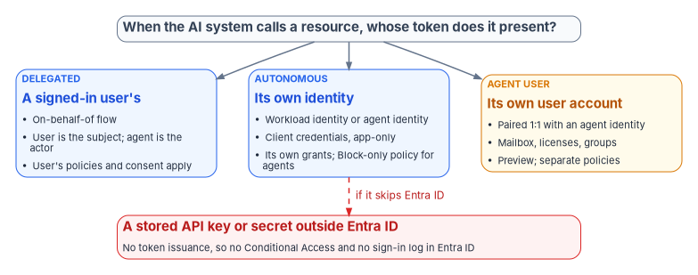
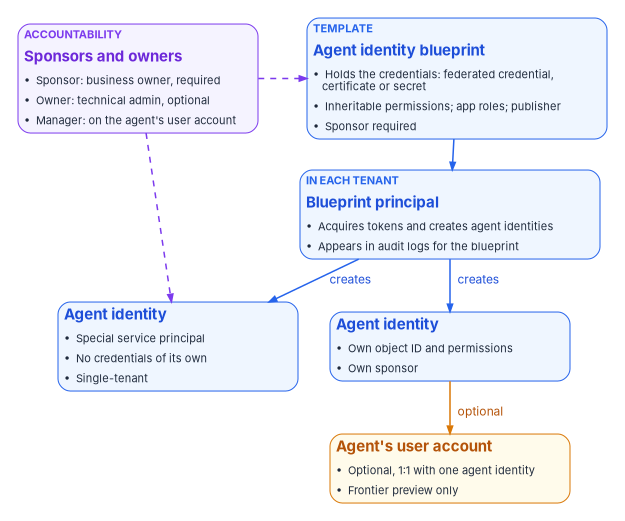

# Chapter 04 — Kinds of AI Identity: Workloads, Agents and Delegated Access

*What kind of identity an AI system has is decided by whose token it presents when it calls something, not by what model it runs, and each answer brings its own owner, credential, policy surface and audit trail.*

::: {.callout-note}
## In this chapter
The question that sorts every AI system: when it calls a resource, whose token does it present? The workload identities an AI system can run as today (service principals, managed identities and federated credentials) and the agent identities Microsoft Entra Agent ID adds: blueprints, agent identities and agents' user accounts. Delegated and autonomous access, and what each means for Conditional Access, risk detection and the logs. What is generally available, what is in preview, what needs extra licensing, and what is documented for GCC, GCC High and DoD as of October 2026. A short contrast with AWS and Google, and the classification the program applies to an agency's AI estate.
:::

[Chapter 03](03-the-inventory-as-an-identity-source.md) ended with a list of AI use cases and a gap: the inventory says what each AI system is for, but not what it signs in as. Closing that gap starts with knowing what to look for. An AI system's identity isn't a property of the model. A large language model has no account. The identity belongs to the software around it: the application that calls the model, the orchestration that decides which tool to use next, and the connector that reads the mailbox. When any of those makes a call, it presents a token, and the token says on whose authority the call is made.

There are three answers that Microsoft Entra ID can see, and one it can't.

{#fig-ch04-whose-token fig-alt="A top-to-bottom diagram. A slate card at the top asks: when the AI system calls a resource, whose token does it present? Three cards branch from it. A blue card labeled delegated, a signed-in user's: on-behalf-of flow; the user is the subject and the agent is the actor; the user's policies and consent apply. A blue card labeled autonomous, its own identity: a workload identity or agent identity; client credentials, app-only; its own grants, with a Block-only policy for agents. An amber card labeled agent user, its own user account: paired one to one with an agent identity; mailbox, licenses and groups; preview, with separate policies. A dashed red arrow labeled if it skips Entra ID runs from the autonomous card to a red card at the bottom: a stored API key or secret outside Entra ID, with no token issuance, so no Conditional Access and no sign-in log in Entra ID."}

- **A signed-in user's.** The AI acts *on behalf of* a person, with that person's delegated permissions. The person is the subject of the token, and the agent appears as the actor.[^c04-ca-agents]
- **Its own.** The AI acts *as itself*, with permissions granted directly to its identity, and no user is involved. Microsoft calls this application-only or client-credentials access.[^c04-ca-agents]
- **Its own user account.** The AI acts *as a user*, through a user account created for it, because the system it needs only accepts user identities.[^c04-ca-agents]
- **None that Entra ID issued.** The AI calls a service with an API key or other secret that never passes through Entra ID. Microsoft notes that when an agent uses an API key this way it bypasses token issuance entirely, and Conditional Access doesn't apply.[^c04-ca-agents]

The first three are identities the program can govern. The fourth is a finding: an AI system whose access the directory can't see, can't put policy on and can't log. [Chapter 06](06-credentials-and-least-privilege.md) deals with replacing those secrets; this chapter is about the identities that replace them.

## Workload identities: what most AI runs as today

Microsoft's term for any identity assigned to software is a workload identity: in Entra ID, applications, service principals and managed identities.[^c04-mi] Before any AI-specific identity existed, AI systems ran as these, and most still do. Microsoft says agents created in earlier versions of Copilot Studio and Azure AI Foundry may exist as classic applications and service principals, possibly tagged as AI agents but without agent identities, and that they're subject to the same policies and governance as any other application.[^c04-disable] [Book 04, Chapter 05](../b04-access/05-applications-and-workload-identities.md) governs these objects in general; what follows is what matters when the workload is an AI system.

### Service principals

An app registration and its service principal are the default identity for an AI application built in-house or bought from a vendor. The service principal holds the permissions (Microsoft Graph application permissions, Azure role assignments, app roles), and the app registration holds the credentials: a client secret, a certificate or a federated credential. A third-party AI service consented into the tenant appears as a service principal for a multitenant application, which is the external-service case [Book 15, Chapter 06](../b15-day2-operations/06-saas-integration-governance.md) governs.

### Managed identities

A managed identity is a service principal of a special type whose credentials Azure manages and nobody can see. A system-assigned identity is created with one Azure resource, can be used only by it, and is deleted with it. A user-assigned identity is a standalone Azure resource that can be attached to several resources and has to be deleted explicitly; Microsoft recommends it for Microsoft services.[^c04-mi] For an AI system hosted in Azure (a model endpoint calling a search index, or a function app calling a storage account), a managed identity removes the stored secret entirely.

A managed identity can also serve as the credential for an app registration, through workload identity federation, which Microsoft recommends whenever an Entra ID application is required and the code runs on Azure.[^c04-mi] That matters for agents, below.

### Workload identity federation

Workload identity federation lets an app registration or a user-assigned managed identity trust tokens from an external identity provider and exchange them for Entra ID access tokens, so the workload holds no secret. Microsoft supports it for Kubernetes clusters on any cloud or on premises, GitHub Actions, Google Cloud, AWS through IAM outbound identity federation, SPIFFE and SPIRE, Azure Pipelines and other platforms that issue OpenID Connect tokens. The credential's issuer, subject and audience must match the external token exactly, and the federated credential flow doesn't accept tokens issued by Entra ID itself.[^c04-wif] An AI agent running on another cloud can therefore reach Microsoft Graph or an agency API without a stored secret, provided its home platform can issue a token Entra ID will trust.

The order of preference among these credentials is settled in the workbook: a managed identity where the workload runs in Azure, a federated credential where it runs elsewhere, a certificate only where neither applies, and a secret only by exception ([Book 02, Chapter 09](../b02-identity/09-building-the-entra-target.md), [Book 04, Chapter 05](../b04-access/05-applications-and-workload-identities.md)). Nothing about AI changes that order.

### Policy on workload identities

Conditional Access can target workload identities, but narrowly. Policies apply only to single-tenant service principals registered in the tenant; Microsoft and third-party SaaS apps, multitenant apps and managed identities aren't covered, and a policy assigned to a group that contains a service principal isn't enforced for it. The available control is to block, by location, by risk or with authentication contexts, and creating or changing these policies requires Workload Identities Premium licenses.[^c04-ca-wid] Microsoft states that Workload Identities Premium is available in Azure for US Government.[^c04-entra-gov] A vendor's AI service, consented in as a multitenant application, is therefore outside workload-identity Conditional Access altogether. Its controls are consent, permissions and monitoring.

## Agent identities: Microsoft Entra Agent ID

Workload identities were designed, in Microsoft's words, for services built and maintained by organizations, with "the expectation of long-term stability, known ownership, and managed lifecycle." Agents are different: they're often created dynamically, by automation or by a user in a low-code tool, and might exist for minutes or be created and destroyed thousands of times a day.[^c04-what-agent] Microsoft Entra Agent ID is Microsoft's identity model for them. Microsoft announced the Agent ID platform as generally available in April 2026, and states that Agent ID is available for all Microsoft Entra customers.[^c04-whatsnew][^c04-agent-id]

### The object model

Agent ID adds four kinds of directory object.[^c04-governance]

- **Agent identity blueprint.** A template that defines a kind of agent. It holds the credentials (federated identity credentials, certificates or client secrets), the inheritable permissions that every agent created from it starts with, app roles and the verified publisher. For agents running on Azure, the blueprint can be federated to a managed identity so no secret is stored on it.[^c04-a365-identity]
- **Agent identity blueprint principal.** The object created when a blueprint is added to a tenant. It acquires tokens, creates agent identities and appears in the audit logs on the blueprint's behalf.[^c04-patterns]
- **Agent identity.** The account an individual agent runs as: a special service principal with its own object ID, display name, sponsor and permissions. It has no credentials of its own; the blueprint acquires tokens on its behalf. Agent identities are single-tenant, while a blueprint can be multitenant, which is how a published agent is added to a customer tenant that then creates its own agent identities.[^c04-agent-identities][^c04-a365-identity]
- **Agent's user account.** An optional second account, a user account marked in the directory as an AI agent, for agents that need a mailbox, licenses or access to systems that only accept user identities. It's paired one-to-one with a single agent identity, the pairing can't be changed once made, and it can only authenticate with a token issued to its agent identity.[^c04-agent-users]

{#fig-ch04-agent-id-objects fig-alt="A diagram of Microsoft Entra Agent ID objects. A blue card labeled template, agent identity blueprint: holds the credentials, a federated credential, certificate or secret; inheritable permissions, app roles and publisher; sponsor required. An arrow leads down to a blue card labeled in each tenant, blueprint principal: acquires tokens and creates agent identities; appears in audit logs for the blueprint. Two arrows labeled creates lead to two blue agent identity cards. The first reads: special service principal; no credentials of its own; single-tenant. The second reads: own object ID and permissions; own sponsor. From the second, an amber arrow labeled optional leads to an amber card, agent's user account: optional, one to one with one agent identity; Frontier preview only. A violet card labeled accountability, sponsors and owners, lists: sponsor, business owner, required; owner, technical admin, optional; manager, on the agent's user account. Dashed violet arrows run from it to the blueprint and to an agent identity."}

Three consequences of this model matter for governance.

**The blueprint is the credential boundary.** Every agent identity created from a blueprint shares the blueprint's credentials, so Microsoft advises treating each blueprint as a credential boundary and grouping only agents that can safely share credentials and baseline permissions.[^c04-a365-identity] It also means one operation on a blueprint, such as a Conditional Access policy, a revoked permission grant or a disable, applies to every agent of that kind, including agents created later.[^c04-agent-identities][^c04-ca-agents]

**Declared isn't granted.** Permissions declared on a blueprint aren't granted until an administrator consents, on the blueprint principal or on individual agent identities. Azure role assignments can't be held by a blueprint and are assigned to each agent identity directly; agent identities can also hold Entra built-in roles.[^c04-a365-identity] An agent's real access is therefore the sum of consented inheritable permissions, direct grants, Azure roles and directory roles, which is what an access review has to read.

**Every agent has a human of record.** A sponsor (a user or a supported group) is required when an agent identity or a blueprint is created. Sponsors are the business owners accountable for the agent's purpose and lifecycle; they can disable or soft-delete an agent and change its sponsors, but can't change its technical settings. Owners are optional technical administrators who manage credentials and configuration, and managers are users responsible for an agent's user account in the organization's hierarchy.[^c04-sponsors] When a user creates an agent in Copilot Studio, the user is recorded as its sponsor.[^c04-what-agent] [Chapter 05](05-owners-sponsors-and-lifecycle.md) builds the program's ownership and lifecycle model on these roles.

### Which products create agent identities

Agent identities appear in a tenant whether or not anyone planned for them. Microsoft documents several sources:[^c04-governance][^c04-what-agent]

- **Microsoft Copilot Studio.** Agents can be configured to get an agent identity automatically; Microsoft labels the automatic creation setting as preview.
- **Microsoft Foundry.** The first agent in a project gets a default blueprint and agent identity shared by the project's agents; publishing an agent gives it its own blueprint and agent identity. Until an agent is published, its activity is attributed to an identity it shares with its neighbors.
- **Azure App Service and Azure Functions** can be configured to run an app as an agent with an agent identity.
- **Microsoft's own agents**, such as the Conditional Access optimization agent, run under agent identities in the tenant.
- **Non-Microsoft agents**, such as agents on Amazon Bedrock or n8n, can be given agent identities through Microsoft's authentication sidecar or through workload identity federation.[^c04-agent-id]

The agent inventory itself has moved. Microsoft announced in March 2026 that the agent registry and agent collections views in the Entra admin center would be retired on May 1, 2026, with Microsoft Agent 365 becoming the single registry and Entra continuing to provide the identities.[^c04-registry]

## Delegated and autonomous access

Whose token the agent presents decides whose policies apply, whose risk is raised and what the logs show. Microsoft's guidance is to create a separate policy for each token subject an agent uses, because a policy aimed at one subject doesn't reach the others.[^c04-ca-agents]

| | Delegated (on-behalf-of) | Autonomous (app-only) | Agent's user account |
|---|---|---|---|
| Token subject | The signed-in user; the agent identity is the actor | The agent identity | The agent's user account |
| Permissions used | The user's delegated permissions, as consented | Grants and roles assigned to the agent identity | Licenses, groups and roles of the user account |
| Conditional Access target | The user, through user and group targeting; a policy on the agent identity doesn't apply | The agent identity or its blueprint; Block is the only control, and agent risk (preview) the only condition | Agent users specifically (preview); "All users" doesn't include them; Block, or require a compliant device |
| Risk detection | Risky activity is attributed to the user, not the agent | Agent risk detections apply | Agent risk applies |
| Release stage | Part of the generally available platform | Generally available identity; agent risk condition in preview | Preview; Frontier program tenants only |

: Three ways an agent obtains access. Behavior from Microsoft Learn as of October 2026. {.striped .hover}

The table's sources are Microsoft's Conditional Access documentation for agents,[^c04-ca-agents][^c04-ca-target] its grant-control reference,[^c04-ca-grant] ID Protection for agents,[^c04-risky-agents] and the Agent 365 identity model.[^c04-a365-identity]

Some consequences follow directly:

- **A delegated agent can't do more than the user, and does everything the user can.** On-behalf-of access limits the agent to resources the user has consented to and can reach.[^c04-foundry] That is a ceiling, not a scope. An assistant that acts for a user with broad access can reach everything that user can, and the agent's own identity carries no policy that narrows it. The narrowing has to come from consent: which delegated permissions the agent may request.
- **An autonomous agent's policy surface is thin.** Agent identities don't use passwords or multifactor authentication, so Microsoft's guidance is to govern them with Conditional Access instead,[^c04-a365-identity] and the only Conditional Access control for an agent identity is to block it.[^c04-ca-grant] Its effective controls are the permissions it was granted and a block policy that fires on risk or on membership in a set of agents. Least privilege does most of the work ([Chapter 06](06-credentials-and-least-privilege.md)).
- **An agent's user account is a user, and isn't.** It can hold a mailbox and licenses and be added to groups and administrative units like any user.[^c04-ca-agents] Policies targeting all users don't include it, and it can't be targeted through group membership; it needs policies written for agent users.[^c04-ca-agents] A tenant whose baseline policies all target "All users" has, by default, no Conditional Access on its agents' user accounts.
- **The logs separate the parties.** Sign-in and audit logs distinguish the blueprint, the agent identity and the agent's user account, so a reviewer can tell the credential source, the acting identity and the token subject; in delegated operations the user is the subject and the agent identity the actor.[^c04-a365-identity] [Book 12, Chapter 03](../b12-security-operations/03-identity-telemetry.md) lists the agent risk tables that carry agent detections into the SIEM.

## Release stage, licensing and government clouds

The agency's cloud decides what it can use. As of October 2026, Microsoft's documentation supports the following reading.

| Capability | Release stage | Licensing | Government-cloud documentation |
|---|---|---|---|
| Agent ID platform: blueprints, agent identities, sponsors | Generally available (April 2026) | Available to all Entra customers | No Agent ID entry on Entra's Azure Government feature list |
| Agent's user account | Preview, Frontier program tenants only | Agent 365 | None |
| Conditional Access for agents | Agent targeting labeled preview in the policy builder; agent identities Block only | Microsoft 365 E7, or Agent 365 with Entra ID P1 or Microsoft 365 E3 | GCC: available for agents with delegated access |
| ID Protection for agents | Agent risk condition labeled preview; detections run offline | Agent 365 required "starting soon" | GCC: listed with Conditional Access |
| ID Governance for agents: access packages, sponsor lifecycle workflows | Sponsor lifecycle workflows generally available (May 2026) | Microsoft 365 E7, or Agent 365 with Entra ID P1 or Microsoft 365 E3 | GCC: available |
| Network controls for agents; Purview audit and DLP for agent interactions | — | Agent 365 | GCC: not available |
| Workload identities: managed identities, federation | Generally available | Free | Not listed on Entra's Azure Government feature list; confirm in the agency's cloud |
| Conditional Access and ID Protection for workload identities | Generally available | Workload Identities Premium | Available in Azure for US Government |

: Agent and workload identity capabilities by stage, license and government cloud, October 2026. {.striped .hover}

Sources for the rows: the Agent ID overview and what's new pages,[^c04-agent-id][^c04-whatsnew] the agent user and Agent 365 identity pages,[^c04-agent-users][^c04-a365-identity] the Conditional Access targeting and licensing pages,[^c04-ca-target][^c04-ca-agents] ID Protection for agents,[^c04-risky-agents] the agent governance overview and Entra what's new for May 2026,[^c04-governance][^c04-whatsnew-entra] the Agent 365 service description,[^c04-a365-sd] the Entra feature availability list for Azure Government,[^c04-entra-gov] and the workload identity pages.[^c04-ca-wid][^c04-wid-faq]

Three points need saying plainly.

**GCC has a partial, documented subset.** Microsoft's Agent 365 service description has a GCC column. It lists the agent registry, basic governance actions, policy templates, access packages for agents, sponsor-driven lifecycle policies, Conditional Access and identity protection for agents with delegated access, Defender observability logs and device compliance for agent Conditional Access as available in GCC, and network controls, the Graph registry API, Purview audit, data lifecycle, DLP and insider risk for agents, and most Defender agent detections as not available.[^c04-a365-sd] A GCC agency can build identity and access governance for agents; it can't yet get Microsoft's audit and data-protection coverage of agent interactions in the same tenant.

**GCC High and DoD have no published availability.** The service description covers GCC only. Microsoft's Agent 365 developer documentation explains how to point its tooling at GCC High and DoD endpoints, then warns that configurable endpoints don't guarantee that every service or feature is available in every cloud, and that features available commercially might not yet be available in GCC, GCC High or DoD.[^c04-a365-cli] Entra's feature availability list for Azure Government, which covers GCC High and DoD tenants, has no Agent ID entries.[^c04-entra-gov] An agency in GCC High or DoD should treat agent identities as unavailable until Microsoft confirms otherwise in writing for its tenant.

**Authorization is pending.** Microsoft's service description says that as of October 1, 2026, Agent 365 meets all FedRAMP High controls reviewed by its independent third-party assessor, and that final authorization by Microsoft's accrediting agency is pending.[^c04-a365-sd] An agency authorizing an AI system that depends on Agent 365 should check the service's current FedRAMP status itself rather than assume it ([Book 10, Chapter 03](../b10-cloud-boundary/03-what-changed-at-fedramp.md)).

The program's position follows [Book 04, Chapter 03](../b04-access/03-the-conditional-access-model.md): it builds on capabilities that are generally available in the agency's own cloud, and records preview capabilities as watch items. Agent identities themselves meet that bar in commercial and, with the listed gaps, in GCC. Policies on agents' user accounts and agent risk conditions don't yet. Where agent identities aren't available, the same governance applies to the service principals and managed identities the agents run as instead: an owner of record, least-privilege grants, a credential without a stored secret, and a lifecycle that ends.

::: {.callout-note}
## Note for readers of Book 04
[Book 04, Chapter 03](../b04-access/03-the-conditional-access-model.md) says agent targets in Conditional Access are in preview and that agent identities support only Block. That remains accurate as of October 2026: the policy builder still labels agent targeting as preview, and Block is still the only control for agent identities.[^c04-ca-target] Two details have been added since. Conditional Access for agents now requires an Agent 365 license (or Microsoft 365 E7), and policies on agents' user accounts can grant access with a compliant-device requirement as well as block, also in preview.[^c04-ca-grant]
:::

## AWS and Google, briefly

The same pattern appears on the other clouds an agency may use for AI. Neither is covered in depth here; they're named as examples, not recommendations.

**AWS.** Amazon Bedrock AgentCore Identity is AWS's identity and credential service for agents. AWS describes agent identities as workload identities with specialized attributes; the service authenticates inbound callers through a JWT authorizer and manages outbound credential providers so agents can reach AWS resources and third-party services on behalf of users.[^c04-aws-agentcore] AWS lists Amazon Bedrock AgentCore as available in the AWS GovCloud (US-West) Region, with some differences: several resources, including the OAuth2 and API key credential providers, aren't available there as CloudFormation resources.[^c04-aws-gov]

**Google Cloud.** Google's agent identity gives each agent a SPIFFE-based identity with an X.509 certificate, presents it as an improvement on service accounts, and says agent identities aren't shared between workloads by default, can't be impersonated and can't have long-lived keys.[^c04-gcp-agent] The page doesn't state a release stage or say anything about Google's government offerings; an agency should confirm both before relying on it.

The common shape is the one this chapter started with. Each platform gives agents their own identity type, built on its workload identity, and distinguishes an agent acting for itself from an agent acting for a user. Workload identity federation lets an agent on one platform reach resources protected by another without a stored secret.[^c04-wif]

## Classifying the AI estate

The program classifies every AI system found in the inventory or in the directory by the kind of identity it uses. The classes and their consequences are program design:

| Kind | What the directory holds | Owner of record | Preferred credential | Policy surface | Ends when |
|---|---|---|---|---|---|
| Delegated assistant | Consent grants to an application; no standing access of its own | The application's owner | None of its own; the user's session | User policies; consent scope | The application is removed or consent is revoked |
| Workload-identity AI | Service principal or managed identity | Two owners on the app; system owner | Managed identity or federated credential | Workload Conditional Access (single-tenant only); grants and roles | The Azure resource is deleted or the app is retired |
| Agent identity | Blueprint, blueprint principal, agent identities | Sponsor (required) and owner | Blueprint federated to a managed identity, or federated credential | Block policies on agents or blueprints; access packages; grants | Sponsor or lifecycle workflow disables and deletes it |
| Agent with a user account | Agent identity plus a paired user account | Sponsor, plus a manager on the user account | Through the agent identity only | Agent-user policies (preview); licenses and groups | Both objects are removed together |
| Vendor-hosted AI | A multitenant service principal, or nothing | The integration's business owner | The vendor's | Consent, permissions, monitoring; outside workload Conditional Access | The integration is offboarded |
| Unmanaged key | Nothing in the directory | None: a finding | Replace with one of the above | None | Never, until found |

: The program's classes of AI identity. Program design; product behavior from Microsoft Learn. {.striped .hover}

The last two rows are where most of the risk sits. A vendor-hosted AI service receives agency data through a consented application that the agency can see but can't put workload policy on, so its controls are the consent baseline and the authorization check in [Book 15, Chapter 06](../b15-day2-operations/06-saas-integration-governance.md). An unmanaged key has no identity at all, and [Chapter 07](07-monitoring-drift-and-shadow-ai.md) is about finding it. Everything above those rows has a place to record an owner, a credential to rotate or eliminate, and an object that can be disabled, and the next two chapters build on that: owners and lifecycle in [Chapter 05](05-owners-sponsors-and-lifecycle.md), credentials and access policy in [Chapter 06](06-credentials-and-least-privilege.md).

::: {.callout-tip}
## Continue the book
[← Previous: Chapter 03 — The AI Use-Case Inventory as an Identity Source](03-the-inventory-as-an-identity-source.md) · [Book index](index.md) · [Next: Chapter 05 — Owners, Sponsors and the AI Identity Lifecycle →](05-owners-sponsors-and-lifecycle.md)
:::

[^c04-ca-agents]: Microsoft Learn, "Conditional Access for agents," sections Requirements and licensing, Agent access patterns, Conditional Access policies and agent identity blueprints, and Boundaries and limitations, <https://learn.microsoft.com/entra/identity/conditional-access/agent-id> (accessed Oct 21, 2026).
[^c04-ca-target]: Microsoft Learn, "Target agent identities in Microsoft Entra Conditional Access policies," sections Prerequisites, Assignments, Conditions and Access controls, <https://learn.microsoft.com/entra/identity/conditional-access/howto-target-agent-identities> (accessed Oct 21, 2026).
[^c04-ca-grant]: Microsoft Learn, "Conditional Access: Grant," Grant controls for agent users (Preview), <https://learn.microsoft.com/entra/identity/conditional-access/concept-conditional-access-grant> (accessed Oct 21, 2026).
[^c04-ca-wid]: Microsoft Learn, "Conditional Access for workload identities," Overview, <https://learn.microsoft.com/entra/identity/conditional-access/workload-identity> (accessed Oct 21, 2026).
[^c04-wid-faq]: Microsoft Learn, "Frequently asked questions about Microsoft Entra Workload ID," free and Premium capabilities, <https://learn.microsoft.com/entra/workload-id/workload-identities-faqs> (accessed Oct 21, 2026).
[^c04-mi]: Microsoft Learn, "What is managed identities for Azure resources?," sections What are managed identities, Managed identity types, and Use managed identity as a Federated Identity Credential, <https://learn.microsoft.com/entra/identity/managed-identities-azure-resources/overview> (accessed Oct 21, 2026).
[^c04-wif]: Microsoft Learn, "Workload identity federation concepts," sections Supported scenarios and How it works, <https://learn.microsoft.com/entra/workload-id/workload-identity-federation> (accessed Oct 21, 2026).
[^c04-disable]: Microsoft Learn, "Disable agent identities in your tenant," Types of identities used by AI agents, <https://learn.microsoft.com/entra/agent-id/disable-agent-identities> (accessed Oct 21, 2026).
[^c04-entra-gov]: Microsoft Learn, "Microsoft Entra feature availability," Azure for US Government, including Other Microsoft Entra products, <https://learn.microsoft.com/entra/identity/authentication/feature-availability> (accessed Oct 21, 2026).
[^c04-what-agent]: Microsoft Learn, "What are agent identities," sections Agent identities versus application identities and Agent identities in practice, <https://learn.microsoft.com/entra/agent-id/what-are-agent-identities> (accessed Oct 21, 2026).
[^c04-agent-id]: Microsoft Learn, "What is Microsoft Entra Agent ID?," sections Agent identity platform and How to get started, <https://learn.microsoft.com/entra/agent-id/identity-professional/microsoft-entra-agent-identities-for-ai-agents> (accessed Oct 21, 2026).
[^c04-whatsnew]: Microsoft Learn, "Microsoft Entra releases and announcements," April 2026, General Availability – Microsoft Entra Agent ID platform, <https://learn.microsoft.com/entra/fundamentals/whats-new> (accessed Oct 21, 2026); Microsoft Learn, "What's new in Microsoft Entra Agent ID," <https://learn.microsoft.com/entra/agent-id/whats-new-agent-id> (accessed Oct 21, 2026).
[^c04-whatsnew-entra]: Microsoft Learn, "Microsoft Entra releases and announcements," May 2026, General Availability – Manage Agent ID sponsorship lifecycle with Lifecycle Workflows, <https://learn.microsoft.com/entra/fundamentals/whats-new> (accessed Oct 21, 2026).
[^c04-governance]: Microsoft Learn, "Governing Agent Identities," sections License requirements, Agent identities basics, Agent identities in other Microsoft products and portals, and Assigning access to agent identities, <https://learn.microsoft.com/entra/id-governance/agent-id-governance-overview> (accessed Oct 21, 2026).
[^c04-patterns]: Microsoft Learn, "Microsoft Entra Agent ID design patterns," Identity constructs, <https://learn.microsoft.com/entra/agent-id/concept-agent-id-design-patterns> (accessed Oct 21, 2026).
[^c04-agent-identities]: Microsoft Learn, "Agent identities in Microsoft Entra Agent ID," sections Anatomy of an agent identity, Blueprints, and Authorizing agent identities, <https://learn.microsoft.com/entra/agent-id/agent-identities> (accessed Oct 21, 2026).
[^c04-agent-users]: Microsoft Learn, "The agent's user account in Microsoft Entra Agent ID," <https://learn.microsoft.com/entra/agent-id/agent-users> (accessed Oct 21, 2026).
[^c04-a365-identity]: Microsoft Learn, "Agent 365 identity," sections Identity objects, Blueprint-to-agent relationship, Credentials, Agent's user account, Permissions and runtime flow, and Sponsor and auditing, <https://learn.microsoft.com/microsoft-agent-365/developer/identity> (accessed Oct 21, 2026).
[^c04-sponsors]: Microsoft Learn, "Administrative relationships in Microsoft Entra Agent ID (Owners, sponsors, and managers)," <https://learn.microsoft.com/entra/agent-id/agent-owners-sponsors-managers> (accessed Oct 21, 2026).
[^c04-registry]: Microsoft Learn, "Microsoft Entra releases and announcements," March 2026, Plan for change – Agent Registry consolidation into Microsoft Agent 365, <https://learn.microsoft.com/entra/fundamentals/whats-new> (accessed Oct 21, 2026).
[^c04-foundry]: Microsoft Learn, "Agent identity concepts in Microsoft Foundry," Authentication capabilities, <https://learn.microsoft.com/azure/foundry/agents/concepts/agent-identity> (accessed Oct 21, 2026).
[^c04-risky-agents]: Microsoft Learn, "ID Protection for agents," sections Licensing and Activities contributing to risk, <https://learn.microsoft.com/entra/id-protection/concept-risky-agents> (accessed Oct 21, 2026).
[^c04-a365-sd]: Microsoft Learn, "Microsoft Agent 365" (service description), Feature availability, <https://learn.microsoft.com/office365/servicedescriptions/microsoft-agent-365/microsoft-agent-365> (accessed Oct 21, 2026).
[^c04-a365-cli]: Microsoft Learn, "Configure the Agent 365 CLI for US Government clouds," <https://learn.microsoft.com/microsoft-agent-365/developer/configure-cloud-endpoints> (accessed Oct 21, 2026).
[^c04-aws-agentcore]: Amazon Web Services, "Provide identity and credential management for agent applications with Amazon Bedrock AgentCore Identity," *Amazon Bedrock AgentCore Developer Guide*, <https://docs.aws.amazon.com/bedrock-agentcore/latest/devguide/identity.html> (accessed Oct 21, 2026).
[^c04-aws-gov]: Amazon Web Services, "Amazon Bedrock AgentCore in AWS GovCloud (US)," *AWS GovCloud (US) User Guide*, <https://docs.aws.amazon.com/govcloud-us/latest/UserGuide/govcloud-bedrock-agentcore.html> (accessed Oct 21, 2026).
[^c04-gcp-agent]: Google Cloud, "Agent identity overview," Identity and Access Management documentation, <https://docs.cloud.google.com/iam/docs/agent-identity-overview> (accessed Oct 21, 2026).
