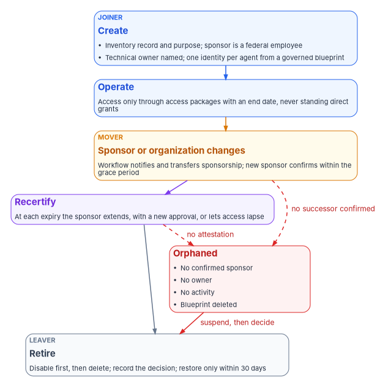
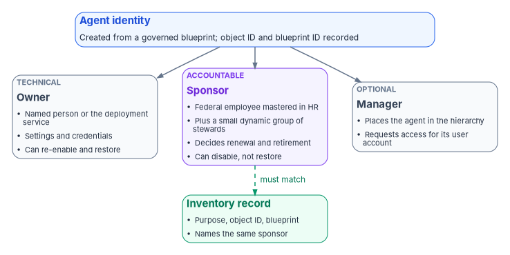

# Chapter 05 — Owners, Sponsors and the AI Identity Lifecycle

*An AI agent has no hire date and no separation date, so its lifecycle has to hang from a person who does, and every event in that person's record has to reach the agent.*

::: {.callout-note}
## In this chapter
Why an AI identity needs an accountable human before it needs anything else, and what Microsoft Entra Agent ID provides for that: owners, sponsors and managers, what each can do, and what creation sets automatically. Then the lifecycle event by event (creation, sponsor change, reorganization, change of purpose, recertification, retirement and the orphaned agent), the Entra ID Governance features that carry each event, their release stage and their availability in the government clouds, and the program's design for agents that can't use those features. [Chapter 06](06-credentials-and-least-privilege.md) covers credentials and access policy; this chapter covers who answers for the identity and when it ends.
:::

A person's identity in the program begins with a record nobody in IT creates. Human resources hires someone, the hire is an effective-dated event, and provisioning turns it into an account; a transfer or a separation later does the same in reverse ([Book 03, Chapter 08](../b03-hr-identity/08-joiner-mover-leaver.md)). Nobody has to remember to disable a leaver, because the separation record causes the disablement.

AI identities have no such record. An agent is created when someone builds it, often in a tool designed to make that fast. When a user creates an agent in Copilot Studio, the agent gets an agent identity in the tenant and the creator is recorded as its sponsor.[^c05-what-agents] When the first agent in a Microsoft Foundry project is created, Foundry provisions a default agent identity blueprint and agent identity for the project, and agents in that project share the project's identity until one is published, at which point it gets its own.[^c05-gov-overview] Microsoft describes agents as being created dynamically through automation, user actions and orchestration, sometimes existing for minutes, sometimes created and destroyed thousands of times a day.[^c05-what-agents] None of those creation paths starts from an authoritative record of who needs the agent, for what, and until when.

That is the gap this chapter closes. The program's position is that an AI identity's lifecycle is anchored in two things the identity program already governs: an accountable human whose own lifecycle is HR-driven, and an inventory record that states the system's purpose ([Chapter 03](03-the-inventory-as-an-identity-source.md)). Every lifecycle event for the agent is either a change to one of those two anchors or a scheduled check that they still hold.

{#fig-ch05-agent-lifecycle fig-alt="A top-to-bottom flow of five stages. First, a blue card, Create, the joiner: an inventory record and purpose, a named sponsor who is a federal employee, a technical owner, and one identity per agent from a governed blueprint. Second, a blue card, Operate: access only through access packages with an end date, never standing direct grants. Third, an amber card, Sponsor or organization changes, the mover: a lifecycle workflow notifies and transfers sponsorship, and the new sponsor confirms within a grace period. Fourth, a violet card, Recertify: at each expiry the sponsor extends with a new approval or lets access lapse. Fifth, a slate card, Retire, the leaver: disable first, then delete, record the decision, and restore only within the 30-day window. A red card on the side, Orphaned, lists no confirmed sponsor, no owner, no activity, or a deleted blueprint; dashed red arrows lead to it from the mover and recertify stages, labeled no successor confirmed and no attestation, and a red arrow from it leads to Retire, labeled suspend, then decide."}

## Three accountable relationships

Microsoft Entra Agent ID separates technical administration of an agent from business accountability for it, and records both on the agent's own directory objects. It defines three relationships, which apply to agent identity blueprints, blueprint principals, agent identities and agents' user accounts, and which are separate from the administrative rights that directory roles such as Agent ID Administrator grant.[^c05-relationships] [Chapter 04](04-kinds-of-ai-identity.md) describes those objects; this chapter is about who is attached to them.

| | Owner | Sponsor | Manager |
|---|---|---|---|
| What it means | Technical administrator: setup, configuration, credentials | Business accountability: purpose, lifecycle decisions, access reviews, retention | The person the agent reports to in the organization's hierarchy |
| Required | Optional on every agent object | At least one on each agent identity and blueprint, set at creation; blueprint principals exempt at creation | Optional |
| Who can hold it | Users, including guests, and service principals; not groups | Users, including guests; dynamic membership groups and Microsoft 365 groups with assigned membership; not role-assignable groups or assigned security groups | Individual users |
| Limits | | Up to 100 sponsors, no more than 5 of them groups | |
| What it can do | Edit settings and authentication properties, manage credentials, add owners and sponsors, disable, re-enable, restore and hard-delete | Disable, soft-delete and change sponsors; request access packages for the agent; can't change application settings, re-enable or restore | Request access packages for the agent's user account; can't modify or delete the agent |

: Owner, sponsor and manager in Microsoft Entra Agent ID. Source: Microsoft Learn, administrative relationships.[^c05-relationships] {.striped .hover}

Two of those rows carry most of the governance weight. The sponsor is the accountable official, and Microsoft deliberately gives the role nondestructive power only: a sponsor can switch an agent off but can't switch it back on, so a sponsor who disables an agent by mistake has to ask an owner or administrator to recover it.[^c05-relationships] The owner holds the technical keys, including the credentials, which is why ownership is the more dangerous relationship to leave stale, exactly as it is for an ordinary application ([Book 04, Chapter 05](../b04-access/05-applications-and-workload-identities.md#ownership)).

An agent's user account, the optional user object an agent gets when it needs a mailbox or a user-only API, has its own, weaker sponsor relationship. Sponsors of an agent's user account can't modify it, are limited to five, and aren't required. Microsoft recommends keeping the agent identity's sponsor as the primary accountable party and, where a sponsor is set on the user account too, using the same user or group on both objects.[^c05-relationships]

### What creation sets automatically

Creation fills in accountability according to how the agent was created, and the defaults are worth knowing because they decide who the tenant believes is accountable when nobody chose.[^c05-relationships]

- **Delegated creation.** When a user creates an agent identity or blueprint through an application, that user becomes the sponsor unless other sponsors are named. If other sponsors are named, the creator isn't added.
- **Administrators aren't defaulted.** Users holding Agent ID administrator roles aren't made sponsors automatically, so that administrators don't accumulate accountability for individual agents.
- **App-only creation.** A service that creates agents without a user must name at least one user or supported group as sponsor.
- **Blueprint creators become owners.** The creator of a blueprint is automatically the owner of both the blueprint and its blueprint principal, and owners can create agent identities from their blueprint without any Agent ID role.[^c05-create-blueprint]

The consequence for a federal tenant is plain. Left to its defaults, the sponsor of most agents will be whoever happened to build them, which may be a developer, a contractor or a pilot user, and the owner of the blueprint will be the same person. Neither is necessarily the official who can answer for the system in the inventory.

### The program's rule: two named humans and a record

The program's design sets accountability explicitly at creation, the way [Book 03, Chapter 06](../b03-hr-identity/06-canonical-attribute-schema.md) sets a sponsor for a contractor.

1. **The sponsor is a federal employee mastered in HR**, normally the official named as accountable for the use case in the inventory record. A contractor can build an agent, but can't be its only sponsor, for the same reason a contractor can't sponsor another contractor.
2. **A second sponsor is a dynamic group** built from the sponsoring office's organization attribute, so accountability survives one person's departure. Microsoft allows dynamic membership groups as sponsors and gives every member sponsor rights,[^c05-relationships] so the group is kept small: the office's designated agent stewards, not the whole office.
3. **The technical owner is a named person or the deployment service's identity**, never the sponsor, so that the person who decides whether the agent should exist isn't also the person holding its credentials. Microsoft supports service principals as owners for automated management.[^c05-relationships]
4. **The inventory record carries the agent identity's object ID, its blueprint and its sponsor**, and the blueprint's `serviceManagementReference` points at that record.[^c05-blueprint-graph] An agent identity with no inventory record, or a record whose sponsor differs from the directory's, is drift ([Chapter 07](07-monitoring-drift-and-shadow-ai.md)).
5. **Administrators sponsor nothing.** The Agent ID Administrator and AI Administrator roles manage agents; they don't answer for them.

{#fig-ch05-who-answers fig-alt="A blue card at the top: the agent identity, created from a governed blueprint, with an object ID and a blueprint ID. Three cards below it, connected by arrows. Left, a slate card, Owner, technical: a named person or the deployment service; manages settings and credentials; can re-enable and restore. Middle, a violet card, Sponsor, accountable: a federal employee mastered in HR plus a small dynamic group of stewards; decides renewal and retirement; can disable but not restore. Right, a slate card, Manager, optional: places the agent in the hierarchy and can request access for its user account. Under the sponsor, a green card, Inventory record: purpose, object ID, blueprint and the same sponsor, joined to the sponsor card by a dashed arrow labeled must match."}

### Agents that aren't agent identities

Not every AI system will arrive as an agent identity. Earlier versions of Copilot Studio and Azure AI Foundry used standard application service principals for their agents, and those appear beside agent identities in the admin center without any agent-specific behavior.[^c05-agent-sps] Many custom agents are still built on app registrations. Microsoft's own planning guidance tells developers not to register an app for an agent, because an identity created that way has no sponsor, no agent-specific audit entries and no blueprint-managed lifecycle, and Microsoft publishes migration guidance for custom app registrations and Copilot Studio agents.[^c05-plan-arch][^c05-whats-new]

Until those agents migrate, the program governs them as applications, with the ownership rules in [Book 04, Chapter 05](../b04-access/05-applications-and-workload-identities.md#ownership) and the orphan policy in [Book 04, Chapter 06](../b04-access/06-who-decides-access.md#ownership-changes-and-orphaned-apps): two named owners, `serviceManagementReference` pointing at the inventory record, and the sponsor recorded in that record because the directory has nowhere to put one. The sponsor's lifecycle then has to reach the agent through the program's own workflow, described under the mover event below.

## The lifecycle, event by event

The table maps the human lifecycle events onto an AI identity. The events and their triggers are the program's design; the platform behavior in the right-hand column is Microsoft's.

| Event | What causes it | What happens to the AI identity | Platform support |
|---|---|---|---|
| **Creation** (joiner) | An approved inventory entry and a production handshake | Identity created from a governed blueprint with the program's sponsors and owner; access requested through access packages | Sponsor required at creation; access packages for agents[^c05-relationships][^c05-access-packages] |
| **Sponsor moves or leaves** (mover, leaver of the human) | The sponsor's HR transfer or separation record | Sponsorship transferred or reassigned; new sponsor confirms within a grace period | Lifecycle Workflows sponsor tasks and templates[^c05-sponsor-tasks][^c05-lcw-templates] |
| **Reorganization** | Organization attribute changes for the sponsoring office | Group sponsor membership re-derives; inventory record re-placed | Dynamic membership groups as sponsors[^c05-relationships] |
| **Change of purpose** | A new or widened use case | Treated as a new request: new inventory entry, new approval, new access | Program design |
| **Recertification** | An access package assignment nearing its end date | Sponsor extends, which can trigger a new approval, or lets access expire | Expiry notifications to the sponsor[^c05-access-packages] |
| **Retirement** (leaver) | The use case ends, or recertification fails | Disable, then delete; restore only within the soft-delete window | Disable, soft delete, cascade cleanup[^c05-deletion] |
| **Orphaned** | No confirmed sponsor, no owner, no activity, or a deleted blueprint | Suspended (disabled) while the sponsoring office decides | Detected by the program's review; disable is native[^c05-best-practices] |

: The AI identity lifecycle. Events and triggers are program design; platform support from Microsoft Learn. {.striped .hover}

### Creation

Creation is the joiner event, and the program's rule is that nothing is created in production that the inventory hasn't approved. Microsoft's own best practices point the same way: plan blueprints before deploying agents rather than creating ad hoc service principals, provision a unique identity for each agent instance so that one can be disabled without affecting others, assign a sponsor and an owner at creation, fill in description and tags, and use a production handshake in which an identity administrator confirms the blueprint, sponsor, consented permissions, Conditional Access coverage and group placement before an agent goes live.[^c05-best-practices]

Two creation defaults need a decision. The tenant setting **Users can create agent blueprints**, when set to Yes, lets any user create a blueprint and its principal; otherwise only the Agent ID Developer and Agent ID Administrator roles can.[^c05-create-blueprint] The program sets it to No, the same choice it makes for app registrations under CISA's MS.AAD.5.1v1 ([Chapter 06](06-credentials-and-least-privilege.md#admin-consent-and-the-scuba-consent-baseline)). And the shared Foundry project identity means that, until an agent is published, several agents can act under one identity;[^c05-gov-overview] the program treats an unpublished project as a development environment and doesn't connect its shared identity to production data.

Access at creation comes through access packages, not direct grants. An access package policy can be opened to agent identities (**For users, service principals, and agent identities in your directory**, then **All agents**), and the package can carry security group memberships, delegated and application API permissions for Microsoft Graph and other applications, and Microsoft Entra roles.[^c05-gov-overview] The agent identity can request a package itself, the sponsor or owner can request one on its behalf through the My Access portal, or an administrator can assign it directly; the request then goes to the package's approvers.[^c05-access-packages] For US Government tenants, the My Access portal is at `myaccess.microsoft.us`.[^c05-access-packages]

### When the sponsor moves or leaves

This is the event the AI identity program exists to catch. An agent doesn't leave; its sponsor does, and without a link between the two the agent keeps running with nobody accountable for it.

Microsoft describes the link directly: if a sponsor leaves the organization, sponsorship of their agent identities transfers to the sponsor's manager, so that a human remains accountable.[^c05-gov-overview] Lifecycle Workflows carries the event with three tasks, **Send email to manager about sponsorship changes**, **Send email to cosponsors about sponsor changes** and **Transfer agent identity sponsorships to manager**, all classed as mover and leaver tasks and available only in mover and leaver workflows.[^c05-sponsor-tasks] Two templates package them: **Transition agent sponsorships when a sponsor leaves** and **Transition agent sponsorships when a sponsor changes roles**.[^c05-lcw-templates] Microsoft announced sponsorship lifecycle management with Lifecycle Workflows as generally available in May 2026.[^c05-entra-whatsnew]

The program uses those templates and adds two rules of its own.

- **The trigger is HR's, not IT's.** The sponsor's mover and leaver workflows are the same HR-driven workflows that run for every person ([Book 03, Chapter 08](../b03-hr-identity/08-joiner-mover-leaver.md)); the sponsorship tasks are added to them, not run as a separate process someone has to start.
- **A transfer is provisional until confirmed.** A manager who inherits sponsorship has a short grace period, set by the program at ten business days, to confirm the agent is still needed, nominate a successor or retire it. An unconfirmed transfer makes the agent orphaned. A manager who inherits a dozen agents from a departing developer is accountable in the directory but not yet in fact.

A mover is subtler than a leaver. A sponsor who changes roles still works for the agency and may still be the right sponsor, or may now sit in an office that has nothing to do with the agent. The role-change template notifies the manager and cosponsors;[^c05-lcw-templates] the program requires the sponsor's new manager or the sponsoring office to confirm or reassign within the same grace period.

### Reorganization

When offices merge or split, the human side re-derives from attributes ([Book 03](../b03-hr-identity/index.md)). Agents follow only if their accountability is attached to something that re-derives. That is why the program's second sponsor is a dynamic group built from the organization attribute: when the attribute changes, the stewards change with it. The inventory record's organizational placement is re-checked in the same pass, and an agent whose sponsoring office no longer exists is treated as a sponsor leaver.

### Change of purpose

An agent that starts summarizing public guidance and is later connected to case records hasn't changed identity, but it has become a different use case. The program treats a widened purpose as a new request: a new or amended inventory entry ([Chapter 03](03-the-inventory-as-an-identity-source.md)), a new approval, and new access through a separate access package, never by widening an existing grant. The old package expires on its own schedule.

### Recertification: expiry is the review

For people, access reviews ask a reviewer to confirm what someone holds ([Book 04, Chapter 09](../b04-access/09-access-governance.md#access-reviews)). For agents, Microsoft's governance model puts the review into the assignment itself. When an agent identity holds an access package assignment with an end date and has a sponsor, the sponsor is notified as the date approaches and can either request an extension, if the policy allows one, or let the assignment expire. An extension request can trigger a new approval cycle. If the sponsor does nothing, the assignment expires on its end date and the agent loses the access.[^c05-access-packages]

That design inverts the default that makes human access reviews weak. A reviewer who ignores a human review often leaves access in place; a sponsor who ignores an agent's expiry removes it. The program relies on that. Its design sets a maximum assignment duration by risk tier, so that an agent with write access to sensitive records comes up for decision more often than one that reads public data, and it never creates agent access packages without an end date. Microsoft separately recommends periodic access reviews that include agent identities, with sponsors attesting every six to twelve months that each agent is still needed and properly configured, and a quarterly review for agents with missing sponsors, outdated metadata or no recent activity.[^c05-best-practices] The program uses the expiry cycle for access and the quarterly review for accountability.

One caution from Microsoft's planning guidance applies to agents given user accounts. It notes that governance processes built for people, such as joiner, mover and leaver workflows, access packages and access reviews, aren't designed for agent lifecycle patterns and can wrongly remove an agent's access when the agent runs as an ordinary user.[^c05-plan-arch] Agents' user accounts are their own object type for that reason, and the program scopes its human workflows so they don't select them.

### Retirement

Retirement is the leaver event, and Microsoft gives it two steps that the program keeps separate. **Disable** stops the blueprint principal or agent identities from authenticating but leaves every object in place; it is the right action to stop activity, investigate, or decommission gradually. **Delete** removes the object and, for a blueprint or blueprint principal, triggers a cascade that soft-deletes every child agent identity and agent's user account.[^c05-deletion]

The details matter for a records-conscious agency:[^c05-deletion]

- **Soft-deleted objects are restorable for 30 days**, then permanently deleted. Restoring a blueprint principal before the background cleanup runs leaves its children untouched; after the cleanup, each child has to be restored individually.
- **The cascade isn't immediate.** It runs asynchronously, possibly hours or days after the blueprint is deleted, and each child deletion appears as its own audit entry with the actor shown as an application named **Delete Agent Identities Task**.
- **Deleted objects still count.** Soft-deleted and orphaned objects count toward directory quota until permanently deleted, including the limit of 250 agent identities per blueprint when using app-only permissions.

The program's retirement sequence is therefore: disable, record the decision and the sponsor's attestation in the inventory, let the expiring access packages lapse or remove them, wait the agreed observation period, then delete. Audit and sign-in records, not the directory object, carry the evidence afterward, just as they do for a deleted person's account ([Book 03, Chapter 08](../b03-hr-identity/08-joiner-mover-leaver.md#deletion)).

### The orphaned agent

An orphaned agent is one whose anchors have failed. The program classifies an agent identity as orphaned when any of these is true:

- no sponsor has confirmed it within the grace period after a transfer;
- it has no owner and no owning service;
- it has shown no sign-in activity over the program's inactivity window;
- its inventory record has been closed or never existed;
- its blueprint has been deleted, which leaves children that can't authenticate but remain in the directory until they're permanently deleted.[^c05-deletion]

The response mirrors the orphaned-application policy in [Book 04, Chapter 06](../b04-access/06-who-decides-access.md#ownership-changes-and-orphaned-apps), shortened because an agent can act: the agent is disabled at once rather than after 30 days, the sponsoring office has 30 days to name a sponsor or retire it, and the finding stays open until one or the other happens. Disabling is the safe suspension because it stops tokens while keeping configuration, and the admin center can disable many agent identities at once from the **All agent identities** page.[^c05-manage-admin] Detection of orphans is a monitoring task covered in [Chapter 07](07-monitoring-drift-and-shadow-ai.md).

## A read-only check to start from

::: {.callout-warning}
## Illustrative and read-only
The script below is illustrative and hasn't been tested against a production tenant. It changes nothing. It lists agent identities with their enabled state, creation date, blueprint and owners, and flags those with no owner. Review it before running. It calls the Microsoft Graph v1.0 list operation for agent identities, whose least-privileged permission is `AgentIdentity.Read.All`; a nonowner running it delegated needs the Agent ID Administrator role.[^c05-list-api] Listing an agent identity's sponsors currently requires the application permission `AgentIdentity.ReadWrite.All` and isn't supported delegated,[^c05-list-sponsors] so the program runs the sponsor check from its governance service identity, not from a person's session.
:::

```powershell
# Federal Modernization Program: read-only list of agent identities and owners.
# Requires the Microsoft Graph PowerShell SDK. Changes nothing.
Connect-MgGraph -Scopes 'AgentIdentity.Read.All' -NoWelcome

$uri = 'https://graph.microsoft.com/v1.0/servicePrincipals/microsoft.graph.agentIdentity' +
       '?$select=id,displayName,accountEnabled,createdDateTime,agentIdentityBlueprintId' +
       '&$expand=owners($select=id)'

$agents = @()
while ($uri) {
    $page   = Invoke-MgGraphRequest -Method GET -Uri $uri
    $agents += $page.value
    $uri    = $page.'@odata.nextLink'
}

$agents | ForEach-Object {
    [pscustomobject]@{
        DisplayName = $_.displayName
        Enabled     = $_.accountEnabled
        Created     = $_.createdDateTime
        BlueprintId = $_.agentIdentityBlueprintId
        OwnerCount  = @($_.owners).Count
        NoOwner     = (@($_.owners).Count -eq 0)
    }
} | Sort-Object NoOwner, DisplayName -Descending | Format-Table -AutoSize
```

For a GCC High or DoD tenant the Graph host differs ([Chapter 06](06-credentials-and-least-privilege.md#release-stage-and-government-cloud-availability)), and Agent ID isn't published as available there ([Chapter 04](04-kinds-of-ai-identity.md#release-stage-licensing-and-government-clouds)).

## Release stage and government-cloud availability

[Chapter 04](04-kinds-of-ai-identity.md#release-stage-licensing-and-government-clouds) sets out the general picture for Microsoft Entra Agent ID: the platform generally available since April 2026, a documented partial subset in GCC, no published availability in GCC High or DoD (treat it as unavailable there), and Agent 365's FedRAMP High authorization still pending. The table below covers only the lifecycle features this chapter relies on, as published on October 22, 2026.

| Capability | Release stage | License | GCC | GCC High, DoD |
|---|---|---|---|---|
| Access packages for agents, including sponsor and owner requests on the agent's behalf | Documented without a preview label | Microsoft 365 E7, or Agent 365 with Entra ID P1 or Microsoft 365 E3[^c05-gov-overview][^c05-licensing] | Available[^c05-a365-sd] | Not published |
| Sponsor lifecycle workflow tasks and templates | Generally available (May 2026)[^c05-entra-whatsnew] | Microsoft 365 E7, or Agent 365 with Entra ID P1 or Microsoft 365 E3[^c05-sponsor-tasks] | Available[^c05-a365-sd] | Not published |
| Manage agents in My Account for sponsors and owners | Announced as preview in November 2025; no general-availability announcement found[^c05-entra-archive] | Not stated separately | Not published | Not published |
| Entra ID Governance for people (Lifecycle Workflows, access reviews, entitlement management) | Generally available | Entra ID Governance | Available[^c05-licensing] | Available[^c05-licensing] |

: Lifecycle features for AI identities by release stage and cloud. "Not published" means Microsoft's documentation states no availability. {.striped .hover}

One point is specific to the lifecycle. **Governance of people doesn't license governance of agents.** Entra ID Governance for Government is available in GCC, GCC High and DoD,[^c05-licensing] but the agent-specific rows in Microsoft's governance licensing table (agents in access packages, owners and sponsors requesting for agents, agent sponsors as approvers, Lifecycle Workflows agent sponsorship tasks) are marked for Microsoft Agent 365 and Microsoft 365 E7, not for Entra ID Governance.[^c05-licensing] A tenant fully licensed for governance of people has no governance of agents until it also licenses Agent 365.

### Where the agent features aren't available

In GCC High and DoD, and for agents built on ordinary service principals anywhere, the program runs the same lifecycle with the tools it already has. Each agent is an application with two named owners and a `serviceManagementReference` pointing at the inventory record, which also names the sponsor ([Book 04, Chapter 05](../b04-access/05-applications-and-workload-identities.md#ownership)). Access is granted through access packages whose policies admit service principals; Microsoft notes that agents not using agent identities need a policy option of **All Service principals**,[^c05-gov-overview] and lists agents and service principals in access packages under the Agent 365 and E7 columns,[^c05-licensing] so this path also depends on licensing the agency must confirm. Where it isn't available, the program grants access directly with an end date recorded in the inventory and a scheduled removal. The sponsor's HR leaver and mover workflows include a custom task extension that opens a ticket for each agent the departing person sponsors, which is the program's substitute for the native sponsorship tasks; Lifecycle Workflows supports custom extensions under Entra ID Governance.[^c05-licensing] The orphan rules above apply unchanged.

## What the program asks of each party

| Party | Responsibility in the AI identity lifecycle |
|---|---|
| Sponsor | Answers for purpose and retention; confirms or declines every extension; retires the agent when the use case ends; confirms within the grace period after inheriting sponsorship |
| Technical owner | Manages configuration and credentials ([Chapter 06](06-credentials-and-least-privilege.md)); restores on the sponsor's request; never sponsors the same agent |
| Identity governance office | Runs the production handshake, the sponsor workflows and the quarterly accountability review; holds interim ownership of orphans |
| HR | Owns the sponsor's own joiner, mover and leaver events, which drive the agent's |
| Authorizing official | Accepts the residual risk of agents running where native lifecycle features aren't available |

: Lifecycle duties for an AI identity. Program design. Decision rights in general are set in [Chapter 08](08-who-owns-ai-identity.md). {.striped .hover}

## Honest limits

1. **The features are young.** The Agent ID platform reached general availability in April 2026 and the sponsor workflows in May 2026;[^c05-entra-whatsnew] behavior and licensing are still changing, and the table above should be re-checked before each phase gate.
2. **Transfer to a manager isn't accountability.** The platform guarantees a human is named; only the confirmation step makes that human accountable in fact.
3. **Expiry needs an end date.** The recertification model works only for access granted through packages with end dates. Direct grants, inherited blueprint permissions and consents made outside the packages don't expire, and [Chapter 06](06-credentials-and-least-privilege.md) treats them as exceptions.
4. **Ephemeral agents strain the record.** An agent that exists for minutes can't have a meaningful inventory entry of its own. The program records the blueprint and its sponsor as the governed unit for such agents and requires the blueprint, not each instance, to carry the use case.
5. **The higher clouds are a gap.** Until Microsoft publishes availability for GCC High and DoD, agencies there run the lifecycle on application objects and a ticket, which is weaker and should be stated as such in the authorization package.

::: {.callout-tip}
## Continue the book
[← Previous: Chapter 04 — Kinds of AI Identity: Workloads, Agents and Delegated Access](04-kinds-of-ai-identity.md) · [Book index](index.md) · [Next: Chapter 06 — Credentials, Least Privilege and Access Policy for AI →](06-credentials-and-least-privilege.md)
:::

[^c05-what-agents]: Microsoft Learn, "What are agent identities," Agent identities versus application identities and Agent identities in practice, <https://learn.microsoft.com/entra/agent-id/what-are-agent-identities> (accessed Oct 22, 2026).
[^c05-gov-overview]: Microsoft Learn, "Governing agent identities," sections Agent identities in other Microsoft products and portals, Assigning access to agent identities and Agent identities sponsor administration, <https://learn.microsoft.com/entra/id-governance/agent-id-governance-overview> (accessed Oct 22, 2026).
[^c05-relationships]: Microsoft Learn, "Administrative relationships in Microsoft Entra Agent ID (Owners, sponsors, and managers)," <https://learn.microsoft.com/entra/agent-id/agent-owners-sponsors-managers> (accessed Oct 22, 2026).
[^c05-create-blueprint]: Microsoft Learn, "Create an agent identity blueprint," Prerequisites and admin center steps, <https://learn.microsoft.com/entra/agent-id/create-blueprint> (accessed Oct 22, 2026).
[^c05-blueprint-graph]: Microsoft Learn, "agentIdentityBlueprint resource type" (Microsoft Graph v1.0), property `serviceManagementReference`, <https://learn.microsoft.com/graph/api/resources/agentidentityblueprint?view=graph-rest-1.0> (accessed Oct 22, 2026).
[^c05-agent-sps]: Microsoft Learn, "Agent identities, service principals, and applications," Agents built using application service principals, <https://learn.microsoft.com/entra/agent-id/agent-service-principals> (accessed Oct 22, 2026).
[^c05-plan-arch]: Microsoft Learn, "Plan your agent identity architecture," Step 1: Choose an identity type, <https://learn.microsoft.com/entra/agent-id/how-to-plan-agent-identity-architecture> (accessed Oct 22, 2026).
[^c05-whats-new]: Microsoft Learn, "What's new in Microsoft Entra Agent ID," <https://learn.microsoft.com/entra/agent-id/whats-new-agent-id> (accessed Oct 22, 2026).
[^c05-access-packages]: Microsoft Learn, "Access packages for agent identities," Access request and approval process and Access assignment lifecycle, <https://learn.microsoft.com/entra/agent-id/agent-access-packages> (accessed Oct 22, 2026).
[^c05-sponsor-tasks]: Microsoft Learn, "Agent identity sponsor tasks in Lifecycle Workflows," <https://learn.microsoft.com/entra/id-governance/agent-sponsor-tasks> (accessed Oct 22, 2026).
[^c05-lcw-templates]: Microsoft Learn, "Lifecycle Workflows templates and categories," <https://learn.microsoft.com/entra/id-governance/lifecycle-workflow-templates> (accessed Oct 22, 2026).
[^c05-deletion]: Microsoft Learn, "Agent identity deletion," <https://learn.microsoft.com/entra/agent-id/concept-agent-identity-deletion> (accessed Oct 22, 2026).
[^c05-best-practices]: Microsoft Learn, "Best practices for Microsoft Entra Agent ID," sections Design agent identity blueprints, Govern the agent lifecycle and Coordinate development and IT workflows, <https://learn.microsoft.com/entra/agent-id/best-practices-agent-id> (accessed Oct 22, 2026).
[^c05-entra-whatsnew]: Microsoft Learn, "Microsoft Entra releases and announcements," April 2026 (General Availability, Microsoft Entra Agent ID platform) and May 2026 (General Availability, Manage Agent ID sponsorship lifecycle with Lifecycle Workflows), <https://learn.microsoft.com/entra/fundamentals/whats-new> (accessed Oct 22, 2026).
[^c05-entra-archive]: Microsoft Learn, "Archive for Microsoft Entra releases and announcements," November 2025, Public Preview: End user experience for managing agent identities, <https://learn.microsoft.com/entra/fundamentals/whats-new-archive> (accessed Oct 22, 2026).
[^c05-manage-admin]: Microsoft Learn, "Manage agent identities in your organization," Automate agent management at scale, <https://learn.microsoft.com/entra/agent-id/manage-agent-identities-admin> (accessed Oct 22, 2026).
[^c05-list-api]: Microsoft Learn, "List agentIdentity objects" (Microsoft Graph v1.0), Permissions and HTTP request, <https://learn.microsoft.com/graph/api/agentidentity-list?view=graph-rest-1.0> (accessed Oct 22, 2026).
[^c05-list-sponsors]: Microsoft Learn, "List agentIdentity sponsors" (Microsoft Graph v1.0), Permissions, <https://learn.microsoft.com/graph/api/agentidentity-list-sponsors?view=graph-rest-1.0> (accessed Oct 22, 2026).
[^c05-a365-sd]: Microsoft Learn, "Microsoft Agent 365" service description, Feature availability (including the GCC Availability column and the FedRAMP High note), <https://learn.microsoft.com/office365/servicedescriptions/microsoft-agent-365/microsoft-agent-365> (accessed Oct 22, 2026).
[^c05-licensing]: Microsoft Learn, "Microsoft Entra ID Governance licensing fundamentals," Types of licenses and the feature-by-license table, <https://learn.microsoft.com/entra/id-governance/licensing-fundamentals> (accessed Oct 22, 2026).
