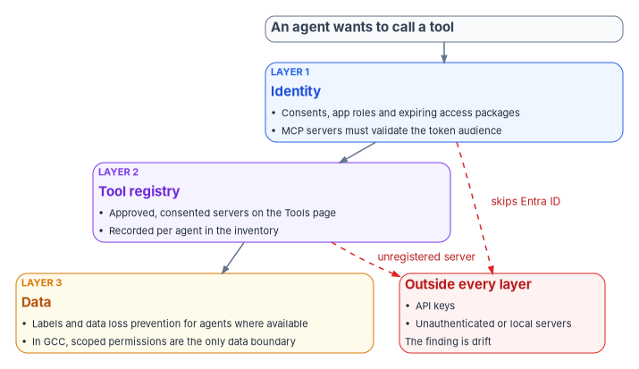
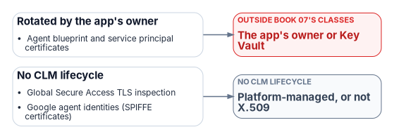

# Chapter 06 — Credentials, Least Privilege and Access Policy for AI

*An agent can't be asked for a second factor, so everything it may do has to be decided before it asks: which credential it proves itself with, which permissions it holds, which policy can stop it, and which tools it can reach.*

::: {.callout-note}
## In this chapter
The order of preference for an AI identity's credential, and why the agent identity blueprint is the credential boundary. How to choose between delegated and application permissions, what Microsoft blocks for agents and what it doesn't, and how admin consent and CISA's consent baseline apply. Which Conditional Access and risk policies reach agents and workload identities, and what they can and can't do, with a check of an earlier chapter's status note. Why the program gives AI identities no standing privileged role, and how it bounds the tools and data an agent can call. A table at the end records each feature's release stage and government-cloud availability.
:::

A person signing in proves something they have and something they are, and Conditional Access can stop them and ask for more. An AI agent can do neither. Microsoft says it directly: agent identities don't authenticate with passwords, SMS, passkeys or authenticator apps, so multifactor authentication doesn't apply to them, and they are governed with Conditional Access instead.[^c06-a365-identity] Workload identities have the same property; Microsoft lists their inability to perform multifactor authentication, their frequent lack of a formal lifecycle and their need to store credentials somewhere as the reasons they are harder to manage and at higher risk.[^c06-ca-wid]

So the controls that matter for an AI identity are all decided in advance. [Book 04, Chapter 05](../b04-access/05-applications-and-workload-identities.md) sets them for applications in general: the credential order, consent, ownership, app management policies and Conditional Access for workload identities. This chapter applies them to AI systems and agents and adds what is specific to Microsoft Entra Agent ID. [Chapter 04](04-kinds-of-ai-identity.md) describes the identity types; [Chapter 05](05-owners-sponsors-and-lifecycle.md) covers who answers for them.

{#fig-ch06-credential-order fig-alt="A top-to-bottom decision flow. A violet card at the top: the blueprint holds the credential and every agent identity created from it shares it, so the blueprint is the credential boundary. An amber question card asks whether the agent runs on Azure. Yes leads to a green card, first choice: a managed identity configured as a federated credential on the blueprint, with no stored secret. No leads to a second amber question card asking whether the agent's platform issues tokens Entra ID can trust. Yes leads to a green card, second choice: workload identity federation from the platform's issuer, recording the issuer and subject. No leads to an amber card, third choice: a certificate kept in a key vault or HSM, with a lifetime capped by policy and automated rotation. A red card at the bottom, a client secret, reads development and test only, blocked in production by an app management policy, reached by a dashed red arrow labeled exception only."}

## No stored secrets

An agent identity doesn't hold a credential of its own. The credential lives on the agent identity blueprint, which uses it to obtain tokens for every agent identity created from that blueprint; the agent identity holds the permissions and appears as the client in the token and the logs.[^c06-agent-sps] Supported blueprint credentials are federated identity credentials, certificates and cryptographic keys, and client secrets.[^c06-a365-identity] Two consequences follow, both in Microsoft's words: blueprint credentials are shared by every agent identity created from the blueprint, so each blueprint is a credential boundary and should group only identities that can safely share credentials and inherited permissions;[^c06-a365-identity] and a compromise of the blueprint's credentials affects every agent identity under it.[^c06-agent-sps]

Microsoft's order of preference for the blueprint credential matches the order [Book 04, Chapter 05](../b04-access/05-applications-and-workload-identities.md#credentials) sets for applications:

1. **A managed identity as a federated identity credential.** Microsoft recommends it for production blueprints because it obtains Entra tokens without any credential to manage; it requires the code to run on an Azure service.[^c06-create-blueprint] It is a credential on the blueprint, not a replacement for the agent identity.[^c06-agent-sps]
2. **Workload identity federation** for agents running outside Azure. Microsoft documents two integration patterns for agents built on other platforms such as Amazon Bedrock and n8n: the Microsoft Entra ID Auth SDK running as a sidecar, and federation.[^c06-third-party] Federation moves trust to the external issuer, so approving a federated credential is approving every workload that issuer will vouch for under that subject ([Book 04, Chapter 05](../b04-access/05-applications-and-workload-identities.md#workload-identity-federation)).
3. **A certificate**, with the private key in Azure Key Vault or a hardware security module, rotated at least annually even though blueprints allow long-lived credentials.[^c06-best-practices]
4. **A client secret only for development and test.** Microsoft supports secrets on blueprints but says they aren't recommended for production, and its best practices say to rotate them out before going live.[^c06-create-blueprint][^c06-best-practices]

Microsoft also says to isolate credentials per blueprint and per environment, using separate blueprints or environment-specific federated credentials for development, test and production, and to review sign-in logs to confirm agents use the intended credential type.[^c06-best-practices]

### Enforcing the order

A blueprint is an application object, and Microsoft notes that a tenant's credential lifecycle policies can restrict the lifetime of secrets added to it.[^c06-create-blueprint] The program's application management policy from [Book 04, Chapter 05](../b04-access/05-applications-and-workload-identities.md#enforcing-the-order-with-app-management-policies), blocking new client secrets and capping certificate lifetime at 180 days for applications created after its effective date, therefore covers blueprints too. Production blueprints get no exception; a secret on a production blueprint is a finding.

CISA's SCuBA baseline for Entra ID is moving the same way. Its current development text adds three policies under section 5, all marked SHOULD and last modified in April 2026: application password addition should be blocked (MS.AAD.5.5v1), application password lifetime should be restricted to 180 days or less (MS.AAD.5.6v1), and application certificate lifetime should be restricted to 365 days or less (MS.AAD.5.7v1).[^c06-scuba-main] They aren't in the latest ScubaGear release, v1.8.0 of May 7, 2026, whose section 5 has only the three consent and registration policies,[^c06-scuba-release] and they aren't BOD 25-01 required configurations.[^c06-bod-configs] The program's 180-day certificate cap is stricter than the draft 365-day policy and meets it.

### When the agent reaches something Entra doesn't protect

Credentials are not only the agent's own. Many agent tools call services with API keys. Microsoft's Conditional Access documentation is explicit about the effect: an agent that accesses a resource with an API key bypasses Entra ID authentication and token issuance entirely, and Conditional Access doesn't apply.[^c06-ca-agents] A tool reached that way is outside the identity program, and the agent's identity, policy and logs say nothing about it. The program's rule is that agent tools use Entra-issued tokens wherever the service accepts them; where a key is unavoidable, it lives in a key vault the agent's identity can read, it has a named owner and a rotation date, and it is recorded in the inventory as an exception.

For comparison, other clouds have built the same pattern. Amazon Bedrock AgentCore Identity implements agent identities as workload identities and provides credential management for agents and tools that call AWS resources and third-party services.[^c06-aws-agentcore] The principle doesn't change with the vendor: the agent proves itself with a credential the platform manages, and secrets for downstream services are held by a governed store, not by the agent's code.

## Least privilege for Microsoft Graph and APIs

NIST SP 800-53 AC-6 applies least privilege to "users (or processes acting on behalf of users)."[^c06-sp80053] An agent is such a process, and it can use its access at a speed and scale no person can.

### Choose the access mode first

Microsoft describes three ways an agent runs, and the choice decides which permissions it needs and who the token represents.[^c06-a365-identity]

| Mode | Who the agent acts as | Permission type | Token subject |
|---|---|---|---|
| On-behalf-of | A signed-in user | Delegated | The user; the agent identity is the actor |
| Service-to-service (app-only) | Its own agent identity | Application | The agent identity |
| Agent user | Its own agent's user account | User-style access; licenses for Microsoft 365 resources | The agent's user account |

: Agent access modes. Source: Microsoft Learn, Agent 365 identity. {.striped .hover}

Microsoft's guidance is to use the on-behalf-of flow for interactive agents so that the user's access policies and consent apply, to use app-only access only for autonomous agents with only the permissions they need, and to avoid application permissions where delegated ones would do.[^c06-best-practices] With delegated access the agent can't exceed what the user could do; with application permissions, the grant is tenant-wide and an administrator must consent to it explicitly.[^c06-authz] The program's design follows that order: on-behalf-of first; app-only only when no user is present and the inventory records why; an agent's user account only when the agent genuinely needs a mailbox, Teams presence or a user-only API, which Microsoft says is the only time to create one.[^c06-best-practices] Agents' user accounts are also preview-only, available to tenants in the Frontier preview program.[^c06-a365-identity]

### What Microsoft blocks, and what it doesn't

Microsoft Entra limits what agent identities can be granted. Many highly privileged directory roles can't be assigned to agents (Global Administrator, Privileged Role Administrator and User Administrator among them), agent identities can't be members of role-assignable groups, and a set of high-risk Microsoft Graph permissions can't be granted even by an administrator. Microsoft's examples of blocked permissions are `Application.ReadWrite.All`, `RoleManagement.ReadWrite.All`, `User.ReadWrite.All` and `Directory.AccessAsUser.All`, and it says the lists of allowed roles and permissions will change over time.[^c06-authz] An agent's user account likewise can't hold privileged administrator roles or be added to role-assignable groups, though it can hold custom roles.[^c06-agent-users]

That is a floor, not least privilege. Microsoft's list of roles that *can* be assigned to agent identities includes Exchange Administrator, SharePoint Administrator, Teams Administrator, Power Platform Administrator, Compliance Administrator and Global Reader,[^c06-authz] each of which is a privileged role in an agency tenant. The published permission examples are examples, so the absence of a permission from them isn't evidence that an agent may safely hold it. The program applies its own permission risk classification from [Book 04, Chapter 05](../b04-access/05-applications-and-workload-identities.md#permissions-what-an-application-can-be-granted) to agents unchanged, and treats "not blocked by Microsoft" as irrelevant to approval.

### Inherited permissions

Blueprints can declare inheritable permissions: delegated scopes and application roles that every agent identity created from the blueprint receives without a separate consent prompt. Each resource can be configured to inherit all available scopes or roles (`allAllowed`), which automatically includes anything later granted to the blueprint principal, or none; a blueprint can list up to 50 resource applications. Microsoft recommends reviewing the configuration regularly, removing unused inherited permissions and recording why each one is inheritable and who approved it.[^c06-inherit] Declaring a permission on a blueprint doesn't grant it; an administrator still has to consent, on the blueprint principal or on individual agent identities.[^c06-a365-identity]

The program's design keeps inheritance narrow. Inherited permissions carry only the shared baseline every agent of that kind needs. `allAllowed` is never used for application roles, because it turns any future grant to the blueprint into a grant to every agent. Role-specific access is assigned to individual agent identities through expiring access packages ([Chapter 05](05-owners-sponsors-and-lifecycle.md#recertification-expiry-is-the-review)), so that it comes up for decision.

### Azure resources and other APIs

Azure role-based access control follows a different rule: blueprints can't hold Azure RBAC roles, so roles are assigned directly to each agent identity,[^c06-agent-sps] and Microsoft's guidance is to scope them to the specific resource, such as Key Vault Reader on one vault.[^c06-authz] Applications that expose their own APIs are reached either by consenting the agent identity to the application's OAuth scopes or by assigning it an app role. Agents and service principals assigned to app roles aren't provisioned into applications by Entra's SCIM provisioning, which supports users and groups only; an application that supports only SAML for users needs an agent's user account and a helper registration.[^c06-assign-apps] Every such assignment is recorded against the agent's inventory entry.

## Admin consent and the SCuBA consent baseline

CISA's BOD 25-01 required configurations include three Entra ID policies on applications, each added on December 17, 2024: only administrators shall be allowed to register applications (MS.AAD.5.1v1), only administrators shall be allowed to consent to applications (MS.AAD.5.2v1), and an admin consent workflow shall be configured (MS.AAD.5.3v1).[^c06-bod-configs] The SCuBA baseline document words MS.AAD.5.2v1 as "User consent to applications SHALL be restricted" and allows it to be met either with no user consent or with user consent only for apps from verified publishers that use permissions an administrator has classified as low risk.[^c06-scuba-main] [Book 04, Chapter 05](../b04-access/05-applications-and-workload-identities.md#consent) describes the consent settings and the workflow, and [Book 15, Chapter 06](../b15-day2-operations/06-saas-integration-governance.md#consent-restriction-answers-who-not-whether) explains why consent restriction answers who approves an integration but not whether the service is authorized.

Applied to agents, the baseline means three things in the program's design.

- **Registration.** The analog of MS.AAD.5.1v1 for agents is the tenant setting **Users can create agent blueprints**, which, when set to Yes, lets any user create a blueprint and its principal; otherwise the Agent ID Developer and Agent ID Administrator roles are needed.[^c06-create-blueprint] The program sets it to No. Microsoft also tells developers not to represent an agent with an ordinary app registration,[^c06-plan-arch] so a new app registration whose purpose is an agent is routed to the blueprint path rather than approved as an application.
- **Delegated consent for on-behalf-of agents.** An interactive agent acting for a user needs delegated scopes, and users can consent to an agent only within the tenant's user consent policy. The program's policy from Book 04, user consent only for verified publishers and low-classified permissions, applies unchanged; anything else goes through the admin consent workflow.
- **Application consent for autonomous agents.** Application permissions always need admin consent.[^c06-authz] Granting Microsoft Graph application permissions to a blueprint takes Privileged Role Administrator, the least-privileged role for that task, while Cloud Application Administrator or Application Administrator can grant delegated Graph permissions.[^c06-create-blueprint] The program grants those through PIM activation against an approved ticket, as it does for every application ([Book 04, Chapter 06](../b04-access/06-who-decides-access.md#who-approves-admin-consent)).

Tools need consent too. When a developer registers a remote Model Context Protocol (MCP) server with Microsoft Agent 365, an administrator reviews it in the Microsoft 365 admin center (the **Requests** tab is preview), approves or rejects it, and then consents to the Entra permissions it needs; the server becomes available to agent-building surfaces only after consent. Approving requires both access to the **Tools** page and the ability to grant tenant-wide consent, which Microsoft says two roles have: AI Administrator and Global Administrator.[^c06-mcp-approve] The program assigns AI Administrator through PIM for that task and never uses Global Administrator for it.

## Conditional Access and risk policies

### The token subject decides which policy applies

Conditional Access for agents evaluates whoever is the subject of the token, and an agent can be any of three subjects. Microsoft's guidance is to create a separate policy for each token subject an agent uses, because a policy targeting one subject doesn't apply to the others.[^c06-ca-agents]

[Chapter 04's figure on whose token an AI system presents](04-kinds-of-ai-identity.md#fig-ch04-whose-token) shows the same three subjects, plus the API key that bypasses all of them. The policy consequences are these.

| Agent access pattern | Policy targets | Available controls |
|---|---|---|
| On-behalf-of a user | The user, directly or through groups; selecting an agent identity doesn't cover this flow | The user's normal controls; the on-behalf-of token exchange is itself evaluated |
| App-only, as the agent identity | **All agent identities**, selected agent identities, a blueprint (covering its current and future identities), or custom security attributes | **Block** only; the only condition is **Agent risk (Preview)** |
| As the agent's user account | **All agent users (Preview)** or selected agent users; policies scoped to **Users**, including all users, don't apply | Block, or grant with **Require device to be marked as compliant**; device platform, device filter and compliant-network conditions for agents on endpoints |

: Conditional Access for agents. Source: Microsoft Learn, Conditional Access for agents, Target agents in Microsoft Entra Conditional Access policies, and Conditional Access: Grant.[^c06-ca-agents][^c06-ca-target][^c06-ca-grant] {.striped .hover}

Microsoft documents a set of boundaries the program has to plan around. Conditional Access doesn't apply when a blueprint obtains a Microsoft Graph token to create agent identities or agents' user accounts, or when a blueprint or agent identity performs the intermediate exchange at the `AAD Token Exchange Endpoint: Public`; it doesn't apply when security defaults are enabled; and it protects only resources secured by Entra ID, so API-key access bypasses it. Policies can't include or exclude agents' user accounts by group membership, and a policy targeting agent identities, including one scoped by blueprint, doesn't reach the agent's user account.[^c06-ca-agents]

The pattern Microsoft recommends for autonomous agents is a policy that includes **All agent identities**, targets **All resources**, grants **Block**, and excludes approved agents, preferably by a custom security attribute such as an approval status, starting in report-only mode.[^c06-ca-autonomous] The program's design builds that policy in report-only mode and sets the approval attribute only in the production handshake ([Chapter 05](05-owners-sponsors-and-lifecycle.md#creation)), so that the report shows every agent that skipped the handshake. Turning it on is a decision for when the agent targets leave preview in the agency's cloud (see the status note below). Microsoft's best practices add that broad user policies, such as one requiring MFA for all users, should be reviewed for unintended effects on agent flows and agents excluded from them where necessary, with dedicated agent policies in their place.[^c06-best-practices]

Licensing for these policies is not the same as for users. Conditional Access for agents requires Microsoft 365 E7, or a Microsoft Agent 365 license with at least Entra ID P1 or Microsoft 365 E3, and agent risk-based policies need Entra ID P2 or Microsoft 365 E5 alongside Agent 365.[^c06-ca-agents][^c06-ca-autonomous]

::: {.callout-note}
## Status note: Book 04's preview statement still holds
[Book 04, Chapter 03](../b04-access/03-the-conditional-access-model.md#users-groups-roles-and-workload-identities) records that agent targets in Conditional Access are in preview and that agent identities support only Block. Checked on October 22, 2026, both still hold. The Agent ID platform became generally available in April 2026,[^c06-entra-whatsnew] but the policy builder still labels the assignment as **Users, agents (Preview) or workload identities**, labels the agent-user targets, the **Agent risk** condition and the **Agent execution environments** condition as preview, and agent identities still support only Block.[^c06-ca-target][^c06-ca-grant] Microsoft's pages aren't consistent (the autonomous-agent guide no longer shows the preview label on **Agents**),[^c06-ca-autonomous] so the program reads the policy builder's label as the release stage. Since Book 04 was written, Microsoft has added an Agent 365 license requirement and, as a June 2026 public preview, a compliant-device grant for agents' user accounts.[^c06-entra-whatsnew] The program keeps all agent policies in report-only mode as watch items until the label is removed.
:::

### ID Protection for agents

Microsoft Entra ID Protection evaluates risk for agents that use agent identities. Its detections include confirmed compromise, early-life malicious activity, directory reconnaissance, failed access attempts, threat intelligence matches, sign-in spikes, suspicious credential usage (a new credential added to a blueprint and then used) and unfamiliar resource access; all agent risk detections are currently offline rather than real-time. A learning mode suppresses behavioral alerts for agents without enough activity history while a separate detection still watches early-life behavior. In on-behalf-of flows, risky activity is attributed to the user rather than the agent, so the remediation targets the compromised session. Detections are kept for up to 90 days, and risky agents can be confirmed compromised, confirmed safe, dismissed or disabled from the report.[^c06-risky-agents] Agent risk is preview, ID Protection for agents requires Entra ID P2 during the preview, and Microsoft says it will soon require an Agent 365 license.[^c06-ca-autonomous][^c06-manage-admin][^c06-risky-agents]

The program's design pairs a **Block high-risk agent identities** policy (report-only first) with the operational rule that a risky-agent alert goes to the agent's sponsor as well as to security operations, because the sponsor is the person who can say whether a burst of activity was expected ([Chapter 05](05-owners-sponsors-and-lifecycle.md#three-accountable-relationships)). The telemetry tables for agent risk are in [Book 12, Chapter 03](../b12-security-operations/03-identity-telemetry.md).

### Workload identities that aren't agents

Many AI systems run as ordinary service principals and managed identities, and the controls in [Book 04, Chapter 05](../b04-access/05-applications-and-workload-identities.md#conditional-access-for-workload-identities) apply to them unchanged: Conditional Access for workload identities can block a single-tenant service principal by location, by ID Protection risk or with authentication contexts; Block is the only grant; managed identities and multitenant applications aren't covered; a service principal must be assigned to the policy directly, not through a group; and creating or changing these policies needs Workload ID Premium.[^c06-ca-wid] Microsoft says Workload ID Premium is available to Azure Government customers through their account manager and that its free trial isn't available in the Azure Government clouds.[^c06-wid-faq] A managed identity used by an AI system is therefore governed through its role assignments and reviews, not through Conditional Access.

## Privileged roles for AI: none standing

The program's rule is that **no AI identity holds a standing privileged role**. That covers Entra directory roles, Azure roles at management-group or subscription scope, and administrative roles inside Microsoft 365 workloads.

The rule needs stating because Microsoft's block list doesn't enforce it. As shown above, agents can't hold Global Administrator or Privileged Role Administrator but can hold Exchange Administrator, SharePoint Administrator and other roles the program classifies as privileged ([Book 04, Chapter 04](../b04-access/04-privileged-roles-and-tiers.md)).[^c06-authz] An agent with Exchange Administrator around the clock is a standing administrator that can't be asked for MFA.

Where an AI system genuinely needs privileged access, the program gives it in one of three ways, in this order:

1. **Delegated, through a person's own activated role.** An agent that acts on behalf of an administrator uses that administrator's access, so the person's PIM activation, approval and MFA still govern it ([Book 04, Chapter 08](../b04-access/08-pim-self-request-with-approval.md)). Microsoft's Microsoft 365 Admin agent works this way: it honors the administrator's existing Entra role assignments, so what it can do reflects the administrator's role.[^c06-admin-agent]
2. **A time-bound assignment through an expiring access package.** Access packages can grant Microsoft Entra roles to agent identities, and an agent identity can request a package programmatically, which routes the request to the package's human approvers and ends the assignment on its end date.[^c06-gov-overview] That gives the agent just-in-time access with a human decision in front of it. Entra roles as access package resources are still preview.[^c06-licensing]
3. **A time-bound active assignment in PIM.** PIM assigns roles to users, groups, service principals and managed identities, as eligible or active, with start and end dates.[^c06-pim] Activation of an eligible assignment is designed around a person acting (MFA, justification, approval), so for a nonhuman principal the program uses a time-bound active assignment approved through the ticket, never a permanent one.

Every privileged assignment to an AI identity is logged and reviewed under AC-6(7), and its use is logged under AC-6(9).[^c06-sp80053] If an AI system needs a privileged role permanently, the program treats that as a design defect to be fixed, not an exception to be renewed.

## Tool and data access boundaries

An agent's reach is the sum of the tools it can call. Microsoft describes tools as how agents interact with their environment (web search, database access, APIs, file systems and other software) and says each tool needs careful thought about security and permissions.[^c06-what-agents] The identity program draws the boundary in three layers.

{#fig-ch06-three-boundaries fig-alt="A slate card at the top: an agent wants to call a tool. Below it three stacked cards joined by arrows. First, a blue card, Layer 1, identity: consents, app roles and expiring access packages decide which tokens the agent can obtain; MCP servers must validate the token audience. Second, a violet card, Layer 2, tool registry: approved and consented servers in the Agent 365 Tools page, recorded per agent in the inventory. Third, an amber card, Layer 3, data: Purview labels and data loss prevention for agents where available; in GCC, scoped permissions are the only data boundary. A red card at the side, outside every layer, reads API keys, unauthenticated or local servers; dashed red arrows lead to it from Layer 1, labeled skips Entra ID, and from Layer 2, labeled unregistered server; the card ends with the note that the finding is drift."}

### Layer 1: what the identity can obtain a token for

Each tool that is an Entra-protected resource is its own token audience, and Conditional Access evaluates both the subject and the audience at issuance.[^c06-ca-agents] The agent's consents, app role assignments and access packages are therefore the first list of what it can call. For MCP servers specifically, the protocol's authorization specification makes a protected MCP server an OAuth 2.1 resource server that must validate that tokens were issued for it as the audience and must not accept or pass through any other tokens. The same specification also makes authorization optional for MCP implementations and says implementations using the local STDIO transport should not follow it and should take credentials from the environment instead.[^c06-mcp-auth] An MCP server that doesn't implement authorization, or a local server reading a key from an environment variable, sits outside Layer 1 and needs Layers 2 and 3.

### Layer 2: which tools are registered and approved

Microsoft Agent 365 keeps a **Tools** registry in the Microsoft 365 admin center that Microsoft calls the source of truth for MCP servers available in the tenant; custom and third-party servers registered through its bring-your-own process are reviewed, approved and consented centrally.[^c06-a365-tools][^c06-mcp-approve] Agent 365 lists tenant-wide control of which tools, including Microsoft MCP servers, agents can access as available in GCC.[^c06-a365-sd] Integration with Azure API Management, which enforces policy inline for MCP traffic and can control individual tools on supported tiers, is preview, as is connecting a tools gateway to the admin center.[^c06-apim][^c06-tools-gateway] The program's design records each agent's approved tools in its inventory entry and treats a tool call to an unregistered server as drift ([Chapter 07](07-monitoring-drift-and-shadow-ai.md)).

### Layer 3: what data the agent can touch

Data boundaries for agents (sensitivity labels honored by agents, data loss prevention that blocks agents from sensitive content, insider risk for agents) are Microsoft Purview capabilities in Agent 365, and the service description lists none of them as available in GCC; nor are Entra's network controls for agent traffic or Defender's blocking of agent tool invocations.[^c06-a365-sd] For agencies in GCC, the data boundary therefore has to come from the identity layer: narrow delegated scopes, application permissions limited to specific sites or mailboxes where the API allows it (Exchange application access policies, for example, in [Book 04, Chapter 05](../b04-access/05-applications-and-workload-identities.md#permissions-what-an-application-can-be-granted)), and resource-scoped Azure roles. [Book 12, Chapter 09](../b12-security-operations/09-data-protection-and-classification.md) covers data protection generally.

| Boundary | Mechanism | Program rule |
|---|---|---|
| Identity | Consents, app roles, access packages, resource-scoped Azure roles | Every grant in the inventory; nothing standing; Block policy excludes only approved agents |
| Tool registry | Agent 365 Tools page, approval and consent | Approved tools listed per agent; unregistered server is drift |
| Data | Purview for agents where available; otherwise scoped permissions | In GCC, scoped permissions are the boundary; record the gap |

: The three boundaries on what an agent can call. Program design built on the cited platform features. {.striped .hover}

## Release stage and government-cloud availability

[Chapter 04](04-kinds-of-ai-identity.md#release-stage-licensing-and-government-clouds) gives the general picture for Agent ID and workload identities, including agents' user accounts (preview, Frontier program only), the partial GCC subset, no published availability in GCC High or DoD, and Agent 365's pending FedRAMP High authorization. The table below covers only the features this chapter relies on, as published on October 22, 2026. "Not published" means Microsoft's documentation states no availability.

| Feature | Release stage | GCC | GCC High, DoD |
|---|---|---|---|
| Blueprint credentials: managed identity as federated credential, certificates, secrets | Part of the generally available platform (April 2026);[^c06-entra-whatsnew] admin center wizard preview[^c06-create-blueprint] | Available with the platform[^c06-a365-sd] | Not published |
| App management policies restricting blueprint secrets and certificate lifetime | Generally available; free Workload ID feature[^c06-wid-faq] | Available | Not stated on the pages checked; confirm in the tenant |
| Conditional Access for agent identities (Block only) | Preview: the policy builder labels the agents assignment as preview[^c06-ca-target] | Listed for agents with delegated access ("extend user policies to agents")[^c06-a365-sd] | Not published |
| Conditional Access for agents' user accounts | Preview[^c06-ca-target] | Not published | Not published |
| Agent risk condition and ID Protection for agents | Preview[^c06-ca-autonomous][^c06-manage-admin] | Listed with Conditional Access for agents with delegated access[^c06-a365-sd] | Not published |
| Conditional Access and ID Protection for workload identities | Generally available; Workload ID Premium[^c06-ca-wid] | Available | Workload ID Premium through the account manager[^c06-wid-faq] |
| Tenant-wide control of agent tools; MCP server approval | Documented; the **Requests** tab is preview[^c06-mcp-approve] | Available[^c06-a365-sd] | Not published |
| API Management and tools gateway integration | Preview[^c06-apim][^c06-tools-gateway] | Not published | Not published |
| Network controls, data loss prevention and labels for agents | See service description | Not available[^c06-a365-sd] | Not published |

: Credential and access-policy features for AI identities by release stage and cloud. {.striped .hover}

The Conditional Access rows for GCC need care. Microsoft's Agent 365 service description lists "Conditional access and identity protection for agents (for agents with delegated access – extend user policies to agents)" as available in GCC.[^c06-a365-sd] It doesn't separately list policies that target agent identities in app-only flows, so an agency in GCC should confirm that support in its own tenant before relying on the Block-unless-approved policy, and record the result. For GCC High and DoD the Graph endpoints differ, `https://graph.microsoft.us` and `https://dod-graph.microsoft.us` with authority `https://login.microsoftonline.us`, and Microsoft warns that configurable endpoints don't guarantee the Agent 365 services are available there.[^c06-a365-cli]

## Honest limits

1. **The block lists move.** Microsoft says the roles and permissions allowed for agents will change;[^c06-authz] the program's own classification, not Microsoft's list, is the control, and it has to be re-run when the list changes.
2. **Conditional Access can only block an agent identity.** There is no grant control to satisfy, so the policy is a gate on approval and risk, not a step-up.
3. **API keys and local tools are invisible to identity.** Layer 1 can't see them; only inventory discipline and tool registration can.
4. **The data layer isn't in GCC.** Until Purview's agent capabilities reach the government clouds, scoped permissions are the only data boundary, and they are coarse.
5. **The higher clouds are a gap.** Agencies in GCC High and DoD govern AI systems as workload identities today, with Workload ID Premium where licensed, and should say so in the authorization package ([Chapter 10](10-evidence-and-authorization.md)).

## Certificates in this book and the CLM platform {#certificates-and-the-clm-platform}

[Book 07](../b07-pki/index.md) gives each class of certificate one issuer and one renewal engine, and makes CyberArk Certificate Manager, Self-Hosted the system of record for every certificate that Intune and the PIV system don't manage ([Chapter 04](../b07-pki/04-the-target-pki.md), [Chapter 05](../b07-pki/05-who-owns-the-certificate-estate.md)). The certificates this book's systems depend on map to it as follows; [Book 07, Appendix C](../b07-pki/appendix-c-anatomy-of-the-clm-platform.md) describes the platform itself.

| Certificate | Book 07 class | Issued by | Renewed by | What the CLM platform does |
|---|---|---|---|---|
| Agent blueprint and service principal certificates | Not a Book 07 class | A CA, key in Key Vault or an HSM | Entra ID or the app's owner | Can provision into Key Vault (inference); doesn't renew Entra credentials |
| Global Secure Access TLS inspection | Not a Book 07 class | Not stated | Platform-managed, or not X.509 | Not a Book 07 class |
| Google agent identities (SPIFFE certificates) | Not a Book 07 class | Google | Platform-managed, or not X.509 | Nothing: vendor-managed |

{fig-alt="Agent blueprint and service principal certificates go to Entra ID or the app's owner (outside book 07's classes); Global Secure Access TLS inspection, Google agent identities (SPIFFE certificates) go to Platform-managed, or not X.509 (no clm lifecycle)."}

None of this book's certificates is renewed by the CLM platform. Agent and service-principal certificates aren't one of Book 07's classes; this book's annual rotation and the 180-day app policy govern them, and the platform at most places the certificate in Key Vault (inference).[^clm-drivers]

::: {.callout-tip}
## Continue the book
[← Previous: Chapter 05 — Owners, Sponsors and the AI Identity Lifecycle](05-owners-sponsors-and-lifecycle.md) · [Book index](index.md) · [Next: Chapter 07 — Monitoring, Drift and Shadow AI →](07-monitoring-drift-and-shadow-ai.md)
:::

[^c06-a365-identity]: Microsoft Learn, "Agent 365 identity," sections Credentials, Agent's user account, and Permissions and runtime flow, <https://learn.microsoft.com/microsoft-agent-365/developer/identity> (accessed Oct 22, 2026).
[^c06-ca-wid]: Microsoft Learn, "Microsoft Entra Conditional Access for workload identities," <https://learn.microsoft.com/entra/identity/conditional-access/workload-identity> (accessed Oct 22, 2026).
[^c06-agent-sps]: Microsoft Learn, "Agent identities, service principals, and applications," Impersonation model, Credential management and Permissions and role assignment, <https://learn.microsoft.com/entra/agent-id/agent-service-principals> (accessed Oct 22, 2026).
[^c06-create-blueprint]: Microsoft Learn, "Create an agent identity blueprint," Prerequisites and Configure credentials for the agent identity blueprint, <https://learn.microsoft.com/entra/agent-id/create-blueprint> (accessed Oct 22, 2026).
[^c06-third-party]: Microsoft Learn, "Integrate third-party agents with Microsoft Entra Agent ID," <https://learn.microsoft.com/entra/agent-id/configure-third-party-agents> (accessed Oct 22, 2026).
[^c06-best-practices]: Microsoft Learn, "Best practices for Microsoft Entra Agent ID," sections Manage credentials securely, Enforce access controls and Design agent identity blueprints, <https://learn.microsoft.com/entra/agent-id/best-practices-agent-id> (accessed Oct 22, 2026).
[^c06-scuba-main]: Cybersecurity and Infrastructure Security Agency, *CISA M365 Secure Configuration Baseline for Microsoft Entra ID*, section 5, Application Registration and Consent, policies MS.AAD.5.1v1–5.3v1 and 5.5v1–5.7v1 and MS.AAD.5.2v1 instructions, ScubaGear repository main branch, <https://github.com/cisagov/ScubaGear/blob/main/PowerShell/ScubaGear/baselines/aad.md> (accessed Oct 22, 2026).
[^c06-scuba-release]: Cybersecurity and Infrastructure Security Agency, ScubaGear release v1.8.0 (published May 7, 2026), baseline file `PowerShell/ScubaGear/baselines/aad.md` at tag v1.8.0, <https://github.com/cisagov/ScubaGear/blob/v1.8.0/PowerShell/ScubaGear/baselines/aad.md> (accessed Oct 22, 2026).
[^c06-bod-configs]: Cybersecurity and Infrastructure Security Agency, "BOD 25-01: Implementing Secure Practices for Cloud Services Required Configurations," Microsoft Entra ID, MS.AAD.5.1v1–5.3v1, <https://www.cisa.gov/resources-tools/services/bod-25-01-implementing-secure-practices-cloud-services-required-configurations> (accessed Oct 22, 2026).
[^c06-ca-agents]: Microsoft Learn, "Conditional Access for agents," sections Agent access patterns and Boundaries and limitations, <https://learn.microsoft.com/entra/identity/conditional-access/agent-id> (accessed Oct 22, 2026).
[^c06-aws-agentcore]: Amazon Web Services, "Provide identity and credential management for agent applications with Amazon Bedrock AgentCore Identity," *Amazon Bedrock AgentCore Developer Guide*, <https://docs.aws.amazon.com/bedrock-agentcore/latest/devguide/identity.html> (accessed Oct 22, 2026).
[^c06-sp80053]: National Institute of Standards and Technology, SP 800-53 Rev. 5, *Security and Privacy Controls for Information Systems and Organizations*, controls AC-6, AC-6(7) and AC-6(9), statements checked against the release 5.2.0 OSCAL catalog, <https://github.com/usnistgov/oscal-content/blob/main/nist.gov/SP800-53/rev5/json/NIST_SP-800-53_rev5_catalog.json> (accessed Oct 22, 2026).
[^c06-authz]: Microsoft Learn, "Authorization in Microsoft Entra Agent ID," sections Microsoft Entra role assignments for agent identities, Microsoft Entra roles allowed for agents, Microsoft Graph permissions for agent IDs and When to use Azure roles, Microsoft Entra roles, or Microsoft Graph permissions, <https://learn.microsoft.com/entra/agent-id/authorization-agent-id> (accessed Oct 22, 2026).
[^c06-agent-users]: Microsoft Learn, "Learn about the agent's user account in Microsoft Entra Agent ID," Capabilities and Security constraints, <https://learn.microsoft.com/entra/agent-id/agent-users> (accessed Oct 22, 2026).
[^c06-inherit]: Microsoft Learn, "Configure inheritable permissions for agent identity blueprints," <https://learn.microsoft.com/entra/agent-id/configure-inheritable-permissions-blueprints> (accessed Oct 22, 2026).
[^c06-assign-apps]: Microsoft Learn, "Manage assignment of agent identities to an application," <https://learn.microsoft.com/entra/identity/enterprise-apps/assign-agent-identities-to-applications> (accessed Oct 22, 2026).
[^c06-plan-arch]: Microsoft Learn, "Plan your agent identity architecture," Don't register an app for your agent, <https://learn.microsoft.com/entra/agent-id/how-to-plan-agent-identity-architecture> (accessed Oct 22, 2026).
[^c06-mcp-approve]: Microsoft Learn, "Manage plugins, skills, and MCP servers," Review and approve MCP requests, <https://learn.microsoft.com/microsoft-365/admin/manage/manage-plugins-skills-mcp-servers> (accessed Oct 22, 2026).
[^c06-ca-target]: Microsoft Learn, "Target agents in Microsoft Entra Conditional Access policies," Assignments, Conditions and Access controls, <https://learn.microsoft.com/entra/identity/conditional-access/howto-target-agent-identities> (accessed Oct 22, 2026).
[^c06-ca-grant]: Microsoft Learn, "Conditional Access: Grant," Grant controls for agent users (Preview), <https://learn.microsoft.com/entra/identity/conditional-access/concept-conditional-access-grant> (accessed Oct 22, 2026).
[^c06-ca-autonomous]: Microsoft Learn, "Secure autonomous agents with Conditional Access," Prerequisites, Allow only specific agents to access resources and Block high-risk agent identities, <https://learn.microsoft.com/entra/identity/conditional-access/policy-autonomous-agents> (accessed Oct 22, 2026).
[^c06-entra-whatsnew]: Microsoft Learn, "Microsoft Entra releases and announcements," April 2026 (General Availability, Microsoft Entra Agent ID platform) and June 2026 (Public Preview, Extended Conditional Access protections for agent's user accounts), <https://learn.microsoft.com/entra/fundamentals/whats-new> (accessed Oct 22, 2026).
[^c06-risky-agents]: Microsoft Learn, "ID Protection for agents," <https://learn.microsoft.com/entra/id-protection/concept-risky-agents> (accessed Oct 22, 2026).
[^c06-manage-admin]: Microsoft Learn, "Manage agent identities in your organization," roles table and ID Protection note, <https://learn.microsoft.com/entra/agent-id/manage-agent-identities-admin> (accessed Oct 22, 2026).
[^c06-wid-faq]: Microsoft Learn, "Frequently asked questions about Microsoft Entra Workload ID," <https://learn.microsoft.com/entra/workload-id/workload-identities-faqs> (accessed Oct 22, 2026).
[^c06-admin-agent]: Microsoft Learn, "Use Microsoft 365 Admin agent," Prerequisites, <https://learn.microsoft.com/microsoft-365/copilot/copilot-ai-admin-agent> (accessed Oct 22, 2026).
[^c06-gov-overview]: Microsoft Learn, "Governing agent identities," Assigning access to agent identities, <https://learn.microsoft.com/entra/id-governance/agent-id-governance-overview> (accessed Oct 22, 2026).
[^c06-licensing]: Microsoft Learn, "Microsoft Entra ID Governance licensing fundamentals," feature-by-license table, row EM – Microsoft Entra Roles (Preview), <https://learn.microsoft.com/entra/id-governance/licensing-fundamentals> (accessed Oct 22, 2026).
[^c06-pim]: Microsoft Learn, "What is Microsoft Entra Privileged Identity Management?," Role assignment overview, <https://learn.microsoft.com/entra/id-governance/privileged-identity-management/pim-configure> (accessed Oct 22, 2026).
[^c06-what-agents]: Microsoft Learn, "What are agent identities," What is an agent, <https://learn.microsoft.com/entra/agent-id/what-are-agent-identities> (accessed Oct 22, 2026).
[^c06-mcp-auth]: Model Context Protocol, *Specification*, version 2026-07-28, Basic: Authorization, sections Protocol Requirements, Roles and Token Handling, <https://modelcontextprotocol.io/specification/2026-07-28/basic/authorization> (accessed Oct 22, 2026).
[^c06-a365-tools]: Microsoft Learn, "Understand MCP server options in Agent 365," <https://learn.microsoft.com/microsoft-agent-365/tooling-servers-overview> (accessed Oct 22, 2026).
[^c06-a365-sd]: Microsoft Learn, "Microsoft Agent 365" service description, Feature availability (including the GCC Availability column and the FedRAMP High note), <https://learn.microsoft.com/office365/servicedescriptions/microsoft-agent-365/microsoft-agent-365> (accessed Oct 22, 2026).
[^c06-apim]: Microsoft Learn, "Govern tools with Microsoft Agent 365 and Azure API Management (preview)," <https://learn.microsoft.com/azure/api-management/agent-365> (accessed Oct 22, 2026).
[^c06-tools-gateway]: Microsoft Learn, "Manage Tools Gateway," <https://learn.microsoft.com/microsoft-365/admin/manage/manage-tools-gateway> (accessed Oct 22, 2026).
[^c06-a365-cli]: Microsoft Learn, "Configure the Agent 365 CLI for US Government clouds," <https://learn.microsoft.com/microsoft-agent-365/developer/configure-cloud-endpoints> (accessed Oct 22, 2026).
[^clm-drivers]: CyberArk, 26.1, "System requirements," supported applications (F5 BIG-IP LTM Advanced, NetScaler, Palo Alto NGFW, Apache/PEM, Java keystores, PKCS#12, Azure Key Vault, AWS and others) and the Server Agent, <https://docs.venafi.com/Docs/current/TopNav/Content/Install/r-install-SysReq-ALLVenProducts.php> (accessed Oct 23, 2026).
