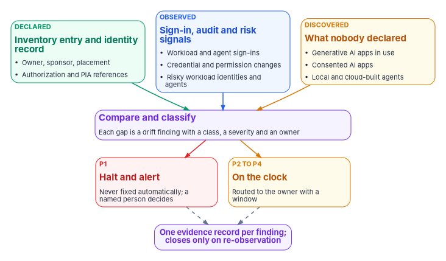
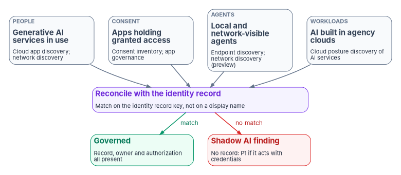

# Chapter 07 — Monitoring, Drift and Shadow AI

*An AI identity that nobody watches drifts the day after it is issued, and an AI system nobody declared is drift from the start.*

::: {.callout-note}
## In this chapter
What federal policy asks monitoring to do for AI, and what it doesn't. Where workload and agent identities show up in Microsoft Entra sign-in and audit logs, and what ID Protection detects for them. Four places shadow AI hides and the tools that see each one, with their release stage and government-cloud availability. The program's AI drift findings, among them a high-priority finding for an agentic AI system with no governed identity and one for a deployed system with no recorded authorization, and how each finding becomes a record in the evidence contract of [Book 12](../b12-security-operations/02-the-evidence-contract.md) and the drift model of [Book 13](../b13-governance/06-the-drift-engine.md).
:::

The earlier chapters of this book give every AI system an identity record, an accountable owner, a lifecycle and credentials scoped to the work ([Chapter 05](05-owners-sponsors-and-lifecycle.md), [Chapter 06](06-credentials-and-least-privilege.md)). None of that stays true by itself. A sponsor changes jobs. A developer adds a client secret to unblock a test and never removes it. A team connects a new tool to an agent and the agent's permissions grow to match. A program office signs up for a generative AI service with a purchase card. The identity record says one thing and the estate says another, and the gap widens quietly.

Monitoring AI identities is therefore the same job [Book 13](../b13-governance/index.md) describes for every other governed object: compare what was declared with what is observed, classify the difference, and send it to someone who can act. What is different about AI is the third input. For users and servers, discovery mostly confirms what the inventory already lists. For AI, a large share of what matters was never declared at all, because it was adopted outside the identity program. The chapter therefore treats discovery as a standing input, not a one-time cleanup.

{#fig-ch07-three-sources fig-alt="Three cards across the top. A green card labeled declared: the inventory entry and identity record, carrying owner, sponsor, placement, and authorization and PIA references. A blue card labeled observed: sign-in, audit and risk signals, covering workload and agent sign-ins, credential and permission changes, and risky workload identities and agents. An amber card labeled discovered: what nobody declared, covering generative AI apps in use, consented AI apps, and local and cloud-built agents. All three point to a violet card, compare and classify, where each gap becomes a drift finding with a class, a severity and an owner. It branches to a red card, P1, halt and alert, never fixed automatically, a named person decides; and an amber card, P2 to P4, on the clock, routed to the owner with a window. Both lead by dashed arrows to a violet pill: one evidence record per finding, which closes only on re-observation."}

## What policy asks monitoring to do

OMB M-25-21 makes ongoing monitoring one of the minimum risk management practices for high-impact AI. Agencies must test and periodically review high-impact use cases to identify adverse impacts to "the performance and security of AI functionality," and the monitoring "must be designed to detect unforeseen circumstances, changes to an AI system after deployment, or changes to the context of use or associated data."[^c07-m2521] NIST's AI Risk Management Framework says the same in its own terms: mechanisms to inventory AI systems (GOVERN 1.6), monitoring of the system's functionality and behavior in production (MEASURE 2.4), and post-deployment monitoring plans that cover incident response, recovery and change management (MANAGE 4.1).[^c07-airmf]

Two limits matter. First, M-25-21's monitoring practice binds high-impact use cases, and it is about the AI's performance and its effects on people as much as its security. Identity monitoring is one input to that practice, not the whole of it. Second, neither document says how to monitor an AI system's identity. That is where the program's design comes in, and where this chapter leans on the identity telemetry Book 12 already collects. A change to an AI system's credentials, permissions, tools or owner is exactly the kind of "change to an AI system after deployment" the memo asks agencies to detect, and the identity logs are where those changes are recorded first.

## Watching the identities you know

### Where AI sign-ins land

Microsoft Entra ID has four sign-in log types: interactive user sign-ins, non-interactive user sign-ins, service principal sign-ins and managed identity sign-ins.[^c07-signins] Workload identities appear in the last two. An application or service principal authenticating with a certificate, a secret or a federated credential lands in the service principal sign-in log; a managed identity lands in its own log, where Azure manages the secret. [Book 12, Chapter 03](../b12-security-operations/03-identity-telemetry.md) lists the diagnostic categories and the Log Analytics tables each one fills, and the program routes all four to the agency's workspace.

Agents are less tidy. Microsoft Entra Agent ID adds an `agentSignIn` resource type to the sign-in logs, and because an agent can sign in with delegated or app-only permissions, "their sign-ins might appear across each of the four sign-in log types." The admin center filters sign-ins by **Agent type** (agent ID user, agent identity, agent identity blueprint, or not agentic) and by **Is Agent**; Microsoft Graph exposes the same data on the beta endpoint.[^c07-agent-logs] The Agent ID platform became generally available in April 2026.[^c07-whatsnew]

| Principal | Where its sign-ins land | How the audit log records changes to it | How to tell it is AI |
|---|---|---|---|
| App registration or service principal used by an AI system | Service principal sign-ins | Application and service principal events | Only from the identity record; the directory has no AI marker |
| Managed identity used by an AI workload | Managed identity sign-ins | Service principal events | Only from the identity record |
| Agent identity blueprint | Service principal sign-ins | Application events, `agentType` = `agenticApp` | `agentType` on the event; Agent type filter |
| Agent identity | Service principal sign-ins (app-only), or a user log when acting for a user | Service principal events, `agentType` = `agenticAppInstance` | `agentType`; Agent type filter |
| Agent's user account | User sign-in logs | User events, `agentType` = `agentIDuser` | `agentType`; Agent type filter |
| Agent acting for a signed-in user (on-behalf-of) | The user's sign-in logs | — | The token represents the user and also identifies the calling agent[^c07-ca-agents] |

The first two rows are why the identity record matters. An AI system built on an ordinary app registration or a managed identity, which is most AI built before Agent ID existed and much built since, looks in the logs exactly like any other workload. Nothing in the sign-in tells the analyst it is an AI system, who sponsors it or which inventory entry it belongs to. The program's join key, described below, is what supplies that.

### What the audit log shows, and what it hides

The audit log records agent activity "under the base identity type from where the activity originates": creating a blueprint appears as *Add application*, creating an agent identity as *Add service principal*, and creating an agent's user account as *Add user*. The `agentType` property on the initiator, performer and target tells the event apart, with values for a blueprint (`agenticApp`), an agent identity (`agenticAppInstance`), a blueprint principal and an agent's user account.[^c07-agent-logs] Two Microsoft cautions shape the program's queries. Audit logs "don't distinguish agent identities from other Microsoft Entra identity types by default," and Microsoft Graph activity logs "don't currently separate agent identities from other identity types": requests from an agent identity are logged as an application and requests from an agent's user account as a user, so the analyst joins with the sign-in logs to find the entity type.[^c07-agent-faq] Detection rules that filter on "is this an agent" therefore belong on the sign-in and audit tables, not on the Graph activity table alone.

Retention is the other constraint. Entra keeps audit and sign-in logs for 30 days with P1 or P2 (seven with Free), and Microsoft Graph activity logs aren't retained at all unless they are sent to storage or an analytics workspace.[^c07-retention] The program's rule, from Book 12, is that every category it relies on for evidence is exported on the day the tenant is built. An AI identity created before export was turned on has no recoverable history.

::: {.callout-warning}
## Illustrative, not tested against a production tenant
The request below is the one Microsoft documents for retrieving agent identity sign-ins. It uses the Microsoft Graph beta endpoint, which can change without notice; review it before building anything on it, and prefer the exported log tables for evidence.
:::

```http
GET https://graph.microsoft.com/beta/auditLogs/signIns?$filter=signInEventTypes/any(t: t eq 'servicePrincipal') and agent/agentType eq 'AgentIdentity'
```

In a GCC High or DoD tenant the Graph host is different (`graph.microsoft.us` or `dod-graph.microsoft.us`),[^c07-a365-cli] and the Agent ID features themselves need to be confirmed for that cloud first, as the release table later in this chapter explains.

### What to alert on

Microsoft's own guidance for Agent ID lists the signals worth an alert: sudden spikes in token requests, access to unexpected APIs, sign-ins from unfamiliar IP ranges, changes to blueprints, credential additions, permission grants and role assignments "that happen outside your normal deployment pipeline," credentials nearing expiry, an agent blocked by Conditional Access or ID Protection, excessive failed token acquisition, and unexpected permission or role changes.[^c07-agent-bp] The list applies just as well to AI systems running on ordinary service principals and managed identities. In the program's design, security operations owns these detections like any other ([Book 12, Chapter 11](../b12-security-operations/11-detection-engineering-and-response.md)), and two of them double as drift findings below: a credential added outside the pipeline, and a permission that grew without a change record.

Other clouds offer the same raw material in their own shape. AWS CloudTrail's `userIdentity` element records the IAM identity that made each request and, for temporary credentials, the role that issued the session (`sessionIssuer`) and, where configured, the original `sourceIdentity` behind an assumed role.[^c07-cloudtrail] Google Cloud's Agent Identity overview says its audit logs identify the agent both when it acts as itself and when it acts for an end user; the page doesn't state a release stage or government availability, so an agency should confirm both before relying on it.[^c07-gcp]

## Risk detection for workload and agent identities

### Workload identities

Microsoft Entra ID Protection detects risk on workload identities as well as users. Its detections for service principals include leaked credentials, suspicious sign-ins against a learned baseline, anomalous service principal activity such as suspicious directory changes, suspicious Microsoft Graph traffic or directory enumeration, threat-intelligence matches, malicious or suspicious applications, and an administrator's confirmation of compromise. Every detection is offline. Single-tenant, non-Microsoft SaaS and multitenant apps are in scope; managed identities aren't. All customers receive the detections, but full risk details and risk-based Conditional Access need Workload ID Premium, and the Conditional Access response can block only single-tenant service principals registered in the tenant.[^c07-idp-workload] Workload ID Premium is listed as available in Azure Government.[^c07-feature-gov] The remediation Microsoft describes is the one the program uses: inventory the identity's credentials, add a new one, remove the compromised ones, rotate any Key Vault secrets the identity could read, and disable the service principal if it must stop at once.[^c07-idp-workload]

### Agents

ID Protection for agents applies the same idea to agent identities. Its detections are an administrator's confirmation of compromise, early-life malicious activity by a newly created agent, directory reconnaissance, failed attempts to reach resources the agent isn't authorized for, threat-intelligence matches, sign-in spikes, credentials newly added to a blueprint and then used, and access to resources the agent doesn't usually touch. All are offline. A learning mode suppresses behavioral alerts for agents without enough history, with a separate detection for malicious early-life behavior. In on-behalf-of flows the risk is attributed to the user, not the agent, so a compromised user session is remediated without disrupting the agent for everyone else. The Risky Agents report offers confirm compromise, confirm safe, dismiss and disable; confirming compromise sets the risk to High and triggers any Conditional Access policy that blocks high agent risk.[^c07-idp-agents]

The release stage is the part to read carefully. Microsoft's agent administration guide says ID Protection for agents "requires a Microsoft Entra ID P2 license during preview," and the Conditional Access condition that uses it is labeled **Agent risk (Preview)**; the ID Protection page adds that it will soon require a Microsoft Agent 365 license.[^c07-agent-manage][^c07-ca-target][^c07-idp-agents] The Conditional Access assignment for agents is itself still labeled preview, and agent identities support only the Block control, which is what [Book 04, Chapter 03](../b04-access/03-the-conditional-access-model.md) records.[^c07-ca-target] The program follows Book 04's rule: it collects the agent risk tables ([Book 12, Chapter 03](../b12-security-operations/03-identity-telemetry.md) lists `AADRiskyAgents` and `AADAgentRiskEvents`) and triages what they report, but it doesn't make an enforcement design depend on a preview signal.

## Finding what nobody declared

Shadow AI is not one problem. It shows up on four surfaces, each seen by a different kind of tool, and the program needs all four because no single tool sees more than one or two.

{#fig-ch07-shadow-ai-surfaces fig-alt="Four slate cards across the top. People: generative AI services in use, seen by cloud app discovery and network discovery. Consent: apps holding granted access, seen by the consent inventory and app governance. Agents: local and network-visible agents, seen by endpoint discovery and network discovery in preview. Workloads: AI built in agency clouds, seen by cloud posture discovery of AI services. All four point to a violet card, reconcile with the identity record, matching on the identity record key, not on a display name. From it a green arrow labeled match leads to a green card, governed: record, owner and authorization all present. A red arrow labeled no match leads to a red card, shadow AI finding: no record, P1 if it acts with credentials."}

**Generative AI services that staff use.** Microsoft Defender for Cloud Apps has a Generative AI category in its cloud app catalog, which Microsoft says now holds more than a thousand generative AI apps, each with a risk assessment across security and compliance factors. An agency can filter discovered apps on the category, sanction or unsanction each one, and set policies that alert on any newly discovered generative AI app.[^c07-mdca-genai] Microsoft Entra Global Secure Access adds a network view: its shadow AI discovery inspects internet and Microsoft 365 traffic for connections to generative AI apps, SaaS MCP servers and AI model provider APIs, matches them against the same catalog, and reports users, usage and bytes sent.[^c07-gsa-shadow] Either view tells the agency which services are in use. Neither tells it whether a service is authorized to hold federal data; that is the authorization verdict of [Book 15, Chapter 06](../b15-day2-operations/06-saas-integration-governance.md), which applies to AI services exactly as to any other SaaS.

**Applications holding consented access.** An AI service a user connected through OAuth holds a delegated grant to agency data whether or not anyone thinks of it as AI. The consent baseline (SCuBA MS.AAD.5.2v1, user consent restricted) and app governance in Defender for Cloud Apps are described in [Book 04, Chapter 05](../b04-access/05-applications-and-workload-identities.md) and [Book 15, Chapter 06](../b15-day2-operations/06-saas-integration-governance.md). Two Agent ID behaviors matter here. The admin consent workflow "doesn't work correctly for permissions requested by agent identities," so requests for agents bypass the workflow the program relies on for everything else and go directly to an administrator; and a set of high-risk Microsoft Graph permissions, including `Application.ReadWrite.All`, `RoleManagement.ReadWrite.All` and `User.ReadWrite.All`, can't be granted to agents at all.[^c07-agent-faq] The program's consent review therefore lists grants to agent identities separately, because they never passed through the workflow's record.

**Agents running on endpoints or reaching the internet.** Microsoft Defender for Endpoint discovers local AI agents, including command-line agents, desktop apps, agentic IDEs and editor extensions, and their configured MCP servers on Windows and macOS (macOS discovery is in preview). It lists an agent only after it observes agent activity, and Microsoft is explicit that this "isn't a complete inventory of installed software."[^c07-mde-local] The Defender portal's AI agent inventory combines those local agents with agents built in Copilot Studio, Microsoft Foundry, Microsoft 365 and supported non-Microsoft platforms, with risk indicators, tools and identities for each.[^c07-mdx-inventory] Global Secure Access's AI agent discovery, in preview, classifies each agent it sees in network traffic as managed or shadow according to whether it is registered with Microsoft Entra Agent ID, and needs the Global Secure Access client with TLS inspection for local agents.[^c07-gsa-agents] The managed-or-shadow test is the right one; the program applies it to every source, not only to network traffic.

**AI built in the agency's own clouds.** The AI security posture management capability in Defender for Cloud's Defender CSPM plan discovers AI workloads and models in use, such as Azure OpenAI, Azure Machine Learning and Amazon Bedrock resources.[^c07-mdc-ai] A model endpoint stood up in a development subscription is shadow AI if no inventory entry and no identity record cover it, even though it sits inside an authorized cloud boundary.

One gap no tool closes. Conditional Access, and every Entra signal in this chapter, protects only resources secured by Microsoft Entra ID: "if an agent accesses resources using an API key, it bypasses the Microsoft Entra ID authentication and token issuance pipeline entirely."[^c07-ca-agents] An agent that reaches a model provider or a third-party API with a static key is invisible to identity monitoring. That is one reason [Chapter 06](06-credentials-and-least-privilege.md) treats stored secrets as a finding in their own right, and why the endpoint and network surfaces above are not optional.

### Release stage and government-cloud availability

Every tool above is in a different place, and several are absent from the higher government clouds. The table is as of October 2026; the program's rule is to re-check the vendor's own availability page at procurement and at every annual inventory refresh.

| Capability | Release stage | GCC (commercial Entra) | GCC High and DoD (Azure Government) |
|---|---|---|---|
| Agent ID platform: agent identities, blueprints, sponsors, agent sign-in and audit logging | Generally available (April 2026)[^c07-whatsnew] | Agent 365's registry, lifecycle and Entra features listed as available in GCC[^c07-a365] | Not listed on the Entra availability page for Azure Government;[^c07-feature-gov] confirm with Microsoft |
| ID Protection for workload identities | Generally available | Available | Workload ID Premium listed as available in Azure Government[^c07-feature-gov] |
| ID Protection for agents; agent risk in Conditional Access | Preview[^c07-agent-manage][^c07-ca-target] | Listed for agents with delegated access[^c07-a365] | Not stated; confirm |
| Defender for Cloud Apps generative AI discovery | Generally available | Available | Parity with commercial except listed app governance detections[^c07-mdca-gov] |
| Global Secure Access shadow AI discovery | Not labeled preview on its page[^c07-gsa-shadow] | Global Secure Access available in GCC[^c07-gsa-limits] | Not yet supported[^c07-gsa-limits] |
| Global Secure Access AI agent discovery | Preview[^c07-gsa-agents] | As above | Not yet supported |
| Defender for Endpoint local AI agent discovery | macOS in preview; no preview label for Windows[^c07-mde-local] | Agent 365's "sync shadow AI endpoint agents" and "block unsanctioned local endpoint agents" listed as not available in GCC[^c07-a365] | Not stated; confirm |
| Defender CSPM AI security posture management | Generally available | Azure commercial | Generally available in Azure Government[^c07-mdc-ai] |

Microsoft states that as of October 1, 2026, Agent 365 "meets all FedRAMP High controls reviewed by Microsoft's independent third-party assessor" and that final authorization "is pending."[^c07-a365] Until a certification appears on the FedRAMP Marketplace, an agency treating Agent 365 as in its boundary is relying on a pending decision, which [Book 10, Chapter 03](../b10-cloud-boundary/03-what-changed-at-fedramp.md) explains how to record.

## Drift: comparing what was declared with what is observed

### The declared side

The declared side of an AI system has two halves. The federal AI use-case inventory supplies the agency's own reported facts about it; [Chapter 03](03-the-inventory-as-an-identity-source.md) reads those fields as identity obligations. The 2025 inventory's data dictionary includes the use case's development stage, its classification (with "Agentic AI" defined as "AI systems that perform tasks or make decisions autonomously with minimal human intervention"), whether it has an associated authorization to operate (`have_ato`) and the name of that system (`system_name_ato`), whether it involves PII maintained by the agency (`has_pii`), an optional link to its privacy impact assessment (`pia_url`), the agency bureau, and a contact email for the responsible individual or team.[^c07-inventory] The program's identity record ([Chapter 05](05-owners-sponsors-and-lifecycle.md)) supplies the rest: the directory objects the system uses, its sponsor and technical owner, its organizational placement and its credentials.

M-25-21 requires each agency (other than the Department of Defense and the Intelligence Community) to inventory its AI use cases at least annually.[^c07-m2521] The inventory is therefore a slow, self-reported source. The program uses it as a declaration to check, not as an observation, and it marks any inventory vintage older than 13 months as stale, which is a design choice, not a federal rule.

### The findings

Each AI finding is an instance of one of the five drift classes in [Book 13, Chapter 06](../b13-governance/06-the-drift-engine.md#the-programs-drift-model-five-classes), as every domain check in the workbook is. Book 13 lets a domain check pin its own severity; the severities below are the program's pinned values, with the reason given where they differ from Book 13's default rule.

| Finding | What is compared | Class | Severity | Fixed automatically? | Routed to |
|---|---|---|---|---|---|
| **An agentic AI system with no governed identity** | An inventory entry classified as agentic, piloted or deployed, with no identity record, or an identity record whose directory objects have no sponsor | Identity | P1 | Never | System owner and ISSO; the authorizing official informed |
| **A shadow AI identity** | A directory object, consented app or discovered agent that acts with credentials and matches no identity record | Identity | P1 | Never | Security operations first, then the owner once found |
| **A deployed AI system with no recorded authorization** | `have_ato` is No, or `system_name_ato` doesn't resolve to an authorization in the agency's records | Authorization | P2 on the inventory answer; P1 once the records confirm it | Never | Authorizing official and ISSO |
| An AI identity with no accountable human | No sponsor, a sponsor who has left, or a sponsor who isn't an agency employee | Identity | P2 | Never | Identity governance officer |
| A credential or permission added outside the pipeline | An audit event adding a credential, grant or role with no matching change record | Authorization | P1 | Never | Security operations |
| An AI system with no organizational placement | The identity record lacks the placement attribute every governed principal carries | Schema | P2 | Within its operation class's ceiling | Identity engineering |
| PII with no privacy impact assessment reference | `has_pii` is Yes and no PIA in the privacy office's register covers the system | Provenance | P2 (pinned) | Never | Privacy officer |
| An unsanctioned generative AI service in use | A discovered service with no authorization verdict | Authorization | P2 (pinned) | Never | The SaaS authorization gate of Book 15, Chapter 06 |

Five rows need comment.

The **agentic AI system with no governed identity** is the finding this book exists to prevent. An AI system that can act, not just answer, and has no identity record behind it is a principal nobody owns holding access nobody reviews. Book 13's default rule makes identity drift on a live object P1, and the program keeps it there: it halts, it alerts a named person, and nothing remediates it automatically, because the right fix might be to issue an identity, to disable an agent that turns out to be unwanted, or to correct an inventory entry that misclassified a chatbot as an agent. Those are decisions, not repairs.

The **deployed system with no recorded authorization** is pinned at P2 on the inventory answer alone because the inventory is self-reported and the field can be wrong in either direction: a use case answered No when it sits inside an authorized platform, or Yes with a system name that matches nothing. The finding asks the ISSO to resolve the answer against the agency's authorization records. Once the records confirm that a deployed AI system is operating with no authorization, the finding becomes P1, because M-25-22 requires an AI system operated as an information system to receive an authorization to operate "prior to deployment."[^c07-m2522] The finding never closes on its own and the engine never accepts the risk; only the authorizing official does ([Chapter 08](08-who-owns-ai-identity.md)).

The **AI identity with no accountable human** includes the sponsor who left. Microsoft Entra Lifecycle Workflows can transfer an agent's sponsorship to the departing sponsor's manager, generally available since May 2026,[^c07-whatsnew] and Agent ID requires a sponsor when an agent identity or blueprint is created but allows guest users to be sponsors.[^c07-owners] The program's record requires an agency employee as sponsor ([Chapter 08](08-who-owns-ai-identity.md#the-agents-sponsor-and-technical-owner)), so a guest sponsor is a finding even though the platform accepts it, and a transfer to a manager who doesn't accept the sponsorship within the program's window is too.

The **PII with no PIA reference** row is pinned below Book 13's default for provenance drift because the inventory's `pia_url` field is optional and asks only for a publicly available link,[^c07-inventory] so its absence proves nothing. The finding asks the privacy office whether its own register covers the system. A confirmed gap goes to the privacy office as a privacy decision, not to the identity team.

The **unsanctioned generative AI service** is a finding about data, not about an identity the agency issued, and its remedy is the SaaS gate: an authorization verdict and then either sanction or block. Marking an app unsanctioned in Defender for Cloud Apps blocks it on devices onboarded to Defender for Endpoint, or warns users if the security team chooses.[^c07-m365-genai] The program pins it at P2 so it enters the queue with an owner and a clock, rather than living only in a discovery dashboard.

### What the engine does and doesn't do

The AI findings follow the same rules as every other finding in Book 13. Severity sets the clock; the operation class's ceiling sets who may act. The program enumerates no AI finding for unattended remediation except filling a missing placement from the sponsor's organization, and even that runs only as a gated change. Disabling a running agent is never automatic. It may be the right response, and Agent ID gives both sponsors and owners the ability to disable an agent identity,[^c07-owners] but whether an agent's behavior is an incident is a security operations decision and whether it should exist at all is the sponsor's.

The annual inventory refresh is the other trigger. When the agency submits a new inventory, the program compares it with the last one: a new piloted or deployed entry needs an identity record before its next sign-in; a retired entry starts the leaver process of [Chapter 05](05-owners-sponsors-and-lifecycle.md); a changed authorization answer is re-checked against the records. [Chapter 09](09-running-the-inventory-scan.md) describes how the scan runs at agency and central level.

## From finding to evidence

Every finding above becomes one record in the evidence contract of [Book 12, Chapter 02](../b12-security-operations/02-the-evidence-contract.md), with the same eight fields as a patch or configuration finding. The design question is the join key. Book 12's key is the naming plane's authoritative asset identity, because every stack has its own idea of what a server is called. AI systems have the same problem in a sharper form: the inventory's use-case ID, the directory's object IDs for each blueprint, agent identity and service principal, the Defender agent ID and the cloud resource ID all describe one system and agree on nothing. In the program's design, `asset_id` for an AI finding is the AI system's identity record key, and the record maps every one of those identifiers to it. A finding keyed on a display name is rejected at intake, because display names are reused and renamed.

| Field | Example: an agentic system with no governed identity |
|---|---|
| `asset_id` | The identity record key, or for a system with no record, the inventory use-case ID it was found under |
| `source` | The inventory comparison (or the discovery tool, for a shadow finding) |
| `surface` | identity |
| `control` | AC-2, IA-4 |
| `state` | Inventory classification Agentic AI, stage Deployed; no identity record; no sponsor |
| `verdict` | fail |
| `observed_at` | The time of the comparison, in synchronized time |
| `disposition` | open |

The control column uses SP 800-53 Rev. 5. The program's mapping, which is design rather than a published crosswalk, is:

| Finding | Controls |
|---|---|
| Agentic system with no governed identity | AC-2 (account management), IA-4 (identifier management), IA-9 (service identification and authentication) |
| Shadow AI identity | CM-8 and CM-8(3) (component inventory; automated unauthorized component detection), CA-7 |
| No recorded authorization | CA-6 (authorization), CA-7 (continuous monitoring) |
| No accountable human | AC-2, CM-8(4) (accountability information) |
| Credential or permission outside the pipeline | AC-2, AC-2(12) (account monitoring for atypical usage), IA-5 (authenticator management) |
| No organizational placement | IA-4, AC-2 |
| PII with no PIA | RA-8 (privacy impact assessments) |
| Unsanctioned generative AI service | SA-9 and AC-20, as in Book 15, Chapter 06 |

The source design for this mapping cited PT-2 as the privacy impact assessment control and AR-2 for privacy risk assessment. In Rev. 5, PT-2 is *Authority to Process Personally Identifiable Information*, the privacy impact assessment control is RA-8, and the AR family from Rev. 4's privacy appendix no longer exists; the table is corrected accordingly.[^c07-sp80053] It also drops CA-8 (penetration testing) and SI-7 (software integrity), which don't describe the gaps those findings measure.

The `disposition` rules are Book 12's. A record is applied only when a later observation of the same `asset_id` shows the fixed state: an identity record that now exists with a sponsor, an authorization the ISSO located, a credential removed. It is accepted risk only with the authorizing official's acceptance and its plan of action and milestones reference. A ticket marked resolved closes nothing. [Chapter 10](10-evidence-and-authorization.md) shows how these records reach the authorization package.

## Honest limits

- **Discovery is partial by design.** Endpoint discovery needs observed activity and an onboarded device; network discovery needs the client and TLS inspection; cloud posture discovery sees only subscriptions it is connected to. An agency that can't see a surface should say so in its continuous monitoring strategy rather than report a clean result.
- **API keys are invisible to identity monitoring.** Any AI that authenticates with a static key outside Entra produces no sign-in, no risk detection and no Conditional Access decision.
- **The inventory is self-reported and annual.** It is a declaration, and the comparison can only be as current as its last vintage.
- **The higher government clouds lag.** Several capabilities in this chapter are commercial or GCC only, and some Agent ID features aren't listed for Azure Government at all. A GCC High or DoD agency may have to rely on ordinary workload identity telemetry and the identity record for longer.
- **Preview signals change.** Agent risk, the agent Conditional Access targets and network agent discovery are preview. The program collects them and doesn't build enforcement on them.

## What this chapter establishes

| Old habit | What replaces it |
|---|---|
| AI systems are monitored like any other app, if at all | Every AI identity's sign-ins, changes and risk are collected, and each one is tied to an identity record |
| Shadow AI is a one-time discovery exercise | Four discovery surfaces feed the same comparison continuously |
| "Is this an agent?" is answered from a display name | It is answered from the identity record key, with the `agentType` property where Agent ID is used |
| A discovered AI tool sits on a dashboard | It becomes a finding with a class, a severity, an owner and a window |
| An agentic system with no identity is a backlog item | It is P1: halt, alert and a human decision |
| The inventory's authorization answer is taken at its word | It is resolved against the agency's authorization records, and a confirmed gap is P1 |
| Preview features are switched on and relied on | They are collected and triaged; enforcement waits for general availability in the agency's cloud |

::: {.callout-tip}
## Continue the book
[← Previous: Chapter 06 — Credentials, Least Privilege and Access Policy for AI](06-credentials-and-least-privilege.md) · [Book index](index.md) · [Next: Chapter 08 — Who Owns AI Identity Governance →](08-who-owns-ai-identity.md)
:::

[^c07-m2521]: Office of Management and Budget, M-25-21, *Accelerating Federal Use of AI through Innovation, Governance, and Public Trust*, April 3, 2025, §3(b)(v) (annual inventory) and §4(b)(iii) (ongoing monitoring), <https://www.whitehouse.gov/wp-content/uploads/2025/02/M-25-21-Accelerating-Federal-Use-of-AI-through-Innovation-Governance-and-Public-Trust.pdf> (accessed Oct 22, 2026).
[^c07-m2522]: Office of Management and Budget, M-25-22, *Driving Efficient Acquisition of Artificial Intelligence in Government*, April 3, 2025, §4(e)(i), <https://www.whitehouse.gov/wp-content/uploads/2025/02/M-25-22-Driving-Efficient-Acquisition-of-Artificial-Intelligence-in-Government.pdf> (accessed Oct 22, 2026).
[^c07-airmf]: National Institute of Standards and Technology, NIST AI 100-1, *Artificial Intelligence Risk Management Framework (AI RMF 1.0)*, January 2023, GOVERN 1.6, MEASURE 2.4 and MANAGE 4.1, <https://nvlpubs.nist.gov/nistpubs/ai/NIST.AI.100-1.pdf> (accessed Oct 22, 2026).
[^c07-signins]: Microsoft Learn, "What are Microsoft Entra sign-in logs?," <https://learn.microsoft.com/entra/identity/monitoring-health/concept-sign-ins> (accessed Oct 22, 2026).
[^c07-agent-logs]: Microsoft Learn, "Microsoft Entra Agent ID logs," <https://learn.microsoft.com/entra/agent-id/sign-in-audit-logs-agents> (accessed Oct 22, 2026).
[^c07-agent-faq]: Microsoft Learn, "Frequently asked questions about Microsoft Entra Agent ID," sections on consent and on monitoring and logs, <https://learn.microsoft.com/entra/agent-id/faq> (accessed Oct 22, 2026).
[^c07-agent-bp]: Microsoft Learn, "Best practices for Microsoft Entra Agent ID," section "Monitor and audit agent activity," <https://learn.microsoft.com/entra/agent-id/best-practices-agent-id> (accessed Oct 22, 2026).
[^c07-agent-manage]: Microsoft Learn, "Manage agent identities in your organization," section "Detect and remediate agent risk," <https://learn.microsoft.com/entra/agent-id/manage-agent-identities-admin> (accessed Oct 22, 2026).
[^c07-whatsnew]: Microsoft Learn, "Microsoft Entra releases and announcements," April 2026 ("General Availability - Microsoft Entra Agent ID platform") and May 2026 ("General Availability - Manage Agent ID sponsorship lifecycle with Lifecycle Workflows"), <https://learn.microsoft.com/entra/fundamentals/whats-new> (accessed Oct 22, 2026).
[^c07-retention]: Microsoft Learn, "Microsoft Entra data retention," <https://learn.microsoft.com/entra/identity/monitoring-health/reference-reports-data-retention> (accessed Oct 22, 2026).
[^c07-cloudtrail]: Amazon Web Services, "CloudTrail userIdentity element," AWS CloudTrail User Guide, <https://docs.aws.amazon.com/awscloudtrail/latest/userguide/cloudtrail-event-reference-user-identity.html> (accessed Oct 22, 2026).
[^c07-gcp]: Google Cloud, "Agent Identity overview," <https://docs.cloud.google.com/gemini-enterprise-agent-platform/govern/agent-identity-overview> (accessed Oct 22, 2026).
[^c07-idp-workload]: Microsoft Learn, "Securing workload identities," <https://learn.microsoft.com/entra/id-protection/concept-workload-identity-risk> (accessed Oct 22, 2026).
[^c07-idp-agents]: Microsoft Learn, "ID Protection for agents," <https://learn.microsoft.com/entra/id-protection/concept-risky-agents> (accessed Oct 22, 2026).
[^c07-ca-agents]: Microsoft Learn, "Conditional Access for agents," section "Boundaries and limitations," <https://learn.microsoft.com/entra/identity/conditional-access/agent-id> (accessed Oct 22, 2026).
[^c07-ca-target]: Microsoft Learn, "Target agent identities in Microsoft Entra Conditional Access policies," <https://learn.microsoft.com/entra/identity/conditional-access/howto-target-agent-identities>; and "Secure autonomous agents with Conditional Access," section "Block high-risk agent identities" ("Agent risk is in Preview"), <https://learn.microsoft.com/entra/identity/conditional-access/policy-autonomous-agents> (both accessed Oct 22, 2026).
[^c07-feature-gov]: Microsoft Learn, "Microsoft Entra feature availability" (Azure for US Government), updated February 13, 2026, <https://learn.microsoft.com/entra/identity/authentication/feature-availability> (accessed Oct 22, 2026).
[^c07-a365]: Microsoft Learn, "Microsoft Agent 365" service description, section "Feature availability," <https://learn.microsoft.com/office365/servicedescriptions/microsoft-agent-365/microsoft-agent-365> (accessed Oct 22, 2026).
[^c07-mdca-genai]: Microsoft Learn, "Discover AI apps and data," step 3, "Discover, sanction, and block AI apps with Microsoft Defender for Cloud Apps," <https://learn.microsoft.com/security/security-for-ai/discover> (accessed Oct 22, 2026).
[^c07-mdca-gov]: Microsoft Learn, "Microsoft Defender for Cloud Apps for US Government offerings," section "Feature variations," <https://learn.microsoft.com/defender-cloud-apps/editions-cloud-app-security-gcc> (accessed Oct 22, 2026).
[^c07-gsa-shadow]: Microsoft Learn, "Shadow AI discovery in Global Secure Access," <https://learn.microsoft.com/entra/global-secure-access/concept-shadow-ai-discovery> (accessed Oct 22, 2026).
[^c07-gsa-limits]: Microsoft Learn, "Known limitations for Global Secure Access," section "Global Secure Access In Government Cloud limitations," <https://learn.microsoft.com/entra/global-secure-access/reference-current-known-limitations> (accessed Oct 22, 2026).
[^c07-gsa-agents]: Microsoft Learn, "AI agent discovery in Global Secure Access (preview)," <https://learn.microsoft.com/entra/global-secure-access/concept-ai-agent-discovery> (accessed Oct 22, 2026).
[^c07-mde-local]: Microsoft Learn, "Local AI agent discovery with Microsoft Defender for Endpoint," <https://learn.microsoft.com/defender-endpoint/local-agent-discovery-overview> (accessed Oct 22, 2026).
[^c07-mdx-inventory]: Microsoft Learn, "Discover AI agents and assess security posture using Microsoft Defender," <https://learn.microsoft.com/defender-xdr/security-for-ai/ai-agent-inventory> (accessed Oct 22, 2026).
[^c07-mdc-ai]: Microsoft Learn, "Support matrices for Defender for Cloud," section "Cloud support" (AI security posture management: GA in Azure and Azure Government; Defender for AI Services not available in Azure Government), updated July 1, 2026, <https://learn.microsoft.com/azure/defender-for-cloud/support-matrix-defender-for-cloud>; and "Discover AI apps and data," step 4, <https://learn.microsoft.com/security/security-for-ai/discover> (both accessed Oct 22, 2026).
[^c07-inventory]: Office of Management and Budget, 2025 Federal Agency AI Use Case Inventory, `Validation/data_dictionary.md` (fields `contact_email`, `development_stage`, `classification`, `have_ato`, `system_name_ato`, `has_pii`, `pia_url`), <https://github.com/ombegov/2025-Federal-Agency-AI-Use-Case-Inventory> (accessed Oct 22, 2026).
[^c07-owners]: Microsoft Learn, "Administrative relationships in Microsoft Entra Agent ID (Owners, sponsors, and managers)," <https://learn.microsoft.com/entra/agent-id/agent-owners-sponsors-managers> (accessed Oct 22, 2026).
[^c07-sp80053]: National Institute of Standards and Technology, SP 800-53 Rev. 5, *Security and Privacy Controls for Information Systems and Organizations*, release 5.2.0, controls AC-2, AC-2(12), CA-6, CM-8, CM-8(3), CM-8(4), IA-4, IA-5, IA-9, PT-2 and RA-8, <https://csrc.nist.gov/pubs/sp/800/53/r5/upd1/final>; control text checked against the release 5.2.0 OSCAL catalog, <https://github.com/usnistgov/oscal-content/tree/main/nist.gov/SP800-53/rev5/json> (both accessed Oct 22, 2026).
[^c07-a365-cli]: Microsoft Learn, "Configure the Agent 365 CLI for US Government clouds," section "Configure GCC High or DoD," <https://learn.microsoft.com/microsoft-agent-365/developer/configure-cloud-endpoints> (accessed Oct 22, 2026).
[^c07-m365-genai]: Microsoft Learn, "Manage generative AI apps for your organization," section "Use Defender for Cloud Apps to discover, monitor, or block generative AI apps," <https://learn.microsoft.com/microsoft-365/copilot/manage-generative-ai-apps> (accessed Oct 22, 2026).
