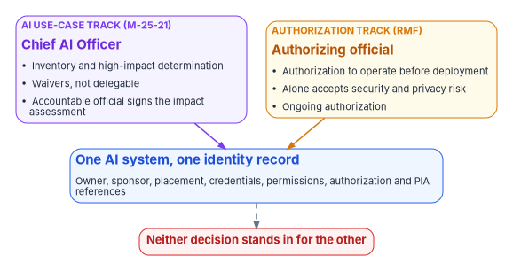
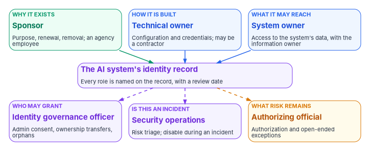

# Chapter 08 — Who Owns AI Identity Governance

*AI governance gave agencies a new executive, but the AI system still signs in through the old machinery, and each part of that machinery already has an owner.*

::: {.callout-note}
## In this chapter
Where the roles come from: OMB M-25-21 and M-25-22, NIST's Risk Management Framework and AI Risk Management Framework, and the sponsor and owner model in Microsoft Entra Agent ID. Then each role: the Chief AI Officer and the AI governance board, the CIO, the CISO, the authorizing official, the official who accepts risk for an AI use case, the system owner and ISSO, the agent's sponsor and technical owner, the identity team, security operations, the privacy officer and acquisition. Who must be a government official, a responsibility matrix consistent with Book 00 Chapter 07, Book 04 Chapter 06, Book 13 Chapter 09 and Book 14 Chapter 10, and the separations that keep AI decisions honest.
:::

When an agency first asks who owns its AI agents' identities, three answers usually come back at once. The Chief AI Officer's office says the identity team does, because identities are an identity matter. The identity team says the Chief AI Officer does, because the agents are AI. And the program office that built the agent says it already accepted the risk when it signed its AI impact assessment. All three are partly right, and the combination leaves an agent with credentials, data access and no one who will answer for it.

The way out is the same one every Who chapter in this workbook uses: separate the decisions, give each one a single decider, and check that no new role quietly absorbs a decision an existing one already holds. AI adds one new executive role and one new kind of risk decision. It doesn't add a new authorizing official, a new account manager or a new way to accept security risk. Most of this chapter is about fitting the new pieces beside the old ones without overlap.

{#fig-ch08-two-tracks fig-alt="Two cards side by side at the top. Left, a violet card labeled AI use-case track under M-25-21, titled Chief AI Officer: inventory and high-impact determination; waivers, which aren't delegable; and the accountable official signs the impact assessment. Right, an amber card labeled authorization track under the RMF, titled authorizing official: authorization to operate before deployment; alone accepts security and privacy risk; ongoing authorization. Both point to a blue card in the middle, one AI system, one identity record, carrying owner, sponsor, placement, credentials, permissions, and authorization and PIA references. A dashed arrow leads from it to a red pill: neither decision stands in for the other."}

## Where the roles come from

**OMB M-25-21** creates the AI-specific roles. Within 60 days of the memo, each agency head had to retain or designate a Chief AI Officer, who "will promote AI innovation, adoption, and governance, in coordination with appropriate agency officials." The agency may designate an existing official, such as the CIO, Chief Data Officer or Chief Technology Officer, "provided that individual has significant expertise in AI." In CFO Act agencies the Chief AI Officer must be at the Senior Executive Service, Scientific and Professional or Senior Leader level, and elsewhere at or above GS-14, with the authority to perform the duties and the standing to engage regularly with the Deputy Secretary.[^c08-m2521] Each CFO Act agency also convenes an AI governance board, chaired at the Deputy Secretary level with the Chief AI Officer as vice-chair, and with representation from IT, cybersecurity, data, budget, legal counsel, privacy, civil rights and civil liberties, among others; existing bodies may serve.[^c08-m2521]

The same memo separates two risk decisions. It asks agencies to enable "trained and accountable agency officials at the lowest appropriate level to identify, assess, mitigate, and accept risk for AI use cases," preferably officials "accountable for the mission outcome," and then says in a footnote that this process "is separate from, and does not supersede, the authorization process for information systems" under OMB Circular A-130. A second footnote repeats it for systems: agencies "must continue to follow applicable authorization to operate requirements."[^c08-m2521] That is the split in the figure above, and the rest of the chapter depends on it.

**OMB M-25-22**, the companion acquisition memo, adds three things. Agencies convene a cross-functional team for AI acquisitions, drawing on acquisition, IT, cybersecurity, privacy, civil rights, budgeting, data, legal and program evaluation expertise. Senior agency officials for privacy have "early and ongoing involvement" in acquiring or contracting for AI that involves PII. And "any AI systems and services operated as an information system by or on behalf of an agency must receive an authorization to operate from an appropriate agency official prior to deployment."[^c08-m2522] **OMB M-26-10**, issued in March 2026, reinforces the CIO's part: under FITARA a covered CFO Act agency can't enter a contract for IT or IT services unless the CIO has reviewed and approved it, and from May 2026 those CIOs reported the contracts they approved to OMB monthly, a requirement the memo sunsets in October 2026 after the sixth report unless OMB extends it.[^c08-m2610] No OMB memorandum issued through September 2026 rescinds or replaces M-25-21 or M-25-22.[^c08-omb-list]

**NIST's Risk Management Framework** gives the system roles, unchanged for AI. The authorizing official "is the only organizational official who can accept the security and privacy risk," and for federal agencies the role is an inherent government function assigned to government personnel only. The system owner is responsible for the system across its life and, with the information owner, "decides who has access to the system (and with what types of privileges or access rights)." The CIO designates the senior agency information security officer, and the senior agency official for privacy is also government-only. SP 800-37 also says organizations should "ensure that there are no conflicts of interest" when one person holds several risk management roles.[^c08-sp80037] **NIST's AI Risk Management Framework** asks for the same clarity in AI terms: roles and responsibilities for mapping, measuring and managing AI risk that are "documented and are clear to individuals and teams throughout the organization" (GOVERN 2.1), executive leadership that "takes responsibility for decisions about risks associated with AI system development and deployment" (GOVERN 2.3), and defined roles for human-AI configurations and oversight (GOVERN 3.2).[^c08-airmf]

**Microsoft Entra Agent ID** brings a platform model that fits the program's split between deciding and doing. **Sponsors** are "business representatives accountable for the agent's purpose and lifecycle decisions, including access reviews and agent retention, without technical administrative access"; at least one is required for each agent identity and blueprint. **Owners** are "technical administrators responsible for operational management," including credentials; they are optional. **Managers** place an agent's user account in the organization's hierarchy. These relationships are separate from directory roles such as Agent ID Administrator.[^c08-owners] The program uses the same words for every AI system, whether or not it runs on Agent ID.

## Deciding, doing and being consulted

The program's model, from [Book 01, Chapter 09](../b01-transformation-arc/09-who-leads-the-transformation.md), separates three kinds of involvement. **Deciding** means being accountable for the outcome and able to say no. **Doing** means building, configuring, operating or remediating. **Being consulted** means the decision can't be made well without that role's input. Every row of the matrix below has one decider. Where two roles look as if they both decide, the row has been split until they don't.

## The roles

### The Chief AI Officer and the AI governance board

M-25-21 gives the Chief AI Officer ten duties. The ones that touch identity governance are to maintain the agency's AI use case inventory; to set up the processes for determining and documenting high-impact use cases, monitoring their performance, overseeing compliance with AI risk requirements, independently reviewing high-impact use cases before risk acceptance, and centrally tracking them; to advise on an AI-ready workforce; and to ensure custom-developed AI code and data are inventoried.[^c08-m2521] The Chief AI Officer may also waive one or more minimum practices for a specific high-impact application after a written, system-specific determination, must certify each waiver annually, and can't delegate that responsibility; and certifies pilots that are exempt from the minimum practices.[^c08-m2521]

What the memo doesn't give the Chief AI Officer is as important. The Chief AI Officer doesn't authorize systems to operate, doesn't accept security or privacy risk for a system, doesn't manage accounts and doesn't run the identity platform. In the program's design the Chief AI Officer owns the **declared** side of AI identity governance: the inventory is the list of AI systems the agency says it has, and [Chapter 03](03-the-inventory-as-an-identity-source.md) reads it as the source of identity obligations. The program asks the Chief AI Officer to make one policy decision that ties the two sides together: no AI use case is recorded as piloted or deployed in the inventory without a link to its identity record. That is design, not a federal requirement, but it is the decision that keeps [Chapter 07](07-monitoring-drift-and-shadow-ai.md)'s comparison possible.

The **AI governance board** coordinates; it doesn't replace the deciders below. M-25-21 makes it the forum where the Chief AI Officer supports the Deputy Secretary on AI activities.[^c08-m2521] The program's own governance board ([Book 13, Chapter 09](../b13-governance/09-who-governs.md#the-governance-board)) reviews changes to the authoritative record and its rules. In a small agency the same people may sit on both. Keep the agendas and the decision records separate: a change to what the identity record requires of AI systems is a rule change for the program's board, and a change to the agency's AI use policy is a matter for the AI governance board.

### The CIO

The CIO's part is the platform and the money. The CIO designates the CISO (the senior agency information security officer), oversees the security program and its trained personnel, and reports on it to the agency head.[^c08-sp80037] Under FITARA the CIO approves contracts for IT and IT services, which includes most AI products and services, and in covered CFO Act agencies reported those approvals to OMB monthly from May to October 2026, unless OMB extends that reporting.[^c08-m2610] With the executive sponsor, the CIO decides budget and licenses for the program ([Book 00, Chapter 07](../b00-orientation/07-who-runs-the-program.md#who-decides-what)), including the identity and monitoring licenses this book's design needs, such as Workload ID Premium or the agent capabilities [Chapter 07](07-monitoring-drift-and-shadow-ai.md) describes.

The CIO also decides one thing the other roles can't: what happens to **shadow AI that belongs to no system**. A discovered agent or AI workload that no system owner will claim has no one below the CIO who can either bring it under an authorization or order it removed.

### The CISO

The CISO sets the control requirements AI identities must meet, as for every other target surface ([Book 00, Chapter 07](../b00-orientation/07-who-runs-the-program.md#who-decides-what)): which credential types are allowed and which are findings, the Conditional Access baseline for workload and agent identities, the logging categories every AI identity must emit and how long they are kept, and the evidence standard a closed AI finding must meet. The CISO decides on continuous monitoring evidence and drift findings and approves bounded exceptions ([Book 13, Chapter 09](../b13-governance/09-who-governs.md#who-reviews-drift)). And because the authorization verdict for a SaaS service is a security decision ([Book 15, Chapter 06](../b15-day2-operations/06-saas-integration-governance.md)), the CISO's office decides whether a generative AI service may hold agency data before anyone sanctions it.

### The authorizing official

Nothing about AI changes the authorizing official's role, and that is the point. Every AI system operated as an information system needs an authorization to operate before deployment.[^c08-m2522] There is no separate AI authorization, and an AI impact assessment's risk acceptance is not one.[^c08-m2521] The authorizing official alone accepts the residual security and privacy risk of the AI system, decides whether a change to it requires reauthorization, approves its plan of action and milestones and makes the ongoing authorization decision ([Book 14, Chapter 10](../b14-compliance/10-who-owns-compliance.md#the-responsibility-matrix)).

For AI, the significant-change question comes up more often than for most systems. Adding a tool or an MCP server to an agent, granting it a new application permission, giving it its own user account, or changing its underlying model can each change what it can do to agency data. In the program's design the system owner raises each of those as a candidate significant change, and the authorizing official decides; the identity team's change record is the evidence that the question was asked.

### The official who accepts risk for an AI use case

M-25-21 creates a second signature. Before deploying a high-impact use case, the agency completes an AI impact assessment that ends in "risk acceptance, supported by a signature from the individual accepting the risk," after an independent reviewer "who has not been involved in the development" has commented and those comments have been shared with that individual.[^c08-m2521] The memo encourages assigning the decision to officials accountable for the mission outcome. In most agencies that is the mission or business owner of the program the AI serves, a role SP 800-37 describes as a key stakeholder that "may also serve in the role of authorizing official."[^c08-sp80037]

The program keeps the two signatures distinct even when one person holds both. The use-case signature accepts the AI's effects on the mission and on the public: its purpose, data quality, impacts on privacy, civil rights and civil liberties, and costs. The authorization accepts the system's residual security and privacy risk. An agency that lets one stand in for the other has either deployed an AI system without an authorization or authorized one without anyone accepting its impact on people.

### The system owner and the ISSO

The system owner owns the AI system and therefore its identities. SP 800-37 gives the system owner the system's life from procurement to disposal and, with the information owner, the decision about who has access and with what privileges.[^c08-sp80037] For an AI system that decision is about the AI itself: which data, which APIs and which tools its identities may reach. The system owner keeps the identity record current, names the sponsor, decides how AI drift findings on the system are remediated within their windows ([Book 13, Chapter 09](../b13-governance/09-who-governs.md#who-reviews-drift)), and decides whether a shadow AI identity found inside the system is accepted into the boundary or removed, the same decision [Book 15, Chapter 10](../b15-day2-operations/10-who-runs-day-two.md#the-responsibility-matrix) gives the system owner for any shadow asset. The system owner also ensures operators of the AI receive the system-specific training M-25-21 requires for high-impact use, which [Book 16](../b16-people/index.md) covers.[^c08-m2521]

The ISSO is the system's representative in the work: resolving the inventory's authorization answer against the records, assessing the security impact of each change to the AI's identities and tools, and assembling the identity evidence for the authorization package ([Chapter 10](10-evidence-and-authorization.md)).

### The agent's sponsor and technical owner

Every AI system has a **sponsor**: the person accountable for why it exists. The sponsor decides whether it should still exist, renews or ends its access, answers access reviews for it, and is the person security operations asks whether its behavior is expected. Agent ID gives sponsors exactly that scope: they can disable or soft-delete an agent identity and change its sponsors, but can't change its configuration or re-enable it.[^c08-owners] The **technical owner** keeps the configuration and credentials correct and can recover an agent the sponsor disabled.[^c08-owners]

The program adds three rules to the platform's model, all design:

1. **The sponsor of record is an agency employee.** Agent ID allows guest users to be sponsors and allows some groups.[^c08-owners] The program allows a group only as a co-sponsor beside a named employee, and never a guest or contractor as the sole sponsor, because the sponsor makes lifecycle decisions for an agency principal. A contractor may be the technical owner.
2. **At publication, sponsorship moves to the people who rely on the agent.** Microsoft notes that for unpublished agents creators often sponsor, while for published agents sponsors "typically come from teams using the agent."[^c08-owners] The builder becomes the technical owner; the using program's employee becomes the sponsor.
3. **Sponsorship follows the person's lifecycle.** When a sponsor moves or leaves, Lifecycle Workflows can transfer sponsorship to the sponsor's manager, generally available since May 2026.[^c08-whatsnew] The manager must accept or reassign it within the program's window, or [Chapter 07](07-monitoring-drift-and-shadow-ai.md) raises a finding. HR-driven mover and leaver events from [Book 03](../b03-hr-identity/index.md) are the trigger.

For an AI system built on an ordinary service principal or managed identity, the same two roles are recorded in the identity record, and the application's Owners list holds only technical owners, as [Book 04, Chapter 05](../b04-access/05-applications-and-workload-identities.md) recommends for every application.

### The identity team

The identity team is the two roles of [Book 04, Chapter 06](../b04-access/06-who-decides-access.md#the-roles). The **identity governance officer** decides the risk tier of an AI application, admin consent outside the lowest tier, federated credentials added to an application, ownership transfers and the remediation of orphaned AI identities, under the CISO's requirements. Because the admin consent workflow doesn't work for permissions requested by agent identities, which go directly to an administrator, the identity governance officer reviews those grants after the fact and on the annual consent review.[^c08-agentfaq] **Identity engineering** builds: blueprints, agent identities, workload identity federation, the Conditional Access policies for workload and agent identities, the identity record's links to directory objects, and the log exports. It executes; it doesn't approve what it builds.

### Security operations

Security operations watches what AI identities do. It owns the detections [Chapter 07](07-monitoring-drift-and-shadow-ai.md) lists, triages risky workload identities and risky agents, and decides whether a behavior is an incident. As in [Book 04](../b04-access/06-who-decides-access.md#the-responsibility-matrix), it decides incident-driven revocation, because speed matters more than the approval chain: disabling an agent, revoking its grants or confirming it compromised. It then hands the decision about the agent's future back to the sponsor and the system owner. [Book 12, Chapter 10](../b12-security-operations/10-who-runs-security-operations.md) assigns the rest.

### The privacy officer

The senior agency official for privacy, or the privacy office acting for that official, decides the privacy questions an AI system raises: whether a privacy impact assessment is needed and whether it covers the AI, and whether the system's use of PII is authorized. Under M-25-22 the privacy official is involved early in any acquisition of AI that involves PII, including pre-solicitation planning and requirements.[^c08-m2522] In the authorization path, the privacy official approves the categorization and privacy plan for systems with PII ([Book 14, Chapter 10](../b14-compliance/10-who-owns-compliance.md#the-responsibility-matrix)). The PII finding of [Chapter 07](07-monitoring-drift-and-shadow-ai.md) goes to this role.

### Acquisition

The contracting officer and the M-25-22 cross-functional team turn the identity requirements into contract terms before an AI product or service is bought. The program's minimum terms, which are design: a vendor-operated agent working in the agency's tenant uses an identity the agency issues and can disable; the vendor names a technical owner and supports the agency's sponsor model; the service emits sign-in and activity logs the agency can export; no shared or static credentials where federation is supported; and the agency is told of any new tool, model or permission the agent acquires. M-25-22 also asks agencies to monitor contracted AI for emerging risks during contract administration.[^c08-m2522] M-26-04 adds contract requirements for large language models on truthfulness and ideological neutrality, which acquisition carries but which aren't identity terms.[^c08-m2604] The CIO approves the IT contract and the system owner owns the requirements. M-25-22 required agencies to update their procedures so that relevant officials can review planned AI acquisitions and give feedback on performance and risk management;[^c08-m2522] in the program's design the Chief AI Officer's office is one of those reviewers.

## Who must be a government official

| Role | Government personnel only? | Program position |
|---|---|---|
| Authorizing official | Yes (SP 800-37) | Signs every authorization and every acceptance of residual risk for an AI system |
| CIO, CISO, senior agency official for privacy | Yes (SP 800-37) | — |
| Chief AI Officer | M-25-21 sets a grade (SES, ST or SL in CFO Act agencies; GS-14 or above elsewhere) | A federal position; the waiver authority can't be delegated |
| Official accepting risk for an AI use case | Not stated | A government official, because the signature accepts the AI's effect on the public; program design |
| System owner | Not stated | A government official; program design ([Book 14, Chapter 10](../b14-compliance/10-who-owns-compliance.md#who-must-be-a-government-official)) |
| Sponsor of an AI system | Not stated; Agent ID allows guests | An agency employee; program design |
| Technical owner, identity engineering, ISSO | Not stated | A contractor may serve, with government oversight |

Sources: SP 800-37 Rev. 2 Appendix D;[^c08-sp80037] M-25-21 §3(a)(i) and §4(a)(ii);[^c08-m2521] Agent ID sponsor rules.[^c08-owners]

{#fig-ch08-one-agent-many-owners fig-alt="Three cards across the top point down to a violet card in the middle, the AI system's identity record, on which every role is named with a review date. The top cards are: a green card, why it exists, the sponsor, who decides purpose, renewal and removal and is an agency employee; a blue card, how it is built, the technical owner, who keeps configuration and credentials and may be a contractor; and a blue card, what it may reach, the system owner, who decides access to the system's data with the information owner. From the record, dashed arrows lead down to three cards: a violet card, who may grant, the identity governance officer, for admin consent, ownership transfers and orphans; a violet card, is this an incident, security operations, for risk triage and disabling during an incident; and an amber card, what risk remains, the authorizing official, for authorization and open-ended exceptions."}

## The responsibility matrix

D = decides (accountable) · R = does the work · C = consulted · blank = informed at most. "Use-case risk acceptor" is the official M-25-21 asks to accept risk for an AI use case. "Identity team" is the identity governance officer (IGO) and identity engineering, each for their own rows. The program office's triage of findings, the governance board and the records officer are outside the matrix; [Book 13, Chapter 09](../b13-governance/09-who-governs.md#the-responsibility-matrix) places them.

| Decision or work item | CAIO | CIO | CISO | AO | Use-case risk acceptor | System owner / ISSO | Sponsor | Identity team | Security ops | Privacy | Acquisition |
|---|---|---|---|---|---|---|---|---|---|---|---|
| Maintain the AI use case inventory | D, R | | | | C | R | C | C | | C | |
| Inventory entries link to identity records (policy) | D | C | C | | | C | | C | | | |
| High-impact determination | D | | | | R | R | C | | | C | |
| Waiver from a minimum practice for high-impact AI | D | | C | C | C | R | | | | C | |
| Certify a pilot exempt from the minimum practices | D | | | | C | R | | | | | |
| AI impact assessment and its risk acceptance | C | | C | C | D | R | C | | | C | |
| Generative AI acceptable-use policy | D | C | C | | | | | | | C | C |
| Authorization to operate for an AI system | C | C | C | D | C | R | | C | | C | |
| Does a new tool, permission, user account or model require reauthorization? | C | | C | D | C | R | C | C | | | |
| Ongoing authorization decision | C | C | C | D | | R | | | | C | |
| Identity record created before any credential is issued | C | | | | | R | R | D (IGO), R | | | |
| Name the sponsor; move sponsorship at publication | | | | | C | D | R | C | | | |
| Sponsor transfer on mover or leaver | | | | | | C | R | D (IGO), R | | | |
| Control requirements for AI identities: credentials, Conditional Access, logging | C | | D | C | | C | | R | C | | |
| Credential type and rotation for an AI system | | | C | | | D | | R | C | | |
| Federated credential added to an AI application | | | C | | | R | | D (IGO), R | C | | |
| What data and tools an AI identity may reach | | | C | | | D | C | R | | C | |
| Admin consent for an AI application or agent | | | C (critical scopes) | | | R | C | D (IGO) | C | | |
| Authorization verdict for a generative AI service | C | | D | | | C | | C | | C | |
| Detections, risky agent and workload identity triage | | | C | | | C | C | C | D, R | | |
| Disable an AI identity during an incident | | | C | | | C | C | R | D | | |
| Shadow AI found inside a system: accept into the boundary or remove | C | | C | | | D | C | R | R | | |
| Shadow AI that belongs to no system | C | D | C | | | | | R | R | | |
| Remediate an AI drift finding within its window | | | C | | | D | R | R | | | |
| Bounded exception with an end date and compensating control | | | D | C | | R | C | C | C | | |
| Exception with no end date or no compensating control | | | R | D | C | R | C | C | C | | |
| Privacy impact assessment for an AI system with PII | C | | | | C | R | | | | D | |
| AI acquisition: identity, logging and credential terms | C | D | C | | | R | | C | | C | R |
| Training for operators of a high-impact AI system | C | | C | | | D, R | C | | | | |
| Retire an AI system as a whole: identities, grants, inventory entry (retiring a single agent is its sponsor's decision) | R | | | | C | D | R | R | | | |
| AI identity evidence in the authorization package | C | | C | | | D, R | | R | R | | |

Eight rows need comment.

The **inventory link** row is the Chief AI Officer's decision because the inventory is the Chief AI Officer's under M-25-21. The identity team is consulted because it must be able to produce the identity record key the inventory entry points at. Without this one decision, the comparison in [Chapter 07](07-monitoring-drift-and-shadow-ai.md) has nothing to join on.

The **high-impact, waiver and pilot** rows follow M-25-21. An appropriate official documents a determination that a presumed high-impact use case isn't high-impact and the Chief AI Officer may revisit it; waivers are the Chief AI Officer's alone and can't be delegated; pilots need the Chief AI Officer's certification.[^c08-m2521] The authorizing official is consulted on waivers because a waived practice may leave a risk the authorization has to carry.

The **impact assessment** row gives the decision to the use-case risk acceptor, not the authorizing official, and the **authorization** row the reverse. The authorizing official is consulted on the impact assessment and the use-case risk acceptor on the authorization, so each sees what the other accepted. Where one person holds both roles, they sign twice, on two documents.

The **identity record** row gives the IGO the decision because creating a principal is identifier management (IA-4), and the record is the IGO's registry for AI as it is for applications in [Book 04](../b04-access/06-who-decides-access.md#the-roles). The rule that the record exists before any credential is issued is design, and it is what makes an agentic system with no governed identity a finding rather than a normal state.

The **credential, federated credential and consent** rows are copied from [Book 04, Chapter 06](../b04-access/06-who-decides-access.md#the-responsibility-matrix) so the books agree: the application owner (here the system owner) decides credential type and rotation, the IGO decides federated credentials and admin consent, and the CISO concurs on critical-rated permissions.

The **generative AI** rows split policy from verdict. M-25-21 asks agencies to develop a policy on acceptable use of generative AI;[^c08-m2521] the program gives that policy to the Chief AI Officer. Whether a particular service may hold agency data is the authorization verdict of [Book 15, Chapter 06](../b15-day2-operations/06-saas-integration-governance.md), which is the CISO's.

The **shadow AI** rows split by whether a system owner exists. Inside a system, the system owner decides, as for any shadow asset. With no owning system, only the CIO can assign it to one or order it removed. Security operations does the containment work in both, and the Chief AI Officer is consulted because a shadow AI system kept is a new inventory entry.

The **exception** rows are the time split every book in this workbook uses: a bounded exception is the CISO's, an open-ended one or one without a compensating control is the authorizing official's ([Book 13, Chapter 09](../b13-governance/09-who-governs.md#who-accepts-exceptions)). A Chief AI Officer waiver of a minimum practice is not an exception to a security control and doesn't substitute for one.

## Keeping the roles apart

1. **An AI use-case risk acceptance isn't an authorization, and an authorization isn't a use-case risk acceptance.** M-25-21 says the AI process doesn't supersede the authorization process, and M-25-22 requires an authorization before deployment.[^c08-m2521][^c08-m2522] The program's identity record carries both references, and either one missing on a deployed system is a finding.
2. **Watch the combined roles.** M-25-21 lets an agency name its CIO as Chief AI Officer, and SP 800-37 notes that a CIO may be designated an authorizing official for selected systems.[^c08-m2521][^c08-sp80037] The program doesn't forbid either. It does ask, in line with SP 800-37's warning about conflicts of interest, that the official who waived a minimum practice for an AI system not also be the sole authorizing official accepting that system's residual risk; a co-authorizing official or a different authorizing official breaks the loop.
3. **The independent reviewer wasn't on the team.** M-25-21 requires the impact assessment's reviewer to be someone "who has not been involved in the development."[^c08-m2521] The program extends the rule to the identity evidence: the person who built an agent's identities doesn't attest to them.
4. **The builder doesn't sponsor a published agent.** The technical owner keeps the configuration; the sponsor, from the program that relies on the agent, decides whether it should exist.
5. **No AI identity approves access.** Agent ID blocks agent identities from the most privileged directory roles and from high-risk Microsoft Graph permissions, and agent identities can't create other agent identities.[^c08-agentfaq][^c08-errors] The program goes further: no AI identity, on Agent ID or not, holds a role that approves access requests, grants consent or changes the rules it is governed by ([Book 00, Chapter 07](../b00-orientation/07-who-runs-the-program.md#keeping-the-roles-apart): the component that decides isn't the one that acts).
6. **The authorizing official stays a government official.** A contractor may build, operate and own an AI system technically, and may prepare every decision in this chapter except those in the authorizing official's, the CIO's, the CISO's and the privacy official's columns.

## Where each Who chapter fits

| Chapter | What it settles |
|---|---|
| [Book 00, Chapter 07 — Who Runs the Program](../b00-orientation/07-who-runs-the-program.md) | Program roles, the decision table, gates and rhythm |
| [Book 01, Chapter 09 — Who Leads the Transformation](../b01-transformation-arc/09-who-leads-the-transformation.md) | Program-wide decision rights |
| [Book 04, Chapter 06 — Who Decides Access](../b04-access/06-who-decides-access.md) | Application risk tiers, consent, credentials, orphaned applications |
| [Book 12, Chapter 10 — Who Runs Security Operations](../b12-security-operations/10-who-runs-security-operations.md) | Logging, detection, incident response |
| [Book 13, Chapter 09 — Who Governs](../b13-governance/09-who-governs.md) | The authoritative record, drift review, exceptions |
| [Book 14, Chapter 10 — Who Owns Compliance](../b14-compliance/10-who-owns-compliance.md) | The RMF roles and the authorization path |
| [Book 15, Chapter 10 — Who Runs Day Two](../b15-day2-operations/10-who-runs-day-two.md) | Day-two execution, the CMDB and shadow assets |
| This chapter | The Chief AI Officer beside the RMF roles; AI use-case risk acceptance beside authorization; sponsors and technical owners for AI identities |

## What changes, in one table

| Old habit | What replaces it |
|---|---|
| "The Chief AI Officer owns AI" | The Chief AI Officer owns the inventory, high-impact determinations and waivers; the system owner owns the AI system and its identities |
| The impact assessment signature is the approval to deploy | The impact assessment and the authorization to operate are two decisions, both required |
| Whoever built the agent owns it | The sponsor decides whether it exists; the technical owner keeps it running; the system owner decides what it may reach |
| A sponsor is whoever the platform recorded at creation | The sponsor of record is an agency employee from the program that relies on the agent, transferred on every move |
| Agent consent requests go to whichever admin is asked | They are reviewed by the IGO like every other grant, because they bypass the consent workflow |
| Shadow AI is the security team's problem | Security operations contains it; the system owner, or the CIO when there is no system, decides its future |
| A contractor team "owns" the agents it built | Contractors build and operate; government officials sponsor, authorize and accept risk |

::: {.callout-tip}
## Continue the book
[← Previous: Chapter 07 — Monitoring, Drift and Shadow AI](07-monitoring-drift-and-shadow-ai.md) · [Book index](index.md) · [Next: Chapter 09 — Running the Inventory Scan, Agency and Central →](09-running-the-inventory-scan.md)
:::

[^c08-m2521]: Office of Management and Budget, M-25-21, *Accelerating Federal Use of AI through Innovation, Governance, and Public Trust*, April 3, 2025, §3(a)(i)–(ii), §3(b)(i), §3(b)(iv)–(v), footnotes 21, 22 and 29, §4(a), and §4(b)(ii) and (iv), <https://www.whitehouse.gov/wp-content/uploads/2025/02/M-25-21-Accelerating-Federal-Use-of-AI-through-Innovation-Governance-and-Public-Trust.pdf> (accessed Oct 22, 2026).
[^c08-m2522]: Office of Management and Budget, M-25-22, *Driving Efficient Acquisition of Artificial Intelligence in Government*, April 3, 2025, §3(b), §3(d), §4(a)(i) and §4(e)(i)–(ii), <https://www.whitehouse.gov/wp-content/uploads/2025/02/M-25-22-Driving-Efficient-Acquisition-of-Artificial-Intelligence-in-Government.pdf> (accessed Oct 22, 2026).
[^c08-m2610]: Office of Management and Budget, M-26-10, *Reinforcing Transparency, Accountability, and Oversight of Federal Technology*, March 31, 2026, §1 (the monthly reporting "shall sunset in October 2026, following covered CFO Act agencies' submission of their sixth and final report, unless OMB notifies agencies beforehand that it will continue past that time"), <https://www.whitehouse.gov/wp-content/uploads/2026/03/M-26-10-Reinforcing-Transparency-Accountability-and-Oversight-of-Federal-Technology.pdf> (accessed Oct 23, 2026).
[^c08-m2604]: Office of Management and Budget, M-26-04, *Increasing Public Trust in Artificial Intelligence Through Unbiased AI Principles*, December 11, 2025, <https://www.whitehouse.gov/wp-content/uploads/2025/12/M-26-04-Increasing-Public-Trust-in-Artificial-Intelligence-Through-Unbiased-AI-Principles-1.pdf> (accessed Oct 22, 2026).
[^c08-omb-list]: The White House, Office of Management and Budget, "Memoranda" (list through M-26-19, September 2026), <https://www.whitehouse.gov/omb/information-resources/guidance/memoranda/> (accessed Oct 22, 2026).
[^c08-sp80037]: National Institute of Standards and Technology, SP 800-37 Rev. 2, *Risk Management Framework for Information Systems and Organizations: A System Life Cycle Approach for Security and Privacy*, December 2018, Appendix D (Authorizing Official, Chief Information Officer, Mission or Business Owner, Senior Agency Information Security Officer, Senior Agency Official for Privacy, System Owner) and footnote 113, <https://nvlpubs.nist.gov/nistpubs/SpecialPublications/NIST.SP.800-37r2.pdf> (accessed Oct 22, 2026).
[^c08-airmf]: National Institute of Standards and Technology, NIST AI 100-1, *Artificial Intelligence Risk Management Framework (AI RMF 1.0)*, January 2023, GOVERN 2.1, 2.3 and 3.2, <https://nvlpubs.nist.gov/nistpubs/ai/NIST.AI.100-1.pdf> (accessed Oct 22, 2026).
[^c08-owners]: Microsoft Learn, "Administrative relationships in Microsoft Entra Agent ID (Owners, sponsors, and managers)," <https://learn.microsoft.com/entra/agent-id/agent-owners-sponsors-managers> (accessed Oct 22, 2026).
[^c08-whatsnew]: Microsoft Learn, "Microsoft Entra releases and announcements," May 2026, "General Availability - Manage Agent ID sponsorship lifecycle with Lifecycle Workflows," <https://learn.microsoft.com/entra/fundamentals/whats-new> (accessed Oct 22, 2026).
[^c08-agentfaq]: Microsoft Learn, "Frequently asked questions about Microsoft Entra Agent ID," sections "Roles, permissions, and groups" and "Authentication and consent," <https://learn.microsoft.com/entra/agent-id/faq> (accessed Oct 22, 2026).
[^c08-errors]: Microsoft Learn, "Microsoft agent identity platform error codes," section "Agent identity creation errors," <https://learn.microsoft.com/entra/agent-id/error-codes> (accessed Oct 22, 2026).
