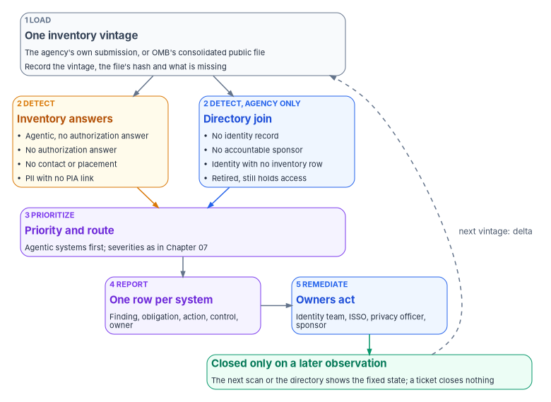
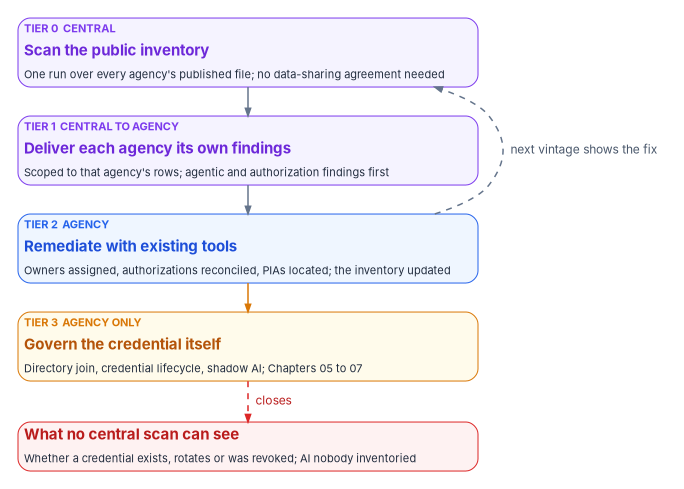

# Chapter 09 — Running the Inventory Scan, Agency and Central

*The inventory scan is cheap because it reads answers agencies have already given; it is useful only if every answer it questions ends with an owner who goes and looks.*

::: {.callout-note}
## In this chapter
The program's scan method for one agency: loading an inventory vintage and recording what's missing from it, the checks that run on inventory answers alone and the ones that need the directory, prioritizing, the report, remediation, and comparing one year's inventory with the next, with illustrative code. Then the central model: one scan over the published inventory for every agency, what the Continuous Diagnostics and Mitigation program actually does and how far the comparison holds, the four tiers, and the gap no central scan can close.
:::

[Chapter 03](03-the-inventory-as-an-identity-source.md) read the federal AI use-case inventory as identity data: which fields anchor an identity record, which are leads, and what the inventory doesn't hold at all. [Chapter 07](07-monitoring-drift-and-shadow-ai.md) defined the findings that follow when what the inventory declares is compared with what the directory observes, with their severities, routes and controls. This chapter is the procedure that connects them: how the scan is run, by whom, on which file, and what happens to its output.

The scan exists in two forms, and they share their checks. An agency runs it on its own inventory submission and joins the result to its directory, which lets it see identities as well as answers. A central operator could run it on OMB's consolidated public inventory for every agency at once, which reaches further but sees only answers. Both are the program's design. No federal rule requires either one; M-25-21 requires the inventory, not a scan of it.[^c09-m2521]

The program's scan script isn't published with the workbook. Everything below describes the method, and the code is illustrative.

{#fig-ch09-scan-method fig-alt="A top-to-bottom flow. A slate card, step 1 Load, one inventory vintage: the agency's own submission or OMB's consolidated public file; record the vintage, the file's hash and what is missing. It branches into two cards side by side. An amber card, step 2 Detect, inventory answers: agentic with no authorization answer; no authorization answer; no contact or placement; PII with no PIA link. A blue card, step 2 Detect, agency only, directory join: no identity record; no accountable sponsor; identity with no inventory row; retired but still holds access. Both lead to a violet card, step 3 Prioritize, priority and route: agentic systems first, severities as in Chapter 07. That leads to a violet card, step 4 Report, one row per system: finding, obligation, action, control, owner; then to a blue card, step 5 Remediate, owners act: identity team, ISSO, privacy officer, sponsor; then to a green card, closed only on a later observation: the next scan or the directory shows the fixed state, and a ticket closes nothing. A dashed arrow labeled next vintage: delta runs from the green card back to the load card."}

## What the scan reads

M-25-21 requires each agency other than the Department of Defense and the Intelligence Community to inventory its AI use cases at least annually, submit the inventory to OMB and post a public version; it encourages agencies to update the public version on an ongoing basis.[^c09-m2521] For the 2025 cycle, OMB's guidance set December 22, 2025 for submissions and January 28, 2026 for a machine-readable CSV at each agency's `/ai` page.[^c09-guidance] OMB then compiled the public inventories into one repository. As of April 13, 2026 it holds 3,611 individually reported use cases from 41 agency submissions, of which 1,818 are deployed or piloted and 445 are high-impact.[^c09-repo]

There are therefore two files the scan can read, and they aren't the same.

| | The agency's own submission | OMB's consolidated public file |
|---|---|---|
| Who can read it | The agency | Anyone |
| Use case ID | Required[^c09-dictionary] | May be removed from the public version;[^c09-guidance] 704 of the 3,611 rows have none[^c09-csv] |
| Contact | The individual or team responsible[^c09-dictionary] | May be replaced with a public inquiry address[^c09-guidance] |
| Withheld use cases and fields | Present | Removed where sharing would be inconsistent with law or policy[^c09-guidance] |
| Completeness | Whatever the agency submitted | Whatever the agency posted, standardized by OMB; some rows lost their stage and answers (below) |
| Who can join it to the directory | The agency | Nobody but the agency |

The agency scan should always read the agency's own submission. The public file is what a central operator has, and the central model later in this chapter is built around its limits.

## Step 1: load one vintage and record what's missing

A vintage is one year's inventory as submitted. The program treats each as a fixed input: it records which vintage was read, the file's hash and the date it was read, so a later re-run can show that the same input gave the same findings. It also marks any vintage older than 13 months as stale. Both are design choices, consistent with [Chapter 07](07-monitoring-drift-and-shadow-ai.md), not federal rules.

Loading is also where the scan records what the file can't support. In the 2025 consolidated file, three agencies' rows (338 of them) have no development stage and no answers in the stage-dependent columns, although the repository's summary table counts those agencies' use cases as deployed or piloted; 13 use case IDs appear more than once.[^c09-csv][^c09-repo] A scan that silently skips those rows reports a cleaner picture than the inventory supports. The program's rule is that the scan reports unreadable rows as their own finding, *stage not recorded*, routed to the agency's inventory coordinator, rather than dropping them.

Two inventory rules matter at load time. Agencies must report a retired use case as retired in the inventory that follows the year it was last operational, after which it may be omitted, and its unique identifier must never be reused.[^c09-repo] And the file is UTF-8 with a byte-order mark, with multi-select answers stored as lists.[^c09-dictionary] The first rule is what makes the leaver check possible; the second is why naive parsing produces stray characters in the first column name.

## Step 2: detect

The checks fall into two groups. The first runs on inventory answers alone, so a central operator can run it too. The second needs the directory, so only the agency can.

### Checks on inventory answers

These checks apply to use cases whose stage is *Pilot* or *Deployed*, because the inventory's authorization, PII and contracting questions are required only at those stages.[^c09-dictionary]

| Check | Inventory condition | Why it matters for identity | What the answer can't prove |
|---|---|---|---|
| Agentic AI with no authorization answer | `classification` is *Agentic AI* and `have_ato` isn't *Yes* | An AI system that can act, not just answer, with no system authorization behind it | That the system has no identity, or that it has one |
| No authorization answer | `have_ato` is *No* or blank | No authorizing official is known to have accepted the risk of the system the AI runs in | The field also covers AI that "is part of another system that has an ATO";[^c09-dictionary] a *No* can be wrong |
| Authorization named nothing | `have_ato` is *Yes* and `system_name_ato` is blank | The answer can't be matched to the agency's system inventory | That the authorization doesn't exist |
| No contact | `contact_email` is blank | No individual or team is named for the use case | Ownership: the public file may carry a shared inquiry address, and a contact isn't an owner ([Chapter 03](03-the-inventory-as-an-identity-source.md)) |
| No placement | `agency_bureau` is blank or doesn't map to the agency's organization model | The identity record can't be placed in the organization | — |
| PII with no PIA link | `has_pii` is *Yes* and `pia_url` is blank | Personal data processed with no visible privacy assessment | Absence: `pia_url` is optional and asks only for a publicly available link[^c09-dictionary] |

The last column is the honest part. Every check above questions an answer; none of them observes a credential, a permission or a sign-in. They produce leads that a person resolves, which is why [Chapter 07](07-monitoring-drift-and-shadow-ai.md) keeps the authorization finding at P2 until the agency's own records confirm it.

### Checks that need the directory

Joining the inventory to the directory, as [Chapter 03](03-the-inventory-as-an-identity-source.md) describes, adds the checks that matter most and that only the agency can run:

- **No identity record.** A piloted or deployed use case with no AI system identity record, or a record with no directory objects. For an agentic system this is the P1 finding of [Chapter 07](07-monitoring-drift-and-shadow-ai.md): an agentic AI system with no governed identity.
- **No accountable sponsor.** The record exists, but its sponsor is missing, has left, or isn't an agency employee ([Chapter 05](05-owners-sponsors-and-lifecycle.md)).
- **An identity with no inventory row.** A directory object that acts like an AI system (an agent identity, an AI service's service principal, a consented AI application) with no use case behind it. This is the shadow AI finding, and it is found from the directory side ([Chapter 07](07-monitoring-drift-and-shadow-ai.md#finding-what-nobody-declared)), not from the inventory.
- **Retired, still holds access.** A use case marked *Retired* whose principals still have credentials, role assignments or consent grants. This is the leaver check, and it depends on the stable ID rule above.

### What the checks find in the published 2025 file

Running the inventory-answer checks over the consolidated 2025 file shows their scale. Of the 1,480 use cases recorded as piloted or deployed (the 338 rows with no stage are excluded), the program's computation found:[^c09-csv]

| Check | Use cases | Share of 1,480 |
|---|---|---|
| Agentic AI with no authorization answer | 14 of the 38 agentic use cases (10 *No*, 4 blank) | 1% |
| No authorization answer | 799 (596 *No*, 203 blank) | 54% |
| Authorization named nothing | 58 | 4% |
| No contact | 488 | 33% |
| No placement (blank bureau) | 25 | 2% |
| PII with no PIA link | 248 of the 337 that involve PII | 17% |
| At least one of the above | 1,064 | 72% |

Read these with care. They are counts of inventory answers in a public file, not findings against any agency and not counts of systems. A use case isn't a system ([Chapter 03](03-the-inventory-as-an-identity-source.md)); a blank contact may be a column the agency was allowed to replace; a *No* for authorization may describe AI inside an authorized platform; a blank PIA link may mean the assessment isn't public. The program's source material reported four of these figures as 14, 596, 488 and 248 "findings" across "1,480 live systems." The arithmetic reproduces, but the 596 left out the 203 blank answers, and the use cases aren't systems.[^c09-csv] What the table does show is the size of the reconciliation job: an agency that wants its inventory to stand up as an identity source has, on these answers, more than two-thirds of its live entries to look at.

## Step 3: prioritize

Every finding takes the severity [Chapter 07](07-monitoring-drift-and-shadow-ai.md#the-findings) gives it, inside the program's drift model of [Book 13, Chapter 06](../b13-governance/06-the-drift-engine.md). The scan adds an order of work, which is design:

1. **Agentic AI first.** An AI system that can act, not just answer, comes before one that only produces output for a person. The agentic-with-no-authorization answer goes straight to the system owner and the ISSO, and once the directory join confirms there's no governed identity it is P1: halt and alert, never remediated automatically.
2. **Authorization next.** A live system with no authorization answer goes to the ISSO to resolve against the agency's authorization records. Confirmed, it is P1; resolved as an inventory error, it becomes an inventory correction.
3. **Owners and placement.** These go to the identity governance officer, because establishing an owner of record is identity work, whatever the inventory's contact field says.
4. **Privacy.** PII with no PIA link goes to the privacy officer to check against the privacy office's own register.
5. **Unreadable rows.** These go to the inventory coordinator, because until they're fixed the agency can't say what the other checks missed.

High-impact use cases move up within each group. The inventory's `is_high_impact` field identifies them,[^c09-dictionary] and for them a missing identity record also means missing evidence for the practices [Chapter 10](10-evidence-and-authorization.md) maps to the package.

## Step 4: report

The report has one row per system and finding, with enough on each row that the person it's routed to can act without going back to the scan. The program's report carries:

| Column | Content |
|---|---|
| Use case | The inventory ID and name; for a directory-only finding, the directory object ID |
| Organization | The bureau or component, mapped to the agency's organization model |
| Finding | One of the checks above, in plain words |
| Priority | P1 or P2 per [Chapter 07](07-monitoring-drift-and-shadow-ai.md), and the order-of-work group |
| Obligation | What is unmet, in the agency's terms: no owner of record, no authorization located, no PIA located |
| Action | The specific next step: name a sponsor, locate or start an authorization, locate or write a PIA, issue a governed identity, remove a retired system's access |
| Controls | The SP 800-53 controls the gap affects, from [Chapter 07](07-monitoring-drift-and-shadow-ai.md#from-finding-to-evidence) |
| Routed to | A named role, never a team mailbox |
| Vintage and run | The inventory vintage, the file hash and the run time |

The same rows are emitted as evidence records in the contract of [Book 12, Chapter 02](../b12-security-operations/02-the-evidence-contract.md), keyed on the AI system's identity record (or, where none exists, on the inventory ID it was found under), so the report and the evidence chain never disagree. A human-readable summary for leadership counts findings by priority and organization; it is a view of the rows, never a separate document.

## Step 5: remediate, and close only on observation

Remediation needs no new tooling at this stage. Each action is done by the person who already owns that kind of decision, with the tools the agency already has:

| Finding | Who acts | What they do | What closes it |
|---|---|---|---|
| Agentic AI with no governed identity | System owner, with the identity team | Issue a governed identity with a sponsor, or disable the agent, or correct a misclassified inventory entry | The directory shows the identity record and sponsor, or the agent disabled; or the next vintage shows the corrected classification |
| No authorization located | ISSO, with the authorizing official | Find the authorization the AI runs under, or start one | The authorization record, matched to `system_name_ato` |
| No accountable sponsor or owner | Identity governance officer | Name a sponsor and technical owner in the identity system; update the inventory contact | The identity record carries both, and the sponsor is an agency employee |
| No placement | Identity engineering | Map the bureau to the organization model | The record's placement attribute resolves |
| PII with no PIA located | Privacy officer | Find the PIA that covers the system, or write one | The privacy office's register entry |
| Retired, still holds access | Sponsor, with the identity team | Remove credentials, role assignments and consent grants; delete or disable the objects | The directory shows no remaining access |
| Stage not recorded | Inventory coordinator | Correct the agency's inventory entry | The next submission carries the stage |

A finding closes only when a later observation shows the fixed state: the next scan, the directory, or the record the table names. A ticket marked resolved closes nothing ([Book 12, Chapter 12](../b12-security-operations/12-evidence-metrics-and-continuous-monitoring.md#closing-a-finding)). Where the fix is an inventory correction, the agency doesn't have to wait a year: OMB encourages agencies to keep their public inventories current on an ongoing basis.[^c09-m2521][^c09-guidance]

## The annual refresh: compare one vintage with the next

When the agency submits a new inventory, the scan compares it with the last one by use case ID. The comparison produces four kinds of change, each with its own consequence:

- **New piloted or deployed entry.** A new AI system needs an identity record before its next sign-in ([Chapter 05](05-owners-sponsors-and-lifecycle.md)).
- **Entry moved to *Retired*.** The leaver process starts: the system's identities lose their access and are removed or disabled.
- **Changed authorization answer.** The ISSO re-checks it against the authorization records.
- **Entry disappeared without being reported as retired.** This breaks the inventory's own rule and is itself a finding, because an AI system that leaves the inventory quietly may still hold credentials.

The comparison only works on IDs that are stable from one year to the next, which the agency's own submission has and the public files may not. OMB's 2024 consolidated public file has no use-case ID column at all, and 704 rows of the 2025 file have none, so a central operator can't reliably compare vintages.[^c09-csv] This is one more reason the leaver check belongs to the agency.

## Illustrative code

::: {.callout-warning}
## Illustrative code
The program's scan script isn't published with the workbook. The script below shows the shape of the inventory-answer checks and the vintage comparison. It uses only standard PowerShell 7 cmdlets and the column names in OMB's 2025 data dictionary, and it hasn't been tested against an agency's internal submission. It reads files and writes a report; it changes nothing. Review it before running, and expect to adjust column names for any other vintage. It matches OMB's shorthand answer codes as they appear in the consolidated file (*Deployed*, *Agentic AI*); an agency's own submission may carry the full answer text, which needs its own mapping.
:::

```powershell
#Requires -Version 7.0
# Inventory-answer checks for one AI use-case inventory vintage (read-only).
param(
    [Parameter(Mandatory)] [string] $Path,      # this vintage, as a CSV
    [Parameter(Mandatory)] [string] $Vintage,   # for example '2025'
    [string] $PriorPath,                        # last vintage, same columns
    [string] $OutFile = ".\ai-identity-findings-$Vintage.csv"
)

$rows = Import-Csv -Path $Path -Encoding utf8BOM
$hash = (Get-FileHash -Path $Path -Algorithm SHA256).Hash
$run  = (Get-Date).ToUniversalTime().ToString('o')

function Test-Blank([string] $Value) { [string]::IsNullOrWhiteSpace($Value) }

function New-Finding($Row, [string] $Finding, [int] $Order, [string] $Route, [string] $Controls) {
    [pscustomobject]@{
        Order    = $Order
        UseCase  = $Row.id
        Name     = $Row.use_case_name
        Bureau   = $Row.agency_bureau
        Finding  = $Finding
        Controls = $Controls
        RoutedTo = $Route
        Vintage  = $Vintage
        FileHash = $hash
        RunAt    = $run
    }
}

$findings = @(foreach ($r in $rows) {
    $stage = "$($r.development_stage)".Trim()
    if (Test-Blank $stage) {
        New-Finding $r 'Stage not recorded' 5 'Inventory coordinator' 'PM-5'
        continue
    }
    if ($stage -notin @('Deployed', 'Pilot')) { continue }

    $noAto = "$($r.have_ato)".Trim() -ne 'Yes'
    if ($r.classification -eq 'Agentic AI' -and $noAto) {
        New-Finding $r 'Agentic AI with no authorization answer' 1 'System owner and ISSO' 'AC-2, IA-9, CA-6'
    }
    if ($noAto) {
        New-Finding $r 'No authorization answer' 2 'ISSO' 'CA-6, CA-7'
    }
    elseif (Test-Blank $r.system_name_ato) {
        New-Finding $r 'Authorization named nothing' 2 'ISSO' 'CA-6'
    }
    if (Test-Blank $r.contact_email) {
        New-Finding $r 'No contact' 3 'Identity governance officer' 'AC-2, CM-8(4)'
    }
    if (Test-Blank $r.agency_bureau) {
        New-Finding $r 'No placement' 3 'Identity engineering' 'IA-4'
    }
    if ($r.has_pii -eq 'Yes' -and (Test-Blank $r.pia_url)) {
        New-Finding $r 'PII with no PIA link' 4 'Privacy officer' 'RA-8'
    }
})

# Vintage comparison by use case ID (needs stable IDs on both sides).
if ($PriorPath) {
    $prior = @{}
    Import-Csv -Path $PriorPath -Encoding utf8BOM |
        Where-Object { -not (Test-Blank $_.id) } |
        ForEach-Object { $prior[$_.id] = $_ }
    $current = @{}
    $rows | Where-Object { -not (Test-Blank $_.id) } | ForEach-Object { $current[$_.id] = $_ }

    $findings += foreach ($id in $current.Keys) {
        $now = $current[$id]
        if (-not $prior.ContainsKey($id) -and $now.development_stage -in @('Deployed', 'Pilot')) {
            New-Finding $now 'New live entry: identity record needed' 3 'Identity governance officer' 'AC-2, IA-4'
        }
        elseif ($prior.ContainsKey($id) -and $now.development_stage -eq 'Retired' -and
                $prior[$id].development_stage -ne 'Retired') {
            New-Finding $now 'Retired: start the leaver process' 2 'Sponsor and identity team' 'AC-2, IA-5'
        }
        elseif ($prior.ContainsKey($id) -and "$($prior[$id].have_ato)" -ne "$($now.have_ato)") {
            New-Finding $now 'Authorization answer changed' 2 'ISSO' 'CA-6'
        }
    }
    $findings += foreach ($id in $prior.Keys) {
        if (-not $current.ContainsKey($id) -and $prior[$id].development_stage -ne 'Retired') {
            New-Finding $prior[$id] 'Left the inventory without being retired' 2 'Inventory coordinator' 'CM-8, PM-5'
        }
    }
}

$findings | Sort-Object Order, Bureau, UseCase |
    Export-Csv -Path $OutFile -NoTypeInformation -Encoding utf8
$findings | Group-Object Finding | Sort-Object Count -Descending | Select-Object Count, Name
```

Three things the script deliberately leaves out. It doesn't join to the directory: that is the agency's identity tooling, described in Chapters [04](04-kinds-of-ai-identity.md) to [07](07-monitoring-drift-and-shadow-ai.md), and a scan that pretended otherwise would report identities it never saw. It doesn't decide anything: every row is routed to a person. And it doesn't write findings into the inventory or the directory; the scan's only output is evidence.

## The central model

Every check in the inventory-answer group runs on a public file. That property makes a second form of the scan possible: one operator, running once over the consolidated inventory, producing a structured file of findings for each agency. The source material for this book proposed exactly that, with OMB as the operator, modeled on the Continuous Diagnostics and Mitigation (CDM) program. The proposal is the program's, not a federal program, and no agency has adopted it. What follows keeps its substance and corrects the comparison it rested on.

### What CDM actually does

The source described CDM as a program in which CISA "ran discovery centrally against agency-provided data" and pushed findings to agencies. That isn't how CISA describes it. CDM "provides cybersecurity tools, integration services, and dashboards to participating agencies"; the tools run in the agencies, and its capability areas are asset management, identity and access management, network security management and data protection management.[^c09-cdm][^c09-cdm-fact] The data flows upward, not downward: the CDM Agency Dashboard "displays data about devices, users, privileges, and vulnerabilities" and provides an object-level view of the agency's posture, and agency dashboards "push summarized information for display on the CDM Federal Dashboard," which gives CISA and OMB visibility across federal networks.[^c09-cdm-dash] Non-CFO Act agencies reach the same capabilities through the CDM Shared Services Platform.[^c09-cdm] CDM's identity and access capability already covers privileges, trust, credentials and security training (PRIV, TRUST, CRED and BEHAVE) for the accounts its tools can see.[^c09-cdm-fact]

The analogy that survives is narrower than the source claimed, and still useful. CDM separates who sees across agencies from who acts inside them: a central view built from agency data, and remediation by the agency. A central AI inventory scan has the same split. It differs from CDM in two ways that matter. It reads public answers, not tool output, so it sees what agencies chose to publish and nothing else. And it has no agency-side tooling at all, which is why it can't see the identity surface CDM's identity capability was built for.

| CDM | Central AI inventory scan (program proposal) |
|---|---|
| Tools deployed in each agency collect object-level data | The agencies' published inventories, compiled by OMB |
| Agency dashboards hold the detail; summaries flow to the Federal Dashboard | One central run; each agency receives its own rows |
| Identity and access capability sees accounts, privileges and credentials in the tools' scope | Sees inventory answers only; no account, privilege or credential |
| The agency remediates | The agency remediates |
| Binding operational directives set cadence for some data, such as BOD 23-01's asset discovery every 7 days | No directive or memorandum sets any cadence; the inventory is annual |

The last row is the source's own conclusion, and it stands. BOD 23-01 requires automated asset discovery every 7 days and vulnerability enumeration every 14 days, with results ingested into the CDM Agency Dashboard, but its scope is networked, IP-addressable assets; it excludes ephemeral assets and third-party software as a service, and it says nothing about AI systems or their credentials.[^c09-bod2301] M-25-21 creates the inventory obligation and the high-impact practices, but it doesn't require anyone to check an AI system's credentials against the inventory.[^c09-m2521] Whether a central scan becomes a structured program, with defined response times, is a policy question the program can raise but not answer.

### The four tiers

The program's central model has four tiers. The first three need nothing beyond the public inventory and tools agencies already own; the fourth is the agency's identity program, and it's where the real work is.

{#fig-ch09-central-tiers fig-alt="Five cards stacked top to bottom. Violet, Tier 0, central: scan the public inventory, one run over every agency's published file, no data-sharing agreement needed. Violet, Tier 1, central to agency: deliver each agency its own findings, scoped to that agency's rows, agentic and authorization findings first. Blue, Tier 2, agency: remediate with existing tools; owners assigned, authorizations reconciled, PIAs located, the inventory updated. A dashed arrow labeled next vintage shows the fix runs from Tier 2 back to Tier 0. Amber, Tier 3, agency only: govern the credential itself; directory join, credential lifecycle, shadow AI, Chapters 05 to 07. A dashed red arrow labeled closes runs from Tier 3 to a red card: what no central scan can see, whether a credential exists, rotates or was revoked, and AI nobody inventoried."}

| Tier | Who | What happens | What it needs |
|---|---|---|---|
| 0: central scan | A central operator | The inventory-answer checks run once over the consolidated public file and produce one findings file per agency, plus a summary | The public file; no data-sharing agreement, because the data is already published |
| 1: delivery | Central operator to each agency's CISO and Chief AI Officer | Each agency receives only its own rows, with agentic and authorization findings first | A delivery channel and an agreed format, such as the report columns above |
| 2: agency remediation | Each agency | The remediation table above, using the agency's existing identity governance tools; corrections recorded in the agency's inventory | Nothing new; the next vintage shows the fix |
| 3: credential governance | Each agency, alone | The directory join, credential lifecycle, sponsor checks and shadow AI discovery of Chapters [05](05-owners-sponsors-and-lifecycle.md), [06](06-credentials-and-least-privilege.md) and [07](07-monitoring-drift-and-shadow-ai.md) | The agency's directory and identity governance platform |

The source proposed action windows for centrally delivered findings: 72 hours for the agentic findings, 30 days for the rest. The program keeps them only as the time an agency has to acknowledge a delivered list and route each row to an owner. Inside the agency, once a finding enters its drift process, it takes the severity and response target of [Book 13, Chapter 06](../b13-governance/06-the-drift-engine.md), which are much shorter. The two clocks measure different things: how fast an agency acknowledges a list it received, and how fast it acts on a confirmed gap.

Two properties make Tiers 0 to 2 credible. The findings are derived, not asserted: a central operator says nothing about an agency's systems beyond what the agency published. And closure is recorded where the agency already records things, in its own inventory, so the central view improves without the operator ever seeing inside an agency.

### What a central scan can't close

The central scan works on the inventory record, not on the credential. That limit is structural, and the program states it plainly rather than let a clean central report imply more than it measured:

- **Credentials.** It can see that a use case has no contact. It can't see whether the system has an identity, whether its secret was rotated, whether its certificate expired, or whether its access was revoked when it retired.
- **What wasn't published.** Withheld use cases and fields, national security systems, the Intelligence Community, Department of Defense use cases and most research are outside the public file.[^c09-repo] Common commercial AI is reported in aggregate, not as individual use cases.[^c09-guidance]
- **What was never inventoried.** Shadow AI appears in the directory, in consent grants and in network logs, not in an inventory. Only the agency's own discovery finds it ([Chapter 07](07-monitoring-drift-and-shadow-ai.md)).
- **Change between vintages.** The inventory is annual. An agent created in February and given broad permissions in March is invisible to the central scan until the following year's file, if it's reported at all.
- **Stable identity across years.** Without use case IDs in the public file, the central scan can't run the vintage comparison, and so can't run the leaver check.

That gap, between what the inventory records and what the credential surface actually is, is Tier 3. Closing it needs per-agency tooling that observes and governs the credential directly. The central scan is a good way to start a conversation with every agency at once. It isn't a way to finish one.

## What changes, in one table

| Old habit | What replaces it |
|---|---|
| The AI inventory is a compliance submission, filed and forgotten | The inventory is scanned as an identity source every time a vintage arrives, and corrected when the scan finds it wrong |
| A scan of the public file is presented as findings against agencies | Public-file counts are answers to reconcile; the agency's own submission, joined to the directory, produces findings |
| Rows the scan can't read are skipped | Unreadable rows are a finding of their own |
| A *No* or a blank contact is treated as proof | Every inventory answer is a lead a named person resolves |
| A ticket closes the finding | A later observation closes it: the directory, the next scan or the named record |
| Retired AI drops out of the inventory and out of view | Retirement starts the leaver process, and an entry that disappears without retiring is a finding |
| A central scan is described as CDM for AI | CDM's split of central view and agency remediation applies; its tooling doesn't, and the credential gap stays with the agency |

::: {.callout-tip}
## Continue the book
[← Previous: Chapter 08 — Who Owns AI Identity Governance](08-who-owns-ai-identity.md) · [Book index](index.md) · [Next: Chapter 10 — Evidence and Authorization for AI Systems →](10-evidence-and-authorization.md)
:::

[^c09-m2521]: Office of Management and Budget, M-25-21, *Accelerating Federal Use of AI through Innovation, Governance, and Public Trust*, April 3, 2025, Sections 3(a)(i) (Chief AI Officer responsibilities, item E) and 3(b)(v), and the consolidated table of actions, <https://www.whitehouse.gov/wp-content/uploads/2025/02/M-25-21-Accelerating-Federal-Use-of-AI-through-Innovation-Governance-and-Public-Trust.pdf> (accessed Oct 21, 2026).
[^c09-guidance]: Office of Management and Budget, *Guidance on 2025 Agency Artificial Intelligence Reporting*, Sections 1(a) (consolidated and individually reported use cases, December 22, 2025) and 1(b) (public CSV by January 28, 2026; withholding; removing the Use Case ID column and replacing the Email Address column; ongoing updates), in the 2025 Federal Agency AI Use Case Inventory repository, <https://github.com/ombegov/2025-Federal-Agency-AI-Use-Case-Inventory/tree/main/Reporting%20Instructions> (accessed Oct 21, 2026).
[^c09-repo]: Office of Management and Budget, "2025-Federal-Agency-AI-Use-Case-Inventory," README: Summary as of April 13, 2026; Major Changes to Reporting Requirements (retired use cases and identifiers); Exclusion Criteria, <https://github.com/ombegov/2025-Federal-Agency-AI-Use-Case-Inventory> (accessed Oct 21, 2026).
[^c09-dictionary]: Office of Management and Budget, `Validation/data_dictionary.md`, 2025 Federal Agency AI Use Case Inventory, columns 3 (`id`), 5 (`agency_bureau`), 6 (`contact_email`), 8 (`development_stage`), 9 (`is_high_impact`), 12 (`classification`), 19 (`have_ato`), 20 (`system_name_ato`), 23 (`has_pii`) and 24 (`pia_url`), and the encoding and list-format notices, <https://github.com/ombegov/2025-Federal-Agency-AI-Use-Case-Inventory/blob/main/Validation/data_dictionary.md> (accessed Oct 21, 2026).
[^c09-csv]: Office of Management and Budget, `Data/2025_individually_reported_AI_use_cases.csv` (3,611 rows), 2025 Federal Agency AI Use Case Inventory, <https://github.com/ombegov/2025-Federal-Agency-AI-Use-Case-Inventory/tree/main/Data>; and `data/2024_consolidated_ai_inventory_raw_v2.csv` (2,133 rows, 62 columns, no use case ID column), <https://github.com/ombegov/2024-Federal-AI-Use-Case-Inventory/tree/main/data>. Counts computed by the program on October 21, 2026 from `development_stage`, `classification`, `have_ato`, `system_name_ato`, `contact_email`, `agency_bureau`, `has_pii`, `pia_url` and `id`; blank means empty after trimming whitespace (both accessed Oct 21, 2026).
[^c09-cdm]: Cybersecurity and Infrastructure Security Agency, "Continuous Diagnostics and Mitigation (CDM) Program," <https://www.cisa.gov/resources-tools/programs/continuous-diagnostics-and-mitigation-cdm-program> (accessed Oct 21, 2026).
[^c09-cdm-fact]: Cybersecurity and Infrastructure Security Agency, *CDM Program Overview* fact sheet, January 2022, "CDM Capabilities" (Identity and Access Management: PRIV, TRUST, CRED, BEHAVE) and "Agency and Federal Dashboards," <https://www.cisa.gov/sites/default/files/publications/cdm-program-overview-fact-sheet-012022-508.pdf> (accessed Oct 21, 2026).
[^c09-cdm-dash]: Cybersecurity and Infrastructure Security Agency, "CDM Agency and Federal Dashboards," <https://cisa.gov/resources-tools/resources/cdm-agency-and-federal-dashboards> (accessed Oct 21, 2026).
[^c09-bod2301]: Cybersecurity and Infrastructure Security Agency, BOD 23-01, *Improving Asset Visibility and Vulnerability Detection on Federal Networks*, October 3, 2022, Scope and Required Actions, <https://www.cisa.gov/news-events/directives/bod-23-01-improving-asset-visibility-and-vulnerability-detection-federal-networks> (accessed Oct 21, 2026).
