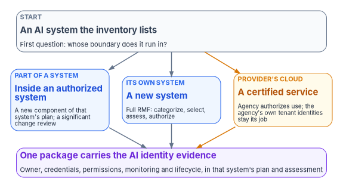
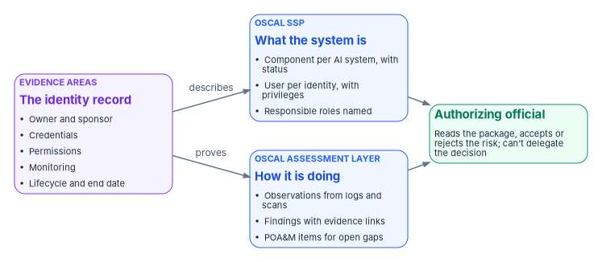

# Chapter 10 — Evidence and Authorization for AI Systems

*An AI system earns its authorization the way every other system does; what's new is that the package has to show who the system is when it signs in, who answers for it, and when its access ends.*

::: {.callout-note}
## In this chapter
Why there is no AI-specific authorization to operate, and what the federal rules say instead. Where an AI system sits in the agency's authorization boundaries, and which package carries its identity evidence. The evidence an authorizing official needs about an AI system's identity in five areas, and the controls each area answers. The seven high-impact practices as evidence rather than inventory answers. The cadence that keeps it current: the annual inventory, compliance plans, waivers, FISMA testing and ongoing authorization. How to carry AI identity in OSCAL 1.2.3, with an illustrative fragment. And the state of NIST's SP 800-53 overlays for AI systems.
:::

Everything in this book ends here. The identity record of [Chapter 05](05-owners-sponsors-and-lifecycle.md), the credential and access rules of [Chapter 06](06-credentials-and-least-privilege.md), the monitoring and findings of [Chapter 07](07-monitoring-drift-and-shadow-ai.md), the roles of [Chapter 08](08-who-owns-ai-identity.md) and the scan of [Chapter 09](09-running-the-inventory-scan.md) all produce records. The authorizing official reads none of them directly. They read an authorization package, and they accept, or decline to accept, the risk it describes. This chapter is about getting AI identity into that package in a form the official can rely on.

[Book 14, Chapter 11](../b14-compliance/11-the-authorization-package.md) already describes the package: its four parts, the OSCAL model for each, the plan of action and milestones, continuous monitoring and ongoing authorization. This chapter doesn't repeat it. It adds what is particular to AI systems.

## There is no AI-specific authorization to operate

Federal AI policy is explicit that AI systems go through the authorization process every other information system goes through. M-25-21 says that "for AI systems, agencies must continue to follow applicable authorization to operate requirements" from OMB Circular A-130, and that the process for reviewing and accepting risk for AI use cases "is separate from, and does not supersede," the information system authorization process.[^c10-m2521] It asks agencies to update their authorization and continuous monitoring processes "to better address the needs of AI applications," and to revisit their cybersecurity policies within 270 days, naming "continuous authorizations for AI" among the topics.[^c10-m2521] It doesn't create a separate authorization. The acquisition memorandum issued the same day is blunter: "any AI systems and services operated as an information system by or on behalf of an agency must receive an authorization to operate from an appropriate agency official prior to deployment."[^c10-m2522]

So an AI system faces two separate decisions, which [Chapter 02](02-what-federal-ai-rules-require.md) sets out: for a high-impact use case, the M-25-21 risk acceptance signed on the AI impact assessment, and for every AI system, the authorization of the information system it runs in. Neither replaces the other. This chapter is about the second, and about how evidence for the first reaches it.

Three things follow for the package.

- **The authorizing official decides, and nobody else.** Under SP 800-37, "the explicit acceptance of risk is the responsibility of the authorizing official and cannot be delegated."[^c10-sp80037] An AI governance board, a Chief AI Officer's determination or a high score from a vendor tool informs the decision; none makes it ([Chapter 08](08-who-owns-ai-identity.md)).
- **The inventory's authorization field reports; it doesn't gate.** The inventory asks whether a use case "itself has an associated Authorization to Operate (ATO), or is part of another system that has an ATO."[^c10-dictionary] A *Yes* is a pointer to a package. It isn't a decision, and a *No* on a deployed system is a finding against the agency's own authorization policy, not against M-25-21 ([Chapter 09](09-running-the-inventory-scan.md)).
- **Prioritized cloud certification isn't a lighter path for the agency.** FedRAMP's AI Prioritization Initiative, which ran from August 2025 to April 2026 and is closed to new entrants, prioritized the certification of AI cloud services meeting five criteria, among them single sign-on, SCIM provisioning and role-based access control, and the ability to meet FedRAMP 20x requirements within two months.[^c10-fr-ai] It sped up providers' certification. It didn't change what the agency does: the agency still authorizes its own use of a certified service, reading the provider's certification as evidence ([Book 13, Chapter 11](../b13-governance/11-reciprocity-and-one-authorization.md#what-fedramps-2026-rules-add)).

## Where the AI sits decides which package carries it

Before asking what evidence the package needs, the ISSO asks a simpler question: whose authorization boundary does the AI system run in? The answer decides which package carries its identity evidence.

{#fig-ch10-where-the-ai-sits fig-alt="A slate card at the top: an AI system the inventory lists; first question, whose boundary does it run in? Three cards below. Blue, part of a system: inside an authorized system, a new component of that system's plan and a significant change review. Blue, its own system: a new system, full RMF, categorize, select, assess, authorize. Amber, provider's cloud: a certified service; the agency authorizes use, and the agency's own tenant identities stay its job. All three lead to a violet card at the bottom: one package carries the AI identity evidence, owner, credentials, permissions, monitoring and lifecycle, in that system's plan and assessment."}

| Where it runs | What the agency does | Where the identity evidence goes |
|---|---|---|
| Inside a system that is already authorized (an AI feature added to a case system, an agent built on an existing platform) | Treat the AI as a new component, and assess whether its addition is a change that needs an event-driven review | The existing system's security plan, assessment and plan of action and milestones |
| As a new system of its own | The full Risk Management Framework, starting with registration and categorization | A new package |
| On a provider's FedRAMP-certified service | Authorize use of the service, reading the provider's certification; govern the identities the service creates or uses in the agency's own tenant | The agency's package for its use of the service, with the provider's certification as an attachment ([Book 10, Chapter 11](../b10-cloud-boundary/11-the-authorization-package.md)) |

The third row is easy to get wrong. A provider's certification covers the provider's side. The service principals, agent identities, consent grants and delegated permissions an AI service creates in the agency's tenant are the agency's to govern, and they belong in the agency's package. A certified AI service that a user consented to with broad delegated permissions is a certified service holding an uncertified grant.

Two RMF tasks bracket an AI system's life in the package. SP 800-37's Task P-18 registers the system "with organizational program or management offices"; Task M-7 implements "a system disposal strategy" when a system is removed from operation.[^c10-sp80037] For an AI system, the identity record's creation and its removal are those two tasks in identity form, and the program ties them together: the record exists from registration, and disposal isn't complete until the identities are gone.

## The evidence an authorizing official needs

For each AI system, the program's design asks the package to answer five questions about its identity. Each has an evidence artifact, a place in the workbook where it's produced, and SP 800-53 controls it answers. The statements quoted are from the SP 800-53 Rev. 5 catalog.[^c10-sp80053]

| Area | Question the official should be able to answer | Evidence | Produced in | Controls |
|---|---|---|---|---|
| Owner | Who answers for this system's identity, and are they still here? | The identity record: sponsor and technical owner, both agency employees; the record's join to the inventory ID and the system inventory | [Chapter 05](05-owners-sponsors-and-lifecycle.md), [Chapter 08](08-who-owns-ai-identity.md) | AC-2 ("assign account managers"), CM-8(4) (accountability information), IA-4 |
| Credentials | How does it authenticate, and where are its secrets? | Credential type per identity (managed identity, federated credential, certificate), with no stored client secrets; certificate expiry; the credential change log | [Chapter 06](06-credentials-and-least-privilege.md) | IA-5 (authenticator management), IA-9 (service identification and authentication) |
| Permissions | What can it reach, and who approved that? | Granted application and delegated permissions, role assignments and access packages, each with an approval record; the access mode (on behalf of a user, or on its own) | [Chapter 04](04-kinds-of-ai-identity.md), [Chapter 06](06-credentials-and-least-privilege.md) | AC-6 (least privilege), AC-6(7) (review of privileges), AC-3 |
| Monitoring | Is anyone watching what it does, and what have they found? | Sign-in and audit log coverage for every identity; detections and risk signals; the open findings from the drift process, with dispositions | [Chapter 07](07-monitoring-drift-and-shadow-ai.md) | AU-6 (audit record review), AU-12, AC-2(12), CA-7 |
| Lifecycle | When does its access end, and what happens when it retires? | The access review or expiry date; the leaver evidence for retired systems; the last vintage comparison | [Chapter 05](05-owners-sponsors-and-lifecycle.md), [Chapter 09](09-running-the-inventory-scan.md) | AC-2 (create, modify, disable and remove accounts), AC-2(3), SP 800-37 Task M-7 |

Three notes on the controls.

**IA-9 is not in any baseline, and the program adds it.** IA-9 asks the organization to "uniquely identify and authenticate" defined system services and applications "before establishing communications with devices, users, or other services or applications."[^c10-sp80053] It is the control that describes an AI system calling a tool or an API with its own identity. It isn't in NIST's Low, Moderate or High baseline, and FedRAMP's 2026 control reference lists it in no class.[^c10-baselines][^c10-fr-controls] An agency that relies on the baseline alone will never assess it. The program's design is to tailor IA-9 into the security plan of any system that contains an AI system acting with its own identity, with the services and applications named in its parameter.

**AC-2 covers non-person accounts.** AC-2 asks the organization to define the types of accounts allowed, assign account managers, require approvals to create accounts and "create, enable, modify, disable, and remove accounts" in line with its policy, and to "align account management processes with personnel termination and transfer processes."[^c10-sp80053] An agent identity is an account type, and the last clause is the sponsor-leaver rule of [Chapter 05](05-owners-sponsors-and-lifecycle.md) read as a control.

**The inventory isn't the system component inventory.** CM-8 asks for a component inventory that "accurately reflects the system" and includes every component, and CM-8(4) adds a means of identifying the individuals "responsible and accountable for administering those components."[^c10-sp80053] PM-5 asks for an inventory of organizational systems and sits in no NIST baseline, as a program management control.[^c10-sp80053][^c10-baselines] The AI use-case inventory is neither: it lists use cases, not components, and its contact field isn't an accountable administrator ([Chapter 03](03-the-inventory-as-an-identity-source.md)). The program joins the three: each AI system in the use-case inventory resolves to components in a system's component inventory, and each component to an identity record with named people.

[Chapter 07](07-monitoring-drift-and-shadow-ai.md#from-finding-to-evidence) maps each AI finding to its controls and corrects two errors in the source design: the privacy impact assessment control in Rev. 5 is RA-8, not PT-2, and the AR family no longer exists. The same corrections apply to any evidence mapping an agency inherited from older AI governance material.

## The high-impact practices as evidence

For a high-impact use case, M-25-21 requires seven minimum practices: pre-deployment testing, an AI impact assessment (with an independent review and the signature of the person accepting the risk), ongoing monitoring, human training and assessment, human oversight and intervention with a fail-safe where practicable, remedies and appeals, and feedback from end users and the public.[^c10-m2521] Agencies had 365 days from April 3, 2025 to document implementation and "be prepared to report them to OMB," and a high-impact use case that doesn't comply must be safely discontinued.[^c10-m2521]

The 2025 inventory reports a status for every practice in nine `hi_*` fields, but a status isn't evidence ([Chapter 03](03-the-inventory-as-an-identity-source.md#what-the-high-impact-fields-can-and-cant-evidence)).[^c10-dictionary] The package needs the artifacts. The program's design puts them where an assessor would look, and draws the identity program's contribution into three of them:

| Practice (M-25-21 Section 4(b)) | Evidence the package carries | Where it sits in the package | Identity contribution |
|---|---|---|---|
| (i) Pre-deployment testing | Test plan, results and risk mitigation plan | Assessment plan and results, as tests of the AI functionality | The test ran under the identity and permissions the system will have in production, not an administrator's |
| (ii) AI impact assessment | The signed assessment, the independent reviewer's comments, the risk acceptor's signature | Attachment to the security plan; referenced in the authorization decision | The identity record names the risk acceptor, so the signature can be checked against a person |
| (iii) Ongoing monitoring | Monitoring results for performance and adverse impacts | Continuous monitoring reports | **Yes:** sign-in, audit and risk records for the system's own identities, and the drift findings ([Chapter 07](07-monitoring-drift-and-shadow-ai.md)) |
| (iv) Human training and assessment | Training records for the system's operators | Continuous monitoring, training evidence ([Book 16](../b16-people/index.md)) | **Yes:** the identity record names the operators' group, so completion is checked against its members |
| (v) Human oversight, intervention and fail-safe | Who can intervene; the fail-safe and its test | Security plan narrative and assessment results | **Yes:** the named people who can disable the identity, and a tested disable |
| (vi) Remedies and appeals | The appeal process and case records | Attachment; privacy and program records | — |
| (vii) End-user and public feedback | The feedback channel and how feedback changed the system | Attachment; program records | — |

Two provisions change what the package shows. A Chief AI Officer may waive one or more practices for a specific system after a written, system-specific risk assessment, must certify each waiver's validity annually, and must report a waiver to OMB within 30 days of granting or revoking it; agencies were to publish waiver summaries by April 3, 2026.[^c10-m2521][^c10-guidance] A pilot is exempt from the practices only if it is limited in scale and duration and the Chief AI Officer has certified it, with the certification tracked centrally.[^c10-m2521] Both are attachments the authorizing official should see, because each is a decision that a practice won't be evidenced, and a waiver or a pilot certification with no end date is an exception with no expiry. The program records both as governed exceptions with the expiry the [Book 14 POA&M lifecycle](../b14-compliance/11-the-authorization-package.md#the-plan-of-action-and-milestones) requires.

## The cadence

AI governance adds three clocks to the authorization cycle the package already runs on. None of them replaces FISMA's annual floor, and all of them should feed the same continuous monitoring stream.

| Cadence | What happens | Source | What it means for the package |
|---|---|---|---|
| At least annually | AI use case inventory submitted to OMB and published; the 2025 cycle's deadlines were December 22, 2025 and January 28, 2026 | M-25-21 Section 3(b)(v); OMB 2025 guidance[^c10-m2521][^c10-guidance] | The vintage comparison of [Chapter 09](09-running-the-inventory-scan.md) runs; new AI systems become new components, retired ones start disposal |
| 180 days after the memo, then every two years until 2036 | Compliance plan submitted to OMB and posted, or a written determination that the agency doesn't use covered AI | M-25-21 Section 3(b)(ii)[^c10-m2521] | The plan states how the agency meets the memo; the package shows whether a given system does |
| Annually, and within 30 days of a change | Waiver certification; waiver grant or revocation reported to OMB | M-25-21 Section 4(a)(ii)–(iii)[^c10-m2521] | Each waiver's governed exception is reviewed and its expiry reset or lapsed |
| No less than annually | Testing and evaluation of the effectiveness of security policies, procedures and practices | FISMA, 44 U.S.C. § 3554(b)(5)[^c10-fisma] | The independent assessment covers the AI controls, including tailored-in IA-9 |
| Time- or event-driven | Ongoing authorization once eligible and approved by the authorizing official | OMB Circular A-130, Appendix I[^c10-a130] | AI identity evidence is part of what the official reviews at each frequency |

M-25-21's 180-day mark fell at the end of September 2025, so the next compliance plans fall due in 2027. The compliance plan and the inventory are distinct obligations on distinct clocks; an agency that tracks only the inventory will miss the plan.

The annual refresh is also the event that most often changes the package. When a new vintage arrives, the program's design applies the vintage comparison's results to the security plan: a new piloted or deployed entry becomes a new component with status *under development* or *operational*; an entry moved to *Retired* moves its component to *disposition* until Task M-7's evidence shows its identities removed; and a changed authorization answer is reconciled before the next monthly report. An agency on ongoing authorization treats a new agentic AI system inside an authorized boundary as an event worth an event-driven review, which is a design choice, not a federal rule.

The NIST AI Risk Management Framework, which is voluntary guidance rather than a requirement, says the same thing in its own terms: GOVERN 1.6 asks for "mechanisms … to inventory AI systems," GOVERN 1.7 for processes to decommission AI systems "safely," and MANAGE 4.1 for post-deployment monitoring plans that include "decommissioning, incident response, recovery, and change management."[^c10-airmf] [Appendix A](appendix-a-requirements-mapping.md) maps them.

## Carrying AI identity in OSCAL

The package should be machine-readable, for the reasons [Book 14, Chapter 11](../b14-compliance/11-the-authorization-package.md#one-oscal-model-per-artifact) gives. The current OSCAL release is 1.2.3, published August 7, 2026.[^c10-oscal] Nothing in OSCAL is specific to AI, and nothing needs to be. The system security plan's `system-implementation` already has the structures an AI system's identity needs: `components`, each with a required `type`, `title`, `description` and `status` whose state is one of `under-development`, `operational`, `disposition` or `other`; `users`, each of which can carry `role-ids` and `authorized-privileges` with the `functions-performed`; and `inventory-items` that point to the components they implement.[^c10-oscal] Agency-specific facts go in properties under the agency's own namespace.

{#fig-ch10-evidence-to-package fig-alt="Left to right. A violet card, evidence areas, the identity record: owner and sponsor, credentials, permissions, monitoring, lifecycle and end date. An arrow labeled describes leads to a blue card, OSCAL SSP, what the system is: a component per AI system with status, a user per identity with privileges, responsible roles named. An arrow labeled proves leads to a second blue card, OSCAL assessment layer, how it is doing: observations from logs and scans, findings with evidence links, POA&M items for open gaps. Both blue cards lead to a green card: authorizing official, reads the package, accepts or rejects the risk, can't delegate the decision."}

The program's mapping, which is design, is:

| AI identity fact | OSCAL structure |
|---|---|
| The AI system | A `component` of type `software` (or `service` for a provider-hosted service), with the inventory use case ID as a property |
| Its stage | The component's `status.state`: pre-deployment and pilot map to `under-development` or `operational` by whether it touches production data; retired maps to `disposition` |
| Sponsor and technical owner | The component's `responsible-roles`, pointing to parties in the plan's metadata |
| Each identity it uses | A `user` with the system's role, its `authorized-privileges` and the credential type and review date as properties |
| Monitoring results and findings | `observations` and `findings` in the assessment results, keyed to the identity record as in [Chapter 07](07-monitoring-drift-and-shadow-ai.md#from-finding-to-evidence) |
| Open gaps, waivers and pilot certifications | `poam-items` and `risks`, with governed exceptions carrying their acceptance and expiry |

::: {.callout-warning}
## Illustrative code
The fragment below is part of an OSCAL 1.2.3 system security plan's `system-implementation`, not a complete document. Names, identifiers and the namespace are examples. The two objects were checked against the `system-user` and `system-component` definitions in NIST's published 1.2.3 SSP JSON schema; validate the full plan against the schema for the release you target before relying on it.
:::

```json
{
  "users": [
    {
      "uuid": "6f1c2a9e-3b7d-4e21-9a0c-2d5e8f71b304",
      "title": "Case triage agent (agent identity)",
      "description": "Non-person identity used by the case triage agent when it acts on its own behalf.",
      "props": [
        { "name": "identity-kind", "ns": "https://agency.example.gov/ns/ai-identity", "value": "agent-identity" },
        { "name": "inventory-use-case-id", "ns": "https://agency.example.gov/ns/ai-identity", "value": "AGENCY-0042" },
        { "name": "credential-type", "ns": "https://agency.example.gov/ns/ai-identity", "value": "federated-no-stored-secret" },
        { "name": "access-review-due", "ns": "https://agency.example.gov/ns/ai-identity", "value": "2027-04-30" }
      ],
      "role-ids": ["ai-agent"],
      "authorized-privileges": [
        {
          "title": "Read case records",
          "functions-performed": ["Read open cases in the triage queue", "Write a triage recommendation field"]
        }
      ]
    }
  ],
  "components": [
    {
      "uuid": "0b8d4e1a-7c3f-4a52-8e19-5f2a6c9d7e40",
      "type": "software",
      "title": "Case triage agent",
      "description": "Agentic AI system listed in the agency AI use case inventory as AGENCY-0042.",
      "props": [
        { "name": "ai-classification", "ns": "https://agency.example.gov/ns/ai-identity", "value": "agentic" },
        { "name": "high-impact", "ns": "https://agency.example.gov/ns/ai-identity", "value": "no" }
      ],
      "status": { "state": "operational" },
      "responsible-roles": [
        { "role-id": "sponsor", "party-uuids": ["9a3e5c7b-1d2f-4b6a-8c0e-3f4a5b6c7d8e"] },
        { "role-id": "technical-owner", "party-uuids": ["2c4e6a8b-0d1f-4e3a-9b5c-7d9e1f3a5b7c"] }
      ]
    }
  ]
}
```

Two cautions. The `authorized-privileges` are a description for the assessor, not the permissions themselves; the evidence that they match is an observation from the directory, collected on the monitoring cadence, and a plan whose privileges were typed by hand and never compared drifts like any other narrative. And the role identifiers (`sponsor`, `technical-owner`, `ai-agent`) must be defined in the plan's metadata roles, which the fragment omits.

## NIST's SP 800-53 overlays for AI systems

NIST is developing SP 800-53 control overlays for AI systems, but there are none to adopt yet. The project published a concept paper for comment on August 14, 2025, and on January 8, 2026 released an annotated outline, a discussion draft, of the overlay for using and fine-tuning predictive AI, with feedback requested by February 13, 2026 for the initial public draft.[^c10-cosis] It proposes five use cases: adapting and using generative AI (assistants and large language models), using and fine-tuning predictive AI, single-agent systems, multi-agent systems, and security controls for AI developers.[^c10-cosis] As of October 21, 2026 the project page lists no public draft of any overlay.

The project also has a new name. On October 20, 2026, NIST renamed it from Control Overlays for Securing AI Systems (COSAiS) to Control Overlays for Super Intelligence Systems (COSIS), citing Executive Order 14434 of September 29, 2026.[^c10-cosis] That order directs agencies, "to the maximum extent permitted by law," to use "Super Intelligence" and "SI" in place of "Artificial Intelligence" and "AI" in official correspondence, public communications, reports, policy documents and other non-statutory documents; it defines the new terms as the technologies covered by the existing statutory definition of artificial intelligence and doesn't require changes to documents already issued.[^c10-eo14434] Federal guidance published after the order uses the new terms; CISA's page for its May 2026 agentic AI guidance, for example, now describes "agentic super intelligence (SI) systems."[^c10-cisa-agentic] Nothing about the systems, the controls or the evidence changes. An agency writing a security plan after September 29, 2026 may need to follow the order's terminology in its own documents, while the instruments it cites (M-25-21, M-25-22, the inventory guidance) keep the terms they were issued with. This workbook, which isn't an executive branch document, keeps the terms its sources use.

Until an overlay is final, the program's position is the one SP 800-53 already supports: select the baseline the system's categorization requires, then tailor. For AI systems, the tailoring this book argues for is IA-9 added, AC-2 and IA-5 parameters set for non-person accounts, CM-8(4) adopted at Moderate where the baseline omits it (it is NIST High only, and FedRAMP Class D only), and AU-6 review frequencies that include the AI identities' logs.[^c10-baselines][^c10-fr-controls] When an overlay is published, the agency compares its tailoring with it and records the differences, the same way it would for any overlay.

## What the authorizing official should find

| Check | Where |
|---|---|
| Every AI system in the inventory that runs in this boundary is a component in the plan, with the inventory use case ID | Security plan; the latest vintage comparison |
| Every component has a named sponsor and technical owner, both agency employees | Security plan roles; identity record |
| Every identity the AI system uses is listed, with its credential type, and none uses a stored client secret without a recorded exception | Security plan users; credential evidence |
| Granted permissions match the plan's described privileges, by observation, not by narrative | Assessment results observations |
| IA-9 is tailored in, with the services and applications named | Security plan control selection |
| Sign-in and audit coverage exists for every AI identity, and its findings are in the POA&M or closed on evidence | Continuous monitoring; POA&M |
| For high-impact use cases, the impact assessment, its independent review and the risk acceptor's signature are attached, and each practice has evidence, not only an inventory answer | Attachments; continuous monitoring |
| Waivers and pilot certifications appear as governed exceptions with expiry dates | POA&M |
| Retired AI systems' identities are removed, with evidence | Disposal record; directory observation |
| The authorization decision states its termination date or, under ongoing authorization, its review frequency | Authorization decision |

## What changes, in one table

| Old habit | What replaces it |
|---|---|
| AI needs its own authorization, or none because it's "just a feature" | AI goes through the agency's existing authorization, before deployment, as a component or a system |
| The inventory's *Yes* for authorization settles it | *Yes* points to a package; the package shows the AI system's identities |
| A provider's certification covers the AI service | It covers the provider; the identities and grants in the agency's tenant are the agency's |
| The baseline covers AI | IA-9 is tailored in, and AC-2 and IA-5 are written for non-person accounts |
| The inventory's practice answers are the evidence | The practices are evidenced by artifacts; three come from the identity program |
| Waivers and pilots are standing exceptions | Each is a governed exception with an expiry |
| Wait for the AI overlays | Tailor the baseline now; compare with the overlay when it's final |

::: {.callout-tip}
## Continue the book
[← Previous: Chapter 09 — Running the Inventory Scan, Agency and Central](09-running-the-inventory-scan.md) · [Book index](index.md) · [Next: Appendix A — Requirements Mapping: AI Rules to Identity Controls →](appendix-a-requirements-mapping.md)
:::

[^c10-m2521]: Office of Management and Budget, M-25-21, *Accelerating Federal Use of AI through Innovation, Governance, and Public Trust*, April 3, 2025, Sections 3(b)(ii), 3(b)(iii) and 3(b)(v); Section 4(a)(i)–(iv) and 4(b)(i)–(vii); footnotes 11, 22 and 29; and the consolidated table of actions, <https://www.whitehouse.gov/wp-content/uploads/2025/02/M-25-21-Accelerating-Federal-Use-of-AI-through-Innovation-Governance-and-Public-Trust.pdf> (accessed Oct 21, 2026).
[^c10-m2522]: Office of Management and Budget, M-25-22, *Driving Efficient Acquisition of Artificial Intelligence in Government*, April 3, 2025, Section 4(e)(i), "Authorization To Operate Compliance," <https://www.whitehouse.gov/wp-content/uploads/2025/02/M-25-22-Driving-Efficient-Acquisition-of-Artificial-Intelligence-in-Government.pdf> (accessed Oct 21, 2026).
[^c10-dictionary]: Office of Management and Budget, `Validation/data_dictionary.md`, 2025 Federal Agency AI Use Case Inventory, columns 19 (`have_ato`) and 28–36 (`hi_*`), <https://github.com/ombegov/2025-Federal-Agency-AI-Use-Case-Inventory/blob/main/Validation/data_dictionary.md> (accessed Oct 21, 2026).
[^c10-fr-ai]: FedRAMP, "FedRAMP AI," 2025 AI Prioritization Initiative and its criteria, <https://www.fedramp.gov/ai/> (accessed Oct 21, 2026).
[^c10-sp80037]: National Institute of Standards and Technology, SP 800-37 Rev. 2, *Risk Management Framework for Information Systems and Organizations: A System Life Cycle Approach for Security and Privacy*, December 2018, Tasks P-18, R-4 (discussion) and M-7, <https://nvlpubs.nist.gov/nistpubs/SpecialPublications/NIST.SP.800-37r2.pdf> (accessed Oct 21, 2026).
[^c10-sp80053]: National Institute of Standards and Technology, SP 800-53 Rev. 5, *Security and Privacy Controls for Information Systems and Organizations*, controls AC-2, AC-2(3), AC-2(12), AC-3, AC-6, AC-6(7), AU-6, AU-12, CA-7, CM-8, CM-8(4), IA-4, IA-5, IA-9 and PM-5; statements read from the release 5.2.0 OSCAL catalog (last modified May 11, 2026), <https://github.com/usnistgov/oscal-content/blob/main/nist.gov/SP800-53/rev5/json/NIST_SP-800-53_rev5_catalog.json> (accessed Oct 21, 2026).
[^c10-baselines]: National Institute of Standards and Technology, SP 800-53B control baselines, release 5.2.0 OSCAL Low, Moderate, High and Privacy baseline profiles (IA-9 and PM-5 in none of the Low, Moderate or High baselines; CM-8(4) High only), <https://github.com/usnistgov/oscal-content/tree/main/nist.gov/SP800-53/rev5/json> (accessed Oct 21, 2026).
[^c10-fr-controls]: FedRAMP, "Full Rev5 Control Reference," *FedRAMP Consolidated Rules for 2026*, Identification and Authentication family (IA-09 shows no FedRAMP Rev5 baseline class) and Configuration Management family (CM-08(04) Class D), <https://www.fedramp.gov/2026/reference/controls/> (accessed Oct 21, 2026).
[^c10-fisma]: 44 U.S.C. § 3554(b)(5), Federal agency responsibilities (Federal Information Security Modernization Act of 2014), <https://www.law.cornell.edu/uscode/text/44/3554> (accessed Oct 21, 2026).
[^c10-a130]: Office of Management and Budget, Circular A-130, *Managing Information as a Strategic Resource*, July 2016, Appendix I, §4.d, items 3 and 4, <https://www.whitehouse.gov/wp-content/uploads/legacy_drupal_files/omb/circulars/A130/a130revised.pdf> (accessed Oct 21, 2026).
[^c10-guidance]: Office of Management and Budget, *Guidance on 2025 Agency Artificial Intelligence Reporting*, Section 1 (deadlines of December 22, 2025 and January 28, 2026) and Section 2 (waiver reporting within 30 days; public waiver summaries by April 3, 2026), in the 2025 Federal Agency AI Use Case Inventory repository, <https://github.com/ombegov/2025-Federal-Agency-AI-Use-Case-Inventory/tree/main/Reporting%20Instructions> (accessed Oct 21, 2026).
[^c10-airmf]: National Institute of Standards and Technology, AI 100-1, *Artificial Intelligence Risk Management Framework (AI RMF 1.0)*, January 2023, Tables 1 and 4 (GOVERN 1.6, GOVERN 1.7, MANAGE 4.1), <https://nvlpubs.nist.gov/nistpubs/ai/NIST.AI.100-1.pdf> (accessed Oct 21, 2026).
[^c10-oscal]: National Institute of Standards and Technology, OSCAL release v1.2.3 (published August 7, 2026), <https://github.com/usnistgov/OSCAL/releases/tag/v1.2.3>; `oscal_ssp_schema.json` definitions `system-implementation`, `system-component` (required properties; `type` and `status.state` values), `system-user` and `authorized-privilege` (both accessed Oct 21, 2026).
[^c10-cosis]: National Institute of Standards and Technology, Computer Security Resource Center, "SP 800-53 Control Overlays for Super Intelligence Systems" (formerly Control Overlays for Securing AI Systems), Recent Updates of October 20, 2026, January 8, 2026 and August 14, 2025, and project description, <https://csrc.nist.gov/projects/cosis> (accessed Oct 21, 2026).
[^c10-eo14434]: Executive Order 14434 of September 29, 2026, "Inaugurating the Era of Super Intelligence," 91 FR 63129 (October 2, 2026), Sections 1–3, <https://www.federalregister.gov/documents/2026/10/02/2026-20321/inaugurating-the-era-of-super-intelligence> (accessed Oct 21, 2026).
[^c10-cisa-agentic]: Cybersecurity and Infrastructure Security Agency, "Careful Adoption of Agentic AI Services," publish date May 1, 2026, <https://www.cisa.gov/resources-tools/resources/careful-adoption-agentic-ai-services> (accessed Oct 21, 2026).
