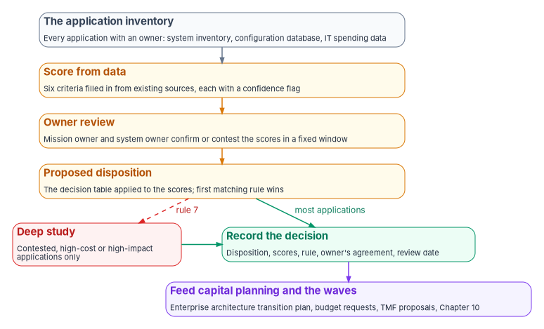

# Chapter 02 — Triaging the Portfolio

*Triage is a scored, repeatable decision for every application, made from data the agency mostly already holds, with deep study kept for the few applications where the score and the owner disagree.*

::: {.callout-note}
## In this chapter
The six dispositions this book uses, and how they line up with Gartner's original five options, AWS's 7 Rs and the Microsoft Cloud Adoption Framework's eight strategies. The six criteria a triage weighs, and an evidence map that turns the dependency criterion from a guess into a sourced, dated record. A scored rubric and a decision table that turn the criteria into a disposition for thousands of applications at once. How the result feeds capital planning and Technology Modernization Fund proposals. Book 06 applies the same discipline to SQL Server instances.
:::

[Chapter 01](01-a-portfolio-not-a-rewrite.md) argued that the unit of modernization is the application. This chapter is about deciding what each one becomes. In a portfolio of thousands, that can't be a separate study per application: a three-month assessment of each would take longer than most applications have left to live. It has to be a rubric applied to data, with judgment kept for the exceptions.

{#fig-ch02-triage-funnel fig-alt="A top-to-bottom funnel of five cards. First, a slate card: the application inventory, every application with an owner, from the system inventory, configuration database and IT spending data. Second, an amber card: score from data, the six criteria filled in from existing sources, each with a confidence flag. Third, an amber card: owner review, the mission owner and system owner confirm or contest the scores in a fixed window. Fourth, an amber card: proposed disposition, the decision table applied to the scores, first matching rule wins. From here two paths: most applications go straight to a green card, record the decision, with the disposition, scores, rule, owner's agreement and review date; a red card beside it, deep study, reached by rule 7 for contested, high-cost or high-impact applications only, also leads to the green card. Below the green card, a violet card: feed capital planning and the waves, with the decision record going to the enterprise architecture transition plan, budget requests, TMF proposals and Chapter 10."}

## The six dispositions

| Disposition | What it means here | The signals that point to it | What it ends with |
|---|---|---|---|
| Retire | Switch the application off. Its records are kept, transferred or destroyed under the records schedule, and its function is dropped, absorbed by another system or replaced by a commercial or shared service | Few users; duplicates another system; function no longer needed; a commercial or shared service already does it | No running application; a records disposition; the hosting and license cost stops |
| Retain | Keep it as it is, on purpose, for a stated period | Stable, supported, meets its mission need; or too risky to move before something else moves first | A documented reason and a review date |
| Rehost | Move it to new infrastructure with no code change | Sound application on a platform being exited (a data center, aging hardware) | Same application, new hosting |
| Replatform | Move it with limited change: a new database engine, a managed runtime, a container | Application logic is sound; the platform under it is unsupported or expensive | Same application logic on a supported platform |
| Refactor | Restructure it onto the target architecture incrementally, behind a stable interface | Valuable, changing often, and blocked by its structure or language | Services on the target architecture, legacy pieces retired one by one |
| Rebuild | Write it again on the target architecture, still delivered in increments | Valuable, but the code can't be salvaged or the requirements have changed beyond it | A new application on the target architecture |

The dispositions are listed in rising order of cost and risk. That ordering is the rubric's first rule: an application gets the cheapest disposition that meets its mission need, and every step up the list has to be justified by the scores.

Two of them are decisions rather than projects. Retire and retain need a decision process, an owner's agreement and, for retire, a decommissioning checklist, but no engineering team. In most portfolios they are where the early savings are, which is why [Book 06's](../b06-data-platform/06-retain-consolidate-retire.md) treatment of SQL Server instances also starts with them.

## Where the names come from

The vocabulary is older than this book, and the major cloud providers each use a slightly different list. An agency will meet all of them in vendor proposals, so it helps to know how they line up.

- **Gartner's five options.** Gartner described five ways to move applications to the cloud, reported at the time as rehost, refactor, revise, rebuild and replace; AWS dates them to 2011.[^c02-aws6rs][^c02-gartner-press] Gartner's research note is behind a paywall and wasn't consulted for this chapter. As reported, Gartner's "refactor" meant running the application on a provider's platform, closer to what later lists call replatform, and "revise" meant modifying the code before moving it.
- **AWS's 7 Rs.** AWS Prescriptive Guidance lists retire, retain, rehost, relocate, repurchase, replatform, and refactor or re-architect.[^c02-aws7rs] Relocate moves servers to a cloud version of the same platform without changing the application; repurchase, also called "drop and shop," replaces the application with a different product, typically SaaS. AWS adds a warning worth taking seriously: refactoring is the most complex strategy and isn't recommended for large migrations, so it advises rehosting, relocating or replatforming first and modernizing afterward.
- **Microsoft's Cloud Adoption Framework.** The framework's planning guidance lists eight strategies: retire, retain, rehost, replatform, refactor, rearchitect, rebuild and replace, each tied to a business driver.[^c02-caf] It cautions against rehosting problematic workloads, since rehosting doesn't fix existing performance, reliability or architectural problems, and suggests rehosting only when a workload won't need modernization for at least two years. Microsoft's separate application modernization guidance uses six: rehost, replatform, refactor, rebuild, retire and retain.[^c02-ms6rs]

| This book | Gartner (five options) | AWS (7 Rs) | Microsoft CAF (eight strategies) |
|---|---|---|---|
| Retire | — | Retire | Retire |
| Retire, function moved to a product or service | Replace | Repurchase | Replace |
| Retain | — | Retain | Retain |
| Rehost | Rehost | Rehost; Relocate | Rehost |
| Replatform | Refactor (on a provider platform) | Replatform | Replatform |
| Refactor | Revise | Refactor or re-architect | Refactor; Rearchitect |
| Rebuild | Rebuild | Refactor or re-architect | Rebuild |

This book uses the same six as Microsoft's application modernization guidance, with two choices made deliberately.

- **Replace is a form of retire.** When a commercial or shared service takes over an application's function, the agency's own application is retired; the new service is an acquisition with its own authorization, not a modernization of the old code. Treating it as retire keeps the decommissioning work, the records disposition and the data migration in view. It also follows federal policy: Circular A-130 says custom development to improve or replace a system should start "only when no existing alternative private sector or governmental source can efficiently meet the need."[^c02-a130] The rubric therefore tests "could a product or shared service do this?" before it allows refactor or rebuild.
- **Relocate is a form of rehost.** Both move an application without changing it. The distinction matters to the hosting team, not to the portfolio decision.

## The six triage criteria

The criteria come from what GAO, federal policy and the providers' own guidance say drives modernization risk and value. Each is scored for every application.

| Criterion | What it asks | Where the data comes from | Grounding |
|---|---|---|---|
| Mission criticality | How much does the mission depend on it, and what happens if it fails or is wrong? | Business impact analysis; the system's FIPS 199 availability and integrity impact; high value asset designation | FIPS 199 impact levels; GAO's "unmet mission needs" risk[^c02-fips199][^c02-gao25] |
| Technical condition | Is it supported, patchable and changeable? | Configuration database; vulnerability scans; vendor support dates; age of hardware and software | A-130 requires unsupported components be "phased out as rapidly as possible"; GAO found seven of eleven critical systems with vulnerabilities that couldn't be fixed without modernization[^c02-a130][^c02-gao25] |
| Data sensitivity | What data does it hold, and how hard is moving it? | FIPS 199 confidentiality impact; the PII inventory and privacy impact assessments; database engine and size | FIPS 199; A-130's inventory of systems holding PII[^c02-fips199][^c02-a130] |
| Cost | What does it cost to run, and what would each disposition cost? | IT spending data; hosting, license and support contracts; staff time | 40 U.S.C. 11312 risk-adjusted return on investment[^c02-11312] |
| Skills | Can the agency staff it today and in five years? | Workforce data; contracts; the languages in the code base (COBOL, PL/I, assembly, PL/SQL, proprietary 4GLs) | GAO on the shortage of COBOL and assembly skills[^c02-gao25] |
| Dependencies | What does it call, what calls it, and what shares its data? | Network flows; interface agreements; database links and shared schemas; batch schedules | AWS lists unmigrated dependencies as a reason to retain[^c02-aws7rs] |

A few notes on using them.

- **FIPS 199 does a lot of the work.** Every federal system already has a security categorization: low, moderate or high potential impact for confidentiality, integrity and availability, with the system taking the "high water mark" of the information types it holds.[^c02-fips199] Availability and integrity impact are a defensible proxy for mission criticality, and confidentiality impact for data sensitivity, for the first pass.
- **Skills are about the future, not the present.** An application maintained today by one contractor team in a language few people still learn scores badly even if it runs well. GAO's point is that the cost of those skills rises as the pool shrinks.[^c02-gao25]
- **Dependencies decide sequence, not disposition.** A heavily connected application may still be refactored, but not first. [Chapter 10](10-running-the-portfolio-in-waves.md) uses the dependency score to build waves.
- **PL/SQL and stored procedures count twice.** Business logic in the database raises both the skills score and the data migration effort, and it makes a rehost or replatform harder than it looks. [Chapter 04](04-moving-the-data.md) covers converting it.

## Recording dependencies as an evidence map

Dependencies are the criterion a scoring sheet handles worst. A score of 4 says an application is well connected; it doesn't say to what, on whose evidence, or which of those connections a move would break. The program's design is to record dependencies as an evidence map, a list of typed entities joined by typed, directed relationships, each relationship carrying its source. The dependency score is then computed from the map rather than estimated by the owner.

### What goes on the map

| Entity type | What it covers | Examples |
|---|---|---|
| Application | Software people or other systems use | A case management system; a public web service; a batch reporting job |
| Data store | Where records live, including master records | The person or account master file; a payments database; a document repository |
| Data element | A single field that something else relies on | A status code, a date of death, an indicator flag |
| Data exchange | An interface with another organization | A file feed to a state, a verification service another agency calls, a matching agreement |
| Process | A business or batch process that reads or writes the data | Nightly reconciliation; a correction workflow; an annual statistical extract |
| Rule | A business, eligibility or data-quality rule, wherever it lives | A rule in a COBOL paragraph, a stored procedure or a procedure manual |
| Governance document | Something that authorizes or constrains a relationship | A system of records notice, an interface agreement, a policy |
| Finding | An audit or oversight finding about the entity | An inspector general recommendation; a GAO finding |

Each relationship records six things:

| Field | What it holds |
|---|---|
| From, to and kind | The two entities and what the link does: reads, writes, feeds, governs, replaces |
| Basis | Observed (seen in flows, logs or code), documented (in an agreement, notice or manual), planned or historical |
| Evidence | The document, log extract or code reference, with its revision date |
| Observed | When someone last confirmed the link |
| Confidence | The same *measured*, *attested* or *assumed* flag the rubric uses |
| Status | Current, retired, or planned with a target date |

### Rules for keeping it honest

- **A link is a claim, not a deployment fact.** A documented link says two things are connected by policy or design. It doesn't prove data flows between them today, and the absence of a link doesn't prove nothing does. Label the basis on every link, and let observed evidence override documented evidence when they disagree.
- **Keep open questions on the map.** When the evidence doesn't settle a link, record the question, who can answer it and when it was asked. Don't drop the link and don't guess it into existence. An open question on a high-impact system is a reason for rule 7, below.
- **Count what points at each master record.** Rank data stores by incoming relationships: applications, processes, rules and outside exchanges that read them. A master record with a hundred or more incoming links is where migration risk concentrates. Retiring or replatforming it isn't one decision but one per dependent, and the map lists them.
- **Count outside partners separately.** Each exchange with another organization is a commitment the agency can't change alone: an agreement with a term, a published notice, a partner's own schedule. Under the Privacy Act, a system of records notice lists the system's routine uses and the categories of sources of its records, and a computer matching agreement runs for up to 18 months, renewable without a new review for no more than one additional year.[^c02-privacy-act] Those dates belong on the map, because a move has to fit inside them or wait for the next renewal.
- **Map fields, not only systems.** Rules depend on individual data elements, such as a code value that means "deceased" or "do not pay." A replatform that preserves every table but changes one code's meaning breaks every rule that reads it. [Chapter 04](04-moving-the-data.md) covers carrying the data across.
- **Date everything.** Each piece of evidence carries the revision date of its source and the date it was last checked. A map without dates can't show which parts have gone stale.

### Where the evidence comes from

The observed basis comes from the sources in the criteria table: network flows, database links, batch schedules and the code itself. The documented basis is often already published or on file: system of records notices, privacy impact assessments, interface and matching agreements, procedure manuals and oversight reports. Starting from the documents gives a first map in weeks; the observed evidence then confirms, corrects or adds to it. [Book 01, Chapter 10](../b01-transformation-arc/10-analyzing-the-estate.md) collects the infrastructure side of the same picture (directory, DNS, certificates, service accounts) as committed, provenance-bound streams, and the two should share identifiers so an application's map can point at its infrastructure dependencies.

### How the map feeds triage

- **The dependency score is computed.** It weighs incoming and outgoing relationships, the number of outside exchanges and the share of links that are only assumed. The confidence flag for the criterion is the weakest flag among the links that drive the score.
- **High-stakes cases are visible.** A master record with many outside exchanges, or a high-impact system with open questions, is a case for deep study under rule 7.
- **Sequencing has its input.** [Chapter 10](10-running-the-portfolio-in-waves.md) builds waves from the map: dependents move before or with what they depend on, and a master record moves last, or behind a stable interface, as [Chapter 03](03-the-target-reference-architecture.md) describes.
- **The map is the authoritative record of dependencies.** Diagrams, spreadsheets and wave plans are derived from it, not maintained beside it. [Book 13, Chapter 03](../b13-governance/03-one-authoritative-record.md) explains why.

## A scored rubric, not a study per application

The program's design is a two-axis score, a set of decision rules and an override.

### Step 1: score two axes

Each criterion is scored from 1 to 5. The six combine into two axes:

| Axis | Criteria | How it reads |
|---|---|---|
| **Mission value** | Mission criticality, cost of the function if lost, and the number and kind of users | High: the agency needs this function, in this form or another |
| **Technical health** | Technical condition, skills, data sensitivity (as migration difficulty) and dependencies | High: the application can be run and changed safely as it is |

Weights are the agency's choice; the program's starting point is equal weights within each axis, adjusted after the pilot calibration below. Each score also carries a confidence flag: *measured* (from system data), *attested* (from the owner) or *assumed* (no data). An application with mostly assumed scores can't get a final disposition; it goes to owner review first.

{#fig-ch02-value-health-grid fig-alt="A two-by-two grid of cards under a note saying that rows are mission value, high above low, and columns are technical health, poor on the left and good on the right. Top left, high value and poor health: a blue card, replatform, refactor or rebuild; replatform when the platform is the problem and the code is sound, refactor or rebuild when the code is the problem. Top right, high value and good health: a green card, retain or rehost; keep it with a review date, and rehost only if its platform is being exited. Bottom left, low value and poor health: a red card, retire first, the cheapest modernization there is. Bottom right, low value and good health: a slate card, retain, or retire when convenient, retire if a product or shared service does the job. A violet note under the grid reads: dependencies decide the order, not the disposition."}

### Step 2: apply the decision table

The decision table turns scores into a proposed disposition. The rules are applied in order, and the first match wins.

| # | Condition | Proposed disposition | Why |
|---|---|---|---|
| 1 | Mission value low (≤ 2), or a commercial or shared service already provides the function | Retire | Cheapest outcome; A-130 prefers existing alternatives to custom development |
| 2 | Technical health high (≥ 4) and no platform exit is forcing a move | Retain, with a review date | Don't spend money on an application that works and is supported |
| 3 | Technical health high, but the hosting platform is being exited | Rehost | The application is sound; only its location changes |
| 4 | Code sound (condition and skills ≥ 3), but the platform, runtime or database is unsupported or costly | Replatform | Fix what is broken, keep what works |
| 5 | Mission value high, code hard to change or staff, and the application can be intercepted behind an interface | Refactor | Incremental replacement keeps the mission running ([Chapter 03](03-the-target-reference-architecture.md)) |
| 6 | Mission value high, and the code can't be salvaged or requirements have outgrown it | Rebuild, in increments | Only after rules 1–5 have been ruled out |
| 7 | Any high-impact system whose proposed disposition is refactor or rebuild, or any application where the owner contests the result | Deep study before the decision | Spend analysis where the stakes or the disagreement are |

Rule 7 is how a rubric covers thousands of applications without becoming careless: most applications get a disposition from rules 1–4 at the cost of a scoring exercise, and the expensive analysis goes to the dozens that need it.

### Step 3: owner review and the record

The proposed disposition goes to the application's mission owner and system owner for a fixed review window. They can agree, or contest with evidence; a contested score is corrected, not argued around. The decision record holds the disposition, the six scores and their confidence flags, the rule that produced the disposition, the owner's agreement and a review date. It is the artifact the enterprise architecture's transition plan, the capital planning process and an auditor will ask for. [Chapter 07](07-who-governs-the-architecture.md) places the record under the architecture review board.

### Calibrating the rubric

Before applying the rubric to the portfolio, the program's design is to run it on a pilot set of thirty to fifty applications that experienced architects already know well, and to compare the rubric's answers with theirs. Where they disagree, the weights or thresholds change, not the architects' judgment of those applications. The calibration is repeated after the first wave, when the agency has real costs for each disposition.

### Keeping it honest

- **Score what is measured before what is believed.** Utilization data, connection logs and support dates beat questionnaires. AWS, for example, suggests using utilization and connection data to find applications nobody uses: no inbound connection for 90 days, or very low average CPU and memory use.[^c02-aws7rs]
- **Don't let the rubric pick the technology.** The disposition says how much an application changes. The target architecture in [Chapter 03](03-the-target-reference-architecture.md) says what it changes into.
- **Retain is not a failure.** It is a decision with a date. A portfolio where nothing is retained has usually not been triaged.

[Book 06 Chapter 05](../b06-data-platform/05-rationalization.md) shows the same approach, utilization, versions and dependencies scored from discovery data, applied to SQL Server instances, and [Chapter 06](../b06-data-platform/06-retain-consolidate-retire.md) its retain, consolidate and retire decision. An agency that has run that analysis already has much of the data this rubric needs for applications on SQL Server.

## Where capital planning and the TMF fit

Triage produces decisions; capital planning funds them. The two have to connect, or the dispositions stay on paper.

- **Capital planning.** The Clinger-Cohen Act's capital planning provision requires each agency head to "design and implement" a process for maximizing the value and managing the risk of IT acquisitions, integrated with budget decisions, with minimum criteria that include "a quantitatively expressed projected net, risk-adjusted return on investment" and ways to compare and rank alternatives.[^c02-11312] A-130 asks agencies to weigh IT investments against others in the portfolio, and to incorporate migration planning and resourcing for unsupported systems into planning and budgeting.[^c02-a130] The rubric's scores and dispositions are the comparison and ranking the statute asks for; the decision record is the evidence for it.
- **The CIO's approval.** A-130 requires the CIO to approve the IT components of agency plans, through a process the agency head defines.[^c02-a130] A disposition that commits money is one of those components. The current FITARA memorandum and the rest of the federal framework status are summarized in the workbook's [federal framework crosswalk](../../research/federal-framework-crosswalk.md).
- **The Technology Modernization Fund.** The TMF's published criteria say proposals "must improve, retire, or replace existing federal IT systems," that competitive projects are "typically less than $25M," that agencies should aim to repay the full amount on a five-year repayment timeline, and that projects should demonstrate measurable outcomes, ideally within 12 months.[^c02-tmf-fit] Its 2026 call for proposals continues to accept proposals on legacy modernization and cybersecurity, with initial proposals due October 20, 2026.[^c02-tmf-2026] The rubric points to the applications that fit: a high-value refactor or a cluster of retirements whose savings can repay the fund. Its decision records supply the baseline costs a proposal needs.
- **Working capital funds.** The Modernizing Government Technology Act authorizes covered agencies to establish IT working capital funds for transitioning from legacy systems, alongside the TMF.[^c02-gao25] Savings from retirements are the natural source; [Chapter 10](10-running-the-portfolio-in-waves.md) covers funding the waves.

## Honest limits

- **The rubric is the program's design.** Federal policy requires capital planning, an inventory, an enterprise architecture with a transition plan and the phase-out of unsupported systems. It doesn't prescribe this rubric, these thresholds or these six names.
- **Scores are only as good as the inventory.** GAO notes that the extent of legacy IT across the government is unknown.[^c02-gao25] Many agencies will find their inventory is the first thing triage fixes.
- **Vendor lists are written for cloud migration.** AWS's and Microsoft's strategies describe moving workloads into their clouds. The dispositions here are about the application's future regardless of where it runs, and an agency should read vendor guidance with that difference in mind.

## What leadership should take from this

1. **Approve the rubric, not each decision.** Leadership's job is to agree the criteria, weights and rules once, and then to rule on the contested cases rule 7 sends up.
2. **Expect most early savings from retire and retain.** They need decisions and owners, not engineering. Fund the decommissioning work that makes retirements real.
3. **Make the decision record the currency.** Capital planning reviews, TMF proposals and the enterprise architecture's transition plan should all draw on the same records.

[Chapter 03](03-the-target-reference-architecture.md) describes the target the refactored and rebuilt applications are built on.

::: {.callout-tip}
## Continue the book
[← Previous: Chapter 01 — A Portfolio, Not a Rewrite](01-a-portfolio-not-a-rewrite.md) · [Book index](index.md) · [Next: Chapter 03 — The Target Reference Architecture →](03-the-target-reference-architecture.md)
:::

[^c02-aws6rs]: Stephen Orban, "6 Strategies for Migrating Applications to the Cloud," AWS Cloud Enterprise Strategy Blog, November 1, 2016, <https://aws.amazon.com/blogs/enterprise-strategy/6-strategies-for-migrating-applications-to-the-cloud/> (accessed Oct 28, 2026).
[^c02-gartner-press]: Help Net Security, "Five ways to migrate applications to the cloud," May 16, 2011, reporting Gartner research by Richard Watson, <https://www.helpnetsecurity.com/2011/05/16/five-ways-to-migrate-applications-to-the-cloud/> (search-result summary; the page refused automated retrieval, accessed Oct 28, 2026). Gartner's own research note requires a subscription and was not consulted.
[^c02-aws7rs]: AWS Prescriptive Guidance, *Guide for AWS large migrations*, "About the migration strategies," <https://docs.aws.amazon.com/prescriptive-guidance/latest/large-migration-guide/migration-strategies.html> (accessed Oct 28, 2026).
[^c02-caf]: Microsoft Learn, Cloud Adoption Framework for Azure, "Select your cloud migration strategies," migration strategy overview and "Select the right migration strategy," <https://learn.microsoft.com/azure/cloud-adoption-framework/plan/select-cloud-migration-strategy> (accessed Oct 28, 2026).
[^c02-ms6rs]: Microsoft Learn, Application modernization guidance, "The 6 Rs of application modernization," <https://learn.microsoft.com/azure/app-modernization-guidance/plan/the-6-rs-of-application-modernization> (accessed Oct 28, 2026).
[^c02-a130]: Office of Management and Budget, Circular A-130, *Managing Information as a Strategic Resource* (2016 revision), §5.a(1)(a), §5.a(3)(c)–(d) and (f), and §5.d(1)(e), <https://www.whitehouse.gov/wp-content/uploads/legacy_drupal_files/omb/circulars/A130/a130revised.pdf> (accessed Oct 28, 2026).
[^c02-fips199]: National Institute of Standards and Technology, FIPS 199, *Standards for Security Categorization of Federal Information and Information Systems*, February 2004, Sections 3 and 4, <https://nvlpubs.nist.gov/nistpubs/FIPS/NIST.FIPS.199.pdf>; publication page <https://csrc.nist.gov/pubs/fips/199/final> (accessed Oct 28, 2026).
[^c02-gao25]: U.S. Government Accountability Office, GAO-25-107795, *Information Technology: Agencies Need to Plan for Modernizing Critical Decades-Old Legacy Systems*, July 17, 2025, Highlights and pages 4–7, 11–12 and 20, <https://www.gao.gov/assets/gao-25-107795.pdf> (accessed Oct 28, 2026).
[^c02-11312]: 40 U.S.C. §11312, "Capital planning and investment control," subsections (a) and (b) (2023 edition), <https://www.govinfo.gov/content/pkg/USCODE-2023-title40/html/USCODE-2023-title40-subtitleIII-chap113-subchapII-sec11312.htm> (accessed Oct 28, 2026).
[^c02-tmf-fit]: Technology Modernization Fund, "Agency and project fit," <https://tmf.cio.gov/fit/> (accessed Oct 28, 2026).
[^c02-tmf-2026]: Technology Modernization Fund, "2026 Call for Proposals," <https://tmf.cio.gov/2026-call-for-proposals/> (accessed Oct 28, 2026).
[^c02-privacy-act]: 5 U.S.C. §552a (Privacy Act of 1974, as amended), subsections (e)(4)(D) and (I) and (o)(1)–(2), Legal Information Institute, <https://www.law.cornell.edu/uscode/text/5/552a> (accessed Oct 30, 2026).
