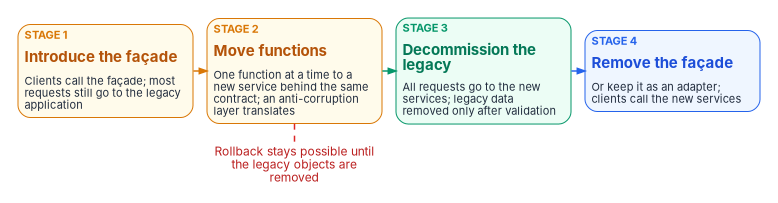

# Chapter 03 — The Target Reference Architecture

*Every application the agency changes should land on the same small set of technologies, connected by published contracts and replaced piece by piece, so that modernizing a portfolio doesn't create a new portfolio of one-off stacks.*

::: {.callout-note}
## In this chapter
The layers of the target reference architecture and the technology the program's design picks for each, with versions and support windows checked on the projects' own sites in October 2026. Why Java and Spring Boot for services, React for front ends and Node.js only where it fits. API-first contracts in OpenAPI. Containers, orchestration and twelve-factor configuration. The strangler-fig pattern that lets a legacy application be replaced in increments. The two NIST publications that serve as the federal security references for this architecture. And, for the applications that stay on premises, how Microsoft Entra application proxy retires Web Application Proxy and VPN publishing, and how secure hybrid access partners bring header-based, Kerberos and LDAP applications, including ERP and HR suites, under Entra ID sign-in, with government-cloud availability for each.
:::

[Chapter 02](02-triaging-the-portfolio.md) sends the applications that need to change to refactor or rebuild, and some replatformed ones part of the way. If each of those projects picks its own language, framework and hosting model, the agency ends the decade with as many stacks as it started with, only newer. The point of a reference architecture is to make the common choices once, so that each project spends its effort on the mission logic, and so that the platform team, the security team and the authorizing official review one pattern instead of hundreds.

The technology choices below are the program's design, not a federal requirement; no federal policy names a language or framework. They are mainstream, well-supported open-source choices with long support windows and large labor pools, which is what a portfolio running for decades needs. An agency with an established alternative, .NET services for example, can keep the structure of this chapter and substitute its own approved list. Vendors and products appear as examples, not endorsements.

{#fig-ch03-reference-architecture fig-alt="A layered diagram, top to bottom. Top: a blue card, front ends, React 19, served as static assets, calls APIs only. Next row, two cards: a blue card, backend-for-frontend, Node.js LTS, one per front end where needed; and a blue card, API gateway, authentication, rate limits, routing, the strangler-fig façade. Next row, two cards: a blue card, domain services, Java 25 LTS and Spring Boot 4.1, each publishes an OpenAPI 3.2 contract; and a slate card, the legacy application, still serving the functions not yet moved. Next: a blue card, data, each service owns its schema, PostgreSQL or SQL Server, Chapter 04. Next: a blue card, platform, OCI images on Kubernetes, configuration from the environment, secrets from a vault or workload identity. At the bottom, joined to the platform by a dashed line, a violet card: security references, NIST SP 800-204 for microservices and SP 800-190 for containers. Arrows run from front ends to the backend-for-frontend and the gateway, from both to the services, from the gateway to the legacy application, and from services to data."}

## The layers and the choices

| Layer | Program's choice | Current release and support, October 2026 | Why |
|---|---|---|---|
| Services | Java on the current LTS release, with Spring Boot | Java 25 is the current LTS release (GA September 16, 2025); Java 27, GA September 15, 2026, is a feature release not on vendors' LTS lists. Spring Boot 4.1 is current (4.1.2), requires Java 17 or later and supports up to Java 27[^c03-jdk][^c03-msjdk][^c03-boot-req] | Large labor pool, long support windows, mature security and observability libraries |
| Front ends | React | React 19.3, released September 9, 2026[^c03-react] | Component model suits large form-heavy mission applications; wide skills base |
| Backend-for-frontend, build tooling, event glue | Node.js, only on an LTS release | Node.js 24 entered maintenance on October 20, 2026 (end of life April 30, 2028); Node.js 26 is scheduled to enter LTS on October 28, 2026 (end of life April 30, 2029); Node.js 22 reaches end of life April 30, 2027[^c03-node][^c03-node-sched] | Same language as the front end, for the thin layers that serve it |
| API contracts | OpenAPI, written before the code | OpenAPI Specification 3.2.1, dated September 10, 2026, a patch release of 3.2[^c03-oas] | A contract every team, tool and reviewer can read |
| Packaging | OCI container images | OCI Image Specification 1.1.1 and Distribution Specification 1.1.1 (2025); Runtime Specification 1.3.0 (November 2025)[^c03-oci][^c03-oci-rel] | Vendor-neutral format every major registry and runtime supports |
| Orchestration | Kubernetes, or a managed service built on it | Kubernetes 1.37 is the newest minor release; the project maintains the three most recent minor releases[^c03-k8s] | One deployment and scaling model across environments |
| Data | PostgreSQL or SQL Server | See [Chapter 04](04-moving-the-data.md) | The two targets this book supports for data off Db2 and Oracle |

Versions are a snapshot. The chief architect, through the architecture review board in [Chapter 07](07-who-governs-the-architecture.md), owns the approved list and its upgrade dates; this table is the starting point, not the standard itself.

## Services: Java and Spring Boot

Java's long-term support releases are the backbone of the services layer. OpenJDK releases a new feature version every six months, and vendors designate some as long-term support: Java 25 is the current one, with the Microsoft Build of OpenJDK, for example, committing to support it until at least September 2030.[^c03-msjdk] Java 26 (March 2026) and Java 27 (September 2026) are feature releases.[^c03-jdk] The program's design is to build services on the current LTS release and move to the next one within a year of its release, not to chase each feature release.

Spring Boot sits on top. Its support windows are shorter than Java's and matter more day to day:

| Spring Boot generation | First release | Open-source support ends | Commercial support ends |
|---|---|---|---|
| 4.2.x | Scheduled November 2026 (release candidate available) | December 31, 2027 | December 31, 2028 |
| 4.1.x (current) | June 2026 | July 31, 2027 | July 31, 2028 |
| 4.0.x | November 2025 | December 31, 2026 | December 31, 2027 |
| 3.5.x | May 2025 | Ended June 30, 2026 | June 30, 2032 |

Source: Spring's project generations data.[^c03-boot-gen]

Two consequences follow. First, an application started on Spring Boot 3.5 is already outside open-source support and depends on commercial support for patches; one on 4.0 loses open-source support at the end of 2026. Second, each recent Spring Boot generation has had about thirteen months of open-source support, so a portfolio of Spring services needs an upgrade cadence built into the platform, not left to each project. Spring Boot 4.1 requires Java 17 at minimum, runs on Spring Framework 7 and supports up to Java 27, so the Java and Spring upgrades can be made independently.[^c03-boot-req]

Why Java for a federal services layer, and not something newer? Because the services layer is where the business rules of a refactored COBOL or PL/SQL application end up, and those rules will need maintaining for decades. The program values the size of the labor market, the length of the support windows, and the maturity of the security, transaction and observability libraries over novelty. Teams that convert COBOL to Java with automated tools should still treat the output as a starting point for the services in this layer, not as the target.

## Front ends: React

React is the front-end layer for new and rebuilt user interfaces. React 19 was released in December 2024, and 19.3 in September 2026.[^c03-react] The program's design keeps front ends thin: they render, validate input for usability, and call APIs. Business rules belong in services, where they are tested and authorized once, not in each user interface.

Federal front ends carry requirements that the framework doesn't solve on its own: Section 508 accessibility, the 21st Century IDEA criteria for public-facing services, and, for public sign-in, OMB's direction toward Login.gov. [Chapter 06](06-compliance-by-design.md#section-508-gate) sets the accessibility gate a rebuilt front end passes, and the others are outside the workbook's scope, which doesn't cover public-facing digital services or the sign-on the public uses for them; the workbook's [federal framework crosswalk](../../reference/federal-framework-crosswalk.md) summarizes their status. A shared component library that builds accessibility in once is worth more to a portfolio than any framework choice.

## Node.js where it fits

Node.js is in the architecture for three jobs, and the program's design keeps it to them.

- **Backend-for-frontend.** A thin service per front end that shapes data for that interface. The Azure Architecture Center describes the pattern: a separate backend for each frontend interface, tailored to its needs, managed by the frontend team, with cross-cutting concerns such as authorization and monitoring kept out of it.[^c03-bff] Writing it in the same language as the front end is the reason to use Node.js here.
- **Front-end build and tooling.** React builds run on Node.js whether or not anything runs on it in production.
- **Event glue.** Small integrations that react to messages or webhooks, where the logic is thin.

Domain logic belongs in the Java services. A backend-for-frontend that starts to hold business rules is a second services layer, and should be refactored into one.

Node.js has a predictable but changing schedule. Through Node.js 26, even-numbered releases became LTS and odd-numbered ones expired after six months. Starting with Node.js 27, the project moves to one major release a year, and every major version moves to LTS after its six-month Current phase; LTS typically means 30 months of critical fixes, and the project advises production applications to use only Active or Maintenance LTS releases.[^c03-node] Node.js 26 is scheduled to enter LTS on October 28, 2026, and Node.js 24 entered maintenance on October 20, 2026.[^c03-node-sched]

## API-first with OpenAPI

Every service publishes its contract before it publishes code. The contract is an OpenAPI document, currently version 3.2, in which the third number is reserved for patch releases that "address errors in, or provide clarifications to" the specification without changing its features.[^c03-oas] The program's design for contracts is:

- **Write the contract first,** review it with the consuming teams, and generate server stubs and client libraries from it.
- **Treat the contract as the interface the strangler-fig façade routes on.** A legacy function and its replacement can sit behind the same contract while the traffic moves.
- **Version deliberately.** Additive changes within a major version; a new major version, run side by side, for breaking ones.
- **Test against the contract** in the pipeline, so that a service can't ship a change that breaks its published interface. [Chapter 07](07-who-governs-the-architecture.md) makes this a review gate.
- **Publish contracts in a catalog** so the next project reuses an API instead of building a duplicate.

## Containers, orchestration and configuration

Services, backends-for-frontends and the façade are packaged as OCI container images. The Open Container Initiative, formed in June 2015 under the Linux Foundation, maintains the runtime, image and distribution specifications that make an image built by one tool run on another runtime and live in any compliant registry.[^c03-oci] Kubernetes, or a managed service built on it, runs them; the Kubernetes project maintains release branches for the three most recent minor releases, so clusters need an upgrade cadence of their own.[^c03-k8s]

Configuration follows the twelve-factor rule: anything that varies between deployments, such as database handles, credentials for external services and hostnames, is kept out of the code and supplied by the environment. Its litmus test is whether the code base could be made open source at any moment "without compromising any credentials."[^c03-12f] The program's design tightens this for secrets: the environment supplies a reference, and the secret itself comes from a managed secret store or, better, is replaced by a workload identity that needs no stored secret at all. [Book 17 Chapter 06](../b17-ai-identity/06-credentials-and-least-privilege.md) gives the credential order the workbook prefers.

Rehosted and replatformed applications can use the same platform without being refactored. A replatform that puts a legacy Java or .NET application into a container on the same orchestrator gains the platform's patching, logging and deployment pipeline even before its code changes.

## Replacing incrementally: the strangler fig

The strangler-fig pattern is how a refactor actually happens. Martin Fowler's account describes building new functionality alongside the legacy system and moving behavior over piece by piece until the old system can be retired, arguing that the transitional code this requires is worth its cost in lower risk and earlier value.[^c03-fowler] The Azure Architecture Center gives the mechanics: a façade (proxy) intercepts requests to the legacy back end and routes each either to the legacy application or to the new services; as functions move, the façade shifts traffic; when nothing depends on the legacy system it is decommissioned, and finally the façade itself can be removed.[^c03-strangler]

{#fig-ch03-strangler-fig fig-alt="Four stages left to right, each a card. Stage 1, amber: introduce the façade; clients call the façade, which sends most requests to the legacy application. Stage 2, amber: move functions; each function moves to a new service behind the same contract, and an anti-corruption layer translates between old and new. Stage 3, green: decommission the legacy application; all requests go to the new services and the legacy data is removed only after validation. Stage 4, blue: remove the façade or keep it as an adapter; clients call the new services directly. A red note under stage 2 reads: rollback stays possible until the legacy objects are removed."}

The same page lists the considerations that decide whether a refactor is feasible, and they belong in the deep study rule 7 of Chapter 02's decision table calls for:

- **Requests must be interceptable.** If the legacy back end can't be put behind a façade, and the agency can't change its source code or any other integration point such as its database, the pattern doesn't fit.[^c03-strangler]
- **Shared data needs a plan.** The new and legacy systems may need the same data stores at once. The Azure page's database example extracts one domain at a time, copies its data with an extract, transform and load step, keeps it in sync with change data capture, validates consistency and only then makes the new database the system of record.[^c03-strangler] [Chapter 04](04-moving-the-data.md) covers this in detail.
- **Cross-calls need an anti-corruption layer,** an adapter that translates between the two systems so that legacy conventions don't leak into the new design.[^c03-strangler]
- **The façade must not become the bottleneck** or a single point of failure, and it has to keep pace with the migration.
- **Rollback has an end.** Rollback stays practical until the legacy tables and procedures for a domain are removed; removing them is a deliberate last step.[^c03-strangler]
- **Small systems may not need it.** When replacing the whole system is simple, the pattern adds cost without much benefit.[^c03-strangler]

For a mainframe application, the façade is often an API layer in front of transactions that already exist, so that new front ends and services can call the legacy functions through the same contracts they will later call on the replacements.

## The federal security references

Two NIST publications are the security references for this architecture. Neither is a requirement in itself; they are guidance agencies draw on when selecting and implementing SP 800-53 controls for these systems, which [Chapter 06](06-compliance-by-design.md) maps.

| Publication | Date | What it covers | Where it bites in this architecture |
|---|---|---|---|
| NIST SP 800-204, *Security Strategies for Microservices-based Application Systems* | August 2019 | Authentication and access management, service discovery, secure communication, monitoring, resiliency, load balancing and session handling for microservices; how API gateways and service meshes package them[^c03-sp800204] | The gateway, service-to-service authentication, the façade |
| SP 800-204A, *Building Secure Microservices-based Applications Using Service-Mesh Architecture* | May 2020 | Service mesh deployment guidance[^c03-sp800204x] | Service-to-service traffic if a mesh is used |
| SP 800-204B, *Attribute-based Access Control for Microservices-based Applications using a Service Mesh* | August 2021 | Authorization policy in the mesh[^c03-sp800204x] | Fine-grained authorization between services |
| SP 800-204C, *Implementation of DevSecOps for a Microservices-based Application with Service Mesh* | March 2022 | DevSecOps pipelines for this kind of application[^c03-sp800204x] | The pipeline and its evidence ([Chapter 07](07-who-governs-the-architecture.md)) |
| SP 800-204D, *Strategies for the Integration of Software Supply Chain Security in DevSecOps CI/CD Pipelines* | February 2024 | Supply chain security in the pipeline[^c03-sp800204x] | Image signing, SBOMs, provenance ([Chapter 06](06-compliance-by-design.md)) |
| NIST SP 800-190, *Application Container Security Guide* | September 2017 | Major risks for images, registries, orchestrators, containers and host operating systems, and countermeasures for each, plus hardware countermeasures[^c03-sp800190] | Image build and scanning, the registry, the cluster and its nodes |

The CSRC pages for SP 800-204 and SP 800-190 list no newer revision or draft as of October 2026.[^c03-sp800204][^c03-sp800190-page] SP 800-190 predates several current practices, but its five risk areas still map cleanly onto the platform layer, and SP 800-204D covers much of the supply chain ground it doesn't.

## Applications that stay on premises: publishing through Application Proxy

Not every application reaches this architecture at once. Retained and rehosted web applications, and refactors still behind their façade, keep running on premises for years, and their remote users still need a front door. In most agencies that door is a Web Application Proxy (WAP) server beside AD FS, a reverse proxy in the perimeter network or a VPN. Microsoft's replacement is Microsoft Entra application proxy.

Application proxy has two parts: a service in the cloud and a private network connector, a lightweight agent on a Windows Server inside the agency's network. The user signs in to Entra ID, where Conditional Access and multifactor authentication apply; the service passes the request to the connector, the connector performs any single sign-on to the application on the user's behalf, and the response returns the same way. The connector makes only outbound connections, so no inbound firewall port is opened, and the application doesn't change.[^c03-ap-overview] Microsoft's guidance for moving AD FS applications names application proxy as the replacement for applications published through WAP, and secure hybrid access (the next section) for applications behind application delivery controllers.[^c03-ap-adfs-migrate] Two limits shape where it fits. It is a remote-access service: Microsoft says it isn't designed for users on the corporate network, who get added latency and possible performance problems from it.[^c03-ap-overview][^c03-ap-plan] And it is not an AD FS proxy; it can't stand in for WAP in front of AD FS itself or publish AD FS endpoints.[^c03-ap-faq] WAP therefore leaves in two steps: its published applications move to application proxy, and the WAP servers that front AD FS go when federation is decommissioned ([Book 02, Chapter 10](../b02-identity/10-migrating-and-governing.md#phase-9-federation-decommission-if-applicable)).

The same connector serves Microsoft Entra Private Access,[^c03-ap-faq] which [Book 01, Chapter 08](../b01-transformation-arc/08-access-plane.md) treats as the per-app replacement for the VPN, and [Book 06, Chapter 18](../b06-data-platform/18-the-four-class-pattern-for-applications.md) uses application proxy as its Class 1 pattern for SQL-backed applications that can't be modernized directly.

### What it can publish

| Application signs users in with | Application proxy single sign-on | Notes |
|---|---|---|
| Integrated Windows Authentication (Kerberos) | Kerberos constrained delegation from the connector | Connector and application server domain-joined, in the same or trusted domains[^c03-ap-overview][^c03-ap-plan] |
| HTTP headers | Header-based single sign-on | [^c03-ap-overview] |
| SAML 2.0 or WS-Federation | SAML single sign-on through the proxy | [^c03-ap-overview] |
| A form that takes a username and password | Password vaulting | Entra ID supplies stored credentials after the first sign-in[^c03-ap-overview] |
| Remote Desktop Gateway; native clients built on MSAL; web APIs | Published as their own scenarios | [^c03-ap-overview] |
| NTLM | Not as preauthentication or single sign-on; only negotiated directly between client and application | Usually means a browser prompt[^c03-ap-faq] |
| Client certificate authentication at the application | Not supported, because the proxy terminates TLS | [^c03-ap-faq] |

: What application proxy can publish. Source: Microsoft Learn. {.striped .hover}

Protocols outside this table (LDAP, NTLM single sign-on, SSH, cookie-based schemes) need a secure hybrid access partner, below.

### Retiring WAP and other reverse proxies, application by application

The steps are Microsoft's deployment plan, with the program's choices marked.

1. **Inventory what the old proxy publishes.** For each application record the service type, platform, internal URL, current external publishing, certificate, authentication type, the connector group it will use and the users and groups who need it; Microsoft's plan lists these fields and offers an inventory spreadsheet.[^c03-ap-plan] The rows join the evidence map of [Chapter 02](02-triaging-the-portfolio.md#recording-dependencies-as-an-evidence-map).
2. **Build connector groups before the first application.** At least two connectors per group, three for servicing headroom; deploy connectors in the same network segment as the applications; allow outbound TCP 443 and 80 and don't inspect or terminate the connectors' TLS to the service.[^c03-ap-plan] Microsoft recommends four CPU cores and 8 GiB of memory per connector, with sustained use under 70 percent.[^c03-ap-connectors] Connectors need a domain-joined server only for Kerberos single sign-on, and their services must keep their default accounts (Network Service for the connector, Local System for the updater).[^c03-ap-connectors][^c03-ap-faq] The program's design puts connectors on Windows Server 2019 or later, the workbook's server baseline.
3. **Install and register.** Installation needs local administrator rights on the server and at least the Application Administrator role to register; Cloud Application Administrator can't manage application proxy settings.[^c03-ap-plan] In GCC High or DoD the tenant is in Azure Government, and the installer takes an extra parameter and different URLs (`*.msappproxy.us`, `*.servicebus.usgovcloudapi.net`):[^c03-ap-govcloud]

    ```powershell
    # On the connector server, from the folder that holds the downloaded installer.
    # Commercial and GCC tenants: run the installer without a parameter.
    # GCC High and DoD (Azure Government):
    .\MicrosoftEntraPrivateNetworkConnectorInstaller.exe ENVIRONMENTNAME="AzureUSGovernment"
    ```

4. **Publish and test in increments.** Microsoft's order is to confirm the application works with preauthentication off, then turn on Microsoft Entra ID preauthentication and assign users and groups, then add single sign-on, then Conditional Access, testing after each step.[^c03-ap-plan] The program's design allows passthrough only on a pilot application that isn't reachable by production users: Conditional Access can't apply to passthrough, because no Entra authentication happens.[^c03-ap-faq] New application proxy apps default to *Assignment required = Yes*;[^c03-ap-faq] the program leaves it there.
5. **Keep one URL.** Microsoft's advice is to publish under a verified custom domain so the internal and external URLs are identical, which avoids link translation and its cost; it needs a public certificate and a public CNAME record, both with lead time.[^c03-ap-plan][^c03-ap-faq]
6. **Cut over and retire.** Move the public DNS name, watch sign-ins for the application, and remove the application from the old proxy. A WAP server is retired when its last published application has moved and nothing else depends on it.

### Continuous access evaluation for published applications

Continuous access evaluation (CAE) for application proxy is on by default for every application proxy application, and the application doesn't need to be CAE-aware. Application proxy receives near-real-time signals when an account is deleted or disabled, a password is changed or reset, MFA is enabled for the user or an administrator revokes the user's refresh tokens, and then requires the user to sign in again; a change of network location is re-evaluated against location policies.[^c03-ap-cae] Microsoft notes that CAE is opportunistic unless Conditional Access strict enforcement applies to the application.[^c03-ap-cae] The program's design leaves CAE on and treats a request to disable it for an application as an exception with an owner and an expiry. For a leaver, this is what makes revocation reach an on-premises web application within minutes instead of at token expiry ([Book 03, Chapter 08](../b03-hr-identity/08-joiner-mover-leaver.md)).

### Guests reaching on-premises applications

Partners invited through B2B collaboration can use published applications. A SAML application published through application proxy needs only an assignment of the guest. An application that uses Integrated Windows Authentication needs more: Kerberos constrained delegation impersonates a user object in Active Directory, so each guest needs a "footprint" account there, created and removed by Microsoft Identity Manager with its Microsoft Graph connector or by Microsoft's B2B sample script, and lifecycle actions on the cloud guest (access reviews, deletion) then carry to the footprint. Microsoft also points out that guests who use on-premises applications may need client access licenses or external connectors.[^c03-ap-b2b] Guests have no on-premises UPN or SAM account name, so the single sign-on identity falls back to the user principal name.[^c03-ap-faq] In Azure Government, B2B collaboration works between Azure Government tenants that support it, and with the commercial cloud only after both tenants enable it in their Microsoft cloud settings.[^c03-ap-b2b-gov] [Book 03, Chapter 15](../b03-hr-identity/15-external-partner-identity.md) covers the partner identity record the footprint account hangs from.

### Read-only inventory as evidence

Microsoft publishes PowerShell samples for application proxy that list applications, their external and internal URLs, preauthentication and single sign-on mode, connector groups and connectors, applications on the default `msappproxy.net` domain, wildcard applications and custom-domain certificates; they need the Microsoft Graph Beta PowerShell module 2.10 or later.[^c03-ap-ps] Some samples change things (assign users, move applications between connector groups, replace certificates); the program uses only the listing samples, run by a signed-in administrator, because Microsoft says a service principal can't manage application proxy through PowerShell or Microsoft Graph.[^c03-ap-faq] The commands below adapt the samples for connector groups and for extended application details into two CSV files for the evidence package.[^c03-ap-ps-connectors][^c03-ap-ps-extended] They are illustrative and were not run against a tenant for this book.

```powershell
# Read-only. Requires Microsoft.Graph.Beta 2.10 or later and an account that can read the directory.
Install-Module Microsoft.Graph.Beta.Applications -Scope CurrentUser -MinimumVersion 2.10.0
Import-Module Microsoft.Graph.Beta.Applications
# Commercial and GCC tenants:
Connect-MgGraph -Scopes Directory.Read.All -NoWelcome
# GCC High instead:  Connect-MgGraph -Environment USGov -Scopes Directory.Read.All -NoWelcome
# DoD instead:       Connect-MgGraph -Environment USGovDoD -Scopes Directory.Read.All -NoWelcome

# 1. Connector groups and their connectors
Get-MgBetaOnPremisePublishingProfileConnectorGroup -OnPremisesPublishingProfileId "applicationProxy" -All |
  Where-Object { $_.ConnectorGroupType -eq "applicationProxy" } |
  ForEach-Object {
    $group = $_
    Get-MgBetaOnPremisePublishingProfileConnectorGroupMember -OnPremisesPublishingProfileId "applicationProxy" -ConnectorGroupId $group.Id |
      Select-Object @{n='ConnectorGroup';e={$group.Name}}, @{n='Region';e={$group.Region}}, MachineName, ExternalIp, Status
  } | Export-Csv .\appproxy-connectors.csv -NoTypeInformation

# 2. Application proxy applications and their publishing settings
Get-MgBetaServicePrincipal -All |
  Where-Object { $_.Tags -contains "WindowsAzureActiveDirectoryOnPremApp" } |
  ForEach-Object {
    $sp  = $_
    $app = Get-MgBetaApplication -Filter "appId eq '$($sp.AppId)'" -Property "id,displayName,onPremisesPublishing"
    $pub = $app.OnPremisesPublishing
    [pscustomobject]@{
      DisplayName        = $app.DisplayName
      AppId              = $sp.AppId
      ExternalUrl        = $pub.ExternalUrl
      InternalUrl        = $pub.InternalUrl
      PreAuthentication  = $pub.ExternalAuthenticationType
      SingleSignOnMode   = $pub.SingleSignOnSettings.SingleSignOnMode
      AssignmentRequired = $sp.AppRoleAssignmentRequired
    }
  } | Export-Csv .\appproxy-apps.csv -NoTypeInformation

Disconnect-MgGraph
```

A row with `PreAuthentication` set to `passthrough`, or `AssignmentRequired` set to `False`, is a finding against step 4 above.

### Control states, rollback and evidence for the move {#b18-03-proxy-move-conventions}

Moving an application from the old proxy to application proxy puts its remote users behind Entra ID preauthentication and Conditional Access, which is an enforcement change for every user who reached it before without either. The retirement steps above already carry the inventory, the pilot and the incremental order; this subsection adds what the workbook's implementation conventions ask for and the steps leave implicit ([Book 00, Appendix D](../b00-orientation/appendix-d-control-states-and-evidence.md)).

**Authority:** Microsoft-recommended for application proxy as the replacement for WAP-published applications, for the incremental publishing order and for a verified custom domain (the Learn pages cited above, read Nov 9, 2026). Risk-based recommended, the program's position: passthrough only on a pilot application, **Assignment required** left on, and CAE left on.
**Applies:** web applications reached by remote users. Environment-dependent: application proxy is listed as available in Azure for US Government, and CAE for application proxy is not yet specified in any government cloud ([Availability in the government clouds](#availability-in-the-government-clouds)).

| How-template step | Where this chapter covers it, or what it adds |
|---|---|
| Prerequisites | Steps 1 to 3: the inventory, connector groups and the registered connector; the application's owner named in the [evidence map](02-triaging-the-portfolio.md#recording-dependencies-as-an-evidence-map) |
| Pilot | Step 4's pilot application, not reachable by production users |
| Report-only or audit phase | Conditional Access policies for the published application created in report-only mode first; the sign-in log's report-only results read for a week before they're turned on |
| Enforcement | Step 4's order, then step 6's DNS cut-over, one application at a time (rings below) |
| Rollback | Point the public DNS name back at the old proxy, which stays configured until the application has run a full business cycle on application proxy; the application owner and the network team, within the DNS record's time to live |
| Exclusions | Users on the corporate network, who reach the application directly rather than through the proxy ([above](#applications-that-stay-on-premises-publishing-through-application-proxy)); any application left on passthrough, with an owner and an expiry. Emergency access accounts are excluded from the application's Conditional Access policies under [Book 04](../b04-access/index.md)'s design |
| Telemetry | The application's sign-in and audit logs, routed to the SIEM ([Book 12](../b12-security-operations/index.md)), and each connector's status from the read-only inventory's `Status` column |
| Evidence | The checklist below |
| Day-two ownership | The application owner; identity engineering owns the connector groups and their servers. Drift is a row in the read-only inventory with `passthrough` or `AssignmentRequired` false, or a connector group below two healthy connectors |

**Change safety**

| Ring | Scope | Exit criteria |
|---|---|---|
| 0 | The pilot application, passthrough then preauthentication | Works for the test users at each step of Microsoft's order |
| 1 | One production application with a small user population | A full business cycle with no sign-in failures traced to the proxy |
| 2 | The remaining applications behind the same connector group | The same, per application |
| 3 | The old proxy's last application moved; WAP servers retired when federation is decommissioned | The old proxy publishes nothing; its servers are in the decommissioning record |

- **Emergency access:** excluded from the application's Conditional Access policies; the exclusion is checked in the policy export.
- **Change window:** each cut-over in the application owner's window, with the network team on hand for DNS.
- **Backout triggers:** sign-in failures or a broken single sign-on for assigned users that can't be fixed within the window.
- **Post-change validation:** a remote test sign-in by an assigned user, a refused sign-in by an unassigned one, and the read-only inventory showing preauthentication and assignment as designed.

**Control states.** <!-- Book 00, Appendix D: Designed, Configured, Enforced, Evidenced, Operated -->

| State | This page | Evidence |
|---|---|---|
| Designed | The path chosen per application ([Choosing the path](#choosing-the-path)) | The evidence-map row |
| Configured | The published application and its Conditional Access policies in report-only mode | `appproxy-apps.csv` and the policy export |
| Enforced | Preauthentication on, assignment required, policies on, DNS cut over | The same exports after the change, and the DNS record |
| Evidenced | The post-change validation | Test records with the sign-in log entries they produced |
| Operated | The read-only inventory rerun on a cadence; connector health watched | Inventory history and connector alerts |

A finding this page addresses is ready for closure when every applicable state has evidence; the authorizing official or assessor decides.

**Evidence checklist**

- [ ] **Configuration:** `appproxy-apps.csv`, `appproxy-connectors.csv` and the Conditional Access export, kept with each change
- [ ] **Operational:** the application's sign-in logs in the SIEM and the connector status history, kept for the program's log retention
- [ ] **Test:** the post-change validation per application (expected and observed outcome, date, tester)
- [ ] **Exception:** any application left on passthrough or without assignment required, and any request to turn CAE off, with approver and expiry
- [ ] **Assessor-ready artifact:** the evidence-map row per application, linked to the exports and test record

::: {.callout-note appearance="simple"}
## Assessment mapping
- **Microsoft Zero Trust pillar:** Apps, with Networks for the removed inbound path
- **CISA ZTMM pillar:** Applications and Workloads
- **Depends on:** Conditional Access and emergency access design ([Book 04](../b04-access/index.md)); the identity plane for preauthentication (Identity); Private Access for non-web traffic ([Book 01, Chapter 08](../b01-transformation-arc/08-access-plane.md))
- **Attack chain interrupted:** an unauthenticated or password-only path to an on-premises application from the internet (Initial Access), and access that survives a disabled account until token expiry (Persistence), cut by preauthentication and CAE
:::

## Secure hybrid access for header-based, Kerberos and LDAP applications

Application proxy covers Kerberos and header-based web applications. Microsoft lists SSH, NTLM, LDAP and cookie-based authentication as protocols it doesn't support, and points to independent software vendors whose products connect those applications to Entra ID.[^c03-sha-integrations] Microsoft calls this secure hybrid access. Each partner registers the application in Entra ID as an enterprise application, so Conditional Access, multifactor authentication and sign-in logs apply to it per application, as they do to a SaaS application.[^c03-sha][^c03-sha-integrations] The partners fall into application delivery controllers (F5 BIG-IP Access Policy Manager, Citrix ADC, Akamai, Kemp), VPN gateways and software-defined perimeter products (Datawiza, Silverfort, Zscaler Private Access and others).[^c03-sha-integrations] Four that Microsoft documents in depth:

| Partner product | How it connects the application | Typical fit | Source |
|---|---|---|---|
| F5 BIG-IP Access Policy Manager | Reverse proxy and SAML service provider: Entra ID preauthenticates and applies Conditional Access, then BIG-IP performs header-based, Kerberos, form-based or LDAP-backed single sign-on to the application. Its Easy Button has templates for Oracle PeopleSoft, Oracle E-Business Suite, Oracle JD Edwards, SAP ERP and a generic template | An agency that already runs BIG-IP in front of the application | [^c03-sha-f5][^c03-sha-f5-easy] |
| Datawiza Access Proxy | A container-based reverse proxy that signs users in with OIDC or SAML and passes identity to the application in HTTP headers; Microsoft presents it as a way off legacy web access managers without rewriting applications | Header-based applications and legacy web access managers | [^c03-sha-datawiza] |
| Silverfort | Agentless and proxyless: authentication requests over Kerberos, NTLM, LDAPS and other protocols are routed to Silverfort, which bridges them to Entra ID for Conditional Access and MFA; bridged assets appear as enterprise applications. Microsoft lists remote desktop, SSH, command-line tools, file shares and databases among them | Protocols no proxy can front | [^c03-sha-silverfort] |
| Cloudflare Zero Trust Access | Entra ID as the identity provider for default-deny rules on applications, private IP ranges and hostnames; Conditional Access applies through the Entra application behind each Cloudflare identity-provider integration, with a dedicated one where an application needs its own policies | An agency that already uses Cloudflare as its access edge | [^c03-sha-cloudflare][^c03-sha-cloudflare-ca] |

: Four secure hybrid access partners Microsoft documents. Products are examples, not endorsements; each is a separate product with its own license and its own authorization. {.striped .hover}

### ERP and HR suites

Enterprise resource planning suites are where header-based single sign-on is most common, and Microsoft publishes recipes for three Oracle application families with two partners each: E-Business Suite, JD Edwards and PeopleSoft through F5's Easy Button and through Datawiza.[^c03-sha-f5-easy][^c03-sha-datawiza-oracle] The pattern is the same in all of them: Entra ID preauthenticates the user and applies Conditional Access, and the proxy hands the application the identity it expects. For JD Edwards that is a header (`JDE_SSO_UID`) carrying the username; for E-Business Suite the proxy also looks up the user's unique ID in Oracle Internet Directory over LDAP and passes it to Oracle AccessGate, which issues the E-Business Suite session cookie.[^c03-sha-f5-jde][^c03-sha-f5-ebs] Where the workforce HR platform or its self-service pages run on one of these suites, this is the path that brings them under the same Conditional Access as everything else without changing the suite. [Book 03, Chapter 13](../b03-hr-identity/13-reference-deployment.md) is where the HR platform's own sign-in is planned.

### Choosing the path

The program's design picks the first of these that works for each application, and records the choice in the evidence map:

1. **Modern protocol directly.** If the application or its vendor supports SAML or OpenID Connect, connect it to Entra ID as an enterprise application; no proxy is needed ([Book 04, Chapter 05](../b04-access/05-applications-and-workload-identities.md)).
2. **Application proxy** for web applications that use Integrated Windows Authentication, headers or forms, for remote users.
3. **A secure hybrid access partner** where the protocol is one application proxy doesn't support, or where the agency already operates the partner's product in front of the application.
4. **Refactor behind the strangler-fig façade** when the application is changing anyway; the new services authenticate with Entra ID natively.

Every path ends with the application behind Entra ID sign-in and Conditional Access; only the adapter differs.

### Availability in the government clouds

Commercial and GCC tenants use Microsoft Entra ID in the commercial cloud; GCC High and DoD tenants use Microsoft Entra ID in Azure Government.[^c03-ap-pairing]

| Feature | GCC (commercial Entra ID) | GCC High and DoD (Azure Government) |
|---|---|---|
| Application proxy, including header-based and Integrated Windows Authentication | Available with the commercial service | Listed as available;[^c03-ap-feature-gov] connector installs with `ENVIRONMENTNAME="AzureUSGovernment"`[^c03-ap-govcloud] |
| Continuous access evaluation for application proxy | Not yet specified | Not yet specified |
| B2B guests reaching on-premises applications | Available with B2B collaboration | B2B between Azure Government tenants that support it, or cross-cloud after both tenants enable Microsoft cloud settings[^c03-ap-b2b-gov] |
| Application proxy PowerShell samples (Microsoft Graph beta) | Worldwide Graph endpoint | Graph `-Environment USGov` or `USGovDoD`; beta availability for these cmdlets not yet specified |
| Secure hybrid access partnerships (Kerberos, NTLM, LDAP, RDP and SSH) | Available with the commercial service | Listed as available[^c03-ap-feature-gov] |
| A specific partner product (F5, Datawiza, Silverfort, Cloudflare) | Not yet specified by Microsoft Learn; check the product's own FedRAMP status | Not yet specified by Microsoft Learn; check the product's own FedRAMP status |

: Government-cloud availability for application proxy and secure hybrid access, from Microsoft Learn on November 9, 2026. {.striped .hover}

## How the dispositions use the architecture

| Disposition | What it takes from this chapter |
|---|---|
| Retire | Nothing, except that any function that moves elsewhere is reached through a published API |
| Retain | Optionally, an API façade in front of it so new applications don't integrate directly with its internals; remote users reach it through application proxy or a secure hybrid access partner |
| Rehost | Nothing in the stack; the application moves without code changes, and putting it in a container is a replatform. Its sign-in moves behind Entra ID through application proxy or a secure hybrid access partner |
| Replatform | The platform layer and, for the database, [Chapter 04](04-moving-the-data.md) |
| Refactor | All of it, introduced through the strangler-fig façade one function at a time |
| Rebuild | All of it, still delivered in increments behind contracts |

[Chapter 08](08-the-reference-implementation.md) describes a small runnable implementation of this architecture that ships with the book.

## Honest limits

- **The stack is the program's choice.** No federal requirement names Java, Spring Boot, React, Node.js or Kubernetes. What federal policy requires is an enterprise architecture with a target and a transition plan, and the phase-out of unsupported components; this chapter is one way to define the target.
- **The versions will move.** Every version in this chapter was checked on the project's own site on October 28, 2026. Spring Boot 4.0 loses open-source support at the end of 2026, Node.js release lines change this month, and Kubernetes ships a minor release approximately three times a year.[^c03-k8s-cycle] The approved list has to be maintained, not published once.
- **The publishing commands are illustrative.** The application proxy installer parameter and the read-only inventory commands follow Microsoft's published samples and pages; they were not run against a tenant for this book, and the partner products were not tested.
- **Not every application fits.** Packaged commercial software, mainframe workloads that are being retained and small applications that are simpler to replace whole won't take this shape, and shouldn't be forced to.

## What leadership should take from this

1. **Approve one target, and a way to change it.** The value is in everyone using the same stack; the risk is in the stack aging. Give the chief architect, through the architecture review board, both the list and the duty to keep it current.
2. **Fund the upgrade cadence.** Recent Spring Boot generations get about thirteen months of open-source support, and Node.js and Kubernetes move on clocks of their own. Budget for platform upgrades as recurring work, or the modernized portfolio becomes the next legacy one.
3. **Ask how each refactor will be strangled.** A refactor proposal should name its façade, its first function to move, how shared data will be handled and when rollback ends.

[Chapter 04](04-moving-the-data.md) takes up the hardest part of most refactors: the data.

::: {.callout-tip}
## Continue the book
[← Previous: Chapter 02 — Triaging the Portfolio](02-triaging-the-portfolio.md) · [Book index](index.md) · [Next: Chapter 04 — Moving the Data: Db2 and Oracle to PostgreSQL or SQL Server →](04-moving-the-data.md)
:::

[^c03-jdk]: OpenJDK, "JDK Project," list of releases and GA dates (JDK 25, September 16, 2025; JDK 26, March 17, 2026; JDK 27, September 15, 2026; JDK 28 in development), <https://openjdk.org/projects/jdk/> (accessed Oct 28, 2026).
[^c03-msjdk]: Microsoft Learn, "Support roadmap for the Microsoft Build of OpenJDK," release and servicing roadmap (OpenJDK 25 LTS, earliest end of support September 2030), <https://learn.microsoft.com/java/openjdk/support> (accessed Oct 28, 2026).
[^c03-boot-req]: Spring Boot reference documentation, "System Requirements" (Spring Boot 4.1.2), <https://docs.spring.io/spring-boot/system-requirements.html> (accessed Oct 28, 2026).
[^c03-boot-gen]: Spring, project generations for Spring Boot (initial release, open-source and commercial support end dates), <https://spring.io/projects/generations>, data read from the Spring projects API, <https://api.spring.io/projects/spring-boot/generations>; current release 4.1.2 and 4.2.0-RC1 from <https://api.spring.io/projects/spring-boot/releases> (accessed Oct 28, 2026).
[^c03-react]: React, "React Versions," changelog (v19.0.0, December 5, 2024; v19.3.0, September 9, 2026), <https://react.dev/versions> (accessed Oct 28, 2026).
[^c03-node]: Node.js, "Node.js Releases," release status table and release schedule notes, <https://nodejs.org/en/about/previous-releases> (accessed Oct 28, 2026).
[^c03-node-sched]: Node.js Release Working Group, `schedule.json` (start, LTS, maintenance and end dates for v22, v24, v26 and v27), <https://github.com/nodejs/Release/blob/main/schedule.json> (accessed Oct 28, 2026).
[^c03-oas]: OpenAPI Initiative, *OpenAPI Specification v3.2.1*, September 10, 2026, Section 2.1 (Versions), <https://spec.openapis.org/oas/v3.2.1.html>; version index <https://spec.openapis.org/oas/> (accessed Oct 28, 2026).
[^c03-oci]: Open Container Initiative, "About the Open Container Initiative," <https://opencontainers.org/about/overview/> (accessed Oct 28, 2026).
[^c03-oci-rel]: Open Container Initiative, release pages for the image specification (v1.1.1, March 3, 2025), distribution specification (v1.1.1, January 29, 2025) and runtime specification (v1.3.0, November 4, 2025), <https://github.com/opencontainers/image-spec/releases>, <https://github.com/opencontainers/distribution-spec/releases>, <https://github.com/opencontainers/runtime-spec/releases> (accessed Oct 28, 2026).
[^c03-k8s]: Kubernetes, "Releases," <https://kubernetes.io/releases/> (accessed Oct 28, 2026).
[^c03-k8s-cycle]: Kubernetes, "Kubernetes Release Cycle," <https://kubernetes.io/releases/release/> (accessed Oct 28, 2026).
[^c03-bff]: Microsoft Learn, Azure Architecture Center, "Backends for Frontends pattern," <https://learn.microsoft.com/azure/architecture/patterns/backends-for-frontends> (accessed Oct 28, 2026).
[^c03-12f]: Adam Wiggins, *The Twelve-Factor App*, "III. Config," <https://12factor.net/config> (accessed Oct 28, 2026).
[^c03-fowler]: Martin Fowler, "Strangler Fig," August 22, 2024, <https://martinfowler.com/bliki/StranglerFigApplication.html> (accessed Oct 28, 2026).
[^c03-strangler]: Microsoft Learn, Azure Architecture Center, "Strangler Fig pattern," Solution, Problems and considerations, When to use this pattern, and Example, <https://learn.microsoft.com/azure/architecture/patterns/strangler-fig> (accessed Oct 28, 2026).
[^c03-sp800204]: National Institute of Standards and Technology, SP 800-204, *Security Strategies for Microservices-based Application Systems*, August 2019, abstract and document history, <https://csrc.nist.gov/pubs/sp/800/204/final> (accessed Oct 28, 2026).
[^c03-sp800204x]: National Institute of Standards and Technology, SP 800-204A (May 2020), <https://csrc.nist.gov/pubs/sp/800/204/a/final>; SP 800-204B (August 2021), <https://csrc.nist.gov/pubs/sp/800/204/b/final>; SP 800-204C (March 2022), <https://csrc.nist.gov/pubs/sp/800/204/c/final>; SP 800-204D (February 2024), <https://csrc.nist.gov/pubs/sp/800/204/d/final> (all accessed Oct 28, 2026).
[^c03-sp800190]: National Institute of Standards and Technology, SP 800-190, *Application Container Security Guide*, September 2017, Sections 3 and 4, <https://nvlpubs.nist.gov/nistpubs/SpecialPublications/NIST.SP.800-190.pdf> (accessed Oct 28, 2026).
[^c03-sp800190-page]: National Institute of Standards and Technology, SP 800-190 publication page, document history, <https://csrc.nist.gov/pubs/sp/800/190/final> (accessed Oct 28, 2026).
[^c03-ap-overview]: Microsoft Learn, "Microsoft Entra application proxy," Overview, Overview of how application proxy works, Authentication and Security benefits, <https://learn.microsoft.com/entra/identity/app-proxy/overview-what-is-app-proxy> (accessed Nov 9, 2026).
[^c03-ap-plan]: Microsoft Learn, "Plan a Microsoft Entra application proxy deployment," Prerequisites, Important considerations, Discover applications for migration, Best practices for a pilot and Publish applications, <https://learn.microsoft.com/entra/identity/app-proxy/conceptual-deployment-plan> (accessed Nov 9, 2026).
[^c03-ap-faq]: Microsoft Learn, "Microsoft Entra application proxy frequently asked questions," General, Connector configuration, Application configuration, Integrated Windows authentication, Passthrough preauthentication and AD FS publishing, <https://learn.microsoft.com/entra/identity/app-proxy/application-proxy-faq> (accessed Nov 9, 2026).
[^c03-ap-adfs-migrate]: Microsoft Learn, "Best practices to migrate applications and authentication to Microsoft Entra ID," Migrate applications (Web Application Proxy; Phase 2, classify apps), <https://learn.microsoft.com/entra/architecture/migration-best-practices> (accessed Nov 9, 2026).
[^c03-ap-connectors]: Microsoft Learn, "Microsoft Entra private network connectors," Specifications and sizing requirements and Domain joining, <https://learn.microsoft.com/entra/global-secure-access/concept-connectors> (accessed Nov 9, 2026).
[^c03-ap-govcloud]: Microsoft Learn, "Hybrid identity considerations for the Azure Government cloud," Allow access to URLs and Install the agent for the Azure Government cloud (applies to the private network connector), <https://learn.microsoft.com/entra/identity/hybrid/connect/reference-connect-government-cloud> (accessed Nov 9, 2026).
[^c03-ap-cae]: Microsoft Learn, "Learn about Continuous Access Evaluation (CAE) for Application Proxy," <https://learn.microsoft.com/entra/identity/app-proxy/concept-continuous-access-evaluation> (accessed Nov 9, 2026).
[^c03-ap-b2b]: Microsoft Learn, "Grant Microsoft Entra B2B users access to your on-premises applications," <https://learn.microsoft.com/entra/external-id/hybrid-cloud-to-on-premises> (accessed Nov 9, 2026).
[^c03-ap-b2b-gov]: Microsoft Learn, "Microsoft Entra B2B in government and national clouds," <https://learn.microsoft.com/entra/external-id/b2b-government-national-clouds> (accessed Nov 9, 2026).
[^c03-ap-ps]: Microsoft Learn, "Microsoft Entra application proxy PowerShell examples," <https://learn.microsoft.com/entra/identity/app-proxy/application-proxy-powershell-samples> (accessed Nov 9, 2026).
[^c03-ap-ps-connectors]: Microsoft Learn, "Get all private network connector groups and connectors in the directory," <https://learn.microsoft.com/entra/identity/app-proxy/scripts/powershell-get-all-connectors> (accessed Nov 9, 2026).
[^c03-ap-ps-extended]: Microsoft Learn, "Get all application proxy apps and list extended information," <https://learn.microsoft.com/entra/identity/app-proxy/scripts/powershell-get-all-app-proxy-apps-extended> (accessed Nov 9, 2026).
[^c03-ap-feature-gov]: Microsoft Learn, "Microsoft Entra feature availability" (Azure for US Government), Applications access: "Application Proxy for on-premises, header-based, and Integrated Windows Authentication" and "Secure hybrid access partnerships (Kerberos, NTLM, LDAP, RDP, and SSH authentication)," <https://learn.microsoft.com/entra/identity/authentication/feature-availability> (accessed Nov 9, 2026).
[^c03-ap-pairing]: Microsoft Learn, "Cloud feature availability for US Government customers," Microsoft 365 integration (Office 365 GCC pairs with Microsoft Entra ID in Azure; GCC High and DoD pair with Microsoft Entra ID in Azure Government), <https://learn.microsoft.com/azure/security/fundamentals/feature-availability> (accessed Oct 21, 2026, for Book 01 Appendix B).
[^c03-sha]: Microsoft Learn, "Secure hybrid access: Protect legacy apps with Microsoft Entra ID," <https://learn.microsoft.com/entra/identity/enterprise-apps/secure-hybrid-access> (accessed Nov 9, 2026).
[^c03-sha-integrations]: Microsoft Learn, "Secure hybrid access with Microsoft Entra integration," introduction and Partnerships, <https://learn.microsoft.com/entra/identity/enterprise-apps/secure-hybrid-access-integrations> (accessed Nov 9, 2026).
[^c03-sha-f5]: Microsoft Learn, "Integrate F5 BIG-IP with Microsoft Entra ID," <https://learn.microsoft.com/entra/identity/enterprise-apps/f5-integration>; and "Configure F5 BIG-IP Easy Button for Header-based and LDAP SSO," <https://learn.microsoft.com/entra/identity/enterprise-apps/f5-big-ip-ldap-header-easybutton> (accessed Nov 9, 2026).
[^c03-sha-f5-easy]: Microsoft Learn, "Tutorial: Configure F5 BIG-IP Easy Button for SSO to Oracle PeopleSoft," Scenario architecture and Configure the Easy Button (templates for PeopleSoft, E-Business Suite, JD Edwards, SAP ERP and a generic template), <https://learn.microsoft.com/entra/identity/enterprise-apps/f5-big-ip-oracle-peoplesoft-easy-button> (accessed Nov 9, 2026).
[^c03-sha-f5-jde]: Microsoft Learn, "Configure F5 BIG-IP Easy Button for SSO to Oracle JDE," HTTP header `JDE_SSO_UID`, <https://learn.microsoft.com/entra/identity/enterprise-apps/f5-big-ip-oracle-jde-easy-button> (accessed Nov 9, 2026).
[^c03-sha-f5-ebs]: Microsoft Learn, "Configure F5 BIG-IP Easy Button for SSO to Oracle EBS," Scenario architecture, <https://learn.microsoft.com/entra/identity/enterprise-apps/f5-big-ip-oracle-enterprise-business-suite-easy-button> (accessed Nov 9, 2026).
[^c03-sha-datawiza]: Microsoft Learn, "Tutorial: Configure Secure Hybrid Access with Microsoft Entra ID and Datawiza," <https://learn.microsoft.com/entra/identity/enterprise-apps/datawiza-configure-sha> (accessed Nov 9, 2026).
[^c03-sha-datawiza-oracle]: Microsoft Learn, "Configure Datawiza for Microsoft Entra multifactor authentication and single sign-on to Oracle EBS," <https://learn.microsoft.com/entra/identity/enterprise-apps/datawiza-sso-mfa-oracle-ebs>; "Configure Microsoft Entra multifactor authentication and SSO for Oracle JD Edwards applications using Datawiza Access Proxy," <https://learn.microsoft.com/entra/identity/enterprise-apps/datawiza-sso-oracle-jde>; "Configure Microsoft Entra multifactor authentication and SSO for Oracle PeopleSoft applications using Datawiza Access Proxy," <https://learn.microsoft.com/entra/identity/enterprise-apps/datawiza-sso-oracle-peoplesoft> (accessed Nov 9, 2026).
[^c03-sha-silverfort]: Microsoft Learn, "Tutorial: Configure Secure Hybrid Access with Microsoft Entra ID and Silverfort," <https://learn.microsoft.com/entra/identity/enterprise-apps/silverfort-integration> (accessed Nov 9, 2026).
[^c03-sha-cloudflare]: Microsoft Learn, "Configure Cloudflare with Microsoft Entra ID for secure hybrid access," <https://learn.microsoft.com/entra/identity/enterprise-apps/cloudflare-integration> (accessed Nov 9, 2026).
[^c03-sha-cloudflare-ca]: Microsoft Learn, "Tutorial: Configure Conditional Access policies in Cloudflare Access," <https://learn.microsoft.com/entra/identity/enterprise-apps/cloudflare-conditional-access-policies> (accessed Nov 9, 2026).
