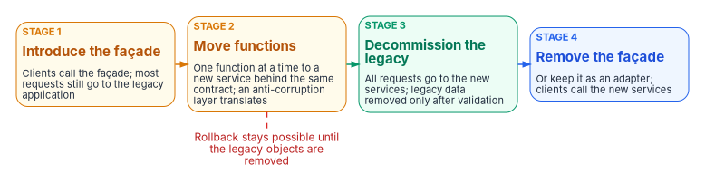

# Chapter 03 — The Target Reference Architecture

*Every application the agency changes should land on the same small set of technologies, connected by published contracts and replaced piece by piece, so that modernizing a portfolio doesn't create a new portfolio of one-off stacks.*

::: {.callout-note}
## In this chapter
The layers of the target reference architecture and the technology the program's design picks for each, with versions and support windows checked on the projects' own sites in October 2026. Why Java and Spring Boot for services, React for front ends and Node.js only where it fits. API-first contracts in OpenAPI. Containers, orchestration and twelve-factor configuration. The strangler-fig pattern that lets a legacy application be replaced in increments. And the two NIST publications that serve as the federal security references for this architecture.
:::

[Chapter 02](02-triaging-the-portfolio.md) sends the applications that need to change to refactor or rebuild, and some replatformed ones part of the way. If each of those projects picks its own language, framework and hosting model, the agency ends the decade with as many stacks as it started with, only newer. The point of a reference architecture is to make the common choices once, so that each project spends its effort on the mission logic, and so that the platform team, the security team and the authorizing official review one pattern instead of hundreds.

The technology choices below are the program's design, not a federal requirement; no federal policy names a language or framework. They are mainstream, well-supported open-source choices with long support windows and large labor pools, which is what a portfolio running for decades needs. An agency with an established alternative, .NET services for example, can keep the structure of this chapter and substitute its own approved list. Vendors and products appear as examples, not endorsements.

{#fig-ch03-reference-architecture fig-alt="A layered diagram, top to bottom. Top: a blue card, front ends, React 19, served as static assets, calls APIs only. Next row, two cards: a blue card, backend-for-frontend, Node.js LTS, one per front end where needed; and a blue card, API gateway, authentication, rate limits, routing, the strangler-fig façade. Next row, two cards: a blue card, domain services, Java 25 LTS and Spring Boot 4.1, each publishes an OpenAPI 3.2 contract; and a slate card, the legacy application, still serving the functions not yet moved. Next: a blue card, data, each service owns its schema, PostgreSQL or SQL Server, Chapter 04. Next: a blue card, platform, OCI images on Kubernetes, configuration from the environment, secrets from a vault or workload identity. At the bottom, joined to the platform by a dashed line, a violet card: security references, NIST SP 800-204 for microservices and SP 800-190 for containers. Arrows run from front ends to the backend-for-frontend and the gateway, from both to the services, from the gateway to the legacy application, and from services to data."}

## The layers and the choices

| Layer | Program's choice | Current release and support, October 2026 | Why |
|---|---|---|---|
| Services | Java on the current LTS release, with Spring Boot | Java 25 is the current LTS release (GA September 16, 2025); Java 27, GA September 15, 2026, is a feature release not on vendors' LTS lists. Spring Boot 4.1 is current (4.1.2), requires Java 17 or later and supports up to Java 27[^c03-jdk][^c03-msjdk][^c03-boot-req] | Large labor pool, long support windows, mature security and observability libraries |
| Front ends | React | React 19.3, released September 9, 2026[^c03-react] | Component model suits large form-heavy mission applications; wide skills base |
| Backend-for-frontend, build tooling, event glue | Node.js, only on an LTS release | Node.js 24 entered maintenance on October 20, 2026 (end of life April 30, 2028); Node.js 26 is scheduled to enter LTS on October 28, 2026 (end of life April 30, 2029); Node.js 22 reaches end of life April 30, 2027[^c03-node][^c03-node-sched] | Same language as the front end, for the thin layers that serve it |
| API contracts | OpenAPI, written before the code | OpenAPI Specification 3.2.1, dated September 10, 2026, a patch release of 3.2[^c03-oas] | A contract every team, tool and reviewer can read |
| Packaging | OCI container images | OCI Image Specification 1.1.1 and Distribution Specification 1.1.1 (2025); Runtime Specification 1.3.0 (November 2025)[^c03-oci][^c03-oci-rel] | Vendor-neutral format every major registry and runtime supports |
| Orchestration | Kubernetes, or a managed service built on it | Kubernetes 1.37 is the newest minor release; the project maintains the three most recent minor releases[^c03-k8s] | One deployment and scaling model across environments |
| Data | PostgreSQL or SQL Server | See [Chapter 04](04-moving-the-data.md) | The two targets this book supports for data off DB2 and Oracle |

Versions are a snapshot. The architecture review board in [Chapter 07](07-who-governs-the-architecture.md) owns the approved list and its upgrade dates; this table is the starting point, not the standard itself.

## Services: Java and Spring Boot

Java's long-term support releases are the backbone of the services layer. OpenJDK releases a new feature version every six months, and vendors designate some as long-term support: Java 25 is the current one, with the Microsoft Build of OpenJDK, for example, committing to support it until at least September 2030.[^c03-msjdk] Java 26 (March 2026) and Java 27 (September 2026) are feature releases.[^c03-jdk] The program's design is to build services on the current LTS release and move to the next one within a year of its release, not to chase each feature release.

Spring Boot sits on top. Its support windows are shorter than Java's and matter more day to day:

| Spring Boot generation | First release | Open-source support ends | Commercial support ends |
|---|---|---|---|
| 4.2.x | Scheduled November 2026 (release candidate available) | December 31, 2027 | December 31, 2028 |
| 4.1.x (current) | June 2026 | July 31, 2027 | July 31, 2028 |
| 4.0.x | November 2025 | December 31, 2026 | December 31, 2027 |
| 3.5.x | May 2025 | Ended June 30, 2026 | June 30, 2032 |

Source: Spring's project generations data.[^c03-boot-gen]

Two consequences follow. First, an application started on Spring Boot 3.5 is already outside open-source support and depends on commercial support for patches; one on 4.0 loses open-source support at the end of 2026. Second, each recent Spring Boot generation has had about thirteen months of open-source support, so a portfolio of Spring services needs an upgrade cadence built into the platform, not left to each project. Spring Boot 4.1 requires Java 17 at minimum, runs on Spring Framework 7 and supports up to Java 27, so the Java and Spring upgrades can be made independently.[^c03-boot-req]

Why Java for a federal services layer, and not something newer? Because the services layer is where the business rules of a refactored COBOL or PL/SQL application end up, and those rules will need maintaining for decades. The program values the size of the labor market, the length of the support windows, and the maturity of the security, transaction and observability libraries over novelty. Teams that convert COBOL to Java with automated tools should still treat the output as a starting point for the services in this layer, not as the target.

## Front ends: React

React is the front-end layer for new and rebuilt user interfaces. React 19 was released in December 2024, and 19.3 in September 2026.[^c03-react] The program's design keeps front ends thin: they render, validate input for usability, and call APIs. Business rules belong in services, where they are tested and authorized once, not in each user interface.

Federal front ends carry requirements that the framework doesn't solve on its own: Section 508 accessibility, the 21st Century IDEA criteria for public-facing services, and, for public sign-in, OMB's direction toward Login.gov. Those are covered where the workbook treats them; the workbook's [federal framework crosswalk](../../reference/federal-framework-crosswalk.md) summarizes their status. A shared component library that builds accessibility in once is worth more to a portfolio than any framework choice.

## Node.js where it fits

Node.js is in the architecture for three jobs, and the program's design keeps it to them.

- **Backend-for-frontend.** A thin service per front end that shapes data for that interface. The Azure Architecture Center describes the pattern: a separate backend for each frontend interface, tailored to its needs, managed by the frontend team, with cross-cutting concerns such as authorization and monitoring kept out of it.[^c03-bff] Writing it in the same language as the front end is the reason to use Node.js here.
- **Front-end build and tooling.** React builds run on Node.js whether or not anything runs on it in production.
- **Event glue.** Small integrations that react to messages or webhooks, where the logic is thin.

Domain logic belongs in the Java services. A backend-for-frontend that starts to hold business rules is a second services layer, and should be refactored into one.

Node.js has a predictable but changing schedule. Through Node.js 26, even-numbered releases became LTS and odd-numbered ones expired after six months. Starting with Node.js 27, the project moves to one major release a year, and every major version moves to LTS after its six-month Current phase; LTS typically means 30 months of critical fixes, and the project advises production applications to use only Active or Maintenance LTS releases.[^c03-node] Node.js 26 is scheduled to enter LTS on October 28, 2026, and Node.js 24 entered maintenance on October 20, 2026.[^c03-node-sched]

## API-first with OpenAPI

Every service publishes its contract before it publishes code. The contract is an OpenAPI document, currently version 3.2, in which the third number is reserved for patch releases that "address errors in, or provide clarifications to" the specification without changing its features.[^c03-oas] The program's design for contracts is:

- **Write the contract first,** review it with the consuming teams, and generate server stubs and client libraries from it.
- **Treat the contract as the interface the strangler-fig façade routes on.** A legacy function and its replacement can sit behind the same contract while the traffic moves.
- **Version deliberately.** Additive changes within a major version; a new major version, run side by side, for breaking ones.
- **Test against the contract** in the pipeline, so that a service can't ship a change that breaks its published interface. [Chapter 07](07-who-governs-the-architecture.md) makes this a review gate.
- **Publish contracts in a catalog** so the next project reuses an API instead of building a duplicate.

## Containers, orchestration and configuration

Services, backends-for-frontends and the façade are packaged as OCI container images. The Open Container Initiative, formed in June 2015 under the Linux Foundation, maintains the runtime, image and distribution specifications that make an image built by one tool run on another runtime and live in any compliant registry.[^c03-oci] Kubernetes, or a managed service built on it, runs them; the Kubernetes project maintains release branches for the three most recent minor releases, so clusters need an upgrade cadence of their own.[^c03-k8s]

Configuration follows the twelve-factor rule: anything that varies between deployments, such as database handles, credentials for external services and hostnames, is kept out of the code and supplied by the environment. Its litmus test is whether the code base could be made open source at any moment "without compromising any credentials."[^c03-12f] The program's design tightens this for secrets: the environment supplies a reference, and the secret itself comes from a managed secret store or, better, is replaced by a workload identity that needs no stored secret at all. [Book 17 Chapter 06](../b17-ai-identity/06-credentials-and-least-privilege.md) gives the credential order the workbook prefers.

Rehosted and replatformed applications can use the same platform without being refactored. A replatform that puts a legacy Java or .NET application into a container on the same orchestrator gains the platform's patching, logging and deployment pipeline even before its code changes.

## Replacing incrementally: the strangler fig

The strangler-fig pattern is how a refactor actually happens. Martin Fowler's account describes building new functionality alongside the legacy system and moving behavior over piece by piece until the old system can be retired, arguing that the transitional code this requires is worth its cost in lower risk and earlier value.[^c03-fowler] The Azure Architecture Center gives the mechanics: a façade (proxy) intercepts requests to the legacy back end and routes each either to the legacy application or to the new services; as functions move, the façade shifts traffic; when nothing depends on the legacy system it is decommissioned, and finally the façade itself can be removed.[^c03-strangler]

{#fig-ch03-strangler-fig fig-alt="Four stages left to right, each a card. Stage 1, amber: introduce the façade; clients call the façade, which sends most requests to the legacy application. Stage 2, amber: move functions; each function moves to a new service behind the same contract, and an anti-corruption layer translates between old and new. Stage 3, green: decommission the legacy application; all requests go to the new services and the legacy data is removed only after validation. Stage 4, blue: remove the façade or keep it as an adapter; clients call the new services directly. A red note under stage 2 reads: rollback stays possible until the legacy objects are removed."}

The same page lists the considerations that decide whether a refactor is feasible, and they belong in the deep study rule 7 of Chapter 02's decision table calls for:

- **Requests must be interceptable.** If the legacy back end can't be put behind a façade, and the agency can't change its source code or any other integration point such as its database, the pattern doesn't fit.[^c03-strangler]
- **Shared data needs a plan.** The new and legacy systems may need the same data stores at once. The Azure page's database example extracts one domain at a time, copies its data with an extract, transform and load step, keeps it in sync with change data capture, validates consistency and only then makes the new database the system of record.[^c03-strangler] [Chapter 04](04-moving-the-data.md) covers this in detail.
- **Cross-calls need an anti-corruption layer,** an adapter that translates between the two systems so that legacy conventions don't leak into the new design.[^c03-strangler]
- **The façade must not become the bottleneck** or a single point of failure, and it has to keep pace with the migration.
- **Rollback has an end.** Rollback stays practical until the legacy tables and procedures for a domain are removed; removing them is a deliberate last step.[^c03-strangler]
- **Small systems may not need it.** When replacing the whole system is simple, the pattern adds cost without much benefit.[^c03-strangler]

For a mainframe application, the façade is often an API layer in front of transactions that already exist, so that new front ends and services can call the legacy functions through the same contracts they will later call on the replacements.

## The federal security references

Two NIST publications are the security references for this architecture. Neither is a requirement in itself; they are guidance agencies draw on when selecting and implementing SP 800-53 controls for these systems, which [Chapter 06](06-compliance-by-design.md) maps.

| Publication | Date | What it covers | Where it bites in this architecture |
|---|---|---|---|
| NIST SP 800-204, *Security Strategies for Microservices-based Application Systems* | August 2019 | Authentication and access management, service discovery, secure communication, monitoring, resiliency, load balancing and session handling for microservices; how API gateways and service meshes package them[^c03-sp800204] | The gateway, service-to-service authentication, the façade |
| SP 800-204A, *Building Secure Microservices-based Applications Using Service-Mesh Architecture* | May 2020 | Service mesh deployment guidance[^c03-sp800204x] | Service-to-service traffic if a mesh is used |
| SP 800-204B, *Attribute-based Access Control for Microservices-based Applications using a Service Mesh* | August 2021 | Authorization policy in the mesh[^c03-sp800204x] | Fine-grained authorization between services |
| SP 800-204C, *Implementation of DevSecOps for a Microservices-based Application with Service Mesh* | March 2022 | DevSecOps pipelines for this kind of application[^c03-sp800204x] | The pipeline and its evidence ([Chapter 07](07-who-governs-the-architecture.md)) |
| SP 800-204D, *Strategies for the Integration of Software Supply Chain Security in DevSecOps CI/CD Pipelines* | February 2024 | Supply chain security in the pipeline[^c03-sp800204x] | Image signing, SBOMs, provenance ([Chapter 06](06-compliance-by-design.md)) |
| NIST SP 800-190, *Application Container Security Guide* | September 2017 | Major risks for images, registries, orchestrators, containers and host operating systems, and countermeasures for each, plus hardware countermeasures[^c03-sp800190] | Image build and scanning, the registry, the cluster and its nodes |

The CSRC pages for SP 800-204 and SP 800-190 list no newer revision or draft as of October 2026.[^c03-sp800204][^c03-sp800190-page] SP 800-190 predates several current practices, but its five risk areas still map cleanly onto the platform layer, and SP 800-204D covers much of the supply chain ground it doesn't.

## How the dispositions use the architecture

| Disposition | What it takes from this chapter |
|---|---|
| Retire | Nothing, except that any function that moves elsewhere is reached through a published API |
| Retain | Optionally, an API façade in front of it so new applications don't integrate directly with its internals |
| Rehost | The platform, where the application can run in a container; otherwise nothing |
| Replatform | The platform layer and, for the database, [Chapter 04](04-moving-the-data.md) |
| Refactor | All of it, introduced through the strangler-fig façade one function at a time |
| Rebuild | All of it, still delivered in increments behind contracts |

[Chapter 08](08-the-reference-implementation.md) describes a small runnable implementation of this architecture that ships with the book.

## Honest limits

- **The stack is the program's choice.** No federal requirement names Java, Spring Boot, React, Node.js or Kubernetes. What federal policy requires is an enterprise architecture with a target and a transition plan, and the phase-out of unsupported components; this chapter is one way to define the target.
- **The versions will move.** Every version in this chapter was checked on the project's own site on October 28, 2026. Spring Boot 4.0 loses open-source support at the end of 2026, Node.js release lines change this month, and Kubernetes ships a minor release approximately three times a year.[^c03-k8s-cycle] The approved list has to be maintained, not published once.
- **Not every application fits.** Packaged commercial software, mainframe workloads that are being retained and small applications that are simpler to replace whole won't take this shape, and shouldn't be forced to.

## What leadership should take from this

1. **Approve one target, and a way to change it.** The value is in everyone using the same stack; the risk is in the stack aging. Give the architecture review board both the list and the duty to keep it current.
2. **Fund the upgrade cadence.** Recent Spring Boot generations get about thirteen months of open-source support, and Node.js and Kubernetes move on clocks of their own. Budget for platform upgrades as recurring work, or the modernized portfolio becomes the next legacy one.
3. **Ask how each refactor will be strangled.** A refactor proposal should name its façade, its first function to move, how shared data will be handled and when rollback ends.

[Chapter 04](04-moving-the-data.md) takes up the hardest part of most refactors: the data.

::: {.callout-tip}
## Continue the book
[← Previous: Chapter 02 — Triaging the Portfolio](02-triaging-the-portfolio.md) · [Book index](index.md) · [Next: Chapter 04 — Moving the Data: DB2 and Oracle to PostgreSQL or SQL Server →](04-moving-the-data.md)
:::

[^c03-jdk]: OpenJDK, "JDK Project," list of releases and GA dates (JDK 25, September 16, 2025; JDK 26, March 17, 2026; JDK 27, September 15, 2026; JDK 28 in development), <https://openjdk.org/projects/jdk/> (accessed Oct 28, 2026).
[^c03-msjdk]: Microsoft Learn, "Support roadmap for the Microsoft Build of OpenJDK," release and servicing roadmap (OpenJDK 25 LTS, earliest end of support September 2030), <https://learn.microsoft.com/java/openjdk/support> (accessed Oct 28, 2026).
[^c03-boot-req]: Spring Boot reference documentation, "System Requirements" (Spring Boot 4.1.2), <https://docs.spring.io/spring-boot/system-requirements.html> (accessed Oct 28, 2026).
[^c03-boot-gen]: Spring, project generations for Spring Boot (initial release, open-source and commercial support end dates), <https://spring.io/projects/generations>, data read from the Spring projects API, <https://api.spring.io/projects/spring-boot/generations>; current release 4.1.2 and 4.2.0-RC1 from <https://api.spring.io/projects/spring-boot/releases> (accessed Oct 28, 2026).
[^c03-react]: React, "React Versions," changelog (v19.0.0, December 5, 2024; v19.3.0, September 9, 2026), <https://react.dev/versions> (accessed Oct 28, 2026).
[^c03-node]: Node.js, "Node.js Releases," release status table and release schedule notes, <https://nodejs.org/en/about/previous-releases> (accessed Oct 28, 2026).
[^c03-node-sched]: Node.js Release Working Group, `schedule.json` (start, LTS, maintenance and end dates for v22, v24, v26 and v27), <https://github.com/nodejs/Release/blob/main/schedule.json> (accessed Oct 28, 2026).
[^c03-oas]: OpenAPI Initiative, *OpenAPI Specification v3.2.1*, September 10, 2026, Section 2.1 (Versions), <https://spec.openapis.org/oas/v3.2.1.html>; version index <https://spec.openapis.org/oas/> (accessed Oct 28, 2026).
[^c03-oci]: Open Container Initiative, "About the Open Container Initiative," <https://opencontainers.org/about/overview/> (accessed Oct 28, 2026).
[^c03-oci-rel]: Open Container Initiative, release pages for the image specification (v1.1.1, March 3, 2025), distribution specification (v1.1.1, January 29, 2025) and runtime specification (v1.3.0, November 4, 2025), <https://github.com/opencontainers/image-spec/releases>, <https://github.com/opencontainers/distribution-spec/releases>, <https://github.com/opencontainers/runtime-spec/releases> (accessed Oct 28, 2026).
[^c03-k8s]: Kubernetes, "Releases," <https://kubernetes.io/releases/> (accessed Oct 28, 2026).
[^c03-k8s-cycle]: Kubernetes, "Kubernetes Release Cycle," <https://kubernetes.io/releases/release/> (accessed Oct 28, 2026).
[^c03-bff]: Microsoft Learn, Azure Architecture Center, "Backends for Frontends pattern," <https://learn.microsoft.com/azure/architecture/patterns/backends-for-frontends> (accessed Oct 28, 2026).
[^c03-12f]: Adam Wiggins, *The Twelve-Factor App*, "III. Config," <https://12factor.net/config> (accessed Oct 28, 2026).
[^c03-fowler]: Martin Fowler, "Strangler Fig," August 22, 2024, <https://martinfowler.com/bliki/StranglerFigApplication.html> (accessed Oct 28, 2026).
[^c03-strangler]: Microsoft Learn, Azure Architecture Center, "Strangler Fig pattern," Solution, Problems and considerations, When to use this pattern, and Example, <https://learn.microsoft.com/azure/architecture/patterns/strangler-fig> (accessed Oct 28, 2026).
[^c03-sp800204]: National Institute of Standards and Technology, SP 800-204, *Security Strategies for Microservices-based Application Systems*, August 2019, abstract and document history, <https://csrc.nist.gov/pubs/sp/800/204/final> (accessed Oct 28, 2026).
[^c03-sp800204x]: National Institute of Standards and Technology, SP 800-204A (May 2020), <https://csrc.nist.gov/pubs/sp/800/204/a/final>; SP 800-204B (August 2021), <https://csrc.nist.gov/pubs/sp/800/204/b/final>; SP 800-204C (March 2022), <https://csrc.nist.gov/pubs/sp/800/204/c/final>; SP 800-204D (February 2024), <https://csrc.nist.gov/pubs/sp/800/204/d/final> (all accessed Oct 28, 2026).
[^c03-sp800190]: National Institute of Standards and Technology, SP 800-190, *Application Container Security Guide*, September 2017, Sections 3 and 4, <https://nvlpubs.nist.gov/nistpubs/SpecialPublications/NIST.SP.800-190.pdf> (accessed Oct 28, 2026).
[^c03-sp800190-page]: National Institute of Standards and Technology, SP 800-190 publication page, document history, <https://csrc.nist.gov/pubs/sp/800/190/final> (accessed Oct 28, 2026).
