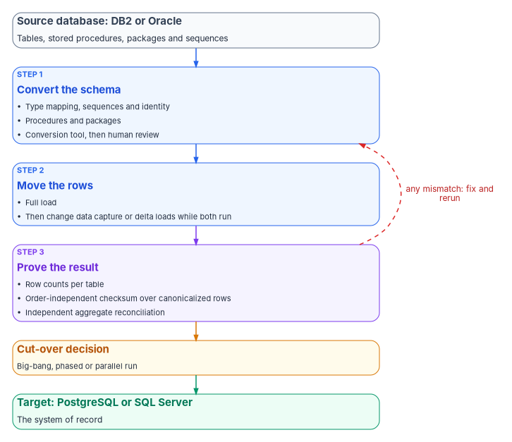
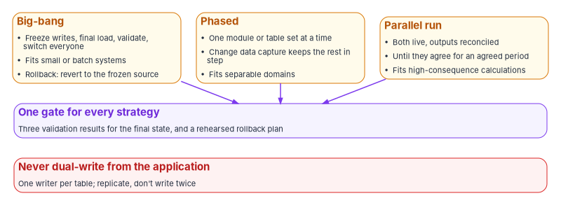

# Chapter 04 — Moving the Data: DB2 and Oracle to PostgreSQL or SQL Server

*Code can be replaced a piece at a time; data moves once, and the move isn't finished until someone can prove that nothing was lost.*

::: {.callout-note}
## In this chapter
How to choose between PostgreSQL and SQL Server as the target engine. What schema conversion involves (type mapping, sequences, stored procedures and packages) and what the main conversion tools support as of October 2026. Three independent ways to prove the data arrived intact, and why one is never enough. The cut-over strategies, and how change data capture lets old and new run side by side without the dual-write trap. Identity and authentication for a SQL Server target are in Book 06, and this chapter points there rather than repeating them.
:::

Most applications that [Chapter 02](02-triaging-the-portfolio.md) sends to replatform, refactor or rebuild sit on a database that also has to move. In a federal portfolio that database is often DB2, on the mainframe or on Linux, UNIX and Windows, or Oracle, carrying decades of stored procedures, packages, triggers and data whose meaning lives partly in the code around it. A rehosted application can keep its database. Every other disposition that changes the application eventually changes where its data lives.

The data move is where modernization projects lose the most trust. A defect in a rewritten screen is visible the day it ships; a row that didn't arrive, or a date that lost its time of day, may not surface until a beneficiary's record is wrong months later. The program's design therefore treats the data move as a sequence of three jobs, each with its own evidence: convert the schema, move the rows, and prove the result.

{#fig-ch04-convert-move-prove fig-alt="A top-to-bottom flow. A slate card at the top: the source database, DB2 or Oracle, with tables, stored procedures, packages and sequences. A blue arrow leads to a blue card, Convert the schema: type mapping, sequences and identity, procedures and packages, using a conversion tool and then human review. Next a blue card, Move the rows: a full load, then change data capture or delta loads while both systems run. Next a violet card, Prove the result, with three items: row counts per table, an order-independent checksum over canonicalized rows, and an independent aggregate reconciliation. An amber card, Cut-over decision, follows, offering big-bang, phased or parallel run. A green card at the bottom: the target, PostgreSQL or SQL Server, as the system of record. A dashed red arrow from Prove the result back to Convert the schema is labeled any mismatch: fix and rerun."}

## Choosing the target engine

The book's target architecture ([Chapter 03](03-the-target-reference-architecture.md)) allows two relational targets. Both are mature, and the choice is usually settled by what the agency already runs and what the application's code assumes, not by features.

| Factor | PostgreSQL | SQL Server |
|---|---|---|
| Current release, October 2026 | PostgreSQL 18, first released September 25, 2025 and supported to November 14, 2030; PostgreSQL 19 is at release candidate 1 (October 15, 2026)[^c04-pg-versions] | SQL Server 2025 (17.x), alongside 2022 and 2019, as targets of Microsoft's migration assistant[^c04-ssma] |
| Support model | Each major version supported for five years after first release; PostgreSQL 14 receives no fixes after November 12, 2026[^c04-pg-versions] | Microsoft's product lifecycle |
| Typical fit (program design) | Oracle sources with PL/SQL that converts well to PL/pgSQL; agencies standardizing on open-source engines or managed PostgreSQL services | Agencies with an established SQL Server estate and its operations, licensing and skills; Db2 and Oracle sources where Microsoft's tooling is preferred |
| Identity and authentication | Engine and platform specific; part of the application's design in [Chapter 03](03-the-target-reference-architecture.md) | The program's SQL Server identity work in Book 06 applies in full (see below) |

Two practical points follow from the table. First, a migration that targets PostgreSQL 14 now lands on a version that leaves community support within weeks; a new target should be PostgreSQL 18, or 19 once it is released and the agency's platform supports it. Second, the choice of engine also chooses the conversion tooling, because no single tool covers every source and target pair, as the tools table below shows.

## Converting the schema

Schema conversion is the part a tool does well and a person must still check. The tools convert tables, views, indexes and most procedural code mechanically, and report what they couldn't convert. What they can't do is know which differences in behavior the application depends on.

### Type mapping: where meaning changes silently

The dangerous conversions are the ones that succeed. A few examples from Oracle show the pattern; each source engine has its own list.

| Source behavior | Why it matters on the target |
|---|---|
| Oracle `DATE` stores year, month, day, hour, minute and second, with no fractional seconds or time zone[^c04-ora-types] | PostgreSQL's `date` type holds no time of day; mapping Oracle `DATE` to it silently drops the time. The faithful mapping is a timestamp type, for example `timestamp(0) without time zone`[^c04-pg-datetime] |
| Oracle `NUMBER(p,s)` allows a precision of 1 to 38 and a scale of −84 to 127[^c04-ora-types] | Mapping to a floating-point type loses exactness; money and counts belong in an exact numeric type on the target |
| Oracle treats a character value of length zero as null, and itself recommends against relying on that[^c04-ora-nulls] | PostgreSQL and SQL Server distinguish an empty string from a null, so queries that test `IS NULL` can return different rows after migration unless the data or the code is normalized |
| Sort order depends on collation | AWS documents that if the target PostgreSQL primary key collation isn't "C", sort order differs from Oracle's and its row-by-row validation fails[^c04-dms-validation]; the same difference can change application paging and reports |
| Sequences generate key values | Both PostgreSQL and SQL Server have sequence objects, and neither guarantees gapless numbers: values consumed by rolled-back transactions or lost from a cache leave holes[^c04-pg-sequence][^c04-mssql-sequence] |

The sequence row has a cut-over consequence. After the load, each target sequence must be advanced past the highest migrated key before the first new insert, or the new system will issue keys that already exist. And any business number that must be gapless, such as a form or case number with legal meaning, can't be generated from a sequence on either engine; it needs its own counter.

### Stored procedures and packages

PL/SQL and DB2 SQL PL convert to PL/pgSQL or to Transact-SQL with varying success. Oracle packages are the hardest case, because PostgreSQL has no package object. Conversion tools emulate them: in AWS's conversion, a package's members become schema-qualified functions named in the form `package$member`, and package-level variables are held and read through helper functions in an extension-pack schema (`aws_oracle_ext` for Oracle sources).[^c04-pg-pkg][^c04-sct-ext] Microsoft's migration assistant likewise adds a schema of emulation functions to the target.[^c04-ssma-db2]

Emulation is a reasonable bridge and a poor destination. Converted code that calls an extension pack depends on that vendor's helper schema for as long as it runs, and an emulated package behaves like a package only as far as the emulation goes. The program's design is to record every call into an emulation schema as technical debt in the application's record and pay it down during refactoring, which is also when business logic buried in procedures can move into the service layer that [Chapter 03](03-the-target-reference-architecture.md) describes.

### The conversion tools, October 2026

| Tool | Sources | Targets | Notes as of October 2026 |
|---|---|---|---|
| AWS Schema Conversion Tool (desktop) | Oracle 10.1 and later; Db2 LUW 9.1 to 11.5; Db2 for z/OS 12; SQL Server; others | PostgreSQL and Aurora PostgreSQL, MySQL and others (Oracle can also target Oracle) | AWS states the tool is FedRAMP compliant; no end-of-support notice found[^c04-sct] |
| AWS DMS Schema Conversion (managed) | Oracle, Db2 for LUW, Db2 for z/OS (API and CLI only), SQL Server, SAP ASE | Aurora PostgreSQL or RDS for PostgreSQL (and some MySQL and Redshift paths) | Built on the SCT conversion engine; generative AI conversion offered on the PostgreSQL paths from Oracle and both Db2 platforms, using cross-Region inference; the published Region table lists no AWS GovCloud (US) Region[^c04-dmssc] |
| SQL Server Migration Assistant for Db2 | Db2 on z/OS 9.0 and later, Db2 LUW 9.8 and later, Db2 for i 7.1 and later | SQL Server 2019, 2022 and 2025; Azure SQL Database; Azure SQL Managed Instance | Current release v10.6[^c04-ssma][^c04-ssma-db2] |
| SQL Server Migration Assistant for Oracle | Oracle | Same targets | Current release v10.6; AI-assisted conversion ("Copilot") generally available since v10.4, using the agency's own Azure OpenAI resource or a Microsoft-managed endpoint with Entra ID sign-in; Microsoft says generated code must be reviewed, validated and tested[^c04-ssma-ora] |
| Ora2Pg (open source, GPL v3) | Oracle; MySQL and MariaDB; SQL Server | PostgreSQL | Version 25.0 (April 20, 2025); migration cost assessment and a diff between source and target "for test purposes"; no DB2 source[^c04-ora2pg] |

Three things in that table shape an agency's plan. Only AWS's tools convert DB2 to PostgreSQL; a DB2 estate headed for PostgreSQL without them needs another tool or hand conversion. Microsoft's assistant targets only SQL Server and Azure SQL. And the AI-assisted options send source code to a model service, which makes the model endpoint, its region and its authorization part of the migration's boundary, the same question [Chapter 05](05-generative-and-agentic-ai.md) asks of any AI feature. The program treats AI-converted code exactly as Microsoft describes it: a draft that a person reviews, and that the validation below tests.

## Proving that nothing was lost

A migration is complete when the agency can show that the target holds the same facts as the source. No single check shows that, because each check shares some assumption with the process it is checking. The program's design uses three, chosen so that their blind spots don't overlap.

| Check | What it catches | What it can miss |
|---|---|---|
| Row counts per table | Missing or duplicated rows; tables skipped entirely | Rows that arrived with wrong values |
| Checksum over canonicalized rows | Any value that differs after canonical formatting; computed order-independently, it doesn't depend on sort order or collation | Errors in the transformation itself, if the checksum is computed after the transform and so shares its assumptions |
| Independent aggregate reconciliation | Business-level differences, such as totals of amounts and counts per status code computed separately on each side | Offsetting errors that cancel in an aggregate |

The third check exists because of the second's limit. If the transform maps Oracle `DATE` to a date-only type, a checksum computed over the transformed rows agrees with the target perfectly, and both are wrong. An aggregate written directly against each database in its own SQL, such as a sum of payment amounts and a count of records per status code, doesn't pass through the transform and so catches what the checksum can't. Choose aggregates the business owner recognizes; a program office that knows its monthly totals can judge a reconciliation in a way it can't judge a hash.

This is what the book's reference implementation does. Its DB2 and Oracle to PostgreSQL migration command validates every run with per-table row counts, an order-independent SHA-256 checksum over canonicalized rows (computed after the transform, so it shares the transform's assumptions, as the table says) and an independent SQL aggregate reconciliation (the sum of amounts and the count per status code on each side). [Chapter 08](08-the-reference-implementation.md) describes it.

Commercial tools do some of this work. AWS Database Migration Service, for example, validates by comparing each source row with its corresponding target row after a full load, and validates changes as they occur during change data capture; it writes mismatches to a control table on the target and offers validation-only tasks that can be run just before or during a cut-over window to count how many rows don't match at that moment.[^c04-dms-validation] Its documented limits are a useful checklist for any tool: validation needs a primary key or unique index on each table; it doesn't validate views or Oracle `LONG` columns; rows modified continuously during validation can't be validated; writes to the target from outside the migration make results unreliable; and validation stops when it finds more than 10,000 failed or suspended records.[^c04-dms-validation] A tool's row comparison is strong evidence for the second check. It isn't the third, because it compares what the tool moved, not what the business counts.

The program keeps the three results with the cut-over decision. Each validation run produces a report naming the source and target, the time, the tables, the three results and every mismatch, and that report is the evidence the review gates in [Chapter 07](07-who-governs-the-architecture.md) examine before cut-over and the change record in [Chapter 06](06-compliance-by-design.md) retains.

## Cutting over

Three strategies cover most applications. The choice belongs to the application's owner and its authorizing official, informed by how long the business can tolerate a freeze and how much it costs to run two systems.

{#fig-ch04-cutover-options fig-alt="Three amber cards side by side. Big-bang: freeze writes, run a final load, validate and switch everyone; fits small or batch systems; rollback means reverting to the frozen source. Phased: one module or table set at a time, with change data capture keeping the rest in step; fits separable domains. Parallel run: both systems live with outputs reconciled until they agree for an agreed period; fits high-consequence calculations. Arrows from all three lead to a wide violet card, One gate for every strategy: three validation results for the final state and a rehearsed rollback plan. Below it, a wide red card: never dual-write from the application; one writer per table; replicate, don't write twice."}

| Strategy | How it works | Fits | Main risk |
|---|---|---|---|
| Big-bang | Freeze writes, run a final load, validate, switch every user at once | Smaller systems, batch systems, or any system with an outage window the business accepts | The validation must finish inside the window; a failure means reverting to the frozen source |
| Phased | Move one module, domain or table set at a time behind the application's interfaces, the data counterpart of the strangler-fig approach in [Chapter 03](03-the-target-reference-architecture.md) | Large systems whose domains can be separated | Cross-domain joins and transactions during the interim; each phase needs its own validation |
| Parallel run | Run old and new on the same inputs and reconcile outputs until they agree for an agreed period | Calculations with legal or financial consequence, such as eligibility or payment amounts | Cost and operational load of two live systems; deciding which result governs while they differ |

Every strategy ends at the same gate: the three validation results for the final state, and a rollback plan that has been rehearsed. For a parallel run, the program's design names the source as the system of record until the gate is passed, so that a disagreement is always resolved in one direction.

## Coexistence without dual writes

Phased and parallel strategies need the source and target to stay in step for weeks or months. There are two ways to do that, and only one of them is safe by default.

**Change data capture** reads committed changes from the source database's own log and applies them to the target. AWS DMS, for example, reads Oracle changes through LogMiner or its binary reader, and SQL Server changes through replication or SQL Server change data capture.[^c04-dms-cdc] Because it reads committed transactions from the log, the target can lag but can't receive a change the source rejected. Two cautions apply. AWS states that its change data capture "does not provide real-time replication," with no service-level agreement for latency, which can grow to minutes or more.[^c04-dms-cdc] And not every source supports it: for Db2 for z/OS as a source, AWS DMS supports only full-load tasks, and change data capture isn't supported.[^c04-dms-db2zos] A mainframe DB2 system that must coexist with its replacement therefore needs a separate change-capture product, or periodic delta loads keyed on a reliable change timestamp. The reference implementation's `--since` delta mode is an example of the second approach ([Chapter 08](08-the-reference-implementation.md)).

**Dual writes**, in which the application writes every change to both databases, look simpler and fail in a specific way. Microsoft's architecture guidance states the problem plainly: the two writes "don't share a transaction," so if only one completes, each store holds records the other lacks.[^c04-dual-write] Under load, with retries and partial failures, the two databases drift, and the drift is invisible until reconciliation finds it. Replication between two writable copies doesn't remove the problem: AWS describes its own bidirectional replication as not "a full multi-master solution," with no conflict detection or resolution, suited only where each data element is changed on one side.[^c04-dms-cdc]

The program's design follows from both points:

1. **One system of record per table at a time.** During coexistence, each table is written in one place and replicated to the other. The authority moves table by table at each phase's gate, never by letting both sides accept writes.
2. **No application dual writes.** Where a new service must publish a change to another store, it writes once, in one transaction, and publishes from there, either through a transactional outbox, which saves the business record and its event in the same database transaction and relays the event afterward,[^c04-outbox] or through change data capture.
3. **Fallback by reverse replication.** After cut-over, changes can be replicated from the new system back to the old for an agreed period, so that rollback doesn't lose the days since the switch. The reversed direction keeps the one-writer rule.
4. **Validate continuously, not once.** During coexistence the three checks run on a schedule, so that drift is found while it is small.

## When the target is SQL Server

An application whose data lands in SQL Server inherits all of the program's SQL Server identity work, and none of it is repeated here. [Book 06](../b06-data-platform/index.md) is that work: how the engine authenticates logins and the program's positions on SQL Authentication and the parallel run ([Book 06, Chapter 12](../b06-data-platform/12-the-engine-authentication-decision.md)), and how the application's connection string moves to Microsoft Entra authentication as the last step of the application chain ([Book 06, Chapter 19](../b06-data-platform/19-connection-string-migration.md)). A migrated application should arrive at its SQL Server target already using the connection pattern Book 06 ends with, rather than carrying a SQL login across and migrating it later. Microsoft's migration assistant itself supports Microsoft Entra authentication to the target.[^c04-ssma-db2]

## Honest limits

- **The tool facts move.** Supported versions, AI features and Region availability in the tools table were checked in October 2026 on each vendor's documentation. Check them again before a plan depends on them, particularly Region availability in the government clouds.
- **Examples, not endorsements.** The tools named are examples of each category. Other commercial and open-source tools exist, including change-capture products for mainframe DB2.
- **Validation proves equivalence, not correctness.** Three matching checks show the target holds what the source held. If the source held wrong data, the target now holds the same wrong data. Data-quality remediation is a separate decision, and doing it during the move makes reconciliation harder.
- **Procedural logic is the long pole.** Row movement is predictable. Converting and testing thousands of stored procedures isn't, and the conversion tools' assessment reports are the best early estimate of that effort.

## What leadership should take from this

1. **Ask for the three results.** Before any cut-over, ask to see row counts, a checksum and a reconciliation of totals the business recognizes, for the final state, with every mismatch explained.
2. **Forbid dual writes.** Coexistence runs through change data capture or delta loads with one writer per table. A plan that has the application write to both databases is a plan for drift.
3. **Pick the engine with the tools in view.** The target engine decides which conversion tools apply, and for DB2 sources the options are narrow. Settle the engine before the wave plan in [Chapter 10](10-running-the-portfolio-in-waves.md) commits dates.

[Chapter 05](05-generative-and-agentic-ai.md) turns to the newest component of the target architecture: generative and agentic AI.

::: {.callout-tip}
## Continue the book
[← Previous: Chapter 03 — The Target Reference Architecture](03-the-target-reference-architecture.md) · [Book index](index.md) · [Next: Chapter 05 — Generative and Agentic AI in the Architecture →](05-generative-and-agentic-ai.md)
:::

[^c04-pg-versions]: PostgreSQL Global Development Group, "Versioning Policy," supported versions table and support policy, <https://www.postgresql.org/support/versioning/>; and PostgreSQL home page, latest releases (PostgreSQL 19 RC 1, October 15, 2026; PostgreSQL 14 end of life), <https://www.postgresql.org/> (both accessed Oct 28, 2026).
[^c04-ssma]: Microsoft Learn, "SQL Server Migration Assistant," migration sources and supported target versions, <https://learn.microsoft.com/en-us/sql/ssma/sql-server-migration-assistant> (accessed Oct 28, 2026).
[^c04-ora-types]: Oracle, *Oracle Database SQL Language Reference 23ai*, "Data Types," built-in data type summary (DATE; NUMBER precision and scale), <https://docs.oracle.com/en/database/oracle/oracle-database/23/sqlrf/Data-Types.html> (accessed Oct 28, 2026).
[^c04-pg-datetime]: PostgreSQL 18 Documentation, "8.5. Date/Time Types," Table 8.9, <https://www.postgresql.org/docs/current/datatype-datetime.html> (accessed Oct 28, 2026).
[^c04-ora-nulls]: Oracle, *Oracle Database SQL Language Reference 23ai*, "Nulls," <https://docs.oracle.com/en/database/oracle/oracle-database/23/sqlrf/Nulls.html> (accessed Oct 28, 2026).
[^c04-dms-validation]: Amazon Web Services, *AWS Database Migration Service User Guide*, "AWS DMS data validation," including Validation only tasks, Enhanced data validation and Limitations, <https://docs.aws.amazon.com/dms/latest/userguide/CHAP_Validating.html> (accessed Oct 28, 2026).
[^c04-pg-sequence]: PostgreSQL 18 Documentation, "CREATE SEQUENCE," Description and Notes, <https://www.postgresql.org/docs/current/sql-createsequence.html> (accessed Oct 28, 2026).
[^c04-mssql-sequence]: Microsoft Learn, "Sequence numbers," Overview and Limitations, <https://learn.microsoft.com/en-us/sql/relational-databases/sequence-numbers/sequence-numbers> (accessed Oct 28, 2026).
[^c04-pg-pkg]: Amazon Web Services, AWS Prescriptive Guidance, "Migrate Oracle SERIALLY_REUSABLE Pragma packages into Amazon Aurora or Amazon RDS for PostgreSQL," Additional information (converted package code), <https://docs.aws.amazon.com/prescriptive-guidance/latest/patterns/migrate-oracle-serially-reusable-pragma-packages-into-postgresql.html> (accessed Oct 28, 2026).
[^c04-sct-ext]: Amazon Web Services, *AWS Schema Conversion Tool User Guide*, "Using extension packs with AWS Schema Conversion Tool," <https://docs.aws.amazon.com/SchemaConversionTool/latest/userguide/CHAP_ExtensionPack.html> (accessed Oct 28, 2026).
[^c04-ssma-db2]: Microsoft Learn, "Install SSMA for Db2 client (Db2ToSQL)," Prerequisites and SSMA for Db2 Extension Pack, <https://learn.microsoft.com/en-us/sql/ssma/db2/installing-ssma-for-db2-client-db2tosql>; and "What's new in SSMA for Db2 (Db2ToSQL)," v8.5 through v10.6, <https://learn.microsoft.com/en-us/sql/ssma/db2/what-s-new-in-ssma-for-db2-db2tosql> (both accessed Oct 28, 2026).
[^c04-sct]: Amazon Web Services, *AWS Schema Conversion Tool User Guide*, "What is the AWS Schema Conversion Tool?," OLTP conversions table, <https://docs.aws.amazon.com/SchemaConversionTool/latest/userguide/CHAP_Welcome.html> (accessed Oct 28, 2026).
[^c04-dmssc]: Amazon Web Services, *AWS Database Migration Service User Guide*, "Converting database schemas using DMS Schema Conversion," How it works, Supported conversion paths and Supported AWS Regions, <https://docs.aws.amazon.com/dms/latest/userguide/CHAP_SchemaConversion.html> (accessed Oct 28, 2026).
[^c04-ssma-ora]: Microsoft Learn, "What's new in SSMA for Oracle (OracleToSQL)," v10.2 through v10.6, <https://learn.microsoft.com/en-us/sql/ssma/oracle/what-s-new-in-ssma-for-oracle-oracletosql>; and "What is Microsoft Copilot in SSMA for Oracle (OracleToSQL)?," Prerequisites and Review and validation, <https://learn.microsoft.com/en-us/sql/ssma/oracle/copilot-in-ssma-overview> (both accessed Oct 28, 2026).
[^c04-ora2pg]: Ora2Pg, home page and "Features," <https://ora2pg.darold.net/> and <https://ora2pg.darold.net/docs/features>; and Ora2Pg releases, <https://github.com/darold/ora2pg/releases> (all accessed Oct 28, 2026).
[^c04-dms-cdc]: Amazon Web Services, *AWS Database Migration Service User Guide*, "Creating tasks for ongoing replication using AWS DMS," including Performing bidirectional replication and its limitations, <https://docs.aws.amazon.com/dms/latest/userguide/CHAP_Task.CDC.html> (accessed Oct 28, 2026).
[^c04-outbox]: Microsoft Learn, Azure Architecture Center, "Implement the Transactional Outbox pattern by using Azure Cosmos DB," Overview and Solution, <https://learn.microsoft.com/en-us/azure/architecture/databases/guide/transactional-out-box-cosmos> (accessed Oct 28, 2026).
[^c04-dms-db2zos]: Amazon Web Services, *AWS Database Migration Service User Guide*, "Using IBM Db2 for z/OS databases as a source for AWS DMS," Limitations, <https://docs.aws.amazon.com/dms/latest/userguide/CHAP_Source.DB2zOS.html> (accessed Oct 28, 2026).
[^c04-dual-write]: Microsoft Learn, Azure Architecture Center, "Scheduler Agent Supervisor pattern," Problems and considerations (dual-write issue), <https://learn.microsoft.com/en-us/azure/architecture/patterns/scheduler-agent-supervisor> (accessed Oct 28, 2026).
