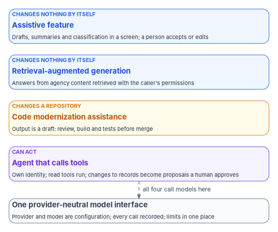

# Chapter 05 — Generative and Agentic AI in the Architecture

*A model is a component behind an interface, and an agent is an identity with an owner, a short list of tools and no power to change a record on its own.*

::: {.callout-note}
## In this chapter
The four places generative AI fits in a modernized application, and what each can change. Why the architecture calls models through one provider-neutral interface. The guardrails every agent needs, and how the book's reference implementation shows them. The Model Context Protocol as an example of a tool protocol, and what it does and doesn't enforce. The OWASP, NIST and CISA material behind the design. The federal AI rules and the identity of AI systems are covered in Book 17; this chapter links there rather than repeating them.
:::

The target architecture in [Chapter 03](03-the-target-reference-architecture.md) is built from services with contracts. Generative AI fits that architecture best when it is treated the same way: a capability behind an interface, called by a service that owns the business rules, with the model's output treated as input to be checked rather than as a decision. Agentic AI, in which a model chooses and calls tools in a loop, adds one more requirement. An agent acts, so it needs what any actor in a federal system needs: an identity, a human who answers for it, permissions limited to its job, and a record of what it did.

The federal rules for AI are settled elsewhere in the workbook. [Book 17, Chapter 02](../b17-ai-identity/02-what-federal-ai-rules-require.md) sets out what OMB M-25-21, M-25-22 and M-26-04 require, what the 2026 executive orders change, and why there is no AI-specific authorization to operate. Two points from that chapter shape the architecture here. M-25-21 states that its process for accepting the risk of an AI use case "is separate from, and does not supersede," the authorization process for information systems, and M-25-22 requires AI systems operated as information systems to receive an authorization to operate before deployment.[^c05-m2521][^c05-m2522] An AI feature is therefore part of the application's system and its boundary, and everything below is designed to produce evidence for that one authorization. Book 17 also explains why the workbook keeps the word "AI" while Executive Order 14434 moves federal documents to "Super Intelligence."

{#fig-ch05-where-ai-fits fig-alt="Four cards stacked from top to bottom, ordered by how much each can change. First, a blue card tagged changes nothing by itself, Assistive feature: drafts, summaries and classification in a screen; a person accepts or edits. Second, a blue card tagged changes nothing by itself, Retrieval-augmented generation: answers from agency content retrieved with the caller's permissions. Third, an amber card tagged changes a repository, Code modernization assistance: output is a draft that goes through review, build and tests before merge. Fourth, a violet card tagged can act, Agent that calls tools: its own identity; read tools run; changes to records become proposals a human approves. At the bottom, a slate card, One provider-neutral model interface: provider and model are configuration, every call is recorded and limits live in one place, reached by a dashed arrow labeled all four call models here."}

## Where AI fits

| Pattern | What it does | What it can change | The risk to design for |
|---|---|---|---|
| Assistive feature | Drafts, summarizes, classifies or extracts inside an existing screen or workflow | Nothing directly; a person accepts, edits or discards the output | Confident errors, which NIST calls confabulation;[^c05-ai6001] over-reliance by users |
| Retrieval-augmented generation | Retrieves agency documents or records at query time and gives them to the model as context, the approach Lewis and colleagues introduced in 2020[^c05-rag] | Nothing directly; it answers from what it retrieved | Disclosure of content the caller isn't entitled to see; poisoned or stale sources; weaknesses in the vector store[^c05-owasp-llm] |
| Code modernization assistance | Converts or upgrades application code and database code during modernization | The repository, through changes a developer reviews | Plausible code that is subtly wrong; unattended runs |
| Agent that calls tools | Chooses and calls tools in a loop to complete a task | Whatever its tools can reach | Excessive agency, prompt injection through the content it reads, runaway loops[^c05-owasp-llm06][^c05-owasp-llm01] |

The first two patterns are the common case in mission applications and the easiest to govern, because a person or a service stands between the model's output and any record. For retrieval, the program's design is that the retrieval step runs with the caller's permissions, never a broader service account, so that the model can't be handed a document the user couldn't open. That is the same rule OWASP gives for agents, that actions should run in the context of the specific user rather than a generic high-privilege account.[^c05-owasp-llm06]

Code modernization assistance is already part of the tools this book discusses. Microsoft's SQL Server Migration Assistant for Oracle and AWS DMS Schema Conversion both offer AI-assisted conversion of database code ([Chapter 04](04-moving-the-data.md)). GitHub Copilot modernization, documented on Microsoft Learn, generates an upgrade plan for a Java project, then changes code and configuration with build validation at each step, for upgrades to Java 11, 17, 21 or 25 and Spring Boot up to version 4.0.[^c05-ghcp-upgrade] AWS Transform for mainframe analyzes and documents z/OS applications written in COBOL and PL/I, with their JCL, CICS transactions, BMS screens, Db2 databases and VSAM files, refactors COBOL into Java, and asks for human approval of intermediate artifacts such as domain decomposition and wave planning.[^c05-aws-transform] These are named as examples, not endorsed. The program's design treats every one of them the same way: the output is a draft in a branch, and it reaches the main line only through the review gates and the validation in [Chapter 07](07-who-governs-the-architecture.md). Microsoft documents an `--allow-all` flag for unattended execution in the command-line modernization agent;[^c05-ghcp-cli] the program doesn't use unattended mode on a production application's repository.

## One provider-neutral model interface

Models and their providers change faster than any other part of the stack, and the providers an agency can use depend on authorizations, contracts and regions that change on their own schedule. A service that calls a provider's SDK directly makes every one of those changes a code change.

The architecture therefore puts one interface between services and models, owned by the platform. Frameworks offer this: Spring AI, at version 2.0.2 in its current stable line, describes "portable API support across AI providers" for chat, embedding and image models, with tool calling and Model Context Protocol support.[^c05-spring-ai] The program's design asks four things of the interface, whichever framework provides it.

1. **One call shape.** Services send a request and receive a response through the interface; the provider, model and endpoint are configuration.
2. **A record of every call.** The interface records which provider, model and version answered, for which caller, so that the audit trail and the monitoring that M-25-21 expects for high-impact AI ([Book 17, Chapter 02](../b17-ai-identity/02-what-federal-ai-rules-require.md)) can tell what produced an output.
3. **A deterministic stub.** Tests run against a stub that returns fixed responses, so that the service's own logic, including its guardrails, is tested without a live model and with repeatable results.
4. **Limits in one place.** Timeouts, rate limits and quotas live in the interface. OWASP's Unbounded Consumption risk lists rate limiting, timeouts and limits on queued and total actions among its mitigations.[^c05-owasp-llm10]

The book's reference implementation does exactly this: its Spring Boot service defines a provider-neutral `ModelClient` interface and ships a deterministic stub model behind it. [Chapter 08](08-the-reference-implementation.md) describes it.

## The guardrails an agent needs

An agent's risk comes from what it can do, not from what it can say. OWASP's 2025 list names that risk Excessive Agency and traces it to three causes: functionality the agent doesn't need, permissions broader than the task, and high-impact actions taken without independent approval.[^c05-owasp-llm06] Prompt injection makes those causes dangerous, because an agent that reads a document, an email or a web page can be steered by instructions hidden in it, and OWASP states that "it is unclear if there are fool-proof methods of prevention."[^c05-owasp-llm01] The design can't rely on the model refusing bad instructions. It has to make sure that a steered agent still can't do much harm.

{#fig-ch05-agent-guardrails fig-alt="A top-to-bottom flow. A blue card, Agent identity: agent ID, human sponsor and allowed tools, leads to a slate card, Agent loop: the model proposes the next tool call. Next a violet card, Step limit check, with a dashed red arrow labeled limit reached to a red card, Stop and audit. Under the limit, the flow reaches a violet card, Allow-list check: is this tool on this agent's list? A dashed red arrow labeled not allowed leads to a red card, Denied and audited. A green arrow labeled read leads to a green card, Read tool runs with least privilege. An amber arrow labeled changes a record leads to an amber card, propose_action: records a PENDING proposal and changes nothing; from it a violet card, Human approval, then a green card, Service applies the change under its own authorization and rules. Dashed violet arrows from the read tool and from the applied change lead to a violet card at the bottom, Audit log: every call, denial, proposal and decision."}

| Guardrail | What it prevents | Basis |
|---|---|---|
| An identity and a human sponsor for every agent | Anonymous action; an agent nobody can switch off or answer for | [Book 17, Chapters 04](../b17-ai-identity/04-kinds-of-ai-identity.md) and [05](../b17-ai-identity/05-owners-sponsors-and-lifecycle.md) |
| A tool allow-list per agent, enforced outside the model, with every denied call audited | Use of tools the task doesn't need; open-ended tools such as shell access | OWASP: minimize extensions and their functionality; avoid open-ended extensions[^c05-owasp-llm06] |
| Least privilege, enforced by the systems the tools call | A steered agent reaching data or actions beyond its job | OWASP: minimize permissions; enforce authorization downstream ("complete mediation"), not in the model[^c05-owasp-llm06]; [Book 17, Chapter 06](../b17-ai-identity/06-credentials-and-least-privilege.md) |
| Human approval for any action that changes a record | Irreversible or consequential change on the model's judgment alone | OWASP: require user approval for high-impact actions[^c05-owasp-llm06]; M-25-21 human oversight and a fail-safe for high-impact AI[^c05-m2521] |
| A hard step limit | Runaway loops and cost | OWASP: restrict the number of queued and total actions[^c05-owasp-llm10] |
| Model output treated as untrusted input | Injection into queries, commands or pages built from output | OWASP: treat the model "as any other user, adopting a zero-trust approach"[^c05-owasp-llm05] |
| External content kept separate and marked | Instructions hidden in retrieved content steering the agent | OWASP: segregate and identify external content[^c05-owasp-llm01] |
| An audit record of every call, denial and approval | Undetected misuse; no evidence for monitoring | OWASP: logging and monitoring limit damage and aid detection[^c05-owasp-llm06] |

The approval guardrail is the one that changes application design most. The program's design gives an agent no tool that writes to a system of record. Instead, an agent that concludes a record should change calls a proposal tool, which stores the proposed change with the agent's identity, its reasoning and the evidence it used, in a pending state. A person with the authority to make the change reviews it in the application, and on approval the service applies the change under its own authorization, through the same business rules a human-entered change would pass. The agent never holds write permission at all, so no injected instruction can give it one.

The book's reference implementation shows each of these guardrails in a small form. Its agent has an identity (an agent ID, a human sponsor and a list of allowed tools); a tool allow-list rejects any other call and audits the denial; a hard step limit ends the loop; and a `propose_action` tool only records a PENDING proposal that a human must approve. [Chapter 08](08-the-reference-implementation.md) describes it, and [Book 17, Chapter 10](../b17-ai-identity/10-evidence-and-authorization.md) explains how records like these become evidence for the authorizing official.

## Tool protocols: the Model Context Protocol

Agents need a way to discover and call tools, and the Model Context Protocol is one open protocol for doing so. Its current specification, version 2026-07-28, uses JSON-RPC 2.0 messages between hosts (the AI applications that start connections), clients (connectors inside the host) and servers (services that offer context and capabilities); servers can offer resources, prompts and tools, which the specification describes as "functions for the AI model to execute."[^c05-mcp-spec] The protocol is stewarded as Model Context Protocol a Series of LF Projects, LLC, under the Linux Foundation's project structure, with specification contributions under the Apache License 2.0, a hierarchy of lead maintainers, core maintainers and maintainers, and changes to the specification proposed as Specification Enhancement Proposals.[^c05-mcp-gov]

The specification is candid about what it leaves to implementers. It says hosts "must obtain explicit user consent before invoking any tool," that descriptions of tool behavior "should be considered untrusted, unless obtained from a trusted server," and that the protocol "cannot enforce these security principles at the protocol level."[^c05-mcp-spec] For the architecture, that settles where the guardrails live. MCP is how an agent reaches a tool; the allow-list, the step limit, the approval step and the audit stay in the agent's host and in the systems behind each tool. An approved MCP server is one more entry on an agent's allow-list, not a substitute for one. How MCP servers authenticate agents and validate their tokens is covered in [Book 17, Chapter 06](../b17-ai-identity/06-credentials-and-least-privilege.md).

## The material behind the design

None of the following is a requirement on agencies in its own right. Each is guidance an architecture team can use to design the guardrails above and to explain them to an assessor.

- **OWASP Top 10 for LLM Applications, 2025 edition.** The current list runs from LLM01 Prompt Injection and LLM02 Sensitive Information Disclosure through LLM06 Excessive Agency, LLM08 Vector and Embedding Weaknesses and LLM10 Unbounded Consumption.[^c05-owasp-llm] It is the most practical checklist for design review. OWASP's GenAI Security Project also published a separate *Top 10 for Agentic Applications for 2026* on December 9, 2025, with risks numbered ASI01 to ASI10.[^c05-owasp-asi]
- **NIST AI 600-1, the Generative AI Profile** (July 2024). It identifies twelve risks unique to or exacerbated by generative AI. Four bear directly on application design: confabulation, defined as "confidently stated but erroneous or false content"; data privacy; information security; and value chain and component integration, which covers untraceable third-party components and "improper supplier vetting across the AI lifecycle."[^c05-ai6001]
- **NIST SP 800-218A** (July 26, 2024), an SSDF community profile for generative AI and dual-use foundation models, for teams that train or fine-tune models rather than only call them.[^c05-ssdf-ai] [Chapter 06](06-compliance-by-design.md) covers the SSDF itself.
- **CISA, *Careful Adoption of Agentic AI Services*** (May 1, 2026), released with the Australian Signals Directorate's Australian Cyber Security Centre and other partners. It is advisory, and CISA's page now uses "SI" in place of "AI."[^c05-cisa-agentic]

## Honest limits

- **The guardrails reduce harm; they don't make a model correct.** An agent inside every guardrail can still propose the wrong change. Human approval is the control for that, which means the approver needs the time, training and information to say no.
- **Approval fatigue is real.** A design that sends every trivial proposal to a person trains people to approve without reading. Keep agents' write proposals for changes that matter, and measure how often approvers reject or amend them.
- **Versions move.** The MCP specification version, Spring AI's stable line and the AI features of the conversion tools were checked in October 2026 and will change.
- **Federal policy is in Book 17.** This chapter describes architecture. Whether a use case is high-impact, and what that triggers, is decided under the rules [Book 17](../b17-ai-identity/index.md) sets out.

## What leadership should take from this

1. **Fund the interface, not a model.** One provider-neutral interface, with call records and limits, lets the agency change providers as authorizations and contracts change.
2. **No agent writes to a system of record.** Agents read, and they propose; people approve, and services apply. Make that a design standard in [Chapter 07](07-who-governs-the-architecture.md).
3. **Every agent has a sponsor.** If no federal employee will answer for an agent, it doesn't run. [Book 17, Chapter 05](../b17-ai-identity/05-owners-sponsors-and-lifecycle.md) sets out how.

[Chapter 06](06-compliance-by-design.md) turns to the controls that every modernized application, with or without AI, has to satisfy.

::: {.callout-tip}
## Continue the book
[← Previous: Chapter 04 — Moving the Data: DB2 and Oracle to PostgreSQL or SQL Server](04-moving-the-data.md) · [Book index](index.md) · [Next: Chapter 06 — Compliance by Design →](06-compliance-by-design.md)
:::

[^c05-m2521]: Office of Management and Budget, M-25-21, *Accelerating Federal Use of AI through Innovation, Governance, and Public Trust*, April 3, 2025, Section 4(b)(v) and footnote 22, <https://www.whitehouse.gov/wp-content/uploads/2025/02/M-25-21-Accelerating-Federal-Use-of-AI-through-Innovation-Governance-and-Public-Trust.pdf> (accessed Oct 28, 2026).
[^c05-m2522]: Office of Management and Budget, M-25-22, *Driving Efficient Acquisition of Artificial Intelligence in Government*, April 3, 2025, Section 4(e)(i), <https://www.whitehouse.gov/wp-content/uploads/2025/02/M-25-22-Driving-Efficient-Acquisition-of-Artificial-Intelligence-in-Government.pdf> (accessed Oct 28, 2026).
[^c05-ai6001]: National Institute of Standards and Technology, NIST AI 600-1, *Artificial Intelligence Risk Management Framework: Generative Artificial Intelligence Profile*, July 2024, Section 2, <https://nvlpubs.nist.gov/nistpubs/ai/NIST.AI.600-1.pdf> (accessed Oct 28, 2026).
[^c05-rag]: Patrick Lewis et al., "Retrieval-Augmented Generation for Knowledge-Intensive NLP Tasks," arXiv:2005.11401, submitted May 22, 2020, accepted at NeurIPS 2020, <https://arxiv.org/abs/2005.11401> (accessed Oct 28, 2026).
[^c05-owasp-llm]: OWASP GenAI Security Project, "2025 Top 10 Risk & Mitigations for LLMs and Gen AI Apps," <https://genai.owasp.org/llm-top-10/> (accessed Oct 28, 2026).
[^c05-owasp-llm06]: OWASP GenAI Security Project, "LLM06:2025 Excessive Agency," Prevention and Mitigation Strategies, <https://genai.owasp.org/llmrisk/llm062025-excessive-agency/> (accessed Oct 28, 2026).
[^c05-owasp-llm01]: OWASP GenAI Security Project, "LLM01:2025 Prompt Injection," Prevention and Mitigation Strategies, <https://genai.owasp.org/llmrisk/llm01-prompt-injection/> (accessed Oct 28, 2026).
[^c05-ghcp-upgrade]: Microsoft Learn, "Quickstart: Upgrade a Java project with GitHub Copilot modernization," Supported upgrade scenarios, Review and edit the upgrade plan, and Execute the upgrade, <https://learn.microsoft.com/en-us/azure/developer/github-copilot-app-modernization/quickstart-upgrade> (accessed Oct 28, 2026).
[^c05-aws-transform]: Amazon Web Services, *AWS Transform User Guide*, "Modernization of mainframe applications," Capabilities and key features, and Human in the loop (HITL), <https://docs.aws.amazon.com/transform/latest/userguide/transform-app-mainframe.html> (accessed Oct 28, 2026).
[^c05-ghcp-cli]: Microsoft Learn, "Modernize Java apps by using GitHub Copilot modernization in the Copilot CLI," Start a modernization task, <https://learn.microsoft.com/en-us/azure/developer/java/migration/github-copilot-app-modernization-for-java-copilot-cli> (accessed Oct 28, 2026).
[^c05-spring-ai]: Spring, *Spring AI Reference*, version 2.0.2, Introduction and feature list, <https://docs.spring.io/spring-ai/reference/index.html> (accessed Oct 28, 2026).
[^c05-owasp-llm05]: OWASP GenAI Security Project, "LLM05:2025 Improper Output Handling," Prevention and Mitigation Strategies, <https://genai.owasp.org/llmrisk/llm052025-improper-output-handling/> (accessed Oct 28, 2026).
[^c05-owasp-llm10]: OWASP GenAI Security Project, "LLM10:2025 Unbounded Consumption," Prevention and Mitigation Strategies, <https://genai.owasp.org/llmrisk/llm102025-unbounded-consumption/> (accessed Oct 28, 2026).
[^c05-mcp-spec]: Model Context Protocol, *Specification*, version 2026-07-28, Overview, Key Details, and Security and Trust & Safety, <https://modelcontextprotocol.io/specification/latest> (accessed Oct 28, 2026).
[^c05-mcp-gov]: Model Context Protocol, "Governance and Stewardship," General Project Policies, Technical Governance and Specification Enhancement Proposals, <https://modelcontextprotocol.io/community/governance> (accessed Oct 28, 2026).
[^c05-owasp-asi]: OWASP GenAI Security Project, "OWASP Top 10 for Agentic Applications for 2026," resource page, December 9, 2025, <https://genai.owasp.org/resource/owasp-top-10-for-agentic-applications-for-2026/> (accessed Oct 28, 2026).
[^c05-ssdf-ai]: National Institute of Standards and Technology, Computer Security Resource Center, "Secure Software Development Framework: Publications," listing SP 800-218A (Final, July 26, 2024), <https://csrc.nist.gov/projects/ssdf/publications> (accessed Oct 28, 2026).
[^c05-cisa-agentic]: Cybersecurity and Infrastructure Security Agency, "Careful Adoption of Agentic AI Services," resource page, publish date May 1, 2026, <https://www.cisa.gov/resources-tools/resources/careful-adoption-agentic-ai-services> (accessed Oct 28, 2026).
