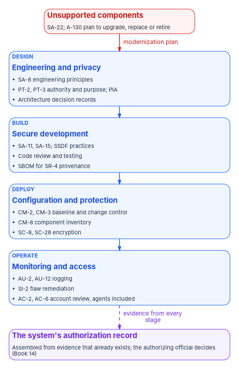

# Chapter 06 — Compliance by Design

*Compliance is cheapest when the target architecture carries the controls and the pipeline produces the evidence, so that each modernized application inherits most of its compliance instead of earning it again.*

::: {.callout-note}
## In this chapter
What OMB Circular A-130 asks of the system development life cycle, and why it makes legacy modernization a compliance obligation as well as a choice. The SP 800-53 Rev. 5 control families that application work touches most, with the evidence each one should produce and where in this book it comes from. Secure development under the SSDF after M-26-05. Privacy, data governance and records as design inputs rather than reviews at the end. Section 508 accessibility as a gate at every stage, from design to operation, including sign-in and recovery, forms, the vendor's conformance report and exceptions. Enterprise architecture as the requirement that ties the portfolio together. How an application is authorized is covered in Book 14; this chapter links there rather than repeating it.
:::

Federal compliance for an application is usually experienced as a package assembled at the end: a system security plan written after the system is built, a privacy impact assessment drafted when someone asks for it, evidence collected by screenshot before an assessment. Modernization is the one moment when that can change, because the agency is choosing the architecture, the platform and the pipeline anyway. If the target architecture in [Chapter 03](03-the-target-reference-architecture.md) implements a control once, every application built on it inherits that control. If the pipeline in [Chapter 07](07-who-governs-the-architecture.md) records its results, every merge and release produces evidence without anyone collecting it.

Circular A-130 asks for exactly this. It directs agencies to consider "information security, privacy, records management, public transparency, and supply chain security issues" for all resource planning and management "throughout the system development life cycle," and its Appendix I asks agencies to integrate security and privacy requirements and controls into "the enterprise architecture, system development life cycle activities, systems engineering processes, and acquisition processes."[^c06-a130] That is compliance by design in the Circular's own words. The rest of this chapter turns it into specific controls, artifacts and gates.

{#fig-ch06-controls-in-the-lifecycle fig-alt="A red card at the top, Unsupported components: SA-22 and the A-130 plan to upgrade, replace or retire, with a red arrow labeled modernization plan into the first of four blue stage cards stacked top to bottom. Design: SA-8 engineering principles; PT-2 and PT-3 authority and purpose and the privacy impact assessment; architecture decision records. Build: SA-11 and SA-15 and the SSDF practices; code review and testing; an SBOM for SR-4 provenance. Deploy: CM-2 and CM-3 baseline and change control; CM-8 component inventory; SC-8 and SC-28 encryption. Operate: AU-2 and AU-12 logging; SI-2 flaw remediation; AC-2 and AC-6 account review with agents included. A dashed violet arrow labeled evidence from every stage leads to a violet card at the bottom: the system's authorization record, assembled from evidence that already exists, where the authorizing official decides as Book 14 describes."}

## Legacy as a compliance finding

The Circular doesn't only ask agencies to build new systems well. It asks them to deal with old ones. Agencies must develop a plan, in consultation with their CIO, records and privacy officials, for systems and components "that cannot be appropriately protected or secured" and give them "a high priority for upgrade, replacement, or retirement," and a footnote makes clear that this includes components no longer supported by their developers or vendors.[^c06-a130] Appendix I adds that agencies shall plan and budget to upgrade, replace or retire systems whose protections can't be made commensurate with risk.[^c06-a130] In the control catalog, the same idea is SA-22, Unsupported System Components.[^c06-80053-catalog]

For the portfolio, this means the triage in [Chapter 02](02-triaging-the-portfolio.md) is also compliance evidence. An application on an unsupported runtime, database or operating system that the triage marks for retain without a plan is an open finding against the Circular, not a neutral decision. The program's design records, for every retained application with unsupported components, the compensating controls, the risk acceptance and the date of the next review.

## The controls application work touches most

NIST SP 800-53 Rev. 5 is at release 5.2.0, issued August 27, 2025. That release added SA-15(13), Logging Syntax; SA-24, Design for Cyber Resiliency; and SI-2(7), Root Cause Analysis; and revised SI-7(12).[^c06-80053][^c06-80053-catalog] Eight families carry most of the weight for an application team. The table names the controls that matter most in each, the evidence modernization work should produce for them, and where this book builds that evidence. Which controls apply to a given system depends on its baseline and tailoring, which [Book 14, Chapter 03](../b14-compliance/03-the-baseline-and-the-crosswalk.md) covers.

| Family | Controls most touched | Evidence the modernized application should produce (program design) | Built in |
|---|---|---|---|
| SA, System and Services Acquisition | SA-3 System Development Life Cycle; SA-4 Acquisition Process; SA-8 Security and Privacy Engineering Principles; SA-11 Developer Testing and Evaluation; SA-15 Development Process, Standards, and Tools; SA-22 Unsupported System Components | The reference architecture and its approved patterns; pipeline test and scan results per release; the triage record for unsupported components | [Chapter 03](03-the-target-reference-architecture.md), [Chapter 07](07-who-governs-the-architecture.md), [Chapter 02](02-triaging-the-portfolio.md) |
| SR, Supply Chain Risk Management | SR-3 Supply Chain Controls and Processes; SR-4 Provenance; SR-11 Component Authenticity | A software bill of materials per build; signed artifacts; dependency and base-image policy | [Chapter 07](07-who-governs-the-architecture.md); [Book 14, Chapter 07](../b14-compliance/07-supply-chain-risk-management.md) |
| AC, Access Control | AC-2 Account Management; AC-3 Access Enforcement; AC-6 Least Privilege | Service, workload and agent identities with owners; role definitions in code; access reviews | [Chapter 05](05-generative-and-agentic-ai.md); [Book 17](../b17-ai-identity/index.md) |
| AU, Audit and Accountability | AU-2 Event Logging; AU-3 Content of Audit Records; AU-12 Audit Record Generation; SA-15(13) Logging Syntax | Structured logs in one schema from every service, including agent tool calls, denials and approvals | [Chapter 05](05-generative-and-agentic-ai.md) for agent logs; the log schema is not yet specified in this book |
| CM, Configuration Management | CM-2 Baseline Configuration; CM-3 Configuration Change Control; CM-4 Impact Analyses; CM-7 Least Functionality; CM-8 System Component Inventory | Configuration and infrastructure as code; pull requests as change records; generated component inventory | [Chapter 07](07-who-governs-the-architecture.md); [Book 13, Chapter 04](../b13-governance/04-change-control-and-provenance.md) |
| SC, System and Communications Protection | SC-7 Boundary Protection; SC-8 Transmission Confidentiality and Integrity; SC-12 Cryptographic Key Establishment and Management; SC-28 Protection of Information at Rest | Platform-provided encryption in transit and at rest; network policy as code; managed keys | The agency's platform services, which this book doesn't yet specify ([Chapter 03](03-the-target-reference-architecture.md) covers packaging and orchestration) |
| SI, System and Information Integrity | SI-2 Flaw Remediation; SI-7 Software, Firmware, and Information Integrity; SI-10 Information Input Validation | Vulnerability scan results and remediation times; integrity checks on artifacts; validation of all input, including model output | [Chapter 07](07-who-governs-the-architecture.md), [Chapter 05](05-generative-and-agentic-ai.md) |
| PT, Personally Identifiable Information Processing and Transparency | PT-2 Authority to Process PII; PT-3 PII Processing Purposes; PT-5 Privacy Notice; PT-7 Specific Categories of PII | Data-flow records naming the authority and purpose for each PII element; notices; the PIA | This chapter; [Book 14, Chapter 08](../b14-compliance/08-privacy-pii-processing.md) |

: Control families most touched by application modernization. Control identifiers and titles from the SP 800-53 Rev. 5 release 5.2.0 catalog;[^c06-80053-catalog] evidence and placement are the program's design. {.striped .hover}

Two of these deserve a word for a data migration. The validation report from [Chapter 04](04-moving-the-data.md) is evidence for SI-7, because it shows the information arrived intact, and the cut-over itself is a CM-3 change with a CM-4 impact analysis. Treating them that way means the migration's proof is filed where an assessor will look for it.

## Secure development after M-26-05

OMB M-26-05, issued January 23, 2026, rescinded M-22-18 and its companion M-23-16, the policy under which the government-wide Secure Software Development Attestation Form was developed.[^c06-m2605] It didn't remove the underlying expectation. Agencies "shall continue to maintain a complete inventory of software and hardware" and develop assurance policies that match their risk determinations; they may choose to keep using the Secure Software Development Attestation Form, and may adopt contract terms requiring a producer to provide a current SBOM on request, which for a cloud platform should be an SBOM of the runtime production environment.[^c06-m2605] The memo points agencies to NIST SP 800-218 for the practices themselves. [Book 14, Chapter 07](../b14-compliance/07-supply-chain-risk-management.md) covers what this means for software the agency buys.

For software the agency builds, which is most of what this book modernizes, the attestation question never applied in the same way: the agency is the producer. The Secure Software Development Framework is the practice set to build to. SP 800-218, SSDF Version 1.1, published February 3, 2022, remains the final version; its Revision 1, SSDF Version 1.2, was released as an initial public draft on December 17, 2025, with comments closed on January 30, 2026, and no final version had been published as of October 2026.[^c06-ssdf-pubs] Version 1.1 organizes the practices into four groups: Prepare the Organization (PO), Protect the Software (PS), Produce Well-Secured Software (PW) and Respond to Vulnerabilities (RV).[^c06-ssdf]

Several SSDF practices read almost as a specification for the pipeline in [Chapter 07](07-who-governs-the-architecture.md):

| SSDF practice (v1.1) | What it asks | How the modernized pipeline meets it (program design) |
|---|---|---|
| PO.3.3 | Configure tools to generate artifacts of their support of secure development practices | Every pipeline stage writes its result as a retained artifact |
| PS.3.2 | Collect, safeguard, maintain and share provenance data for all components of each release, for example in an SBOM | An SBOM generated and stored for every build |
| PW.1.3 | Build in support for standardized security features and services, such as existing log management and identity management | Services use the platform's identity, logging and secrets services rather than their own |
| PW.7 | Review and/or analyze human-readable code to identify vulnerabilities | Required pull-request review and static analysis on every change, including AI-generated code |
| PW.8 | Test executable code to identify vulnerabilities | Dynamic and dependency testing in the pipeline before release |
| RV.1, RV.3 | Identify and confirm vulnerabilities on an ongoing basis; analyze root causes | Continuous scanning of deployed images; root-cause records, which SI-2(7) now also asks for |

: SSDF practices and pipeline evidence. Practice text paraphrased from SP 800-218 Version 1.1.[^c06-ssdf] {.striped .hover}

Teams that train or fine-tune models, not only call them, should add SP 800-218A, the SSDF profile for generative AI ([Chapter 05](05-generative-and-agentic-ai.md)).[^c06-ssdf-pubs]

## Privacy as a design input

Modernization changes how personal information flows, and the privacy obligations attach to those changes. Circular A-130 requires agencies to comply with the Privacy Act, including publishing and revising system of records notices; to "conduct privacy impact assessments when developing, procuring, or using IT, in accordance with the E-Government Act"; to limit the creation, collection and use of PII to what is legally authorized and necessary, and reduce it to the minimum necessary; and to maintain an inventory of the systems that handle PII.[^c06-a130] Its Appendix II says the senior agency official for privacy's review of privacy risks "should begin at the earliest planning" stages of an agency action.[^c06-a130] The PT family carries the same obligations as controls, and [Book 14, Chapter 08](../b14-compliance/08-privacy-pii-processing.md) covers them in full.

The program's design names the modernization events that reopen privacy work, so that the privacy office hears about them at design review rather than at authorization:

- **A new data store or a new engine.** A migration to PostgreSQL or SQL Server ([Chapter 04](04-moving-the-data.md)) changes where PII is stored and who administers it; the PIA and the PII system inventory change with it.
- **A new data flow.** Splitting a monolith into services, adding an API or a backend-for-frontend, or adding change data capture creates copies and flows the old PIA didn't describe.
- **An AI feature.** Sending records to a model, or retrieving them into a prompt, is a new use of the information, and the PT-3 purpose has to cover it ([Chapter 05](05-generative-and-agentic-ai.md)).
- **Test data.** Copying production PII into development or test environments is a use that rarely has an authority. The program's design is synthetic or masked data outside production.
- **Retirement.** Decommissioning a legacy system is a disposition of the PII it holds, which the records schedule governs (below).

## Data governance: the Evidence Act and chief data officers

The Foundations for Evidence-Based Policymaking Act of 2018 (the Evidence Act, Pub. L. 115-435) established chief data officers and set requirements for managing data as an asset. OMB M-25-05, dated January 15, 2025, is the current guidance on its open-data title: it requires agencies to keep data assets in open formats and public data assets as open government data assets, to maintain a comprehensive data inventory of all data assets, and to keep an open data plan; it makes agency chief data officers, with the data governance body established under M-19-23, responsible for implementation; and it rescinds the older open data policy, M-13-13.[^c06-m2505] It also says agencies "must take appropriate steps to account for the requirements of this Memorandum when initiating new information collections or IT investments."[^c06-m2505] A modernization project is such an investment.

The workbook cites the Evidence Act and M-25-05 rather than the Federal Data Strategy, whose site is being retired ([framework status](../../reference/federal-framework-crosswalk.md)). For application teams, the practical consequences are small and concrete: when a data asset moves to a new engine or is split across services, its entry in the data inventory moves with it, its metadata is updated, and the chief data officer's governance body sees the change. The program's design adds the data inventory entry to the privacy obligations table in the data move ([Chapter 04](04-moving-the-data.md)).

## Records: from design to decommissioning

Circular A-130 requires that records management functions and retention and disposition requirements be "fully incorporated into information life cycle processes and stages, including the design, development, implementation, and decommissioning of information systems," cloud services included, and that each agency designate a senior agency official for records management.[^c06-a130] Records with PII must be kept according to retention schedules approved by the National Archives and Records Administration.[^c06-a130]

Two modernization decisions are records decisions in disguise. Retiring an application ([Chapter 02](02-triaging-the-portfolio.md)) means its records must be either migrated, transferred or destroyed under an approved schedule, and the decision belongs to the records officer as well as the application owner. And a data migration that drops history, audit tables or attachments to save effort may be destroying records. The program's design puts the records officer on the review for every retire disposition and every migration that changes what history is kept.

## Accessibility: the Section 508 gate {#section-508-gate}

Every application in the portfolio has users, and some of them are federal employees with disabilities. Section 508 of the Rehabilitation Act requires that when an agency develops, procures, maintains or uses information and communication technology, employees with disabilities have access to and use of information and data "comparable to the access to and use of the information and data by Federal employees who are not individuals with disabilities," unless an undue burden would be imposed.[^c06-794d] A modernized application is technology the agency develops, so the requirement attaches to the work itself, not to a review after it.

Modernization is also where most legacy applications lose their protection. The Revised 508 Standards let existing technology that met the earlier standards stay as it is if it "has not been altered" on or after January 18, 2018, and they define an alteration as a change that "affects interoperability, the user interface, or access to information or data."[^c06-1194] A refactor or rebuild with a new React front end ([Chapter 03](03-the-target-reference-architecture.md#front-ends-react)) is an alteration by that definition. A rehost that keeps the old screens keeps their accessibility too, good or bad, so the program's design weighs known accessibility defects against *retain* and *rehost* when the owner reviews the disposition ([Chapter 02](02-triaging-the-portfolio.md)); the scoring rubric doesn't include them.

### What the standard is, and which WCAG

The Revised 508 Standards are Appendix A to 36 CFR part 1194. For software, "user interface components, as well as the content of platforms and applications, shall conform to Level A and Level AA Success Criteria and Conformance Requirements in WCAG 2.0"; electronic content, including documents an application generates, must meet the same level; and non-web documents and non-web software are excused from four success criteria (2.4.1 Bypass Blocks, 2.4.5 Multiple Ways, 3.2.3 Consistent Navigation and 3.2.4 Consistent Identification).[^c06-1194] The standards also set functional performance criteria, such as at least one mode of operation that doesn't require vision, which decide whether an alternative design gives "substantially equivalent or greater accessibility and usability" when a team departs from a technical requirement.[^c06-1194]

The legal floor is still WCAG 2.0 Level AA, not a later version.[^c06-wcag-version] W3C's current recommendation is WCAG 2.2, and W3C says content that conforms to 2.2 also conforms to 2.0 and 2.1, and advises using 2.2 "to maximize future applicability of accessibility efforts."[^c06-wcag22] The program's design is to build to WCAG 2.2 Level AA and to report conformance against WCAG 2.0 Level AA, the level the standards require. Two of the 2.2 additions matter to this chapter: 3.3.8 Accessible Authentication (Minimum) and 3.3.7 Redundant Entry, both covered below.

### What M-24-08 adds

OMB M-24-08, issued December 21, 2023, is the current OMB policy on managing Section 508; it rescinded four older OMB memoranda on the subject.[^c06-m2408] No later memorandum rescinding it was found on November 2, 2026.[^c06-m2408-status] Five of its provisions shape an application program:

- **Accessibility from the start.** Accessibility "must be incorporated, unless an exception applies, from the very beginning of the design and development of any digital experience and integrated throughout every step of the ICT lifecycle," and agencies must ensure conformance to the standards when designing or developing technology.[^c06-m2408]
- **Testing before release, and after.** Agencies should test comprehensively before deployment, test with people with disabilities and assistive technology users before deployment, monitor accessibility after deployment, and validate updates so they don't make things worse.[^c06-m2408]
- **Checkpoints across the life cycle.** Monitoring should follow the whole software development life cycle, "including enterprise architecture reviews; IT program reviews; acquisition, design, development, production release reviews; and change control," and agencies are encouraged to make accessibility experts "authoritative decision-makers during development checkpoints and milestones."[^c06-m2408]
- **Documented processes.** Agencies should document how Section 508 compliance is handled in acquisition, development, configuration, deployment and maintenance; how conformance testing is done; and how issues and complaints are reported, tracked and resolved.[^c06-m2408]
- **Named roles.** The CIO leads the agency's Section 508 program and appoints its program manager. Product managers ensure that their technology conforms; IT program and project managers ensure Section 508 is considered throughout the acquisition and IT life cycles; and the contracting officer's representative verifies that deliverables meet the contract's accessibility terms before accepting them.[^c06-m2408]

### The gate across the life cycle

The table turns those provisions into the program's gate. The stages are the four in the figure above, with test separated from build because assistive-technology testing is a different activity from the automated checks in the pipeline. The *who signs off* column follows the gates in [Chapter 07](07-who-governs-the-architecture.md#four-gates). All of it is the program's design.

| Stage | What's done | Evidence | Who signs off |
|---|---|---|---|
| Design | Name the provisions that apply (software, content, documents the application generates). Start from the shared component library. Design keyboard operation, focus order and error handling with the screens, not after them. Research and prototype with users with disabilities for high-use flows. | The accessibility section of the Gate 2 decision record; the list of applicable provisions; prototype findings | Chief architect or delegate at Gate 2, with the Section 508 program manager's delegate |
| Build | Use the library's components rather than hand-built controls. Run automated accessibility rules on every change, and unit tests that assert each control's accessible name and role. | Automated results on the pull request; test results | Code owner at Gate 3 |
| Test | Manual conformance testing on a documented, repeatable process: keyboard only, a screen reader on each supported browser, magnification to 200 percent, and the error paths. Test critical flows with people who use assistive technology. | A conformance test report per release, with each failure logged by success criterion and severity; the application's own Accessibility Conformance Report, kept current | A trained accessibility tester; the Section 508 program manager's delegate for the report |
| Deploy | Release only with no open Level A or AA failures on critical flows, or with a documented exception (below). Publish known limitations and how to get help where users will see them. | The release record linking the test report; any exception record | Release owner at Gate 4; the responsible agency official for any exception |
| Operate | Scheduled automated scans, intranet pages included; a feedback route that reaches the team; re-test changed flows on every release, and vendor components on every vendor update. | Scan results; the feedback and complaint log with resolutions; regression results | Application owner; the Section 508 program manager for the agency's reporting |

: The accessibility gate. Stages follow M-24-08's life-cycle provisions;[^c06-m2408] tasks, evidence and sign-offs are the program's design. {.striped .hover}

Two rules keep the gate from becoming paperwork. A defect found in operation goes back through the same pipeline as any other defect and is closed by a change, not by an annotation. And the Accessibility Conformance Report for a system the agency builds is kept as current as the system: if a vendor would owe one at procurement, the agency's own application owes one too.

### Automated testing finds some problems; people find the rest

Automated rule engines are fast and belong in the pipeline, but they can't decide conformance on their own. M-24-08 says agencies should use automated tools "in combination with targeted manual testing because automated testing tools cannot fully assess conformance to accessibility standards," and explains that some criteria are "highly context-dependent" and need human judgment: "Automated testing cannot evaluate the criteria of accessibility standards that require human subjectivity."[^c06-m2408] It recommends manual conformance validation, such as the Trusted Tester Conformance Test Process for the Web, alongside automated testing, sampling or prioritizing where resources are short, and asks that the people who test have, at a minimum, participated in a certified Section 508 conformance training program.[^c06-m2408]

A tool can tell that an image has alternative text, not whether the text says what the image means. It can tell that a field has a label, not whether the label makes sense, whether the focus order follows the task, or whether a screen reader announces that a save succeeded. Those are the defects users report. The program's design, accordingly, is automation at Gate 3 on every change and manual testing at Gate 4 on every flow the release changed, with the full manual test on the critical flows before the first release of a rebuilt application. M-24-08's priorities for employee-facing technology decide which flows go first: the most widely used, those with the most feedback, those that user research flagged and those subject to complaints.[^c06-m2408]

### Signing in, enrolling and recovering

A modernized application shouldn't build its own sign-in; it uses the platform's identity service (SSDF PW.1.3 above). For a workforce application on Microsoft Entra ID, that means the sign-in, multifactor enrollment, password reset and recovery screens are largely Microsoft's. The agency's accessibility decisions are which methods it offers, how it configures them, and what it builds around them. What Microsoft Learn documents, and what it doesn't:

- **Methods.** Microsoft's Learn page on accessible multifactor authentication lists Microsoft Authenticator, which it describes as "compatible with various assistive technologies, including screen readers"; text and voice calls; FIDO2 security keys with a PIN or biometric; Windows Hello for Business; and email verification as a fallback.[^c06-ms-mfa-a11y] Text, voice and email codes aren't phishing-resistant, and federal staff must use phishing-resistant authentication ([Book 16, Chapter 07](../b16-people/07-end-user-training.md#accessible-training) and [Book 04](../b04-access/index.md)). The accessible set for staff is therefore the PIV card, a FIDO2 security key or passkey, and Windows Hello for Business, with the choice made per user, because no single method suits everyone.
- **Enrollment and recovery.** A Temporary Access Pass can live from 10 minutes to 30 days (default one hour), and can be one-time or multi-use. When a one-time pass is used to register a passwordless method, registration must finish within 10 minutes of signing in; Learn says the limit "doesn't apply to a TAP that can be used more than once."[^c06-ms-tap] A user who works with a screen reader or switch access may need more than ten minutes. The program's design is that the help desk can issue a multi-use pass with a lifetime that fits the user, inside the limits the CISO sets in the recovery ladder ([Book 15, Chapter 03](../b15-day2-operations/03-intake-triage-and-routing.md#verify-the-person-before-a-sensitive-action)), and stay on the session until the method is registered.
- **Branding.** Company branding sets the background image and color, the logos, the sign-in page text, the username hint and a self-service password reset link.[^c06-ms-branding] Each of those is the agency's content, so its contrast and wording are the agency's responsibility; no instruction should live only in the background image. Custom CSS is being retired for workforce tenants: tenants created after January 5, 2026 don't have it, and after July 21, 2026 older tenants that don't already use it can't configure it.[^c06-ms-branding]
- **User flows.** For people outside the workforce, Microsoft Entra External ID user flows let the agency choose which attributes a sign-up form collects, mark them required, order them, edit their labels and choose input types (text box, radio buttons, checkboxes), and override the page and error strings through language customization.[^c06-ms-userflows] Those settings let the team write clear labels and error text. Learn doesn't make an accessibility conformance claim for the hosted pages, so the team tests them like its own.
- **Conformance claims.** Microsoft publishes Accessibility Conformance Reports, and its Section 508 compliance page lists "Office 365 and Microsoft Entra sign-in" among the services in scope.[^c06-ms-508] The agency obtains the current report and validates it, as it would any vendor's (below). This chapter makes no claim about the sign-in pages' conformance level.

Anything the application team builds around sign-in, such as a step-up prompt, a consent screen or an account-linking step, is the team's own content and must meet the standard. WCAG 2.2's 3.3.8 Accessible Authentication (Minimum) is a useful design rule beyond the 2.0 floor: no step requires a cognitive function test, "such as remembering a password or solving a puzzle," unless an alternative or a mechanism to assist is offered. W3C's guidance says authentication by the device or operating system isn't a cognitive function test, and that blocking password managers or paste fails the criterion.[^c06-wcag22-auth] WCAG 2.0 already requires any CAPTCHA to offer "alternative forms of CAPTCHA using output modes for different types of sensory perception."[^c06-wcag20]

### Forms and error messages

Most legacy mission applications are forms. The WCAG 2.0 criteria that matter most to a rebuilt form are all Level A or AA, so all are required:[^c06-wcag20]

| WCAG 2.0 criterion | What it asks | The program's design rule |
|---|---|---|
| 1.3.1 Info and Relationships (A); 3.3.2 Labels or Instructions (A) | Structure and relationships are programmatically determinable; labels or instructions where input is required | Every field has a visible label tied to it in code; required fields and formats are stated in the label text, not only by an asterisk or a color |
| 3.3.1 Error Identification (A) | An automatically detected error is identified and "described to the user in text" | Each error names the field and the problem; an error summary at the top links to the fields; entered data is kept |
| 3.3.3 Error Suggestion (AA) | Suggestions for correction are given when known, unless that would compromise security | "Enter the date as MM/DD/YYYY," not "Invalid input" |
| 3.3.4 Error Prevention (Legal, Financial, Data) (AA) | Submissions that commit the user, change or delete their stored data, or submit test responses are reversible, checked, or confirmed | A review-and-confirm step before any submission that changes a record |
| 2.2.1 Timing Adjustable (A) | Users can turn off, adjust or extend a time limit the content sets | A session timeout warns the user and offers to extend; no form is lost to a timeout |
| 4.1.2 Name, Role, Value (A) | Every control's name, role and state are programmatically available, and changes are announced | Custom widgets come from the component library, which is tested once against screen readers |
| 1.4.1 Use of Color (A) | Color isn't the only way information is conveyed | Errors carry an icon and text as well as red |

: Forms and errors. Criteria and levels from WCAG 2.0;[^c06-wcag20] design rules are the program's. {.striped .hover}

WCAG 2.2's 3.3.7 Redundant Entry adds a sensible rule for multi-step processes: information the user already entered is filled in or offered for selection rather than asked for again.[^c06-wcag22] It is design guidance here, not a Section 508 requirement.

### Buying: the vendor's Accessibility Conformance Report

Much of the portfolio is bought, not built: commercial products, SaaS, low-code platforms and the component libraries teams build on. M-24-08 says the Federal Acquisition Regulation, at sections 11.002(f) and 39.203, requires agencies to build the Section 508 standards into the acquisition life cycle, and encourages agencies to evaluate and validate the vendor's conformance documentation before purchase and again when the product changes. It describes an Accessibility Conformance Report as documenting how a product meets the applicable standards, and the Voluntary Product Accessibility Template (VPAT) as "a commonly used industry template" for writing one.[^c06-m2408]

The report is the vendor's claim, not a test result. Section508.gov's guide to reading one explains the conformance terms: "Partially Supports" means the product does not conform, and "Not Evaluated" "does not provide any assurance of accessibility." It advises buyers to run their own conformance validation testing where possible.[^c06-acr] The program's design for every product in the portfolio is: an ACR against the Revised 508 Standards, for the version and edition being bought; the agency's own test of its critical flows on that version; a contract term for an updated ACR with each major release and for remediating failures; and the report filed with the product's record, where [Book 15, Chapter 06](../b15-day2-operations/06-saas-integration-governance.md) also asks for it at SaaS intake.

### Exceptions, and how to document them

The standards allow exceptions, each with conditions. The general exceptions cover legacy technology that met the earlier standards and hasn't been altered (above); national security systems; technology a contractor acquires incidental to a contract; and status indicators and operable parts in spaces used only by service personnel for maintenance or occasional monitoring.[^c06-1194] Two more come up in application work:

- **Undue burden or fundamental alteration (E202.6).** Where conformance "would impose an undue burden or would result in a fundamental alteration in the nature of the ICT," conformance is required only to the extent that it doesn't. An undue burden means "significant difficulty or expense considering the agency resources available to the program or component" concerned. The responsible agency official must document the basis in writing, including "why and to what extent" compliance would create the burden or alteration, and the agency must give people with disabilities access to the information and data "by an alternative means that meets identified needs."[^c06-1194] The statute itself uses "undue burden" and requires alternative means when it applies; "fundamental alteration" comes from the standards.[^c06-794d]
- **Best meets (E202.7).** Where conforming technology "is not commercially available," the agency procures what best meets the standards consistent with its business needs, documents in writing the non-availability, including "a description of market research performed and which provisions cannot be met," and the basis for its choice, and provides an alternative means.[^c06-1194]

The program's design gives every exception one record in the same place as the architecture exceptions of [Chapter 07](07-who-governs-the-architecture.md#what-it-decides): the provisions not met, the screens or functions affected, the basis (the cost and resource analysis for undue burden, the market research for best meets), the alternative means and how a user gets it, the responsible agency official who signed it, and a review date. An exception without an alternative means, or without an end date, isn't accepted at Gate 4. M-24-08 also asks agencies to plan for the risk assessment and documentation of technology that doesn't meet the standards, which this record supplies.[^c06-m2408]

## Enterprise architecture: the requirement that ties it together

Circular A-130 §5.a(2) says agencies "shall develop an enterprise architecture (EA) that describes the baseline architecture, target architecture, and a transition plan to get to the target architecture," and that the EA should incorporate plans for significant upgrades, replacements and disposition of systems that can no longer support missions.[^c06-a130] SP 800-53 carries the same requirement as PM-7, Enterprise Architecture.[^c06-80053-catalog] The Federal Enterprise Architecture Framework v2 is historical; the requirement behind it is live ([framework status](../../reference/federal-framework-crosswalk.md)).

This book's parts map directly onto the Circular's three elements: the triaged portfolio is the baseline, the reference architecture in [Chapter 03](03-the-target-reference-architecture.md) is the target, and the wave plan in [Chapter 10](10-running-the-portfolio-in-waves.md) is the transition plan. [Chapter 09](09-togaf-and-zachman.md) maps the same work onto TOGAF and Zachman for agencies that use either.

## Evidence, not packages

Each control above should leave a record the system produces as it runs: a pipeline result, a pull request, an SBOM, a log entry, a validation report, a review decision. The program's design collects them into the system's authorization record continuously, so that the package the authorizing official reviews is assembled from evidence that already exists. [Book 13, Chapter 07](../b13-governance/07-evidence-over-attestation.md) explains why evidence beats attestation, and [Book 14, Chapter 11](../b14-compliance/11-the-authorization-package.md) describes the package and the authorization itself, including ongoing authorization and the authorizing official's sole responsibility for accepting residual risk. Nothing in this chapter changes who decides; it changes how much the decision-maker can see.

## Honest limits

- **Inheritance is only as good as the platform's own authorization.** A control an application inherits from the platform is satisfied only if the platform's implementation is assessed and current. Inheritance moves the work; it doesn't remove it.
- **The control table is a starting set.** It names the controls application work touches most, not every control that applies. Baseline and tailoring decide the full set.
- **The SSDF is changing.** Version 1.2 is still a draft. When it is final, re-map the pipeline to its practices.
- **Accessibility can't be fully automated either.** Automated rules find only part of the failures; the manual test with assistive technology is what shows a flow works. And the hosted sign-in pages belong to the vendor: the agency can test them and validate the vendor's report, not fix them.
- **Privacy and records judgments aren't automatable.** The pipeline can record what changed. Whether a new flow needs a revised notice, or a dropped table was a record, is a judgment for the privacy and records officials.

## What leadership should take from this

1. **Make the platform carry the controls.** Every control implemented once in the target architecture is a control a thousand applications don't implement separately.
2. **Treat unsupported components as findings.** A retained application on unsupported software needs a plan, a risk acceptance and a date, because the Circular asks for one.
3. **Bring privacy and records in at design review.** The events that reopen their work are predictable; name them, and send them to the right officials before anything is built.
4. **Make accessibility a gate, not an audit.** A rebuilt front end loses the legacy safe harbor; test it with assistive technology before release, demand and validate the vendor's conformance report, and accept no exception without an alternative means and an end date.

[Chapter 07](07-who-governs-the-architecture.md) describes the people and gates that make these controls happen on every change.

::: {.callout-tip}
## Continue the book
[← Previous: Chapter 05 — Generative and Agentic AI in the Architecture](05-generative-and-agentic-ai.md) · [Book index](index.md) · [Next: Chapter 07 — Who Governs the Architecture →](07-who-governs-the-architecture.md)
:::

[^c06-a130]: Office of Management and Budget, Circular A-130, *Managing Information as a Strategic Resource* (2016 revision), §5.a(1)(a)(ii) and (c)(i)–(ii) and footnote 8, §5.a(2), §5.d(5)(d), §5.f(1)(d)–(e), (g)–(i), §5.h(1); Appendix I §1 and §4.b(3); Appendix II §4, <https://www.whitehouse.gov/wp-content/uploads/legacy_drupal_files/omb/circulars/A130/a130revised.pdf> (accessed Oct 28, 2026).
[^c06-80053-catalog]: National Institute of Standards and Technology, SP 800-53 Rev. 5, release 5.2.0, OSCAL catalog (`NIST_SP-800-53_rev5_catalog.json`), control families and control titles, <https://github.com/usnistgov/oscal-content/tree/main/nist.gov/SP800-53/rev5/json> (accessed Oct 28, 2026).
[^c06-80053]: National Institute of Standards and Technology, Computer Security Resource Center, SP 800-53 Rev. 5, *Security and Privacy Controls for Information Systems and Organizations*, publication page, release 5.2.0 note (August 27, 2025), <https://csrc.nist.gov/pubs/sp/800/53/r5/upd1/final> (accessed Oct 28, 2026).
[^c06-m2605]: Office of Management and Budget, M-26-05, *Adopting a Risk-based Approach to Software and Hardware Security*, January 23, 2026, and footnote 1, <https://www.whitehouse.gov/wp-content/uploads/2026/01/M-26-05-Adopting-a-Risk-based-Approach-to-Software-and-Hardware-Security.pdf> (accessed Oct 28, 2026).
[^c06-ssdf-pubs]: National Institute of Standards and Technology, Computer Security Resource Center, "Secure Software Development Framework: Publications," <https://csrc.nist.gov/projects/ssdf/publications>; and SP 800-218 Rev. 1 (Initial Public Draft), December 17, 2025, <https://csrc.nist.gov/pubs/sp/800/218/r1/ipd> (both accessed Oct 28, 2026).
[^c06-ssdf]: National Institute of Standards and Technology, SP 800-218, *Secure Software Development Framework (SSDF) Version 1.1*, February 2022, Section 2 and Table 1 (PO.3, PS.3, PW.1, PW.7, PW.8, RV.1, RV.3), <https://nvlpubs.nist.gov/nistpubs/SpecialPublications/NIST.SP.800-218.pdf> (accessed Oct 28, 2026).
[^c06-m2505]: Office of Management and Budget, M-25-05, *Phase 2 Implementation of the Foundations for Evidence-Based Policymaking Act of 2018: Open Government Data Access and Management Guidance*, January 15, 2025, Sections 1 and 2, <https://www.whitehouse.gov/wp-content/uploads/2025/01/M-25-05-Phase-2-Implementation-of-the-Foundations-for-Evidence-Based-Policymaking-Act-of-2018-Open-Government-Data-Access-and-Management-Guidance.pdf> (accessed Oct 28, 2026).
[^c06-794d]: 29 U.S.C. §794d, "Electronic and information technology," subsections (a)(1)(A) and (a)(1)(B), <https://www.law.cornell.edu/uscode/text/29/794d> (accessed Nov 2, 2026).
[^c06-1194]: U.S. Access Board, *Information and Communication Technology: Revised 508 Standards and 255 Guidelines*, Appendix A to 36 CFR part 1194: E101.2 (equivalent facilitation), E103.4 (definition of "alteration"), E202.2–E202.5 (general exceptions), E202.6–E202.6.3 (undue burden or fundamental alteration), E202.7–E202.7.2 (best meets), E205.4 (accessibility standard for content), E207.2 (WCAG conformance for software), Chapter 3, 302 (functional performance criteria), and 702.10.1 (WCAG 2.0 incorporated by reference), <https://www.access-board.gov/ict/> (accessed Nov 2, 2026).
[^c06-wcag-version]: The Access Board's text incorporates "Web Content Accessibility Guidelines (WCAG) 2.0, W3C Recommendation, December 11, 2008" by reference at 702.10.1 and applies it through E205.4 and E207.2; Section508.gov says the standards "incorporate by reference the WCAG 2.0 Level AA Success Criteria." Neither the Access Board's standards page nor Section508.gov's applicability page or its laws and policies page, read November 2, 2026, mentions an update to WCAG 2.1 or 2.2. U.S. Access Board, <https://www.access-board.gov/ict/>; Section508.gov, "Applicability & Conformance Requirements," <https://www.section508.gov/develop/applicability-conformance/>, and "Laws and Policies," <https://www.section508.gov/manage/laws-and-policies/> (all accessed Nov 2, 2026).
[^c06-wcag22]: World Wide Web Consortium, *Web Content Accessibility Guidelines (WCAG) 2.2*, W3C Recommendation, 12 December 2024 (first published 5 October 2023), Abstract and status, and Success Criterion 3.3.7 Redundant Entry, <https://www.w3.org/TR/WCAG22/> (accessed Nov 2, 2026).
[^c06-wcag22-auth]: World Wide Web Consortium, "Understanding Success Criterion 3.3.8: Accessible Authentication (Minimum)," <https://www.w3.org/WAI/WCAG22/Understanding/accessible-authentication-minimum.html> (accessed Nov 2, 2026).
[^c06-wcag20]: World Wide Web Consortium, *Web Content Accessibility Guidelines (WCAG) 2.0*, W3C Recommendation, 11 December 2008, Success Criteria 1.1.1 (CAPTCHA), 1.3.1, 1.4.1, 1.4.4, 2.2.1, 3.3.1, 3.3.2, 3.3.3, 3.3.4 and 4.1.2, <https://www.w3.org/TR/WCAG20/> (accessed Nov 2, 2026).
[^c06-m2408]: Office of Management and Budget, M-24-08, *Strengthening Digital Accessibility and the Management of Section 508 of the Rehabilitation Act*, December 21, 2023, §I (rescissions), §III.A, §III.B and footnote 21, §III.C, §III.E and footnote 31, §III.F, and Appendix A, <https://www.whitehouse.gov/wp-content/uploads/2023/12/M-24-08-Strengthening-Digital-Accessibility-and-the-Management-of-Section-508-of-the-Rehabilitation-Act.pdf> (accessed Nov 2, 2026).
[^c06-m2408-status]: Section508.gov, "Laws and Policies" (lists M-24-08 among related policies; page reviewed October 2026), <https://www.section508.gov/manage/laws-and-policies/>; Office of Management and Budget, Memoranda (2025–2027 memoranda; none rescinds M-24-08 or concerns Section 508), <https://www.whitehouse.gov/omb/information-resources/guidance/memoranda/> (both accessed Nov 2, 2026).
[^c06-acr]: Section508.gov, "Understanding Vendor Claims in Accessibility Conformance Reports" (reviewed September 2023), <https://www.section508.gov/buy/understand-claims/> (accessed Nov 2, 2026).
[^c06-ms-mfa-a11y]: Microsoft Learn, "Improve accessibility with multifactor authentication in Microsoft Entra ID," <https://learn.microsoft.com/entra/identity/authentication/accessibility/authentication-methods-accessibility> (accessed Nov 2, 2026).
[^c06-ms-tap]: Microsoft Learn, "Configure Temporary Access Pass to register passwordless authentication methods," sections "Enable the Temporary Access Pass policy" and "Limitations," <https://learn.microsoft.com/entra/identity/authentication/howto-authentication-temporary-access-pass> (accessed Nov 2, 2026).
[^c06-ms-branding]: Microsoft Learn, "Configure your company branding," sections "Before you begin" and "Layout," <https://learn.microsoft.com/entra/fundamentals/how-to-customize-branding>; and "CSS template reference guide," <https://learn.microsoft.com/entra/fundamentals/reference-company-branding-css-template> (both accessed Nov 2, 2026).
[^c06-ms-userflows]: Microsoft Learn, "Collect custom user attributes during external tenant sign-up," section "Configure the user input types and page layout," <https://learn.microsoft.com/entra/external-id/customers/how-to-define-custom-attributes>; and "Customize browser language for authentication experience," <https://learn.microsoft.com/entra/external-id/customers/how-to-customize-languages-customers> (both accessed Nov 2, 2026).
[^c06-ms-508]: Microsoft Learn, "U.S. Section 508" (compliance offering; in-scope services and the link to Microsoft's Accessibility Conformance Reports), <https://learn.microsoft.com/compliance/regulatory/offering-section-508-vpats> (accessed Nov 2, 2026).
