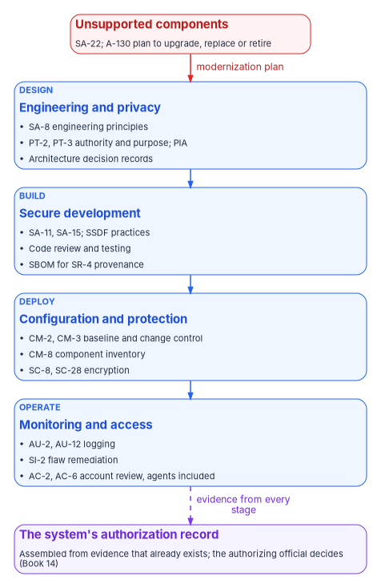

# Chapter 06 — Compliance by Design

*Compliance is cheapest when the target architecture carries the controls and the pipeline produces the evidence, so that each modernized application inherits most of its compliance instead of earning it again.*

::: {.callout-note}
## In this chapter
What OMB Circular A-130 asks of the system development life cycle, and why it makes legacy modernization a compliance obligation as well as a choice. The SP 800-53 Rev. 5 control families that application work touches most, with the evidence each one should produce and where in this book it comes from. Secure development under the SSDF after M-26-05. Privacy, data governance and records as design inputs rather than reviews at the end. Enterprise architecture as the requirement that ties the portfolio together. How an application is authorized is covered in Book 14; this chapter links there rather than repeating it.
:::

Federal compliance for an application is usually experienced as a package assembled at the end: a system security plan written after the system is built, a privacy impact assessment drafted when someone asks for it, evidence collected by screenshot before an assessment. Modernization is the one moment when that can change, because the agency is choosing the architecture, the platform and the pipeline anyway. If the target architecture in [Chapter 03](03-the-target-reference-architecture.md) implements a control once, every application built on it inherits that control. If the pipeline in [Chapter 07](07-who-governs-the-architecture.md) records its results, every merge and release produces evidence without anyone collecting it.

Circular A-130 asks for exactly this. It directs agencies to consider "information security, privacy, records management, public transparency, and supply chain security issues" for all resource planning and management "throughout the system development life cycle," and its Appendix I asks agencies to integrate security and privacy requirements and controls into "the enterprise architecture, system development life cycle activities, systems engineering processes, and acquisition processes."[^c06-a130] That is compliance by design in the Circular's own words. The rest of this chapter turns it into specific controls, artifacts and gates.

{#fig-ch06-controls-in-the-lifecycle fig-alt="A red card at the top, Unsupported components: SA-22 and the A-130 plan to upgrade, replace or retire, with a red arrow labeled modernization plan into the first of four blue stage cards stacked top to bottom. Design: SA-8 engineering principles; PT-2 and PT-3 authority and purpose and the privacy impact assessment; architecture decision records. Build: SA-11 and SA-15 and the SSDF practices; code review and testing; an SBOM for SR-4 provenance. Deploy: CM-2 and CM-3 baseline and change control; CM-8 component inventory; SC-8 and SC-28 encryption. Operate: AU-2 and AU-12 logging; SI-2 flaw remediation; AC-2 and AC-6 account review with agents included. A dashed violet arrow labeled evidence from every stage leads to a violet card at the bottom: the system's authorization record, assembled from evidence that already exists, where the authorizing official decides as Book 14 describes."}

## Legacy as a compliance finding

The Circular doesn't only ask agencies to build new systems well. It asks them to deal with old ones. Agencies must develop a plan, in consultation with their CIO, records and privacy officials, for systems and components "that cannot be appropriately protected or secured" and give them "a high priority for upgrade, replacement, or retirement," and a footnote makes clear that this includes components no longer supported by their developers or vendors.[^c06-a130] Appendix I adds that agencies shall plan and budget to upgrade, replace or retire systems whose protections can't be made commensurate with risk.[^c06-a130] In the control catalog, the same idea is SA-22, Unsupported System Components.[^c06-80053-catalog]

For the portfolio, this means the triage in [Chapter 02](02-triaging-the-portfolio.md) is also compliance evidence. An application on an unsupported runtime, database or operating system that the triage marks for retain without a plan is an open finding against the Circular, not a neutral decision. The program's design records, for every retained application with unsupported components, the compensating controls, the risk acceptance and the date of the next review.

## The controls application work touches most

NIST SP 800-53 Rev. 5 is at release 5.2.0, issued August 27, 2025. That release added SA-15(13), Logging Syntax; SA-24, Design for Cyber Resiliency; and SI-2(7), Root Cause Analysis; and revised SI-7(12).[^c06-80053][^c06-80053-catalog] Eight families carry most of the weight for an application team. The table names the controls that matter most in each, the evidence modernization work should produce for them, and where this book builds that evidence. Which controls apply to a given system depends on its baseline and tailoring, which [Book 14, Chapter 03](../b14-compliance/03-the-baseline-and-the-crosswalk.md) covers.

| Family | Controls most touched | Evidence the modernized application should produce (program design) | Built in |
|---|---|---|---|
| SA, System and Services Acquisition | SA-3 System Development Life Cycle; SA-4 Acquisition Process; SA-8 Security and Privacy Engineering Principles; SA-11 Developer Testing and Evaluation; SA-15 Development Process, Standards, and Tools; SA-22 Unsupported System Components | The reference architecture and its approved patterns; pipeline test and scan results per release; the triage record for unsupported components | [Chapter 03](03-the-target-reference-architecture.md), [Chapter 07](07-who-governs-the-architecture.md), [Chapter 02](02-triaging-the-portfolio.md) |
| SR, Supply Chain Risk Management | SR-3 Supply Chain Controls and Processes; SR-4 Provenance; SR-11 Component Authenticity | A software bill of materials per build; signed artifacts; dependency and base-image policy | [Chapter 07](07-who-governs-the-architecture.md); [Book 14, Chapter 07](../b14-compliance/07-supply-chain-risk-management.md) |
| AC, Access Control | AC-2 Account Management; AC-3 Access Enforcement; AC-6 Least Privilege | Service, workload and agent identities with owners; role definitions in code; access reviews | [Chapter 05](05-generative-and-agentic-ai.md); [Book 17](../b17-ai-identity/index.md) |
| AU, Audit and Accountability | AU-2 Event Logging; AU-3 Content of Audit Records; AU-12 Audit Record Generation; SA-15(13) Logging Syntax | Structured logs in one schema from every service, including agent tool calls, denials and approvals | [Chapter 03](03-the-target-reference-architecture.md), [Chapter 05](05-generative-and-agentic-ai.md) |
| CM, Configuration Management | CM-2 Baseline Configuration; CM-3 Configuration Change Control; CM-4 Impact Analyses; CM-7 Least Functionality; CM-8 System Component Inventory | Configuration and infrastructure as code; pull requests as change records; generated component inventory | [Chapter 07](07-who-governs-the-architecture.md); [Book 13, Chapter 04](../b13-governance/04-change-control-and-provenance.md) |
| SC, System and Communications Protection | SC-7 Boundary Protection; SC-8 Transmission Confidentiality and Integrity; SC-12 Cryptographic Key Establishment and Management; SC-28 Protection of Information at Rest | Platform-provided encryption in transit and at rest; network policy as code; managed keys | [Chapter 03](03-the-target-reference-architecture.md) |
| SI, System and Information Integrity | SI-2 Flaw Remediation; SI-7 Software, Firmware, and Information Integrity; SI-10 Information Input Validation | Vulnerability scan results and remediation times; integrity checks on artifacts; validation of all input, including model output | [Chapter 07](07-who-governs-the-architecture.md), [Chapter 05](05-generative-and-agentic-ai.md) |
| PT, Personally Identifiable Information Processing and Transparency | PT-2 Authority to Process PII; PT-3 PII Processing Purposes; PT-5 Privacy Notice; PT-7 Specific Categories of PII | Data-flow records naming the authority and purpose for each PII element; notices; the PIA | This chapter; [Book 14, Chapter 08](../b14-compliance/08-privacy-pii-processing.md) |

: Control families most touched by application modernization. Control identifiers and titles from the SP 800-53 Rev. 5 release 5.2.0 catalog;[^c06-80053-catalog] evidence and placement are the program's design. {.striped .hover}

Two of these deserve a word for a data migration. The validation report from [Chapter 04](04-moving-the-data.md) is evidence for SI-7, because it shows the information arrived intact, and the cut-over itself is a CM-3 change with a CM-4 impact analysis. Treating them that way means the migration's proof is filed where an assessor will look for it.

## Secure development after M-26-05

OMB M-26-05, issued January 23, 2026, rescinded M-22-18 and its companion M-23-16, the policy under which the government-wide Secure Software Development Attestation Form was developed.[^c06-m2605] It didn't remove the underlying expectation. Agencies "shall continue to maintain a complete inventory of software and hardware" and develop assurance policies that match their risk determinations; they may choose to keep using the Secure Software Development Attestation Form, and may adopt contract terms requiring a producer to provide a current SBOM on request, which for a cloud platform should be an SBOM of the runtime production environment.[^c06-m2605] The memo points agencies to NIST SP 800-218 for the practices themselves. [Book 14, Chapter 07](../b14-compliance/07-supply-chain-risk-management.md) covers what this means for software the agency buys.

For software the agency builds, which is most of what this book modernizes, the attestation question never applied in the same way: the agency is the producer. The Secure Software Development Framework is the practice set to build to. SP 800-218, SSDF Version 1.1, published February 3, 2022, remains the final version; its Revision 1, SSDF Version 1.2, was released as an initial public draft on December 17, 2025, with comments closed on January 30, 2026, and no final version had been published as of October 2026.[^c06-ssdf-pubs] Version 1.1 organizes the practices into four groups: Prepare the Organization (PO), Protect the Software (PS), Produce Well-Secured Software (PW) and Respond to Vulnerabilities (RV).[^c06-ssdf]

Several SSDF practices read almost as a specification for the pipeline in [Chapter 07](07-who-governs-the-architecture.md):

| SSDF practice (v1.1) | What it asks | How the modernized pipeline meets it (program design) |
|---|---|---|
| PO.3.3 | Configure tools to generate artifacts of their support of secure development practices | Every pipeline stage writes its result as a retained artifact |
| PS.3.2 | Collect, safeguard, maintain and share provenance data for all components of each release, for example in an SBOM | An SBOM generated and stored for every build |
| PW.1.3 | Build in support for standardized security features and services, such as existing log management and identity management | Services use the platform's identity, logging and secrets services rather than their own |
| PW.7 | Review and/or analyze human-readable code to identify vulnerabilities | Required pull-request review and static analysis on every change, including AI-generated code |
| PW.8 | Test executable code to identify vulnerabilities | Dynamic and dependency testing in the pipeline before release |
| RV.1, RV.3 | Identify and confirm vulnerabilities on an ongoing basis; analyze root causes | Continuous scanning of deployed images; root-cause records, which SI-2(7) now also asks for |

: SSDF practices and pipeline evidence. Practice text paraphrased from SP 800-218 Version 1.1.[^c06-ssdf] {.striped .hover}

Teams that train or fine-tune models, not only call them, should add SP 800-218A, the SSDF profile for generative AI ([Chapter 05](05-generative-and-agentic-ai.md)).[^c06-ssdf-pubs]

## Privacy as a design input

Modernization changes how personal information flows, and the privacy obligations attach to those changes. Circular A-130 requires agencies to comply with the Privacy Act, including publishing and revising system of records notices; to "conduct privacy impact assessments when developing, procuring, or using IT, in accordance with the E-Government Act"; to limit the creation, collection and use of PII to what is legally authorized and necessary, and reduce it to the minimum necessary; and to maintain an inventory of the systems that handle PII.[^c06-a130] Its Appendix II says the senior agency official for privacy's review of privacy risks "should begin at the earliest planning" stages of an agency action.[^c06-a130] The PT family carries the same obligations as controls, and [Book 14, Chapter 08](../b14-compliance/08-privacy-pii-processing.md) covers them in full.

The program's design names the modernization events that reopen privacy work, so that the privacy office hears about them at design review rather than at authorization:

- **A new data store or a new engine.** A migration to PostgreSQL or SQL Server ([Chapter 04](04-moving-the-data.md)) changes where PII is stored and who administers it; the PIA and the PII system inventory change with it.
- **A new data flow.** Splitting a monolith into services, adding an API or a backend-for-frontend, or adding change data capture creates copies and flows the old PIA didn't describe.
- **An AI feature.** Sending records to a model, or retrieving them into a prompt, is a new use of the information, and the PT-3 purpose has to cover it ([Chapter 05](05-generative-and-agentic-ai.md)).
- **Test data.** Copying production PII into development or test environments is a use that rarely has an authority. The program's design is synthetic or masked data outside production.
- **Retirement.** Decommissioning a legacy system is a disposition of the PII it holds, which the records schedule governs (below).

## Data governance: the Evidence Act and chief data officers

The Foundations for Evidence-Based Policymaking Act of 2018 (the Evidence Act, Pub. L. 115-435) established chief data officers and set requirements for managing data as an asset. OMB M-25-05, dated January 15, 2025, is the current guidance on its open-data title: it requires agencies to keep data assets in open formats and public data assets as open government data assets, to maintain a comprehensive data inventory of all data assets, and to keep an open data plan; it makes agency chief data officers, with the data governance body established under M-19-23, responsible for implementation; and it rescinds the older open data policy, M-13-13.[^c06-m2505] It also says agencies "must take appropriate steps to account for the requirements of this Memorandum when initiating new information collections or IT investments."[^c06-m2505] A modernization project is such an investment.

The workbook cites the Evidence Act and M-25-05 rather than the Federal Data Strategy, whose site is being retired ([framework status](../../research/federal-framework-crosswalk.md)). For application teams, the practical consequences are small and concrete: when a data asset moves to a new engine or is split across services, its entry in the data inventory moves with it, its metadata is updated, and the chief data officer's governance body sees the change. The program's design adds the data inventory entry to the cut-over checklist in [Chapter 04](04-moving-the-data.md).

## Records: from design to decommissioning

Circular A-130 requires that records management functions and retention and disposition requirements be "fully incorporated into information life cycle processes and stages, including the design, development, implementation, and decommissioning of information systems," cloud services included, and that each agency designate a senior agency official for records management.[^c06-a130] Records with PII must be kept according to retention schedules approved by the National Archives and Records Administration.[^c06-a130]

Two modernization decisions are records decisions in disguise. Retiring an application ([Chapter 02](02-triaging-the-portfolio.md)) means its records must be either migrated, transferred or destroyed under an approved schedule, and the decision belongs to the records officer as well as the application owner. And a data migration that drops history, audit tables or attachments to save effort may be destroying records. The program's design puts the records officer on the review for every retire disposition and every migration that changes what history is kept.

## Enterprise architecture: the requirement that ties it together

Circular A-130 §5.a(2) says agencies "shall develop an enterprise architecture (EA) that describes the baseline architecture, target architecture, and a transition plan to get to the target architecture," and that the EA should incorporate plans for significant upgrades, replacements and disposition of systems that can no longer support missions.[^c06-a130] SP 800-53 carries the same requirement as PM-7, Enterprise Architecture.[^c06-80053-catalog] The Federal Enterprise Architecture Framework v2 is historical; the requirement behind it is live ([framework status](../../research/federal-framework-crosswalk.md)).

This book's parts map directly onto the Circular's three elements: the triaged portfolio is the baseline, the reference architecture in [Chapter 03](03-the-target-reference-architecture.md) is the target, and the wave plan in [Chapter 10](10-running-the-portfolio-in-waves.md) is the transition plan. [Chapter 09](09-togaf-and-zachman.md) maps the same work onto TOGAF and Zachman for agencies that use either.

## Evidence, not packages

Each control above should leave a record the system produces as it runs: a pipeline result, a pull request, an SBOM, a log entry, a validation report, a review decision. The program's design collects them into the system's authorization record continuously, so that the package the authorizing official reviews is assembled from evidence that already exists. [Book 13, Chapter 07](../b13-governance/07-evidence-over-attestation.md) explains why evidence beats attestation, and [Book 14, Chapter 11](../b14-compliance/11-the-authorization-package.md) describes the package and the authorization itself, including ongoing authorization and the authorizing official's sole responsibility for accepting residual risk. Nothing in this chapter changes who decides; it changes how much the decision-maker can see.

## Honest limits

- **Inheritance is only as good as the platform's own authorization.** A control an application inherits from the platform is satisfied only if the platform's implementation is assessed and current. Inheritance moves the work; it doesn't remove it.
- **The control table is a starting set.** It names the controls application work touches most, not every control that applies. Baseline and tailoring decide the full set.
- **The SSDF is changing.** Version 1.2 is still a draft. When it is final, re-map the pipeline to its practices.
- **Privacy and records judgments aren't automatable.** The pipeline can record what changed. Whether a new flow needs a revised notice, or a dropped table was a record, is a judgment for the privacy and records officials.

## What leadership should take from this

1. **Make the platform carry the controls.** Every control implemented once in the target architecture is a control a thousand applications don't implement separately.
2. **Treat unsupported components as findings.** A retained application on unsupported software needs a plan, a risk acceptance and a date, because the Circular asks for one.
3. **Bring privacy and records in at design review.** The events that reopen their work are predictable; name them, and send them to the right officials before anything is built.

[Chapter 07](07-who-governs-the-architecture.md) describes the people and gates that make these controls happen on every change.

::: {.callout-tip}
## Continue the book
[← Previous: Chapter 05 — Generative and Agentic AI in the Architecture](05-generative-and-agentic-ai.md) · [Book index](index.md) · [Next: Chapter 07 — Who Governs the Architecture →](07-who-governs-the-architecture.md)
:::

[^c06-a130]: Office of Management and Budget, Circular A-130, *Managing Information as a Strategic Resource* (2016 revision), §5.a(1)(a)(ii) and (c)(i)–(ii) and footnote 8, §5.a(2), §5.d(5)(d), §5.f(1)(d)–(e), (g)–(i), §5.h(1); Appendix I §1 and §4.b(3); Appendix II §4, <https://www.whitehouse.gov/wp-content/uploads/legacy_drupal_files/omb/circulars/A130/a130revised.pdf> (accessed Oct 28, 2026).
[^c06-80053-catalog]: National Institute of Standards and Technology, SP 800-53 Rev. 5, release 5.2.0, OSCAL catalog (`NIST_SP-800-53_rev5_catalog.json`), control families and control titles, <https://github.com/usnistgov/oscal-content/tree/main/nist.gov/SP800-53/rev5/json> (accessed Oct 28, 2026).
[^c06-80053]: National Institute of Standards and Technology, Computer Security Resource Center, SP 800-53 Rev. 5, *Security and Privacy Controls for Information Systems and Organizations*, publication page, release 5.2.0 note (August 27, 2025), <https://csrc.nist.gov/pubs/sp/800/53/r5/upd1/final> (accessed Oct 28, 2026).
[^c06-m2605]: Office of Management and Budget, M-26-05, *Adopting a Risk-based Approach to Software and Hardware Security*, January 23, 2026, and footnote 1, <https://www.whitehouse.gov/wp-content/uploads/2026/01/M-26-05-Adopting-a-Risk-based-Approach-to-Software-and-Hardware-Security.pdf> (accessed Oct 28, 2026).
[^c06-ssdf-pubs]: National Institute of Standards and Technology, Computer Security Resource Center, "Secure Software Development Framework: Publications," <https://csrc.nist.gov/projects/ssdf/publications>; and SP 800-218 Rev. 1 (Initial Public Draft), December 17, 2025, <https://csrc.nist.gov/pubs/sp/800/218/r1/ipd> (both accessed Oct 28, 2026).
[^c06-ssdf]: National Institute of Standards and Technology, SP 800-218, *Secure Software Development Framework (SSDF) Version 1.1*, February 2022, Section 2 and Table 1 (PO.3, PS.3, PW.1, PW.7, PW.8, RV.1, RV.3), <https://nvlpubs.nist.gov/nistpubs/SpecialPublications/NIST.SP.800-218.pdf> (accessed Oct 28, 2026).
[^c06-m2505]: Office of Management and Budget, M-25-05, *Phase 2 Implementation of the Foundations for Evidence-Based Policymaking Act of 2018: Open Government Data Access and Management Guidance*, January 15, 2025, Sections 1 and 2, <https://www.whitehouse.gov/wp-content/uploads/2025/01/M-25-05-Phase-2-Implementation-of-the-Foundations-for-Evidence-Based-Policymaking-Act-of-2018-Open-Government-Data-Access-and-Management-Guidance.pdf> (accessed Oct 28, 2026).
