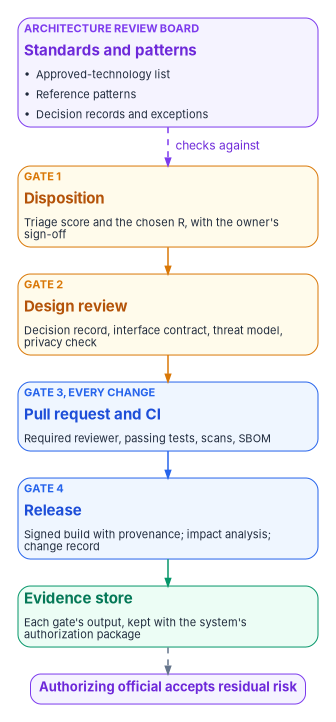

# Chapter 07 — Who Governs the Architecture

*A target architecture holds across thousands of applications only if someone owns each decision about it, every change passes the same few gates, and each gate leaves proof behind.*

::: {.callout-note}
## In this chapter
The architecture review board: what it decides, what it doesn't, and who sits on it. The standards it maintains: an approved-technology list, reference patterns and architecture decision records. The four gates every modernized application passes, from disposition to release, and the Git and pipeline practice that makes the last two cheap. How each gate produces the evidence federal compliance asks for, and a responsibility matrix for the whole cycle.
:::

The earlier chapters made a set of decisions on paper. [Chapter 02](02-triaging-the-portfolio.md) gave every application a disposition, [Chapter 03](03-the-target-reference-architecture.md) chose a target architecture, [Chapter 04](04-moving-the-data.md) set the rules for moving data, [Chapter 05](05-generative-and-agentic-ai.md) set them for AI, and [Chapter 06](06-compliance-by-design.md) said which controls apply. None of that survives contact with a few hundred delivery teams unless the decisions have owners. A team under schedule pressure will pick the framework it knows, skip the contract test that slows the build, or add a database the platform team has never seen. Each choice is defensible on its own. Across a portfolio they add up to a second legacy estate.

Governance here means three things, and only three: who decides, what every change has to pass, and what record each pass leaves. The program's design keeps the machinery small, because a review process that takes longer than the work it reviews will be bypassed. It reuses what the workbook already runs: the program's decision rights in [Book 00, Chapter 07](../b00-orientation/07-who-runs-the-program.md), and the pull-request change path in [Book 13, Chapter 04](../b13-governance/04-change-control-and-provenance.md).

{#fig-ch07-gates-and-evidence fig-alt="A vertical chain. At the top, a violet card for the architecture review board, standards and patterns: approved-technology list, reference patterns, decision records and exceptions. A dashed violet arrow labeled checks against leads to four gates in order. Gate 1, amber, disposition: triage score and the chosen R, with the owner's sign-off. Gate 2, amber, design review: decision record, interface contract, threat model, privacy check. Gate 3, blue, every change, pull request and CI: required reviewer, passing tests, scans, SBOM. Gate 4, blue, release: signed build with provenance, impact analysis, change record. An arrow leads to a green card, evidence store: each gate's output, kept with the system's authorization package. A dashed arrow leads to a violet pill: authorizing official accepts residual risk."}

## What federal policy asks for, and what it leaves open

No federal rule tells an agency to have an architecture review board. Several require the outcomes a board produces.

OMB Circular A-130 says agencies "shall develop an enterprise architecture" that describes a baseline, a target and a transition plan, and that the architecture should include plans for upgrading, replacing or disposing of systems that no longer support the mission.[^c07-a130] NIST SP 800-53 turns that into controls. PM-7 asks the organization to develop and maintain an enterprise architecture with security and privacy in view. PL-8 asks each system to have security and privacy architectures that describe how they are integrated into and support the enterprise architecture, and to keep them current as it changes. SA-17 asks a system's developer for a design consistent with that organizational architecture.[^c07-sp80053] Those three are the federal hook for architecture review: someone has to say what the enterprise architecture is and check each system against it.

Change control is just as explicit. CM-3 asks the organization to decide which changes are configuration-controlled, review and approve or disapprove them "with explicit consideration for security and privacy impact analyses," keep the records, and run the process through a named body. CM-3(4) asks that security and privacy representatives sit on that body, and CM-4 asks for an impact analysis before a change is implemented. SA-3, SA-8, SA-10, SA-11 and SA-15 ask for a defined development life cycle, engineering principles, developer configuration management, developer testing and a documented development process.[^c07-sp80053] Most of these sit in the Moderate baseline. SA-17 and SA-11(1) static code analysis don't: SA-17 is High only, and SA-11(1) is in no baseline.[^c07-sp80053b]

Funding has its own decider. FITARA forbids a covered CFO Act agency from entering into a contract for IT or IT services unless the agency CIO has reviewed and approved it, and OMB M-26-10 restated that on March 31, 2026.[^c07-m2610] An architecture board can recommend a technology. It can't buy one.

What the rules leave open is how the review happens, how often and in what form. That is the program's design, set out below.

## The architecture review board

The board is the program's change control body for the target architecture, in the sense CM-3 uses. In most agencies it should be an existing forum with a defined agenda rather than a new one. Where the agency already has an enterprise architecture function, the board is that function's review body; where the Federal Modernization Program runs a governance board ([Book 13, Chapter 09](../b13-governance/09-who-governs.md#the-governance-board)), architecture is a standing item on its agenda.

### What it decides

| Decision | Decider | Reviewed by | Recorded as |
|---|---|---|---|
| What is on the approved-technology list, and in which tier | Chief architect, as board chair | Board, with the CISO's representative | Pull request to the list, with a decision record |
| The reference patterns and their versions | Chief architect | Board; platform team | Pattern repository release |
| An exception to a standard for one application | Chief architect, with an end date | Board; CISO's representative for any control impact | Decision record with an expiry |
| A design at Gate 2 | Chief architect or a delegated reviewer | Two board members, one from security | Decision record in the application's repository |
| An application's disposition | Application owner, with the steward | Board for consistency with the target architecture | Triage record ([Chapter 02](02-triaging-the-portfolio.md)) |
| The security and privacy control requirements a design must meet | CISO and senior agency official for privacy | Board | Requirement committed as policy |
| Residual risk for the system | Authorizing official alone | — | Authorization decision ([Book 14](../b14-compliance/index.md)) |
| Contracts and licenses for a technology | CIO (FITARA approval) and sponsor | Board recommends | Acquisition record |

The table follows the rule [Book 13, Chapter 09](../b13-governance/09-who-governs.md#the-governance-board) set for the governance board: the board reviews, it doesn't vote. Every decision has one decider. A board that decides by consensus produces decisions no one is accountable for, and slow ones.

### Who sits on it

| Member | Why they're there |
|---|---|
| Chief architect, chairing | Owns the target architecture and the standards |
| Lead architects for applications, data, integration and platform | Bring the patterns and review the designs |
| The CISO's representative | The security representative CM-3(4) asks for |
| The privacy office's representative | The privacy representative CM-3(4) asks for; flags designs that need a privacy impact assessment |
| The platform team lead | Runs the pipelines and runtime the patterns depend on |
| The program steward | Keeps the decisions in the program's record and sequences them with the waves ([Chapter 10](10-running-the-portfolio-in-waves.md)) |
| Application owners, when their application is on the agenda | Decide for their application |
| The records officer, on request | Retention and disposition of data an application retires |

The authorizing official, or a designated representative, can observe. They shouldn't be members, because the board's recommendations feed decisions only the authorizing official can make, and that separation is part of what an assessor checks.

## Standards and patterns

The board governs through three artifacts. They live in a repository, change by pull request and are versioned like code.

**The approved-technology list.** Each technology the portfolio uses gets a tier. The program's design uses four: *adopt* (the default for new work), *trial* (allowed for named applications while the board evaluates it), *contain* (allowed where it already runs, not for new work) and *retire* (on a dated exit). For this book's target, Java and Spring Boot, React, Node.js for the narrow roles [Chapter 03](03-the-target-reference-architecture.md) gives it, PostgreSQL or SQL Server and OCI containers sit in *adopt*; DB2 and Oracle sit in *contain* or *retire*, depending on what the triage found. The list carries supported versions and their end-of-support dates, because SA-22 asks the organization to replace components when the vendor stops supporting them.[^c07-sp80053] A list without versions is a brochure.

**Reference patterns.** A pattern is a runnable starting point, not a slide: a service template with the contract test already wired in, a front-end template with the identity library configured, a data-migration job with validation built in, an agent with an allow-list and an audit log. [Chapter 08](08-the-reference-implementation.md) is the book's example. Teams that start from a pattern inherit the review the pattern already passed, so Gate 2 for a standard service is short and Gate 2 for a design that departs from the pattern is where the board spends its time.

**Architecture decision records.** A decision record is a short document, kept with the code, that states one significant decision and why it was made. The format most teams use goes back to Michael Nygard's 2011 proposal: a title, the context, the decision, a status and the consequences, numbered in sequence and stored in the project repository. When a decision is reversed, the old record is marked superseded rather than deleted, so the history stays visible.[^c07-nygard] Decision records are the cheapest evidence the program has. They answer the question an assessor asks about PL-8 ("how does this system's architecture fit the enterprise one?") in the words of the people who made the choice, at the time they made it.

## Four gates

Every application the triage changes passes four gates. Applications dispositioned *retire* or *retain* pass only the first.

| Gate | When | What passes it | Who decides | Controls it evidences |
|---|---|---|---|---|
| 1. Disposition | Once per application, and at each re-triage | A scored triage record and a disposition the owner has signed | Application owner, with the steward | PM-5 system inventory, CM-8 component inventory, SA-22 unsupported components |
| 2. Design review | Before build for *replatform*, *refactor* and *rebuild*; for *rehost* only when the runtime changes | A decision record for each departure from a pattern; the interface contract (OpenAPI for services); a data classification; a threat model; the privacy check that decides whether a PIA is needed | Chief architect or delegate | PL-8, SA-3, SA-8, SA-17 where High, CM-4 |
| 3. Pull request and CI | Every change | Required review by someone other than the author; passing unit, contract and integration tests; static analysis and dependency scans; an SBOM | Code owner for the component | CM-3, SA-10, SA-11, SA-15 |
| 4. Release | Every production deployment | A signed build with provenance; a recorded impact analysis; a change record that links the pull requests it contains | Release owner; change control body for significant changes | CM-3, CM-4, SR-4 provenance |

Two of the gates are meetings and two are automation, and that ratio is deliberate. Gates 1 and 2 happen once per application, or once per significant change, and need human judgment. Gates 3 and 4 happen many times a day and can be enforced by the repository and the pipeline. A program that runs Gate 3 as a meeting will either stall or stop running it.

Gate 2 also decides when a change is significant enough to go back to the authorizing official. That threshold is the authorizing official's to set, in the system's continuous monitoring strategy ([Book 14](../b14-compliance/index.md)); the gate's job is to apply it and record the answer.

## Git and pipeline practice

Gates 3 and 4 work only if the way teams use version control makes them cheap. The program's design rests on five practices.

1. **Trunk-based development or short-lived branches.** DORA's research, run by Google Cloud, describes trunk-based development as merging small batches into the main line at least once a day, with three or fewer active branches and no code freezes, and associates those practices with higher delivery performance.[^c07-dora-tbd] Long-lived branches turn every merge into an integration project, and every integration project into a reason to skip review.
2. **Pull requests with required review.** Every change to the main branch arrives as a pull request reviewed by someone other than its author. SP 800-218, the Secure Software Development Framework, asks organizations to decide whether code review, code analysis or both apply, then perform them against the organization's secure coding standards and record what they find (practice PW.7).[^c07-ssdf]
3. **Protected branches.** The platform enforces the rule instead of trusting habit. GitHub's branch protection, for example, can require a number of approving reviews, dismiss approvals when the diff changes, require code-owner review, require status checks to pass, accept only signed commits, and apply all of it to administrators as well. GitLab, Azure Repos and Bitbucket have equivalents.[^c07-gh-protect] Turn on the setting that binds administrators. A rule administrators can skip is a standing exception, as [Book 13, Chapter 04](../b13-governance/04-change-control-and-provenance.md#changing-the-record-pull-requests) puts it.
4. **CI that produces evidence, not just a green check.** The pipeline keeps its outputs: test reports, static-analysis results, dependency findings, the SBOM. SP 800-218 asks organizations to configure tools to generate artifacts showing their support of secure development practices (PO.3.3) and to collect and share provenance data for each release, "e.g., in a software bill of materials [SBOM]" (PS.3.2).[^c07-ssdf] SSDF 1.1, from February 2022, is the final version; a Version 1.2 draft, SP 800-218 Rev. 1, was published for comment on December 17, 2025, and its comment period closed on January 30, 2026.[^c07-ssdf12]
5. **Signed, reproducible releases.** The release pipeline builds from the main branch, signs what it builds and records where it came from. SLSA, a cross-industry specification now at version 1.2, defines levels of build provenance a pipeline can meet.[^c07-slsa] SR-4 asks the organization to document, monitor and maintain the provenance of the systems and components it names.[^c07-sp80053]

### What SBOMs are for, after M-26-05

OMB M-26-05 of January 23, 2026 rescinded M-22-18 and its companion M-23-16. Agencies "shall continue to maintain a complete inventory of software and hardware" and set assurance policies that match their risk; they *may* require a producer to provide a current SBOM on request.[^c07-m2605] So an SBOM from a vendor is now a contract choice. An SBOM for the agency's own modernized applications is a different matter: the agency is the producer, the pipeline generates it for free, and it is the fastest way to answer CM-8 and the next "are we affected?" question about a vulnerable library. CISA's *2026 Minimum Elements for a Software Bill of Materials*, published July 29, 2026 with NSA, the FBI and international partners, replaces the NTIA's 2021 minimum elements and is the reference for what each SBOM should contain.[^c07-cisa-sbom] [Book 14, Chapter 07](../b14-compliance/07-supply-chain-risk-management.md) covers the acquisition side.

### Agile without skipping the gates

Agile delivery and these gates aren't in tension if the gates are part of the team's definition of done rather than documents written at the end. A story isn't done until its pull request passed Gate 3. A release isn't done until Gate 4 has written its record. A design decision isn't made until it has a decision record. SA-3 asks for a defined life cycle with security and privacy roles named in it; it doesn't ask for a waterfall.[^c07-sp80053] The program's position is that the agency's SDLC policy should name these four gates and leave the cadence to the teams.

## How the gates become evidence

Each gate's output is already evidence; the work is keeping it where an assessor can find it. The program's design keeps every gate's output in, or linked from, the application's repository, and the evidence store collects it by system so it lines up with the system's authorization boundary.

| Evidence | Produced at | Kept where | Answers |
|---|---|---|---|
| Triage record and disposition | Gate 1 | Portfolio repository | PM-5, CM-8, SA-22 |
| Decision records and interface contract | Gate 2 | Application repository | PL-8, SA-8, SA-17 |
| Threat model and privacy check | Gate 2 | Application repository, linked from the system security and privacy plan | CM-4, PL-8, the PIA trigger |
| Pull request with reviewer and checks | Gate 3 | Version control history | CM-3, SA-10, SSDF PW.7 |
| Test, scan and SBOM outputs | Gate 3 | Pipeline artifact store, retained per the records schedule | SA-11, SA-15, SSDF PO.3.3 and PS.3.2 |
| Signed build and provenance | Gate 4 | Artifact registry | SR-4, SA-10 |
| Change record | Gate 4 | Change system, linked to the pull requests | CM-3, CM-4 |

This is the same principle [Book 13, Chapter 04](../b13-governance/04-change-control-and-provenance.md#no-closure-counts-unless-it-carries-its-proof) states for the program's own changes: no closure counts unless it carries its proof. For an application, the release that can't show its pull requests, tests and provenance didn't pass Gate 4, whatever the deployment log says. How the evidence reaches the authorization package is [Book 14](../b14-compliance/index.md)'s subject.

## Responsibility matrix

R = responsible (does the work), A = accountable (owns the outcome), C = consulted, I = informed. One A per row.

| Activity | CIO | Chief architect (board chair) | Board | Application owner | Delivery team lead | Platform team | CISO | Privacy office | Authorizing official | Steward |
|---|---|---|---|---|---|---|---|---|---|---|
| Charter the board and name its chair | A | R | I | I | I | I | C | C | I | C |
| Maintain the approved-technology list | C | A | R | I | C | C | C | I | I | I |
| Publish and version reference patterns | I | A | C | I | C | R | C | C | I | I |
| Grant an exception to a standard | I | A | C | R | C | C | C | C | I | I |
| Gate 1: dispositions | I | C | C | A | C | I | I | I | I | R |
| Gate 2: design review | I | A | R | C | R | C | C | C | I | I |
| Gate 3: pull request and CI | I | I | I | I | A | R | C | I | I | I |
| Gate 4: release | I | I | I | A | R | R | C | I | I | I |
| Set control requirements for designs | I | C | C | I | I | C | A | R | I | I |
| Decide whether a change is significant | I | C | I | C | C | I | C | C | A | I |
| Accept residual risk | I | I | I | C | I | I | C | C | A | I |
| Approve IT contracts and licenses | A | C | C | C | I | I | C | I | I | I |
| Keep gate evidence in the record | I | C | I | C | R | R | C | I | I | A |

Read it with [Book 00, Chapter 07](../b00-orientation/07-who-runs-the-program.md#who-decides-what), which sets the program-wide decision rights; where the two differ, Book 00 governs and this table is wrong. Two rows deserve emphasis. The authorizing official is accountable for deciding whether a change is significant, because that decision can reopen the authorization; the board and the CISO only advise. And the CIO, not the board, approves what the agency buys.

## Where governance goes wrong

1. **The board becomes the bottleneck.** Every design waits weeks for a monthly meeting. *Mitigation:* patterns that pre-approve the common case, a delegated reviewer for Gate 2, and a published service level for reviews.
2. **Standards without versions.** "Java" is on the list, so a team ships on a release that left support last year. *Mitigation:* list supported versions with end dates, and fail the build on a retired one.
3. **Review by approval count.** A pull request gets its required approval from a teammate who never read it. *Mitigation:* code owners for sensitive paths, stale-approval dismissal, and sampling of reviews by the security lead.
4. **Evidence assembled after the fact.** A month before an assessment, someone collects screenshots. *Mitigation:* keep pipeline outputs as artifacts from the first wave, and treat a missing artifact as a failed gate.
5. **The board accepting risk.** An exception granted by the chief architect is treated as a risk acceptance. *Mitigation:* exceptions that touch a control go to the authorizing official through the plan of action and milestones, and the decision record says so.

## Key takeaways

1. **Give every architecture decision one owner.** The board reviews; the chief architect decides standards; the application owner decides dispositions; the authorizing official alone accepts risk; the CIO approves purchases.
2. **Govern through artifacts, not meetings.** A versioned technology list, runnable patterns and decision records do most of the work, and they are evidence by construction.
3. **Automate the gates that run every day.** Protected branches, required review and a pipeline that keeps its outputs make Gates 3 and 4 nearly free, and that is why teams don't bypass them.

[Chapter 08](08-the-reference-implementation.md) shows the patterns as runnable code.

::: {.callout-tip}
## Continue the book
[← Previous: Chapter 06 — Compliance by Design](06-compliance-by-design.md) · [Book index](index.md) · [Next: Chapter 08 — The Reference Implementation →](08-the-reference-implementation.md)
:::

[^c07-a130]: Office of Management and Budget, Circular A-130, *Managing Information as a Strategic Resource* (2016 revision), §5.a(2), <https://www.whitehouse.gov/wp-content/uploads/legacy_drupal_files/omb/circulars/A130/a130revised.pdf> (accessed Oct 28, 2026).
[^c07-sp80053]: National Institute of Standards and Technology, SP 800-53 Rev. 5, *Security and Privacy Controls for Information Systems and Organizations*, release 5.2.0, controls CM-3, CM-3(4), CM-4, CM-8, PL-8, PM-5, PM-7, SA-3, SA-8, SA-10, SA-11, SA-11(1), SA-15, SA-17, SA-22 and SR-4, OSCAL catalog, <https://github.com/usnistgov/oscal-content/blob/main/nist.gov/SP800-53/rev5/json/NIST_SP-800-53_rev5_catalog.json> (accessed Oct 28, 2026).
[^c07-sp80053b]: National Institute of Standards and Technology, SP 800-53B control baselines, release 5.2.0, Low, Moderate and High baseline profiles, OSCAL, <https://github.com/usnistgov/oscal-content/tree/main/nist.gov/SP800-53/rev5/json> (accessed Oct 28, 2026).
[^c07-m2610]: Office of Management and Budget, M-26-10, *Reinforcing Transparency, Accountability, and Oversight of Federal Technology*, March 31, 2026, Section 1, <https://www.whitehouse.gov/wp-content/uploads/2026/03/M-26-10-Reinforcing-Transparency-Accountability-and-Oversight-of-Federal-Technology.pdf> (accessed Oct 28, 2026).
[^c07-nygard]: Michael Nygard, "Documenting Architecture Decisions," Cognitect blog, November 15, 2011, <https://www.cognitect.com/blog/2011/11/15/documenting-architecture-decisions> (accessed Oct 28, 2026).
[^c07-dora-tbd]: DORA (Google Cloud), "Capabilities: Trunk-based development," <https://dora.dev/capabilities/trunk-based-development/> (accessed Oct 28, 2026).
[^c07-ssdf]: National Institute of Standards and Technology, SP 800-218, *Secure Software Development Framework (SSDF) Version 1.1*, February 2022, Table 1, practices PO.3, PS.3 and PW.7, <https://nvlpubs.nist.gov/nistpubs/specialpublications/nist.sp.800-218.pdf> (accessed Oct 28, 2026).
[^c07-ssdf12]: National Institute of Standards and Technology, SP 800-218 Rev. 1 (Initial Public Draft), *Secure Software Development Framework (SSDF) Version 1.2*, December 17, 2025, <https://csrc.nist.gov/pubs/sp/800/218/r1/ipd>; SSDF project page, <https://csrc.nist.gov/projects/ssdf> (both accessed Oct 28, 2026).
[^c07-gh-protect]: GitHub Docs, "About protected branches," <https://docs.github.com/en/repositories/configuring-branches-and-merges-in-your-repository/managing-protected-branches/about-protected-branches> (accessed Oct 28, 2026).
[^c07-slsa]: SLSA, "SLSA specification," version 1.2, <https://slsa.dev/spec/> (accessed Oct 28, 2026).
[^c07-m2605]: Office of Management and Budget, M-26-05, *Adopting a Risk-based Approach to Software and Hardware Security*, January 23, 2026, <https://www.whitehouse.gov/wp-content/uploads/2026/01/M-26-05-Adopting-a-Risk-based-Approach-to-Software-and-Hardware-Security.pdf> (accessed Oct 28, 2026).
[^c07-cisa-sbom]: Cybersecurity and Infrastructure Security Agency, "2026 Minimum Elements for a Software Bill of Materials (SBOM)," publish date July 29, 2026, <https://www.cisa.gov/resources-tools/resources/2026-minimum-elements-software-bill-materials-sbom> (accessed Oct 28, 2026).
