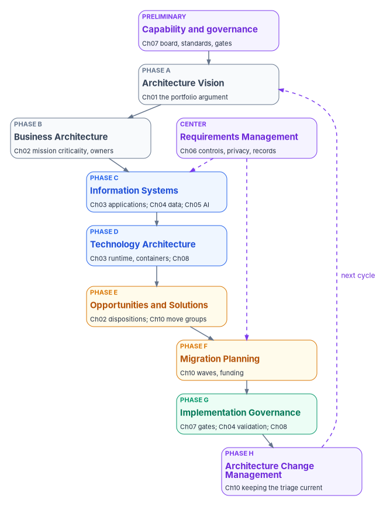

# Chapter 09 — Mapping the Work to TOGAF and Zachman

*Federal policy requires an enterprise architecture, not a framework; TOGAF tells you the order to do the work in and Zachman tells you whether you've described all of it, and this book's method can be filed under both without changing a step.*

::: {.callout-note}
## In this chapter
What federal policy requires of enterprise architecture and what it leaves to the agency. The TOGAF Standard as published today, its Architecture Development Method and where each chapter of this book does that method's work. The Zachman Framework as published today, its rows and columns in Zachman's own names, and which cells this book's chapters and the reference implementation's artifacts fill. And how to use the two mappings without building a second bureaucracy.
:::

Many agencies have an enterprise architecture office, and many of those offices describe their practice in TOGAF or Zachman terms. A modernization program that ignores the office's vocabulary forces it to translate every artifact before it can use it, and a program that adopts the vocabulary wholesale ends up producing framework deliverables nobody reads. This chapter takes the middle course. It maps what the book already does to the phases and cells those offices know, so the portfolio's triage records, decision records, contracts and wave plans can be filed in the agency's architecture repository as they are.

The mappings in this chapter are the program's reading. Neither The Open Group nor Zachman International has reviewed them.

{#fig-ch09-adm-map fig-alt="A vertical chain of ten cards following the ADM cycle. Preliminary, violet: capability and governance, Chapter 07 board, standards, gates. Phase A, slate: Architecture Vision, Chapter 01 the portfolio argument. Phase B, slate: Business Architecture, Chapter 02 mission criticality and owners. Beside Phase B, a violet card at the center: Requirements Management, Chapter 06 controls, privacy, records, with dashed arrows to Phase C and Phase F. Phase C, blue: Information Systems, Chapter 03 applications, Chapter 04 data, Chapter 05 AI. Phase D, blue: Technology Architecture, Chapter 03 runtime and containers, Chapter 08. Phase E, amber: Opportunities and Solutions, Chapter 02 dispositions, Chapter 10 move groups. Phase F, amber: Migration Planning, Chapter 10 waves and funding. Phase G, green: Implementation Governance, Chapter 07 gates, Chapter 04 validation, Chapter 08. Phase H, violet: Architecture Change Management, Chapter 10 keeping the triage current. A dashed violet arrow labeled next cycle returns from Phase H to Phase A."}

## What federal policy requires

The requirement is in OMB Circular A-130. Agencies "shall develop an enterprise architecture (EA) that describes the baseline architecture, target architecture, and a transition plan to get to the target architecture." The architecture must align with the agency's information resources management strategic plan, and should take in plans for significant upgrades, replacements and disposition of systems that can no longer support the mission.[^c09-a130] A-130 also directs agencies to build federal security and privacy requirements into the enterprise architecture (Appendix I, §4.b(5)). It names no framework.

NIST SP 800-53 carries the requirement into controls. PM-7 asks the organization to develop and maintain an enterprise architecture with consideration for security, privacy and the resulting risk. Its discussion explains that PM-7's architectures sit at the system-of-systems level, and PL-8's at the level of one system, consistent with the organization's.[^c09-sp80053] An assessor testing PM-7 or PL-8 asks to see the architecture and its relationship to each system; nothing in either control asks for a framework.

The Federal Enterprise Architecture Framework version 2, published January 29, 2013, survives on an archived OMB page that is no longer updated.[^c09-feaf] It is historical. The workbook's position, set in the federal framework crosswalk, is to cite A-130 §5.a(2) and PM-7 for the requirement and to treat FEAF v2 as background. An agency that still organizes its architecture around FEAF's reference models can keep doing so; it just can't cite FEAF v2 as current federal policy.

So TOGAF and Zachman are choices. They're useful ones, because the A-130 triad (baseline, target, transition plan) is exactly what TOGAF's method produces and what Zachman's grid helps check for completeness.

## The TOGAF Standard today

The current edition is **the TOGAF Standard, 10th Edition**, published by The Open Group, which announced it on April 25, 2022.[^c09-togaf-launch] The edition's document number is C220; The Open Group's publication page carries a May 19, 2025 date and notes that Technical Corrigendum 1 was applied in May 2025.[^c09-togaf-c220] It succeeds Version 9.2, which The Open Group still offers alongside it.[^c09-togaf-license]

The edition separates stable content from guidance. It "is divided into the TOGAF Fundamental Content and the TOGAF Series Guides." The Fundamental Content has six parts: Introduction and Core Concepts; Architecture Development Method; ADM Techniques; Applying the ADM; Architecture Content; and Enterprise Architecture Capability and Governance. The Series Guides include, among others, a Government Reference Model, a Microservices Architecture guide, guides on business capabilities and value streams, and a guide to integrating risk and security.[^c09-togaf-c220] The Open Group says the split lets it publish new guidance more often while keeping the core stable.[^c09-togaf-launch]

The standard is free to download for non-commercial use, which The Open Group says "will usually mean using it inside your organization," after registration; commercial use needs a license.[^c09-togaf-license] Its online edition requires a sign-in. This chapter relies only on The Open Group's public pages and paraphrases rather than quoting the standard.

### The Architecture Development Method

The ADM is TOGAF's method: a cycle of phases that takes an architecture from vision to governed change, with requirements management at the center feeding every phase.[^c09-togaf-adm][^c09-togaf-pubs]

| Phase | Name | What it produces, in short |
|---|---|---|
| Preliminary | Preliminary | The organization's architecture capability: principles, governance, the framework tailored to the agency |
| A | Architecture Vision | Scope, stakeholders and an approved vision for this cycle |
| B | Business Architecture | Baseline and target business architecture, and the gaps between them |
| C | Information Systems Architectures | Baseline and target data and application architectures, in either order |
| D | Technology Architecture | The technology architecture the implementation will build on |
| E | Opportunities and Solutions | Implementation options (build, buy, reuse), the top-level work packages, their dependencies, costs and benefits |
| F | Migration Planning | The work packages in priority order, as an implementation and migration plan |
| G | Implementation Governance | Architectural oversight of implementation, and conformance of projects to the target |
| H | Architecture Change Management | Procedures for managing change to the architecture, and the trigger for the next cycle |
| Center | Requirements Management | A process that identifies, stores and feeds architecture requirements into and out of every phase |

Two features matter for a portfolio. Phases B, C and D each compare a baseline with a target, which is A-130's language. And Phases E and F turn that comparison into work packages and a sequenced plan, which is what [Chapter 02](02-triaging-the-portfolio.md) and [Chapter 10](10-running-the-portfolio-in-waves.md) do for applications.

## The Zachman Framework today

The current version is **the Zachman Framework for Enterprise Architecture, Version 3.0**, subtitled "The Enterprise Ontology," published by Zachman International and dated 2011 on the framework graphic (copyright 1987–2011, John A. Zachman).[^c09-zachman-graphic][^c09-zachman-evolution] Zachman International describes the framework as a schema at the intersection of two classifications: the communication interrogatives and the stages of reification. It is depicted as a six-by-six matrix with the interrogatives as columns and the transformations as rows, and each cell is one intersection.[^c09-zachman-about]

Zachman is emphatic that the framework "IS NOT a methodology."[^c09-zachman-about] It doesn't say what order to work in, where to start or how much to describe. It says what a complete description contains. That makes it the natural complement to TOGAF: one gives a process, the other a checklist for what the process should have produced.

Version 3.0 names its columns and rows as follows.[^c09-zachman-graphic]

| Column (interrogative) | Zachman's name for the column |
|---|---|
| What | Inventory Sets |
| How | Process Flows |
| Where | Distribution Networks |
| Who | Responsibility Assignments |
| When | Timing Cycles |
| Why | Motivation Intentions |

| Row (audience perspective) | Who holds it, in Zachman's terms | Model name | Reification stage in each cell |
|---|---|---|---|
| 1. Executive Perspective | Business context planners | Scope Contexts | Identification |
| 2. Business Management Perspective | Business concept owners | Business Concepts | Definition |
| 3. Architect Perspective | Business logic designers | System Logic | Representation |
| 4. Engineer Perspective | Business physics builders | Technology Physics | Specification |
| 5. Technician Perspective | Business component implementers | Tool Components | Configuration |
| 6. Enterprise Perspective | Users | Operations Instances | Instantiation |

A cell is named by joining its column and its stage: *Inventory Identification* is row 1 of What, *Process Representation* row 3 of How, *Responsibility Specification* row 4 of Who.[^c09-zachman-graphic] The tables below use those names.

## Mapping the chapters and artifacts to TOGAF

The left column lists each chapter of this book and the main artifacts of the reference implementation in [Chapter 08](08-the-reference-implementation.md). The right columns say which ADM phase the work belongs to and what kind of ADM output it stands in for.

| Book 18 chapter or artifact | ADM phase | What it stands in for |
|---|---|---|
| [Ch01](01-a-portfolio-not-a-rewrite.md) A portfolio, not a rewrite | A | The architecture vision: scope (the whole portfolio), the problem and the case for change |
| [Ch02](02-triaging-the-portfolio.md) Triaging the portfolio | B, E | Business baseline (mission criticality, owners, cost); the disposition per application is Phase E's choice among options, including leaving a system in place |
| [Ch03](03-the-target-reference-architecture.md) Target reference architecture | C, D | Target application architecture (services, contracts, front ends); target technology architecture (runtimes, containers, orchestration) |
| [Ch04](04-moving-the-data.md) Moving the data | C, G | Target data architecture and the data migration approach; the validation evidence is Phase G conformance |
| [Ch05](05-generative-and-agentic-ai.md) Generative and agentic AI | C, Requirements Management | Application architecture for AI features; the AI rules and identity requirements as architecture requirements |
| [Ch06](06-compliance-by-design.md) Compliance by design | Requirements Management, Preliminary | Security, privacy and records requirements that feed every phase; principles for the architecture capability |
| [Ch07](07-who-governs-the-architecture.md) Who governs the architecture | Preliminary, G | The governance framework and architecture board; the gates as implementation governance and compliance review |
| [Ch08](08-the-reference-implementation.md) The reference implementation | D, G | Reusable building blocks for the target; a worked example of conformance |
| Ch09 (this chapter) | Preliminary | Tailoring the frameworks to the agency |
| [Ch10](10-running-the-portfolio-in-waves.md) Running the portfolio in waves | E, F, H | Move groups as work packages; the wave plan as the implementation and migration plan; re-triage as architecture change management |
| Portfolio inventory and triage scores | B, E | Baseline catalog; gap analysis; options |
| Architecture decision records | Preliminary to H | The record of architecture decisions, kept per application |
| OpenAPI contract and contract test | C, G | Interface definition in the target application architecture; a conformance check run on every change |
| Spring Boot service over PostgreSQL | C, D | A building block of the target application and technology architecture |
| React front end | C | The user-facing application component |
| DB2/Oracle to PostgreSQL migration CLI | E, F, G | The transition mechanism for data, scheduled in a wave and governed by its validation |
| Row-count, checksum and aggregate validation report | G | Proof that the implementation conforms to the target without loss |
| Provider-neutral agent pattern with a stub model | C, Requirements Management | Target application pattern for AI, with its identity and approval requirements |
| Wave plan and gate decisions ([Chapter 10](10-running-the-portfolio-in-waves.md)) | F, G | Implementation and migration plan; governance checkpoints |

Read the table with one caution. The ADM is a cycle, and the book does several cycles at once: one for the portfolio, and one for each application a wave changes. For the portfolio, Phases A through F happen once and are revisited at each re-triage. For an application, Phase G happens many times, once per change, through the gates in [Chapter 07](07-who-governs-the-architecture.md).

## Mapping the chapters and artifacts to Zachman

Zachman cells are named by column and stage, as above. Most chapters fill several cells; the table lists the main ones.

| Book 18 chapter or artifact | Row (perspective) | Column | Cell |
|---|---|---|---|
| [Ch01](01-a-portfolio-not-a-rewrite.md) | 1 Executive | Why; What | Motivation Identification; Inventory Identification (the list of applications in scope) |
| [Ch02](02-triaging-the-portfolio.md) | 1 Executive; 2 Business Management | What; Who; Why | Inventory Identification; Responsibility Definition (owners); Motivation Definition (the dispositions as business ends and means) |
| [Ch03](03-the-target-reference-architecture.md) | 3 Architect; 4 Engineer | How; Where | Process Representation (services and contracts); Distribution Specification (containers, orchestration) |
| [Ch04](04-moving-the-data.md) | 3 Architect; 4 Engineer; 6 Enterprise | What | Inventory Representation (logical model); Inventory Specification (physical schema, type mapping); Inventory Instantiations (the migrated rows) |
| [Ch05](05-generative-and-agentic-ai.md) | 3 Architect; 4 Engineer | Who; How | Responsibility Representation (agent roles, human approval); Responsibility Specification (agent identities and tool permissions) |
| [Ch06](06-compliance-by-design.md) | 2 Business Management; 4 Engineer | Why | Motivation Definition (policy and privacy rules); Motivation Specification (controls as implemented) |
| [Ch07](07-who-governs-the-architecture.md) | 2 Business Management; 3 Architect | Who; When | Responsibility Definition (decision rights); Timing Representation (the gates in the life cycle) |
| [Ch08](08-the-reference-implementation.md) | 5 Technician | All six | The Configuration cells: the reference implementation is row 5 for one application |
| [Ch10](10-running-the-portfolio-in-waves.md) | 1 Executive; 2 Business Management | When; Why | Timing Identification (phases and gates); Timing Definition (the wave schedule); Motivation Definition (funding and metrics) |
| Portfolio inventory | 1 Executive | What; How | Inventory Identification; Process Identification |
| OpenAPI contract | 3 Architect | How | Process Representation (system inputs and outputs) |
| Spring Boot service | 5 Technician | How | Process Configuration |
| Contract test | 5 Technician; 6 Enterprise | How | Process Configuration checked against Process Representation; its run results are Process Instantiations |
| PostgreSQL schema | 4 Engineer; 5 Technician | What | Inventory Specification; Inventory Configuration |
| React front end | 5 Technician | Who; How | Responsibility Configuration (the screens each role works in); Process Configuration |
| Container images and deployment files | 5 Technician | Where | Distribution Configuration |
| Migration CLI | 5 Technician | What; When | Inventory Configuration; Timing Configuration (the cut-over run) |
| Validation report | 6 Enterprise | What | Inventory Instantiations: counts, checksums and aggregates of the real rows |
| Agent pattern with a stub model | 4 Engineer; 5 Technician | Who | Responsibility Specification; Responsibility Configuration |

Two gaps show up when the table is read by column. The **Where** column is thin above row 4: the book says little about the agency's business locations or network topology, because [Book 09](../b09-network/index.md) and [Book 10](../b10-cloud-boundary/index.md) do. And the **When** column is thin below row 2: the book schedules waves but doesn't model application timing, such as batch windows and event schedules. That belongs in each application's design review, and the decision record is where to put it. Gaps like these are what Zachman is for.

## Using the mappings

The program's design for using the two frameworks is short.

1. **File, don't redo.** Put the book's artifacts in the agency's architecture repository under the ADM phase and Zachman cell above. A triage record doesn't need to be rewritten as a "Phase B deliverable" to serve as one.
2. **Answer the assessor with the A-130 triad.** For PM-7 and PL-8, show the baseline (the portfolio inventory and triage), the target (the reference architecture and patterns) and the transition plan (the wave plan), with decision records connecting each system to them. The framework labels help the enterprise architecture office; the triad is what the requirement asks for.
3. **Use Zachman to find what's missing, not to fill every cell.** Zachman International itself says the framework doesn't prescribe how much to formalize now and what to engineer for reuse later.[^c09-zachman-about] An empty cell is a question, not a defect.
4. **Use the ADM's Phase H for re-triage.** The portfolio changes; vendors end support, missions change, incidents reveal risk. [Chapter 10](10-running-the-portfolio-in-waves.md) sets the triggers. In TOGAF terms they start the next cycle.
5. **Don't buy compliance with a framework.** No federal rule requires TOGAF or Zachman, and claiming conformance to either says nothing about whether the systems meet their controls.

## Key takeaways

1. **The requirement is the architecture, not the framework.** A-130 §5.a(2) and PM-7 ask for a baseline, a target and a transition plan with security and privacy built in. FEAF v2 is historical.
2. **TOGAF is the order; Zachman is the checklist.** The ADM's phases match the book's sequence from vision to waves; Zachman's cells show what the book describes in detail and where it leaves work to other books or to each application.
3. **The book's artifacts already fit both.** File them under the phase and cell they belong to and the enterprise architecture office can use them without translation.

[Chapter 10](10-running-the-portfolio-in-waves.md) runs the portfolio, in TOGAF's terms Phases E through H, wave by wave.

::: {.callout-tip}
## Continue the book
[← Previous: Chapter 08 — The Reference Implementation](08-the-reference-implementation.md) · [Book index](index.md) · [Next: Chapter 10 — Running the Portfolio in Waves →](10-running-the-portfolio-in-waves.md)
:::

[^c09-a130]: Office of Management and Budget, Circular A-130, *Managing Information as a Strategic Resource* (2016 revision), §5.a(2) and Appendix I §4.b(5), <https://www.whitehouse.gov/wp-content/uploads/legacy_drupal_files/omb/circulars/A130/a130revised.pdf> (accessed Oct 28, 2026).
[^c09-sp80053]: National Institute of Standards and Technology, SP 800-53 Rev. 5, *Security and Privacy Controls for Information Systems and Organizations*, release 5.2.0, controls PM-7 and PL-8 with their discussion, OSCAL catalog, <https://github.com/usnistgov/oscal-content/blob/main/nist.gov/SP800-53/rev5/json/NIST_SP-800-53_rev5_catalog.json> (accessed Oct 28, 2026).
[^c09-feaf]: The White House (archived), Office of Management and Budget, "Federal Enterprise Architecture (FEA)," including "Federal Enterprise Architecture Framework version 2" (January 29, 2013), <https://obamawhitehouse.archives.gov/node/17927> (accessed Oct 28, 2026).
[^c09-togaf-launch]: The Open Group, "The Open Group Announces Launch of the TOGAF® Standard, 10th Edition," April 25, 2022, <https://www.opengroup.org/open-group-announces-launch-togaf-standard-10th-edition> (accessed Oct 28, 2026).
[^c09-togaf-c220]: The Open Group, *The TOGAF® Standard, 10th Edition* (document C220), publication page, May 19, 2025, with Technical Corrigendum 1 applied, list of Fundamental Content parts and TOGAF Series Guides, <https://publications.opengroup.org/c220> (accessed Oct 28, 2026).
[^c09-togaf-license]: The Open Group, "TOGAF Licensed Downloads," <https://www.opengroup.org/togaf-licensed-downloads>; "The TOGAF® Standard" landing page, <https://www.opengroup.org/togaf> (both accessed Oct 28, 2026).
[^c09-togaf-adm]: The Open Group Security Forum and Architecture Forum, *Guide to Security Architecture in TOGAF ADM*, white paper W055, November 2005, sections on Requirements Management and Phases A to H, <https://pubs.opengroup.org/onlinepubs/7699949499/toc.pdf> (accessed Oct 28, 2026). The white paper predates the 10th Edition; the current phase names are confirmed against the publisher's online index in the next note.
[^c09-togaf-pubs]: The Open Group, *TOGAF® Standard — Architecture Development Method*, 10th Edition, online chapters "Phase A: Architecture Vision," "Phase E: Opportunities & Solutions," "Phase G: Implementation Governance," "Phase H: Architecture Change Management" and "ADM Architecture Requirements Management," <https://pubs.opengroup.org/togaf-standard/adm/> (sign-in required; chapter titles confirmed from the publisher's index, Oct 28, 2026).
[^c09-zachman-graphic]: John A. Zachman, *The Zachman Framework for Enterprise Architecture: The Enterprise Ontology*, Version 3.0, © 1987–2011, Zachman International, <https://zachman-feac.com/images/ZI_PIcs/ZF3.jpg> (accessed Oct 28, 2026).
[^c09-zachman-evolution]: Zachman International, "The Zachman Framework Evolution," <https://zachman-feac.com/the-zachman-framework-evolution> (accessed Oct 28, 2026).
[^c09-zachman-about]: Zachman International, "About the Zachman Framework," including John A. Zachman's concise definition (© 2008), <https://zachman-feac.com/zachman/about-the-zachman-framework> (accessed Oct 28, 2026).
