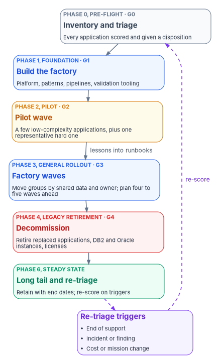

# Chapter 10 — Running the Portfolio in Waves

*A portfolio of thousands of applications is modernized the way any large thing is built: a small first batch to learn on, a factory that makes each later batch cheaper, and a list that is re-scored often enough to stay true.*

::: {.callout-note}
## In this chapter
How the application portfolio runs inside the program's phases and gates. How to plan waves: what goes in the pilot, how move groups form, how far ahead to plan, and what to do with the long tail. What the modernization factory is and who staffs it. The metrics that tell an executive whether it is working. How the Technology Modernization Fund and IT working capital funds pay for it. And how to keep the triage from going stale.
:::

[Chapter 02](02-triaging-the-portfolio.md) produced a disposition for every application. That is a list, not a plan. A large agency can't start thousands of modernization projects at once, and it shouldn't run them one at a time either: each would rediscover the same problems with the same database conversions, the same authentication changes and the same authorization questions. Waves solve both problems. Each wave is a batch of applications that move together through the same steps, and each one leaves the next a little cheaper.

The program already has a schedule and a set of gates. [Book 01, Chapter 12](../b01-transformation-arc/12-migration-roadmap.md) sets seven phases, Phase 0 *Pre-flight* to Phase 6 *Steady state*, with gates G0 to G5 and named authorities for each. The application portfolio doesn't need a second schedule. It runs inside that one, and this chapter says what each phase means for applications.

{#fig-ch10-waves fig-alt="A vertical chain of six cards. Phase 0, Pre-flight, gate G0, slate: inventory and triage, every application scored and given a disposition. Phase 1, Foundation, gate G1, blue: build the factory, platform, patterns, pipelines, validation tooling. Phase 2, Pilot, gate G2, amber: pilot wave, a few low-complexity applications plus one representative hard one. An arrow labeled lessons into runbooks leads to Phase 3, General rollout, gate G3, blue: factory waves, move groups by shared data and owner, plan four to five waves ahead. Phase 4, Legacy retirement, gate G4, red: decommission, retire replaced applications, DB2 and Oracle instances, licenses. Phase 6, Steady state, green: long tail and re-triage, retain with end dates, re-score on triggers. A dashed violet arrow leads from Phase 6 to a violet card, re-triage triggers: end of support, incident or finding, cost or mission change, and another dashed arrow labeled re-score returns to Phase 0."}

## The portfolio on the program's phases

| Program phase and gate ([Book 01, Ch12](../b01-transformation-arc/12-migration-roadmap.md)) | What it means for the application portfolio | Leaves behind |
|---|---|---|
| Phase 0, Pre-flight; G0 Ready to Plan | Inventory every application, score it, give it a disposition and an owner ([Chapter 02](02-triaging-the-portfolio.md)) | The triage record; a first wave plan |
| Phase 1, Foundation; G1 Foundation Complete | Build the factory: the platform, the reference patterns, the pipelines and the data validation tooling ([Chapter 03](03-the-target-reference-architecture.md), [Chapter 04](04-moving-the-data.md), [Chapter 08](08-the-reference-implementation.md)); stand up the review gates ([Chapter 07](07-who-governs-the-architecture.md)) | A factory that has moved one test application end to end |
| Phase 2, Pilot division; G2 Pilot Clean | Run the pilot wave | Runbooks rewritten from what went wrong |
| Phase 3, General rollout; G3 Rollout Complete | Run the factory waves | Applications modernized and authorized, wave by wave |
| Phase 4, Legacy retirement; G4 Legacy Quiet | Decommission what the waves replaced: old application servers, DB2 and Oracle instances, licenses, interfaces | Retirement records, with the records officer's sign-off |
| Phase 5, AD DS retirement; G5 AD Retired | No application work of its own, but a hard dependency: no production application may still authenticate against Active Directory when the gate is decided | An application dependency check feeding G5 |
| Phase 6, Steady state | Work the long tail and re-triage on a cadence | A portfolio that stays current |

The gate authorities don't change. The steward clears G0, G1 and G4, the steward and executive sponsor clear G2, the sponsor and steering committee clear G3, and the sponsor and CIO clear G5 ([Book 01, Chapter 12](../b01-transformation-arc/12-migration-roadmap.md#gates-rollback-and-authority)). What changes is the evidence each gate reads. G2 for applications, for example, reads the pilot wave's validation reports, its gate records and the defects found after cut-over, not only the identity drift reports the program's own G2 names.

The program's phase weeks are illustrative, and an application portfolio runs longer than the identity work. The program's design is to keep the phase sequence and gates and let the application waves extend Phase 3 for as long as the portfolio needs, with each wave reporting at the monthly gate review.

## Planning waves

AWS's Prescriptive Guidance for large migrations and the Microsoft Cloud Adoption Framework give consistent advice on waves, and it carries over from servers to applications.

**Start small and simple.** AWS recommends that the first waves hold few servers, low-complexity applications and lower environments, and that teams "fail fast," starting small and applying what they learn to later waves.[^c10-aws-wave] Microsoft's guidance is to begin with less complex, lower-risk workloads, move non-production environments before production, and schedule critical systems after the team has shown it can migrate.[^c10-caf-wave]

**But include one hard case.** Microsoft also advises adding one or two complex workloads to each early wave, representative of common patterns such as multi-tier or database-dependent applications, to expose the problems mission-critical applications will raise.[^c10-caf-wave] The program's design takes both pieces of advice: a pilot wave of three to five simple applications plus one representative application with a DB2 or Oracle database and a real interface contract.

**Group by what must move together.** AWS calls the unit a *move group*: applications and servers that must migrate together, such as applications sharing a database or owned by the same person, and waves are built from one or more move groups.[^c10-aws-wave] Microsoft's guidance groups workloads by shared databases, APIs, authentication services and network connections, and suggests grouping components together when it isn't clear how critical a dependency is.[^c10-caf-plan] For application modernization the strongest grouping rule is the database. Applications that share a DB2 or Oracle schema move in one move group, or one of them goes first behind an interface the others call, which is the strangler-fig approach of [Chapter 03](03-the-target-reference-architecture.md).

**Plan ahead, but only in detail for the next wave.** AWS recommends planning four to five waves in advance so the delivery teams never run out of work, while treating wave planning as continuous rather than a one-time task.[^c10-aws-wave] Microsoft recommends defining only the next wave in detail and keeping later waves at a high level until there is enough information.[^c10-caf-wave] The two fit together: a ranked backlog five waves deep, with only the next wave fully planned.

### Three kinds of wave

| Wave | What goes in it | Size (program design) | Exit test |
|---|---|---|---|
| Pilot | Three to five low-complexity applications, plus one representative hard case | One factory team | Every application through all four gates of [Chapter 07](07-who-governs-the-architecture.md); every data migration validated; runbooks revised |
| Factory waves | Move groups ranked by the triage score: value, risk, end-of-support date, funding | Set by measured factory throughput, not by ambition | The wave's applications authorized and in production; replaced components scheduled for Phase 4 |
| Long tail | Applications dispositioned *retain*, applications no team will fund, and applications too entangled to move yet | Not a wave; a managed list | Each has an owner, a reason and an end date for review |

The long tail is where portfolios rot. An application dispositioned *retain* isn't finished; it's deferred. The program's design gives every retained application a review date, and an application that reaches end of support while retained goes back to triage automatically.

## The modernization factory

A factory is the set of people, platform and repeatable procedures that turns each wave into a routine. AWS uses the same word: its guidance describes building standard operating procedures and automation into a repeatable pattern, "known as a *migration factory*," that is initialized and calibrated first and then run and improved wave by wave. It splits the work into workstreams for foundation, project governance, portfolio and migration, with the portfolio workstream collecting data, prioritizing and planning waves while the migration workstream does the cut-overs.[^c10-aws-phases]

For application modernization the factory has five parts. Each is the program's design, built from earlier chapters.

| Part | What it is | Owned by |
|---|---|---|
| Platform | The container platform, identity integration, logging and the evidence store every modernized application lands on | Platform team |
| Patterns | Runnable templates for services, front ends, data migration and AI agents ([Chapter 08](08-the-reference-implementation.md)) | Chief architect; platform team maintains |
| Pipelines | Reusable pipelines that run Gates 3 and 4 and keep their outputs ([Chapter 07](07-who-governs-the-architecture.md)) | Platform team |
| Data tooling | Schema conversion, data movement and the row-count, checksum and aggregate validation of [Chapter 04](04-moving-the-data.md) | Data lead |
| Runbooks and a portfolio team | The written procedure for each disposition, and a small team that keeps the triage, plans the next waves and runs the gate reviews | Steward |

Factory teams do the work wave by wave; application owners and their developers join for their applications. The factory's own measure of success is that the fifth wave costs less per application than the first. If it doesn't, the runbooks aren't absorbing what the waves teach.

## Metrics

Executives need a few numbers that show whether the portfolio is moving, and engineers need a few that show whether the factory works. The program's design reports both at the monthly gate review.

| Metric | Definition | Source | Read by |
|---|---|---|---|
| Applications dispositioned | Share of the inventory with a scored disposition and a named owner | Triage record | Sponsor, CIO |
| Applications retired | Count and share retired, with infrastructure and licenses actually shut off | Phase 4 retirement records | Sponsor, CFO |
| Applications modernized | Count through all four gates and in production on the target | Gate records | Steering committee |
| Data migrations validated | Share of cut-overs whose row counts, checksums and aggregates reconciled on the first run | Validation reports | Data lead, steward |
| Operations and maintenance cost avoided | Annual run cost of retired or replaced components, less the target's run cost | Budget data, agreed with the CFO's office | Sponsor, CFO, TMF board where funded |
| Change lead time and change fail rate | DORA's measures: time from commit to production, and the share of deployments needing immediate intervention[^c10-dora] | Pipeline and incident data | Platform team, delivery leads |
| Defects after cut-over | Defects found in production in the first 30 days, per application | Issue tracker | Steward, application owners |
| Time to authorization | Days from Gate 2 design approval to the authorizing official's decision | Gate and authorization records | CISO, authorizing official |
| Long-tail health | Retained applications with an owner, a reason and a review date that hasn't passed | Triage record | Steward |

Two cautions. "Cost avoided" is a forecast until the old system is actually switched off, so report it from Phase 4 records, not from plans. And time to authorization measures the whole path, not the authorizing official: if it is long, look first at whether the evidence from [Chapter 07](07-who-governs-the-architecture.md)'s gates arrives complete.

## Funding

Waves are also a funding structure. Each wave is a budget request small enough to approve and a set of results soon enough to show.

**The Technology Modernization Fund.** The TMF funds proposals that "must improve, retire, or replace existing federal IT systems." Its fit guidance says competitive projects are typically less than $25 million and use a five-year repayment timeline, that agencies should aim to repay the full amount, and that proposals should show measurable outcomes, ideally within 12 months of starting.[^c10-tmf-fit] Funding is released in stages as the project reaches milestones, after an initial project proposal, a full proposal and votes by the Technology Modernization Board, and repayment typically begins within a year of the first transfer.[^c10-tmf-process] The 2026 call keeps legacy modernization and cybersecurity as priorities, adds AI adoption and permitting technology, and asked for initial project proposals by October 20, 2026.[^c10-tmf-2026] A wave plan fits that shape: a TMF proposal can fund a pilot wave and the first factory waves, with milestones that match the gates.

**IT working capital funds.** The Modernizing Government Technology Act lets the head of each CFO Act agency establish an IT system modernization and working capital fund. It may be used to improve, retire or replace existing systems, to move legacy systems to commercial cloud and other platforms, and to repay TMF transfers. Deposits stay available for three years, after which unobligated amounts return to the Treasury. The fund can't be used to supplant operations and maintenance funding, and the agency head must prioritize it first for cost-savings activities the CIO approves.[^c10-mgt] That last rule is the important one for a portfolio: savings from retiring applications in one wave can be reprogrammed into the fund to pay for the next.

**Capital planning and the CIO's role.** Waves still go through the agency's capital planning process, which 40 U.S.C. §11312 requires agency heads to run "for maximizing the value" of IT acquisitions and managing their risks.[^c10-11312] OMB M-26-10 restates that CFO Act agency CIOs must advise the agency head on whether to continue, modify or terminate IT programs, and that the agency can't contract for IT without CIO approval.[^c10-m2610] A triage disposition is that advice made specific for each application, which is a good reason to have the CIO sign the wave plan.

## Keeping the triage current

A triage done once decays the way any inventory does. The rules point the same way. A-130 asks agencies to inventory software applications when obtained and update the inventory "on an ongoing basis," and to give systems that can't be protected "a high priority for upgrade, replacement, or retirement."[^c10-a130] SP 800-53 asks for a system inventory (PM-5) and a component inventory (CM-8) that are reviewed and updated, and for unsupported components to be replaced (SA-22).[^c10-sp80053] [Chapter 09](09-togaf-and-zachman.md) calls the same thing TOGAF's Phase H.

The program's design for keeping the triage current:

1. **Re-score on triggers, not only on a calendar.** An application goes back to triage when a component it depends on has a published end-of-support date within the planning horizon, when an incident or assessment finding touches it, when its run cost or user base changes materially, or when its mission changes.
2. **Re-score the whole portfolio at least once a year,** aligned with the budget cycle so the next year's waves and funding requests use current scores.
3. **Feed the score from the factory.** Each wave measures what modernization actually cost for each disposition. Those numbers replace the estimates in the scoring rubric, so later triage is more accurate than the first.
4. **Keep dispositions in the record.** A changed disposition is a pull request to the triage record with a decision record, like any other change ([Book 13, Chapter 04](../b13-governance/04-change-control-and-provenance.md)).
5. **Close the loop with retirement.** An application isn't retired until its infrastructure is off, its data is dispositioned under the records schedule and its entry in the inventory says so.

## Where wave programs go wrong

1. **A pilot that is too easy.** Every pilot application succeeds, and the first factory wave meets its first DB2 stored-procedure package. *Mitigation:* one representative hard case in the pilot.
2. **Waves sized by the schedule.** The plan needs 400 applications a year, so waves are sized to 400 divided by twelve. *Mitigation:* size waves by measured throughput from the pilot, and change the schedule, not the waves.
3. **Nothing actually retired.** New systems go live and the old ones keep running "just in case." *Mitigation:* Phase 4 is a gate, cost avoided is reported only from retirement records, and decommission dates are set before cut-over.
4. **The long tail as a hiding place.** Hard applications get dispositioned *retain* to make the numbers look good. *Mitigation:* review dates, end-of-support triggers and a long-tail health metric the sponsor reads.
5. **A stale triage.** The first scoring drives five years of waves. *Mitigation:* the triggers and annual re-score above.

## Key takeaways

1. **Run the portfolio on the program's phases and gates.** The application waves fill Phases 0 through 4 and 6 of [Book 01, Chapter 12](../b01-transformation-arc/12-migration-roadmap.md), and no application may still depend on Active Directory authentication when G5 is decided.
2. **Learn small, then industrialize.** A pilot wave with one hard case, a factory that writes down what each wave teaches, and waves sized by measured throughput.
3. **Fund and measure by wave.** TMF milestones, working capital funds fed by retirement savings, and a few metrics reported from records rather than plans.
4. **Keep the list true.** Re-score on triggers and yearly, and give every retained application an owner and a review date.

This is the last chapter of Book 18. The book's argument, in one line: decide application by application, build the changed ones on one architecture, prove the data moved, govern the AI, and let the gates write the evidence.

::: {.callout-tip}
## Continue the book
[← Previous: Chapter 09 — Mapping the Work to TOGAF and Zachman](09-togaf-and-zachman.md) · [Book index](index.md)
:::

[^c10-aws-wave]: Amazon Web Services, AWS Prescriptive Guidance, *Portfolio playbook for AWS large migrations*, "Task 5: Defining the wave planning process," <https://docs.aws.amazon.com/prescriptive-guidance/latest/large-migration-portfolio-playbook/wave-planning.html> (accessed Oct 28, 2026).
[^c10-caf-wave]: Microsoft Learn, Cloud Adoption Framework, "Migration wave planning," <https://learn.microsoft.com/azure/cloud-adoption-framework/migrate/migration-wave-planning> (accessed Oct 28, 2026).
[^c10-caf-plan]: Microsoft Learn, Cloud Adoption Framework, "Plan your migration," Determine the migration sequence, <https://learn.microsoft.com/azure/cloud-adoption-framework/migrate/plan-migration> (accessed Oct 28, 2026).
[^c10-aws-phases]: Amazon Web Services, AWS Prescriptive Guidance, *Guide for AWS large migrations*, "Phases of a large migration," <https://docs.aws.amazon.com/prescriptive-guidance/latest/large-migration-guide/phases.html> (accessed Oct 28, 2026).
[^c10-dora]: DORA (Google Cloud), "DORA's software delivery performance metrics," <https://dora.dev/guides/dora-metrics/> (accessed Oct 28, 2026).
[^c10-tmf-fit]: Technology Modernization Fund, "Agency and project fit," <https://tmf.cio.gov/fit/> (accessed Oct 28, 2026).
[^c10-tmf-process]: Technology Modernization Fund, "Process," <https://tmf.cio.gov/process/> (accessed Oct 28, 2026).
[^c10-tmf-2026]: Technology Modernization Fund, "2026 Call for Proposals," <https://tmf.cio.gov/2026-call-for-proposals/> (accessed Oct 28, 2026).
[^c10-mgt]: National Defense Authorization Act for Fiscal Year 2018, Pub. L. 115-91, Title X, Subtitle G (Modernizing Government Technology), §1077(b), 131 Stat. 1587–1588, <https://www.govinfo.gov/content/pkg/PLAW-115publ91/html/PLAW-115publ91.htm> (accessed Oct 28, 2026).
[^c10-11312]: 40 U.S.C. §11312(a), Capital planning and investment control (2023 edition), <https://www.govinfo.gov/content/pkg/USCODE-2023-title40/html/USCODE-2023-title40-subtitleIII-chap113-subchapII-sec11312.htm> (accessed Oct 28, 2026).
[^c10-m2610]: Office of Management and Budget, M-26-10, *Reinforcing Transparency, Accountability, and Oversight of Federal Technology*, March 31, 2026, Section 1, <https://www.whitehouse.gov/wp-content/uploads/2026/03/M-26-10-Reinforcing-Transparency-Accountability-and-Oversight-of-Federal-Technology.pdf> (accessed Oct 28, 2026).
[^c10-a130]: Office of Management and Budget, Circular A-130, *Managing Information as a Strategic Resource* (2016 revision), §5.a(1) and footnote 6, §5.a(1)(c)(ii), <https://www.whitehouse.gov/wp-content/uploads/legacy_drupal_files/omb/circulars/A130/a130revised.pdf> (accessed Oct 28, 2026).
[^c10-sp80053]: National Institute of Standards and Technology, SP 800-53 Rev. 5, release 5.2.0, controls PM-5, CM-8 and SA-22, OSCAL catalog, <https://github.com/usnistgov/oscal-content/blob/main/nist.gov/SP800-53/rev5/json/NIST_SP-800-53_rev5_catalog.json> (accessed Oct 28, 2026).
