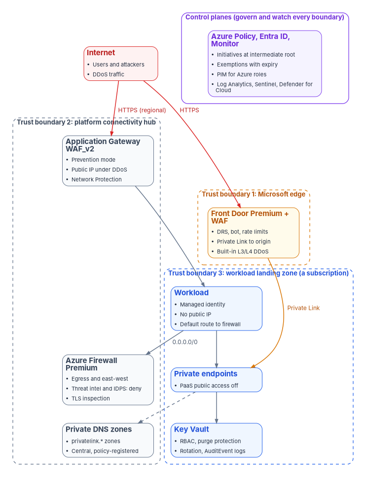

# Azure Security Engineering

*A landing zone decides what can be deployed; it doesn't decide what the internet can reach, what leaves, or who can read a key. Those are engineered one service at a time, and each one has to be proved.*

**Training:** the [Azure Security Engineering learning path](../../training/azure-security/index.md) teaches this guide in five modules, each with a lab of its checks in a test subscription.

::: {.callout-note}
## In this guide
How an agency engineers the security of its Azure estate on top of the landing zone [Book 10](../b10-cloud-boundary/index.md) designs, as gated steps an operator can run. First, how to read the guide, where each topic is covered, the placeholders, prerequisites and government-cloud availability, a comparison with AWS, Google Cloud and Oracle Cloud Infrastructure, the reference architecture and the decision record. Then ten steps: the landing-zone security baseline, the public exposure inventory, DDoS protection, the web application firewall, Front Door and Application Gateway, Azure Firewall and segmentation, Private Link and DNS, managed identities and Key Vault, Azure Policy and drift, and operations and evidence. Each step carries its authority label, copy-paste commands from Microsoft Learn, the How template of [Book 00, Appendix D](../b00-orientation/appendix-d-control-states-and-evidence.md#how-section-template), a **Validate** step and an evidence checklist. Then the RACI, the evidence catalog, the metrics, the requirements and KSIs, the dangers, rollback, the implementation checklist and what couldn't be verified.
:::

::: {.callout-tip}
## Watch, present or train
**Narrated deck (about 17 minutes, captions)**: why a landing zone isn't a defense, what the books design and what this guide engineers, the ten steps on one page, commercial Azure for a GCC tenant and what differs in Azure Government, the same controls on AWS, Google Cloud and Oracle Cloud Infrastructure, the eligible roles and the RACI, then each step from the baseline and the exposure inventory to Key Vault, policy and operations, the dangers and what couldn't be verified, as a Why / What / Who / How deck, on the [Presentations](../../presentations/index.md#guide-azure-security) page, or [▶ watch it in the browser](../../presentations/watch.html?v=Guide_Azure_Security_Narrated). The deck says this guide is a draft awaiting the editor's review.
:::

## How to read this guide

The books already design most of this. [Book 10, Chapter 05](../b10-cloud-boundary/05-the-landing-zone.md) builds the management group hierarchy, the boundary policies and the exemption rule; [Chapter 07](../b10-cloud-boundary/07-the-front-door.md) puts every change through a provisioning loop; [Chapter 08](../b10-cloud-boundary/08-who-owns-the-boundary.md) names who owns the boundary. [Book 12, Chapter 08](../b12-security-operations/08-cloud-native-posture.md) chooses the posture tool on each cloud and feeds its findings into the evidence contract. [Book 09](../b09-network/index.md) owns the agency network edge. What none of them gives is the service-by-service engineering of the Azure controls a Zero Trust assessment tests: DDoS protection on every public IP, a web application firewall in prevention mode, origins that only the edge can reach, egress through an inspecting firewall, PaaS reachable only through private endpoints, keys behind RBAC with purge protection, and the evidence that each one is in place and working. This guide does that, and links to the books instead of restating them.

The guide replaces the separate Azure security book the Zero Trust Assessment closure update proposed: the workbook's editor chose implementation guides over new books on November 11, 2026. Each of the proposed book's ten chapters is a step below. The guide also carries the Azure part of the closure map's row for DDoS, WAF and public exposure (closure-map item CM-11, which is not the NIST control of the same number); [Book 10](../b10-cloud-boundary/index.md) carries the boundary decisions behind it.

**Where the facts come from.** Every command, service behavior and government-cloud statement was read on Microsoft Learn on November 11, 2026, through the Microsoft Learn documentation service, and the commands are Learn's own, with Learn's names replaced by placeholders. Control statements come from NIST SP 800-53 Rev. 5 and the KSIs' related controls from fedramp.gov's 2026 theme pages, read the same day. AWS, Google Cloud and Oracle facts come from each provider's documentation. The [verification log](https://github.com/WhalerMike/modernization-workbook/blob/main/docs/books/guides/_verification/azure-security-implementation.md) lists every claim. Where Learn doesn't say, the guide says *not yet specified* and [lists it](#what-couldnt-be-verified). Nothing here was run against a live subscription.

**Labels.** Each step carries the authority label of [Appendix D](../b00-orientation/appendix-d-control-states-and-evidence.md#authority-labels): *Mandated* only where a federal source requires it, *Microsoft-recommended* where Learn recommends it, *Risk-based recommended* where it is this program's position. *(Design guidance)* marks the program's own choices in prose. A control a tenant isn't licensed for, or a feature a cloud doesn't offer, is a licensing or environment decision, not a failed control: an assessment test that can't run against it is *Skipped*, not *Fail* ([Book 11, Chapter 10](../b11-zero-trust/10-evidence-not-verdicts.md#a-normalized-result-taxonomy)).

**The audience.** A civilian agency at FedRAMP Moderate whose Microsoft 365 GCC tenant pairs with commercial Azure, and agencies that run workloads in Azure Government (which pairs with GCC High and DoD). [Book 10, Chapter 04](../b10-cloud-boundary/04-gcc-and-the-feature-gap.md) explains the pairing. The examples use the fictional Contoso and `contoso.example`.

**The placeholders.** Replace these once, everywhere:

| Placeholder | What it is |
|---|---|
| `<cloud>` | `AzureCloud` (commercial Azure, which a GCC tenant uses) or `AzureUSGovernment` |
| `<subscription-id>`, `<rg>`, `<location>` | A subscription, resource group and region in scope |
| `<mg-id>` | The intermediate root management group of [Book 10, Chapter 05](../b10-cloud-boundary/05-the-landing-zone.md#the-management-group-hierarchy) |
| `<workspace-id>` | The resource ID of the Log Analytics workspace the platform team runs |
| `<vnet>`, `<subnet>`, `<pip>` | A virtual network, a subnet and a Standard public IP |
| `<ddos-plan>` | The agency's one DDoS Network Protection plan |
| `<waf-policy>`, `<appgw>`, `<afd-profile>`, `<afd-waf>` | An Application Gateway WAF policy, an application gateway, a Front Door profile and its WAF policy |
| `<fw-policy>`, `<fw-private-ip>`, `<route-table>` | The Azure Firewall policy, the firewall's private IP and a workload route table |
| `<vault>`, `<key>`, `<pe-name>` | A key vault, a key in it and a private endpoint |
| `<front-door-id>` | The *Front Door ID* on the profile's Overview page, used in the `X-Azure-FDID` header |
| `<action-group-id>` | The resource ID of the action group that pages the security monitor |
| `<expiry>` | An exemption's expiry date, ISO 8601, for example `2027-03-31T00:00:00Z` |

: Placeholders used in this guide {.striped .hover}

**The pieces.** An implementation guide is finished when it has its deck series, developer workbook and training path ([CONTRIBUTING](https://github.com/WhalerMike/modernization-workbook/blob/main/CONTRIBUTING.md#an-implementation-guide-is-finished-when-it-has-all-four-pieces)):

| Piece | State |
|---|---|
| This guide | Draft, November 11, 2026 |
| Narrated guide deck and video | Built: 17 narrated slides, about 17 minutes, with captions; see *Watch, present or train* at the top |
| Narrated deck series, one per step | Planned |
| Developer workbook with Lab 1 on fixtures and Lab 2 in a test subscription | Planned |
| Training path | Draft, November 13, 2026: [Azure Security Engineering](../../training/azure-security/index.md), five modules, each with a lab of this guide's checks in a test subscription |

: The guide's pieces {.striped .hover}

## Where each topic is covered {#coverage}

| Topic | Where it's covered | What this guide adds |
|---|---|---|
| 1. Landing-zone security baseline | [Book 10, Chapter 05](../b10-cloud-boundary/05-the-landing-zone.md) (hierarchy, boundary policy, exemptions), [Chapter 07](../b10-cloud-boundary/07-the-front-door.md) (provisioning loop), [Chapter 08](../b10-cloud-boundary/08-who-owns-the-boundary.md) (ownership); [privileged access guide](privileged-access-implementation.md) (PIM for Azure roles) | [Step 1](#step-1-landing-zone-security-baseline): the security settings the baseline adds, protecting the hierarchy, logging, and the gate |
| 2. Public exposure inventory | [Book 12, Chapter 08](../b12-security-operations/08-cloud-native-posture.md) (internet exposure analysis in Defender for Cloud) | [Step 2](#step-2-public-exposure-inventory): the Resource Graph inventory, owners and the register |
| 3. DDoS protection | None | [Step 3](#step-3-ddos-protection) |
| 4. Web application firewall | None | [Step 4](#step-4-web-application-firewall) |
| 5. Front Door and Application Gateway | None | [Step 5](#step-5-front-door-and-application-gateway) |
| 6. Firewall and segmentation | [Book 09](../b09-network/index.md) (the agency edge and TIC) | [Step 6](#step-6-firewall-and-segmentation): Azure Firewall egress, IDPS, threat intelligence, routes |
| 7. Private Link and DNS | [Book 08](../b08-ddi/index.md) (DNS authority) | [Step 7](#step-7-private-link-and-dns) |
| 8. Managed identities and Key Vault | [Service account guide, Migration C](service-account-migration.md#migration-c) (managed identities and workload identities) | [Step 8](#step-8-managed-identities-and-key-vault): Key Vault only |
| 9. Policy and drift | [Book 10, Chapter 05](../b10-cloud-boundary/05-the-landing-zone.md#enforcing-without-breaking-things), [Book 13, Chapter 02](../b13-governance/02-drift-is-the-primary-threat.md) | [Step 9](#step-9-policy-and-drift): the security initiatives, exemptions, remediation and the compliance export |
| 10. Operations and evidence | [Book 12, Chapter 08](../b12-security-operations/08-cloud-native-posture.md#feeding-the-evidence-contract), [Book 11, Chapter 10](../b11-zero-trust/10-evidence-not-verdicts.md#the-closure-chain), [Book 15](../b15-day2-operations/index.md) | [Step 10](#step-10-operations-and-evidence), the [RACI](#raci), [evidence catalog](#evidence-catalog) and [metrics](#metrics) |

: The ten topics and where each is covered {.striped .hover}

## The track at a glance

**The goal.** Every internet-facing service in Azure is in an inventory with an owner, sits behind DDoS protection and a web application firewall in prevention mode, and can't be reached around them; workloads leave Azure only through an inspecting firewall and reach PaaS only through private endpoints; secrets and keys sit in vaults that only managed identities and eligible administrators can use; Azure Policy holds all of it in place and reports drift; and each of those statements has evidence an assessor can inspect *(design guidance)*.

**Done when** *(design guidance)*:

- the public exposure register lists every public IP, Front Door endpoint and application gateway, each with an owner, and it is regenerated at least weekly;
- every public IP is covered by DDoS Network Protection or DDoS IP Protection, with metrics, diagnostic logs and an alert, and the response has been exercised;
- every internet-facing HTTP workload is behind a WAF in prevention mode with request body inspection and a rate limit, and its origin accepts traffic only from that edge;
- every workload subnet's default route goes to Azure Firewall with threat intelligence and IDPS in deny mode;
- PaaS services in scope have public network access disabled and resolve through central private DNS zones;
- key vaults use RBAC, purge protection, private endpoints and audit logs, and workloads reach them with managed identities;
- the security initiatives are enforced at the intermediate root, every exemption has an expiry, and the compliance export is filed each month.

## Prerequisites {#prerequisites}

- **The landing zone exists.** The management group hierarchy, the boundary policies and the provisioning loop of [Book 10, Chapters 05 and 07](../b10-cloud-boundary/05-the-landing-zone.md) are in place, and the platform team owns a connectivity hub subscription and a management subscription with a Log Analytics workspace.
- **Roles, eligible through PIM.** Network Contributor for the connectivity work, Resource Policy Contributor for Azure Policy, Key Vault Administrator for vault settings, and Security Admin for Defender for Cloud, each eligible rather than standing, as the [privileged access guide](privileged-access-implementation.md) sets up. Emergency access accounts aren't used for this work and aren't excluded from anything here, because nothing here governs sign-in.
- **Tools.** Azure CLI with the `resource-graph` and `azure-firewall` extensions (the firewall policy draft needs `azure-firewall` 1.2.3 or later),[^azs-fw-draft] and the Az PowerShell module.
- **The right cloud.** Sign in to the cloud the subscription lives in. Azure Government endpoints differ (Resource Manager at `management.usgovcloudapi.net`, Key Vault at `vault.usgovcloudapi.net`):[^azs-gov-compare]

    ```powershell
    az cloud set --name <cloud>
    az login
    az account set --subscription <subscription-id>
    az extension add --name resource-graph
    az extension add --name azure-firewall
    ```

- **Licenses and costs.** DDoS Network Protection is billed per plan and DDoS IP Protection per protected IP;[^azs-ddos-tiers] Front Door managed WAF rules need the Premium tier;[^azs-afd-cli] IDPS and TLS inspection need Azure Firewall Premium.[^azs-fw-zt] These are budget decisions recorded in the [decision record](#decision-record), not findings.

### Government-cloud availability {#gov-availability}

Microsoft 365 GCC pairs with commercial Azure, so a GCC agency's subscriptions are usually commercial and the left column applies; GCC High and DoD pair with Azure Government ([Book 10, Chapter 04](../b10-cloud-boundary/04-gcc-and-the-feature-gap.md)). Learn's comparison page says a service available in Azure Government has all its features unless the page lists a variation, and that it doesn't cover Azure Government Secret or Top Secret.[^azs-gov-compare]

| Service | Commercial Azure | Azure Government | Difference to plan for |
|---|---|---|---|
| Azure Front Door Standard and Premium | Available | Generally available in US Gov Arizona and US Gov Texas[^azs-gov-compare] | Learn's Front Door overview says Standard, Premium and classic are available in Azure Government;[^azs-afd-overview] the comparison page names the two regions. Classic retires March 31, 2027 and accepts no new profiles or domains.[^azs-afd-classic] Premium is needed for managed WAF rules and Private Link origins |
| Front Door Private Link to origin | The listed regions | US Gov Arizona, US Gov Texas and US Gov Virginia are in Learn's region list[^azs-afd-pl] | The same page says the feature is only in regions with availability zones, and Learn's Azure Government region list shows zones only in US Gov Virginia:[^azs-gov-regions] treat Arizona and Texas as unconfirmed until a test profile shows them |
| Azure WAF (Application Gateway) | Available | Supported in sovereign clouds, but geo-filtering custom rules and bot protection rule sets aren't[^azs-waf-faq] | The Zero Trust test for a bot protection rule set can't pass in Azure Government: record it as *Skipped-Not-Applicable* (environment), not *Fail* |
| Azure WAF (Front Door) | Available | Not yet specified separately on Learn | Assume the Application Gateway FAQ's sovereign-cloud limits until a test policy shows otherwise |
| Azure DDoS Protection | Available | No variation listed on the comparison page[^azs-gov-compare] | Simulation partner Red Button is public cloud only;[^azs-ddos-sim] which partners serve Azure Government is not yet specified. IP Protection versus Network Protection by cloud: not yet specified |
| Azure Firewall (Standard, Premium) | Available | No variation listed on the comparison page[^azs-gov-compare] | Premium's region list is on the products-by-region page, not Learn:[^azs-fw-premium] not yet specified on Learn |
| Private Link and private DNS | Available | Per-service availability page; different zone names, for example `privatelink.vaultcore.usgovcloudapi.net` and `privatelink.blob.core.usgovcloudapi.net`[^azs-pe-dns] | Policy that registers DNS records needs the Azure Government zone names |
| Key Vault and Managed HSM | Available | `vault.usgovcloudapi.net`, `managedhsm.usgovcloudapi.net`[^azs-gov-compare] | Endpoints only |
| Azure Policy | Available | No variation listed[^azs-gov-compare] | FedRAMP initiatives exist in separate versions for each cloud ([Book 10, Chapter 05](../b10-cloud-boundary/05-the-landing-zone.md#which-settings)) |
| Microsoft Defender for Cloud | Available | Feature differences | [Book 12, Chapter 08](../b12-security-operations/08-cloud-native-posture.md#where-defender-for-cloud-does-and-doesnt-reach): internet exposure analysis and regulatory compliance are generally available in Azure Government; the AWS connector isn't |
| Azure landing zone accelerators | Supported | Not supported unmodified; adapt the code ([Book 10, Chapter 05](../b10-cloud-boundary/05-the-landing-zone.md#what-a-landing-zone-is)) | Remove policies and resources that don't exist in Azure Government |
| Azure Lighthouse | Available | No PIM (just-in-time) for delegated access, and no delegation across clouds[^azs-gov-compare] | A partner managing an Azure Government estate needs standing roles or a different model; record it |

: Azure security services in commercial Azure and Azure Government, read November 11, 2026 {.striped .hover}

## The same controls on AWS, Google Cloud and Oracle Cloud {#other-clouds}

The workbook's estate spans clouds ([Book 12, Chapter 08](../b12-security-operations/08-cloud-native-posture.md#per-platform-mechanisms)), and an agency's HR platform may run on Oracle Cloud Infrastructure. The equivalents, briefly; each provider's own documentation carries the build:

| Control | Azure | AWS | Google Cloud | Oracle Cloud Infrastructure |
|---|---|---|---|---|
| L3/L4 DDoS | DDoS infrastructure protection (free) plus Network or IP Protection[^azs-ddos-tiers] | AWS Shield Standard (free) and Shield Advanced, with the Shield Response Team and cost protection[^azs-aws-shield] | Google Cloud Armor: always-on L3/L4 protection for applications behind load balancers; Enterprise adds advanced network DDoS protection and telemetry[^azs-gcp-armor] | Not compared here; not yet specified |
| Web application firewall | Azure WAF on Front Door and Application Gateway | AWS WAF on CloudFront, Application Load Balancer, API Gateway and AppSync[^azs-aws-shield] | Cloud Armor security policies with preconfigured OWASP CRS rules; Adaptive Protection on Enterprise[^azs-gcp-armor] | OCI WAF, as a regional policy on a load balancer or at the edge, with protection rules and rate limiting[^azs-oci-waf] |
| Inspecting firewall | Azure Firewall Premium (IDPS, TLS inspection) | AWS Network Firewall; not compared here | Cloud NGFW; not compared here | OCI Network Firewall, built on Palo Alto Networks, with IDPS, TLS inspection and URL filtering, reached through VCN route tables[^azs-oci-nfw] |
| Private access to PaaS | Private Link private endpoints | AWS PrivateLink interface endpoints; not compared here | Private Service Connect: consumers reach Google APIs and published services on internal IPs in their own VPC[^azs-gcp-psc] | Private endpoints: a private IP in a VCN subnet for an Oracle service[^azs-oci-pe] |
| Government-cloud note | Azure Government differences above | AWS WAF in GovCloud (US) offers only AWS managed rule groups, no Marketplace rule groups;[^azs-aws-govwaf] Shield Advanced in GovCloud: not yet specified | Assured Workloads' FedRAMP High package lists Cloud Armor and VPC, not Private Service Connect;[^azs-gcp-aw] Moderate: not yet specified | OCI Government Cloud availability of WAF and Network Firewall: not yet specified |

: The controls in this guide across four clouds {.striped .hover}

## Reference architecture {#reference-architecture}

Three trust boundaries and the control planes that govern and watch them. Traffic from the internet meets the Microsoft edge first (Front Door with its WAF, or a regional Application Gateway whose public IP is under DDoS Network Protection). The platform hub holds the shared inspection and name resolution. The workload landing zone holds the workload, which has no public IP, sends its default route to the firewall and reaches PaaS and Key Vault only through private endpoints *(design guidance)*.

{#fig-azs-reference fig-alt="At the top, a red Internet card for users, attackers and DDoS traffic, beside a violet control-planes boundary holding Azure Policy with initiatives at the intermediate root and exemptions with expiry, Entra ID with PIM for Azure roles, and Log Analytics, Sentinel and Defender for Cloud. Two red HTTPS arrows leave the internet: one to Front Door Premium with WAF inside trust boundary 1, the Microsoft edge, which applies the default rule set, bot rules, rate limits and built-in L3 and L4 DDoS protection; the other, labeled regional, to Application Gateway WAF_v2 in prevention mode inside trust boundary 2, the platform connectivity hub, whose public IP is under DDoS Network Protection. The hub also holds Azure Firewall Premium for egress and east-west traffic with threat intelligence and IDPS in deny mode and TLS inspection, and the central privatelink private DNS zones. Trust boundary 3, the workload landing zone, a subscription, holds the workload with a managed identity, no public IP and a default route to the firewall, private endpoints with PaaS public access off, and Key Vault with RBAC, purge protection, rotation and AuditEvent logs. Front Door reaches the private endpoints over Private Link; Application Gateway forwards to the workload; the workload's 0.0.0.0/0 route goes to the firewall; the private endpoints register in the private DNS zones."}

## Decision record template {#decision-record}

One record per service decision (a DDoS tier, a Front Door tier, a firewall SKU, an exemption), kept with the change record of [Book 10, Chapter 07](../b10-cloud-boundary/07-the-front-door.md) *(design guidance)*:

```markdown
**Decision:** <what was decided, one sentence>
**Step and topic:** <Step N, e.g. Step 3 DDoS protection>
**Scope:** <management group, subscriptions, resources>
**Options considered:** <e.g. DDoS Network Protection | DDoS IP Protection | infrastructure protection only>
**License or cost:** <SKU, tier, plan; who pays>
**Cloud availability:** <commercial Azure / Azure Government; region; Learn page and date read, or "not yet specified">
**Prerequisites:** <what must exist first: hub, workspace, roles, Premium tier>
**Compensating control, if the preferred option is unavailable:** <what covers the risk instead, and its evidence>
**Authority:** <Mandated | Microsoft-recommended | Risk-based recommended | Optional> (<source>)
**Requirements and KSIs supported:** <e.g. SC-5, KSI-CNA-RVP>
**Decided by / date:** <policy owner>, <date>   **Review by:** <date>
**Residual risk accepted by:** <authorizing official or delegate, if any>
```

## The path on one page

| Step | Done when | Validate with |
|---|---|---|
| [1 Landing-zone security baseline](#step-1-landing-zone-security-baseline) | Hierarchy protected; security initiative assigned; platform logs flowing | `az policy assignment list`, Resource Graph diagnostic-settings query |
| [2 Public exposure inventory](#step-2-public-exposure-inventory) | Every public IP, Front Door endpoint and application gateway in the register with an owner | The inventory queries, rerun weekly |
| [3 DDoS protection](#step-3-ddos-protection) | Every public IP protected, logged and alerting; one exercise run | `ddosSettings` query; the alert fired in the exercise |
| [4 Web application firewall](#step-4-web-application-firewall) | WAF in prevention mode with request body inspection, current rule set and rate limits | `waf-policy show`; a test request blocked |
| [5 Front Door and Application Gateway](#step-5-front-door-and-application-gateway) | Origins reachable only through the edge; TLS 1.2 minimum; logs on; failover tested | A direct request to the origin refused |
| [6 Firewall and segmentation](#step-6-firewall-and-segmentation) | Default routes to the firewall; threat intelligence and IDPS in deny mode; logs on | Effective routes; a known-bad test domain denied |
| [7 Private Link and DNS](#step-7-private-link-and-dns) | PaaS public access off; central zones; records registered by policy | `nslookup` resolves to a private IP |
| [8 Managed identities and Key Vault](#step-8-managed-identities-and-key-vault) | Vaults on RBAC, purge protection, private endpoint, rotation and audit logs | `az keyvault show`; AuditEvent rows |
| [9 Policy and drift](#step-9-policy-and-drift) | Initiatives enforced; exemptions expire; monthly compliance export | `az policy state summarize` |
| [10 Operations and evidence](#step-10-operations-and-evidence) | Owners, cadence, exercises and the evidence catalog in use | The quarterly review record |

: The ten steps of Azure security engineering {.striped .hover}

Steps 1 and 2 come first; Steps 3 to 8 can run in parallel by workload once the inventory exists; Step 9 turns each of them into policy; Step 10 runs from the start.

## Step 1: Landing-zone security baseline {#step-1-landing-zone-security-baseline}

[Book 10, Chapter 05](../b10-cloud-boundary/05-the-landing-zone.md) designs the hierarchy, the boundary policies (allowed locations, allowed resource types, the FedRAMP initiative in audit mode) and the exemption rule; this step adds what the security baseline needs on top, and doesn't repeat it.

**Authority:** Microsoft-recommended (protecting the hierarchy, the default management group, diagnostic logs on platform resources, Learn as cited) and Risk-based recommended (the gate, for the risk that security services get deployed into a landing zone nobody logs).
**Applies:** all subscriptions; Environment-dependent: the landing zone accelerators need adapting in Azure Government.

**Steps.**

1. **Protect the hierarchy.** Require authorization to create management groups and send new subscriptions to a default group, as Book 10 recommends. Learn's Az PowerShell, with the tenant root group's ID:[^azs-mg-protect]

    ```powershell
    New-AzManagementGroupHierarchySetting -GroupName <tenant-root-group-id> -Authorization True -DefaultManagementGroup <sandbox-mg-id>
    ```

2. **Assign the security benchmark and the FedRAMP initiative in audit at the intermediate root,** not enforcing yet (Step 9 enforces). List the initiatives in the cloud you're signed in to, then assign:

    ```powershell
    az policy set-definition list --query "[?contains(displayName,'FedRAMP') || contains(displayName,'Microsoft cloud security benchmark')].{name:name, displayName:displayName}" -o table
    az policy assignment create --name azs-fedramp-mod --display-name "FedRAMP Moderate (audit)" --policy-set-definition <initiative-name> --scope /providers/Microsoft.Management/managementGroups/<mg-id> --enforcement-mode DoNotEnforce
    ```

    `DoNotEnforce` evaluates compliance without enforcing the effect; a remediation task can still run for `deployIfNotExists` policies.[^azs-enforcement]

3. **Send platform logs to the workspace.** Every hub resource this guide creates gets a diagnostic setting to `<workspace-id>`; Steps 3 to 8 give the command for each. Find what's missing:

    ```powershell
    az graph query -q "Resources | where type in~ ('microsoft.network/azurefirewalls','microsoft.network/applicationgateways','microsoft.cdn/profiles','microsoft.keyvault/vaults','microsoft.network/publicipaddresses') | project id, type, subscriptionId" --first 1000
    ```

    Compare the list with `az monitor diagnostic-settings list --resource <id>` for each, or assign the built-in "Public IP addresses should have resource logs enabled for Azure DDoS Protection" policy and its peers in Step 9.[^azs-ddos-secure]

4. **Turn on Defender for Cloud** on every subscription, with continuous export to the workspace, as [Book 12, Chapter 08](../b12-security-operations/08-cloud-native-posture.md#feeding-the-evidence-contract) sets out.

| How template | This step |
|---|---|
| Prerequisites | Book 10's hierarchy and boundary policy; Resource Policy Contributor eligible at `<mg-id>` |
| Pilot | The Sandbox management group, then one Corp subscription |
| Report-only or audit phase | Initiatives in `DoNotEnforce` for at least one 24-hour evaluation cycle and one compliance review with the ISSO |
| Enforcement | Not applicable here: Step 9 enforces |
| Rollback | `az policy assignment delete --name azs-fedramp-mod --scope /providers/Microsoft.Management/managementGroups/<mg-id>`; minutes |
| Exclusions | None at the root; exemptions only through Step 9, with expiry |
| Telemetry | Activity log and policy compliance in the workspace |
| Evidence | The checklist below |
| Day-two ownership | Platform owner; monthly compliance review ([Step 10](#step-10-operations-and-evidence)) |

: Step 1 against the How template {.striped .hover}

::: {.callout-important}
## Validate (Step 1)
- `az policy assignment list --scope /providers/Microsoft.Management/managementGroups/<mg-id> -o table` shows the initiatives in `DoNotEnforce`.
- Every platform resource from the step 3 query has a diagnostic setting to `<workspace-id>`.
- Gate owner: the platform owner, with the ISSO.
:::

**Evidence checklist**

- [ ] **Configuration:** hierarchy settings export; initiative assignments export
- [ ] **Operational:** policy compliance in the workspace, retained per the logging plan
- [ ] **Test:** a subscription created in a test tenant lands in the default group (date, tester)
- [ ] **Exception:** none, or Step 9's exemption register
- [ ] **Assessor-ready artifact:** the compliance summary for the boundary, linked from the package ([Book 10, Chapter 11](../b10-cloud-boundary/11-the-authorization-package.md))

## Step 2: Public exposure inventory {#step-2-public-exposure-inventory}

Nothing in Steps 3 to 5 can be proved complete without a list of what is exposed. Learn recommends an inventory of every public IP and its protection status, kept with Resource Graph, and a quarterly review of which IPs still need protection.[^azs-ddos-secure][^azs-ddos-cost] The register adds the owner, the DNS names and certificates that point at each exposure, and whether a WAF covers it.

**Authority:** Mandated (FIPS 200 requires federal systems to apply the SP 800-53 baseline for their impact level, and CM-8, system component inventory, is in the Moderate baseline);[^azs-80053] Microsoft-recommended for the Resource Graph inventory and quarterly review (Learn as cited). The register's shape is the program's *(design guidance)*.
**Applies:** all subscriptions.

**Steps.**

1. **Public IPs and their DDoS state.** Built from Learn's starter query, with the `ddosSettings` property Learn's DDoS samples read:[^azs-arg-starter][^azs-ddos-ip-cli]

    ```powershell
    az graph query -q "Resources | where type =~ 'microsoft.network/publicipaddresses' | project id, name, subscriptionId, resourceGroup, ip = tostring(properties.ipAddress), sku = tostring(sku.name), ddosMode = tostring(properties.ddosSettings.protectionMode), attachedTo = tostring(properties.ipConfiguration.id), owner = tostring(tags['owner'])" --first 1000 -o json > out/public-ips.json
    ```

2. **Front Door profiles and application gateways, with their WAF.**

    ```powershell
    az graph query -q "Resources | where type =~ 'microsoft.cdn/profiles' | project id, name, sku = tostring(sku.name), owner = tostring(tags['owner'])" --first 1000 -o json > out/frontdoor.json
    az graph query -q "Resources | where type =~ 'microsoft.network/applicationgateways' | project id, name, sku = tostring(properties.sku.tier), wafPolicy = tostring(properties.firewallPolicy.id), owner = tostring(tags['owner'])" --first 1000 -o json > out/appgw.json
    ```

3. **PaaS with public network access on.** Many services expose a `publicNetworkAccess` property; list the ones that aren't disabled:

    ```powershell
    az graph query -q "Resources | where isnotempty(properties.publicNetworkAccess) and tostring(properties.publicNetworkAccess) !~ 'Disabled' | project id, type, publicNetworkAccess = tostring(properties.publicNetworkAccess), owner = tostring(tags['owner'])" --first 1000 -o json > out/paas-public.json
    ```

    The property's name and values vary by service; treat the query as a starting list, not a complete one *(design guidance)*.

4. **Join the names and certificates.** For each exposure, the DNS records that point at it come from the authoritative DNS ([Book 08](../b08-ddi/index.md)) and its certificate from the certificate inventory ([Book 07](../b07-pki/index.md)). A DNS record that points at a public IP or endpoint no longer in the inventory is a dangling record to remove *(design guidance)*.
5. **Write the register** with one row per exposure: resource ID, type, public name, owner, DDoS state, WAF and mode, origin lock-down, certificate expiry, last reviewed. Store it inside the boundary; it is a map of the attack surface and doesn't belong in a public repository.
6. **Compare with Defender for Cloud's view.** Internet exposure analysis is generally available in both clouds ([Book 12, Chapter 08](../b12-security-operations/08-cloud-native-posture.md#where-defender-for-cloud-does-and-doesnt-reach)); an exposure it reports that the register lacks is a gap in the queries.

| How template | This step |
|---|---|
| Prerequisites | Reader on every subscription in scope; Resource Graph extension |
| Pilot | One management group's subscriptions |
| Report-only or audit phase | Not applicable: the step only reads |
| Enforcement | Not applicable; Step 9 adds a policy that requires an `owner` tag on public IPs if the agency wants it |
| Rollback | Not applicable: read-only |
| Exclusions | None: every exposure is listed, including approved ones |
| Telemetry | Activity log `Microsoft.Network/publicIPAddresses/write` events show new exposures between runs |
| Evidence | The checklist below |
| Day-two ownership | Platform owner runs it weekly; workload owners answer for their rows; quarterly review with the ISSO |

: Step 2 against the How template {.striped .hover}

::: {.callout-important}
## Validate (Step 2)
- Every row in `out/public-ips.json` has an owner, and every ownerless row has a ticket.
- The register's count matches Defender for Cloud's internet-exposed resources, or the difference is explained.
- Gate owner: the platform owner.
:::

**Evidence checklist**

- [ ] **Configuration:** the query text and the dated JSON outputs
- [ ] **Operational:** the weekly runs and the activity-log alert on new public IPs
- [ ] **Test:** a public IP created in a test subscription appears in the next run (date, tester)
- [ ] **Exception:** exposures accepted without WAF or DDoS protection, each with its decision record
- [ ] **Assessor-ready artifact:** the dated register, reconciled with Defender for Cloud

## Step 3: DDoS protection {#step-3-ddos-protection}

Every public IP in Azure gets DDoS infrastructure protection at no cost. DDoS Network Protection and DDoS IP Protection add per-IP adaptive tuning, attack analytics, metrics, alerts and mitigation reports; Network Protection also adds the DDoS Rapid Response team, cost protection and a WAF discount, and protects Basic public IPs, which IP Protection doesn't.[^azs-ddos-tiers] Neither covers a public IP attached to a NAT gateway, and both work at layers 3 and 4: layer 7 needs the WAF of Step 4.[^azs-ddos-tiers][^azs-ddos-overview] Microsoft's Zero Trust recommendations check that every public IP in a virtual network is protected, that metrics are on and that diagnostic logs are on.[^azs-zt-ddos]

**Authority:** Mandated for the control (SC-5, denial-of-service protection, is in the Moderate baseline FIPS 200 requires);[^azs-80053] Microsoft-recommended for meeting it with Azure DDoS Protection on every public IP.[^azs-zt-ddos] **Applies:** License-dependent (plan or per-IP billing); Environment-dependent (exercise partners by cloud).

**Choose the tier.** Network Protection when many public IPs across subscriptions need coverage, or Rapid Response and cost protection are wanted; IP Protection for a few critical IPs.[^azs-ddos-cost] Record the choice in the [decision record](#decision-record). Fewer public IPs (Private Link, one edge per application) means less to protect.[^azs-ddos-cost]

**Steps.**

1. **Create the one plan** in the connectivity subscription (Network Protection):[^azs-ddos-cli]

    ```powershell
    az network ddos-protection create --resource-group <rg> --name <ddos-plan>
    ```

2. **Link each virtual network that holds public IPs:**

    ```powershell
    az network vnet update --resource-group <rg> --name <vnet> --ddos-protection-plan <ddos-plan> --ddos-protection true
    ```

    A virtual network with DDoS protection can't be moved between resource groups or subscriptions; disabling it to move resets the tuned thresholds.[^azs-ddos-cli] Or, for IP Protection on one Standard public IP:[^azs-ddos-ip-cli]

    ```powershell
    az network public-ip update --resource-group <rg> --name <pip> --ddos-protection-mode Enabled
    ```

3. **Turn on diagnostic logs** for each protected public IP (`DDoSProtectionNotifications`, `DDoSMitigationFlowLogs`, and `DDoSMitigationReports` until its retirement, which Learn says starts about mid-August 2026):[^azs-ddos-secure]

    ```powershell
    az monitor diagnostic-settings create --name ddos-to-workspace --resource /subscriptions/<subscription-id>/resourceGroups/<rg>/providers/Microsoft.Network/publicIPAddresses/<pip> --workspace <workspace-id> --logs '[{"categoryGroup":"allLogs","enabled":true}]' --metrics '[{"category":"AllMetrics","enabled":true}]'
    ```

4. **Alert on attack.** The metric *Under DDoS attack or not* (`IfUnderDDoSAttack`) is 1 during mitigation; Learn's tutorial alerts at maximum ≥ 1:[^azs-ddos-metric][^azs-ddos-sim]

    ```powershell
    az monitor metrics alert create --name ddos-under-attack-<pip> --resource-group <rg> --scopes /subscriptions/<subscription-id>/resourceGroups/<rg>/providers/Microsoft.Network/publicIPAddresses/<pip> --condition "max IfUnderDDoSAttack >= 1" --window-size 5m --evaluation-frequency 1m --action <action-group-id> --severity 1
    ```

5. **Hold it with policy.** Assign "Virtual networks should be protected by Azure DDoS Protection" (Modify effect, to enable protection on noncompliant networks, or Audit) and "Public IP addresses should have resource logs enabled for Azure DDoS Protection" in Step 9.[^azs-ddos-secure]
6. **Exercise the response.** Learn allows simulations only through its approved partners (MazeBolt, Red Button, RedWolf), only against the agency's own protected Azure public IPs, and recommends staging or off-peak windows; Red Button is public cloud only.[^azs-ddos-sim] Before the exercise, write the response team and runbook Learn recommends, including how to raise a severity A request to Rapid Response under Network Protection.[^azs-ddos-secure]

| How template | This step |
|---|---|
| Prerequisites | The inventory (Step 2); Network Contributor eligible on the hub and spokes; the plan's budget approved |
| Pilot | One non-production virtual network with a load balancer, as Learn's simulation tutorial builds |
| Report-only or audit phase | The DDoS policy in Audit for one evaluation cycle; the list of unprotected public IPs reviewed |
| Enforcement | Ring 0: hub; ring 1: Online landing zones; ring 2: Corp landing zones with public IPs; then the policy's Modify effect |
| Rollback | `az network vnet update ... --ddos-protection false` (Learn's disable command); the plan can't be deleted while networks are linked to it[^azs-ddos-cli] |
| Exclusions | Public IPs on NAT gateways (unsupported);[^azs-ddos-tiers] any others by decision record with expiry |
| Telemetry | `IfUnderDDoSAttack` and the other DDoS metrics; the three log categories; alerts in Defender for Cloud[^azs-ddos-best] |
| Evidence | The checklist below |
| Day-two ownership | Security monitor answers the alert; platform owner owns the plan; quarterly coverage and cost review |

: Step 3 against the How template {.striped .hover}

::: {.callout-important}
## Validate (Step 3)
- Rerun the Step 2 query: every public IP shows `ddosMode` `Enabled`, or `VirtualNetworkInherited` in a linked network.
- The simulation raised the alert, the action group paged the security monitor, and the logs show the mitigation.
- Gate owner: the platform owner, with the security monitor.
:::

**Evidence checklist**

- [ ] **Configuration:** plan and linked networks (`az network ddos-protection show`); per-IP mode export
- [ ] **Operational:** DDoS metrics and logs in the workspace; alert history
- [ ] **Test:** the simulation report, the alert it fired and the after-action notes (date, partner, tester)
- [ ] **Exception:** unprotected public IPs, each with a decision record and expiry
- [ ] **Assessor-ready artifact:** coverage percentage from the register, with the exercise report

## Step 4: Web application firewall {#step-4-web-application-firewall}

Azure WAF runs on Front Door (global) and Application Gateway WAF_v2 (regional) as a WAF policy of managed rules, custom rules and settings. In detection mode it only logs; only prevention mode blocks.[^azs-zt-agw-waf] Microsoft's Zero Trust recommendations for both check prevention mode, request body inspection, the default rule set, the bot protection rule set, rate limiting, a JavaScript challenge and diagnostic logging, and for Application Gateway the HTTP DDoS rule set; Front Door adds a CAPTCHA challenge.[^azs-zt-netsec] Learn recommends the latest Default Rule Set, 2.2 at the time of reading, validated in log mode before blocking.[^azs-agw-secure]

**Authority:** Microsoft-recommended (Learn as cited); supports SP 800-53 SC-7 and SI-10. **Applies:** License-dependent (Front Door managed rules need Premium); Environment-dependent (no bot protection or geo-filtering custom rules in sovereign clouds).[^azs-waf-faq]

**Steps (Application Gateway).** Learn's CLI; the defaults are `Microsoft_DefaultRuleSet` version 2.1, so name the version you've validated:[^azs-waf-cli]

1. **Create the policy in detection mode, with request body inspection on:**

    ```powershell
    az network application-gateway waf-policy create --name <waf-policy> --resource-group <rg> --type Microsoft_DefaultRuleSet --version 2.1
    az network application-gateway waf-policy policy-setting update --policy-name <waf-policy> --resource-group <rg> --mode Detection --state Enabled --request-body-check true
    ```

2. **Add bot protection** (commercial Azure only) and a rate limit. The rate limit combines Learn's two examples, grouping by client address and matching the login path:[^azs-waf-ratelimit]

    ```powershell
    az network application-gateway waf-policy managed-rule rule-set add --policy-name <waf-policy> --resource-group <rg> --type Microsoft_BotManagerRuleSet --version 1.1
    az network application-gateway waf-policy custom-rule create --policy-name <waf-policy> --resource-group <rg> --action Block --name LoginRateLimitRule --priority 99 --rule-type RateLimitRule --rate-limit-threshold 100 --group-by-user-session '[{"groupByVariables":[{"variableName":"ClientAddr"}]}]'
    az network application-gateway waf-policy custom-rule match-condition add --policy-name <waf-policy> --resource-group <rg> --name LoginRateLimitRule --match-variables RequestUri --operator Contains --value '/login'
    ```

3. **Associate the policy and log it.** Attach it to the gateway (the `--set` form is the CLI's generic update, not a Learn sample), then send `ApplicationGatewayAccessLog` and `ApplicationGatewayFirewallLog` to the workspace (resource-specific tables, as Learn recommends):[^azs-agw-logs]

    ```powershell
    az network application-gateway update --name <appgw> --resource-group <rg> --set firewallPolicy.id=/subscriptions/<subscription-id>/resourceGroups/<rg>/providers/Microsoft.Network/ApplicationGatewayWebApplicationFirewallPolicies/<waf-policy>
    az monitor diagnostic-settings create --name appgw-to-workspace --resource /subscriptions/<subscription-id>/resourceGroups/<rg>/providers/Microsoft.Network/applicationGateways/<appgw> --workspace <workspace-id> --export-to-resource-specific true --logs '[{"categoryGroup":"allLogs","enabled":true}]'
    ```

4. **Tune, then enforce.** Read the firewall log for false positives, scope each exception to the narrowest rule, then switch:[^azs-waf-cli][^azs-agw-secure]

    ```powershell
    az network application-gateway waf-policy policy-setting update --policy-name <waf-policy> --resource-group <rg> --mode Prevention --state Enabled --request-body-check true
    ```

**Steps (Front Door Premium).** Learn's quickstart creates the policy in prevention mode; this guide starts in detection, then switches:[^azs-afd-cli]

```powershell
az network front-door waf-policy create --name <afd-waf> --resource-group <rg> --sku Premium_AzureFrontDoor --disabled false --mode Detection
az network front-door waf-policy managed-rules add --policy-name <afd-waf> --resource-group <rg> --type Microsoft_DefaultRuleSet --action Block --version 2.1
az network front-door waf-policy managed-rules add --policy-name <afd-waf> --resource-group <rg> --type Microsoft_BotManagerRuleSet --version 1.0
az network front-door waf-policy rule create --name rateLimitRule --policy-name <afd-waf> --resource-group <rg> --rule-type RateLimitRule --rate-limit-duration 1 --rate-limit-threshold 1000 --action Block --priority 1 --defer
az network front-door waf-policy rule match-condition add --match-variable RequestUri --operator Contains --values '/login' --name rateLimitRule --policy-name <afd-waf> --resource-group <rg>
az afd security-policy create --resource-group <rg> --profile-name <afd-profile> --security-policy-name <afd-profile>-waf --domains /subscriptions/<subscription-id>/resourcegroups/<rg>/providers/Microsoft.Cdn/profiles/<afd-profile>/afdEndpoints/<endpoint> --waf-policy /subscriptions/<subscription-id>/resourcegroups/<rg>/providers/Microsoft.Network/frontdoorwebapplicationfirewallpolicies/<afd-waf>
```

The rate-limit pair is Learn's.[^azs-waf-ratelimit] Send `FrontDoorAccessLog`, `FrontDoorHealthProbeLog` and `FrontDoorWebApplicationFirewallLog` to the workspace; none is on by default.[^azs-afd-logs]

**As code.** The same Application Gateway policy in Bicep, from Microsoft's Azure Verified Modules registry (pin the module version the platform team approved):[^azs-avm-waf]

```bicep
module wafPolicy 'br/public:avm/res/network/application-gateway-web-application-firewall-policy:<version>' = {
  params: {
    name: '<waf-policy>'
    location: '<location>'
    managedRules: {
      managedRuleSets: [
        { ruleSetType: 'Microsoft_DefaultRuleSet', ruleSetVersion: '2.1' }
        { ruleSetType: 'Microsoft_BotManagerRuleSet', ruleSetVersion: '1.1' }
      ]
    }
    policySettings: { mode: 'Prevention', state: 'Enabled', requestBodyCheck: true }
  }
}
```

In Azure Government, leave out the bot manager rule set.[^azs-waf-faq]

| How template | This step |
|---|---|
| Prerequisites | Application Gateway WAF_v2 or Front Door Premium; the workspace; the inventory's list of HTTP endpoints |
| Pilot | One application with its owner on call; detection mode for at least one full business cycle (two weeks is the program's default *(design guidance)*) |
| Report-only or audit phase | Detection mode; read `ApplicationGatewayFirewallLog` or `FrontDoorWebApplicationFirewallLog` for matches on legitimate traffic |
| Enforcement | Prevention per application, in the rings of [Appendix D](../b00-orientation/appendix-d-control-states-and-evidence.md#change-safety); then the policies "WAF should use the specified mode" in Step 9[^azs-waf-policy] |
| Rollback | `policy-setting update --mode Detection` (Learn documents the reverse switch for false positives); minutes[^azs-waf-403] |
| Exclusions | Rule exceptions scoped to the narrowest rule and request attribute, each with an owner and review date[^azs-agw-secure] |
| Telemetry | WAF logs and metrics; the Sentinel WAF solution and workbook |
| Evidence | The checklist below |
| Day-two ownership | Application owner and security monitor tune; platform owner owns the policy; rule-set upgrades reviewed each quarter |

: Step 4 against the How template {.striped .hover}

::: {.callout-important}
## Validate (Step 4)
- `az network application-gateway waf-policy show --name <waf-policy> --resource-group <rg> --query "{mode:policySettings.mode, body:policySettings.requestBodyCheck, sets:managedRules.managedRuleSets[].ruleSetType}"` shows `Prevention`, `true` and the rule sets.
- A request to a test path carrying a benign SQL injection string returns 403, and the firewall log has the matching row.
- Gate owner: the application owner, with the security monitor.
:::

**Evidence checklist**

- [ ] **Configuration:** WAF policy exports (JSON or the Bicep file and its commit)
- [ ] **Operational:** WAF logs and block counts, retained per the logging plan
- [ ] **Test:** the blocked test request and its log row (date, tester)
- [ ] **Exception:** the rule-exception register; bot-protection skip in Azure Government with its environment reason
- [ ] **Assessor-ready artifact:** per-application WAF state from the register, with the test

## Step 5: Front Door and Application Gateway {#step-5-front-door-and-application-gateway}

Front Door is global and sits at the Microsoft edge with built-in L3/L4 DDoS protection; Application Gateway is regional, in the agency's virtual network.[^azs-afd-overview] Either works with the WAF of Step 4. What this step adds is the rest of the ingress engineering: an origin nothing can reach around the edge, TLS, health probes, logs and failover.

**Selection** *(design guidance)*: Front Door Premium for internet-facing applications that need global reach, Private Link origins or managed WAF rules; Application Gateway WAF_v2 for regional applications, for traffic that must enter through the agency's own virtual network, or where Front Door isn't available in the region; both (Front Door in front of Application Gateway, reached over Private Link) where the application needs regional inspection too.[^azs-afd-pl] In Azure Government, check the region first ([availability](#gov-availability)). Migrate any classic Front Door before March 31, 2027.[^azs-afd-classic]

**Authority:** Microsoft-recommended (origin lock-down, Private Link origins, TLS 1.2 minimum, migration from classic).[^azs-afd-secure][^azs-ingress] **Applies:** License-dependent (Private Link origins need Premium); Environment-dependent (Azure Government regions).

**Steps.**

1. **Lock the origin.** Use Private Link where the origin type supports it (App Service, Blob Storage, internal load balancers, API Management, Application Gateway, Container Apps); approve the private endpoint connection Front Door requests; don't mix public and private origins in one origin group.[^azs-afd-pl] Where Private Link doesn't apply, use both the `AzureFrontDoor.Backend` service tag and the `X-Azure-FDID` header, because the tag's addresses are shared by every Front Door customer.[^azs-afd-origin] For an App Service origin, Learn's access restriction does both:[^azs-appsvc-fd]

    ```powershell
    az webapp config access-restriction add --resource-group <rg> --name <app-name> --priority 100 --service-tag AzureFrontDoor.Backend --http-header x-azure-fdid=<front-door-id>
    ```

    For an application gateway behind Front Door, an NSG rule allows 80 and 443 from `AzureFrontDoor.Backend` and denies them from `Internet`, and a WAF custom rule checks `X-Azure-FDID`.[^azs-afd-origin]
2. **Set TLS.** TLS 1.2 or 1.3 only; on Application Gateway use a predefined policy such as `AppGwSslPolicy20220101`.[^azs-ingress] Learn's Az PowerShell:[^azs-agw-tls]

    ```powershell
    $AppGw = Get-AzApplicationGateway -Name <appgw> -ResourceGroupName <rg>
    Set-AzApplicationGatewaySslPolicy -PolicyType Predefined -PolicyName "AppGwSslPolicy20220101S" -ApplicationGateway $AppGw
    Set-AzApplicationGateway -ApplicationGateway $AppGw
    ```

    Front Door Standard and Premium require HTTPS on every custom domain; store custom certificates in Key Vault (Step 8).[^azs-afd-classic]
3. **Health probes and failover.** Learn's quickstart builds an origin group with probes and two origins in different regions, then stops one origin to show failover:[^azs-afd-cli]

    ```powershell
    az afd origin-group create --resource-group <rg> --origin-group-name og --profile-name <afd-profile> --probe-request-type GET --probe-protocol Http --probe-interval-in-seconds 60 --probe-path / --sample-size 4 --successful-samples-required 3 --additional-latency-in-milliseconds 50
    ```

    With Private Link origins, health probes follow the same private path; Learn recommends origins in different Private Link regions for regional redundancy.[^azs-afd-pl]
4. **Logs.** As in Step 4 for both services.

| How template | This step |
|---|---|
| Prerequisites | Step 4's WAF; the origin's owner; Front Door Premium for Private Link |
| Pilot | One application, with the origin lock-down tested from outside before the old path closes |
| Report-only or audit phase | Not applicable to the lock-down itself; run Front Door in parallel with the old public endpoint and compare logs before cutting DNS |
| Enforcement | Close the origin's public path (access restriction, NSG or `publicNetworkAccess` off) per application |
| Rollback | Remove the access restriction (`az webapp config access-restriction remove`) or NSG rule; restore DNS to the old endpoint |
| Exclusions | Origins that can't take Private Link or a header check, each with a compensating control in the decision record |
| Telemetry | Access, health-probe and WAF logs; origin health metrics |
| Evidence | The checklist below |
| Day-two ownership | Application owner for origins and certificates; platform owner for the profile; failover exercised twice a year *(design guidance)* |

: Step 5 against the How template {.striped .hover}

::: {.callout-important}
## Validate (Step 5)
- A request straight to the origin's own hostname from the internet is refused (403 or no route); the same request through Front Door succeeds.
- Stopping one origin leaves the application available through the other.
- Gate owner: the application owner, with the platform owner.
:::

**Evidence checklist**

- [ ] **Configuration:** profile, origin group, route and access-restriction exports
- [ ] **Operational:** access and health-probe logs
- [ ] **Test:** the refused direct request and the failover test (date, tester)
- [ ] **Exception:** origins without lock-down, each with its compensating control
- [ ] **Assessor-ready artifact:** the register's origin lock-down column, with the tests

## Step 6: Firewall and segmentation {#step-6-firewall-and-segmentation}

[Book 09](../b09-network/index.md) owns the agency's edge and TIC; inside Azure, Azure Firewall is the inspection point for egress and east-west traffic. Microsoft's Zero Trust recommendations check that outbound traffic from virtual-network workloads routes through the firewall, that threat intelligence and IDPS are in "alert and deny" mode, that outbound TLS is inspected, and that diagnostic logs are on.[^azs-fw-zt] Threat intelligence deny needs Standard or Premium; IDPS, TLS inspection and full URL filtering need Premium, and Standard upgrades to Premium without redeployment.[^azs-fw-zt][^azs-fw-sku]

**Authority:** Microsoft-recommended (Learn as cited); supports SP 800-53 SC-7 and SC-7(5) (deny by default) and SI-4. **Applies:** License-dependent (Premium); Environment-dependent (TLS inspection doesn't decrypt the Education, Finance, Government and Health categories).[^azs-fw-premium]

**Steps.**

1. **Create the policy in alert mode** (Premium):[^azs-fw-cli]

    ```powershell
    az network firewall policy create --name <fw-policy> --resource-group <rg> --sku Premium --threat-intel-mode Alert --idps-mode Alert
    ```

2. **Route workloads to it.** Learn's route table and default route:[^azs-fw-route]

    ```powershell
    az network route-table create --resource-group <rg> --name <route-table> --location <location>
    az network route-table route create --resource-group <rg> --route-table-name <route-table> --name default-to-firewall --address-prefix 0.0.0.0/0 --next-hop-type VirtualAppliance --next-hop-ip-address <fw-private-ip>
    az network vnet subnet update --resource-group <rg> --vnet-name <vnet> --name <subnet> --route-table <route-table>
    ```

    For high-volume egress, Learn suggests a NAT gateway on the firewall subnet to avoid SNAT port exhaustion.[^azs-fw-zt]
3. **Log it** (application, network, NAT, threat intelligence, IDPS and DNS proxy logs, in resource-specific tables):[^azs-fw-zt]

    ```powershell
    az monitor diagnostic-settings create --name fw-to-workspace --resource /subscriptions/<subscription-id>/resourceGroups/<rg>/providers/Microsoft.Network/azureFirewalls/<firewall> --workspace <workspace-id> --export-to-resource-specific true --logs '[{"categoryGroup":"allLogs","enabled":true}]'
    ```

4. **Move to deny through a draft,** so every change lands at once and can be reviewed. Learn's Draft + Deployment commands:[^azs-fw-draft]

    ```powershell
    az network firewall policy draft create --policy-name <fw-policy> --resource-group <rg>
    az network firewall policy draft update --policy-name <fw-policy> --resource-group <rg> --threat-intel-mode Deny --idps-mode Deny
    az network firewall policy draft show --policy-name <fw-policy> --resource-group <rg>
    az network firewall policy deploy --name <fw-policy> --resource-group <rg>
    ```

    Deploying replaces the whole applied policy; changes made to the live policy after the draft was created are lost unless they're in the draft too.[^azs-fw-draft]
5. **TLS inspection** needs an intermediate CA certificate in Key Vault that clients trust; follow Learn's enterprise CA procedure, and start with a pilot rule collection *(design guidance)*.[^azs-fw-zt]
6. **East-west.** Spoke-to-spoke traffic goes through the hub firewall, not direct peering, and NSGs deny by default inside each spoke *(design guidance)*; [Book 10, Chapter 06](../b10-cloud-boundary/06-ipam-and-network-as-code.md) holds the route and NSG code.

| How template | This step |
|---|---|
| Prerequisites | Hub virtual network with `AzureFirewallSubnet`; Firewall Premium; the egress allow list from the workload owners |
| Pilot | One spoke subnet routed through the firewall in alert mode |
| Report-only or audit phase | Threat intelligence and IDPS in `Alert` for two weeks; read the threat-intelligence and IDPS logs for hits on legitimate traffic |
| Enforcement | The draft to `Deny`, deployed in a change window; routes added spoke by spoke |
| Rollback | A new draft back to `Alert`, deployed; or remove the route table from the subnet (`az network vnet subnet update ... --route-table ""`); minutes |
| Exclusions | IDPS bypass rules and threat-intelligence allow-list entries, each with an owner and expiry |
| Telemetry | Firewall logs and the Azure Firewall workbook |
| Evidence | The checklist below |
| Day-two ownership | Platform owner for the policy; security monitor for hits; rule review each quarter |

: Step 6 against the How template {.striped .hover}

::: {.callout-important}
## Validate (Step 6)
- `az network nic show-effective-route-table` on a workload VM's NIC shows `0.0.0.0/0` to `<fw-private-ip>`.
- `az network firewall policy show --name <fw-policy> --resource-group <rg> --query "{ti:threatIntelMode, idps:intrusionDetection.mode}"` shows `Deny` and `Deny`.
- A request from the pilot subnet to a test domain on the threat-intelligence feed is denied and logged.
- Gate owner: the platform owner, with the security monitor.
:::

**Evidence checklist**

- [ ] **Configuration:** firewall policy export; route tables
- [ ] **Operational:** firewall logs, retained per the logging plan
- [ ] **Test:** the denied request and its log row (date, tester)
- [ ] **Exception:** bypass and allow-list register
- [ ] **Assessor-ready artifact:** percentage of workload subnets routed through the firewall, with the test

## Step 7: Private Link and DNS {#step-7-private-link-and-dns}

A private endpoint gives a PaaS resource an address in the agency's virtual network; DNS decides whether clients use it. Name resolution is where private endpoints fail: the zone must exist, be linked to the virtual network and hold the record, and on-premises DNS must forward to Azure.[^azs-kv-pl] [Book 08](../b08-ddi/index.md) owns the agency's DNS authority; this step adds the Azure side.

**Authority:** Microsoft-recommended (public access disabled with private endpoints; central zones registered by policy).[^azs-kv-secure][^azs-pl-scale] **Applies:** Environment-dependent (zone names differ in Azure Government).[^azs-pe-dns]

**Steps.**

1. **Create each `privatelink` zone once, centrally,** in the connectivity subscription, and link it to the hub (Key Vault shown; use the [Azure Government name](#gov-availability) there):[^azs-kv-pl]

    ```powershell
    az network private-dns zone create --resource-group <rg> --name privatelink.vaultcore.azure.net
    az network private-dns link vnet create --resource-group <rg> --virtual-network <vnet> --zone-name privatelink.vaultcore.azure.net --name <vnet>-link --registration-enabled false
    ```

2. **Create the private endpoint and its zone group,** which registers and removes the A record with the endpoint:[^azs-kv-pl][^azs-pe-zonegroup]

    ```powershell
    az network private-endpoint create --resource-group <rg> --vnet-name <vnet> --subnet <subnet> --name <pe-name> --private-connection-resource-id "/subscriptions/<subscription-id>/resourceGroups/<rg>/providers/Microsoft.KeyVault/vaults/<vault>" --group-ids vault --connection-name <pe-name>-conn --location <location>
    az network private-endpoint dns-zone-group create --resource-group <rg> --endpoint-name <pe-name> --name default --private-dns-zone privatelink.vaultcore.azure.net --zone-name vault
    ```

3. **At scale, let policy do it.** Microsoft's Cloud Adoption Framework pattern: deny `privatelink` zones in workload subscriptions, deny PaaS with public endpoints, and a `deployIfNotExists` policy that adds the zone group in the central zone; the Azure landing zones initiative *Configure Azure PaaS services to use private DNS zones* carries the built-ins. The policy's managed identity needs Private DNS Zone Contributor on the zones.[^azs-pl-scale]
4. **Turn public access off** for each service once its private path works; for Key Vault, `--default-action deny` closes the firewall (Step 8).[^azs-kv-pl]
5. **On-premises resolution.** Conditional forwarders for the public zones (for Key Vault, `vault.azure.net` and `vaultcore.azure.net`) to Azure DNS Private Resolver.[^azs-kv-pl]
6. **Exfiltration paths.** A private endpoint can reach its own resource only, but traffic to it can bypass the firewall; where inspection is required, Learn's troubleshooting route sends the endpoint's /32 through the firewall *(design guidance on when)*.[^azs-pe-udr]

| How template | This step |
|---|---|
| Prerequisites | Central zones; DNS Private Resolver or equivalent; [Book 08](../b08-ddi/index.md)'s conditional-forwarder change |
| Pilot | One vault or storage account, with its consumers tested from Azure and on premises |
| Report-only or audit phase | The deny-public-endpoint policies in Audit; Step 2's `paas-public` list reviewed |
| Enforcement | Public access off per resource; then the deny policies |
| Rollback | Re-enable public access on the resource (for Key Vault, `az keyvault update --default-action allow`); minutes |
| Exclusions | Services without Private Link, recorded with a compensating firewall rule |
| Telemetry | Private DNS query logs if enabled; resource access logs showing private source addresses |
| Evidence | The checklist below |
| Day-two ownership | Platform owner for zones and policy; workload owner for endpoints |

: Step 7 against the How template {.striped .hover}

::: {.callout-important}
## Validate (Step 7)
- From a VM in a linked network, `nslookup <vault>.vault.azure.net` returns a private address through `privatelink.vaultcore.azure.net`; from outside it returns the public frontend, which refuses the request.[^azs-kv-pl]
- Rerun Step 2's `paas-public` query: resources in scope show `Disabled`.
- Gate owner: the platform owner.
:::

**Evidence checklist**

- [ ] **Configuration:** zones, links, endpoints, zone groups; the policy assignments
- [ ] **Operational:** policy compliance for the private DNS and public-access policies
- [ ] **Test:** the two `nslookup` results and the refused public request (date, tester)
- [ ] **Exception:** services still public, each with a decision record
- [ ] **Assessor-ready artifact:** percentage of in-scope PaaS with public access disabled

## Step 8: Managed identities and Key Vault {#step-8-managed-identities-and-key-vault}

Managed identities are covered in the [service account guide](service-account-migration.md#migration-c): a workload that moves to Azure gets a user-assigned managed identity, an Arc-enabled server uses its system-assigned identity, and CI/CD uses workload identity federation. Follow it; this step covers the vault those identities read. Learn recommends one vault per application, region and environment; RBAC, not legacy access policies; PIM for administrators; soft delete and purge protection; autorotation; audit logging, Defender for Key Vault and alerts; private endpoints with public access disabled; and tested backups.[^azs-kv-secure]

**Authority:** Microsoft-recommended (Learn as cited); supports SP 800-53 SC-12, SC-28 and IA-5. **Applies:** all subscriptions; Defender for Key Vault is License-dependent.

**Steps.**

1. **Create vaults on RBAC with purge protection,** and close the firewall (Learn's commands):[^azs-kv-pl]

    ```powershell
    az keyvault create --name <vault> --resource-group <rg> --location <location> --enable-rbac-authorization true --enable-purge-protection true
    az keyvault update --name <vault> --resource-group <rg> --default-action deny
    ```

    Purge protection can't be turned off once on; that is the point *(design guidance)*.
2. **Grant the workload's managed identity a data-plane role** at the vault, not the subscription:

    ```powershell
    az role assignment create --assignee <managed-identity-principal-id> --role "Key Vault Secrets User" --scope /subscriptions/<subscription-id>/resourceGroups/<rg>/providers/Microsoft.KeyVault/vaults/<vault>
    ```

    Administrators get Key Vault Administrator as an eligible PIM assignment ([privileged access guide](privileged-access-implementation.md)).
3. **Private endpoint:** Step 7.
4. **Rotate keys by policy.** Write the policy file, then apply it (Learn's command):[^azs-kv-rotate]

    ```json
    {
      "lifetimeActions": [
        { "trigger": { "timeAfterCreate": "P18M" }, "action": { "type": "Rotate" } },
        { "trigger": { "timeBeforeExpiry": "P30D" }, "action": { "type": "Notify" } }
      ],
      "attributes": { "expiryTime": "P2Y" }
    }
    ```

    ```powershell
    az keyvault key rotation-policy update --vault-name <vault> --name <key> --value rotation-policy.json
    ```

    The periods are an example; the agency's key management policy sets them.
5. **Audit logs to the workspace** (Learn's command):[^azs-kv-log]

    ```powershell
    az monitor diagnostic-settings create --name kv-to-workspace --resource /subscriptions/<subscription-id>/resourceGroups/<rg>/providers/Microsoft.KeyVault/vaults/<vault> --logs '[{"category":"AuditEvent","enabled":true}]' --workspace <workspace-id>
    ```

6. **Protect recovery.** Back up keys that can't be recreated and test a restore; if a key is suspected compromised, rotate and migrate dependents before disabling the old key, because disabling it takes dependent services offline.[^azs-kv-secure]

| How template | This step |
|---|---|
| Prerequisites | Step 7's zone; the workload's managed identity ([service account guide](service-account-migration.md#migration-c)) |
| Pilot | One application's vault, moved from access policies to RBAC with both in place until the application reads through RBAC |
| Report-only or audit phase | Key Vault policies in Audit; AuditEvent rows checked for denied reads |
| Enforcement | `--default-action deny`; then the deny policies for public access and missing purge protection |
| Rollback | `az keyvault update --default-action allow`; role assignments removed with `az role assignment delete`; purge protection itself has no rollback |
| Exclusions | Vaults that still need trusted-service bypass, recorded; never an exclusion from purge protection |
| Telemetry | AuditEvent; Defender for Key Vault alerts; Event Grid on near-expiry |
| Evidence | The checklist below |
| Day-two ownership | Application owner for secrets and rotation; platform owner for vault policy; access review each quarter |

: Step 8 against the How template {.striped .hover}

::: {.callout-important}
## Validate (Step 8)
- `az keyvault show --name <vault> --query "{rbac:properties.enableRbacAuthorization, purge:properties.enablePurgeProtection, net:properties.networkAcls.defaultAction, pna:properties.publicNetworkAccess}"` shows `true`, `true`, `Deny` and, where public access is off, `Disabled`.
- AuditEvent rows show the managed identity reading the secret, and a read from an unassigned identity denied.
- Gate owner: the application owner, with the platform owner.
:::

**Evidence checklist**

- [ ] **Configuration:** vault properties export; role assignments at vault scope; rotation policies
- [ ] **Operational:** AuditEvent logs; Defender for Key Vault alerts
- [ ] **Test:** the allowed and denied reads; the restore test (date, tester)
- [ ] **Exception:** vaults on access policies or with public access, each with a dated plan
- [ ] **Assessor-ready artifact:** vault posture from the register, with the tests

## Step 9: Policy and drift {#step-9-policy-and-drift}

[Book 10, Chapter 05](../b10-cloud-boundary/05-the-landing-zone.md#enforcing-without-breaking-things) sets the rollout (audit first, then deny) and [Book 13, Chapter 02](../b13-governance/02-drift-is-the-primary-threat.md) explains why drift is the threat. This step turns Steps 3 to 8 into policy, holds the exceptions to an expiry, and files the evidence.

**Authority:** Microsoft-recommended (built-in definitions, `DoNotEnforce` before enforcement, exemptions with categories and expiry).[^azs-enforcement][^azs-exemption] **Applies:** all subscriptions; Environment-dependent (built-in availability by cloud).

**Steps.**

1. **Gather the security definitions into one initiative** assigned at `<mg-id>`: DDoS on virtual networks and DDoS logs (Step 3), "Web Application Firewall (WAF) should be enabled for Application Gateway", "Azure Web Application Firewall should be enabled for Azure Front Door entry-points" and the two "WAF should use the specified mode" policies (Step 4),[^azs-waf-policy] the private DNS and public-access policies (Step 7) and the Key Vault policies (Step 8). Look up each definition's name in the cloud you're in:

    ```powershell
    az policy definition list --query "[?displayName=='Virtual networks should be protected by Azure DDoS Protection'].{name:name, effects:parameters.effect.allowedValues}" -o json
    ```

2. **Assign it in `DoNotEnforce`, then switch to `Default`** after the compliance review, as Step 1 did for the benchmark. Policies with `deployIfNotExists` or `modify` need a managed identity and its role:

    ```powershell
    az policy assignment create --name azs-security --policy-set-definition <initiative-name> --scope /providers/Microsoft.Management/managementGroups/<mg-id> --enforcement-mode DoNotEnforce --mi-system-assigned --location <location> --role Contributor --identity-scope /providers/Microsoft.Management/managementGroups/<mg-id>
    az policy assignment update --name azs-security --scope /providers/Microsoft.Management/managementGroups/<mg-id> --enforcement-mode Default
    ```

    Grant the narrowest role each definition names, not Contributor, where the initiative allows it *(design guidance)*.
3. **Remediate what already exists** with a remediation task per `deployIfNotExists` or `modify` policy:

    ```powershell
    az policy remediation create --name azs-ddos-remediation --policy-assignment azs-security --definition-reference-id <reference-id> --management-group <mg-id>
    ```

4. **Exemptions expire.** *Mitigated* when the intent is met another way, *Waiver* when non-compliance is accepted for a time; an expired exemption is kept for the record but no longer honored.[^azs-exemption]

    ```powershell
    az policy exemption create --name <exemption-name> --policy-assignment /providers/Microsoft.Management/managementGroups/<mg-id>/providers/Microsoft.Authorization/policyAssignments/azs-security --exemption-category Waiver --expires-on <expiry> --scope /subscriptions/<subscription-id>/resourceGroups/<rg> --description "<decision record reference>"
    ```

5. **Export compliance each month:**

    ```powershell
    az policy state summarize --management-group <mg-id> -o json > out/policy-summary.json
    az policy state list --management-group <mg-id> --filter "complianceState eq 'NonCompliant'" -o json > out/policy-noncompliant.json
    ```

| How template | This step |
|---|---|
| Prerequisites | Steps 1 to 8 piloted; Resource Policy Contributor eligible at `<mg-id>` |
| Pilot | The initiative on the Sandbox group first |
| Report-only or audit phase | `DoNotEnforce` for at least one evaluation cycle and one review of `policy-noncompliant.json` with owners |
| Enforcement | `Default` at `<mg-id>`; remediation tasks; deny effects last |
| Rollback | `az policy assignment update ... --enforcement-mode DoNotEnforce`; minutes; resources a remediation created stay until removed |
| Exclusions | Exemptions only, each with a category, expiry and decision record; no `notScopes` for convenience |
| Telemetry | Policy compliance and activity-log deny events in the workspace |
| Evidence | The checklist below |
| Day-two ownership | Policy owner for the initiative; platform owner for remediation; exemptions reviewed monthly, expired ones reported |

: Step 9 against the How template {.striped .hover}

::: {.callout-important}
## Validate (Step 9)
- A test deployment of an application gateway without WAF in a pilot subscription is denied with the policy's message.
- `out/policy-summary.json` shows the initiative's compliance; no exemption is past its expiry without a renewal decision.
- Gate owner: the policy owner, with the ISSO.
:::

**Evidence checklist**

- [ ] **Configuration:** initiative definition and assignment exports (or policy-as-code and its commit)
- [ ] **Operational:** monthly compliance exports; deny events
- [ ] **Test:** the denied test deployment (date, tester)
- [ ] **Exception:** the exemption register from `az policy exemption list`
- [ ] **Assessor-ready artifact:** the monthly summary, with exemptions and their decision records

## Step 10: Operations and evidence {#step-10-operations-and-evidence}

Each control above has an owner, a cadence and a test. This step puts them in one place: who does what, how an attack is handled, which resilience tests run, and what the assessor gets. Findings from a Zero Trust assessment enter the closure chain of [Book 11, Chapter 10](../b11-zero-trust/10-evidence-not-verdicts.md#the-closure-chain), weighted by exposure and blast radius rather than pass rate ([Chapter 10](../b11-zero-trust/10-evidence-not-verdicts.md#weigh-the-finding-not-the-pass-rate)); posture findings go into the one queue of [Book 12, Chapter 08](../b12-security-operations/08-cloud-native-posture.md#feeding-the-evidence-contract).

**Authority:** Risk-based recommended (the program's operating model). SP 800-53 IR-4, CP-4 and CA-7 ask for incident handling, contingency plan testing and continuous monitoring at Moderate; the cadence below is the program's.

**Incident response for a DDoS attack** *(design guidance, built on Learn's response strategy)*:[^azs-ddos-secure]

1. The `IfUnderDDoSAttack` alert pages the security monitor; Defender for Cloud raises the mitigation alert.[^azs-ddos-best]
2. The security monitor checks application health and the WAF logs for a layer-7 component with Learn's top-talker queries, and the platform owner lowers the rate-limit thresholds through an emergency change if needed.[^azs-waf-l7]
3. If mitigation isn't enough, open a severity A support request for Rapid Response (Network Protection only).[^azs-ddos-secure]
4. After the event: the mitigation logs, the timeline, cost-protection claim if any, and an after-action report ([KSI-INR-AAR](#requirements)).

**Recurring reviews** *(design guidance)*:

| Cadence | Review | Owner |
|---|---|---|
| Weekly | Exposure register rerun; new public IPs and ownerless rows | Platform owner |
| Monthly | Policy compliance export; exemptions due or expired; WAF false positives | Policy owner, ISSO |
| Quarterly | DDoS coverage and cost;[^azs-ddos-cost] firewall rules and bypasses; Key Vault access; WAF rule-set version | Platform owner, security monitor |
| Twice a year | Front Door failover test; restore test of a vault backup | Application owners |
| Yearly | DDoS simulation with an approved partner; the decision records re-read | Security monitor, policy owner |

: Recurring reviews {.striped .hover}

### RACI {#raci}

R responsible, A accountable, C consulted, I informed. Roles follow [Book 10, Chapter 08](../b10-cloud-boundary/08-who-owns-the-boundary.md) and [Book 15](../b15-day2-operations/index.md) *(design guidance)*:

| Activity | Policy owner | Platform owner | Operator | Security monitor | Help desk | Assessor |
|---|---|---|---|---|---|---|
| Decision records (tiers, SKUs, exemptions) | A | R | C | C | I | I |
| Landing-zone baseline and initiatives (Steps 1, 9) | A | R | C | C | I | I |
| Exposure register (Step 2) | I | A | R | C | I | I |
| DDoS plan, WAF policies, firewall policy (Steps 3, 4, 6) | C | A | R | C | I | I |
| Origins, certificates, vault contents (Steps 5, 8) | I | C | R (application owner) | C | I | I |
| Private DNS zones and endpoints (Step 7) | I | A | R | I | I | I |
| Alert response and DDoS incidents | I | C | C | A, R | I (user reports) | I |
| User reports of blocked access (WAF false positives) | I | C | R | C | R (first contact) | I |
| Exercises and resilience tests | C | A | R | R | I | I |
| Evidence package and closure readiness | A | R | C | C | I | C (decides) |

: RACI for Azure security engineering {.striped .hover}

### Evidence catalog {#evidence-catalog}

| Step | Configuration | Test | Operational | Exception | Reassessment |
|---|---|---|---|---|---|
| 1 Baseline | Hierarchy settings; initiative assignments | Default-group test | Compliance in the workspace | Exemption register | Monthly compliance export |
| 2 Exposure | Query text; dated register | New-IP detection test | Weekly runs; new-IP alert | Accepted exposures | Weekly rerun; quarterly review |
| 3 DDoS | Plan and links; per-IP mode | Simulation report and fired alert | DDoS metrics and logs | Unprotected IPs | Yearly simulation; quarterly coverage |
| 4 WAF | WAF policy exports or Bicep | Blocked test request | WAF logs and block counts | Rule exceptions; Azure Government bot skip | Quarterly rule-set review |
| 5 Front Door and Application Gateway | Profile, routes, access restrictions | Refused direct request; failover | Access and probe logs | Unlocked origins | Twice-yearly failover |
| 6 Firewall | Policy export; route tables | Denied threat-intel request | Firewall logs | Bypass and allow lists | Quarterly rule review |
| 7 Private Link and DNS | Zones, endpoints, policies | `nslookup` private and public | Policy compliance | Public services | Monthly with Step 9 |
| 8 Key Vault | Vault properties; RBAC; rotation | Allowed and denied reads; restore | AuditEvent; Defender alerts | Vaults on access policies | Quarterly access review |
| 9 Policy | Initiative and assignment | Denied deployment | Deny events | Exemptions with expiry | Monthly export |
| 10 Operations | RACI; review calendar | Exercise records | Alert and incident history | Accepted risks | The next Zero Trust Assessment run |

: Evidence catalog by step and kind {.striped .hover}

File each item with its date, the cloud and subscription, and the tester; the evidence pattern is [Appendix D's](../b00-orientation/appendix-d-control-states-and-evidence.md#evidence-pattern).

### Metrics {#metrics}

Measure protected coverage and effectiveness, not that a setting exists *(design guidance)*:

| Metric | How it's computed | Target |
|---|---|---|
| Exposure ownership | Register rows with an owner ÷ all rows | 100% |
| DDoS coverage | Public IPs with Network or IP Protection ÷ public IPs (excluding NAT gateway IPs) | 100% |
| WAF prevention coverage | Internet-facing HTTP endpoints behind a WAF in Prevention with request body inspection ÷ all | 100% |
| Origin lock-down | Origins reachable only through the edge (tested) ÷ origins | 100% |
| Egress inspection | Workload subnets whose effective default route is the firewall ÷ workload subnets | 100% |
| Private PaaS | In-scope PaaS with public network access disabled ÷ in-scope PaaS | Agency target, rising |
| Vault posture | Vaults with RBAC, purge protection, private endpoint and AuditEvent ÷ vaults | 100% |
| Policy compliance | Compliant resources ÷ resources for the security initiative | Rising each month |
| Exemption hygiene | Exemptions past expiry without renewal | 0 |
| Detection to page | Minutes from DDoS mitigation start to the security monitor's acknowledgment, from the exercise | Agency target |
| Exercise currency | Days since the last DDoS simulation and failover test | Under 365 and 183 |
| WAF effectiveness | Blocked attack requests, and false positives reported through the help desk, per month | Trend |

: Metrics for Azure security engineering {.striped .hover}

| How template | This step |
|---|---|
| Prerequisites | Steps 1 to 9 in at least pilot; the roles named |
| Pilot | The first month's reviews run with the ISSO watching |
| Report-only or audit phase | Not applicable: operations |
| Enforcement | Not applicable: operations |
| Rollback | Not applicable |
| Exclusions | Not applicable |
| Telemetry | The alerts and logs of Steps 3 to 8 |
| Evidence | The evidence catalog above |
| Day-two ownership | The RACI above; [Book 15](../b15-day2-operations/index.md) for the help desk path |

: Step 10 against the How template {.striped .hover}

**Evidence checklist**

- [ ] **Configuration:** the RACI and review calendar, approved
- [ ] **Operational:** review records, alert and incident history
- [ ] **Test:** the exercise and failover records
- [ ] **Exception:** accepted risks with the authorizing official's signature
- [ ] **Assessor-ready artifact:** the evidence catalog's files, and the closure-chain entries for any assessment finding

## Control states and assessment mapping {#control-states}

**Control states.** <!-- Book 00, Appendix D: Designed, Configured, Enforced, Evidenced, Operated -->

| State | This page | Evidence |
|---|---|---|
| Designed | [Decision record](#decision-record); [reference architecture](#reference-architecture) | Approved decision records |
| Configured | Steps 1 to 8 in pilot or audit mode | Exports and Bicep with commits |
| Enforced | Prevention mode, deny modes, public access off, Step 9 in `Default` | Enforcing state in the exports; exemption register |
| Evidenced | Each step's **Validate** | Test records and the log rows they produced |
| Operated | [Step 10](#step-10-operations-and-evidence) | RACI, review calendar, alert definitions, last review |

A finding this page addresses is ready for closure when every applicable state has evidence; the authorizing official or assessor decides.

::: {.callout-note appearance="simple"}
## Assessment mapping
- **Microsoft Zero Trust pillar:** Networks and Infrastructure (Key Vault: Data)
- **CISA ZTMM pillar:** Networks; Applications and Workloads
- **Depends on:** Identity (PIM for Azure roles in the [privileged access guide](privileged-access-implementation.md); workload identities in the [service account guide](service-account-migration.md#migration-c)); SecOps (the workspace and alerting of [Book 12](../b12-security-operations/index.md)); the boundary decisions of [Book 10](../b10-cloud-boundary/index.md)
- **Attack chain interrupted:** Initial Access (exposed services and exploit traffic stopped at the edge), Impact (denial of service absorbed), Command and Control and Exfiltration (egress inspected and denied), Credential Access (secrets out of code and behind RBAC)
:::

## Federal requirements and KSIs {#requirements}

The steps support these controls and indicators; they don't by themselves decide them. The KSI column names FedRAMP 20x indicators whose related controls, as fedramp.gov lists them, include the row's control or closely match the step.[^azs-ksi] KSIs are written for cloud service providers; the agency lines up its own evidence with them ([Book 00, Appendix B](../b00-orientation/appendix-b-engagement-archetype.md)). Control names are NIST SP 800-53 Rev. 5.[^azs-80053]

| Step | NIST SP 800-53 Rev. 5 | KSI | What the ISSO keeps |
|---|---|---|---|
| 1 Baseline | CM-2, CM-6, CA-7 | KSI-SVC-ACM, KSI-MLA-EVC | Initiative assignments, compliance export |
| 2 Exposure | CM-8, SC-7 | KSI-CNA-MAT | The dated register |
| 3 DDoS | SC-5, SI-4 | KSI-CNA-RVP (cites SC-5), KSI-MLA-LET | Coverage, metrics and logs, simulation report |
| 4 WAF | SC-7, SI-10 | KSI-CNA-MAT (cites SI-10), KSI-CNA-RVP | WAF exports, logs, blocked test |
| 5 Front Door and Application Gateway | SC-7, SC-8, CP-2 | KSI-CNA-MAT (cites SC-8), KSI-SVC-SIN (cites SC-8) | Origin lock-down test, TLS policy, failover test |
| 6 Firewall | SC-7, SC-7(5), SI-4 | KSI-CNA-RNT (cites SC-7(5)), KSI-CNA-ULN (cites SC-7) | Firewall policy, routes, denied test |
| 7 Private Link and DNS | SC-7, AC-4 | KSI-CNA-ULN (cites AC-4(21), SC-7) | Zones, endpoints, public-access state |
| 8 Key Vault | SC-12, SC-28, IA-5 | KSI-SVC-ASM (cites SC-12, IA-5(2)), KSI-IAM-SNU | Vault posture, rotation policies, AuditEvent |
| 9 Policy | CM-2, CM-6, CA-7 | KSI-SVC-ACM, KSI-CNA-EIS, KSI-MLA-EVC | Monthly export, exemption register |
| 10 Operations | IR-4, CP-4, AU-6 | KSI-INR-RIR, KSI-INR-AAR, KSI-RPL-TRC, KSI-MLA-OSM | Review records, exercises, after-action reports |

: Requirements and KSIs by step {.striped .hover}

SC-5, SC-7, CM-2, CM-6, CM-8, CA-7, IA-5, AU-6, IR-4 and CP-4 are in the Moderate baseline, as are SC-7(5), SC-8, SC-12, SC-28, SI-4, SI-10 and AC-4 *(as the workbook reads SP 800-53B; [Book 12, Appendix A](../b12-security-operations/appendix-a-requirements-mapping.md) and [Book 13, Appendix A](../b13-governance/appendix-a-requirements-mapping.md) carry the core mappings)*. The organization still sets each control's parameters, and the assessor decides whether each is satisfied.

## Dangers and how to avoid them {#dangers}

| Danger | What goes wrong | Mitigation |
|---|---|---|
| **The WAF left in detection mode** | Attacks are logged and reach the backend[^azs-zt-agw-waf] | Validate shows `Prevention`; Step 9's mode policy |
| **An origin reachable around the edge** | Attackers bypass the WAF and DDoS controls by calling the origin directly; the `AzureFrontDoor.Backend` tag alone admits any customer's Front Door[^azs-afd-origin] | Private Link or tag plus `X-Azure-FDID`; Step 5's refused-request test |
| **A public IP nobody knows about** | Created in a workload subscription, outside DDoS and WAF | Weekly register; DDoS Modify policy; new-IP alert |
| **Moving a DDoS-protected virtual network** | The move fails; disabling protection to move resets tuning[^azs-ddos-cli] | Plan moves; re-baseline after |
| **A firewall draft deployed over newer changes** | Live edits made after the draft are lost[^azs-fw-draft] | One change path: drafts only, through the change record |
| **Private DNS zones in workload subscriptions** | Records split across zones; resolution fails or goes public | Deny `privatelink` zones outside the hub; zone groups by policy[^azs-pl-scale] |
| **Assuming commercial features in Azure Government** | Bot rule sets, geo-filtering, some Front Door regions, a simulation partner aren't there[^azs-waf-faq][^azs-ddos-sim] | The [availability table](#gov-availability); skipped tests recorded as environment, not failures |
| **Disabling a key to contain a compromise** | Dependent databases and storage go offline[^azs-kv-secure] | Rotate and migrate first, then disable |
| **Classic Front Door past March 31, 2027** | Service disruption[^azs-afd-classic] | Migrate in Step 5 |
| **The register in a public repository** | A map of the attack surface published | Keep it inside the boundary |

: Dangers in Azure security engineering {.striped .hover}

## Rollback

| Step | Rollback | Time |
|---|---|---|
| 1 Baseline | Delete the initiative assignment; hierarchy settings revert with `Update-AzManagementGroupHierarchySetting` | Minutes |
| 2 Exposure | None: read-only | Not applicable |
| 3 DDoS | Disable on the network; unlink before deleting the plan[^azs-ddos-cli] | Minutes; tuning resets |
| 4 WAF | Mode back to Detection[^azs-waf-403] | Minutes |
| 5 Front Door and Application Gateway | Remove access restriction or NSG rule; restore DNS | Minutes, plus DNS TTL |
| 6 Firewall | A draft back to Alert; or remove the route table from the subnet | Minutes |
| 7 Private Link and DNS | Re-enable public access on the resource | Minutes |
| 8 Key Vault | Firewall default action to allow; remove role assignments; purge protection has none | Minutes |
| 9 Policy | Enforcement mode to `DoNotEnforce` | Minutes |
| 10 Operations | Not applicable | Not applicable |

: Rollback by step {.striped .hover}

Every rollback is a change: it goes through the change record of [Book 10, Chapter 07](../b10-cloud-boundary/07-the-front-door.md), with the backout trigger that set it off.

## Implementation checklist {#checklist}

Each line has its pilot, enforcement, rollback, exception and validation step in the step it names:

- [ ] Hierarchy protected; security and FedRAMP initiatives in audit at the intermediate root; platform logs flowing (Step 1)
- [ ] Exposure register generated, every row owned, reconciled with Defender for Cloud (Step 2)
- [ ] DDoS plan or IP Protection on every public IP; logs, metrics and alert; one exercise run (Step 3)
- [ ] WAF in Prevention with request body inspection, current rule set, rate limits; bot rules where the cloud allows (Step 4)
- [ ] Origins locked to the edge; TLS 1.2 minimum; logs; failover tested; no classic Front Door (Step 5)
- [ ] Default routes to Azure Firewall; threat intelligence and IDPS in Deny; logs (Step 6)
- [ ] Central private DNS zones; endpoints registered by policy; public access off (Step 7)
- [ ] Vaults on RBAC with purge protection, private endpoint, rotation and AuditEvent; workloads on managed identities (Step 8)
- [ ] Security initiative enforced; remediation run; every exemption with an expiry; monthly export (Step 9)
- [ ] RACI, review calendar, incident runbook and evidence catalog in use; metrics reported (Step 10)

## What couldn't be verified {#what-couldnt-be-verified}

- **Front Door in Azure Government, region by region.** Learn's comparison page says Standard and Premium are generally available in US Gov Arizona and US Gov Texas; the Front Door overview says Standard, Premium and classic are available in Azure Government without naming regions. Whether US Gov Virginia or the DoD regions host Front Door profiles is not yet specified.
- **Front Door Private Link in US Gov Arizona and Texas.** Learn lists them, but the same page limits the feature to regions with availability zones, and Learn's Azure Government region list shows zones only in US Gov Virginia. Unresolved; test before relying on it.
- **Front Door WAF in sovereign clouds.** Learn's sovereign-cloud limits (no bot protection, no geo-filtering custom rules) are on the Application Gateway WAF FAQ; Front Door's are not yet specified.
- **DDoS Protection tiers and simulation partners in Azure Government.** Whether IP Protection is available there, and which partners other than Red Button (public cloud only) test Azure Government, are not yet specified.
- **Azure Firewall Premium regions in Azure Government.** Learn points to the products-by-region page, not a Learn statement.
- **AWS Shield Advanced in GovCloud (US); OCI WAF and Network Firewall in OCI Government Cloud; Google Cloud's FedRAMP Moderate package.** Not read or not stated.
- **Built-in policy names and effects in Azure Government.** The guide lists the definitions by display name and has the reader look them up, because built-ins differ by cloud.
- **The Step 2 `publicNetworkAccess` query.** The property's presence and values vary by resource type; the query is a starting list.
- **Tenant behavior.** Nothing in this guide was run in a subscription. Every command is Learn's, unrun by the authors.

## Back to the books

[Book 10, Chapter 05](../b10-cloud-boundary/05-the-landing-zone.md) (the landing zone) · [Chapter 07](../b10-cloud-boundary/07-the-front-door.md) (the provisioning loop) · [Chapter 08](../b10-cloud-boundary/08-who-owns-the-boundary.md) (who owns the boundary) · [Book 12, Chapter 08](../b12-security-operations/08-cloud-native-posture.md) (cloud-native posture) · [Book 11, Chapter 10](../b11-zero-trust/10-evidence-not-verdicts.md) (evidence, not verdicts) · [Book 13, Chapter 02](../b13-governance/02-drift-is-the-primary-threat.md) (drift) · [Book 00, Appendix D](../b00-orientation/appendix-d-control-states-and-evidence.md) (control states and evidence) · [Service account guide](service-account-migration.md) · [Privileged access guide](privileged-access-implementation.md)

<!-- revisions:start: generated by scripts/generate_revisions.py from data/editions.yml; edit those, not this section -->

## Version and revision history {#version-history}

This guide has not been published in an edition yet. Each edition is kept, with its Word editions, decks and videos, on the [Archive](../../about/archive.md) page. Every change so far is in the [commit history](https://github.com/WhalerMike/modernization-workbook/commits/main/docs/books/guides/azure-security-implementation.md).

<!-- revisions:end -->

[^azs-gov-compare]: Microsoft Learn, "Compare Azure Government and global Azure" (endpoints; a listed service has all features unless a variation is listed; Front Door Standard and Premium generally available in US Gov Arizona and US Gov Texas; Private Link DNS zone names; Lighthouse without PIM or cross-cloud delegation; Secret and Top Secret not covered), <https://learn.microsoft.com/azure/azure-government/compare-azure-government-global-azure> (accessed Nov 11, 2026).
[^azs-gov-regions]: Microsoft Learn, "What is Azure Government?," section "List of regions" (availability zone support shown for US Gov Virginia only), <https://learn.microsoft.com/azure/azure-government/documentation-government-welcome> (accessed Nov 11, 2026).
[^azs-afd-overview]: Microsoft Learn, "What is Azure Front Door?" (built-in layer 3-4 DDoS protection; Standard, Premium and classic available in Azure (Commercial) and Azure Government (US)), <https://learn.microsoft.com/azure/frontdoor/front-door-overview> (accessed Nov 11, 2026).
[^azs-afd-classic]: Microsoft Learn, "Migrate Azure Front Door (classic) to Standard or Premium tier" (classic retires March 31, 2027; no new profiles, domains or managed certificates; Standard and Premium require HTTPS on custom domains), <https://learn.microsoft.com/azure/frontdoor/migrate-tier> (accessed Nov 11, 2026).
[^azs-afd-pl]: Microsoft Learn, "Secure your origin with Private Link in Azure Front Door Premium" (supported origin types; approval; region list including US Gov Arizona, Texas and Virginia; availability-zone note; no mixed origin groups; health probes on the private path; regional redundancy), <https://learn.microsoft.com/azure/frontdoor/private-link> (accessed Nov 11, 2026).
[^azs-afd-cli]: Microsoft Learn, "Quickstart: Create an Azure Front Door using Azure CLI" (profile, origin group and probes, WAF policy with `--sku Premium_AzureFrontDoor`, managed rules DRS 2.1 and bot manager 1.0, security policy; managed rules need Premium; failover test), <https://learn.microsoft.com/azure/frontdoor/create-front-door-cli> (accessed Nov 11, 2026).
[^azs-afd-origin]: Microsoft Learn, "Secure traffic to Azure Front Door origins" (`AzureFrontDoor.Backend` service tag and `X-Azure-FDID` together; the tag's addresses are shared; Application Gateway NSG and WAF custom rule), <https://learn.microsoft.com/azure/frontdoor/origin-security> (accessed Nov 11, 2026).
[^azs-afd-secure]: Microsoft Learn, "Secure your Azure Front Door deployment," section "Network security" (migrate from classic; Private Link origins; restrict direct origin access; current DRS), <https://learn.microsoft.com/azure/frontdoor/secure-front-door> (accessed Nov 11, 2026).
[^azs-afd-logs]: Microsoft Learn, "Configure Azure Front Door logs" and "Azure Front Door monitoring data reference" (access, health probe and WAF logs not enabled by default; categories `FrontDoorAccessLog`, `FrontDoorHealthProbeLog`, `FrontDoorWebApplicationFirewallLog`), <https://learn.microsoft.com/azure/frontdoor/standard-premium/how-to-logs> (accessed Nov 11, 2026).
[^azs-appsvc-fd]: Microsoft Learn, "Tutorial: Create a highly available multi-region app in Azure App Service," section "Configure Azure Front Door" (`az webapp config access-restriction add` with `--service-tag AzureFrontDoor.Backend` and `--http-header x-azure-fdid=`), <https://learn.microsoft.com/azure/app-service/tutorial-multi-region-app> (accessed Nov 11, 2026).
[^azs-ingress]: Microsoft Learn, "Internet ingress: expose your application to the internet," section "Security considerations" (TLS 1.2 or 1.3 only; predefined policies such as `AppGwSslPolicy20220101`; origin lock-down with both mechanisms), <https://learn.microsoft.com/azure/networking/design-guide/internet-ingress> (accessed Nov 11, 2026).
[^azs-agw-tls]: Microsoft Learn, "Configure TLS policy versions and cipher suites on Application Gateway using PowerShell" (`Set-AzApplicationGatewaySslPolicy -PolicyType Predefined -PolicyName "AppGwSslPolicy20220101S"`, then `Set-AzApplicationGateway`), <https://learn.microsoft.com/azure/application-gateway/application-gateway-configure-ssl-policy-powershell> (accessed Nov 11, 2026).
[^azs-agw-secure]: Microsoft Learn, "Secure your Azure Application Gateway" (WAF v2 with WAF policies; DRS 2.2, validated in log mode; detection before prevention; narrowly scoped exceptions; built-in policies), <https://learn.microsoft.com/azure/application-gateway/secure-application-gateway> (accessed Nov 11, 2026).
[^azs-agw-logs]: Microsoft Learn, "Diagnostic logs for Application Gateway" (access and firewall logs; resource-specific destination tables), <https://learn.microsoft.com/azure/application-gateway/application-gateway-diagnostics> (accessed Nov 11, 2026).
[^azs-waf-cli]: Microsoft Learn, Azure CLI reference, "az network application-gateway waf-policy" (`create` with `--type` default `Microsoft_DefaultRuleSet` and `--version` default 2.1; `managed-rule rule-set add`; accepted rule set types), <https://learn.microsoft.com/cli/azure/network/application-gateway/waf-policy> (accessed Nov 11, 2026).
[^azs-waf-403]: Microsoft Learn, "Troubleshoot Application Gateway WAF blocking legitimate requests" (switching `policy-setting update --mode` between Prevention and Detection with `--request-body-check`), <https://learn.microsoft.com/troubleshoot/azure/application-gateway/troubleshoot-waf-blocking-legitimate-requests-403> (accessed Nov 11, 2026).
[^azs-waf-ratelimit]: Microsoft Learn, "Configure rate limit custom rules" for Application Gateway WAF, and "Configure a WAF rate limit rule" for Front Door (the custom-rule and match-condition commands), <https://learn.microsoft.com/azure/web-application-firewall/ag/rate-limiting-configure> and <https://learn.microsoft.com/azure/web-application-firewall/afds/waf-front-door-rate-limit-configure> (accessed Nov 11, 2026).
[^azs-waf-faq]: Microsoft Learn, "Frequently asked questions for Azure Web Application Firewall on Application Gateway" (sovereign clouds supported, but geo-filtering custom rules and bot protection rule sets aren't; detection mode doesn't block), <https://learn.microsoft.com/azure/web-application-firewall/ag/application-gateway-waf-faq> (accessed Nov 11, 2026).
[^azs-waf-policy]: Microsoft Learn, "Azure Web Application Firewall and Azure Policy" (built-in definitions to require a WAF on Front Door and Application Gateway and to require a mode, with Audit, Deny and Disabled), <https://learn.microsoft.com/azure/web-application-firewall/shared/waf-azure-policy> (accessed Nov 11, 2026).
[^azs-waf-l7]: Microsoft Learn, "Application (layer 7) DDoS protection," section "Analyze WAF and access logs" (WAF log categories and top-talker queries), <https://learn.microsoft.com/azure/web-application-firewall/application-ddos-protection> (accessed Nov 11, 2026).
[^azs-avm-waf]: Microsoft, Azure Verified Modules, "Application Gateway Web Application Firewall (WAF) Policies" Bicep module `br/public:avm/res/network/application-gateway-web-application-firewall-policy` (managed rule sets and policy settings), <https://github.com/Azure/bicep-registry-modules/tree/main/avm/res/network/application-gateway-web-application-firewall-policy> (accessed Nov 11, 2026).
[^azs-zt-netsec]: Microsoft Learn, "Azure network security Zero Trust recommendations" (the checks for DDoS Protection, Azure Firewall, Application Gateway WAF and Front Door WAF, with risk levels; automated by the Zero Trust Assessment), <https://learn.microsoft.com/azure/networking/security/zero-trust-network-security> (accessed Nov 11, 2026).
[^azs-zt-agw-waf]: Microsoft Learn, "Zero Trust recommendations for Application Gateway WAF" (detection mode logs but forwards; only prevention blocks; request body inspection), <https://learn.microsoft.com/azure/networking/security/zero-trust-application-gateway-waf> (accessed Nov 11, 2026).
[^azs-zt-ddos]: Microsoft Learn, "Zero Trust recommendations for Azure DDoS Protection" (every public IP in VNets protected; metrics; diagnostic logs), <https://learn.microsoft.com/azure/networking/security/zero-trust-ddos-protection> (accessed Nov 11, 2026).
[^azs-ddos-tiers]: Microsoft Learn, "About Azure DDoS Protection tier comparison" (features by tier; Rapid Response, cost protection, WAF discount and Basic public IPs with Network Protection only; pricing per IP or per 100 IPs; infrastructure protection free; NAT gateway IPs not supported), <https://learn.microsoft.com/azure/ddos-protection/ddos-protection-sku-comparison> (accessed Nov 11, 2026).
[^azs-ddos-overview]: Microsoft Learn, "What is Azure DDoS Protection?" (layers 3 and 4; layer 7 needs a WAF), <https://learn.microsoft.com/azure/ddos-protection/ddos-protection-overview> (accessed Nov 11, 2026).
[^azs-ddos-cli]: Microsoft Learn, "QuickStart: Create and configure Azure DDoS Network Protection using Azure CLI" (plan, linking and unlinking a virtual network; no move while protected, thresholds reset; dissociate before deleting the plan), <https://learn.microsoft.com/azure/ddos-protection/manage-ddos-protection-cli> (accessed Nov 11, 2026).
[^azs-ddos-ip-cli]: Microsoft Learn, "QuickStart: Create and configure Azure DDoS IP Protection using Azure CLI" (`az network public-ip update --ddos-protection-mode Enabled`), <https://learn.microsoft.com/azure/ddos-protection/manage-ddos-ip-protection-cli> (accessed Nov 11, 2026).
[^azs-ddos-secure]: Microsoft Learn, "Secure your Azure DDoS Protection deployment" (built-in policies with Modify or Audit; inventory with Resource Graph; diagnostic categories and the `DDoSMitigationReports` retirement from about mid-August 2026; metric alerts; Sentinel; Rapid Response severity A; response team and runbook; simulation testing; quarterly cost review), <https://learn.microsoft.com/azure/ddos-protection/secure-ddos-protection> (accessed Nov 11, 2026).
[^azs-ddos-cost]: Microsoft Learn, "DDoS Protection cost optimization principles" (asset inventory; IP versus Network Protection; fewer public IPs through Private Link; quarterly reviews), <https://learn.microsoft.com/azure/ddos-protection/ddos-optimization-guide> (accessed Nov 11, 2026).
[^azs-ddos-sim]: Microsoft Learn, "Tutorial: Azure DDoS Protection simulation testing" (approved partners MazeBolt, Red Button and RedWolf; own protected public IPs only; Red Button public cloud only; alert on *Under DDoS attack or not* at 1), <https://learn.microsoft.com/azure/ddos-protection/test-through-simulations> (accessed Nov 11, 2026).
[^azs-ddos-metric]: Microsoft Learn, "Supported metrics for Microsoft.Network/publicIPAddresses" (`IfUnderDDoSAttack`, Maximum, PT1M), <https://learn.microsoft.com/azure/azure-monitor/reference/supported-metrics/microsoft-network-publicipaddresses-metrics> (accessed Nov 11, 2026).
[^azs-ddos-best]: Microsoft Learn, "Azure DDoS Protection fundamental best practices," section "Configure monitoring and alerting" (metric alerts; mitigation alerts in Defender for Cloud), <https://learn.microsoft.com/azure/ddos-protection/fundamental-best-practices> (accessed Nov 11, 2026).
[^azs-fw-zt]: Microsoft Learn, "Zero Trust recommendations for Azure Firewall" (outbound routed through the firewall; NAT gateway for SNAT; threat intelligence deny needs Standard or Premium; IDPS deny; outbound TLS inspection with a CA in Key Vault; diagnostic logs), <https://learn.microsoft.com/azure/networking/security/zero-trust-azure-firewall> (accessed Nov 11, 2026).
[^azs-fw-sku]: Microsoft Learn, "Azure Firewall and traffic inspection," section "Azure Firewall SKU tiers" (features by SKU; upgrade from Standard to Premium without redeployment), <https://learn.microsoft.com/azure/networking/design-guide/azure-firewall> (accessed Nov 11, 2026).
[^azs-fw-premium]: Microsoft Learn, "Azure Firewall Premium features implementation guide" (TLS inspection, IDPS, URL filtering, web categories; Education, Finance, Government and Health categories not TLS-terminated; supported regions on the products-by-region page), <https://learn.microsoft.com/azure/firewall/premium-features> (accessed Nov 11, 2026).
[^azs-fw-cli]: Microsoft Learn, Azure CLI reference, "az network firewall policy create" (`--sku`, `--threat-intel-mode` and `--idps-mode` with Alert, Deny, Off), <https://learn.microsoft.com/cli/azure/network/firewall/policy> (accessed Nov 11, 2026).
[^azs-fw-route]: Microsoft Learn, "Integrate NAT gateway with Azure Firewall," section "Create a route table" (route table, default route to the firewall's private IP, subnet association), <https://learn.microsoft.com/azure/firewall/integrate-with-nat-gateway-v2> (accessed Nov 11, 2026).
[^azs-fw-draft]: Microsoft Learn, "Azure Firewall Draft + Deployment" (draft create, update threat intelligence and IDPS modes, show, deploy, delete; CLI extension 1.2.3 or later; deploying replaces the applied policy), <https://learn.microsoft.com/azure/firewall/draft-deploy> (accessed Nov 11, 2026).
[^azs-pe-dns]: Microsoft Learn, "Azure Private Endpoint private DNS zone values," section "Government" (for example `privatelink.vaultcore.usgovcloudapi.net`, `privatelink.blob.core.usgovcloudapi.net`), <https://learn.microsoft.com/azure/private-link/private-endpoint-dns> (accessed Nov 11, 2026).
[^azs-pe-zonegroup]: Microsoft Learn, "Azure Private Endpoint DNS integration scenarios," section "Private DNS zone group" (records managed with the endpoint and deleted with it), <https://learn.microsoft.com/azure/private-link/private-endpoint-dns-integration> (accessed Nov 11, 2026).
[^azs-pe-udr]: Microsoft Learn, "Troubleshoot private endpoint connectivity failure" (a /32 route for the private endpoint's address through the firewall), <https://learn.microsoft.com/troubleshoot/azure/private-link/troubleshoot-private-endpoint-connectivity-failure> (accessed Nov 11, 2026).
[^azs-pl-scale]: Microsoft Learn, Cloud Adoption Framework, "Private Link and DNS integration at scale" (deny public endpoints and `privatelink` zones in workload subscriptions; `deployIfNotExists` zone groups; Private DNS Zone Contributor for the policy identity; the landing zone initiative), <https://learn.microsoft.com/azure/cloud-adoption-framework/ready/azure-best-practices/private-link-and-dns-integration-at-scale> (accessed Nov 11, 2026).
[^azs-kv-pl]: Microsoft Learn, "Integrate Key Vault with Azure Private Link" (CLI for an RBAC vault with purge protection, firewall deny, zone and link, private endpoint; validation with `nslookup`; public DNS still resolves; on-premises conditional forwarders), <https://learn.microsoft.com/azure/key-vault/general/private-link-service> (accessed Nov 11, 2026).
[^azs-kv-secure]: Microsoft Learn, "Secure your Azure Key Vault" (one vault per application, region and environment; private endpoints; RBAC not access policies; PIM; soft delete and purge protection; autorotation; logging, Defender, alerts; backup and key compromise response), <https://learn.microsoft.com/azure/key-vault/general/secure-key-vault> (accessed Nov 11, 2026).
[^azs-kv-rotate]: Microsoft Learn, "Configure cryptographic key autorotation in Azure Key Vault" (`az keyvault key rotation-policy update --value` with a policy file; lifetime actions Rotate and Notify; expiry), <https://learn.microsoft.com/azure/key-vault/keys/how-to-configure-key-rotation> (accessed Nov 11, 2026).
[^azs-kv-log]: Microsoft Learn, "Enable Key Vault logging" (diagnostic setting with the `AuditEvent` category), <https://learn.microsoft.com/azure/key-vault/general/howto-logging> (accessed Nov 11, 2026).
[^azs-mg-protect]: Microsoft Learn, "Protect your resource hierarchy" and Az PowerShell `New-AzManagementGroupHierarchySetting` (`-Authorization`, `-DefaultManagementGroup`), <https://learn.microsoft.com/azure/governance/management-groups/how-to/protect-resource-hierarchy> (accessed Nov 11, 2026).
[^azs-enforcement]: Microsoft Learn, "Azure Policy assignment structure," section "Enforcement mode" (`DoNotEnforce` evaluates without enforcing; remediation still possible for `deployIfNotExists`), <https://learn.microsoft.com/azure/governance/policy/concepts/assignment-structure> (accessed Nov 11, 2026).
[^azs-exemption]: Microsoft Learn, "Azure Policy exemption structure" (Mitigated and Waiver; `expiresOn`; expired exemptions kept for the record) and the `az policy exemption create` reference, <https://learn.microsoft.com/azure/governance/policy/concepts/exemption-structure> (accessed Nov 11, 2026).
[^azs-arg-starter]: Microsoft Learn, "Starter Resource Graph query samples," section "List all public IP addresses," <https://learn.microsoft.com/azure/governance/resource-graph/samples/starter> (accessed Nov 11, 2026).
[^azs-aws-shield]: Amazon Web Services, "How AWS Shield and Shield Advanced work" and "What are AWS WAF, AWS Shield Advanced...?" (Shield Standard automatic; Shield Advanced protections, Shield Response Team, cost protection; AWS WAF resources), <https://docs.aws.amazon.com/waf/latest/developerguide/ddos-overview.html> (accessed Nov 11, 2026).
[^azs-aws-govwaf]: Amazon Web Services, *AWS GovCloud (US) User Guide*, "AWS WAF in AWS GovCloud (US)" (available in both GovCloud regions; only AWS managed rule groups, no Marketplace rule groups), <https://docs.aws.amazon.com/govcloud-us/latest/UserGuide/govcloud-waf.html> (accessed Nov 11, 2026).
[^azs-gcp-armor]: Google Cloud, "Google Cloud Armor overview" (always-on L3/L4 DDoS protection behind load balancers; preconfigured WAF rules from the OWASP CRS; Enterprise tier and Adaptive Protection), <https://docs.cloud.google.com/armor/docs/cloud-armor-overview> (accessed Nov 11, 2026).
[^azs-gcp-psc]: Google Cloud, "Private Service Connect" (private access to Google APIs and published services with internal IP addresses in the consumer's VPC), <https://docs.cloud.google.com/vpc/docs/private-service-connect> (accessed Nov 11, 2026).
[^azs-gcp-aw]: Google Cloud, Assured Workloads, "Supported products by control package" (FedRAMP High lists Google Cloud Armor and VPC; Private Service Connect not listed), <https://docs.cloud.google.com/assured-workloads/docs/supported-products> (accessed Nov 11, 2026).
[^azs-oci-waf]: Oracle, OCI documentation, "Web Application Firewall overview" (OWASP protections; regional policy on a load balancer or edge policy; protection rules and rate limiting), <https://docs.oracle.com/en-us/iaas/Content/WAF/Concepts/overview.htm> (accessed Nov 11, 2026).
[^azs-oci-nfw]: Oracle, OCI documentation, "Network Firewall overview" (powered by Palo Alto Networks; IDPS, SSL inspection, URL and FQDN filtering; reached through VCN route tables), <https://docs.oracle.com/en-us/iaas/Content/network-firewall/overview.htm> (accessed Nov 11, 2026).
[^azs-oci-pe]: Oracle, OCI documentation, "Access to Oracle Services: private access" (a private endpoint is a private IP in a VCN subnet for an Oracle service), <https://docs.oracle.com/en-us/iaas/Content/Network/Concepts/privateaccess.htm> (accessed Nov 11, 2026).
[^azs-ksi]: FedRAMP, "Key Security Indicators," *FedRAMP Consolidated Rules for 2026*, theme pages for Cloud Native Architecture, Service Configuration, Identity and Access Management, Monitoring, Logging and Auditing, Incident Response and Recovery Planning (indicator statements and "Related SP 800-53 Controls"), <https://www.fedramp.gov/2026/providers/20x/key-security-indicators/> (accessed Nov 11, 2026).
[^azs-80053]: National Institute of Standards and Technology, SP 800-53 Rev. 5, *Security and Privacy Controls for Information Systems and Organizations*, and SP 800-53B, *Control Baselines*, <https://doi.org/10.6028/NIST.SP.800-53r5> and <https://doi.org/10.6028/NIST.SP.800-53B>; FIPS 200, *Minimum Security Requirements for Federal Information and Information Systems* (organizations meet the minimum requirements by selecting the SP 800-53 baseline for the system's impact level), <https://doi.org/10.6028/NIST.FIPS.200> (accessed Nov 11, 2026).
