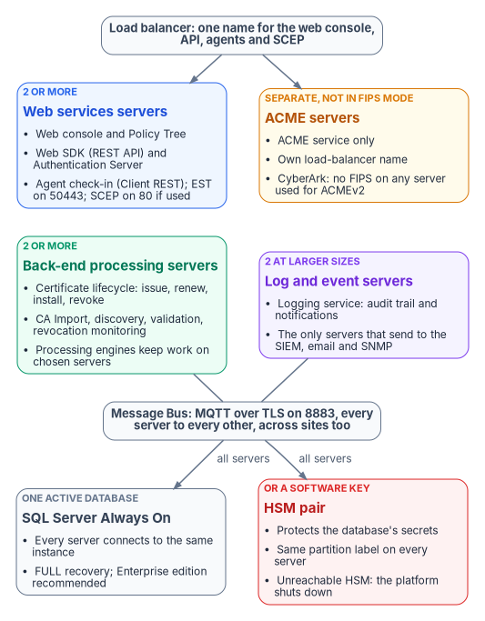
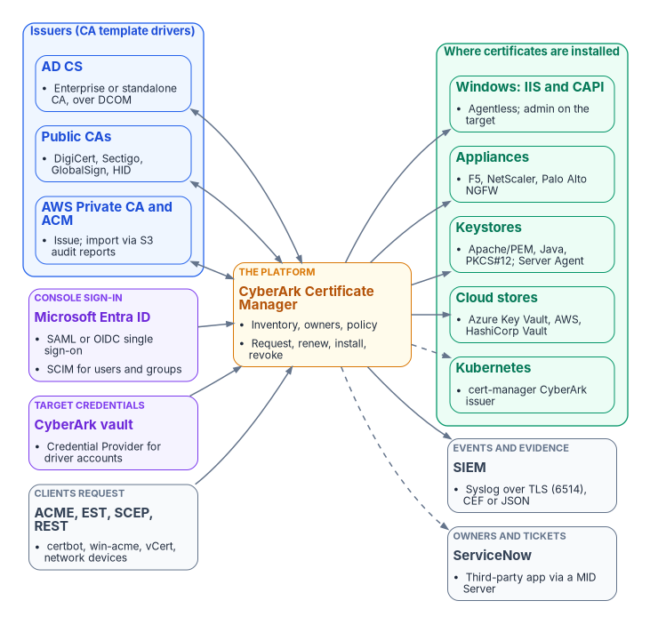
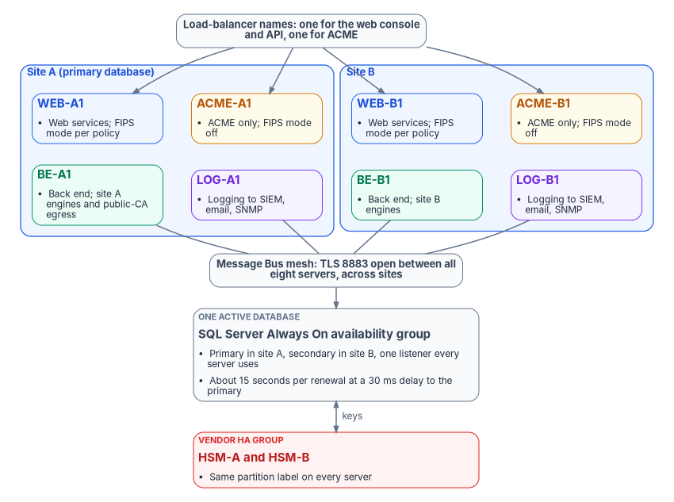
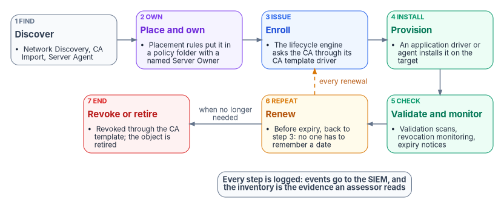

# Certificate Lifecycle on CyberArk Certificate Manager {.unnumbered}

[Book 07 — PKI & Certificates](../b07-pki/index.md) sets the certificate architecture: Microsoft Cloud PKI through Intune for managed devices, a hardened AD CS retained for servers and domain controllers, the Federal PKI for PIV, public CAs for internet-facing names, and one certificate lifecycle management (CLM) platform as the system of record for everything Intune and the PIV system don't manage. This implementation guide builds that CLM layer on CyberArk Certificate Manager, the program's choice because CyberArk is the agency's existing machine-identity vendor and the program doesn't add a second CLM vendor.

## Watch or download



| Edition | File |
|---|---|
| Deck | [Research_CyberArk_CLM.pptx](https://github.com/WhalerMike/modernization-workbook/releases/download/edition-2026.11.1/Research_CyberArk_CLM.pptx) |
| Narrated, self-running (about 20 minutes, captions) | [Research_CyberArk_CLM_Narrated.pptx](https://github.com/WhalerMike/modernization-workbook/releases/download/edition-2026.11.1/Research_CyberArk_CLM_Narrated.pptx) |
| Narration script and caption track | [Script](https://github.com/WhalerMike/modernization-workbook/blob/main/presentations/research-cyberark-clm/Research_CyberArk_CLM_Narration_Script.md) · [Captions](https://github.com/WhalerMike/modernization-workbook/blob/main/presentations/research-cyberark-clm/Research_CyberArk_CLM_Narrated.vtt) |

## What it covers

| Part | Content |
|---|---|
| Orientation | Book 07's issuer map and the CLM's role, and what "the platform" means; prerequisites and decisions: the self-hosted edition (no FedRAMP package exists for the SaaS edition), version 26.1, Windows Server and SQL Server requirements |
| Inside the platform | What the platform is made of: its server roles, the web tier, the back end (processing engines, log servers, the Message Bus), the components switched on per server, drivers, agents, the database and keys, what it connects to, a two-site reference topology, and one certificate's journey through it |
| 1. Build the platform | Architecture and high availability; FIPS posture, and what can't be claimed; console sign-in through Entra single sign-on with certificate-based authentication (design guidance); hardening and least-privilege service accounts; backup and recovery of the database and keys |
| 2. Connect the issuers | The AD CS driver, its permissions and scoping the CA account under ESC7; public and cloud CA drivers in 26.1 (the Entrust driver is gone); Intune coexistence: Intune keeps device certificates, and the CLM's own SCEP-CA option is documented but rejected as a second issuer |
| 3. Discover, own and automate | Discovery scans and CA import; ownership through policy folders tied to identity and CMDB owners; enrollment automation (ACME, EST, SCEP, REST, agents); Kubernetes through cert-manager inside the boundary; ServiceNow (only a third-party Store app) and SIEM |
| 4. Migrate and operate | The build mapped to Book 07's six waves (design guidance); renewal as public TLS lifetimes shrink; monitoring and drift; decommissioning AD CS with the CLM inventory; decisions, vendor asks and next steps |

The backup section holds an assessor's evidence checklist, a risks register, what couldn't be verified or sits behind a login, and the full source list.

## Inside the platform

"The platform" in this guide is CyberArk Certificate Manager, Self-Hosted: a cluster of Windows servers running the same software against one SQL Server database, with a role for each server set by the components switched on. [Book 07, Appendix C — Anatomy of the CLM Platform](../b07-pki/appendix-c-anatomy-of-the-clm-platform.md) describes each component, with notes to CyberArk's 26.1 documentation; the deck's "Inside the platform" section walks through the same four diagrams.

{fig-alt="Server roles of CyberArk Certificate Manager: a load balancer in front of web services servers and separate ACME servers not in FIPS mode; back-end processing servers and log and event servers; all linked by the Message Bus, MQTT over TLS on 8883 between every server, to one SQL Server Always On database and an HSM pair. Book 07 Appendix C describes the figure in full."}

{fig-alt="Integrations of CyberArk Certificate Manager: AD CS, public CAs and AWS as issuers; Windows IIS and CAPI, appliances, keystores, cloud stores and Kubernetes as installation targets; Entra ID for sign-in, the CyberArk vault for driver credentials, ACME, EST, SCEP and REST clients, the SIEM over syslog-TLS and ServiceNow through a third-party app. Book 07 Appendix C describes the figure in full."}

{fig-alt="A two-site layout: each site has a web services server, a non-FIPS ACME server, a back-end server and a log server behind shared load-balancer names, a Message Bus mesh between all eight servers, one SQL Server Always On availability group across the sites and an HSM pair. Book 07 Appendix C describes the figure in full."}

{fig-alt="Discover, place and own, enroll, provision, validate and monitor, renew back to enrollment before expiry, and revoke or retire when no longer needed; every step is logged. Book 07 Appendix C describes the figure in full."}

## What the research changed in Book 07

The research behind this guide corrected three points in Book 07, now updated:

- **ACME and FIPS** ([Chapter 08](../b07-pki/08-lifecycle-monitoring-and-decommissioning.md)): CyberArk's 26.1 installation guide says FIPS mode isn't supported for its ACME service at all, not only for the win-acme client, so the ACME service runs on dedicated servers outside the FIPS-mode server set.
- **Cloud PKI inventory** ([Chapter 04](../b07-pki/04-the-target-pki.md)): CyberArk documents no Cloud PKI import; reporting those certificates in the CLM needs a custom job from a Microsoft Graph beta report.
- **Scoping the CLM's CA account** ([Chapter 05](../b07-pki/05-who-owns-the-certificate-estate.md)): Microsoft publishes no Windows Server 2025 procedure for certificate-manager restrictions, so the scoping rests on template permissions plus tested allowed and denied requests.

## Status and review

**In review.** Every claim was checked against CyberArk's 26.1 documentation, Microsoft Learn, AWS documentation, the ServiceNow Store, the NIST CMVP list and FedRAMP Marketplace data on October 22, 2026. Open items, including Windows Server 2025 CA support in the vendor's integrations table, Azure Government support for the Key Vault driver, which cryptographic module the product uses, and console sign-in with PIV, are listed as vendor asks in the deck. To move this guide to **Proved**, build it in a lab or pilot boundary and record the evidence on this page. Comments and corrections are welcome as [issues on GitHub](https://github.com/WhalerMike/modernization-workbook/issues).

Related: [Book 07 — PKI & Certificates](../b07-pki/index.md), the [Book 07 technical deep dive](../../presentations/index.md#technical-b07), and the research explainer [Who Names the Device After AD?](../explainers/device-naming-after-ad.md), which covers the DNS names certificates carry.

<!-- revisions:start: generated by scripts/generate_revisions.py from data/editions.yml; edit those, not this section -->

## Version and revision history {#version-history}

**Version 1.1**, in [edition 2026.11.1](../../about/archive.md#edition-2026-11-1) (November 1, 2026). Every edition is kept on the [Archive](../../about/archive.md) page; every change between editions is in the [commit history](https://github.com/WhalerMike/modernization-workbook/commits/main/docs/books/guides/cyberark-certificate-lifecycle.md).

| Version | Edition | Date | Changes |
|---|---|---|---|
| 1.1 | [2026.11.1](../../about/archive.md#edition-2026-11-1) | 2026-11-01 | Edition 2026.11: record the edition, and publish the four gate-level decks and videos ([#282](https://github.com/WhalerMike/modernization-workbook/pull/282)) |
| 1.0 | [2026.11](../../about/archive.md#edition-2026-11) | 2026-11-01 | Retire Research: move each page to a home by type (guides, training, reference, evaluations, explainers) ([#269](https://github.com/WhalerMike/modernization-workbook/pull/269)) |

: Versions of this guide, newest first {.striped .hover}

<!-- revisions:end -->
