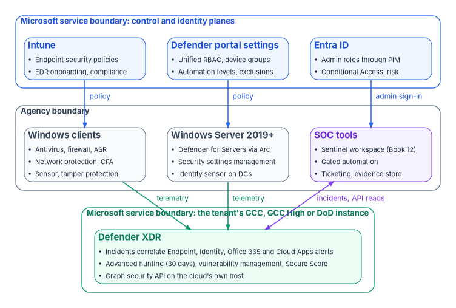

# Defender XDR Engineering & Operations: An Implementation Guide

*A Defender license is not a defended endpoint: the sensor has to be on every device and healthy, the prevention settings have to be enforced and not just configured, and every alert has to end in a decision someone can show.*

::: {.callout-note}
## In this guide
How an agency turns Microsoft Defender XDR from a license into hardened Windows endpoints, tuned detections and repeatable response, as gated steps an operator can run. First, how to read the guide, what the books already cover, the reference architecture with its trust boundaries and control planes, government-cloud availability feature by feature, a decision record, the RACI and the path on one page. Then ten gates, one for each topic: service architecture and access, endpoint onboarding, endpoint prevention, Attack Surface Reduction, exposure management, XDR incidents, advanced hunting, identity and cloud-app signals, automation, and operations and evidence. Each gate carries its prerequisites, pilot, audit phase, enforcement, rollback, exclusions, telemetry, evidence and day-two owner, with copy-paste commands and a **Validate** step. Then the metrics, the evidence catalog, the requirements and KSIs, the dangers, rollback, the implementation checklist and what couldn't be verified. Windows clients and Windows Server only; macOS and Linux are out of scope.
:::

## How to read this guide

The books already own most of this subject; this guide builds what they decide. [Book 12](../b12-security-operations/index.md) owns security operations: the Defender XDR connector and the division of labor with Microsoft Sentinel ([Chapter 05](../b12-security-operations/05-from-log-warehouse-to-detection.md#what-defender-xdr-contributes)), Defender Vulnerability Management and the remediation queue ([Chapter 06](../b12-security-operations/06-vulnerability-management.md#defender-vulnerability-management-on-arc-enabled-servers)), who runs the SOC ([Chapter 10](../b12-security-operations/10-who-runs-security-operations.md)), the rule lifecycle, the response ladder and device isolation ([Chapter 11](../b12-security-operations/11-detection-engineering-and-response.md#the-response-ladder)), and the metric set ([Chapter 12](../b12-security-operations/12-evidence-metrics-and-continuous-monitoring.md#the-metric-set)). [Book 05](../b05-devices/index.md) owns the endpoint policy library: the antivirus, firewall, EDR and Attack Surface Reduction policies ES-001 to ES-005 ([Chapter 08](../b05-devices/08-gpo-to-intune-policy-migration.md#endpoint-security-policies)), servers under Azure Arc ([Chapter 09](../b05-devices/09-servers-under-azure-arc.md)), and the Defender settings that live in the portal ([Chapter 10](../b05-devices/10-operating-and-evidencing-the-fleet.md#microsoft-defender-for-endpoint)). This guide links to those pages for the design and the setting values, and adds what they don't give: the order of work, the commands that prove each step, the warn stage for Attack Surface Reduction, detections as code, the government-cloud check per feature, and the evidence.

**Where the facts come from.** Every product behavior, command, permission, endpoint and government-cloud statement was read on Microsoft Learn on November 11, 2026; the commands are Learn's own, or Learn's cmdlets and queries with only the placeholders filled. The [verification log](https://github.com/WhalerMike/modernization-workbook/blob/main/docs/books/guides/_verification/defender-xdr-implementation.md) lists every claim. Where Learn doesn't say, the guide says *not yet specified* and [lists it](#what-couldnt-be-verified). Recommendations carry an authority label ([Book 00, Appendix D](../b00-orientation/appendix-d-control-states-and-evidence.md#authority-labels)): **Microsoft-recommended** with the Learn page, or **risk-based recommended** where it is the program's position. The audience is a civilian agency at FedRAMP Moderate in Microsoft 365 GCC, with notes for GCC High and DoD. The program's Windows Server standard is an assumption, not a fact about any agency: Windows Server 2016 is gone by January 12, 2027 and Windows Server 2019 is the minimum. Nothing here was run in a tenant; every command is unrun by the authors. Examples use the fictional `contoso.example`.

**The placeholders.** The commands are exact; replace these values once, everywhere:

| Placeholder | What it is |
|---|---|
| `<graph-environment>` | `Global` for GCC; `USGov` for GCC High; `USGovDoD` for DoD |
| `<pilot-device>` | A ring 0 or ring 1 Windows device the gate owner has approved for tests |
| `<incident-id>` | A Defender XDR incident number from the queue |
| `<rule-file>` | A custom detection rule's JSON file in the agency's detection repository |
| `<rule-id>` | That rule's `id`, a short client-chosen name such as `contoso-office-encoded-powershell` |
| `<evidence-folder>` | The folder, inside the agency's boundary, where a run's evidence files are written |

: Placeholders used in this guide {.striped .hover}

**The checks.** There is no kit for this guide. Each **Validate** step is a read-only command or KQL query from Learn that an operator runs and files; the only writes are the policy changes each gate names, made through Intune or the Defender portal under a change record.

## What the books cover, and where each topic lives

| ID | Topic | Where it lives | What this guide adds |
|---|---|---|---|
| XDR-01 | Service architecture | [Gate 1](#step-1-service-architecture-and-access) and the [reference architecture](#reference-architecture) | Components, licensing, data flows, permissions, workspaces, federal cloud constraints per feature |
| XDR-02 | Endpoint onboarding | [Gate 2](#step-2-endpoint-onboarding); policy ES-004 in [Book 05, Chapter 08](../b05-devices/08-gpo-to-intune-policy-migration.md#es-004-endpoint-detection-and-response); servers in [Book 05, Chapter 09](../b05-devices/09-servers-under-azure-arc.md) | Sensor-health proof, coverage query, unsupported and isolated assets |
| XDR-03 | Endpoint prevention | [Gate 3](#step-3-endpoint-prevention); values in ES-001 and ES-003 | Audit first, enforcement order, local and fleet verification |
| XDR-04 | Attack Surface Reduction | [Gate 4](#step-4-attack-surface-reduction); rule list in [ES-005](../b05-devices/08-gpo-to-intune-policy-migration.md#es-005-attack-surface-reduction) | Audit, warn, block rings; exclusions; measuring blocks |
| XDR-05 | Exposure management | [Gate 5](#step-5-exposure-management); the queue in [Book 12, Chapter 06](../b12-security-operations/06-vulnerability-management.md) | What Exposure Management can't do in US Government clouds, and the interim path |
| XDR-06 | XDR incidents | [Gate 6](#step-6-xdr-incidents); response in [Book 12, Chapter 11](../b12-security-operations/11-detection-engineering-and-response.md) | Severity, triage, containment, evidence and hand-off, through the Graph incidents API |
| XDR-07 | Advanced hunting | [Gate 7](#step-7-advanced-hunting-and-detections-as-code); lifecycle in [Book 12, Chapter 11](../b12-security-operations/11-detection-engineering-and-response.md#rule-lifecycle-and-testing) | Custom detections as code through Graph, schema governance, validation datasets |
| XDR-08 | Identity and cloud-app signals | [Gate 8](#step-8-identity-and-cloud-app-signals); identity telemetry in [Book 12, Chapter 03](../b12-security-operations/03-identity-telemetry.md) | Cross-source correlation in advanced hunting; Defender for Identity and Defender for Cloud Apps in government clouds |
| XDR-09 | Automation | [Gate 9](#step-9-automation-with-approval-boundaries); the ladder in [Book 12, Chapter 11](../b12-security-operations/11-detection-engineering-and-response.md#the-response-ladder) | Automation levels per device group, attack disruption exclusions, rollback |
| XDR-10 | Operations and evidence | [Gate 10](#step-10-operations-and-evidence), [metrics](#metrics), [evidence catalog](#evidence-catalog) | Health, coverage, tuning, exceptions, exercises and assessor artifacts |

: The ten topics and where each one lives {.striped .hover}

## The track at a glance

**The goal.** Every Windows device the agency owns is onboarded and reporting, its prevention settings are enforced at the strength the design chose, every Attack Surface Reduction rule is in block (or in a recorded exception), every alert lands in one incident queue with an owner, and the evidence for all of it can be produced on request *(risk-based recommended: the program's position)*.

**Done when** *(risk-based recommended)*:

- the onboarding coverage query shows every in-scope Windows device onboarded with an active sensor, or in the exception register;
- antivirus, firewall, tamper protection, network protection and controlled folder access are enforced on every ring, with audit evidence from the pilot;
- each Attack Surface Reduction rule has passed audit and warn (where the rule supports warn) and is in block, with its per-rule exclusions recorded;
- incidents are triaged to the severity table, contained on the response ladder, and closed with a classification;
- custom detections live in a repository and deploy through the Graph API after a recorded test;
- the metrics and the evidence catalog are produced every month.

**Control states.** <!-- Book 00, Appendix D: Designed, Configured, Enforced, Evidenced, Operated -->

| State | This page | Evidence |
|---|---|---|
| Designed | [Decision record](#decision-record-template), Gate 1 | The signed decision record per feature |
| Configured | Gates 2 to 4 and 9, audit and pilot phases | Intune and Defender portal policy exports; device group automation levels |
| Enforced | Gates 3 and 4, enforcement rings; Gate 9 | Block mode in the policy export, the ring assignment and the exclusion register |
| Evidenced | Every **Validate** step and the [synthetic events](#synthetic-events) | Test record and the event it produced, with the query that found it |
| Operated | Gate 10 | Owner, cadence, the metrics run and the drift and health alerts |

A finding this page addresses is ready for closure when every applicable state has evidence; the authorizing official or assessor decides. Record each finding in the closure register of [Book 11, Chapter 10](../b11-zero-trust/10-evidence-not-verdicts.md#the-closure-chain), and treat a Zero Trust Assessment test skipped for a missing license or an unavailable government-cloud feature as a disposition, not a failed control ([Book 11, Chapter 10](../b11-zero-trust/10-evidence-not-verdicts.md#a-normalized-result-taxonomy)).

::: {.callout-note appearance="simple"}
## Assessment mapping
- **Microsoft Zero Trust pillar:** Devices (Gates 2 to 5) and SecOps (Gates 6 to 10)
- **CISA ZTMM pillar:** Devices, with the Visibility and Analytics and the Automation and Orchestration cross-cutting capabilities
- **Depends on:** device identity and compliance ([Book 05, Chapter 10](../b05-devices/10-operating-and-evidencing-the-fleet.md)); privileged roles through PIM and emergency access ([Book 04](../b04-access/index.md)); the identity telemetry of [Book 12, Chapter 03](../b12-security-operations/03-identity-telemetry.md)
- **Attack chain interrupted:** Execution and Persistence on the endpoint (Attack Surface Reduction, antivirus), Credential Access (the LSASS rule, Credential Guard), Defense Evasion (tamper protection), Command and Control (network protection), Impact (controlled folder access), and dwell time across the chain (detection and response)
:::

## Reference architecture {#reference-architecture}

{#fig-defender-xdr-architecture fig-alt="Three stacked boxes. Top, blue, the Microsoft service boundary for the control and identity planes: Intune with endpoint security policies and EDR onboarding and compliance; Defender portal settings with unified RBAC, device groups, automation levels and exclusions; and Entra ID with admin roles through PIM, Conditional Access and risk. Middle, slate, the agency boundary: Windows clients with antivirus, firewall, Attack Surface Reduction, network protection, controlled folder access, the sensor and tamper protection; Windows Server 2019 and later with Defender for Servers through Arc, security settings management and the Defender for Identity sensor on domain controllers; and SOC tools with the Sentinel workspace, gated automation, ticketing and the evidence store. Policy arrows run from Intune to the clients and from the Defender portal to the servers; an admin sign-in arrow runs from Entra ID to the SOC tools. Bottom, green, the Microsoft service boundary for the tenant's GCC, GCC High or DoD instance: Defender XDR, which correlates Endpoint, Identity, Office 365 and Cloud Apps alerts into incidents, holds 30 days of advanced hunting, vulnerability management and Secure Score, and serves the Graph security API on the cloud's own host. Telemetry arrows run from the clients and servers to Defender XDR, and a two-way arrow labeled incidents and API reads joins Defender XDR and the SOC tools."}

**Trust boundaries.** Two boundaries matter. The agency's boundary holds the devices, the SOC's Sentinel workspace, automation and the evidence store. Microsoft's service boundary holds the Defender XDR service and its control planes; for a US Government tenant it is built in the Azure US Government environment, and GCC, GCC High and DoD each have their own portal.[^xdr-usgov] Every arrow that crosses the boundary is authenticated by Entra ID, and every administrator who crosses it holds a role through PIM ([Book 04](../b04-access/index.md)).

**Control planes.** Intune is the recommended tool for configuring and distributing Defender for Endpoint features to devices, through endpoint security policies; Defender for Endpoint management supports device objects only, so policies are assigned to Entra device groups, not user groups.[^xdr-asr-configure] Settings Intune doesn't hold (automation levels, device groups, attack disruption exclusions, custom detections) are set in the Defender portal ([Book 05, Chapter 10](../b05-devices/10-operating-and-evidencing-the-fleet.md#microsoft-defender-for-endpoint)). Windows Server is reached through Defender for Servers and security settings management ([Book 05, Chapter 09](../b05-devices/09-servers-under-azure-arc.md)); servers in AWS, Google Cloud or Oracle Cloud Infrastructure reach Defender the same way where Book 05 Chapter 09 says Arc reaches them. Use one control plane per setting: for Attack Surface Reduction, Learn's precedence is local `Set-MpPreference` lowest, then MDM or Group Policy (Group Policy wins by default unless `MDMWinsOverGP` is set), and Microsoft says not to configure the same rule in both.[^xdr-asr-configure]

**Data flows.** The sensor and antivirus send telemetry to the tenant's Defender instance; alerts from Endpoint, Identity, Office 365 and Cloud Apps become incidents there; advanced hunting holds 30 days of raw data;[^xdr-asr-monitor] the SOC reads incidents and runs queries through the Microsoft Graph security API, and the Defender XDR connector carries incidents and selected tables to Sentinel ([Book 12, Chapter 05](../b12-security-operations/05-from-log-warehouse-to-detection.md#microsoft-defender-xdr)).

## Government-cloud availability by feature {#government-cloud-availability}

Read on Microsoft Learn on November 11, 2026. "Not yet specified" means Learn doesn't say; it doesn't mean available.

| Feature | GCC | GCC High | DoD | Source |
|---|---|---|---|---|
| Defender for Endpoint (prevention, detection, investigation, remediation) | Available | Available | Available | [^xdr-mde-gov] |
| Defender portal | `security.microsoft.com` | `security.microsoft.us` | `security.apps.mil` | [^xdr-usgov] |
| Defender for Endpoint API host | `api-gcc.securitycenter.microsoft.us` | `api-gov.securitycenter.microsoft.us` | `api-gov.securitycenter.microsoft.us` | [^xdr-mde-gov] |
| Defender XDR API host | `api-gcc.security.microsoft.us` | `api-gov.security.microsoft.us` | `api-gov.security.microsoft.us` | [^xdr-usgov] |
| Graph security API: list incidents, run hunting query | Available (L4 column; GCC uses the worldwide Graph host) | Available (US Government L4) | Available (US Government L5) | [^xdr-graph-incidents] [^xdr-graph-hunting] [^xdr-graph-clouds] |
| Graph custom detection rules (`detectionRules`) | Not yet specified | Not yet specified | Not yet specified | [^xdr-graph-detection] |
| Security settings management (Windows Server policy from Intune) | Available | Available | Available | [^xdr-mde-gov] |
| Defender Vulnerability Management, core and premium | Available, without *report inaccuracy* and *request CVE support* | Same | Same | [^xdr-mde-gov] |
| Microsoft Secure Score | Available; some recommendations aren't | Available | Available | [^xdr-mde-gov] |
| Microsoft Security Exposure Management (attack paths, exposure graph, critical asset management) | Not available: Learn says Public Cloud only, not US Gov | Not available | Not available | [^xdr-msem] |
| Microsoft Threat Experts; Defender for IoT enterprise IoT security | Not available | Not available | Not available | [^xdr-usgov] |
| Defender for Identity | Available (sensor endpoint `*.atp.gcc.azure.com`) | Available (`*.atp.azure.us`) | Available (`*.atp.azure.us`) | [^xdr-mdi-gov] |
| Defender for Cloud Apps | Available; App Governance alerts listed as roadmap | Same | Same | [^xdr-mdca-gov] |
| Defender for Cloud Apps behaviors in `BehaviorInfo` and `BehaviorEntities` (preview) | Not available | Not yet specified | Not yet specified | [^xdr-ah-schema] |
| Automated investigation and response, automation levels per device group | Not listed as a gap; an explicit statement is not yet specified | Same | Same | [^xdr-mde-gov] |
| Automatic attack disruption | Not yet specified | Not yet specified | Not yet specified | [^xdr-disruption] |
| Web content filtering on Windows | Not yet specified (the government page lists its report for mobile only) | Not yet specified | Not yet specified | [^xdr-mde-gov] |
| Streamlined device connectivity | Preview URL list for Gov, GCC and DoD | Same | Same | [^xdr-mde-gov] |
| Defender XDR connector to Sentinel | See [Book 12, Chapter 05](../b12-security-operations/05-from-log-warehouse-to-detection.md#where-sentinel-runs-and-which-clouds-table-to-read), which records a conflict between two Learn pages for DoD | | | |

: Government-cloud availability for the features this guide relies on {.striped .hover}

Defender for Identity says new features reach GCC, GCC High and DoD within 90 days of commercial release, and preview features may not be supported there;[^xdr-mdi-gov] Defender for Cloud Apps says three months for GCC High and DoD.[^xdr-mdca-gov] A GCC customer moving from Defender commercial to GCC transitions Endpoint, Cloud Apps and Identity to their GCC versions; no Defender for Identity data is migrated.[^xdr-usgov] [^xdr-mdi-gov]

## Prerequisites {#prerequisites}

- **Licenses.** For desktops, one of the government offers Learn lists: Microsoft 365 GCC G5, Microsoft 365 G5 Security GCC, Defender for Endpoint GCC or Windows 10 Enterprise E5 GCC, or the GCC High or DoD equivalents; G3 includes Defender for Endpoint Plan 1 only. For servers, Defender for Endpoint Server or Defender for Servers (Government in GCC High and DoD).[^xdr-mde-gov] Advanced hunting, the Attack Surface Reduction report and the device timeline need Plan 2.[^xdr-asr-test] Intune is a separate product, not included with every Defender subscription.[^xdr-onboard-intune] *License-dependent* throughout: a feature the agency isn't licensed for is a licensing decision, not a failed control.
- **Roles.** Endpoint Security Manager in Intune to create EDR and endpoint security policies;[^xdr-onboard-intune] Security Administrator in Entra ID to activate unified RBAC;[^xdr-rbac-activate] custom unified RBAC roles for everyone else (Gate 1). Every privileged role is eligible through PIM, not standing ([Book 04](../b04-access/index.md)).
- **Tools.** PowerShell 7 with `Microsoft.Graph.Authentication` and `Microsoft.Graph.Security`; the Windows `Defender` and `NetSecurity` modules on the test devices.
- **Decisions first.** The [decision record](#decision-record-template) for each feature, the [RACI](#raci), the ring groups (ring 0 the implementing team, ring 1 a pilot, ring 2 early adopters, ring 3 everyone in scope), and the emergency access accounts that every automation exclusion protects.

## Decision record template {#decision-record-template}

One record per feature, kept in the agency's repository inside its boundary. The fields are the program's design.

```yaml
# decision-record: one per Defender feature (program template)
feature: "<feature name, for example Attack Surface Reduction: Block Office applications from creating child processes>"
decision: "<adopt | adopt with exceptions | defer | not applicable>"
authority: "<Mandated | Microsoft-recommended | Risk-based recommended | Optional> (<source or stated risk>)"
license: "<license that carries it, from Learn; or 'none beyond Defender for Endpoint Plan 2'>"
cloud_availability:
  cloud: "<GCC | GCC High | DoD>"
  status: "<available | not available | not yet specified | preview>"
  source: "<Learn page and date read>"
prerequisites: ["<platform version, connector, role, prior gate>"]
scope: "<device groups or ring groups>"
exclusions: ["<path, device group or account, with approver and expiry>"]
compensating_controls: "<what stands in where the feature is unavailable or excepted>"
rollback: "<the step back and who can run it>"
owner: "<role from the RACI>"
review_date: "<date>"
approved_by: "<policy owner role and date>"
```

## RACI {#raci}

R responsible, A accountable, C consulted, I informed. The roles follow [Book 12, Chapter 10](../b12-security-operations/10-who-runs-security-operations.md#the-responsibility-matrix) and [Book 05, Chapter 06](../b05-devices/06-who-owns-the-endpoint.md#the-responsibility-matrix); the assignment is the program's design.

| Activity | Policy owner (ISSO / CISO delegate) | Platform owner (endpoint engineering) | Operator (Intune and Defender admin) | Security monitor (SOC) | Help desk | Assessor |
|---|---|---|---|---|---|---|
| Decision record per feature | A | R | C | C | I | I |
| Onboarding and sensor health | I | A | R | C | I | I |
| Prevention and ASR policies, rings | A | R | R | C | C | I |
| Exclusions and the exception register | A | R | C | C | I | I |
| Incident triage and containment | I | C | C | A/R | C | I |
| Custom detections and hunting | I | C | I | A/R | I | I |
| Automation levels and attack disruption exclusions | A | C | R | R | I | I |
| Warn-mode unblock requests and user impact | I | C | C | I | R | I |
| Metrics, evidence catalog, exercises | A | R | C | R | I | C |
| Assessment of the evidence | I | C | I | C | I | A/R |

: RACI for Defender XDR engineering and operations {.striped .hover}

## The path on one page

| Gate | Done when | Validate with |
|---|---|---|
| [G1 Service architecture and access](#step-1-service-architecture-and-access) | Unified RBAC roles exist and are active; the SOC reads incidents through Graph on the tenant's own cloud | `Get-MgSecurityIncident -Top 5` |
| [G2 Endpoint onboarding](#step-2-endpoint-onboarding) | Every in-scope device onboarded with an active sensor, or excepted | `DeviceInfo` coverage query; the detection test |
| [G3 Endpoint prevention](#step-3-endpoint-prevention) | Antivirus, firewall, tamper protection, network protection and controlled folder access enforced on every ring | `Get-MpComputerStatus`, `Get-MpPreference`, `Get-NetFirewallProfile`; audit-event queries |
| [G4 Attack Surface Reduction](#step-4-attack-surface-reduction) | Every rule through audit and warn into block, exclusions recorded | `Get-MpPreference` rule listing; `DeviceEvents` ASR query |
| [G5 Exposure management](#step-5-exposure-management) | Vulnerabilities and configuration weaknesses flow to owned remediation | `DeviceTvmSoftwareVulnerabilities` query |
| [G6 XDR incidents](#step-6-xdr-incidents) | One queue, a severity table, containment on the ladder, every incident classified | Incident export with alerts |
| [G7 Advanced hunting](#step-7-advanced-hunting-and-detections-as-code) | Detections in a repository, deployed through Graph after a recorded test | `runHuntingQuery` against the validation dataset |
| [G8 Identity and cloud-app signals](#step-8-identity-and-cloud-app-signals) | Defender for Identity and Cloud Apps feed incidents; cross-source query in use | `AlertEvidence` correlation query |
| [G9 Automation](#step-9-automation-with-approval-boundaries) | Automation levels per device group set to the ladder; attack disruption exclusions recorded | Device group export; Action center review |
| [G10 Operations and evidence](#step-10-operations-and-evidence) | Metrics and the evidence catalog produced monthly; an exercise each quarter | The monthly evidence run |

: The ten gates of Defender XDR engineering and operations {.striped .hover}

Gates 1 and 2 come first. Gates 3 and 4 need Gate 2; Gates 5 to 9 need Gates 1 and 2; Gate 10 runs once the others have their first evidence.

## Step 1: Service architecture and access {#step-1-service-architecture-and-access}

Defender XDR's components are Defender for Endpoint, Defender for Identity, Defender for Office 365 and Defender for Cloud Apps, joined in one portal and one incident queue; Sentinel joins them when onboarded to the Defender portal ([Book 12, Chapter 05](../b12-security-operations/05-from-log-warehouse-to-detection.md#what-defender-xdr-contributes)). This gate fixes who can do what, in which cloud.

**Prerequisites.** The licenses and roles above; the decision record for the cloud (GCC, GCC High or DoD) and its portal and API hosts from the [availability table](#government-cloud-availability).

**Steps.**

1. **Create the roles in unified RBAC.** In the Defender portal, **System** > **Permissions** > **Microsoft Defender XDR** > **Roles** > **Create custom role**. Permission groups are **Security operations**, **Security posture**, **Authorization and settings** and **Data operations**; assign each role to Entra security groups and data sources.[^xdr-rbac-create] The program's roles *(risk-based recommended)*: a read role (**Security data basics**) for analysts and the assessor's read-only account; a responder role adding **Alerts**, **Response** and **Basic live response**; a detection-engineer role with **Detection tuning (Manage)**, which the custom detection API accepts;[^xdr-graph-detection] and **Advanced live response** only for the Tier 0 analysts [Book 05, Chapter 10](../b05-devices/10-operating-and-evidencing-the-fleet.md#microsoft-defender-for-endpoint) names. Assign groups that PIM governs.
2. **Activate unified RBAC.** **System** > **Permissions** > **Microsoft Defender XDR** > **Roles** > **Workload settings**, and turn on each workload. Activation needs at least Security Administrator in Entra ID; new Defender for Endpoint and Defender for Identity tenants have used the unified model by default since 2025.[^xdr-rbac-activate] Create every role and assignment before activating.
3. **Connect the SOC's read path, in the right cloud.** GCC uses `Global`; GCC High `USGov`; DoD `USGovDoD`.

    ```powershell
    Install-Module Microsoft.Graph.Authentication, Microsoft.Graph.Security -Scope CurrentUser
    Connect-MgGraph -Environment <graph-environment> -Scopes SecurityIncident.Read.All,ThreatHunting.Read.All
    ```

    `SecurityIncident.Read.All` is the least-privileged permission to list incidents, and a delegated user also needs Security Reader, Global Reader, Security Operator or Security Administrator; `ThreatHunting.Read.All` runs hunting queries.[^xdr-graph-incidents] [^xdr-graph-hunting]

**Exclusions.** Not applicable: roles grant access; they don't block anyone. Keep the emergency access accounts out of Defender roles; they exist for Entra sign-in recovery ([Book 04](../b04-access/index.md)).

**Telemetry and evidence.** The role export (screenshot or the portal's role list) and the PIM assignment report. **Rollback.** Deactivate a workload on the same **Workload settings** page; the previous model's roles return. **Day-two.** Platform owner; access review each quarter through PIM.

::: {.callout-important}
## Validate (G1 Service architecture and access)
- **Read access works in the tenant's cloud:**

    ```powershell
    Get-MgSecurityIncident -Top 5 | Select-Object Id, DisplayName, Severity, Status, CreatedDateTime
    ```

    Pass: up to five incidents return (or an empty list in a new tenant) with no permission error. An error naming the role means the delegated user lacks one of the four roles above.
- Gate owner: the platform owner, with the ISSO.
:::

## Step 2: Endpoint onboarding {#step-2-endpoint-onboarding}

Onboarding by management plane: Windows clients through Intune's EDR policy (ES-004 in [Book 05, Chapter 08](../b05-devices/08-gpo-to-intune-policy-migration.md#es-004-endpoint-detection-and-response)), Windows Server through Defender for Servers on Arc ([Book 05, Chapter 09](../b05-devices/09-servers-under-azure-arc.md) and [Book 12, Chapter 06](../b12-security-operations/06-vulnerability-management.md#defender-vulnerability-management-on-arc-enabled-servers)). This gate proves the sensor is on and healthy everywhere it should be.

### Prerequisites
Devices enrolled in Intune; the Intune–Defender for Endpoint connection; Endpoint Security Manager for the EDR policy.[^xdr-onboard-intune] Government-cloud: Windows 11, Windows 10 21H1 and later, Windows Server 2019 and 2022 and later are supported in GCC, GCC High and DoD; Windows Server 2019 needs KB4586839 *before* onboarding so it reaches the right environment.[^xdr-mde-gov] Firewalls allow the government URL list, standard or streamlined (preview).[^xdr-mde-gov]

### Pilot
Ring 0, then ring 1: assign the EDR policy (package type *Auto from connector*) to the ring's device group.

### Report-only or audit phase
Not applicable: onboarding doesn't block anything. Its observation is the sensor-health check below.

### Enforcement
Assign the EDR policy to rings 2 and 3, and make onboarding part of the compliance policy where Book 05 sets a Defender risk score ([Chapter 10](../b05-devices/10-operating-and-evidencing-the-fleet.md#defender-risk-as-a-compliance-signal)).

### Rollback
Offboard with the package from **Settings** > **Endpoints** > **Offboarding**, deployed as an EDR policy with package type **Offboard**. The package expires seven days after download; don't deploy onboarding and offboarding to a device at the same time; the device's profile stays in the inventory without data for up to 180 days.[^xdr-onboard-intune]

### Exclusions
Devices the sensor can't reach: an unsupported OS, an isolated network, an appliance. Each goes in the exception register with a compensating control: for an isolated network, the streamlined connectivity set or a proxy; where no path exists, Windows Event Forwarding of the Defender operational log, which Learn names as the way to centralize events without the service.[^xdr-asr-test] Windows Server 2016 and earlier leave the estate under the program's standard; until they do, the modern unified solution is the path Learn supports.[^xdr-mde-gov]

### Telemetry
On the device, the SENSE service and the onboarding state; in the service, `DeviceInfo`'s `OnboardingStatus` and `SensorHealthState`.[^xdr-deviceinfo] Sensor health values: **Active**; **Inactive** (no contact, typically 7 days or more); **No sensor data**; **Impaired communications**; **Misconfigured**.[^xdr-inventory-fields] Intune's EDR onboarding status report shows the same from the Intune side ([Book 05, Chapter 10](../b05-devices/10-operating-and-evidencing-the-fleet.md#microsoft-defender-for-endpoint)).

### Evidence
**Evidence checklist**

- [ ] **Configuration:** the EDR policy export and its assignments
- [ ] **Operational:** the weekly coverage query result, kept 12 months
- [ ] **Test:** the detection test on `<pilot-device>`, with the alert it raised
- [ ] **Exception:** every device not onboarded, with reason, compensating control, approver and expiry
- [ ] **Assessor-ready artifact:** coverage by ring against the CM-8 inventory ([Book 05, Chapter 10](../b05-devices/10-operating-and-evidencing-the-fleet.md#device-inventory-reconciliation))

### Day-two ownership
Operator, weekly: every device not **Active** for 7 days is a ticket; the platform owner reviews the exception register quarterly.

::: {.callout-important}
## Validate (G2 Endpoint onboarding)
- **On `<pilot-device>`, the sensor runs and the device is onboarded.** Learn names the service and the registry value (`OnboardingState` = `1`):[^xdr-troubleshoot-onboarding]

    ```powershell
    sc.exe query sense
    Get-ItemProperty -Path 'HKLM:\SOFTWARE\Microsoft\Windows Advanced Threat Protection\Status' -Name OnboardingState
    ```

- **Across the fleet, onboarding and sensor health,** through Graph so the result can be filed:

    ```powershell
    $q = 'DeviceInfo | where Timestamp > ago(1d) | summarize arg_max(Timestamp, *) by DeviceId | where OSPlatform startswith "Windows" | summarize Devices = count() by OnboardingStatus, SensorHealthState'
    Start-MgSecurityHuntingQuery -BodyParameter @{ Query = $q } | ConvertTo-Json -Depth 5 | Out-File <evidence-folder>/g2-coverage.json
    ```

    Pass: every device is onboarded with `SensorHealthState` `Active`, or is in the exception register.
- **End to end, the detection test,** from an elevated Command Prompt on `<pilot-device>`, exactly as Learn publishes it; an alert appears in the portal in about 10 minutes.[^xdr-detection-test]

    ```powershell
    powershell.exe -NoExit -ExecutionPolicy Bypass -WindowStyle Hidden $ErrorActionPreference = 'silentlycontinue';(New-Object System.Net.WebClient).DownloadFile('http://127.0.0.1/1.exe', 'C:\\test-MDATP-test\\invoice.exe');Start-Process 'C:\\test-MDATP-test\\invoice.exe'
    ```

- Gate owner: the platform owner.
:::

## Step 3: Endpoint prevention {#step-3-endpoint-prevention}

Antivirus (ES-001), firewall (ES-003) and tamper protection carry Book 05's values; this gate adds network protection, web protection and controlled folder access, all through an audit phase, and proves each one on the device and across the fleet. The setting values stay in [Book 05, Chapter 08](../b05-devices/08-gpo-to-intune-policy-migration.md#es-001-antivirus); don't copy them here.

### Prerequisites
Gate 2 on the ring. Tamper protection through Intune needs onboarding to Defender for Endpoint ([Book 05, Chapter 08](../b05-devices/08-gpo-to-intune-policy-migration.md#es-001-antivirus)). Network protection needs Defender Antivirus in active mode, behavior monitoring and cloud protection with working connectivity.[^xdr-np-evaluate] On Windows Server 2019 and later, network protection also needs `AllowNetworkProtectionOnWinServer`; on high-UDP server roles (domain controllers, DNS, file, SQL Server), set `AllowDatagramProcessingOnWinServer` to false.[^xdr-np-configure] Government-cloud: these are Defender for Endpoint capabilities, available in all three clouds;[^xdr-mde-gov] Windows web content filtering is not yet specified there.

### Pilot
Ring 0 and ring 1, two weeks minimum *(risk-based recommended)*, with network protection and controlled folder access in audit.

### Report-only or audit phase
Network protection and controlled folder access both have audit modes: network protection `AuditMode` (value 2) logs connections it would block;[^xdr-np-configure] controlled folder access `AuditMode` (value 2) logs untrusted writes to protected folders, with block (1) and disk-sector-only modes (3 and 4).[^xdr-cfa-configure] In Intune both are settings of the endpoint security policies (network protection in the antivirus policy; controlled folder access in the Attack Surface Reduction policy).[^xdr-cfa-configure] Read the audit events weekly (Validate, below) and add allowed applications for controlled folder access before enforcing. Antivirus, firewall and tamper protection have no audit mode; they go straight to ring 1 with the backout triggers below.

### Enforcement
Network protection to **Enabled (block mode)** and controlled folder access to **Enabled** in the Intune policy, ring by ring. **Change safety**

| Ring | Scope | Exit criteria |
|---|---|---|
| 0 | Implementing team | Audit events reviewed; test site blocked; no help-desk call |
| 1 | Pilot group | Two weeks; every audited line-of-business block has an allow entry or a decision |
| 2 | Early adopters | One week; help-desk calls tagged "Defender block" under the threshold set before the change |
| 3 | Everyone in scope | Post-change validation passes on a sample per site |

- **Emergency access:** not applicable to device policies; the emergency workstations, if any, are in their own device group and ring 0.
- **Change window:** the endpoint change board's weekly window; the operator and a help-desk lead on hand.
- **Backout triggers:** a blocked critical application with no allow path; help-desk volume over the agreed threshold.
- **Post-change validation:** the Validate commands on a sample device per ring.

### Rollback
Set the mode back to audit in the same Intune policy and sync; the change reaches devices at the next policy check-in. Tamper protection is turned off only from the console that set it; on the device it can be lifted temporarily only in Defender for Endpoint troubleshooting mode.[^xdr-tamper-configure]

### Exclusions
Controlled folder access allowed applications and network protection allow indicators, each in the register with owner and expiry; antivirus exclusions follow Book 05's exclusion hygiene ([Chapter 08](../b05-devices/08-gpo-to-intune-policy-migration.md#es-001-antivirus)).

### Telemetry
`DeviceEvents` action types `ExploitGuardNetworkProtectionAudited` and `ExploitGuardNetworkProtectionBlocked`; `ControlledFolderAccessViolationAudited` and `ControlledFolderAccessViolationBlocked`; `TamperingAttempt`.[^xdr-np-hunting] [^xdr-cfa-monitor] [^xdr-tamper-overview] On the device, the Windows Defender Operational log: network protection 1125 (audit) and 1126 (block); controlled folder access 1124 (audit) and 1123 (block).[^xdr-np-hunting] [^xdr-cfa-monitor]

### Evidence
**Evidence checklist**

- [ ] **Configuration:** the antivirus, firewall and Attack Surface Reduction policy exports from Intune, per ring
- [ ] **Operational:** the weekly audit and block query results
- [ ] **Test:** the network protection test site blocked on a ring 3 sample; tamper status `True`
- [ ] **Exception:** allowed applications and allow indicators with approver and expiry
- [ ] **Assessor-ready artifact:** enforcement by ring, from the policy assignment and the device-state query

### Day-two ownership
Platform owner; weekly review of blocks and tampering attempts by the SOC; quarterly exclusion review.

::: {.callout-important}
## Validate (G3 Endpoint prevention)
- **On `<pilot-device>`, tamper and real-time protection on** (`True` means enabled):[^xdr-tamper-configure]

    ```powershell
    Get-MpComputerStatus | Select-Object IsTamperProtected, RealTimeProtectionEnabled
    ```

- **Network protection and controlled folder access modes** (network protection 0 off, 1 block, 2 audit):[^xdr-np-configure] [^xdr-cfa-configure]

    ```powershell
    Get-MpPreference | Select-Object EnableNetworkProtection, AllowNetworkProtectionOnWinServer, AllowDatagramProcessingOnWinServer, EnableControlledFolderAccess
    ```

- **Firewall profiles as enforced:**[^xdr-firewall]

    ```powershell
    Get-NetFirewallProfile -PolicyStore ActiveStore | Select-Object Name, Enabled, DefaultInboundAction, DefaultOutboundAction
    ```

- **Network protection test.** In a browser other than Edge, open Learn's test site, `https://smartscreentestratings2.net`; in block mode the connection is blocked with a notification.[^xdr-np-evaluate]
- **Fleet audit and block events, last 7 days:**

    ```kusto
    DeviceEvents
    | where Timestamp > ago(7d)
    | where ActionType in ('ExploitGuardNetworkProtectionAudited','ExploitGuardNetworkProtectionBlocked','ControlledFolderAccessViolationAudited','ControlledFolderAccessViolationBlocked','TamperingAttempt')
    | summarize Events = count(), Devices = dcount(DeviceId) by ActionType
    ```

- Gate owner: the platform owner.
:::

## Step 4: Attack Surface Reduction {#step-4-attack-surface-reduction}

Book 05's ES-005 names the rules and runs audit then block. This guide puts **warn** between them for every rule that supports it: audit to see what would be blocked, warn to show users the block with a way to proceed, then block *(risk-based recommended)*. Microsoft's own position is that standard protection rules can go to block without extensive testing and other rules are tested in audit first.[^xdr-asr-overview]

### Prerequisites
Gate 2 and Gate 3's antivirus on the ring; cloud-delivered protection for the rules that need it ([Book 05, ES-005](../b05-devices/08-gpo-to-intune-policy-migration.md#es-005-attack-surface-reduction)). Warn mode needs Windows 10 1809 or later, Defender Antivirus platform 4.18.2008.9 and engine 1.1.17400.5 or later; it isn't available in Configuration Manager, and on older Windows a warn rule acts as block.[^xdr-asr-overview] Two rules don't support warn: *Block credential stealing from the Windows local security authority subsystem* and *Block Office applications from injecting code into other processes*; they go audit to block.[^xdr-asr-overview] Government-cloud: Attack Surface Reduction is a Defender for Endpoint capability, available in GCC, GCC High and DoD;[^xdr-mde-gov] the report and advanced hunting need Plan 2.[^xdr-asr-test]

### Pilot
Before auditing, turn off any related rule already in block or warn.[^xdr-asr-test] Then all rules in audit at once on ring 1, which Learn recommends, to see which rules everyday business triggers.[^xdr-asr-test]

### Report-only or audit phase
Audit mode (value 2) doesn't affect users; it logs events.[^xdr-asr-test] Thirty days minimum *(risk-based recommended, from ES-005)*. Read the Attack Surface Reduction rules report, the `DeviceEvents` query below, or event 1122 in the Windows Defender Operational log.[^xdr-asr-test] Defender Vulnerability Management's recommendation for each rule shows a **User impact** value: the share of devices that can take the rule in block without a productivity effect.[^xdr-asr-test] For each rule with audit hits, decide an exclusion or a fix before warn.

### Enforcement
In Intune, **Endpoint security** > **Attack surface reduction** > **Create policy**, platform **Windows**, profile **Attack Surface Reduction Rules**, assigned to Entra *device* groups.[^xdr-asr-configure] Rule modes are `0` off, `1` block, `2` audit, `5` not configured, `6` warn.[^xdr-asr-configure] Where a custom profile is used instead, the OMA-URI is `./Vendor/MSFT/Policy/Config/Defender/AttackSurfaceReductionRules` with a string value, one `<rule GUID>=<mode>` per line in Intune:[^xdr-asr-configure]

```text
d4f940ab-401b-4efc-aadc-ad5f3c50688a=6
3b576869-a4ec-4529-8536-b80a7769e899=6
9e6c4e1f-7d60-472f-ba1a-a39ef669e4b2=1
75668c1f-73b5-4cf0-bb93-3ecf5cb7cc84=2
```

That example shows a ring in the middle of the move: two Office rules in warn, the LSASS rule in block, and the Office injection rule (no warn) still in audit. GUIDs are Book 05's ES-005 table.

| Ring | Mode | Exit criteria |
|---|---|---|
| 1 | Audit, 30 days | Every audited rule hit has an exclusion, a fix or a decision |
| 1, then 2 | Warn, 14 days | Unblock requests counted; none for a business-critical application left without a per-rule exclusion |
| 1, 2, then 3 | Block | Blocks per rule per week stable; help-desk volume under the threshold |

Warn is a user-friction stage, not a bypass: since platform 4.18.26060, using **Unblock** on a warn rule needs administrator approval, and Microsoft says a persistent need belongs in a per-rule exclusion, not repeated unblocks.[^xdr-asr-overview]

### Rollback
Set the rule back one stage (block to warn, warn to audit) in the same policy; Microsoft's advice is that an exclusion is better than turning a rule off or back to audit.[^xdr-asr-test] On a single device under investigation, Learn's local cmdlet sets a rule's mode, but Intune overwrites it at the next policy refresh:[^xdr-asr-configure]

```powershell
Add-MpPreference -AttackSurfaceReductionRules_Ids <rule GUID> -AttackSurfaceReductionRules_Actions AuditMode
```

### Exclusions
Per-rule exclusions in the same policy's **ASR only per rule exclusions**, as paths or path and file name; global ones under **Attack surface reduction only exclusions**.[^xdr-asr-configure] Prefer a file path to a folder. If **Disable Local Admin Merge** is true, local per-rule exclusions don't apply.[^xdr-asr-configure] Each exclusion is in the register with owner and expiry.

### Telemetry
`DeviceEvents` with `ActionType` starting `Asr`, throttled to unique processes each hour;[^xdr-asr-monitor] each rule has its own audited and blocked action types (for example `AsrExecutableOfficeContentAudited` and `AsrExecutableOfficeContentBlocked`).[^xdr-asr-reference] Microsoft lists a known issue on Windows Server where the rule shows as compliant without being enforced, with no fix date; and the WMI persistence rule isn't supported through Intune on Windows Server 2012 R2 or 2016 with the unified solution.[^xdr-asr-configure] [^xdr-asr-reference] On servers, trust the device-side check and the events, not the compliance report.

### Evidence
**Evidence checklist**

- [ ] **Configuration:** the Attack Surface Reduction policy export per ring, showing each rule's mode
- [ ] **Operational:** the weekly per-rule audit and block counts
- [ ] **Test:** a known-bad sample per rule on ring 0 (Learn's demonstration pages), blocked
- [ ] **Exception:** per-rule exclusions and any rule held below block, with approver and expiry
- [ ] **Assessor-ready artifact:** the rule-by-ring matrix with dates each rule entered block

### Day-two ownership
Platform owner; weekly per-rule review by the SOC; a new rule from Microsoft starts at audit on ring 1.

::: {.callout-important}
## Validate (G4 Attack Surface Reduction)
- **On `<pilot-device>`, each rule and its mode,** with Learn's command:[^xdr-asr-configure]

    ```powershell
    $p = Get-MpPreference;0..([math]::Min($p.AttackSurfaceReductionRules_Ids.Count,$p.AttackSurfaceReductionRules_Actions.Count)-1) | % {[pscustomobject]@{Id=$p.AttackSurfaceReductionRules_Ids[$_];Action=$p.AttackSurfaceReductionRules_Actions[$_]}} | Format-Table -AutoSize
    ```

- **Across the fleet, events by rule,** Learn's query:[^xdr-asr-monitor]

    ```kusto
    DeviceEvents
    | where Timestamp > ago(30d)
    | where ActionType startswith "Asr"
    | summarize EventCount=count() by ActionType
    ```

- **Detail for one rule,** to decide an exclusion (Learn's pattern, for the Office child-process rule):[^xdr-asr-monitor]

    ```kusto
    DeviceEvents
    | where (ActionType startswith "AsrOfficechild")
    | extend RuleId=extractjson("$Ruleid", AdditionalFields, typeof(string))
    | project DeviceName, FileName, FolderPath, ProcessCommandLine, InitiatingProcessFileName, InitiatingProcessCommandLine
    ```

- Gate owner: the platform owner, with the SOC lead.
:::

## Step 5: Exposure management {#step-5-exposure-management}

The remediation program, its clock and the CISA Known Exploited Vulnerabilities catalog belong to [Book 12, Chapter 06](../b12-security-operations/06-vulnerability-management.md) and [Chapter 07](../b12-security-operations/07-patch-configuration-and-baselines.md). This gate covers what Defender adds and what it can't do in a government cloud.

**The government-cloud fact that shapes the gate.** Microsoft Security Exposure Management, which holds attack paths, the exposure graph and critical asset management, is available in Public Cloud only, not in US Government clouds.[^xdr-msem] Defender Vulnerability Management core and premium capabilities are available in GCC, GCC High and DoD, without *report inaccuracy* and *request CVE support*; Secure Score is available with some recommendations missing.[^xdr-mde-gov] A Zero Trust Assessment test that needs Exposure Management is therefore *not applicable (unavailable in the tenant's cloud)*, recorded as such in the closure register, not a failure ([Book 11, Chapter 10](../b11-zero-trust/10-evidence-not-verdicts.md#a-normalized-result-taxonomy)).

**Interim path for attack paths.** Prioritize by exposure level and internet-facing devices from `DeviceInfo` (`ExposureLevel`, `IsInternetFacing`, `AssetValue`)[^xdr-deviceinfo] and by Defender Vulnerability Management recommendations, and use the Tier 0 inventory of [Book 04](../b04-access/index.md) as the critical-asset list.

**Ownership.** Each device group or device tag maps to a remediation owner in the decision record; a vulnerability without an owner is a finding against CM-8, not just RA-5 *(risk-based recommended)*.

**How-section notes.** Pilot, audit phase, enforcement and exclusions: not applicable; this gate reads and prioritizes. Rollback: not applicable. Telemetry: the `DeviceTvm*` tables, which stay in Defender: they aren't ingested into Sentinel, so Sentinel queries that name them return nothing.[^xdr-tvm] Day-two: the vulnerability manager in Book 12's queue, weekly.

::: {.callout-important}
## Validate (G5 Exposure management)
- **High and critical vulnerabilities by device and recommended update:**

    ```kusto
    DeviceTvmSoftwareVulnerabilities
    | where VulnerabilitySeverityLevel in ("Critical", "High")
    | summarize CVEs = dcount(CveId), Devices = dcount(DeviceId) by SoftwareVendor, SoftwareName, RecommendedSecurityUpdate
    | order by Devices desc
    ```

- **Exposed and internet-facing Windows devices:**

    ```kusto
    DeviceInfo
    | where Timestamp > ago(1d)
    | summarize arg_max(Timestamp, *) by DeviceId
    | where ExposureLevel == "High" or IsInternetFacing == true
    | project DeviceName, ExposureLevel, IsInternetFacing, AssetValue, MachineGroup
    ```

    Pass: every row has an owner in the decision record and a ticket in Book 12's queue.
- Gate owner: the vulnerability manager.
:::

## Step 6: XDR incidents {#step-6-xdr-incidents}

Defender XDR correlates alerts that share attack techniques or an attacker into one incident.[^xdr-graph-incidents] The response ladder, isolation and the incident response plan are [Book 12, Chapter 11](../b12-security-operations/11-detection-engineering-and-response.md); this gate fixes severity, triage, evidence and hand-off.

### Prerequisites
Gates 1 and 2; the incident response plan; Sentinel onboarded to the Defender portal if the agency uses it, so there is one queue ([Book 12, Chapter 05](../b12-security-operations/05-from-log-warehouse-to-detection.md#what-defender-xdr-contributes)).

### Pilot
Two weeks with the SOC's day shift triaging every incident to the table below and recording time to triage.

### Report-only or audit phase
Not applicable: triage changes no configuration.

### Enforcement
The severity table *(risk-based recommended; the response windows are program design, as in [Book 13, Appendix B](../b13-governance/appendix-b-ticket-to-machine-reference.md))*:

| Incident severity | Triage within | Containment rung | Hand-off |
|---|---|---|---|
| High | 1 hour | L3 gated: the playbook prepares, a named approver releases | IR lead and ISSO; US-CERT reporting decision under the incident response plan |
| Medium | 24 hours | L2 advise: enrich and ticket | Analyst decides |
| Low or informational | 72 hours | L1 observe | Tuning review if recurring |

Every incident closes with a classification and determination; the Graph incident record carries both, with `assignedTo` and comments.[^xdr-graph-incidents]

### Rollback
Containment actions are reversible from the Action center (release from isolation, re-enable a user) as [Book 12, Chapter 11](../b12-security-operations/11-detection-engineering-and-response.md#device-isolation) describes; an incident wrongly closed is reopened with a comment.

### Exclusions
Servers and privileged or emergency accounts are never contained by a playbook; a human decides ([Book 12, Chapter 11](../b12-security-operations/11-detection-engineering-and-response.md#the-response-ladder)).

### Telemetry
The incident and alert records; `AlertInfo` and `AlertEvidence` in advanced hunting.[^xdr-alertevidence]

### Evidence
**Evidence checklist**

- [ ] **Configuration:** the severity table and the incident response plan version
- [ ] **Operational:** the monthly incident export with alerts, classification and timestamps
- [ ] **Test:** the quarterly exercise incident, triaged and closed to the table
- [ ] **Exception:** incidents closed outside their window, with the reason
- [ ] **Assessor-ready artifact:** per-incident records traceable from alert to closure ([Book 12, Chapter 05](../b12-security-operations/05-from-log-warehouse-to-detection.md#the-assessor-evidence-standard))

### Day-two ownership
SOC lead; daily queue review; monthly metrics (Gate 10).

::: {.callout-important}
## Validate (G6 XDR incidents)
- **Open incidents and their alerts, exported for the record:**

    ```powershell
    Get-MgSecurityIncident -Filter "status eq 'active'" -All | Select-Object Id, DisplayName, Severity, AssignedTo, CreatedDateTime | Export-Csv <evidence-folder>/g6-open-incidents.csv -NoTypeInformation
    Get-MgSecurityIncident -IncidentId <incident-id> -ExpandProperty alerts | ConvertTo-Json -Depth 10 | Out-File <evidence-folder>/g6-incident-<incident-id>.json
    ```

    Pass: every open incident has an owner; the exported incident shows its alerts, evidence and, once resolved, classification and determination.
- Gate owner: the SOC lead.
:::

## Step 7: Advanced hunting and detections as code {#step-7-advanced-hunting-and-detections-as-code}

Book 12 runs a rule lifecycle (author, test, alert-only, promote, review) and says to write a rule that reads only Defender tables as a Defender custom detection ([Chapter 05](../b12-security-operations/05-from-log-warehouse-to-detection.md#what-defender-xdr-contributes); [Chapter 11](../b12-security-operations/11-detection-engineering-and-response.md#rule-lifecycle-and-testing)). This gate puts those detections in a repository and deploys them through the Graph API.

**Prerequisites.** `CustomDetection.ReadWrite.All`, and a role the API accepts: **Detection tuning (Manage)** in unified RBAC, or Security Administrator; Security Operator only where Defender for Endpoint RBAC is off.[^xdr-graph-detection] Government-cloud: the hunting API is available in US Government L4 and L5;[^xdr-graph-hunting] the `detectionRules` API's national-cloud availability is not yet specified, so in GCC High and DoD the interim path is to create the rule in the portal from the same repository file.

**Schema governance** *(risk-based recommended)*. Each rule file names the tables and columns it reads; the weekly review runs each rule's query and fails it when a column is renamed. Learn keeps a list of schema naming changes.[^xdr-ah-changes] Advanced hunting holds 30 days, so a rule's validation window is at most 30 days; `runHuntingQuery` defaults to 30 days and takes an ISO 8601 `Timespan`.[^xdr-graph-hunting]

**Validation datasets.** Every rule has a known-bad event it must find (from the [synthetic events](#synthetic-events) or a ring 0 replay) and a known-good window it must stay quiet in. A rule that can't be shown to fire isn't finished ([Book 12, Chapter 11](../b12-security-operations/11-detection-engineering-and-response.md#rule-lifecycle-and-testing)).

**Steps.**

1. **Write the rule file.** Learn's example shape, with `status` `disabled` until the test passes:[^xdr-graph-detection]

    ```json
    {
      "@odata.type": "#microsoft.graph.security.detectionRule",
      "id": "contoso-office-encoded-powershell",
      "displayName": "Suspicious encoded PowerShell from Office",
      "description": "Encoded PowerShell launched by an Office application.",
      "status": "disabled",
      "queryCondition": {
        "queryText": "DeviceProcessEvents | where InitiatingProcessFileName in~ ('winword.exe','excel.exe','outlook.exe') | where FileName == 'powershell.exe' | where ProcessCommandLine has '-enc'"
      },
      "schedule": { "frequency": "PT1H" },
      "detectionAction": {
        "alertTemplate": {
          "title": "Suspicious encoded PowerShell from Office",
          "description": "An Office app launched an encoded PowerShell command.",
          "severity": "high",
          "recommendedActions": "Investigate the parent document and the user's recent email.",
          "entityMappings": { "hosts": [ { "deviceIdColumn": "DeviceId", "nameColumn": "DeviceName" } ] },
          "tactics": [ { "tactic": "Execution", "techniques": [ { "technique": "T1059.001" } ] } ]
        }
      }
    }
    ```

    Automated actions (isolate, investigate) are left out; containment stays on the ladder (Gate 9).

2. **Test the query against the validation window.**

    ```powershell
    Connect-MgGraph -Environment <graph-environment> -Scopes ThreatHunting.Read.All,CustomDetection.ReadWrite.All
    $rule = Get-Content <rule-file> -Raw | ConvertFrom-Json
    Start-MgSecurityHuntingQuery -BodyParameter @{ Query = $rule.queryCondition.queryText; Timespan = 'P30D' } | ConvertTo-Json -Depth 5 | Out-File <evidence-folder>/g7-<rule-id>-test.json
    ```

3. **Deploy, then enable after review.**

    ```powershell
    Invoke-MgGraphRequest -Method POST -Uri 'v1.0/security/rules/detectionRules' -Body (Get-Content <rule-file> -Raw) -ContentType 'application/json'
    Invoke-MgGraphRequest -Method GET -Uri 'v1.0/security/rules/detectionRules/<rule-id>'
    ```

    Enabling is a change to `status` in the repository file, reviewed and redeployed. The create quota is 10 rules a minute per application.[^xdr-graph-quotas]

**Rollback.** Set `status` to `disabled` in the file and redeploy, or disable the rule in the portal. **Exclusions.** Not applicable to the rule; suppressions of known-benign incidents are Gate 9's automation rules with an expiry. **Telemetry.** Alerts with detection source *Custom detection*.[^xdr-ah-changes] **Day-two.** Detection engineer; quarterly review per rule; Sentinel analytics rules for cross-source logic stay in Book 12.

::: {.callout-important}
## Validate (G7 Advanced hunting)
- The test output for each enabled rule finds its known-bad event and stays under its threshold in the known-good window.
- **The deployed rules match the repository:**

    ```powershell
    Invoke-MgGraphRequest -Method GET -Uri 'v1.0/security/rules/detectionRules' | ConvertTo-Json -Depth 10 | Out-File <evidence-folder>/g7-deployed-rules.json
    ```

    Pass: every rule in the repository is deployed with the same query text and status; none is deployed that isn't in the repository.
- Gate owner: the detection engineer.
:::

## Step 8: Identity and cloud-app signals {#step-8-identity-and-cloud-app-signals}

Defender for Identity's sensors on domain controllers, AD FS, AD CS and Entra Connect servers, and Defender for Cloud Apps' connectors, put identity and SaaS behavior into the same incidents as the endpoint.[^xdr-mdi-gov] Entra ID's own telemetry is [Book 12, Chapter 03](../b12-security-operations/03-identity-telemetry.md); UEBA is [Chapter 05](../b12-security-operations/05-from-log-warehouse-to-detection.md#user-and-entity-behavior-analytics). This gate makes the correlation a routine query.

**Prerequisites.** Defender for Identity's workspace in the tenant's cloud, with sensors reaching `<workspace>sensorapi.atp.gcc.azure.com` in GCC or `<workspace>sensorapi.atp.azure.us` in GCC High and DoD, or the `AzureAdvancedThreatProtection` service tag;[^xdr-mdi-gov] domain controller auditing configured, which attack disruption also needs.[^xdr-disruption] Domain controllers remain Tier 0 until retired ([Book 12, Chapter 03](../b12-security-operations/03-identity-telemetry.md#domain-controllers-while-they-remain-tier-0)). Government-cloud gaps: Defender for Cloud Apps lists App Governance's predefined policy alerts and threat-detection alerts as roadmap items for GCC, GCC High and DoD;[^xdr-mdca-gov] Cloud Apps behaviors in `BehaviorInfo` aren't available for GCC.[^xdr-ah-schema] The interim path for OAuth-app abuse is [Book 12](../b12-security-operations/index.md)'s application detections in Sentinel.

**How-section notes.** Pilot: sensors on one domain controller per domain first. Audit phase and enforcement: not applicable; sensors observe. Rollback: uninstall the sensor. Exclusions: none for sensors; detection exclusions follow Gate 7. Telemetry: `IdentityLogonEvents`, `IdentityDirectoryEvents`, `IdentityQueryEvents`, `CloudAppEvents`, `AlertEvidence`.[^xdr-ah-migrate] Day-two: SOC lead; sensor health weekly in the Identities settings.

::: {.callout-important}
## Validate (G8 Identity and cloud-app signals)
- **Users with alerts from more than one source in 7 days** (an identity seen by the endpoint, identity and cloud-app sensors together is a priority):

    ```kusto
    AlertEvidence
    | where Timestamp > ago(7d)
    | where EntityType == "User" and isnotempty(AccountObjectId)
    | join kind=inner (AlertInfo | project AlertId, Title, Severity) on AlertId
    | summarize Sources = dcount(ServiceSource), SourceList = make_set(ServiceSource), Alerts = dcount(AlertId) by AccountObjectId, AccountUpn
    | where Sources > 1
    | order by Sources desc, Alerts desc
    ```

    Pass: the query runs and returns rows from more than one `ServiceSource` across the fleet, showing that the identity and cloud-app sources are feeding alerts.
- Gate owner: the SOC lead.
:::

## Step 9: Automation with approval boundaries {#step-9-automation-with-approval-boundaries}

Book 12's ladder decides what may act without a person; this gate sets Defender's own automation to match it. Two settings matter: the remediation level of each device group (automated investigation and response), and the exclusions for automatic attack disruption.

### Prerequisites
Gates 1, 2 and 6; Global Administrator or Security Administrator to change device groups;[^xdr-disruption] the authorizing official's recorded decision on attack disruption as an L4 class ([Book 12, Chapter 11](../b12-security-operations/11-detection-engineering-and-response.md#the-response-ladder)). For the **Contain User** action the sensor must be at least v10.8470.[^xdr-disruption] Government-cloud: attack disruption's availability is not yet specified; automated investigation isn't listed as a gap.[^xdr-mde-gov]

### Pilot
Ring 1 workstations' device group at **Semi - require approval for all folders**, so every remediation is proposed and an analyst approves it in the Action center.[^xdr-disruption-exclusions]

### Report-only or audit phase
The semi-automated level is the audit phase: two weeks of pending actions reviewed, with the approval rate recorded.

### Enforcement
Workstation groups to **Full - remediate threats automatically**, Microsoft's recommended setting;[^xdr-disruption] server groups stay at a **Semi** level, because isolating a server is never autonomous in the program's ladder *(risk-based recommended)*. Device group levels: **Full**; **Semi - require approval for core folders**; **Semi - require approval for non-temp folders**; **Semi - require approval for all folders**; **No automated response**.[^xdr-disruption-exclusions] Excluding a device group from attack disruption also affects automated investigation and response for it.[^xdr-disruption-exclusions]

### Rollback
Set the device group back to a semi level in **Settings** > **Microsoft Defender XDR** > **Automated responses** > **Devices**. Every attack disruption action can be undone by the security team.[^xdr-disruption-overview]

### Exclusions
In **Settings** > **Microsoft Defender XDR** > **Automated response**: **Identities** for user exclusions, **Devices** for device groups and IP ranges.[^xdr-disruption-exclusions] Exclude the emergency access accounts and the service accounts whose disablement would stop the SOC itself; Microsoft names service and emergency admin accounts as the use for user exclusions, and cautions that exclusions reduce protection.[^xdr-disruption-exclusions] Each is in the register with the authorizing official's approval.

### Telemetry
The Action center history; incident comments written by playbooks ([Book 12, Chapter 11](../b12-security-operations/11-detection-engineering-and-response.md#playbooks)).

### Evidence
**Evidence checklist**

- [ ] **Configuration:** device group list with remediation level; attack disruption exclusions
- [ ] **Operational:** monthly Action center export of automated and approved actions
- [ ] **Test:** the quarterly exercise's containment, undone on schedule
- [ ] **Exception:** each excluded identity, device group and IP range, with the authorizing official's approval and review date
- [ ] **Assessor-ready artifact:** the ladder decision record mapped to the device group levels

### Day-two ownership
SOC lead with the platform owner; exclusions reviewed quarterly.

::: {.callout-important}
## Validate (G9 Automation)
- **The sensor version on `<pilot-device>`,** for Contain User (Learn's command):[^xdr-disruption]

    ```powershell
    Get-ItemProperty -Path 'Registry::HKEY_LOCAL_MACHINE\SOFTWARE\Microsoft\Windows Advanced Threat Protection\Status' -Name "MsSenseDllVersion"
    ```

- **Device groups and levels:** export the **Device groups** page and compare with the ladder decision record. Pass: every server group at a semi level, every workstation group at Full or a recorded exception, the emergency access accounts in the identity exclusions.
- Gate owner: the SOC lead.
:::

## Step 10: Operations and evidence {#step-10-operations-and-evidence}

The operating rhythm is Book 12's ([Chapter 12](../b12-security-operations/12-evidence-metrics-and-continuous-monitoring.md#the-reporting-rhythm)); this gate produces Defender's part of it. Health, coverage, tuning, exceptions, exercises and the assessor package, each on a cadence *(risk-based recommended)*:

| Activity | Cadence | Output |
|---|---|---|
| Sensor health and coverage | Weekly | G2 coverage file; tickets for every device not Active |
| Prevention and ASR drift | Weekly | G3 and G4 queries; policy export diff against the last approved export |
| Detection tuning | Quarterly per rule | G7 test outputs; disabled or retired rules |
| Exception register review | Quarterly | Expired exceptions removed or re-approved |
| Exercise (tabletop plus synthetic events) | Quarterly | Exercise record; incidents raised and closed |
| Metrics and evidence package | Monthly | The [metrics](#metrics) and the [evidence catalog](#evidence-catalog) files, hashed |

: Operating cadence for Defender XDR {.striped .hover}

**The monthly evidence run.** Runs the read-only queries and hashes the files, from a workstation inside the boundary:

```powershell
Connect-MgGraph -Environment <graph-environment> -Scopes SecurityIncident.Read.All,ThreatHunting.Read.All
$queries = @{
  'coverage' = 'DeviceInfo | where Timestamp > ago(1d) | summarize arg_max(Timestamp, *) by DeviceId | where OSPlatform startswith "Windows" | summarize Devices = count() by OnboardingStatus, SensorHealthState'
  'asr'      = 'DeviceEvents | where Timestamp > ago(30d) | where ActionType startswith "Asr" | summarize EventCount=count() by ActionType'
  'prevention' = 'DeviceEvents | where Timestamp > ago(30d) | where ActionType in ("ExploitGuardNetworkProtectionBlocked","ControlledFolderAccessViolationBlocked","TamperingAttempt") | summarize Events = count(), Devices = dcount(DeviceId) by ActionType'
}
foreach ($k in $queries.Keys) {
  Start-MgSecurityHuntingQuery -BodyParameter @{ Query = $queries[$k] } | ConvertTo-Json -Depth 5 | Out-File "<evidence-folder>/$k.json"
}
Get-MgSecurityIncident -Filter "createdDateTime ge $((Get-Date).AddDays(-30).ToString('yyyy-MM-ddTHH:mm:ssZ'))" -All | Select-Object Id, Severity, Status, Classification, Determination, CreatedDateTime, LastUpdateDateTime | Export-Csv "<evidence-folder>/incidents.csv" -NoTypeInformation
Get-ChildItem <evidence-folder> -File | Get-FileHash -Algorithm SHA256 | Export-Csv "<evidence-folder>/SHA256SUMS.csv" -NoTypeInformation
```

`createdDateTime` is one of the incident properties Learn lists as filterable.[^xdr-graph-incidents]

**How-section notes.** Pilot, audit phase, enforcement and exclusions: not applicable; this gate reads. Rollback: not applicable. Telemetry: as above. Day-two: the platform owner owns the run; the ISSO receives the package.

::: {.callout-important}
## Validate (G10 Operations and evidence)
- The monthly run produces every file and `SHA256SUMS.csv`; a re-hash next month of last month's files matches.
- The quarterly exercise raised the expected incident for each [synthetic event](#synthetic-events).
- Gate owner: the platform owner, with the ISSO.
:::

## Synthetic events {#synthetic-events}

Searchable synthetic events are how an assessor sees that the telemetry, the detection and the route work end to end. Run them on ring 0 devices under a change record.

| Test | Expected result | Where to find it |
|---|---|---|
| Detection test (Gate 2) | An alert on the device in about 10 minutes[^xdr-detection-test] | Incident queue; `AlertInfo` |
| Network protection test site (Gate 3) | Blocked, event 1126; `ExploitGuardNetworkProtectionBlocked`[^xdr-np-hunting] | `DeviceEvents` |
| Controlled folder access write by an untrusted app (Gate 3) | Blocked, event 1123; `ControlledFolderAccessViolationBlocked`[^xdr-cfa-monitor] | `DeviceEvents` |
| Attack Surface Reduction demonstration per rule (Gate 4) | Audited or blocked per ring; event 1121 or 1122[^xdr-asr-events] | `DeviceEvents` with `ActionType` starting `Asr` |
| A custom detection's known-bad replay (Gate 7) | An alert with detection source *Custom detection* | Incident queue |

: Synthetic events and where they surface {.striped .hover}

## Metrics {#metrics}

The metrics measure protected coverage and effectiveness, not whether a setting exists. They join Book 12's metric set ([Chapter 12](../b12-security-operations/12-evidence-metrics-and-continuous-monitoring.md#the-metric-set)); targets are the program's to set *(risk-based recommended)*.

| Metric | Formula | Why it isn't configuration presence |
|---|---|---|
| Protected coverage | Onboarded Windows devices with `SensorHealthState` Active ÷ in-scope devices in the CM-8 inventory | A policy assigned to a group says nothing about devices that never checked in |
| Enforcement depth | Devices with every ASR rule in block (or an approved exception) ÷ onboarded devices | Audit mode is configured but protects nothing |
| Prevention effectiveness | Blocks by ASR, network protection and controlled folder access per 1,000 devices per week, with the trend | Shows the controls acting on real activity |
| Exception exposure | Devices or rules under an active exception ÷ in-scope devices; exceptions past expiry | Every exception is protection not given |
| Mean time to triage and to contain | From incident creation to first assignment, and to containment, by severity | Detection that waits is a warehouse |
| Detection validity | Enabled custom detections with a passing known-bad test this quarter ÷ enabled detections | A rule that can't be shown to fire isn't a control |
| Synthetic-event success | Synthetic events that produced their expected alert or event ÷ events run | End-to-end proof of telemetry and route |

: Metrics for protected coverage and control effectiveness {.striped .hover}

## Evidence catalog {#evidence-catalog}

| Kind | Artifact | Gate | Retention *(program design)* |
|---|---|---|---|
| Configuration | Unified RBAC roles and assignments; PIM report | G1 | Current plus prior version |
| Configuration | EDR, antivirus, firewall and Attack Surface Reduction policy exports per ring | G2–G4 | Every approved version |
| Configuration | Device group remediation levels; attack disruption exclusions | G9 | Every approved version |
| Configuration | Detection repository at a tagged commit; deployed-rules export | G7 | Every release |
| Test | Detection test, network protection test, per-rule ASR tests, custom detection tests | G2–G4, G7 | 3 years |
| Operational | Weekly coverage, ASR and prevention query outputs; monthly incident export; Action center export | G2–G4, G6, G9, G10 | 12 months searchable, per M-26-14's floor ([Book 12, Chapter 05](../b12-security-operations/05-from-log-warehouse-to-detection.md#retention-briefly)) |
| Exception | The exception register: devices not onboarded, exclusions, rules below block, automation exclusions | All | Life of the exception plus 3 years |
| Reassessment | Quarterly exercise record; closure-register entries ([Book 11, Chapter 10](../b11-zero-trust/10-evidence-not-verdicts.md#the-closure-chain)) | G10 | 3 years |
| Assessor-ready | The monthly package with `SHA256SUMS.csv`, indexed to the rows above | G10 | 3 years |

: Evidence catalog {.striped .hover}

## Requirements and KSIs

The rows say which requirements each gate supports and with what. The gates support these controls; they don't by themselves decide them, and the agency's assessor does. The KSI column names FedRAMP 20x Key Security Indicators whose related controls include the row's control, as [Book 12, Chapter 12](../b12-security-operations/12-evidence-metrics-and-continuous-monitoring.md#fedramps-key-security-indicators) and [Book 05, Chapter 10](../b05-devices/10-operating-and-evidencing-the-fleet.md#fedramp-20x-key-security-indicators) map them; KSIs bind cloud service providers, and the agency uses them as a vocabulary for its own evidence. Control text is in [Book 12, Appendix A](../b12-security-operations/appendix-a-requirements-mapping.md).

| Gate | Requirement it supports | KSI | What the ISSO keeps |
|---|---|---|---|
| G1 | AC-2, AC-6 (least privilege for security tooling); AU-9 (4) access to audit tools | KSI-IAM-ELP, KSI-MLA-ALA | Role export, PIM report |
| G2 | CM-8 (inventory), SI-4 (system monitoring); OMB M-22-09's device actions, including EDR deployed widely as M-22-01 describes ([Book 11, Chapter 03](../b11-zero-trust/03-what-the-mandates-require.md)) | KSI-PIY-GIV, KSI-MLA-OSM | Coverage file, exception register |
| G3 | SI-3 (malicious code protection), SC-7 (boundary protection, host firewall), CM-6 (configuration settings), SI-7 (integrity, tamper protection) | KSI-SVC-ACM, KSI-CNA-EIS, KSI-MLA-EVC | Policy exports, device checks, audit results |
| G4 | CM-7 (least functionality), CM-6, SI-3 | KSI-SVC-ACM, KSI-MLA-EVC | Rule-by-ring matrix, per-rule tests |
| G5 | RA-5 (vulnerability monitoring), SI-2 (flaw remediation), CM-8 | KSI-MLA-EVC, KSI-PIY-GIV | Vulnerability query output; Book 12's queue |
| G6 | IR-4 (incident handling), IR-5 (monitoring), IR-6 (reporting), AU-6 | KSI-INR-RIR, KSI-INR-RPI, KSI-MLA-RVL | Incident exports with classification |
| G7 | SI-4, AU-6 (1) and (3), CM-3 for rule changes | KSI-MLA-OSM, KSI-MLA-LET, KSI-CMT-LMC | Rule repository, test outputs, deployed-rules export |
| G8 | SI-4, AU-6 (3) (correlate repositories), AC-2 (12) (account monitoring) | KSI-MLA-OSM, KSI-MLA-RVL | Correlation query output, sensor health |
| G9 | IR-4 (1) (automated incident handling), SI-4 (7) (automated response) | KSI-INR-RIR | Device group levels, exclusions, Action center export |
| G10 | CA-7 (continuous monitoring), AU-11, IR-3 (incident response testing) | KSI-MLA-EVC, KSI-INR-AAR | Monthly package, exercise record |

: Requirements and KSIs by gate {.striped .hover}

The closure map's two rows this guide addresses: **endpoint hardening** (prevention baselines and Attack Surface Reduction by staged rings, evidenced by policy and endpoint telemetry) is Gates 3 and 4, with Book 05 holding the baselines; **audit and visibility** (telemetry, retention, routing, detection and tests, evidenced by searchable synthetic events) is Gates 2, 7 and 10 and the [synthetic events](#synthetic-events), with Book 12 holding the workspace and retention.

## Dangers and how to avoid them {#dangers}

| Danger | What goes wrong | Mitigation |
|---|---|---|
| **A rule assigned to user groups** | Defender for Endpoint management supports device objects only; the policy never applies[^xdr-asr-configure] | Assign to Entra device groups |
| **Intune and Group Policy both set a rule** | Group Policy wins by default; the Intune value silently loses[^xdr-asr-configure] | One control plane per setting; `MDMWinsOverGP` only by decision ([Book 05, Chapter 07](../b05-devices/07-the-gpo-sunset-program.md#coexistence-who-wins)) |
| **Server compliance shows enforced when it isn't** | Known issue: ASR on Server OS marked compliant without enforcement[^xdr-asr-configure] | Verify on the server with `Get-MpPreference` and events |
| **Warn treated as a safety valve** | Unblock needs administrator approval since 4.18.26060; users call the help desk[^xdr-asr-overview] | Brief the help desk before the warn ring; persistent needs become per-rule exclusions |
| **Exposure Management assumed in a government cloud** | It's Public Cloud only; attack-path work stalls or a ZTA test reads as failed[^xdr-msem] | Record not-applicable; use the interim path in Gate 5 |
| **A Graph session in the wrong cloud** | A GCC High tenant read from the worldwide host returns nothing, and the check passes on an empty list | `Connect-MgGraph -Environment` per the placeholder table; check the tenant on every run |
| **Attack disruption contains a server or an emergency account** | Outage or lockout during the incident | Server groups at a semi level; emergency access accounts in identity exclusions (Gate 9) |
| **An offboarding package deployed with onboarding** | Unpredictable policy collision[^xdr-onboard-intune] | Never assign both to one device |
| **Hunting evidence older than 30 days requested** | Advanced hunting keeps 30 days[^xdr-asr-monitor] | The monthly run files the results; the Sentinel workspace keeps streamed tables to Book 12's retention |

: Dangers in Defender XDR engineering and operations {.striped .hover}

## Rollback

| Gate | Rollback |
|---|---|
| G1 | Deactivate the workload in unified RBAC; roles revert to the earlier model |
| G2 | Offboarding package (valid seven days) through an EDR policy; profile kept 180 days |
| G3 | Network protection and controlled folder access back to audit in the same policy; tamper protection only from its console |
| G4 | Rule back one stage; prefer an exclusion to a step back |
| G5 | None: read-only |
| G6 | Undo containment from the Action center; reopen a wrongly closed incident |
| G7 | Rule `status` to `disabled` and redeploy |
| G8 | Uninstall a sensor; disconnect a connector |
| G9 | Device group back to a semi level; attack disruption actions undone by the SOC |
| G10 | None: read-only |

: Rollback by gate {.striped .hover}

## Checklist {#checklist}

The implementation checklist: pilot, enforcement, rollback, exception and validation for each gate.

- [ ] Unified RBAC roles created, assigned to PIM-governed groups and activated; Graph read verified in the tenant's cloud (G1)
- [ ] EDR policy piloted on rings 0 and 1, enforced on 2 and 3; coverage query clean or every gap excepted; detection test passed; offboarding path written (G2)
- [ ] Network protection and controlled folder access audited two weeks, allow entries recorded, enforced ring by ring; tamper protection on; firewall profiles verified; backout triggers set before the change (G3)
- [ ] Every ASR rule through audit (30 days) and warn (where supported) into block; per-rule exclusions in the register; server enforcement checked on the device (G4)
- [ ] Vulnerability and exposure queries owned and flowing to Book 12's queue; Exposure Management recorded as not applicable where unavailable (G5)
- [ ] Severity table adopted; every incident classified; monthly export filed (G6)
- [ ] Detections in a repository, tested against a validation window, deployed through Graph or the portal from the same file (G7)
- [ ] Defender for Identity sensors healthy; cross-source correlation query in the weekly hunt (G8)
- [ ] Device groups at the levels the ladder sets; attack disruption exclusions for emergency access and service accounts approved (G9)
- [ ] Monthly evidence run hashed and filed; quarterly exercise with synthetic events; exception register reviewed (G10)

## What couldn't be verified {#what-couldnt-be-verified}

- **Graph custom detection rules in GCC High and DoD.** Learn's `detectionRules` pages have no national-cloud table; availability is not yet specified, and the guide's interim path is portal creation from the same file.
- **Automatic attack disruption in GCC, GCC High and DoD.** Learn's government pages don't mention it; [Book 12, Chapter 11](../b12-security-operations/11-detection-engineering-and-response.md#the-response-ladder) also says to confirm it in the tenant.
- **Web content filtering on Windows in government clouds.** The Defender for Endpoint government page lists the web content filtering report only for mobile.
- **Security Exposure Management and GCC.** Learn says Public Cloud only, not US Gov. Defender for US Government customers, GCC included, is built in Azure US Government, so the guide treats GCC as not available; Learn doesn't name GCC explicitly.
- **The detection test on Windows clients.** The run-detection-test page read on November 11, 2026 lists Windows Server 2012 R2, Windows Server 2016 and later, and Azure Stack HCI as supported; Windows 10 and 11 aren't listed. Treat a missing alert on a client as inconclusive and rely on the coverage query and the network protection test.
- **Value strings in `OnboardingStatus`.** Learn's field reference names the field and the sensor-health values; the guide's queries group by `OnboardingStatus` rather than filter on an exact string.
- **Severity strings in `VulnerabilitySeverityLevel`.** The table reference doesn't enumerate them; the guide uses `Critical` and `High` as the portal shows them. Check the values in the tenant before relying on the filter.
- **The FedRAMP KSI mapping.** Carried from Book 12 and Book 05, which checked it against fedramp.gov; not re-read for this guide.
- **Tenant behavior.** Nothing in this guide was run in a tenant. Every command is unrun by the authors.

## Back to the books

[Book 12](../b12-security-operations/index.md): [Chapter 05](../b12-security-operations/05-from-log-warehouse-to-detection.md) (SIEM and XDR) · [Chapter 06](../b12-security-operations/06-vulnerability-management.md) (vulnerability management) · [Chapter 10](../b12-security-operations/10-who-runs-security-operations.md) (who runs security operations) · [Chapter 11](../b12-security-operations/11-detection-engineering-and-response.md) (detection engineering and response) · [Chapter 12](../b12-security-operations/12-evidence-metrics-and-continuous-monitoring.md) (metrics) · [Book 05](../b05-devices/index.md): [Chapter 08](../b05-devices/08-gpo-to-intune-policy-migration.md#endpoint-security-policies) (endpoint security policies) · [Chapter 09](../b05-devices/09-servers-under-azure-arc.md) (servers) · [Chapter 10](../b05-devices/10-operating-and-evidencing-the-fleet.md) (operating the fleet) · [Book 11, Chapter 10](../b11-zero-trust/10-evidence-not-verdicts.md) (closure method) · [Book 00, Appendix D](../b00-orientation/appendix-d-control-states-and-evidence.md) (conventions)

[^xdr-usgov]: Microsoft Learn, "Microsoft Defender for US Government" (built in Azure US Government; GCC, GCC High and DoD licensing; portal URLs; Defender XDR API hosts; Threat Experts and Defender for IoT enterprise IoT security not available; GCC customers transition Endpoint, Cloud Apps and Identity to GCC), <https://learn.microsoft.com/defender-xdr/usgov> (accessed Nov 11, 2026).
[^xdr-mde-gov]: Microsoft Learn, "Microsoft Defender for Endpoint for US Government customers" (licensing; G3 includes Plan 1; portal URLs; supported OS versions and the KB prerequisite; standard and streamlined (preview) URL lists; API hosts; feature parity: Secure Score with some recommendations missing, Threat Experts not available, security configuration management available; Defender Vulnerability Management core and premium available without report inaccuracy and request CVE support; web content filtering report listed for mobile), <https://learn.microsoft.com/defender-endpoint/gov> (accessed Nov 11, 2026).
[^xdr-asr-configure]: Microsoft Learn, "Configure attack surface reduction (ASR) rules and exclusions" (Intune recommended; device objects only; precedence and MDMWinsOverGP; rule modes 0, 1, 2, 5, 6; OMA-URI and value syntax; per-rule and global exclusions; Disable Local Admin Merge; known Server OS issue; PowerShell listing and Add-MpPreference), <https://learn.microsoft.com/defender-endpoint/attack-surface-reduction-rules-configure> (accessed Nov 11, 2026).
[^xdr-asr-overview]: Microsoft Learn, "Attack surface reduction (ASR) rules overview," section "Modes for ASR rules" and "ASR rules" (warn mode requirements; two rules without warn; administrator approval for Unblock from platform 4.18.26060; standard protection rules to block without extensive testing; other rules audited first), <https://learn.microsoft.com/defender-endpoint/attack-surface-reduction-rules-overview> (accessed Nov 11, 2026).
[^xdr-asr-reference]: Microsoft Learn, "Attack surface reduction (ASR) rules reference" (advanced hunting action types per rule; WMI persistence rule not supported through Intune on Windows Server 2012 R2 or 2016 with the modern unified solution), <https://learn.microsoft.com/defender-endpoint/attack-surface-reduction-rules-reference> (accessed Nov 11, 2026).
[^xdr-asr-test]: Microsoft Learn, "Test your attack surface reduction (ASR) rules deployment" (disable related rules first; all rules in audit on ring 1; User impact in the security recommendation; report, timeline and hunting need Plan 2; event 1122; Windows Event Forwarding; exclusions better than turning rules off), <https://learn.microsoft.com/defender-endpoint/attack-surface-reduction-rules-deployment-test> (accessed Nov 11, 2026).
[^xdr-asr-monitor]: Microsoft Learn, "Monitor attack surface reduction (ASR) rule activity" (advanced hunting holds 30 days; ASR events in DeviceEvents, throttled hourly; the two sample queries), <https://learn.microsoft.com/defender-endpoint/attack-surface-reduction-rules-monitor> (accessed Nov 11, 2026).
[^xdr-asr-events]: Microsoft Learn, "Attack surface reduction events in Windows Event Viewer" (ASR rule events 1121, 1122, 1129, 5007; controlled folder access and network protection event IDs), <https://learn.microsoft.com/defender-endpoint/attack-surface-reduction-windows-events> (accessed Nov 11, 2026).
[^xdr-onboard-intune]: Microsoft Learn, "Onboard Windows devices to Microsoft Defender for Endpoint by using Microsoft Intune" (enrollment; Endpoint Security Manager; Intune licensed separately; offboarding package expiry of seven days; don't deploy onboarding and offboarding together; profile kept up to 180 days), <https://learn.microsoft.com/defender-endpoint/configure-endpoints-mdm> (accessed Nov 11, 2026).
[^xdr-troubleshoot-onboarding]: Microsoft Learn, "Troubleshoot Microsoft Defender for Endpoint onboarding issues" (`sc query sense`; onboarding status under `HKLM\SOFTWARE\Microsoft\Windows Advanced Threat Protection\Status`), <https://learn.microsoft.com/defender-endpoint/troubleshoot-onboarding>, and "Onboard Windows devices ... with Configuration Manager," section "Monitor device configuration" (`OnboardingState` value `1`), <https://learn.microsoft.com/defender-endpoint/configure-endpoints-sccm> (accessed Nov 11, 2026).
[^xdr-detection-test]: Microsoft Learn, "Run a detection test on a device recently onboarded to Microsoft Defender for Endpoint" (the command; an alert in about 10 minutes; supported operating systems as listed), <https://learn.microsoft.com/defender-endpoint/run-detection-test> (accessed Nov 11, 2026).
[^xdr-deviceinfo]: Microsoft Learn, "DeviceInfo" (OnboardingStatus, SensorHealthState, ExposureLevel, IsInternetFacing, AssetValue, MachineGroup), <https://learn.microsoft.com/defender-xdr/advanced-hunting-deviceinfo-table> (accessed Nov 11, 2026).
[^xdr-inventory-fields]: Microsoft Learn, "Device inventory field reference," section "Sensor health state values," <https://learn.microsoft.com/defender-endpoint/device-inventory-field-reference> (accessed Nov 11, 2026).
[^xdr-tamper-configure]: Microsoft Learn, "Configure tamper protection for Microsoft Defender Antivirus on Windows" (not configurable by PowerShell in normal operation; temporary disable only in troubleshooting mode; `Get-MpComputerStatus` status command), <https://learn.microsoft.com/defender-endpoint/tamper-protection-windows-configure> (accessed Nov 11, 2026).
[^xdr-tamper-overview]: Microsoft Learn, "Tamper protection overview," section "Query tampering attempts with advanced hunting" (`TamperingAttempt` in DeviceEvents), <https://learn.microsoft.com/defender-endpoint/tamper-protection-overview> (accessed Nov 11, 2026).
[^xdr-np-configure]: Microsoft Learn, "Configure network protection in Microsoft Defender Antivirus" (PowerShell modes; Windows Server parameters; `AllowDatagramProcessingOnWinServer` false on high-UDP roles; verification command and values), <https://learn.microsoft.com/defender-endpoint/enable-network-protection> (accessed Nov 11, 2026).
[^xdr-np-evaluate]: Microsoft Learn, "Evaluate network protection" (audit mode; the test site; event IDs 1125 and 1126; prerequisites: active mode, behavior monitoring, cloud protection), <https://learn.microsoft.com/defender-endpoint/evaluate-network-protection> (accessed Nov 11, 2026).
[^xdr-np-hunting]: Microsoft Learn, "Use network protection to help prevent connections to malicious or suspicious sites," sections "Advanced hunting" and "Review network protection events in Windows Event Viewer" (`ExploitGuardNetworkProtectionAudited`, `ExploitGuardNetworkProtectionBlocked`; events 1125, 1126), <https://learn.microsoft.com/defender-endpoint/network-protection> (accessed Nov 11, 2026).
[^xdr-cfa-configure]: Microsoft Learn, "Configure controlled folder access (CFA)" (modes 0 to 4; Intune Attack Surface Reduction policy settings; PowerShell), <https://learn.microsoft.com/defender-endpoint/controlled-folder-access-configure> (accessed Nov 11, 2026).
[^xdr-cfa-monitor]: Microsoft Learn, "Monitor controlled folder access (CFA) activity" (events 1123, 1124, 1127, 1128; `ControlledFolderAccessViolationAudited` and `Blocked`), <https://learn.microsoft.com/defender-endpoint/controlled-folder-access-monitor> (accessed Nov 11, 2026).
[^xdr-firewall]: Microsoft Learn, NetSecurity module reference, `Get-NetFirewallProfile` (`-PolicyStore ActiveStore`), <https://learn.microsoft.com/powershell/module/netsecurity/get-netfirewallprofile> (accessed Nov 11, 2026).
[^xdr-msem]: Microsoft Learn, "What is Microsoft Security Exposure Management?" (available in Public Cloud only; not available in national or sovereign clouds, US Gov included), <https://learn.microsoft.com/security-exposure-management/microsoft-security-exposure-management>, and "Prerequisites and support" (permissions), <https://learn.microsoft.com/security-exposure-management/prerequisites> (accessed Nov 11, 2026).
[^xdr-tvm]: Microsoft Learn, "DeviceTvmSoftwareVulnerabilities" (columns; not ingested into Microsoft Sentinel), <https://learn.microsoft.com/defender-xdr/advanced-hunting-devicetvmsoftwarevulnerabilities-table> (accessed Nov 11, 2026).
[^xdr-graph-incidents]: Microsoft Learn, "List incidents" (Microsoft Graph v1.0; national cloud table: Global, US Government L4 and L5; `SecurityIncident.Read.All`; supported Entra roles; filterable properties; `Get-MgSecurityIncident` and `-ExpandProperty alerts`; correlation of alerts into incidents), <https://learn.microsoft.com/graph/api/security-list-incidents?view=graph-rest-1.0> (accessed Nov 11, 2026).
[^xdr-graph-hunting]: Microsoft Learn, "security: runHuntingQuery" (national cloud table: Global, US Government L4 and L5; `ThreatHunting.Read.All`; `Timespan` default 30 days, ISO 8601; `Start-MgSecurityHuntingQuery`), <https://learn.microsoft.com/graph/api/security-security-runhuntingquery?view=graph-rest-1.0> (accessed Nov 11, 2026).
[^xdr-graph-clouds]: Microsoft Learn, "National cloud deployments" (GCC uses the worldwide Graph endpoints; GCC High `graph.microsoft.us`; DoD `dod-graph.microsoft.us`), <https://learn.microsoft.com/graph/deployments> (accessed Nov 9, 2026, for the Provider Notices guide, and relied on here).
[^xdr-graph-detection]: Microsoft Learn, "Create detectionRule" (`POST /security/rules/detectionRules`; `CustomDetection.ReadWrite.All`; Detection tuning (Manage), Security Administrator, Security Operator conditions; properties and the example body; no national cloud table), <https://learn.microsoft.com/graph/api/security-rulesroot-post-detectionrules?view=graph-rest-1.0> (accessed Nov 11, 2026).
[^xdr-graph-quotas]: Microsoft Learn, "Use the Microsoft Graph security API," section "Custom detections" (quotas), <https://learn.microsoft.com/graph/api/resources/security-api-overview?view=graph-rest-1.0#custom-detections> (accessed Nov 11, 2026).
[^xdr-rbac-create]: Microsoft Learn, "Create custom roles with Microsoft Defender unified RBAC" (permission groups; assignments to users and data sources), <https://learn.microsoft.com/defender-xdr/create-custom-rbac-roles>, and "Permissions in Microsoft Defender unified role-based access control (RBAC)," <https://learn.microsoft.com/defender-xdr/custom-permissions-details> (accessed Nov 11, 2026).
[^xdr-rbac-activate]: Microsoft Learn, "Activate Microsoft Defender unified role-based access control (URBAC)" (Security Administrator needed; default for new Endpoint and Identity tenants from 2025; workload settings), <https://learn.microsoft.com/defender-xdr/activate-defender-rbac> (accessed Nov 11, 2026).
[^xdr-mdi-gov]: Microsoft Learn, "Microsoft Defender for Identity for US Government offerings" (built on Azure Government; licensing; portal and sensor endpoints; service tag; migration from commercial without data; features within 90 days; previews may not be supported), <https://learn.microsoft.com/defender-for-identity/us-govt-gcc-high> (accessed Nov 11, 2026).
[^xdr-mdca-gov]: Microsoft Learn, "Microsoft Defender for Cloud Apps for US Government offerings" (feature parity except listed App Governance alerts, on the roadmap for GCC, GCC High and DoD; new features within three months), <https://learn.microsoft.com/defender-cloud-apps/editions-cloud-app-security-gcc> (accessed Nov 11, 2026).
[^xdr-ah-schema]: Microsoft Learn, "Understand the advanced hunting schema" (BehaviorInfo and BehaviorEntities: Defender for Cloud Apps behaviors not available for GCC), <https://learn.microsoft.com/defender-xdr/advanced-hunting-schema-tables> (accessed Nov 11, 2026).
[^xdr-ah-changes]: Microsoft Learn, "Advanced hunting schema - Naming changes" (DetectionSource and ServiceSource values, including Custom detection), <https://learn.microsoft.com/defender-xdr/advanced-hunting-schema-changes> (accessed Nov 11, 2026).
[^xdr-ah-migrate]: Microsoft Learn, "Migrate advanced hunting queries from Microsoft Defender for Endpoint" (tables available only in Microsoft Defender, including the Identity tables; AlertInfo and AlertEvidence join), <https://learn.microsoft.com/defender-xdr/advanced-hunting-migrate-from-mde> (accessed Nov 11, 2026).
[^xdr-alertevidence]: Microsoft Learn, "AlertEvidence" and "AlertInfo" (columns; join on AlertId), <https://learn.microsoft.com/defender-xdr/advanced-hunting-alertevidence-table> and <https://learn.microsoft.com/defender-xdr/advanced-hunting-alertinfo-table> (accessed Nov 11, 2026).
[^xdr-disruption]: Microsoft Learn, "Configure automatic attack disruption in Microsoft Defender XDR" (roles; device group remediation levels, Full recommended; minimum Sense version v10.8470 for Contain User and the registry command; Defender for Identity auditing and action accounts), <https://learn.microsoft.com/defender-xdr/configure-attack-disruption> (accessed Nov 11, 2026).
[^xdr-disruption-exclusions]: Microsoft Learn, "Exclude assets from automated responses in automatic attack disruption" (user, device group and IP exclusions; the five automation levels; device group exclusion also affects automated investigation and response; caution against exclusions), <https://learn.microsoft.com/defender-xdr/automatic-attack-disruption-exclusions> (accessed Nov 11, 2026).
[^xdr-disruption-overview]: Microsoft Learn, "Automatic attack disruption in Microsoft Defender" (all automatic actions can be undone), <https://learn.microsoft.com/defender-xdr/automatic-attack-disruption> (accessed Nov 11, 2026).

<!-- revisions:start: generated by scripts/generate_revisions.py from data/editions.yml; edit those, not this section -->

## Version and revision history {#version-history}

This guide has not been published in an edition yet. Each edition is kept, with its Word editions, decks and videos, on the [Archive](../../about/archive.md) page. Every change so far is in the [commit history](https://github.com/WhalerMike/modernization-workbook/commits/main/docs/books/guides/defender-xdr-implementation.md).

<!-- revisions:end -->
