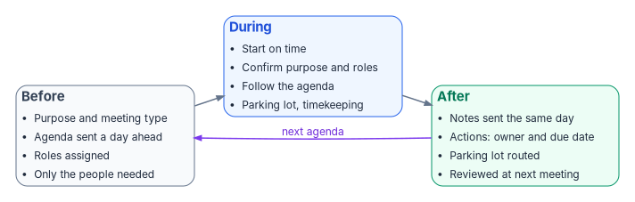

# Effective Meetings — Purpose, Agenda, Roles, and Follow-Through

*A meeting is a tool for deciding and coordinating; if it ends without decisions and owners, it was a status report that cost an hour of everyone's time.*

::: {.callout-note}
## In this guide
Why a modernization program lives or dies by its meetings, the three kinds of meeting and what
each one is for, the roles every meeting needs, and a before / during / after routine with an
agenda template, a notes template, and a one-page checklist. The practices come from public
guidance, chiefly GSA's 18F team, and from facilitation training used in industry and academia.
:::

::: {.callout-tip}
## Watch or present
**Narrated briefing (about 14 minutes, captions)**: the whole guide as a Why / What / Who / How deck, on the [Presentations](../../presentations/index.md#guide-effective-meetings) page, or [▶ watch it in the browser](../../presentations/watch.html?v=Guide_Effective_Meetings_Narrated).
:::

## Why meetings matter to a modernization program

A modernization program is coordinated through meetings: change advisory boards, cutover
go/no-go calls, architecture reviews, vendor working sessions, steering committees. Most of the
program's decisions are made in one of them, and most of its slippage starts in one that ended
without a clear decision or a named owner.

The habits in this guide are not new. Intel made a course on effective meetings mandatory for
new employees, and it was often taught by Andy Grove himself while he was CEO.[^m-grove] The
federal government's own digital-services team at GSA, 18F, published a short public guide built
on the same ideas: a clear purpose, a complete agenda, assigned roles, and written next
steps.[^m-18f] University faculty-development and engineering programs teach the same
structure.[^m-chp][^m-psu] The pattern is consistent because it works.

{#fig-effective-meetings-lifecycle fig-alt="Three boxes left to right. Before: purpose, agenda sent in advance, roles assigned, right attendees. During: start on time, confirm purpose and roles, follow the agenda, parking lot, timekeeping. After: notes sent the same day, action items with owner and due date, parking lot routed, follow-up at the next meeting. An arrow from After loops back to Before, labeled next agenda."}

## Is a meeting needed at all?

Ask this first. 18F's test is whether the meeting is a better use of the attendees' time than
not meeting.[^m-18f] A faculty-development session at UPMC Children's Hospital of Pittsburgh
lists the usual reasons for a meeting, from giving information and working a problem to simply
"satisfying requirements" and "tradition," and asks whether some of those goals can be met
another way.[^m-chp]

As a working rule for the Federal Modernization Program:

- **Information only, one way** → send a written update. Hold a meeting only if questions need
  live discussion.
- **A problem to work** or **a decision to make** → meet, with the right people in the room.
- **A recurring meeting** → re-check its purpose each quarter. A recurring meeting that no longer
  decides anything should be cancelled or turned into a written report.

## The three kinds of meeting

Engineering-education guidance from Portland State University, drawing on Cameron Herold's
*Meetings Suck*, sorts meeting work into three types.[^m-psu] One meeting can contain more than
one, but each agenda item should be one of them, and the agenda should say which.

| Type | What happens | What it needs | What it produces |
|---|---|---|---|
| Information sharing | Mostly one-way reporting, with clarifying questions | Material sent in advance; focus on what others need to know; no rehashing past decisions | Shared understanding |
| Problem solving | Open discussion among many people | A time limit, a note-taker, a divergent phase (generate ideas), then a convergent phase (narrow them) | Options, criteria, and the questions still open |
| Decision making | The group commits to one option | What is being decided, stated in advance; the decision method agreed in advance (consensus, majority, or deferral to an owner); everyone has the information | A recorded decision, an owner, and next steps |

Two warnings from the same source apply directly to technical programs:

- **Don't do the work in the meeting.** When a group starts doing detailed analysis together, stop,
  agree on who will do it, by when, and what they'll deliver, then go back to the agenda.[^m-psu]
- **Name the shift.** When a discussion moves from reporting to problem solving, or from
  problem solving to deciding, the facilitator should say so out loud. It keeps the group on the
  same task.[^m-psu]

## The agenda: more than a list of topics

The agenda defines the meeting's content and tells everyone when it is over: when the agenda is
done, the meeting is done.[^m-18f] A list of topic names ("Identity," "Network," "AOB") does not
do that. A real agenda gives, for each item:

| Field | Why |
|---|---|
| **Item, written as a question or outcome** | "Which three pilot sites go first?" focuses discussion better than "Pilot sites."[^m-chp] |
| **Type** | Inform, discuss, or decide, so people know how to take part.[^m-18f] |
| **Owner** | The person who leads that item. |
| **Time** | Minutes allowed for the item. |
| **Preparation** | What to read or bring beforehand. |

Above the items, the agenda states the meeting's purpose and expected outcomes, where the notes
will be kept, and the call-in or room details.[^m-18f] Its title should be specific: "Cutover
go/no-go, wave 2," not "Weekly sync."[^m-psu] Keep it to one page and put the detail in
attachments.[^m-psu]

Send the agenda early enough for people to prepare (at least a day ahead), at a consistent time
for recurring meetings, and let attendees propose changes before the meeting rather than debating
the agenda at its start.[^m-18f][^m-psu]

**Scheduling.** 18F suggests 15- or 45-minute meetings instead of the default 30 or 60, which
leaves room between meetings and spare time if an item runs over. It also suggests asking whether
everyone needs to attend once a meeting reaches double digits, and keeping meetings to about a
dozen people.[^m-18f]

## Roles

Every meeting needs named roles, and every attendee should know which one they hold. 18F calls
failing to assign a note-taker the most common meeting mistake; any attendee can ask, "Who's
taking notes?"[^m-18f]

| Role | Responsibilities |
|---|---|
| **Leader / facilitator** | Convenes and runs the meeting; keeps discussion on the agenda; draws out quieter people and stops one voice dominating; ends the meeting when the agenda is done. Focuses on process; need not be the person who called the meeting.[^m-18f][^m-chp][^m-psu] Have a backup.[^m-18f] |
| **Timekeeper** | Tracks time on each item, warns when an item will run over, and calls for the group to re-prioritize. Supports the facilitator but doesn't replace them.[^m-psu] |
| **Note-taker** | Records decisions, action items, open questions, and parking-lot items, not a transcript. Checks the record for accuracy and publishes it.[^m-chp][^m-psu] |
| **Decision-maker** | The person (or people) with authority to decide. If they aren't in the room, a "decide" item can't be decided.[^m-18f] |
| **Participants** | Arrive on time and prepared; listen; keep disagreement about ideas, not people; accept the group's decision.[^m-psu] |
| **Closer** (optional) | Runs the close: summarizes outcomes, confirms every action item has an owner and a date, and sets up the next meeting. Often the facilitator.[^m-psu] |

In small or recurring meetings one person can hold more than one role (the facilitator as closer,
the note-taker as timekeeper), and rotating roles across the team spreads the skill.[^m-psu]

## Running the meeting

### Before

1. Confirm the meeting is needed and its type.
2. Write and send the agenda, with preparation material attached.
3. Assign the roles and invite only the people the items need: those affected by a decision, and
   those with the knowledge, resources, or authority it requires.[^m-chp]
4. Shortly before, send a reminder with the agenda; arrive early and test the equipment.[^m-18f]

### During

**Start.** Start on time, every time.[^m-18f] Open by stating the purpose, confirming the
agenda, and naming the roles. Point to the notes, slides, and chat in use. Agree or restate
ground rules; examples include sharing air time ("take space, make space") and treating
different perspectives as valuable.[^m-chp]

**Stay on track.** Follow the agenda and leave it only deliberately, for a set time.[^m-18f]
Summarize as you go.[^m-chp] Point latecomers to the agenda and notes instead of recapping for
them.[^m-18f]

**Use a parking lot.** Topics that are off the agenda, or can't be settled in the time
available, go into a visible parking lot: a section of the notes or a corner of the
whiteboard.[^m-18f] Give each entry an action (send to another group, add to a future agenda,
assign to a small team), and review the parking lot before the meeting ends. Following up on it
is what keeps people willing to park topics.[^m-chp]

**Take useful notes.** Capture meaning, not dialogue; prioritize decisions and assigned tasks;
leave gaps during fast discussion and fill them in the same day.[^m-18f]

### Close

Reserve the last few minutes on the agenda for the close, and aim to end early.[^m-18f][^m-chp]

1. Read back the decisions.
2. Read back each action item with its **owner** and **due date**, and have each owner confirm
   it out loud.[^m-psu]
3. Route each parking-lot item.
4. Ask what is missing, and what to change about the meeting next time.[^m-chp]
5. Set the next meeting and its facilitator if one is needed.[^m-psu]

### After

- Send the notes and action items in writing, with owners and dates, the same day.[^m-18f]
- Store the notes where the team keeps its records, and make any correction visible to everyone
  who attended.[^m-psu]
- Open the next meeting by reviewing the previous action items.[^m-18f]
- Avoid the "meeting after the meeting." Decisions made in the hallway exclude remote attendees
  and never reach the notes.[^m-18f]

## Templates

### Agenda

```text
MEETING: <specific title, e.g. "Wave 2 cutover go/no-go">
Date / time / length:   <date>  <start>-<end>  (<15 | 45 | ...> min)
Location / bridge:      <room, link, dial-in>
Purpose:                <one sentence>
Expected outcomes:      <decisions to make, outputs to produce>
Notes kept at:          <link>

Roles   Facilitator: <name>   Timekeeper: <name>   Note-taker: <name>
        Decision-maker(s): <name(s)>

#  Item (as a question)                     Type      Owner   Min  Prep
1  Review open action items                 Inform    <name>   5   Last notes
2  <question>?                              Decide    <name>  15   <doc link>
3  <question>?                              Discuss   <name>  10   -
4  Close: decisions, actions, parking lot   -         Fac.     5   -
```

### Notes and action items

```text
MEETING: <title>                  DATE: <date>
Attendees: <names>                Absent: <names>
Facilitator / Timekeeper / Note-taker: <names>

DECISIONS
D1  <decision>  (decided by <name/method>)

ACTION ITEMS
#   What                         Owner     Due        Status
A1  <deliverable>                <name>    <date>     Open

PARKING LOT
Item                             Route to (group / future agenda / owner)

OPEN QUESTIONS
<question>  -> <who will answer, by when>

NEXT MEETING: <date>   Facilitator: <name>
```

## One-page checklist

| Phase | Check |
|---|---|
| Before | Is a meeting needed? · Type of each item set · Agenda with owners, times, prep sent ≥ 1 day ahead · Roles assigned · Decision-maker attending · Only needed people invited |
| Start | On time · Purpose, agenda, roles confirmed · Ground rules · Notes and parking lot visible |
| During | Agenda followed · Time tracked per item · Quiet voices drawn in · No work done in the room · Off-topic items parked |
| Close | Decisions read back · Every action has an owner and a date · Parking lot routed · "What would we change?" · Ended on time or early |
| After | Notes sent same day · Stored in the team record · Actions reviewed at the next meeting |

## Further reading

- Andrew S. Grove, *High Output Management* (Vintage, 1995 edition). Grove's own account of
  managing at Intel, including a chapter on meetings.
- Cameron Herold, *Meetings Suck* (Lioncrest Publishing, 2016), the source of the roles and
  meeting types in Portland State's toolbox.[^m-psu]

::: {.callout-tip}
## Back to the books
This is a companion guide, not part of a numbered book. [← The Workbook Books](../index.md)
:::

<!-- revisions:start: generated by scripts/generate_revisions.py from data/editions.yml; edit those, not this section -->

## Version and revision history {#version-history}

**Version 1.2**, in [edition 2026.11.1](../../about/archive.md#edition-2026-11-1) (November 1, 2026). Every edition is kept on the [Archive](../../about/archive.md) page; every change between editions is in the [commit history](https://github.com/WhalerMike/modernization-workbook/commits/main/docs/books/guides/effective-meetings.md).

| Version | Edition | Date | Changes |
|---|---|---|---|
| 1.2 | [2026.11.1](../../about/archive.md#edition-2026-11-1) | 2026-11-01 | Edition 2026.11: record the edition, and publish the four gate-level decks and videos ([#282](https://github.com/WhalerMike/modernization-workbook/pull/282)) |
| 1.1 | [2026.11](../../about/archive.md#edition-2026-11) | 2026-11-01 | Move the decks and narration audio out of git, onto edition 2026.10 ([#260](https://github.com/WhalerMike/modernization-workbook/pull/260)) |
| 1.0 | [2026.10](../../about/archive.md#edition-2026-10) | 2026-10-31 | First edition (3 merged changes since the guide began) |

: Versions of this guide, newest first {.striped .hover}

<!-- revisions:end -->

[^m-grove]: Nagesh Belludi, "How to … Deal with Meetings That Get Derailed," *Right Attitudes*, January 26, 2023, <https://www.rightattitudes.com/2023/01/26/dealing-with-meetings-that-get-derailed/> (accessed Oct 21, 2026).
[^m-18f]: 18F, U.S. General Services Administration, "How to run an efficient meeting," December 14, 2016, archived on the 18F blog, <https://blog.18f.org/2016/12/14/how-to-run-an-efficient-meeting/> (accessed Oct 21, 2026).
[^m-chp]: Dianna Ploof, EdD, "Making Meetings More Effective," Department of Pediatrics Faculty Development, UPMC Children's Hospital of Pittsburgh, August 4, 2016, <https://www.chp.edu/-/media/chp/healthcare-professionals/documents/faculty-development/making-meetings-effective-handout.pdf> (accessed Oct 21, 2026).
[^m-psu]: Gerald Recktenwald, "Supplemental Notes: A Meeting Toolbox," Portland State University, January 4, 2018, <https://web.cecs.pdx.edu/~gerry/class/ME492/notes/pdf/meeting_toolbox.pdf> (accessed Oct 21, 2026).
