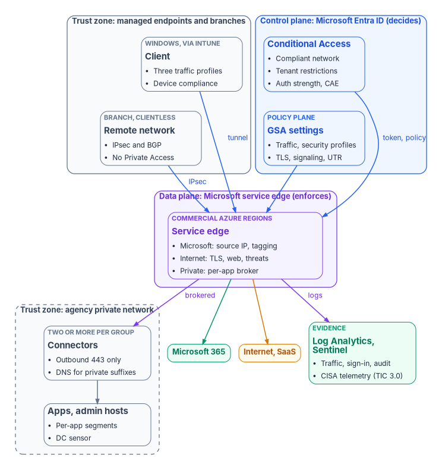

# Global Secure Access & Zero Trust Network Engineering: An Implementation Guide

*A VPN proves that a device reached the network; the work in this guide makes every connection prove who is asking, from which device, for which application, and leaves a record that it did.*

::: {.callout-note}
## In this guide
How an agency on Microsoft 365 GCC deploys Microsoft's security service edge, Global Secure Access, as the identity-aware network layer of its Zero Trust program, and proves each piece works. First, how to read the guide, where each of the twelve topics lives, government-cloud availability and licensing feature by feature, how the design lines up with CISA's TIC 3.0 Remote User and Branch Office use cases, and the reference architecture. Then twelve steps: the decision and licensing, the architecture, the Windows client, Microsoft traffic, internet traffic, private applications, the compliant network check, universal tenant restrictions, TLS inspection, privileged protocols, coexistence and migration, and telemetry and evidence. Each step has Microsoft Learn's commands, a **Validate** step, the How-section order of [Book 00, Appendix D](../b00-orientation/appendix-d-control-states-and-evidence.md#how-section-template) (prerequisites, pilot, report-only, enforcement, rollback, exclusions, telemetry, evidence, day-two ownership) and the requirements it supports. Then the RACI, the evidence catalog, the metrics, the requirements and KSIs by step, the dangers, rollback, the implementation checklist and what couldn't be verified.
:::

::: {.callout-tip}
## Watch, present or train
**Narrated deck (about @@Guide_Global_Secure_Access@@ minutes, captions)**: why a VPN proves only that a device arrived, TIC 3.0's remote-user options, the twelve steps and their run order, government cloud and licensing by feature, the reference architecture and the RACI, then each step from the client and Microsoft traffic to private apps, tenant restrictions, TLS inspection, rings and rollback, the dangers and what couldn't be verified, as a Why / What / Who / How deck, on the [Presentations](../../presentations/index.md#guide-global-secure-access) page, or [▶ watch it in the browser](../../presentations/watch.html?v=Guide_Global_Secure_Access_Narrated). The deck says this guide is a draft awaiting the editor's review.
**Training:** the learning path [*Global Secure Access as the Identity-Aware Network*](../../training/global-secure-access/index.md) teaches this guide in six modules, in its run order, with a lab in a test tenant and a knowledge check in each.
:::

## How to read this guide {#how-to-read}

**Where this guide sits.** The books own the argument; this guide does the work. [Book 09, Chapter 05](../b09-network/05-sd-wan-sase-and-governed-transport.md#microsofts-security-service-edge-global-secure-access) explains what Global Secure Access is, its government-cloud and licensing gates, Private Access as the VPN and DirectAccess replacement, connectors, private DNS, remote networks, Internet Access policy and coexistence with other security service edge vendors. [Book 09, Chapter 03](../b09-network/03-what-tic-3-requires.md) reads TIC 3.0 from CISA's documents, [Chapter 12](../b09-network/12-microsoft-365-traffic.md#tenant-restrictions-the-case-an-assessor-will-build) the tenant restrictions case, and [Chapter 11](../b09-network/11-field-office-wan-transformation.md) the branches. [Book 04, Chapter 07](../b04-access/07-the-conditional-access-policy-library.md#optional-family-conditional-access-on-network-traffic) holds the Conditional Access family for network traffic, [Book 04, Appendix C](../b04-access/appendix-c-partner-access-profile-entra.md) the tenant restrictions v2 policy, [Book 10, Chapter 04](../b10-cloud-boundary/04-gcc-and-the-feature-gap.md#a-worked-case-global-secure-accesss-network-and-privacy-facts) the boundary facts, and [Book 12, Chapter 03](../b12-security-operations/03-identity-telemetry.md#global-secure-access-logs-and-alerts) the log categories. Where one of those already says it, this guide links to it and adds only the step-by-step work, the commands and the evidence. It replaces the separate network engineering book the Zero Trust closure update proposed, by the program owner's decision of November 11, 2026.

**Where the facts come from.** Every product fact, command, permission and government-cloud statement was read on Microsoft Learn on November 11, 2026, through the Microsoft Learn documentation service; facts the books verified on November 9 are cited by link to the chapter that holds them. TIC 3.0 statements were read from CISA's own documents the same day, and KSI statements and related controls from fedramp.gov. The [verification log](https://github.com/WhalerMike/modernization-workbook/blob/main/docs/books/guides/_verification/global-secure-access-implementation.md) lists each claim with its source and date. Where Learn is silent, the guide says *not yet specified* and lists it under [What couldn't be verified](#what-couldnt-be-verified). Recommendations carry an authority label from [Appendix D](../b00-orientation/appendix-d-control-states-and-evidence.md#authority-labels): *Mandated*, *Microsoft-recommended*, *Risk-based recommended* (the program's position) or *Optional*, with *License-dependent* and *Environment-dependent* where they apply.

**The starting state the guide assumes.** A civilian agency at FedRAMP Moderate on Microsoft 365 GCC, which uses the commercial Microsoft Entra ID service and the worldwide Microsoft Graph endpoint, `https://graph.microsoft.com`; Windows 11 devices joined or hybrid joined to Microsoft Entra ID and managed by Intune ([Book 05](../b05-devices/index.md)); a full-tunnel VPN, possibly DirectAccess, and an on-premises or MTIPS web proxy; Active Directory still in service; and the program's standard of Windows Server 2019 or later for connector hosts, with 2016 gone by January 12, 2027 ([Book 00, Chapter 01](../b00-orientation/01-why-modernize-now.md#the-workbooks-server-standard)). That standard is the program's assumption, not a fact about any estate. An agency in GCC High or DoD stops at [Step 1](#step-1-decision-and-licensing): Global Secure Access isn't yet supported there. Examples use the fictional `contoso.example`.

**The Graph API is beta.** Microsoft's network access APIs are in preview on the `/beta` endpoint, and Learn says beta APIs "are subject to change" and that their use in production applications "is not supported."[^gsai-graph-overview] The commands below are Learn's own requests. Run them interactively by an administrator, with the result kept as evidence; don't build unattended production automation on them until they reach v1.0 *(Risk-based recommended: an unsupported API in a production pipeline is a change-control risk)*. Conditional Access, named locations and app role assignments use v1.0 where Learn's examples do.

**The placeholders.** The commands are exact; replace these values once, everywhere:

| Placeholder | What it is |
|---|---|
| `<pilot-group-id>`, `<ring-group-id>` | Object IDs of the Microsoft Entra security groups for the pilot and for each later ring |
| `<emergency-group-id>` | Object ID of the group that holds the emergency access accounts ([Book 04, Chapter 04](../b04-access/04-privileged-roles-and-tiers.md#emergency-access-accounts)) |
| `<profile-id>` | A traffic forwarding profile's ID, read in Step 4 |
| `<compliant-location-id>` | The ID of the **All Compliant Network locations** named location, read in Step 7 |
| `<app-object-id>`, `<sp-object-id>`, `<user-role-id>` | A Private Access application's application object ID, its service principal's object ID, and the ID of its `User` app role |
| `<connector-group-id>` | A private network connector group's ID |
| `<app-fqdn>`, `<app-ports>` | One private application's host name and its ports, such as `app01.contoso.example` and `443-443` |
| `<admin-host-fqdn>` | An administrative server's host name, for Step 10 |
| `<filtering-policy-id>`, `<security-profile-id>` | A web content filtering policy and a security (filtering) profile, from Step 5 |
| `<intune-enrollment-app-id>`, `<intune-app-id>` | The app IDs of **Microsoft Intune Enrollment** and **Microsoft Intune** in the tenant, read in Step 7 |
| `<app-name>`, `<app-id>` | A Private Access application's display name, and its application (client) ID |
| `<server-fqdn>` | A server whose service principal name the domain controller sensor protects, for Step 10 |
| `<ca-config>`, `<tls-inspection-subca-template>` | The issuing CA's `host
ame` configuration string and the certificate template for the TLS inspection intermediate, for Step 9 |
| `<subscription-id>`, `<resource-group>`, `<workspace>` | The Log Analytics workspace that receives the logs |

: Placeholders used in this guide {.striped .hover}

Every PowerShell block starts from a session opened with the scopes it needs, for example:

```powershell
# Microsoft Graph PowerShell SDK; GCC uses the worldwide (Global) environment.
Install-Module Microsoft.Graph -Scope CurrentUser   # once
Connect-MgGraph -Environment Global -Scopes "NetworkAccess.ReadWrite.All","Policy.ReadWrite.ConditionalAccess","Policy.Read.All","Application.ReadWrite.All"
```

`NetworkAccess.ReadWrite.All` is the delegated permission Learn lists for the settings calls, and the signed-in administrator also needs **Global Secure Access Administrator** or **Security Administrator**; Conditional Access calls need `Policy.ReadWrite.ConditionalAccess` and **Conditional Access Administrator**.[^gsai-ca-settings][^gsai-graph-ia] Activate those roles through PIM for the change window only ([Book 04, Chapter 08](../b04-access/08-pim-self-request-with-approval.md)).

**The pieces.** An implementation guide is finished when it has its deck series, developer workbook and training path ([CONTRIBUTING](https://github.com/WhalerMike/modernization-workbook/blob/main/CONTRIBUTING.md#an-implementation-guide-is-finished-when-it-has-all-four-pieces)):

| Piece | State |
|---|---|
| This guide | Draft, November 11, 2026 |
| Narrated deck | Built, November 13, 2026: 16 narrated slides, about 16 minutes, in [`presentations/guide-global-secure-access`](https://github.com/WhalerMike/modernization-workbook/tree/main/presentations/guide-global-secure-access); the video joins the Presentations page when it is exported |
| Developer workbook with Lab 1 on fixtures and Lab 2 in a test tenant | Planned; there is no kit in `examples/` yet |
| Training path | Draft, November 13, 2026: [Global Secure Access as the Identity-Aware Network](../../training/global-secure-access/index.md), six modules, each with a lab in a test tenant (the guide's own commands and Validate steps, not run by the authors) and a knowledge check |

: The guide's pieces {.striped .hover}

## Where each topic lives {#topic-map}

The Zero Trust closure update lists twelve network topics, GSA-01 to GSA-12. Each is a step here; where a book chapter already does part of the work, the step says which part it links to.

| ID | Topic | Step in this guide | What the books already carry |
|---|---|---|---|
| GSA-01 | Decision and licensing | [Step 1](#step-1-decision-and-licensing) | Gates and licensing: [Book 09, Ch. 05](../b09-network/05-sd-wan-sase-and-governed-transport.md#the-gates-come-first); boundary facts: [Book 10, Ch. 04](../b10-cloud-boundary/04-gcc-and-the-feature-gap.md#a-worked-case-global-secure-accesss-network-and-privacy-facts) |
| GSA-02 | Reference architecture | [Step 2](#step-2-reference-architecture) | Access plane: [Book 01, Ch. 08](../b01-transformation-arc/08-access-plane.md); network reference architecture: [Book 09, Ch. 08](../b09-network/08-reference-architecture.md) |
| GSA-03 | Client deployment | [Step 3](#step-3-client-deployment) | Intune onboarding: [Book 05, Ch. 04](../b05-devices/04-intune-first-onboarding.md) |
| GSA-04 | Microsoft traffic | [Step 4](#step-4-microsoft-traffic) | Source IP and location signals: [Book 04, Ch. 03](../b04-access/03-the-conditional-access-model.md); Microsoft 365 paths: [Book 09, Ch. 12](../b09-network/12-microsoft-365-traffic.md) |
| GSA-05 | Internet traffic | [Step 5](#step-5-internet-traffic) | Internet Access policy: [Book 09, Ch. 05](../b09-network/05-sd-wan-sase-and-governed-transport.md#internet-access-policy) |
| GSA-06 | Private applications | [Step 6](#step-6-private-applications) | Quick Access, per-app access, connectors, private DNS, DirectAccess: [Book 09, Ch. 05](../b09-network/05-sd-wan-sase-and-governed-transport.md#private-access-as-the-vpn-and-directaccess-replacement) |
| GSA-07 | Compliant network | [Step 7](#step-7-compliant-network) | Policy shape: [Book 04, Ch. 07](../b04-access/07-the-conditional-access-policy-library.md#optional-family-conditional-access-on-network-traffic) |
| GSA-08 | Tenant restrictions | [Step 8](#step-8-tenant-restrictions) | TRv2 policy: [Book 04, App. C](../b04-access/appendix-c-partner-access-profile-entra.md#tenant-restrictions-v2-the-outbound-edge); data-plane limits: [Book 09, Ch. 12](../b09-network/12-microsoft-365-traffic.md#tenant-restrictions-the-case-an-assessor-will-build) |
| GSA-09 | TLS inspection | [Step 9](#step-9-tls-inspection) | What inspection breaks: [Book 09, Ch. 06](../b09-network/06-legacy-protocols-on-re-routed-paths.md); the agency PKI: [Book 07, Ch. 04](../b07-pki/04-the-target-pki.md) |
| GSA-10 | Privileged protocols | [Step 10](#step-10-privileged-protocols) | Privileged tiers and emergency access: [Book 04, Ch. 04](../b04-access/04-privileged-roles-and-tiers.md); Kerberos over Private Access: [Book 09, Ch. 06](../b09-network/06-legacy-protocols-on-re-routed-paths.md#ways-to-provide-the-path) |
| GSA-11 | Coexistence and migration | [Step 11](#step-11-coexistence-and-migration) | Partner SSE coexistence and DirectAccess: [Book 09, Ch. 05](../b09-network/05-sd-wan-sase-and-governed-transport.md#coexistence-with-cisco-zscaler-palo-alto-networks-netskope-and-infoblox); branches: [Book 09, Ch. 11](../b09-network/11-field-office-wan-transformation.md#remote-networks-to-a-security-service-edge) |
| GSA-12 | Telemetry and evidence | [Step 12](#step-12-telemetry-and-evidence) | Log categories and tables: [Book 12, Ch. 03](../b12-security-operations/03-identity-telemetry.md#global-secure-access-logs-and-alerts); closure method: [Book 11, Ch. 10](../b11-zero-trust/10-evidence-not-verdicts.md#the-closure-chain) |

: The twelve network topics and where they live {.striped .hover}

The steps are numbered to match the topics. Run them in this order, so the logs exist before anything is enforced and nothing blocks before its path exists: 1, 2, 12 (logging only), 3, 4, 7, 8, 6, 10, 5, 9, 11, then 12 again for the evidence package.

## Government cloud and licensing, feature by feature {#availability}

Learn's statement covers the whole product: "Global Secure Access is available in the US Government Community Cloud (GCC), but isn't yet supported in the US Government Community Cloud High (GCC-H), Department of Defense cloud, or other government or sovereign cloud environments."[^gsai-limits] No feature page read for this guide narrows or widens that for a feature, so the GCC column below rests on the product-wide sentence alone; where a feature is in preview, its GCC availability is *not yet specified*. Re-read the limitations page before each ring; this table is as of November 11, 2026.

| Feature | GCC | GCC High | DoD | License (with Entra ID P1 or P2) | Status on Learn | Step |
|---|---|---|---|---|---|---|
| Windows client | Available (product-wide) | Not yet supported | Not yet supported | Per the profiles it carries | Generally available; Entra registered devices (preview) carry Private Access only | 3 |
| Microsoft traffic profile; source IP restoration | Available (product-wide) | Not yet supported | Not yet supported | Included in P1 or P2 | Generally available | 4 |
| Internet Access: web content filtering, threat intelligence, security profiles | Available (product-wide) | Not yet supported | Not yet supported | Internet Access or Microsoft Entra Suite | Generally available | 5 |
| Internet Access: cloud firewall for clients, Explicit Forward Proxy, source traffic type and HTTP method filtering | Not yet specified | Not yet supported | Not yet supported | Internet Access or Suite | Preview | 5 |
| Private Access: Quick Access, per-app access, private DNS, application discovery | Available (product-wide) | Not yet supported | Not yet supported | Private Access or Suite | Generally available; custom Private Access profiles are preview | 6 |
| Compliant network check | Available (product-wide) | Not yet supported | Not yet supported | Included in P1 or P2 (Microsoft traffic profile) | Generally available; not supported for Private Access apps | 7 |
| Universal tenant restrictions | Available (product-wide) | Not yet supported | Not yet supported | Included in P1 or P2 (Microsoft traffic profile) | Generally available | 8 |
| TLS inspection, Microsoft-managed or agency certificate | Available (product-wide) | Not yet supported | Not yet supported | Internet Access or Suite | Generally available | 9 |
| Private Access sensor on domain controllers | Available (product-wide) | Not yet supported | Not yet supported | Private Access or Suite | Not labeled preview on the page read | 10 |
| Remote networks (branch IPsec) | Available (product-wide) | Not yet supported | Not yet supported | At least 50 P1 and Internet Access licenses combined ([Book 09, Ch. 05](../b09-network/05-sd-wan-sase-and-governed-transport.md#remote-networks-for-branches)) | Generally available | 11 |
| Traffic logs and the `NetworkAccessTrafficLogs` category | Available (product-wide) | Not yet supported | Not yet supported | Internet Access or Private Access | The traffic logs page is titled "(preview)" | 12 |
| Microsoft Graph network access API | Usable from GCC on `graph.microsoft.com` | See note | See note | As for the feature it configures | Beta | All |

: Government-cloud availability and licensing by feature, as of November 11, 2026 {.striped .hover}

Sources: the limitations, licensing, traffic forwarding, client, feature and Graph reference pages cited in each step.[^gsai-limits][^gsai-forwarding][^gsai-client][^gsai-graph-overview] Remote network licensing and the certification facts are [Book 09, Chapter 05's](../b09-network/05-sd-wan-sase-and-governed-transport.md#the-gates-come-first), verified November 9.

**A conflict between Learn pages.** The Graph reference pages for the network access settings and reports list the API as available in "US Government L4" and "US Government L5 (DOD)."[^gsai-ca-settings][^gsai-device-usage] The product's limitations page says the service isn't yet supported in GCC High or DoD. The guide follows the product statement: an API that answers in a national cloud doesn't make the service it configures supported there *(Risk-based recommended)*. The question goes to the agency's Microsoft account team before any GCC High or DoD planning.

**Authorization.** Microsoft's certifications page lists FedRAMP High and DoD SRG Level 2 for Global Secure Access without naming the environment; [Book 09, Chapter 05](../b09-network/05-sd-wan-sase-and-governed-transport.md#the-gates-come-first) records that, and [Book 10, Chapter 04](../b10-cloud-boundary/04-gcc-and-the-feature-gap.md#a-worked-case-global-secure-accesss-network-and-privacy-facts) records that a GCC tenant's traffic is processed in the commercial regions Microsoft lists. The agency reads the authorization package before Step 1's decision is signed.

## TIC 3.0 alignment {#tic-alignment}

TIC 3.0 is technology-neutral: its Security Capabilities Catalog sets goals, not products ([Book 09, Chapter 03](../b09-network/03-what-tic-3-requires.md#what-the-catalog-and-the-branch-office-use-case-require)). Read against CISA's documents, Global Secure Access is one way to build three of the options CISA describes.

- **Remote User Use Case, version 2.2.** Its three security patterns are remote user to agency campus, to agency-sanctioned cloud service providers, and to the web. Each has an option that runs through "a cloud access security broker (CASB) or other security-as-a-service (SECaaS) provider," with traffic directed there by "client agents, proxy settings, and domain name system (DNS) means," and CISA notes that policy enforcement parity "can be simplified when the locations use the same CASB or SECaaS provider."[^gsai-tic-ruc] In the program's reading, Private Access is that option for Pattern 1 (to the campus), the Microsoft traffic profile with the compliant network check for Pattern 2 (to Microsoft 365, a sanctioned provider), and Internet Access for Pattern 3 (to the web), which CISA calls the riskiest and the one requiring "the greatest amount of rigor." The use case's fourth Pattern 1 option, direct connection to the resource "via protected connections (e.g., TLS and MFA)," is what per-application Conditional Access adds on top.
- **Branch Office Use Case.** Remote networks are the security-as-a-service option for a branch; the use case's policy enforcement parity statement asks that every conveyance path keep security parity ([Book 09, Chapter 05](../b09-network/05-sd-wan-sase-and-governed-transport.md#what-the-branch-edge-adds-and-what-tic-3.0-asks-of-it)). Remote network traffic gets only the baseline security profile and no Conditional Access ([Step 11](#step-11-coexistence-and-migration)), so parity between a client user and a branch user is a design question, not an automatic result.
- **CISA's SASE guidance (June 2026).** It describes ZTNA for private applications and SWG for external resources in a TIC 3.0 solution and sends SASE telemetry to CISA's Comprehensive Log Aggregation Warehouse (CLAW); it permits and describes, it doesn't require ([Book 09, Chapter 03](../b09-network/03-what-tic-3-requires.md#the-document-set-read-from-the-cover-pages)).

**Telemetry is the part a design most often loses.** The Remote User Use Case says that as remote users connect more directly to external services, "visibility by CISA must be preserved through telemetry sharing," and that where users bypass the traditional collection points the agency "may need to augment its telemetry collection" in accordance with OMB M-26-14.[^gsai-tic-ruc] Moving users off a full-tunnel VPN onto Global Secure Access moves their web and Microsoft 365 telemetry from the agency's collection points to Microsoft's. [Step 12](#step-12-telemetry-and-evidence) exports it; how it reaches CISA is agreed with the agency's TIC delegates and CISA points of contact before the VPN's web path is retired *(Mandated in substance by the use case's telemetry requirement; the mechanism is the agency's)*. None of this makes Global Secure Access a TIC 3.0 product: CISA certifies no products, and the agency's TIC posture remains its own determination.

## A brief comparison with other security service edge offerings {#comparison}

Most agencies already hold a FedRAMP-authorized SSE or VPN, so the question is usually which functions to move, not which vendor to buy. [Book 09, Chapter 05](../b09-network/05-sd-wan-sase-and-governed-transport.md#authorization-status-is-not-uniform) lists FedRAMP Marketplace statuses for several SSE offerings as of October 21, 2026; read them from the Marketplace when a requirement is written.

| Question | Global Secure Access | Typical third-party SSE (Zscaler, Palo Alto Networks, Netskope, Cisco, as Learn's coexistence pages describe them) |
|---|---|---|
| Where policy is decided | Microsoft Entra Conditional Access, the same engine as sign-in | The vendor's own policy engine, usually fed by Entra ID as the identity provider |
| Government-cloud reach | GCC only today | Per offering; several hold FedRAMP High listings |
| Signals only Entra can produce | Compliant network check, universal tenant restrictions, source IP restoration to Entra ID | Not available from a third party |
| Running both | Supported: Microsoft traffic, internet and private traffic can each go to one or the other, with mutual bypasses ([Book 09, Ch. 05](../b09-network/05-sd-wan-sase-and-governed-transport.md#coexistence-with-cisco-zscaler-palo-alto-networks-netskope-and-infoblox)) | Same |

: Global Secure Access beside a third-party SSE {.striped .hover}

The table is a starting point for the decision record, not a recommendation. Private applications in AWS, Google Cloud or Oracle Cloud Infrastructure are reached the same way as on-premises ones: Learn describes Private Access as reaching private apps "across hybrid and multicloud environments,"[^gsai-overview] through connectors on Windows Server hosts with line of sight to the application, so each cloud's network needs its own connector group. Learn doesn't describe a connector deployment specific to any of those three clouds (*not yet specified*), and this guide doesn't compare those providers' own access services.

## The reference architecture {#reference-architecture}

{#fig-gsa-reference-architecture fig-alt="Four trust zones and planes. Top left, a slate cluster for managed endpoints and branches holds the Global Secure Access client on Windows, deployed by Intune, with three traffic profiles and device compliance, and a clientless remote network over IPsec and BGP that carries no Private Access. Top right, a blue control-plane cluster for Microsoft Entra ID holds Conditional Access (compliant network, tenant restrictions, authentication strength and continuous access evaluation) and the Global Secure Access settings policy plane (traffic and security profiles, TLS, signaling, universal tenant restrictions). Blue arrows labeled tunnel, IPsec and token, policy run into a violet data-plane cluster, the Microsoft service edge in commercial Azure regions, which handles Microsoft traffic with source IP and tenant tagging, internet traffic with TLS inspection, web filtering and threat intelligence, and private traffic as a per-app broker. From the edge, a violet arrow labeled brokered reaches a dashed slate cluster for the agency private network with two or more connectors per group, outbound 443 only, which reach applications and administrative hosts with per-app segments and a domain controller sensor. Green and amber arrows reach Microsoft 365 and the internet, and a violet arrow labeled logs reaches a green evidence card for Log Analytics and Sentinel, with traffic, sign-in and audit logs and CISA telemetry under TIC 3.0."}

This is the first of the six artifacts. The trust boundaries and planes it shows, and who owns each, are:

| Zone or plane | What sits there | Trust boundary it crosses | Owner (see [RACI](#raci)) |
|---|---|---|---|
| Managed endpoint | Windows client, Intune policy, device identity | Device to service edge, in a tunnel the client opens after Entra sign-in | Platform owner (endpoint) |
| Branch | Customer premises equipment with an IPsec tunnel | Branch to service edge; no user identity on the tunnel | Platform owner (network) |
| Control plane | Conditional Access, named locations, cross-tenant access, authentication strengths | Decides; never carries traffic | Policy owner |
| Policy plane | Traffic forwarding profiles, security profiles, TLS inspection policies, signaling settings | Configures the data plane | Platform owner |
| Data plane | Microsoft service edge in commercial Azure regions | Enforces; holds the agency's traffic in transit | Microsoft (provider), recorded in the boundary description |
| Agency private network | Connector groups, private DNS, applications, domain controllers with sensors | Outbound-only from connectors and sensors; no inbound ports | Platform owner (servers); application owners |
| Evidence | Log Analytics workspace, Sentinel, the evidence store | Logs leave the provider through diagnostic settings | Security monitor |

: Trust boundaries and planes {.striped .hover}

**Identity signals.** The control plane reads the user (and the authentication strength used), the device's compliance or join state from Intune and Entra ID, the network (the compliant network location, or the restored source IP), and risk. **DNS** stays split: public names resolve normally; private suffixes go through the service edge to the connector group's DNS servers ([Book 09, Chapter 05](../b09-network/05-sd-wan-sase-and-governed-transport.md#private-access-as-the-vpn-and-directaccess-replacement)). The client doesn't support DNS over HTTPS, so secure DNS in browsers is off on managed devices ([Step 3](#step-3-client-deployment)); the agency's Protective DNS obligation is met at its resolvers, not by the client ([Book 09, Chapter 03](../b09-network/03-what-tic-3-requires.md#dns-what-satisfies-the-protective-dns-obligation)). <!-- claims-ok: cites a heading title in Book 09 -->

## The control states and the closure chain {#control-states}

**Control states.** <!-- Book 00, Appendix D: Designed, Configured, Enforced, Evidenced, Operated -->

| State | This page | Evidence |
|---|---|---|
| Designed | [Step 1](#step-1-decision-and-licensing) decision record; [Step 2](#step-2-reference-architecture) architecture | The signed decision record and the architecture figure with its boundary table |
| Configured | Steps 3 to 10, each profile, policy or setting in report-only, audit or pilot scope | The Graph exports each step's **Validate** writes |
| Enforced | Each step's **Enforcement**, by ring | Conditional Access policies **On**, profiles assigned to the full scope, sensors in enforce mode, and the exclusion register |
| Evidenced | Each step's **Validate** test | Test records (expected and observed) and the sign-in or traffic log entries they produced |
| Operated | [Step 12](#step-12-telemetry-and-evidence) and the [RACI](#raci) | Owners, cadences, the alert and drift queries, the last review |

A finding this page addresses is ready for closure when every applicable state has evidence; the authorizing official or assessor decides. Each finding's register entry follows [Book 11, Chapter 10's closure chain](../b11-zero-trust/10-evidence-not-verdicts.md#the-closure-chain). A Zero Trust Assessment test that is skipped because the tenant has no Internet Access or Private Access license is a licensing result, not a failed control ([Book 11, Chapter 10](../b11-zero-trust/10-evidence-not-verdicts.md#a-normalized-result-taxonomy)); and a pass rate across the network tests says less than the weight of each finding ([Weigh the finding, not the pass rate](../b11-zero-trust/10-evidence-not-verdicts.md#weigh-the-finding-not-the-pass-rate)).

**The network findings this guide addresses.** Microsoft's "Protect networks" recommendations on Learn are the remediation text behind the Zero Trust Assessment's network tests.[^gsai-zt-networks] Each maps to a step:

| Microsoft recommendation (Learn heading) | Step |
|---|---|
| Global Secure Access licenses are available in the tenant and assigned to users | 1 |
| Global Secure Access client is deployed on all managed endpoints | 3 |
| Traffic forwarding profiles are scoped to appropriate users and groups for controlled deployment | 3, 4 |
| Microsoft 365 traffic is actively flowing through Global Secure Access; Network traffic is routed through Global Secure Access for security policy enforcement | 4 |
| Internet Access forwarding profile is enabled; web content filtering (configured, category-based, linked to security profiles, integrated with Conditional Access, blocking high-risk categories); threat intelligence filtering; file transfer policies | 5 |
| Private network connectors active, healthy, current, at least two per group; Private DNS; DNS for internal domains through Private Access; Quick Access enabled, bound to a connector, bound to Conditional Access and assigned; application segments least-privilege; all Private Access apps assigned | 6 |
| Global Secure Access signaling for Conditional Access is enabled; Conditional Access policies use compliant network controls; network validation through Universal Continuous Access Evaluation | 7 |
| Tenant restrictions v2 policy is configured; Universal tenant restrictions block unauthorized external tenant access | 8 |
| TLS inspection enabled and correctly configured; bypass rules reviewed; certificates with sufficient validity; failure rate below 1%; custom bypass rules don't duplicate system bypass | 9 |
| Domain controller RDP access is protected by phishing-resistant authentication through Global Secure Access; Private Access sensors are enforcing strong authentication policies on domain controllers | 10 |
| Global Secure Access cloud firewall protects branch office internet traffic | 11 |
| Named locations are configured | 4 (with [Book 04, Ch. 07](../b04-access/07-the-conditional-access-policy-library.md)) |

: Microsoft's network recommendations and the step that addresses each {.striped .hover}

Recommendations for preview features (Intelligent Local Access, the AI gateway's prompt injection protection) are listed by Learn but not built here; a test against them is recorded as *not applicable: preview, not adopted* with the decision record as its exception evidence.

## Step 1: Decision and licensing {#step-1-decision-and-licensing}

**Authority:** Risk-based recommended (the program's position that a network control is adopted by a written decision with exit criteria, not by enabling a toggle). **Applies:** Environment-dependent: GCC only; GCC High and DoD record "not yet supported" and choose a compensating path.

The decision is whether to adopt each Global Secure Access function, keep the current VPN or SSE for it, or run both. It is made per function (Microsoft traffic, internet, private, branch), because the gates differ: the Microsoft traffic profile comes with P1, while Internet Access and Private Access are separately licensed.

**1.1 Read the tenant's licenses and onboarding state.** Learn names the licenses but doesn't publish their service plan identifiers on the pages read, so compare the output against the licensing section of "What is Global Secure Access?"[^gsai-overview] by product name in the Microsoft 365 admin center:

```powershell
Connect-MgGraph -Environment Global -Scopes "Organization.Read.All","NetworkAccess.Read.All"
Get-MgSubscribedSku | Select-Object SkuPartNumber, ConsumedUnits, @{n="Enabled";e={$_.PrepaidUnits.Enabled}} |
    Export-Csv .\gsa-01-licenses.csv -NoTypeInformation
# Onboarding status of the tenant to Global Secure Access (beta)
Invoke-MgGraphRequest -Method GET -Uri "https://graph.microsoft.com/beta/networkAccess/tenantStatus" |
    ConvertTo-Json -Depth 5 | Out-File .\gsa-01-tenant-status.json
```

**1.2 Record the decision.** This is the second artifact, a decision record. Keep it with the closure chain entry:

```yaml
# Decision record: Global Secure Access, one row per function
decision_id: NET-GSA-<nn>
function: microsoft-traffic | internet | private | branch
decision: adopt | retain-current | coexist | defer
cloud_environment: GCC | GCC-High | DoD
availability: "Learn, Known limitations for Global Secure Access, read <date>: <quote>"
license_required: "<P1 or P2 | Internet Access | Private Access | Entra Suite>"
license_held: "<count and SKU from gsa-01-licenses.csv>"
preview_features_used: [ ]          # none unless an exception is approved
prerequisites:
  - "Devices Entra joined or hybrid joined, Intune-managed, Windows 10 LTSC 2021+ or Windows 11"
  - "Emergency access accounts and exclusion group tested (Book 04)"
  - "Diagnostic setting for GSA categories in place (Step 12)"
  - "Connector hosts on Windows Server 2019+ (program standard)"
compensating_controls:              # required when decision is retain-current or defer
  - "<e.g., FedRAMP High SSE offering, per-app VPN ACLs, named-location CA, device TRv2 by GPO>"
authorization: "<package read; class; environment covered>"
tic_alignment: "<Remote User / Branch Office pattern and option; telemetry path agreed with TIC delegates on <date>>"
pilot_exit_criteria:
  - "<e.g., 20 pilot users 10 business days, no Sev-2 tickets, client active on 100% of pilot devices>"
exit_criteria:                      # when the agency would reverse or revisit the decision
  - "Learn's government-cloud statement changes"
  - "Authorization package doesn't cover the agency's environment or class"
  - "Beta API change breaks evidence collection"
owner: "<policy owner role>"
approver: "<AO or delegated official>"
approved_on: <date>
review_on: <date + 12 months>
```

**1.3 For GCC High and DoD.** Don't build. Record `decision: defer`, cite the limitations sentence and keep a compensating path: a FedRAMP-authorized SSE offering at the right class ([Book 09, Chapter 05](../b09-network/05-sd-wan-sase-and-governed-transport.md#authorization-status-is-not-uniform)), per-application VPN access lists, named-location Conditional Access ([Book 04, Chapter 07](../b04-access/07-the-conditional-access-policy-library.md)), and device-side tenant restrictions v2 by Group Policy ([Book 09, Chapter 12](../b09-network/12-microsoft-365-traffic.md#tenant-restrictions-the-case-an-assessor-will-build)).

**Validate.** The decision record names a license count no smaller than the pilot and first ring, an availability quote dated within 30 days, and an approver; `gsa-01-tenant-status.json` shows the tenant onboarded.

**How-section.** **Prerequisites:** the authorization package and the TIC delegates' view. **Pilot:** not applicable (a decision). **Report-only:** not applicable. **Enforcement:** not applicable. **Rollback:** a superseding decision record. **Exclusions:** none. **Telemetry:** not applicable. **Evidence:** the decision record, the license export, the tenant status, the availability quote. **Day-two ownership:** the policy owner reviews the record yearly and whenever Learn's limitations page changes (the [Provider Notices guide](provider-notices-implementation.md) routes those changes).

## Step 2: Reference architecture {#step-2-reference-architecture}

**Authority:** Risk-based recommended. **Applies:** all GCC tenants adopting any function.

The architecture is the [figure and boundary table above](#reference-architecture); this step makes it the agency's. Write down, for this tenant: which traffic profiles each user population gets; how many connector groups, where, and which applications each serves (one group per network segment or cloud, two connectors minimum each, per [Book 09, Chapter 05](../b09-network/05-sd-wan-sase-and-governed-transport.md#private-access-as-the-vpn-and-directaccess-replacement)); the private DNS suffixes, including the Active Directory forest name; which branches use remote networks and which keep the client only; and where telemetry lands.

**2.1 Export the current configuration as the baseline.** Learn's operations guidance is to back up Global Secure Access configuration through Graph JSON exports weekly and before every change.[^gsai-ops-common] The same export is the configuration evidence for every later step:

```powershell
$out = ".\gsa-config-$(Get-Date -Format yyyyMMdd)"; New-Item -ItemType Directory $out | Out-Null
$uris = @{
  "forwardingProfiles" = "https://graph.microsoft.com/beta/networkAccess/forwardingProfiles?`$expand=policies"
  "filteringProfiles"  = "https://graph.microsoft.com/beta/networkAccess/filteringProfiles?`$expand=policies"
  "filteringPolicies"  = "https://graph.microsoft.com/beta/networkAccess/filteringPolicies"
  "caSignaling"        = "https://graph.microsoft.com/beta/networkAccess/settings/conditionalAccess"
  "crossTenantTagging" = "https://graph.microsoft.com/beta/networkAccess/settings/crossTenantAccess"
  "connectors"         = "https://graph.microsoft.com/beta/onPremisesPublishingProfiles/applicationProxy/connectors"
  "connectorGroups"    = "https://graph.microsoft.com/beta/onPremisesPublishingProfiles/applicationProxy/connectorGroups"
  "caPolicies"         = "https://graph.microsoft.com/v1.0/identity/conditionalAccess/policies"
  "namedLocations"     = "https://graph.microsoft.com/beta/identity/conditionalAccess/namedLocations"
}
foreach ($k in $uris.Keys) {
  Invoke-MgGraphRequest -Method GET -Uri $uris[$k] | ConvertTo-Json -Depth 20 | Out-File "$out\$k.json"
}
Get-ChildItem $out | Get-FileHash -Algorithm SHA256 | Export-Csv "$out\manifest.csv" -NoTypeInformation
```

**Validate.** The architecture record names every connector group with at least two hosts, every private DNS suffix, every remote network and the workspace; the export folder and its hash manifest exist. **How-section.** Prerequisites: Step 1 approved. Pilot, report-only, enforcement, exclusions: not applicable (a design). Rollback: not applicable. Telemetry: not applicable. Evidence: the architecture record, the figure and the export. Day-two ownership: the platform owner updates the record with each normal or major change.

## Step 3: Client deployment {#step-3-client-deployment}

**Authority:** Microsoft-recommended (Learn's Intune deployment and client hardening). **Applies:** Environment-dependent: GCC; Windows 10 LTSC 2021 or later, Windows 11 and Windows 11 on Arm (separate installer); Azure Virtual Desktop single-session and Windows 365, not AVD multi-session.[^gsai-client]

Learn's prerequisites: a device joined, hybrid joined or registered in the onboarded tenant (registered devices carry only Private Access), local administrator rights to install, and a license. The client can't be installed on a machine that hosts virtual machines with a Hyper-V external switch, tunnels IPv4 only, and doesn't support secure DNS, DNS over TCP from browsers' built-in resolvers, or Group Policy NRPT rules.[^gsai-client][^gsai-limits]

**3.1 Package the client.** Download it from **Global Secure Access** > **Connect** > **Client download**, put `GlobalSecureAccessClient.exe` beside Learn's installation script (which sets IPv4 preferred, runs the installer with `/quiet`, and returns `3010` when a restart is needed), and wrap both with the Win32 Content Prep Tool:[^gsai-client]

```cmd
IntuneWinAppUtil.exe -c C:\Packages\GSA -s Install-GSAClient.ps1 -o C:\Packages\Out -q
```

**3.2 Create the Win32 app in Intune** with Learn's values: install command `powershell.exe -ExecutionPolicy Bypass -File Install-GSAClient.ps1`; uninstall command `"GlobalSecureAccessClient.exe" /uninstall /quiet /norestart`; install behavior **System**; return codes `0` success, `3010` soft reboot, `1618` retry; detection rule **File**, path `C:\Program Files\Global Secure Access Client\TrayApp`, file `GlobalSecureAccessClient.exe`, **String (version)** greater than or equal to the packaged version; assign as **Required** to `<pilot-group-id>` with the restart grace period enabled.[^gsai-client]

**3.3 Turn off DNS over HTTPS in Edge and Chrome** with an Intune settings catalog profile: **Control the mode of DNS-over-HTTPS** set to **Disabled** for both browsers, assigned to the same group.[^gsai-client] Firefox, where installed, takes Learn's remediation script. Don't disable QUIC in browsers for this; see Step 5.

**3.4 Harden the client with an Intune remediation** (64-bit PowerShell), using Learn's detection and remediation scripts with these values *(Microsoft-recommended to restrict non-privileged users; the program's values)*:

```powershell
# Remediation: Learn's script, with the program's values
$gsaPath = "HKLM:\SOFTWARE\Microsoft\Global Secure Access Client"
$gsaSettings = @{ "HideSignOutButton" = 1; "HideDisablePrivateAccessButton" = 1; "HideDisableButton" = 1; "RestrictNonPrivilegedUsers" = 1 }
if (-not (Test-Path $gsaPath)) { New-Item -Path $gsaPath -Force | Out-Null }
foreach ($s in $gsaSettings.GetEnumerator()) { Set-ItemProperty -Path $gsaPath -Name $s.Key -Value $s.Value -Type DWord -Force }
```

Learn's advice is to let users run unrestricted first and confirm nobody needs to disable the client (for a website or a parallel VPN) before restricting; deploy this remediation from ring 2, not in the pilot.[^gsai-client]

**3.5 Upgrade in rings.** Learn's phased approach: keep the existing app, add a new app for the new version, assign it to a small group, widen it, then delete the old app.[^gsai-client] Each version change is a normal change with its own rollback (re-assign the previous app).

**Validate.** On a pilot device, as an administrator:

```powershell
(Get-Item "C:\Program Files\Global Secure Access Client\TrayApp\GlobalSecureAccessClient.exe").VersionInfo.FileVersion
Get-ItemProperty "HKLM:\SOFTWARE\Microsoft\Global Secure Access Client" |
    Select-Object HideSignOutButton, HideDisablePrivateAccessButton, HideDisableButton, RestrictNonPrivilegedUsers
Get-ItemProperty "HKLM:\SYSTEM\CurrentControlSet\Services\Tcpip6\Parameters" -Name DisabledComponents   # 0x20 = IPv4 preferred
```

Then open the client's **Advanced diagnostics** > **Health check** and keep the export; the tray must read **Connected**. Across the fleet, the tenant-wide count of devices seen by the service (beta; Global Secure Access Log Reader is enough):

```powershell
$end = (Get-Date).ToUniversalTime(); $start = $end.AddDays(-7); $pivot = $end.AddDays(-1)
$f = "yyyy-MM-ddTHH:mm:ssZ"
Invoke-MgGraphRequest -Method GET -Uri ("https://graph.microsoft.com/beta/networkAccess/reports/getDeviceUsageSummary(startDateTime={0},endDateTime={1},activityPivotDateTime={2})" -f $start.ToString($f), $end.ToString($f), $pivot.ToString($f))
```

Compare `activeDeviceCount` with Intune's count of in-scope Windows devices; the ratio is the client coverage metric ([Metrics](#metrics)).

**How-section.** **Prerequisites:** Step 1; Intune Win32 app management; the pilot group. **Pilot:** the implementing team, then fewer than 20 users, Learn's deployment guide's pilot size ([Book 09, Chapter 05](../b09-network/05-sd-wan-sase-and-governed-transport.md#deployment-and-proof-of-concept)). **Report-only or audit:** not applicable to the client itself; the profiles it carries are piloted in Steps 4 to 6. **Enforcement:** widen the Required assignment ring by ring ([Step 11](#step-11-coexistence-and-migration)). **Rollback:** remove the Required assignment and assign the uninstall; the uninstall command is Learn's. **Exclusions:** hosts with a Hyper-V external switch, AVD multi-session hosts, and devices on a reviewed exception list; each with an owner and a review date. **Telemetry:** Intune install status; the device usage summary; client health check exports. **Evidence:** the app's assignment export, detection rule, remediation results, the device usage summary. **Day-two ownership:** the platform owner (endpoint); help desk tier 1 uses the client's **Collect logs** and the health check before escalating ([Book 15](../b15-day2-operations/index.md)).

::: {.callout-note appearance="simple"}
## Assessment mapping: Step 3
- **Microsoft Zero Trust pillar:** Networks
- **CISA ZTMM pillar:** Devices
- **Depends on:** device identity and compliance ([Book 05](../b05-devices/index.md))
- **Attack chain interrupted:** a device that bypasses the agency's network controls by being off-network (Defense Evasion)
:::

## Step 4: Microsoft traffic {#step-4-microsoft-traffic}

**Authority:** Microsoft-recommended. **Applies:** GCC; Entra ID P1 or P2.

The Microsoft traffic profile acquires Microsoft 365 and Entra ID traffic; that traffic can only be acquired by this profile, never by the Internet Access profile.[^gsai-ms-tutorial] It is the prerequisite for source IP restoration, the compliant network check and universal tenant restrictions.

**4.1 Find and enable the profile** (Learn's Graph tutorial pattern, with the `m365` traffic type):[^gsai-graph-ia][^gsai-forwarding-profile]

```powershell
$p = Invoke-MgGraphRequest -Method GET -Uri "https://graph.microsoft.com/beta/networkAccess/forwardingProfiles?`$filter=trafficForwardingType eq 'm365'"
$p.value | Select-Object id, name, state
Invoke-MgGraphRequest -Method PATCH -Uri "https://graph.microsoft.com/beta/networkAccess/forwardingProfiles/<profile-id>" -Body '{"state":"enabled"}' -ContentType "application/json"
```

**4.2 Scope it to the pilot.** Assign `<pilot-group-id>` to the profile in **Global Secure Access** > **Connect** > **Traffic forwarding** > **Microsoft traffic profile** > **User and group assignments** (an Application Administrator role is needed for assignments).[^gsai-ms-tutorial] Learn's pages read give no Graph request for this assignment, so it is a portal step.

**4.3 Enable source IP restoration.** It is on by default for tenants that onboarded after June 2025; set it explicitly and record the state:[^gsai-sip][^gsai-ca-settings]

```powershell
Invoke-MgGraphRequest -Method PATCH -Uri "https://graph.microsoft.com/beta/networkAccess/settings/conditionalAccess" -Body '{"signalingStatus":"enabled"}' -ContentType "application/json"
Invoke-MgGraphRequest -Method GET -Uri "https://graph.microsoft.com/beta/networkAccess/settings/conditionalAccess"
```

The same setting is the Conditional Access signaling Step 7 needs. Learn's caution: once Conditional Access policies depend on IP locations or the compliant network, turning signaling off can block users, so those policies come out of enforcement first.[^gsai-sip]

**Validate.** Learn's deployment guide test: compare the IP address in a SharePoint sign-in with the client running and disabled; with source IP restoration they're the same.[^gsai-dg-ms] In the workspace, the share of sign-ins carried by the service:

```kusto
SigninLogs
| where TimeGenerated > ago(7d)
| summarize Total = count(), ThroughGSA = countif(tostring(IsThroughGlobalSecureAccess) =~ "true") by bin(TimeGenerated, 1d)
| extend PctThroughGSA = round(100.0 * ThroughGSA / Total, 1)
```

**How-section.** **Prerequisites:** Steps 1 to 3. **Pilot:** the pilot group only. **Report-only or audit:** the profile has no report-only mode; the pilot group is the audit phase, read through the sign-in query for five business days. **Enforcement:** add ring groups. **Rollback:** remove the ring group from the assignment, or `{"state":"disabled"}` on the profile after Steps 7 and 8's policies are out of enforcement. **Exclusions:** none by default; where an application breaks, Learn's traffic forwarding rules are adjusted by a normal change. **Telemetry:** `SigninLogs`, `NetworkAccessTraffic` with `TrafficType == "microsoft365"`. **Evidence:** the profile export and its assignments, the signaling GET, the sign-in query result. **Day-two ownership:** the platform owner (network); weekly volume check from Learn's Microsoft traffic operations queries.[^gsai-ops-ms]

::: {.callout-note appearance="simple"}
## Assessment mapping: Step 4
- **Microsoft Zero Trust pillar:** Networks
- **CISA ZTMM pillar:** Networks
- **Depends on:** Step 3's client; Entra ID sign-in logs ([Book 12, Ch. 03](../b12-security-operations/03-identity-telemetry.md))
- **Attack chain interrupted:** use of stolen credentials from an unexpected network, made visible by the real source address (Initial Access)
:::

## Step 5: Internet traffic {#step-5-internet-traffic}

**Authority:** Risk-based recommended (an identity-aware web gateway for remote users is the program's choice for TIC Remote User Pattern 3; the agency may keep its current gateway). **Applies:** License-dependent: Internet Access or Microsoft Entra Suite; Environment-dependent: GCC.

Internet Access groups web content filtering, threat intelligence, TLS inspection and file policies into security profiles, which Conditional Access assigns to users; the baseline profile applies to all traffic, last ([Book 09, Chapter 05](../b09-network/05-sd-wan-sase-and-governed-transport.md#internet-access-policy)). Learn's Graph tutorial is the procedure:[^gsai-graph-ia]

**5.1 Enable the Internet Access profile** for the pilot (as in 4.1, with `trafficForwardingType eq 'internet'`). The internet profile doesn't include destinations in the Microsoft traffic profile, so enable both for full coverage.[^gsai-forwarding]

**5.2 Create a filtering policy** blocking the categories the agency's acceptable-use policy names (the category list is the agency's; `ArtificialIntelligence` below is Learn's example):

```powershell
$policy = @'
{
  "name": "NET-WCF-Block-HighRisk",
  "policyRules": [
    { "@odata.type": "#microsoft.graph.networkaccess.webCategoryFilteringRule", "name": "Categories", "ruleType": "webCategory",
      "destinations": [ { "@odata.type": "#microsoft.graph.networkaccess.webCategory", "name": "ArtificialIntelligence" } ] }
  ],
  "action": "block"
}
'@
Invoke-MgGraphRequest -Method POST -Uri "https://graph.microsoft.com/beta/networkaccess/filteringPolicies" -Body $policy -ContentType "application/json"
```

**5.3 Create a security profile and link the policy:**

```powershell
Invoke-MgGraphRequest -Method POST -Uri "https://graph.microsoft.com/beta/networkaccess/filteringProfiles" -ContentType "application/json" `
  -Body '{"name":"SP-Pilot","state":"enabled","priority":100,"policies":[]}'
Invoke-MgGraphRequest -Method POST -Uri "https://graph.microsoft.com/beta/networkaccess/filteringProfiles/<security-profile-id>/policies" -ContentType "application/json" `
  -Body '{"priority":100,"state":"enabled","@odata.type":"#microsoft.graph.networkaccess.filteringPolicyLink","loggingState":"enabled","policy":{"id":"<filtering-policy-id>","@odata.type":"#microsoft.graph.networkaccess.filteringPolicy"}}'
```

**5.4 Assign it with Conditional Access.** Learn's request targets "All internet resources with Global Secure Access" (app ID `5dc48733-b5df-475c-a49b-fa307ef00853`) with the `globalSecureAccessFilteringProfile` session control; the program scopes it to the pilot group and excludes emergency access:[^gsai-graph-ia]

```powershell
$ca = @'
{
  "displayName": "NET-IA-SecurityProfile-Pilot",
  "state": "enabled",
  "conditions": {
    "applications": { "includeApplications": [ "5dc48733-b5df-475c-a49b-fa307ef00853" ] },
    "users": { "includeGroups": [ "<pilot-group-id>" ], "excludeGroups": [ "<emergency-group-id>" ] }
  },
  "sessionControls": { "globalSecureAccessFilteringProfile": { "profileId": "<security-profile-id>", "isEnabled": true } }
}
'@
Invoke-MgGraphRequest -Method POST -Uri "https://graph.microsoft.com/beta/identity/conditionalAccess/policies" -Body $ca -ContentType "application/json"
```

**5.5 Threat intelligence and the baseline profile.** Turn on threat intelligence filtering, which blocks high-severity known malicious destinations ([Book 09, Chapter 05](../b09-network/05-sd-wan-sase-and-governed-transport.md#internet-access-policy)), in the baseline profile so it covers everyone in the internet profile *(Risk-based recommended)*. Learn's limits: 256 security profiles, 1,000 policies, 1,000 rules and 8,000 destinations per tenant; HTTP and HTTPS on ports 80 and 443 only; no IPv6 and no UDP.[^gsai-limits]

**5.6 QUIC.** Internet Access doesn't forward QUIC end to end. Learn's newer guidance keeps QUIC on in browsers and uses **Custom Acquire** on UDP 443 with a cloud firewall **Block** rule, which is preview; its TLS inspection page instead blocks outbound UDP 443 with Windows Firewall.[^gsai-limits][^gsai-tls] Until the cloud firewall for clients is generally available, the program uses the generally available path, an Intune-delivered firewall rule equivalent to Learn's command, piloted first:

```powershell
New-NetFirewallRule -DisplayName "Block QUIC" -Direction Outbound -Action Block -Protocol UDP -RemotePort 443
```

**5.7 Bypass governance.** Every custom bypass in the Internet Access forwarding profile, and every allow-list entry, is a recorded exception with an owner approval, a reason and an expiry, as Learn's change guidance asks for allow-list changes ("set an expiration or review date so entries don't become permanent by default").[^gsai-ops-common] Custom bypass doesn't work on remote networks; those bypasses are made on the branch equipment.[^gsai-limits]

**Validate.** From a pilot device, browse to a site in a blocked category and expect the block page; then:

```kusto
NetworkAccessTraffic
| where TimeGenerated > ago(24h) and TrafficType == "internet"
| summarize Allowed = countif(Action == "Allowed"), Denied = countif(Action == "Denied") by UserPrincipalName
```

**How-section.** **Prerequisites:** Steps 1 to 4; the acceptable-use category list approved by the policy owner. **Pilot:** the pilot group's security profile. **Report-only or audit:** Learn's pages read don't say whether a Conditional Access policy in report-only mode applies a security profile; the program pilots with a group-scoped policy set to **On** for the pilot only, and an **Allow** policy with logging for categories under review *(Risk-based recommended)*. **Enforcement:** widen the policy's groups ring by ring; move threat intelligence to the baseline profile at ring 1. **Rollback:** set the Conditional Access policy to `disabled`, or remove the policy link from the profile; disable the internet profile last. **Exclusions:** the emergency access group; categories excluded by the privacy rules of Step 9; each bypass in the exception register. **Telemetry:** `NetworkAccessTraffic`, the block counts by category. **Evidence:** filtering policy, profile and Conditional Access exports; the blocked-category test; the bypass register. **Day-two ownership:** the policy owner approves category changes; the platform owner applies them; the security monitor reviews top blocked destinations weekly.[^gsai-ops-ia]

::: {.callout-note appearance="simple"}
## Assessment mapping: Step 5
- **Microsoft Zero Trust pillar:** Networks
- **CISA ZTMM pillar:** Networks
- **Depends on:** Step 3's client; Conditional Access ([Book 04](../b04-access/index.md))
- **Attack chain interrupted:** a user reaching a malicious or disallowed destination, and command-and-control callbacks to known infrastructure (Initial Access, Command and Control)
:::

## Step 6: Private applications {#step-6-private-applications}

**Authority:** Microsoft-recommended (Quick Access as a transition, then per-app access). **Applies:** License-dependent: Private Access or Suite; Environment-dependent: GCC; client required (remote networks can't carry Private Access).

[Book 09, Chapter 05](../b09-network/05-sd-wan-sase-and-governed-transport.md#private-access-as-the-vpn-and-directaccess-replacement) holds the design: Quick Access as the bridge, application discovery to find what is used, per-app applications with their own assignments and Conditional Access, connectors (outbound only, two per group, sizing, unattended registration) and private DNS. This step is the per-app build, with Learn's Graph tutorial.[^gsai-graph-pa]

**6.1 Create the application** from the custom application template and mark it a Private Access app:

```powershell
$app = Invoke-MgGraphRequest -Method POST -Uri "https://graph.microsoft.com/v1.0/applicationTemplates/8adf8e6e-67b2-4cf2-a259-e3dc5476c621/instantiate" `
  -Body '{"displayName":"PA-<app-name>"}' -ContentType "application/json"
$app.application.id; $app.servicePrincipal.id     # <app-object-id>, <sp-object-id>
Invoke-MgGraphRequest -Method PATCH -Uri "https://graph.microsoft.com/beta/applications/<app-object-id>" -ContentType "application/json" `
  -Body '{"onPremisesPublishing":{"applicationType":"nonwebapp","isAccessibleViaZTNAClient":true}}'
```

**6.2 Bind it to a connector group:**

```powershell
Invoke-MgGraphRequest -Method PUT -Uri "https://graph.microsoft.com/beta/applications/<app-object-id>/connectorGroup/`$ref" -ContentType "application/json" `
  -Body '{"@odata.id":"https://graph.microsoft.com/beta/onPremisesPublishingProfiles/applicationproxy/connectorGroups/<connector-group-id>"}'
```

**6.3 Add only the segments the application uses** (one host, its ports, its protocol):

```powershell
Invoke-MgGraphRequest -Method POST -Uri "https://graph.microsoft.com/beta/applications/<app-object-id>/onPremisesPublishing/segmentsConfiguration/microsoft.graph.ipSegmentConfiguration/applicationSegments" `
  -ContentType "application/json" -Body '{"destinationHost":"<app-fqdn>","destinationType":"fqdn","port":0,"ports":["<app-ports>"],"protocol":"tcp"}'
```

Segments may not overlap between Private Access apps, except that a per-app segment overrides an overlapping Quick Access segment; assignments don't move with a segment, and clients take up to 15 minutes to pick up a change ([Book 09, Chapter 05](../b09-network/05-sd-wan-sase-and-governed-transport.md#private-access-as-the-vpn-and-directaccess-replacement)).

**6.4 Assign a group, not individuals** (nested groups aren't supported), with the app's `User` role:

```powershell
$sp = Invoke-MgGraphRequest -Method GET -Uri "https://graph.microsoft.com/v1.0/servicePrincipals/<sp-object-id>?`$select=appRoles"
$sp.appRoles | Select-Object id, value, displayName          # <user-role-id>
Invoke-MgGraphRequest -Method POST -Uri "https://graph.microsoft.com/v1.0/servicePrincipals/<sp-object-id>/appRoleAssignments" -ContentType "application/json" `
  -Body '{"principalId":"<pilot-group-id>","principalType":"Group","appRoleId":"<user-role-id>","resourceId":"<sp-object-id>"}'
```

**6.5 Put Conditional Access on the application**, in report-only first, following Learn's example (MFA and a compliant or hybrid-joined device; emergency access excluded):[^gsai-pa-ca]

```powershell
$ca = @'
{
  "displayName": "NET-PA-<app-name>-Device-MFA",
  "state": "enabledForReportingButNotEnforced",
  "conditions": {
    "applications": { "includeApplications": [ "<app-id>" ] },
    "users": { "includeGroups": [ "<pilot-group-id>" ], "excludeGroups": [ "<emergency-group-id>" ] }
  },
  "grantControls": { "operator": "AND", "builtInControls": [ "mfa", "compliantDevice" ] }
}
'@
Invoke-MgGraphRequest -Method POST -Uri "https://graph.microsoft.com/v1.0/identity/conditionalAccess/policies" -Body $ca -ContentType "application/json"
```

`<app-id>` is the application's client ID (`$app.application.appId`). Microsoft advises against an MFA sign-in frequency on Quick Access because DNS queries trigger prompts ([Book 09, Chapter 05](../b09-network/05-sd-wan-sase-and-governed-transport.md#private-access-as-the-vpn-and-directaccess-replacement)).

**6.6 Enable the Private Access profile** (as in 4.1, with `trafficForwardingType eq 'private'`) for the pilot group, after at least one application, its assignment and its policy exist.

**Validate.** From a pilot device off the corporate network, reach `<app-fqdn>` on its port and confirm a port outside the segment fails; in the client's **Advanced diagnostics** > **Forwarding profile**, use **Policy tester** to see which rule handles the destination.[^gsai-perapp] Then:

```kusto
NetworkAccessTraffic
| where TimeGenerated > ago(24h) and TrafficType == "private"
| summarize Sessions = count() by DestinationFqdn, UserPrincipalName
```

And for least privilege, Quick Access should shrink to nothing: list what is left in it from application discovery, and move each into its own app.

**How-section.** **Prerequisites:** connectors per Book 09, Chapter 05 (Windows Server 2019 or later, TLS 1.2, no inline TLS inspection of connector traffic); Step 3. **Pilot:** one application, the pilot group. **Report-only or audit:** the Conditional Access policy in `enabledForReportingButNotEnforced` for five business days, read in the sign-in log's report-only results. **Enforcement:** set the policy to `enabled`; add ring groups to the assignment; then turn off the VPN route for that application ([Step 11](#step-11-coexistence-and-migration)). **Rollback:** remove the group's app role assignment, or set the policy back to report-only; the VPN route stays until Step 11's exit criteria are met. **Exclusions:** emergency access accounts from the policy; no exclusions from the assignment (an unassigned user has no path, by design). **Telemetry:** `NetworkAccessTraffic` with `TrafficType == "private"`, sign-in logs for the app, connector health. **Evidence:** app, segment, assignment and policy exports; the reachable and unreachable port tests; the Quick Access residual list. **Day-two ownership:** the application owner reviews the assignment each quarter (an access review, [Book 04, Chapter 09](../b04-access/09-access-governance.md)); the platform owner keeps at least two healthy, current connectors per group.[^gsai-ops-pa]

::: {.callout-note appearance="simple"}
## Assessment mapping: Step 6
- **Microsoft Zero Trust pillar:** Networks
- **CISA ZTMM pillar:** Applications and Workloads
- **Depends on:** Conditional Access and device compliance ([Book 04](../b04-access/index.md), [Book 05](../b05-devices/index.md)); connectors on the program's server standard
- **Attack chain interrupted:** a compromised user or device moving laterally across a VPN address pool (Lateral Movement, Discovery)
:::

## Step 7: Compliant network {#step-7-compliant-network}

**Authority:** Microsoft-recommended. **Applies:** GCC; Entra ID P1 or P2 with the Microsoft traffic profile; not for Private Access apps.

The compliant network check passes only for users connected through this tenant's Global Secure Access, from the client or a remote network; it denies a replayed refresh token at authentication and, with services that support Continuous Access Evaluation such as Microsoft Graph, rejects a replayed access token in near real time ([Book 04, Chapter 07](../b04-access/07-the-conditional-access-policy-library.md#optional-family-conditional-access-on-network-traffic)).[^gsai-compliant]

**7.1 Confirm signaling and read the named location.** Signaling is the same setting as 4.3. The named location is created when it's turned on:

```powershell
$loc = Invoke-MgGraphRequest -Method GET -Uri "https://graph.microsoft.com/beta/identity/conditionalAccess/namedLocations"
$loc.value | Where-Object { $_.'@odata.type' -eq '#microsoft.graph.compliantNetworkNamedLocation' } | Select-Object id, displayName, isTrusted
```

**7.2 Find the Intune applications to exclude** (Learn: exclude **Microsoft Intune Enrollment** and **Microsoft Intune** where devices enroll, to avoid a circular dependency):[^gsai-compliant]

```powershell
Get-MgServicePrincipal -Filter "displayName eq 'Microsoft Intune Enrollment'" | Select-Object AppId   # <intune-enrollment-app-id>
Get-MgServicePrincipal -Filter "displayName eq 'Microsoft Intune'" | Select-Object AppId              # <intune-app-id>
```

**7.3 Create the policy in report-only.** Learn's example sets it straight to **On**; the program, like every library policy, starts in report-only and scopes to the pilot:

```powershell
$ca = @'
{
  "displayName": "NET-CN-Require-Compliant-Network-Pilot",
  "state": "enabledForReportingButNotEnforced",
  "conditions": {
    "users": { "includeGroups": [ "<pilot-group-id>" ], "excludeGroups": [ "<emergency-group-id>" ] },
    "applications": { "includeApplications": [ "All" ], "excludeApplications": [ "<intune-enrollment-app-id>", "<intune-app-id>" ] },
    "locations": { "includeLocations": [ "All" ], "excludeLocations": [ "<compliant-location-id>" ] }
  },
  "grantControls": { "operator": "OR", "builtInControls": [ "block" ] }
}
'@
Invoke-MgGraphRequest -Method POST -Uri "https://graph.microsoft.com/v1.0/identity/conditionalAccess/policies" -Body $ca -ContentType "application/json"
```

If the agency uses the Explicit Forward Proxy (preview), also exclude the `GSA-ExplicitForwardProxy` resource, or proxy users fail the check.[^gsai-limits]

**7.4 Know the failure modes before enforcing.**

| Failure | What happens | Design response |
|---|---|---|
| Client disabled or not installed | Sign-in to any in-scope resource is blocked at the next authentication; existing sessions continue until reauthentication[^gsai-compliant] | Restrict disabling (Step 3.4); help desk script for reinstall |
| Global Secure Access service outage | Microsoft: "users can't access resources that the Global Secure Access-compliant network check secures" ([Book 09, Ch. 05](../b09-network/05-sd-wan-sase-and-governed-transport.md#deployment-and-proof-of-concept)) | Microsoft's break-glass scripts that switch these policies to report-only, rehearsed and recorded in the contingency plan ([Book 14, Ch. 06](../b14-compliance/06-contingency-and-continuity.md)) |
| Signaling turned off while policies are On | Users can be blocked[^gsai-compliant] | Rollback order: policies to report-only or deleted first, signaling last |
| Private Access application in scope | The check isn't supported for Private Access apps[^gsai-limits] | Target Private Access apps with Step 6's per-app policies instead |
| Mobile devices (Defender app) | Defender resources need exclusions[^gsai-compliant] | Out of scope for this guide's Windows pilot; record the exclusion if mobile devices are added |

: Compliant network failure modes {.striped .hover}

**Validate.** Learn's test: with the client running, sign in to an in-scope app; disable the client from the tray, open a new browser session, and sign in again; expect "You can't access this right now"; re-enable and confirm access.[^gsai-cn-tutorial] In report-only, read the would-be blocks first:

```kusto
SigninLogs
| where TimeGenerated > ago(7d)
| mv-expand CAP = ConditionalAccessPolicies
| where tostring(CAP.displayName) == "NET-CN-Require-Compliant-Network-Pilot"
| summarize count() by Result = tostring(CAP.result), Through = tostring(IsThroughGlobalSecureAccess)
```

Universal Continuous Access Evaluation is the data-plane half: the Windows client 1.8.239.0 or later uses Universal CAE tokens, which last 60 to 90 minutes and are revoked in near real time, with a disconnect about 10 minutes after the signal; Learn's recommendation is not to disable CAE for Global Secure Access workloads and to consider strict enforcement.[^gsai-limits][^gsai-zt-networks] Strict location enforcement blocks users whose traffic source IP restoration doesn't carry, so the program decides it per policy, not tenant-wide.

**How-section.** **Prerequisites:** Steps 3 and 4; the break-glass scripts staged. **Pilot:** the pilot group, all resources. **Report-only or audit:** 10 business days in report-only, reading the query above; a non-zero `reportOnlyFailure` count with `Through == "true"` is a defect to fix before enforcement. **Enforcement:** set `state` to `enabled` for the pilot, then add ring groups. **Rollback:** `PATCH` the policy's `state` to `enabledForReportingButNotEnforced`; in an outage, run Microsoft's break-glass script. **Exclusions:** the emergency access group (tested each quarter), the Intune enrollment applications, and any service account through workload identity policies instead ([Book 04, Chapter 05](../b04-access/05-applications-and-workload-identities.md)). **Telemetry:** the sign-in query; the `Token/Device Inconsistency` alert in `NetworkAccessAlerts` ([Book 12, Chapter 03](../b12-security-operations/03-identity-telemetry.md#global-secure-access-logs-and-alerts)). **Evidence:** the policy export, the named location, the disable-and-retry test, the report-only results, the break-glass rehearsal record. **Day-two ownership:** the policy owner; the identity engineer runs the policy; the security monitor watches blocks with `Through == "false"`, which are either an attack or a broken client.

::: {.callout-note appearance="simple"}
## Assessment mapping: Step 7
- **Microsoft Zero Trust pillar:** Identity and Networks
- **CISA ZTMM pillar:** Identity (with Networks)
- **Depends on:** Steps 3 and 4; emergency access ([Book 04, Ch. 04](../b04-access/04-privileged-roles-and-tiers.md#emergency-access-accounts))
- **Attack chain interrupted:** replay of a stolen refresh or access token from outside the agency's path (Credential Access, Defense Evasion)
:::

## Step 8: Tenant restrictions {#step-8-tenant-restrictions}

**Authority:** Microsoft-recommended. **Applies:** GCC; Microsoft traffic profile; Global Secure Access Administrator and Security Administrator to enable.

Universal tenant restrictions apply the tenant restrictions v2 policy to devices with the client or on a remote network, without a proxy; users can then sign in only to tenants and applications the policy allows.[^gsai-utr] The protection reaches the authentication plane and the Microsoft Graph data plane, not the SharePoint or Exchange data plane, which only device-side signaling reaches ([Book 09, Chapter 12](../b09-network/12-microsoft-365-traffic.md#tenant-restrictions-the-case-an-assessor-will-build)).

**8.1 The TRv2 policy comes first**: default block, with partner policies for the agency's own other tenants and each approved partner, as [Book 04, Appendix C](../b04-access/appendix-c-partner-access-profile-entra.md#tenant-restrictions-v2-the-outbound-edge) sets it. Read it back:

```powershell
Invoke-MgGraphRequest -Method GET -Uri "https://graph.microsoft.com/beta/policies/crossTenantAccessPolicy/default" | ConvertTo-Json -Depth 10 | Out-File .\gsa-08-trv2-default.json
Invoke-MgGraphRequest -Method GET -Uri "https://graph.microsoft.com/beta/policies/crossTenantAccessPolicy/partners" | ConvertTo-Json -Depth 10 | Out-File .\gsa-08-trv2-partners.json
```

**8.2 Turn on tagging** (the portal's **Enable Tenant Restrictions for Microsoft Entra ID and Microsoft Graph** toggle under **Global Secure Access** > **Settings** > **Session management**):[^gsai-utr][^gsai-xtenant]

```powershell
Invoke-MgGraphRequest -Method PATCH -Uri "https://graph.microsoft.com/beta/networkAccess/settings/crossTenantAccess" -Body '{"networkPacketTaggingStatus":"enabled"}' -ContentType "application/json"
Invoke-MgGraphRequest -Method GET -Uri "https://graph.microsoft.com/beta/networkAccess/settings/crossTenantAccess"
```

The setting is tenant-wide: it acts on every user whose traffic the Microsoft traffic profile carries, so its pilot is the Microsoft profile's assignment (Step 4.2), not a separate scope.

**Validate.** Learn's test matrix: a member of the agency's tenant signs in normally; a partner tenant's account on an allowed tenant signs in; an account from a tenant that isn't allowed is blocked; a guest in the agency's tenant isn't evaluated.[^gsai-utr] Run each from a pilot device with the client on, and record the outcome. Then the blocks in the logs (Learn's query, error `5000211`):[^gsai-ops-ms]

```kusto
SigninLogs
| where TimeGenerated > ago(30d)
| where Identity contains "Tenant Restriction" and ResultType == 5000211
| summarize Blocked = count() by AppDisplayName, ResourceDisplayName, ResourceTenantId
```

A known issue: an administrator of an allowed partner tenant may see "Access denied" in that tenant's admin center; Learn's workaround is the `?feature.msaljs=true&exp.msaljsexp=true` flag on the URL.[^gsai-utr]

**How-section.** **Prerequisites:** Step 4; the TRv2 policy approved. **Pilot:** the Microsoft traffic profile's pilot group. **Report-only or audit:** TRv2 has no report-only mode on the pages read; the pilot group is the audit phase, with the block query read daily. **Enforcement:** widens with the Microsoft profile's rings. **Rollback:** `{"networkPacketTaggingStatus":"disabled"}`; the TRv2 policy stays. **Exclusions:** none at the tagging layer; partner allowances are TRv2 partner policies with an owner and review date. **Telemetry:** the block query; the `Increased External Tenant Activity` alert ([Book 12, Chapter 03](../b12-security-operations/03-identity-telemetry.md#global-secure-access-logs-and-alerts)). **Evidence:** the TRv2 exports, the tagging GET, the four-case test record. **Day-two ownership:** the identity engineer owns the partner list, reviewed with the partner register each quarter.

::: {.callout-note appearance="simple"}
## Assessment mapping: Step 8
- **Microsoft Zero Trust pillar:** Identity and Data
- **CISA ZTMM pillar:** Identity (with Data)
- **Depends on:** Step 4; the partner register ([Book 04, App. C](../b04-access/appendix-c-partner-access-profile-entra.md))
- **Attack chain interrupted:** moving data to a personal or hostile tenant from an agency device (Exfiltration)
:::

## Step 9: TLS inspection {#step-9-tls-inspection}

**Authority:** Risk-based recommended, with privacy constraints. **Applies:** License-dependent: Internet Access or Suite; Environment-dependent: GCC.

TLS inspection decrypts HTTPS at the service edge so full URLs, files and content can be filtered, then re-encrypts; it is a prerequisite for URL rules, file and content policies and AI prompt inspection.[^gsai-tls-concept] It is also the step most likely to break applications and to read content the agency shouldn't, so it comes after filtering works on server names alone.

**9.1 Decide the certificate authority.** Learn offers a Microsoft-managed certificate or the agency's own. With the agency's own, Learn uses a two-tier model: the agency signs an intermediate CA, from which the service issues short-lived leaf certificates; the signed certificate needs **Server Auth** in Extended Key Usage, `basicConstraints=critical,CA:TRUE`, `pathLenConstraint=1` and `keyCertSign, cRLSign`, must be valid for at least six months, and only one can be active.[^gsai-tls-byoc][^gsai-tls-concept] Learn's tutorial suggests "a dedicated CA for TLS inspection, not your production PKI."[^gsai-tls-tutorial] The program's position: issue it from a dedicated issuing CA under the agency's root, as [Book 07, Chapter 04](../b07-pki/04-the-target-pki.md) designs, never from the CA that issues authentication certificates *(Risk-based recommended: a compromised inspection CA can impersonate any site to every managed device)*.

**9.2 Create the CSR and sign it.** In **Global Secure Access** > **Secure** > **TLS inspection policies** > **TLS inspection settings**, **Create certificate** (name unique, no spaces, at most 12 characters, never reused), then sign the downloaded CSR with the issuing CA. On an AD CS issuing CA with a template that carries the extensions above:

```cmd
certreq -submit -config "<ca-config>" -attrib "CertificateTemplate:<tls-inspection-subca-template>" gsa.csr gsa-signed.cer
```

Learn publishes AD CS and OpenSSL sample scripts for this step.[^gsai-tls-byoc] Convert to `.pem`, upload the certificate and chain, and set it **Enabled**.

**9.3 Make clients trust the chain before enabling it.** Deploy the root and the intermediate with an Intune **Trusted certificate** profile to the pilot group; Learn's certificate rolling procedure puts trust deployment before activation, and an expired inspection certificate disables all TLS inspection across the tenant.[^gsai-ops-ia]

**9.4 Create the policy and link it.** Create a TLS inspection policy (default action **Inspect**); Learn auto-creates a system bypass rule for incompatible destinations and an editable recommended bypass for the Education, Finance, Government, and Health & Medicine categories.[^gsai-tls] Link it to the pilot's security profile (Step 5), not the baseline profile, so only the pilot is inspected.

**9.5 Privacy boundaries.** Learn says to establish and communicate a TLS policy to users before enabling inspection.[^gsai-tls] The program keeps the recommended bypass categories, adds categories the agency's privacy officer names, and records the inspection scope in the system's privacy documentation *(Risk-based recommended; the privacy officer approves the scope, [Book 14](../b14-compliance/index.md))*. Inspected content stays in the security profile's purpose; prompt and content capture features are separate decisions.

**9.6 Pinned applications and failures.** Applications that pin certificates fail under inspection; Learn's answer is a custom bypass rule for their destinations, without duplicating the system bypass list.[^gsai-tls-faq] Developer tools with their own certificate stores (Git, Python, Node.js, Docker) need the root added; Learn's troubleshooting page has the commands. Inspection doesn't negotiate HTTP/2 and doesn't follow AIA or OCSP links.[^gsai-tls-concept]

**Validate.** On a pilot device, browse to an inspected site and confirm the issuer is **Microsoft Global Secure Access Intermediate** (or the agency's chain). Then read the outcomes (Learn's traffic logs carry `TlsAction`, Bypassed or Intercepted, and `TlsStatus`):[^gsai-tls-concept]

```kusto
let T = NetworkAccessTraffic
    | where TimeGenerated > ago(24h) and TrafficType == "internet" and isnotempty(TlsStatus)
    | summarize Count = count() by TlsStatus, TlsAction;
let Total = toscalar(T | summarize sum(Count));
T | extend Share = round(100.0 * Count / Total, 2)
```

Microsoft's recommendation treats a failure rate above 1% as a systemic problem.[^gsai-zt-networks] Learn's pages give the `TlsStatus` values as Success or Failure in one place and filter on `Inspected` in another, so group by the values the workspace actually holds before writing an alert.

**How-section.** **Prerequisites:** Step 5 working on server names; the dedicated issuing CA; the privacy officer's approved scope; user notice sent. **Pilot:** the pilot security profile only. **Report-only or audit:** none; a policy whose default action is **Bypass**, with inspection rules for a few test categories, is the audit phase. **Enforcement:** default action **Inspect** for the pilot, then ring by ring; never the baseline profile until ring 3. **Rollback:** Learn's order: remove the policy link from the security profile, delete the policy, then remove the certificate.[^gsai-tls] **Exclusions:** the system bypass, the privacy categories, and pinned applications, each custom bypass in the exception register with an expiry. **Telemetry:** the TLS query; the certificate's expiry date. **Evidence:** the certificate and chain, the CSR's template, the trust profile's deployment status, the policy export, the issuer check, the failure rate, the privacy approval and user notice. **Day-two ownership:** the platform owner renews the certificate at least 90 days before expiry (Learn's procedure); the security monitor alerts on failure rate; the policy owner reviews bypasses each quarter.

::: {.callout-note appearance="simple"}
## Assessment mapping: Step 9
- **Microsoft Zero Trust pillar:** Networks
- **CISA ZTMM pillar:** Networks (with Data)
- **Depends on:** the agency PKI ([Book 07](../b07-pki/index.md)); Step 5
- **Attack chain interrupted:** malware delivery and data movement hidden inside encrypted web sessions (Initial Access, Exfiltration)
:::

## Step 10: Privileged protocols {#step-10-privileged-protocols}

**Authority:** Microsoft-recommended (phishing-resistant authentication for administrative RDP and for domain controllers). **Applies:** License-dependent: Private Access or Suite; Environment-dependent: GCC.

Administrative RDP, SSH and SMB to servers are the paths an attacker wants most. Private Access makes each a per-app application with its own assignment and its own Conditional Access, so an administrator authenticates to Entra ID with a phishing-resistant method before the tunnel opens; the Private Access sensor on domain controllers extends that to Kerberos tickets for named service principal names.[^gsai-zt-networks][^gsai-dc]

**10.1 Publish administrative hosts as their own applications**, separate from user applications: one app per tier or host group, segment `<admin-host-fqdn>` on `3389-3389` (RDP), assigned only to the privileged group whose PIM activation grants it (Steps 6.1 to 6.4, with `<admin-host-fqdn>` and `3389-3389`).

**10.2 Require phishing-resistant authentication** with the built-in strength, ID `00000000-0000-0000-0000-000000000004` ([Book 04, Chapter 03](../b04-access/03-the-conditional-access-model.md)), and a compliant device, in report-only first:

```powershell
$ca = @'
{
  "displayName": "NET-PA-AdminRDP-PhishingResistant",
  "state": "enabledForReportingButNotEnforced",
  "conditions": {
    "applications": { "includeApplications": [ "<app-id>" ] },
    "users": { "includeGroups": [ "<pilot-group-id>" ], "excludeGroups": [ "<emergency-group-id>" ] }
  },
  "grantControls": { "operator": "AND", "builtInControls": [ "compliantDevice" ],
                     "authenticationStrength": { "id": "00000000-0000-0000-0000-000000000004" } }
}
'@
Invoke-MgGraphRequest -Method POST -Uri "https://graph.microsoft.com/v1.0/identity/conditionalAccess/policies" -Body $ca -ContentType "application/json"
```

**10.3 Domain controllers, for as long as they remain.** The program retires its domain controllers; until then they are Tier 0 ([Book 04, Chapter 04](../b04-access/04-privileged-roles-and-tiers.md)). Learn's procedure: publish the DCs on TCP 88 in Quick Access or an app and add the SPNs to protect; assign users and a phishing-resistant Conditional Access policy; open inbound TCP 1337 on the DCs; install the sensor (one per DC) silently and register it with a token; add the connector IPs to the sensor's `localpolicy` `SourceIPAllowList`.[^gsai-dc]

```cmd
.\PrivateAccessSensor.exe /quiet SKIPREGISTRATION="true"
```

```powershell
# On the DC, with $token and $tenantId acquired by Learn's token script on an admin workstation
$SecureToken = $token | ConvertTo-SecureString -AsPlainText -Force
cd "C:\Program Files\Private Access Sensor\bin"
.\RegisterConnector.ps1 -modulePath "C:\Program Files\Private Access Sensor\bin" -moduleName "MicrosoftEntraPrivateNetworkConnectorPSModule" -Authenticationmode Token -Token $SecureToken -TenantId $tenantId -Feature PrivateAccess
```

The sensor installs in **Audit** mode. Learn's advice is to test with application SPNs first and protect the DC's own SPN only later, "to avoid any issues of admin lockout," and to assess NTLM use before restricting it.[^gsai-dc] The token is a credential: acquire it on a privileged access workstation, use it once, and clear the session *(Risk-based recommended)*.

**Validate.** Learn's sensor test: with client and sensor off, `klist purge` then `klist get cifs/<server-fqdn>` succeeds; with the sensor on and the client off, SMB to the share is blocked; with both on, the ticket is issued after the Conditional Access prompt.[^gsai-dc]

```cmd
klist purge
klist get cifs/<server-fqdn>
```

For RDP, connect to `<admin-host-fqdn>` with the client on: the sign-in log for the application shows the phishing-resistant authentication strength was required and a phishing-resistant method was used.

**How-section.** **Prerequisites:** phishing-resistant methods registered for every administrator ([Book 04, Chapter 03](../b04-access/03-the-conditional-access-model.md)); privileged access workstations; Step 6. **Pilot:** one administrative host group and its administrators; for sensors, a few DCs in one site with application SPNs only. **Report-only or audit:** the policy in report-only; the sensor in **Audit**, reading its event log (**Applications and Services Logs** > **Microsoft** > **Windows** > **Private Access Sensor**). **Enforcement:** policy **On**; sensor `SensorMode` set to **EnforceMode** in **Connectors and sensors** > **Private access sensors**; then remove direct RDP from the VPN and from the server firewall except from connector IPs. **Rollback:** policy back to report-only; sensor **Enable break glass mode** in the admin center, or `TmpBreakglass` set to `1` and the sensor restarted.[^gsai-dc] **Exclusions:** emergency access accounts; SPN exclusions by IP or UPN only for systems without a client, each with an owner and expiry; never a blanket exclusion of the DC's own SPN without a review. **Telemetry:** sign-in logs for the admin apps, the sensor event log, `NetworkAccessTraffic` private sessions to admin hosts. **Evidence:** app and policy exports, the sensor mode, the `klist` test record, the break-glass rehearsal. **Day-two ownership:** the privileged access owner ([Privileged Access guide](privileged-access-implementation.md)); the security monitor alerts on RDP to admin hosts outside Private Access.

::: {.callout-note appearance="simple"}
## Assessment mapping: Step 10
- **Microsoft Zero Trust pillar:** Identity and Networks
- **CISA ZTMM pillar:** Identity (with Networks)
- **Depends on:** PIM and privileged groups ([Book 04, Ch. 08](../b04-access/08-pim-self-request-with-approval.md)); phishing-resistant methods
- **Attack chain interrupted:** a phished administrator's credentials replayed to RDP into a domain controller, then DCSync or golden tickets (Credential Access, Lateral Movement, Privilege Escalation)
:::

## Step 11: Coexistence and migration {#step-11-coexistence-and-migration}

**Authority:** Microsoft-recommended (phased waves with a rollback plan). **Applies:** GCC; every agency with a VPN, proxy or SSE in place.

[Book 09, Chapter 05](../b09-network/05-sd-wan-sase-and-governed-transport.md#coexistence-with-cisco-zscaler-palo-alto-networks-netskope-and-infoblox) holds the coexistence patterns (each traffic type to one SSE or the other, with mutual bypasses), the DirectAccess retirement sequence, and the endpoint protection exclusions; [Chapter 11](../b09-network/11-field-office-wan-transformation.md#remote-networks-to-a-security-service-edge) holds remote networks for branches. This step is the cutover plan around them.

**11.1 The rings.** *(Change safety, [Appendix D](../b00-orientation/appendix-d-control-states-and-evidence.md#change-safety))*

| Ring | Scope | Exit criteria |
|---|---|---|
| 0 | The implementing team | Every step's **Validate** passed; break-glass rehearsed |
| 1 | Pilot, fewer than 20 users across roles and sites | 10 business days; no unresolved Sev-2 ticket; client active on all pilot devices; report-only results clean |
| 2 | Early adopters, about 10% of users, including one branch | 20 business days; help desk volume within the agreed threshold; TLS failure rate under 1% |
| 3 | Everyone in scope, in waves by organization | Per wave: the ring 2 criteria; the VPN route for each migrated application removed only after the wave holds |

: Cutover rings {.striped .hover}

- **Emergency access:** the emergency access group is excluded from every policy in Steps 5 to 10; the exclusion is tested on the date each ring starts.
- **Change window:** normal changes in the agency's window, approved by the service owner; enabling a new traffic profile or restructuring connector groups is a major change for the change advisory board, as Learn categorizes them.[^gsai-ops-common]
- **Backout triggers:** set before each ring, for example a sign-in failure rate above the baseline, help desk calls above the agreed threshold, a mission application unreachable, or a TLS failure rate above 1%.
- **Post-change validation:** the step's **Validate**, rerun for the ring's group.

**11.2 Coexistence during the move.** Keep the VPN for applications not yet published, in split-include mode where the VPN supports it, so Private Access and the VPN don't contend for the same routes; DirectAccess can't coexist with Private Access on the same device ([Book 09, Chapter 05](../b09-network/05-sd-wan-sase-and-governed-transport.md#private-access-as-the-vpn-and-directaccess-replacement)). Where a proxy is configured at the OS or browser level, Learn's PAC file guidance excludes every FQDN and IP the client tunnels.[^gsai-limits] Where a third-party SSE stays for internet traffic, follow its coexistence page on Learn for the bypasses in both directions.

**11.3 Branches.** A remote network carries the Microsoft and internet profiles, not Private Access, and applies the baseline profile with no Conditional Access; a user at a branch with the client keeps the client's identity-aware policy.[^gsai-limits] For TIC parity, the program keeps the client on managed devices at branches and uses the remote network for devices without one *(Risk-based recommended)*.

**11.4 Rolling back a wave.** Learn's deployment guide asks for a rollback plan that "defines the circumstances and procedures" for removing the client or disabling a profile.[^gsai-dg-ms] The program's order, newest first: Conditional Access policies to report-only; security profile links removed; the wave's group removed from the profile assignments; the VPN route restored; the client uninstalled only if the device can't work with it disabled.

**Validate.** For each wave: the profile assignment export shows the wave's groups; the coverage and sign-in queries of Step 12 show the wave's users on the service; the VPN's own logs show no traffic for migrated applications for 10 business days before their VPN routes are removed.

**How-section.** **Prerequisites:** Steps 3 to 10 at ring 1. **Pilot:** ring 1. **Report-only or audit:** each policy's report-only phase within its ring. **Enforcement:** ring by ring, per the table. **Rollback:** 11.4. **Exclusions:** the exception register. **Telemetry:** Step 12's metrics per ring. **Evidence:** ring exit records with the criteria and their measured values. **Day-two ownership:** the technical program manager runs the waves; the service owner approves each exit.

## Step 12: Telemetry and evidence {#step-12-telemetry-and-evidence}

**Authority:** Mandated in part (OMB M-26-14 and TIC 3.0's telemetry requirement for the logging; [Book 09, Chapter 03](../b09-network/03-what-tic-3-requires.md#logging-and-cisa-telemetry-after-mtips)); Risk-based recommended for the specific measures. **Applies:** GCC.

Traffic and remote network health logs are kept in the service for 30 days; longer retention needs export through diagnostic settings.[^gsai-logs] [Book 12, Chapter 03](../b12-security-operations/03-identity-telemetry.md#global-secure-access-logs-and-alerts) lists the categories, their tables and the Sentinel solution; this step turns them on and makes them evidence.

**12.1 Export the categories** with a dedicated Entra diagnostic setting, in Book 12's `az rest` pattern (Security Administrator; run before the pilot):

```bash
ARM="https://management.azure.com"
WORKSPACE_ID="/subscriptions/<subscription-id>/resourceGroups/<resource-group>/providers/Microsoft.OperationalInsights/workspaces/<workspace>"
az rest --method PUT \
  --uri "${ARM}/providers/microsoft.aadiam/diagnosticSettings/gsa-network-telemetry?api-version=2017-04-01" \
  --headers "Content-Type=application/json" \
  --body "{\"properties\":{\"workspaceId\":\"${WORKSPACE_ID}\",\"logs\":[
    {\"category\":\"NetworkAccessTrafficLogs\",\"enabled\":true},
    {\"category\":\"NetworkAccessConnectionEvents\",\"enabled\":true},
    {\"category\":\"RemoteNetworkHealthLogs\",\"enabled\":true},
    {\"category\":\"NetworkAccessAlerts\",\"enabled\":true}]}}"
az rest --method GET --uri "${ARM}/providers/microsoft.aadiam/diagnosticSettings?api-version=2017-04-01" -o jsonc > gsa-12-diagnostic-settings.json
```

Sign-in and audit logs stay on the core setting Book 12 deploys. Add `EnrichedOffice365AuditLogs` or `NetworkAccessGenerativeAIInsights` (both preview) only by a decision record.

**12.2 Install the Global Secure Access solution** from the Sentinel content hub for its workbooks and analytics rules ([Book 12, Chapter 03](../b12-security-operations/03-identity-telemetry.md#global-secure-access-logs-and-alerts)), and treat a sudden drop in `NetworkAccessTraffic` volume as an alert: Learn notes it covers tenant offboarding, which has no audit signal, profile disablement and outages.[^gsai-secops]

**12.3 Agree CISA telemetry.** Record with the TIC delegates how the agency's Global Secure Access telemetry reaches CISA (CLAW or another path CISA confirms), before the VPN's web path is retired ([TIC 3.0 alignment](#tic-alignment)).

**Validate.** Each category has rows within an hour of pilot traffic:

```kusto
union isfuzzy=true withsource=Table NetworkAccessTraffic, NetworkAccessConnectionEvents, RemoteNetworkHealthLogs, NetworkAccessAlerts
| where TimeGenerated > ago(1d)
| summarize Rows = count(), Last = max(TimeGenerated) by Table
```

**How-section.** **Prerequisites:** the workspace and its retention set per [Book 12](../b12-security-operations/index.md). **Pilot:** not applicable (logging precedes the pilot). **Report-only or audit:** not applicable. **Enforcement:** not applicable; the setting is on for the tenant. **Rollback:** delete the `gsa-network-telemetry` setting (which ends the evidence trail; only by change). **Exclusions:** none. **Telemetry:** the freshness query above, run daily ([Book 12, Chapter 05](../b12-security-operations/05-from-log-warehouse-to-detection.md)). **Evidence:** the diagnostic setting GET, the freshness result, the CISA telemetry agreement. **Day-two ownership:** the security monitor.

## RACI {#raci}

The fourth artifact. Microsoft's operations guide gives a RACI for Global Secure Access with a service owner, network security engineer, identity engineer, SOC analyst, help desk and platform operations.[^gsai-ops-common] The closure update asks for six roles; the table maps them, and adds the assessor, who is independent of the work.

| Activity | Policy owner (service owner; ISSO consulted) | Platform owner (network security and identity engineers) | Operator (platform operations) | Security monitor (SOC) | Help desk | Assessor |
|---|---|---|---|---|---|---|
| Decision record and exit criteria (Step 1) | A | R | I | C | I | I |
| Reference architecture (Step 2) | A | R | C | C | I | I |
| Client packaging and rings (Step 3) | I | R | R | I | C | — |
| Traffic profiles and assignments (Steps 4 to 6) | A | R | C | I | I | — |
| Conditional Access policies and exclusions (Steps 5 to 10) | A | R | I | C | I | — |
| TLS certificate, policy and privacy scope (Step 9) | A | R | C | C | I | — |
| Connectors and DC sensors (Steps 6, 10) | I | R | R | I | — | — |
| Exception register (bypasses, exclusions) | A | R | I | C | I | I |
| Alerts, freshness and metrics (Step 12) | I | C | R | R | — | I |
| Tier-1 user issues | — | C | C | — | R | — |
| Evidence package for each finding | A | R | C | C | — | I |
| Assess the evidence; recommend a finding ready for closure | I | C | — | — | — | R |
| Decide closure | Authorizing official (or assessor for an assessment finding) | | | | | |

: RACI for Global Secure Access (R responsible, A accountable, C consulted, I informed) {.striped .hover}

Learn's advice is at least two people per role.[^gsai-ops-overview]

## Evidence catalog {#evidence}

The fifth artifact. Every item is produced by a command in the step, named by the step and date, hashed into the step 2.1 manifest pattern, and kept for the system's audit retention.

| Kind | Artifact | Produced by | Step |
|---|---|---|---|
| Configuration | Graph export of profiles, policies, settings, connectors, Conditional Access and named locations, with SHA-256 manifest | 2.1, rerun before every change | 2 to 10 |
| Configuration | Decision record, architecture record, Intune app and profile exports, diagnostic setting GET | 1.2, 2, 3, 12.1 | 1 to 3, 12 |
| Test | Client health check export; source IP comparison; blocked-category test; reachable and unreachable port tests; compliant network disable-and-retry; tenant restrictions four-case matrix; TLS issuer check; `klist` sensor test | Each step's **Validate** | 3 to 10 |
| Operational | Sign-in share through the service; traffic by type; blocks by category; TLS outcomes; TRv2 blocks; freshness by table; device usage summary | The KQL and report queries, run on the day-two cadence | 3 to 12 |
| Exception | Exception register: emergency access exclusion and its quarterly test, Intune app exclusions, bypass rules, SPN exclusions, preview features declined, each with approver and expiry | The policy owner's register | All |
| Reassessment | The Zero Trust Assessment rerun after each ring, with each network finding's register entry updated per the closure chain | [Book 11, Ch. 09](../b11-zero-trust/09-running-the-assessment.md) and [Ch. 10](../b11-zero-trust/10-evidence-not-verdicts.md#the-closure-chain) | After 11 |

: Evidence catalog {.striped .hover}

**Evidence checklist**

- [ ] **Configuration:** the dated Graph export folder and its manifest, kept in the evidence store, not a personal drive
- [ ] **Operational:** the weekly metric queries' results, kept for the audit retention period
- [ ] **Test:** each **Validate** record with expected and observed outcome, date and tester
- [ ] **Exception:** the exception register with approver and expiry for every exclusion and bypass
- [ ] **Assessor-ready artifact:** one closure chain entry per network finding, pointing to the four above

## Metrics {#metrics}

The sixth artifact. Each measures protected coverage or effectiveness, not whether a setting exists *(Risk-based recommended; targets are the program's starting values, set by the policy owner)*.

| Metric | How it's computed | Starting target |
|---|---|---|
| Client coverage | Device usage summary `activeDeviceCount` ÷ Intune count of in-scope Windows devices | 98% after ring 3 |
| Sign-ins through the service | Step 4's query: `ThroughGSA ÷ Total` for in-scope users | 95% |
| Compliant network enforcement | In-scope users covered by an **On** compliant network policy ÷ in-scope users | 100% after ring 3 |
| Replay blocks | Compliant network failures with `Through == "false"`, investigated within one business day | All investigated |
| Private Access least privilege | Segments left in Quick Access; Private Access apps without an assignment or without a Conditional Access policy | 0; 0 |
| Connector resilience | Connector groups with at least two active connectors on a current version ÷ groups | 100% |
| Bypass exposure | Custom bypass rules and allow-list entries past their expiry; share of internet bytes bypassed | 0; trend down |
| TLS inspection health | Failure share from Step 9's query; days until certificate expiry | Under 1%; over 90 |
| Tenant restrictions effectiveness | TRv2 blocks by resource tenant, reviewed for new tenants | Reviewed weekly |
| Privileged path | RDP sessions to admin hosts not through Private Access (server or firewall logs) | 0 after enforcement |
| Telemetry freshness | Tables with no rows in 24 hours | 0 |

: Network coverage and effectiveness metrics {.striped .hover}

## Federal requirements and KSIs, by step {#requirements}

Controls are NIST SP 800-53 Rev. 5; the KSI column names FedRAMP 20x indicators whose related controls, as fedramp.gov lists them, include the row's control or an enhancement of it.[^gsai-ksi] Which evidence supports which indicator is the program's mapping (design guidance). The steps support these requirements and provide evidence for them; the agency still sets each control's parameters and owns its policy and procedures, and the assessor decides whether each is satisfied. For the federal framework behind each, see the [federal framework crosswalk](../../reference/federal-framework-crosswalk.md) and [Book 09, Appendix B](../b09-network/appendix-b-requirements-mapping.md). <!-- claims-ok: describes what the assessor decides -->

| Step | What the evidence shows | Controls it supports | KSIs | Other requirements it supports |
|---|---|---|---|---|
| 1 Decision | The function, its availability, license, compensating controls and exit criteria are decided and approved | PL-2, SA-9, CA-3 | Not mapped (a decision record isn't mapped to an indicator) | TIC 3.0 use case selection; FedRAMP authorization use |
| 2 Architecture | Boundaries, planes and flows are documented and exported | SC-7, AC-4, CM-2, CM-8 | KSI-CNA-ULN, KSI-PIY-GIV | TIC 3.0 Reference Architecture trust zones |
| 3 Client | Managed devices carry the client and can't silently turn it off | CM-6, CM-7, SI-4 | KSI-MLA-EVC, KSI-CNA-RNT | M-22-09 device inventory and EDR expectations (with Book 05) |
| 4 Microsoft traffic | Microsoft 365 and Entra traffic is acquired and sign-ins carry the real source IP | AC-17, AU-3, SI-4 | KSI-IAM-ELP, KSI-MLA-OSM | TIC Remote User Pattern 2 |
| 5 Internet traffic | Web access is filtered by identity-aware policy, bypasses are governed | SC-7, SC-7(5), SI-3, SI-4 | KSI-CNA-ULN, KSI-CNA-RNT, KSI-CNA-MAT | TIC Remote User Pattern 3 |
| 6 Private apps | Each application is reachable only by its assigned group, on its ports, under Conditional Access | AC-3, AC-6, AC-17, AC-17(3) | KSI-IAM-ELP, KSI-CNA-ULN, KSI-CNA-MAT | M-22-09 application access without a VPN; TIC Remote User Pattern 1 |
| 7 Compliant network | Sign-in and token use are bound to the agency's path | AC-3, AC-12, SC-23 | KSI-IAM-ELP, KSI-CNA-ULN, KSI-IAM-APM | M-22-09 identity and network verification |
| 8 Tenant restrictions | Agency devices can sign in only to approved tenants | AC-20, AC-20(1), AC-4 | KSI-IAM-ELP, KSI-CNA-MAT | The tenant-restriction precondition in Book 09, Chapter 12's exemption instruments |
| 9 TLS inspection | Encrypted web traffic is inspected within an approved privacy scope, with a governed CA | SC-8, SC-12, SC-17, SI-4 | KSI-SVC-SIN, KSI-SVC-ASM, KSI-CNA-MAT | TIC 3.0 Web PEP capabilities |
| 10 Privileged protocols | Administrative paths require phishing-resistant authentication and a compliant device | IA-2(1), IA-2(2), AC-6(9), AC-17 | KSI-IAM-APM, KSI-IAM-ELP, KSI-MLA-LET | M-22-09 phishing-resistant MFA |
| 11 Coexistence | Each wave moved with exit criteria, rollback and validation | CM-3, CM-4, CP-2 | KSI-CMT-LMC, KSI-CMT-VTD | Appendix D change safety |
| 12 Telemetry | Network logs are exported, fresh, reviewed and shared as agreed | AU-2, AU-6, AU-12, SI-4 | KSI-MLA-OSM, KSI-MLA-LET, KSI-MLA-RVL | OMB M-26-14; TIC 3.0 telemetry; CISA CLAW |

: Federal requirements and KSIs, by step {.striped .hover}

KSIs are FedRAMP's indicators for cloud service providers. The agency authorizes its own system and lines this evidence up with what its providers report; it doesn't report KSIs itself ([Book 00, Appendix B](../b00-orientation/appendix-b-engagement-archetype.md)).

## Dangers and how to avoid them {#dangers}

| Danger | What happens | The guard |
|---|---|---|
| Building in GCC High or DoD | An unsupported service in the boundary | Step 1 stops; compensating path recorded |
| Compliant network enforced before the client is everywhere in scope | Users without a working client are blocked | Report-only for 10 days; ring by ring; client coverage metric first |
| Signaling turned off with policies On | Users blocked | Policies out of enforcement first, signaling last |
| Global Secure Access outage | Compliant-network-protected resources unreachable | Microsoft's break-glass scripts rehearsed; contingency plan entry |
| Emergency access caught by a block policy | Lockout during an incident | Excluded group on every policy; quarterly sign-in test |
| Quick Access left as a VPN-wide range | The VPN's lateral movement exposure, under a new name | Application discovery; per-app moves; Quick Access residual metric to zero |
| A single connector per group | A patch or outage takes the applications down | Two or more per group; maintenance group for patching |
| TLS inspection CA from the authentication PKI | A compromise impersonates sites and authentication services | Dedicated issuing CA (9.1) |
| Inspection certificate expires | All inspection, filtering on URLs and content policies stop | Renew 90 days ahead; trust deployed before activation |
| Bypass and allow-list entries without expiry | Permanent holes in filtering | Exception register with expiry; bypass metric |
| DC SPN protected before application SPNs are proven | Administrator lockout from the domain | Learn's order: application SPNs first; break-glass mode known |
| Beta API used in unattended automation | A silent change breaks evidence collection | Interactive runs; export reviewed each time; recheck at each ring |
| VPN web path retired without CISA telemetry agreed | Loss of CISA visibility the TIC use case requires | 12.3 before ring 3 |

: Dangers {.striped .hover}

## Rollback {#rollback}

Each step's rollback is in its How-section. In an incident that touches several steps, reverse in this order: Conditional Access policies from Steps 10, 7, 6 and 5 to report-only; security profile links (Steps 5, 9) removed; universal tenant restrictions tagging disabled; the affected groups removed from the traffic profiles; the VPN route restored; signaling disabled only after no policy depends on it. Every rollback is a change with a record, followed by the Step 2.1 export so the evidence shows the state after it.

## Implementation checklist {#checklist}

The third artifact.

- [ ] Decision record approved per function, with availability quote, license, compensating controls and exit criteria (Step 1).
- [ ] Architecture record and the first configuration export with its hash manifest (Step 2).
- [ ] Diagnostic setting for the network categories on, freshness query clean (Step 12, before the pilot).
- [ ] Client packaged in Intune with Learn's commands and detection rule; DoH off; hardening remediation from ring 2 (Step 3).
- [ ] Microsoft traffic profile enabled for the ring; source IP restoration and signaling on; sign-in share measured (Step 4).
- [ ] Compliant network policy run 10 days in report-only, then On by ring; break-glass rehearsed (Step 7).
- [ ] TRv2 policy approved; tagging on; four-case test recorded (Step 8).
- [ ] Each private application published with its own segments, group assignment and Conditional Access; Quick Access residual at zero (Step 6).
- [ ] Administrative hosts behind phishing-resistant policies; DC sensors moved from Audit to Enforce for application SPNs (Step 10).
- [ ] Security profiles with web filtering and threat intelligence; bypasses in the exception register (Step 5).
- [ ] TLS inspection from a dedicated CA, with privacy approval and user notice; failure rate under 1% (Step 9).
- [ ] Each ring exited on its recorded criteria; VPN routes removed only after the wave holds; CISA telemetry agreed (Steps 11, 12).
- [ ] Emergency access exclusion tested at each ring start, and every quarter after.
- [ ] Zero Trust Assessment rerun; each network finding's closure chain entry updated with evidence for every applicable state.

## What couldn't be verified {#what-couldnt-be-verified}

- **The commands weren't run against a tenant for this guide.** Each Graph request is Learn's, with the program's values; the PowerShell wrappers use `Invoke-MgGraphRequest` with Learn's URIs and bodies rather than beta cmdlets whose parameters weren't all read.
- **Government cloud, feature by feature.** Learn states availability for the product only. GCC availability of each feature is inferred from that sentence; preview features are *not yet specified*. The Graph reference pages' L4 and L5 availability conflicts with the product statement and isn't relied on.
- **Assigning users to a traffic profile through Graph.** The pages read give a portal procedure only (4.2).
- **Report-only and security profiles.** Whether a report-only Conditional Access policy applies or logs a Global Secure Access security profile isn't stated on the pages read (Step 5).
- **`TlsStatus` values.** Learn's TLS concept page lists Success and Failure; its operations page filters on `Inspected`. The query groups by actual values.
- **`IsThroughGlobalSecureAccess` type** in `SigninLogs` isn't documented on the pages read; the queries compare it as a string.
- **Service plan identifiers** for Internet Access, Private Access and the Suite aren't on the licensing pages read; Step 1 compares by product name.
- **QUIC handling.** Learn's TLS page blocks UDP 443 with Windows Firewall; its newer client and limitations pages keep QUIC on and block it with the preview cloud firewall. The guide uses the generally available path until the cloud firewall for clients is generally available.
- **Connectors in other clouds.** Learn describes multicloud reach generally; no AWS, Google Cloud or OCI connector procedure was found.
- **CISA telemetry mechanics.** The Remote User Use Case requires visibility be preserved but leaves the mechanism to the agency and its TIC delegates; no CISA document read names a Global Secure Access integration.

## Questions for the program owner {#questions}

1. **Which functions first.** *Recommendation:* the Microsoft traffic profile, compliant network and universal tenant restrictions first (P1, no new license), then Private Access for the VPN's top applications, then Internet Access and TLS inspection.
2. **Client hardening.** *Recommendation:* hide **Disable** and restrict non-privileged users from ring 2, with a help desk elevation path.
3. **TLS inspection scope.** *Recommendation:* keep Learn's recommended bypass categories, add those the privacy officer names, and don't capture prompt or file content until a separate decision.
4. **Strict location enforcement for Universal CAE.** *Recommendation:* not tenant-wide; decide per policy after source IP restoration coverage is measured.

## Back to the books

- [Book 09, Chapter 05: Microsoft's security service edge](../b09-network/05-sd-wan-sase-and-governed-transport.md#microsofts-security-service-edge-global-secure-access) and [Chapter 03: What TIC 3.0 requires](../b09-network/03-what-tic-3-requires.md)
- [Book 04, Chapter 07: Conditional Access on network traffic](../b04-access/07-the-conditional-access-policy-library.md#optional-family-conditional-access-on-network-traffic) and [Appendix C: tenant restrictions v2](../b04-access/appendix-c-partner-access-profile-entra.md#tenant-restrictions-v2-the-outbound-edge)
- [Book 10, Chapter 04: Global Secure Access's network and privacy facts](../b10-cloud-boundary/04-gcc-and-the-feature-gap.md#a-worked-case-global-secure-accesss-network-and-privacy-facts)
- [Book 11, Chapter 10: Evidence, not verdicts](../b11-zero-trust/10-evidence-not-verdicts.md)
- [Book 12, Chapter 03: Global Secure Access logs and alerts](../b12-security-operations/03-identity-telemetry.md#global-secure-access-logs-and-alerts)
- [Book 00, Appendix D: Control states, authority labels and evidence](../b00-orientation/appendix-d-control-states-and-evidence.md)

<!-- revisions:start: generated by scripts/generate_revisions.py from data/editions.yml; edit those, not this section -->

## Version and revision history {#version-history}

This guide has not been published in an edition yet. Each edition is kept, with its Word editions, decks and videos, on the [Archive](../../about/archive.md) page. Every change so far is in the [commit history](https://github.com/WhalerMike/modernization-workbook/commits/main/docs/books/guides/global-secure-access-implementation.md).

<!-- revisions:end -->

[^gsai-graph-overview]: Microsoft Learn, "Secure access to cloud, public, and private apps using Microsoft Graph network access APIs (preview)," building blocks, onboarding, access controls, logs and monitoring; and the beta notice on each API page, <https://learn.microsoft.com/graph/api/resources/networkaccess-global-secure-access-api-overview?view=graph-rest-beta> (accessed Nov 11, 2026).
[^gsai-ca-settings]: Microsoft Learn, "Update conditionalAccessSettings" (Microsoft Graph beta), national cloud table (Global service, US Government L4, US Government L5 (DOD)), permission `NetworkAccess.ReadWrite.All`, roles Global Secure Access Administrator and Security Administrator, `PATCH /networkAccess/settings/conditionalAccess` with `signalingStatus`, <https://learn.microsoft.com/graph/api/networkaccess-conditionalaccesssettings-update?view=graph-rest-beta> (accessed Nov 11, 2026).
[^gsai-limits]: Microsoft Learn, "Known limitations for Global Secure Access," sections Windows client, Remote network, Access controls, Traffic forwarding profile, Private Access, Internet Access, Global Secure Access In Government Cloud and Explicit Forward Proxy (preview) limitations, <https://learn.microsoft.com/entra/global-secure-access/reference-current-known-limitations> (accessed Nov 11, 2026).
[^gsai-forwarding]: Microsoft Learn, "Global Secure Access traffic forwarding profiles," Private access and Internet access sections (licensing; custom Private Access profiles in preview; the internet profile excludes Microsoft traffic destinations), <https://learn.microsoft.com/entra/global-secure-access/concept-traffic-forwarding> (accessed Nov 11, 2026).
[^gsai-forwarding-profile]: Microsoft Learn, "forwardingProfile resource type" (Microsoft Graph beta), `trafficForwardingType` values `m365`, `internet`, `private`, <https://learn.microsoft.com/graph/api/resources/networkaccess-forwardingprofile?view=graph-rest-beta> (accessed Nov 11, 2026).
[^gsai-client]: Microsoft Learn, "Install the Global Secure Access client for Windows," prerequisites, Intune packaging script and Win32 app values, client version updates, client settings by remediation scripts, DNS over HTTPS by settings catalog, client registry keys and security recommendations, <https://learn.microsoft.com/entra/global-secure-access/how-to-install-windows-client> (accessed Nov 11, 2026).
[^gsai-device-usage]: Microsoft Learn, "reports: getDeviceUsageSummary" (Microsoft Graph beta), national cloud table, permission `NetworkAccessPolicy.Read.All`, roles including Global Secure Access Log Reader, <https://learn.microsoft.com/graph/api/networkaccess-reports-getdeviceusagesummary?view=graph-rest-beta> (accessed Nov 11, 2026).
[^gsai-overview]: Microsoft Learn, "What is Global Secure Access?," Microsoft Entra Private Access key features ("across hybrid and multicloud environments") and licensing overview, <https://learn.microsoft.com/entra/global-secure-access/overview-what-is-global-secure-access> (accessed Nov 11, 2026).
[^gsai-tic-ruc]: Cybersecurity and Infrastructure Security Agency, *Trusted Internet Connections 3.0 Remote User Use Case*, Version 2.2, publication September 2026 (revision history: v2.2 July 2025), §6.1 to §6.3 (Security Patterns 1 to 3 and their options), §8 and §8.1 (Telemetry Requirements and Considerations, citing OMB M-26-14), <https://www.cisa.gov/sites/default/files/2026-09/TIC_3.0_Remote_User_Use_Case_September_2026_61.pdf>, linked from <https://www.cisa.gov/resources-tools/resources/trusted-internet-connections-tic-30-core-guidance-documents> (accessed Nov 11, 2026).
[^gsai-ops-common]: Microsoft Learn, "Common operations for Microsoft Entra Global Secure Access," roles and responsibilities (RACI matrix), change management (categories; allow-list entries with expiration or review date), configuration backup strategy, <https://learn.microsoft.com/entra/global-secure-access/how-to-operations-common> (accessed Nov 11, 2026).
[^gsai-ops-overview]: Microsoft Learn, "Microsoft Entra Global Secure Access operations guide," getting started with operations ("Ensure at least two people cover each role"), <https://learn.microsoft.com/entra/global-secure-access/overview-operations> (accessed Nov 11, 2026).
[^gsai-ms-tutorial]: Microsoft Learn, "Tutorial: Enable the Microsoft traffic profile" and "Tutorial: Get started with Microsoft traffic labs" (Microsoft traffic acquired only by its profile; roles for assignments), <https://learn.microsoft.com/entra/global-secure-access/tutorial-microsoft-traffic-enable-profile> and <https://learn.microsoft.com/entra/global-secure-access/tutorial-microsoft-traffic-introduction> (accessed Nov 11, 2026).
[^gsai-sip]: Microsoft Learn, "Source IP restoration," prerequisites, enabling signaling (on by default for new tenants; tenants onboarded before June 2025 may need to enable it), caution on disabling, <https://learn.microsoft.com/entra/global-secure-access/how-to-source-ip-restoration> (accessed Nov 11, 2026).
[^gsai-dg-ms]: Microsoft Learn, "Microsoft Global Secure Access deployment guide for Microsoft Traffic," test and deploy (rollback plan; source IP, compliant network and tenant restriction verification), <https://learn.microsoft.com/entra/architecture/gsa-deployment-guide-microsoft-traffic> (accessed Nov 11, 2026).
[^gsai-ops-ms]: Microsoft Learn, "Operate Microsoft Entra Global Secure Access Microsoft traffic profile," alerting and monitoring (traffic volume and tenant restriction block queries; Sentinel workbook), <https://learn.microsoft.com/entra/global-secure-access/how-to-operate-microsoft-traffic> (accessed Nov 11, 2026).
[^gsai-graph-ia]: Microsoft Learn, "Configure Microsoft Entra Internet Access using Microsoft Graph APIs," prerequisites (roles; `NetworkAccess.Read.All`, `NetworkAccess.ReadWrite.All`, `Policy.ReadWrite.ConditionalAccess`), Steps 1 to 3 (forwarding profile, filtering policy, filtering profile, policy link, Conditional Access with `globalSecureAccessFilteringProfile`), <https://learn.microsoft.com/graph/tutorial-entra-internet-access> (accessed Nov 11, 2026).
[^gsai-ops-ia]: Microsoft Learn, "Operate Microsoft Entra Internet Access," alerting and monitoring (KQL), maintenance and health checks (certificate validity of at least six months, renewal 90 days ahead, certificate rolling procedure; an expired certificate disables all TLS inspection), <https://learn.microsoft.com/entra/global-secure-access/how-to-operate-internet-access> (accessed Nov 11, 2026).
[^gsai-graph-pa]: Microsoft Learn, "Configure Microsoft Entra Private Access using Microsoft Graph APIs," Steps 1 to 8 (template instantiation, `onPremisesPublishing`, connector groups, application segments, app role assignment, forwarding profile, private DNS), <https://learn.microsoft.com/graph/tutorial-entra-private-access> (accessed Nov 11, 2026).
[^gsai-pa-ca]: Microsoft Learn, "How to Apply Conditional Access Policies to Microsoft Entra Private Access Apps," verified for Book 09, Chapter 05 on Nov 9, 2026, <https://learn.microsoft.com/entra/global-secure-access/how-to-target-resource-private-access-apps> (accessed Nov 9, 2026).
[^gsai-perapp]: Microsoft Learn, "How to configure per-app access using Global Secure Access applications," application segments (common ports, overlap with Quick Access), rule priority in the client and Policy tester, RDP flow, <https://learn.microsoft.com/entra/global-secure-access/how-to-configure-per-app-access> (accessed Nov 11, 2026).
[^gsai-ops-pa]: Microsoft Learn, "Microsoft Entra Global Secure Access operations guide," Private Access operations (connector health, segment management), <https://learn.microsoft.com/entra/global-secure-access/overview-operations> (accessed Nov 11, 2026).
[^gsai-compliant]: Microsoft Learn, "Enable compliant network check with Conditional Access," enforcement (authentication and data plane), prerequisites, enabling signaling, the caution on disabling it, the example policy (Intune exclusions; emergency access), automatic exclusions, mobile app support, trying the policy, <https://learn.microsoft.com/entra/global-secure-access/how-to-compliant-network> (accessed Nov 11, 2026).
[^gsai-cn-tutorial]: Microsoft Learn, "Tutorial: Enable the compliant network check," Step 1 (pilot group and test application) and Step 2 (validate by disabling the client), <https://learn.microsoft.com/entra/global-secure-access/tutorial-microsoft-traffic-compliant-network> (accessed Nov 11, 2026).
[^gsai-utr]: Microsoft Learn, "Turn on Universal Tenant Restrictions," prerequisites, enabling, the four-case example, known limitation, <https://learn.microsoft.com/entra/global-secure-access/how-to-universal-tenant-restrictions> (accessed Nov 11, 2026).
[^gsai-xtenant]: Microsoft Learn, "crossTenantAccessSettings resource type" and "Update crossTenantAccessSettings" (Microsoft Graph beta), `networkPacketTaggingStatus`, permission `NetworkAccess.ReadWrite.All`, <https://learn.microsoft.com/graph/api/resources/networkaccess-crosstenantaccesssettings?view=graph-rest-beta> and <https://learn.microsoft.com/graph/api/networkaccess-crosstenantaccesssettings-update?view=graph-rest-beta> (accessed Nov 11, 2026).
[^gsai-tls-concept]: Microsoft Learn, "What is Transport Layer Security inspection?," the inspection process (two-tier certificates; `TlsAction`, `TlsPolicyId`, `TlsPolicyName`, `TlsStatus`), supported ciphers, known limitations (one active certificate, six months' validity, no HTTP/2, no AIA or OCSP), <https://learn.microsoft.com/entra/global-secure-access/concept-transport-layer-security> (accessed Nov 11, 2026).
[^gsai-tls-byoc]: Microsoft Learn, "Configure TLS inspection with your own certificate," CSR fields and limits, required extensions, upload and enable, OpenSSL test procedure, AD CS and OpenSSL PowerShell samples, <https://learn.microsoft.com/entra/global-secure-access/how-to-transport-layer-security-settings> (accessed Nov 11, 2026).
[^gsai-tls-tutorial]: Microsoft Learn, "Tutorial: Enable TLS inspection," security considerations ("Consider using a dedicated CA for TLS inspection, not your production PKI"), <https://learn.microsoft.com/entra/global-secure-access/tutorial-internet-access-tls-inspection> (accessed Nov 11, 2026).
[^gsai-tls]: Microsoft Learn, "Configure Transport Layer Security inspection policies," Step 1 (default action; system and recommended bypass rules), Step 2 (establish and communicate a TLS policy; link to a profile), Step 4 (trust, QUIC firewall rule, test), disable TLS inspection, <https://learn.microsoft.com/entra/global-secure-access/how-to-transport-layer-security> (accessed Nov 11, 2026).
[^gsai-tls-faq]: Microsoft Learn, "Frequently asked questions for Transport Layer Security inspection," certificate pinning and the system bypass list, <https://learn.microsoft.com/entra/global-secure-access/faq-transport-layer-security>; and "Troubleshoot Global Secure Access Transport Layer Security inspection errors," <https://learn.microsoft.com/entra/global-secure-access/troubleshoot-transport-layer-security> (accessed Nov 11, 2026).
[^gsai-zt-networks]: Microsoft Learn, "Configure Microsoft Entra for Zero Trust: Protect networks," Zero Trust security recommendations (each heading in the mapping table; TLS failure rate above 1%; Universal CAE; domain controller RDP), <https://learn.microsoft.com/entra/fundamentals/zero-trust-protect-networks> (accessed Nov 11, 2026).
[^gsai-dc]: Microsoft Learn, "Configure Microsoft Entra Private Access for Active Directory domain controllers," prerequisites (TCP 1337, one sensor per DC, Audit by default, test application SPNs first, NTLM), network requirements, configuration steps 1 to 10 (silent install and token registration, policy files, enforce mode), exclusions and inclusions, break glass mode, testing with `klist`, <https://learn.microsoft.com/entra/global-secure-access/how-to-configure-domain-controllers> (accessed Nov 11, 2026).
[^gsai-logs]: Microsoft Learn, "Global Secure Access logs and monitoring," log retention and storage (traffic and remote network health logs 30 days; export through diagnostic settings), <https://learn.microsoft.com/entra/global-secure-access/concept-global-secure-access-logs-monitoring> (accessed Nov 11, 2026).
[^gsai-secops]: Microsoft Learn, "Security operations for network access," what to look for (traffic heartbeat; TLS certificate changes) and where to look (`NetworkAccessTraffic`, `NetworkAccessConnectionEvents`, `RemoteNetworkHealthLogs`, `NetworkAccessAlerts`), <https://learn.microsoft.com/entra/global-secure-access/how-to-security-operations> (accessed Nov 11, 2026).
[^gsai-ksi]: FedRAMP, "Key Security Indicators," *FedRAMP Consolidated Rules for 2026*, indicator statements and "Related SP 800-53 Controls" for KSI-CNA-RNT, KSI-CNA-MAT, KSI-CNA-ULN, KSI-IAM-APM, KSI-IAM-ELP, KSI-MLA-OSM, KSI-MLA-LET, KSI-MLA-EVC, KSI-MLA-RVL, KSI-SVC-SIN, KSI-SVC-ASM, KSI-CMT-LMC, KSI-CMT-VTD and KSI-PIY-GIV, <https://www.fedramp.gov/2026/reference/key-security-indicators/> (accessed Nov 11, 2026).
