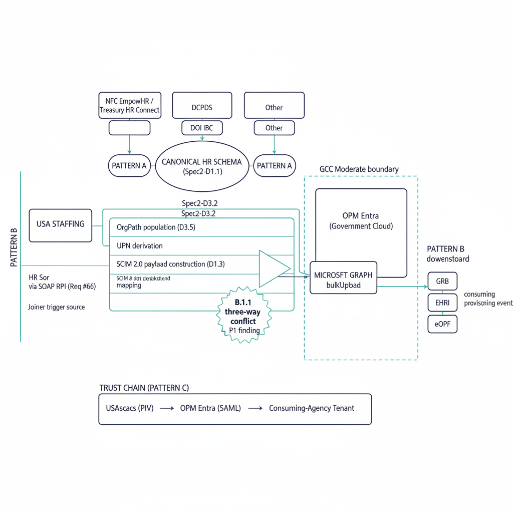

# Federal Civilian OPM HRIT → Entra ID — Reference Deployment Pattern

{#fig-reference-deployment-opm-hrit-to-entra-image-02 fig-alt="HRIT inbound provisioning pipeline. Engineering blueprint style, neutral slate background, federal navy (#1F3A5F) for primary structural elements, teal (#1A9E8F) for secondary/integration elements, amber (#D4A017) for governance/audit/registry overlays, monospace labels for identifiers, no human figures, 16:9 landscape." width="100%"}

{#fig-reference-deployment-opm-hrit-to-entra-image-03 fig-alt="Six-phase deployment with drift findings. Engineering blueprint style, neutral slate background, federal navy (#1F3A5F) for primary structural elements, teal (#1A9E8F) for secondary/integration elements, amber (#D4A017) for governance/audit/registry overlays, monospace labels for identifiers, no human figures, 16:9 landscape." width="100%"}

::: {.callout-important}
## Framing pattern, not a fabricated engagement
This page is the **canonical engagement pattern** for a federal civilian
agency stand-up of the Spec 2 inbound HR provisioning pipeline from an
OPM-platform HR system of record into Microsoft Entra ID Government
Cloud. Specific metrics, agency identifiers, contractor names, and
calendar dates are intentionally absent until real engagement material
is reviewed and externally releasable. The narrative below describes
the **substrate's behavior** against the archetype, not a deployed-
and-attested reference.

Status badge in the family index: **Framing-Pattern** per the
Whitepapers status conventions.

Companion to the
[AD → Entra ID + SQL Estate reference deployment](reference-deployment-fedciv-ad-to-entra.md):
that case study covers the **directory migration** dimension; this one
covers the **inbound provisioning** dimension. Both are required for a
federal-civilian identity plane that is continuously trustworthy from
the HR event through to the Azure SSOT stack.
:::

{#fig-reference-deployment-opm-hrit-to-entra-image-01 fig-alt="Top of frame: HR System of Record (e.g. NFC EmpowHR / Treasury HR Connect / DCPDS / DOI IBC) with a per-source adapter labeled \"Pattern A\" feeding into a \"Canonical HR Schema (Spec2-D1.1)\" box. Below that, a middleware pipeline labeled \"Spec2-D3.2\" with three lanes labeled \"the organizational-attribute model population (D3.5)\", \"UPN derivation\", and \"SCIM 2.0 payload construction (D1.3 mapping)\" converging on a \"Microsoft Graph bulkUpload\" output box that feeds \"OPM Entra (Government Cloud)\". To the left of the SoR, a \"Pattern B\" lane shows USA Staffing -> HR SoR via SOAP RPI (Req #66) as the Joiner trigger source. To the right of the SoR, a \"Pattern B downstream\" lane shows GRB / EHRI / eOPF consuming provisioning events. Across the bottom, a \"Trust Chain (Pattern C)\" rail shows USAccess (PIV) -> OPM Entra (SAML) -> Consuming-Agency Tenant. A dashed \"GCC Moderate boundary\" enclosure groups the middleware + OPM Entra; B.1.1 three-way conflict appears as a small called-out P1 finding. Clean engineering blueprint style, dark navy (#0D1B2E) and teal (#1E8C8C) on white background. No photographs, purely diagrammatic." width="100%"}

## Engagement archetype

The same agency archetype the
[AD reference deployment](reference-deployment-fedciv-ad-to-entra.md)
introduced — a federal civilian agency of approximately fifty thousand
employees and several thousand active contractors — but here from the
HR-source-feeding-Entra-ID angle. The agency's HR system of record is
operated by **NFC EmpowHR** under USDA National Finance Center, per the
common federal-civilian pattern; HR Connect (Treasury), DCPDS (DoD
civilians), and DOI IBC are the other three Pattern A sources the
substrate's Spec2-D6.1 canon supports without modification.

The agency's HR data exchange profile today is recognizable:

- The HR system of record is the Privacy Act system of records under
  the agency's published SORN; the agency is the data steward but does
  not own the data exchange contract — that's NFC's, governed by their
  master interconnection agreement.
- USA Staffing is the upstream hire trigger via Request Processing
  Interconnection (SOAP, per HRIT Solicitation Req #66). New-hire data
  flows USA Staffing → NFC EmpowHR → the substrate.
- GRB Platform (federal benefits), eOPF (long-term personnel-folder
  archive), and EHRI (government-wide HR/payroll warehouse) are
  downstream consumers of provisioning events.
- USAccess is the PIV credential issuance authority under HSPD-12 /
  FIPS 201-3; the substrate's `certificate-anchored: true` invariant
  binds adapter operations to PIV-derived credentials per the program decision.
- OPM Entra is the HRIT-platform federation IdP per the program decision; the
  agency's consuming tenant authenticates via SAML 2.0 to OPM Entra.

The agency's pre-substrate state: a bespoke NFC adapter built for a
prior modernization, no canonical schema enforcement, manual
exception handling for the organizational-attribute model assignment, no continuous drift
detection between NFC EmpowHR and Entra ID, no Evidence Bundle
artifact emitted from the provisioning pipeline. This is the engagement
pattern FMP_136 (Spec 2) is built for, and the substrate's behavior
across the phases below is what this case study illustrates.

For the federal mandate landscape that makes this work necessary, see
the [Federal HRIT Productization whitepaper](../whitepapers/federal-hrit-productization.md).

## Phase 1 — Adapter onboarding (Spec2-D5.4)

The substrate's first action is to make the HR-source adapter explicit
and canon-anchored. The agency's existing bespoke NFC EmpowHR connector
is replaced with a per-source adapter conforming to the
Spec2-D1.1 Canonical HR Attribute Schema:

- The adapter consumes NFC's published change-data feed (SOAP via the
  Personnel Records Interconnection; some agencies receive flat-file
  exports instead — both are Pattern A in Spec2-D6.1 §3.1).
- Records are normalized into the canonical-schema fields
  (`employeeId`, `firstName`, `lastName`, `department`, `division`,
  `organizationCode`, `costCenter`, `hireDate`, `workerType`,
  `locationCode`, `country`, `employmentStatus`, `extracted_at`,
  `adapter_metadata`).
- The adapter is registered in canon under
  [`adapter-registry.yaml`](../../../src/fmp/canon/adapter-registry.yaml)
  with its `class: modernization`, `mission-class: identity`,
  `gcc-boundary: gcc-moderate` declarations.

The adapter onboarding follows
[`Spec2-D5.4`](../../../src/fmp/canon/specs/Spec2-D5.4-HRSystemOnboardingPlaybook.md)
— the canonical playbook every per-source adapter follows. For the
NFC instance, the substrate also runs the PowerShell discovery
generator at `tools/discovery/Spec2-D1.1-Get-HRAttributeSchema.ps1`
against the deployment to confirm attribute presence and surface
any vendor-specific quirks before the adapter goes live.

## Phase 2 — Pre-flight HR record inventory (PR #449)

Before any record flows to OPM Entra, the substrate runs the HRIT
record-inventory pass introduced in PR #449
(`src/fmp/adapters/modernization/hrit/inventory.py`). The pass:

- Reads the canonical-schema-conformant records from the per-source
  adapter
- Tags the inventory with `phase: pre_migration` (or `pre_provisioning`
  for ongoing deployments)
- Resolves each record's the organizational-attribute model via the OrgTree codebook (priority:
  `organization_code` → `division` → `department` → `cost_center` per
  Spec2-D1.3 / D3.5)
- Emits a `DRIFT-IDENTITY` P2 finding (`GOV-HRIT-NNN`) for every record
  that cannot be attributed to a verified organizational position

For this archetype, the agency's first pass surfaces approximately
1,500 records (~3% of the ~50K employees) with unresolved the organizational-attribute model —
a mix of recently-reorganized departments whose codebook entries are
stale, contractor records carrying organizational codes that predate
the agency's most recent OrgTree change, and a residual long tail of
single-record edge cases. Each finding becomes a code-book change-
request through the agency's standard OrgTree governance workflow
before the record flows to the middleware.

## Phase 3 — Middleware integration (Spec2-D3.2)

With the per-source adapter live and the pre-flight inventory clean,
the substrate wires the canonical-schema feed through the Spec2-D3.2
middleware. The middleware:

1. Receives canonical-schema records from the adapter
2. Runs the the organizational-attribute model population pipeline
   (`Spec2-D3.5`)
   to resolve each record's `organization_code` / `division` /
   `department` / `cost_center` to an the organizational-attribute model value
3. Derives the UPN per the agency's UPN-generation rules
4. Constructs the SCIM 2.0 payload using the
   Spec2-D1.3 HR → Entra Attribute Mapping Matrix
   (ISO-3166 alpha-2 `country` → Entra `usageLocation`,
   canonical-schema `displayName` → Entra `displayName`, etc.)
5. Calls Microsoft Graph `bulkUpload` against OPM Entra Government
   Cloud (Spec2-D3.4 §IAM binding)

Every middleware operation is recorded in the substrate's provenance
chain. The `ssot-mutation: never` canon invariant is enforced: the
middleware never writes back to NFC EmpowHR; the HR system remains the
sole Privacy Act system of records.

## Phase 4 — Joiner / Mover / Leaver workflows

Once records are landing in OPM Entra, the substrate's JML workflows
([`Spec2-D2.1`](../../../src/fmp/canon/specs/Spec2-D2.1-JoinerWorkflowSpecification.md)
+ D2.2 Mover + D2.3 Leaver) take over the operational lifecycle:

| Workflow | Trigger | Substrate action |
|---|---|---|
| **Joiner** | New record with `employmentStatus: Active` (often originating in USA Staffing → NFC EmpowHR per Pattern B) | Provision Entra account, set the organizational-attribute model, schedule USAccess appointment, route to manager for welcome |
| **Mover** | Change in `department` / `division` / `organizationCode` / `costCenter` / `managerEmployeeId` | Update the organizational-attribute model, re-evaluate Conditional Access scope, re-evaluate Purview Adaptive Scope membership, log change in provenance chain |
| **Leaver** | `employmentStatus` transitions to `Terminated` or `Rescinded` | Disable Entra account, revoke PIV via USAccess, emit eOPF archival event, route to Recovery Manager for AAL teardown |
| **Conversion** | `workerType` transitions (e.g. Contractor → FullTimeEmployee) | Adjust group memberships, re-evaluate license assignment, recompute the organizational-attribute model if the conversion involves an organizational move |

Each workflow's execution is provenance-chained. The substrate's
`certificate-anchored: true` invariant means every JML transition is
bound to an identity certificate that traces back to PIV via USAccess
per the program decision.

## Phase 5 — Continuous drift detection (Spec2-D5.5)

Once the pipeline is operating, the substrate continuously monitors
for drift between the HR system and Entra ID per
[`Spec2-D5.5`](../../../src/fmp/canon/specs/Spec2-D5.5-ProvisioningDriftDetectionRules.md).
The drift surface maps to the canonical five-class taxonomy in
Doc 16:

| Condition | Drift class | Severity | Detection signal |
|---|---|---|---|
| HR record present in NFC EmpowHR, absent in Entra ID (provisioning gap) | `DRIFT-IDENTITY` | P1 | Set-difference: records in HR feed not in Entra after a provisioning cycle |
| Entra account exists for a Terminated HR record (provisioning lag) | `DRIFT-AUTHZ` | P1 | Same `employeeId`, `employmentStatus: Terminated` in HR vs Active in Entra |
| the organizational-attribute model in Entra diverges from canonical the organizational-attribute model derived from current HR record | `DRIFT-PROVENANCE` | P2 | Same `employeeId`, the organizational-attribute model mismatch with no recorded Mover transition |
| Conditional Access policy state contradicts the AAL recorded for the principal | `DRIFT-AUTHZ` | P2 | Cross-check between Entra CA policy state and COR-recorded AAL |
| Record fails Spec2-D1.1 schema validation mid-pipeline | `DRIFT-SCHEMA` | P2 | Per-record JSON-Schema validator output |

For this archetype, approximately 5–15 P1 conditions surface during
the first month of substrate-governed operation — a mix of stuck
Leaver transitions where the NFC feed had reported termination but
the agency's manual deactivation cadence had lagged, plus a handful
of orphan Entra accounts from a pre-substrate bespoke connector that
the canonical pipeline now identifies as no-longer-mapped. Each P1
halts the dependent provisioning operation until the canonical state
is recoverable.

## Phase 6 — Trust-chain federation (the program decision / the program decision / the program decision)

Federation is the substrate's terminal binding to the OPM HRIT
platform. The full trust chain:

- **USAccess (Pattern C)** terminates PIV credential issuance under
  HSPD-12 / FIPS 201-3. The substrate is a downstream consumer per
  the program decision; PIV issuance itself is the agency's HSPD-12 program's
  responsibility.
- **OPM Entra (Pattern C)** is the HRIT-platform federation IdP. The
  consuming-agency tenant authenticates via SAML 2.0 to OPM Entra per
  the program decision; the substrate records the trust-anchor chain at each
  authentication event.
- **OPM Azure APIM (Pattern C)** mediates programmatic access to
  HRIT-platform services per the program decision. Substrate operations against
  OPM-platform endpoints flow through APIM with PIV-anchored
  credentials.

The full chain is *PIV credential at USAccess → SAML assertion to OPM
Entra → consuming-agency tenant → substrate adapter operation
authenticated by PIV-derived credential*. Every link is canon-anchored
and provenance-recorded.

## The Evidence Bundle the auditor consumes

At any point after Phase 1, the agency can produce an Evidence Bundle
from the substrate's HRIT pipeline artifacts. The bundle includes:

- The per-source adapter manifest (NFC EmpowHR adapter), HMAC-signed
- The phase-tagged HRIT record inventory (`pre_provisioning`
  baseline + ongoing pass-tagged inventories per cadence)
- The the organizational-attribute model codebook state at each inventory pass
- All Joiner / Mover / Leaver workflow events with full provenance
- All drift findings — severity, class, remediation evidence per the
  drift standard §4 remediation contract
- AAL recordings per principal (substrate's NIST SP 800-63 surface
  per A.9 NIST + FICAM Cross-Walk)
- The B.1.1 GCC-Moderate compliance-conflict finding
  (`GCC-BOUNDARY-3WAY-001`) with the agency's HRIT-pipeline
  compensating controls — telemetry routing under GCC-Moderate is the
  same constraint the AD reference deployment surfaces; the HRIT
  pipeline contributes its own compensating-controls catalogue
- Trust-chain attestations: USAccess PIV → OPM Entra SAML → consuming
  tenant, recorded at each provisioning event

This is the artifact the 3PAO consumes during the next FedRAMP cycle.
Like the AD reference deployment's Evidence Bundle, it is produced as
a byproduct of operations rather than assembled retrospectively.

## Complementarity with the AD reference deployment

The two reference deployments share the same archetype agency
deliberately. Read together they describe a complete federal-civilian
identity-plane story:

| Phase | AD reference deployment (PR #402) | HRIT reference deployment (this PR) |
|---|---|---|
| 1 | Discover AD forest + SPN inventory | Onboard HR adapter (D5.4) |
| 2 | Normalize the organizational-attribute model assignment + COR | Pre-flight HRIT record inventory (PR #449) |
| 3 | Map 8 adapter contracts + DM_090 SQL Server | Middleware integration (D3.2) |
| 4 | Migrate with provenance chain | JML workflows (D2.1 / D2.2 / D2.3) |
| 5 | Validate post-migration drift | Continuous drift detection (D5.5) |
| 6 | Azure SSOT bridge (Purview, Fabric Domains, OneLake) | Trust-chain federation (USAccess / OPM Entra / APIM) |
| Evidence | OrgTree-readiness bundle + SPN inventories + B.1.1 compensating controls | HRIT inventory + JML provenance + AAL + B.1.1 compensating controls |

An agency running both substrate dimensions in parallel produces a
single Evidence Bundle that traces from the HR-event in the SoR
through the directory migration into a continuously-verified Entra ID
identity plane.

## What survives the engagement

Per the same cost-shape inversion the AD reference deployment
documents: the canon, the schemas, the JML workflows, the drift
findings, the Evidence Bundle do not belong to whichever system
integrator delivered the onboarding. They belong to the agency. The
next FedRAMP cycle consumes the existing canon; the next NFC EmpowHR
adapter version upgrade plugs into the same canonical schema; the
next agency reorganization triggers Mover workflows against the same
JML pipeline. Re-engagements consume canon; they do not rediscover it.

## Cross-references

- [Federal HRIT Productization whitepaper](../whitepapers/federal-hrit-productization.md) — customer-facing companion to Spec2-D6.1; federal mandate landscape and the 9-system federal HR ecosystem
- [AD → Entra ID + SQL Estate Reference Deployment](reference-deployment-fedciv-ad-to-entra.md) — the directory-migration dimension; shares the agency archetype
- [Federal SSOT Alignment whitepaper](../whitepapers/federal-ssot-alignment.md) — federal mandate alignment over the identity layer
- A.9 NIST + FICAM Cross-Walk — NIST IR 8011, SP 800-157, SP 800-63 series, FICAM v3
- B.1.1 Three-Way GCC-Moderate Compliance Conflict — boundary-side compliance triangle
- Drift Detection Standard — five-class drift taxonomy and §7 Federal SSOT Context
- Spec2-D6.1 Federal HRIT Integration Runbook — canonical operational runbook
- Spec2-D1.1 Canonical HR Attribute Schema — schema the adapter conforms to
- Spec2-D2.1 Joiner Workflow — JML lifecycle
- Spec2-D5.5 Provisioning Drift Detection Rules — drift surface

When real engagement material becomes externally releasable, specific
metrics (provisioning latency, drift-rate decomposition by class and
severity, JML transition success rate, AAL coverage percentage,
trust-chain attestation cadence) replace the prose-level claims above.
Until then this page is the canonical archetype the substrate is built
against and the shape the Evidence Bundle is produced into.
