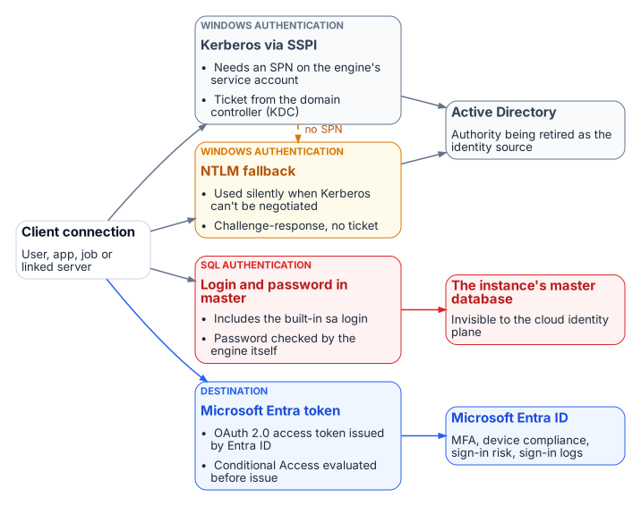

::: {.content-visible when-format="docx"}
# Book_01 — The Authentication Inheritance Problem
:::

::: {.callout-note}
SQL Server's Windows Authentication was an act of good engineering, not negligence. This book makes the case for replacement without making the case that what came before was foolish — a precise account of what Windows Authentication is, why it worked, and why it must now end.
:::

{fig-alt="A client connection authenticates by Kerberos via SSPI, by NTLM fallback when there is no SPN, or by a SQL login and password, all anchored in Active Directory or the instance's master database; only a Microsoft Entra token is anchored in Entra ID."}

::: {.callout-tip}
## Download this book
**[Book_01-bundle.docx](../../../downloads/Book_01-bundle.docx)** — every chapter of this book concatenated into one Word document. Regenerated on every site deploy.
:::

## Chapters

::: {#book-chapters}
:::

## Authoritative references

Checked 19 October 2026.

- [Microsoft Entra authentication for SQL Server overview](https://learn.microsoft.com/en-us/sql/relational-databases/security/authentication-access/azure-ad-authentication-sql-server-overview?view=sql-server-ver17)
- [Microsoft Entra cloud-first identity guidance](https://learn.microsoft.com/en-us/entra/identity/hybrid/guidance-it-architects-source-of-authority)
- [Retiring NTLM: frequently asked questions (Microsoft Tech Community)](https://techcommunity.microsoft.com/blog/windows-itpro-blog/retiring-ntlm-frequently-asked-questions/4550522)
- [OMB M-22-09, Federal Zero Trust Strategy](https://www.whitehouse.gov/wp-content/uploads/2022/01/M-22-09.pdf)
- [Memo 22-09 identity requirements overview](https://learn.microsoft.com/en-us/entra/standards/memo-22-09-meet-identity-requirements)

::: {.callout-tip}
## Continue the series
[← Previous: Applicability](Applicability.md) · [Index](index.md) · [Next: Book 02 — The Estate Itself →](Book_02.md)
:::
