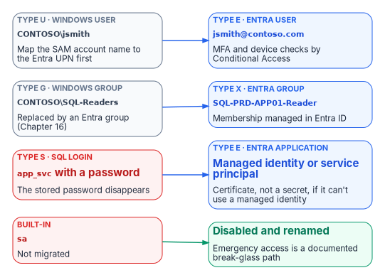

::: {.content-visible when-format="docx"}
# Book_05 — The Login Migration: Windows Principals to Entra Logins
:::

::: {.callout-note}
Everything in Books 01 through 04 is prerequisite; everything in Books 06 through 09 is consequence. This book is the migration itself — performed only on the instances Book 02 classified **retain** or **target**, using the three-phase parallel-run pattern that the SQL Server engine-authentication decision makes normative.
:::

{fig-alt="Type U Windows users map to type E Entra users, type G Windows groups to type X Entra groups, type S SQL logins to Entra applications (a managed identity or service principal), and sa is disabled and renamed rather than migrated."}

::: {.callout-tip}
## Download this book
**[Book_05-bundle.docx](../../../downloads/Book_05-bundle.docx)** — every chapter of this book concatenated into one Word document. Regenerated on every site deploy.
:::

## Chapters

::: {#book-chapters}
:::

## Authoritative references

Checked 19 October 2026.

- [CREATE LOGIN (Transact-SQL)](https://learn.microsoft.com/en-us/sql/t-sql/statements/create-login-transact-sql?view=sql-server-ver17)
- [sys.server_principals (Transact-SQL)](https://learn.microsoft.com/en-us/sql/relational-databases/system-catalog-views/sys-server-principals-transact-sql?view=sql-server-ver17)
- [Disable SQL Authentication — SQL Server enabled by Azure Arc](https://learn.microsoft.com/en-us/sql/sql-server/azure-arc/disable-sql-authentication?view=sql-server-ver17)
- [Change server authentication mode](https://learn.microsoft.com/en-us/sql/database-engine/configure-windows/change-server-authentication-mode?view=sql-server-ver17)
- [What is Conditional Access?](https://learn.microsoft.com/en-us/entra/identity/conditional-access/overview)

::: {.callout-tip}
## Continue the series
[← Previous: Book 04 — Arc as the Identity Bridge](Book_04.md) · [Index](index.md) · [Next: Book 06 — Eliminating NTLM at the SQL Layer →](Book_06.md)
:::
